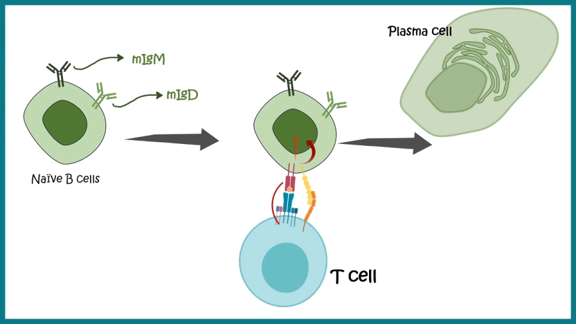
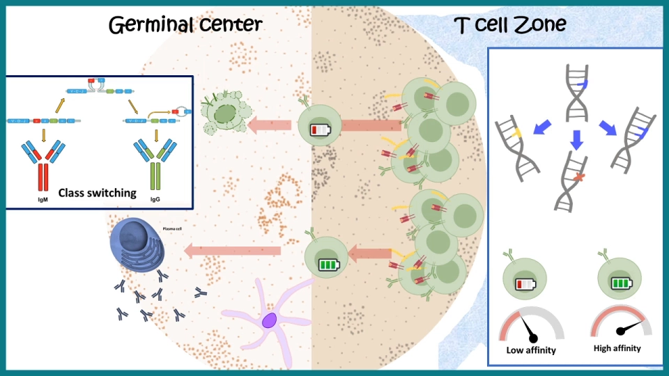
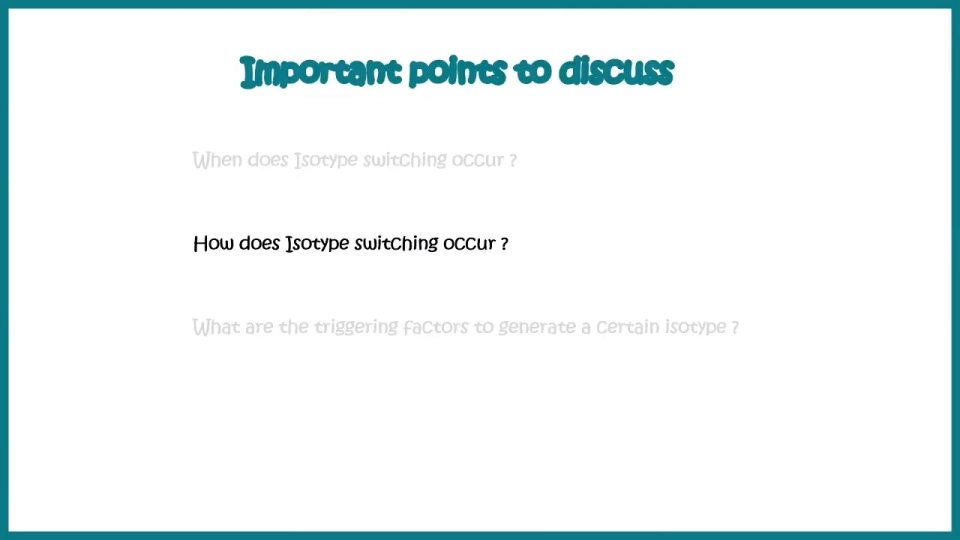
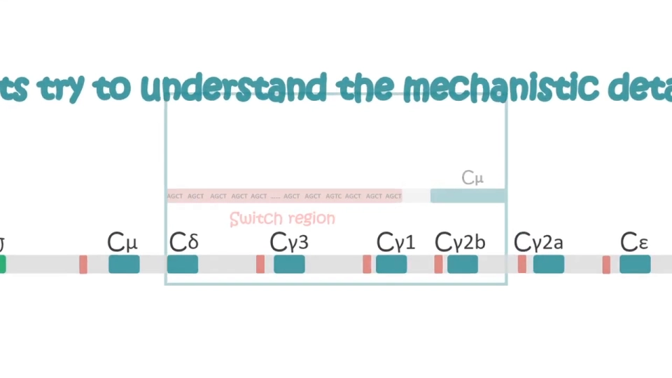
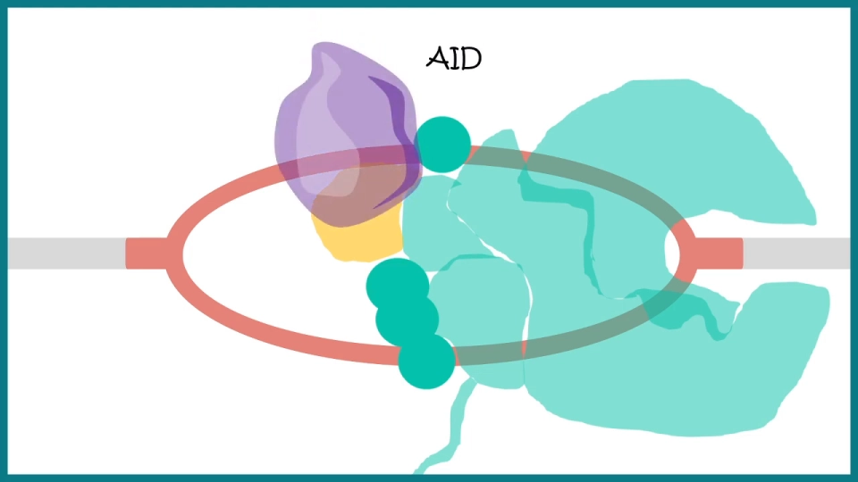
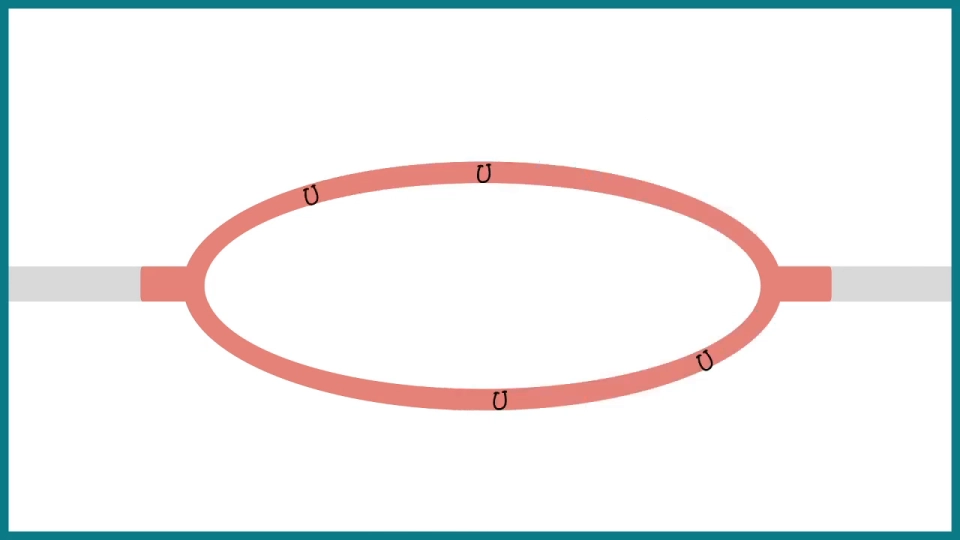
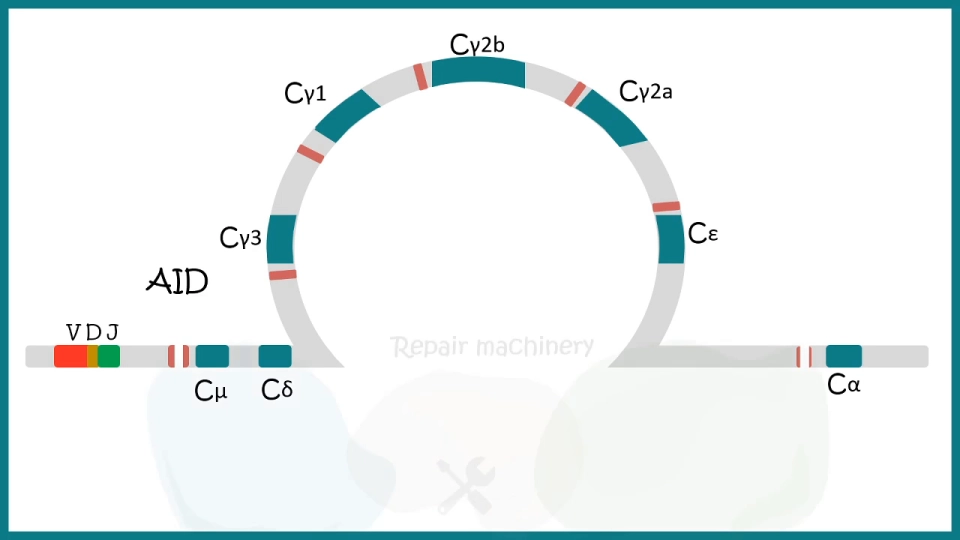
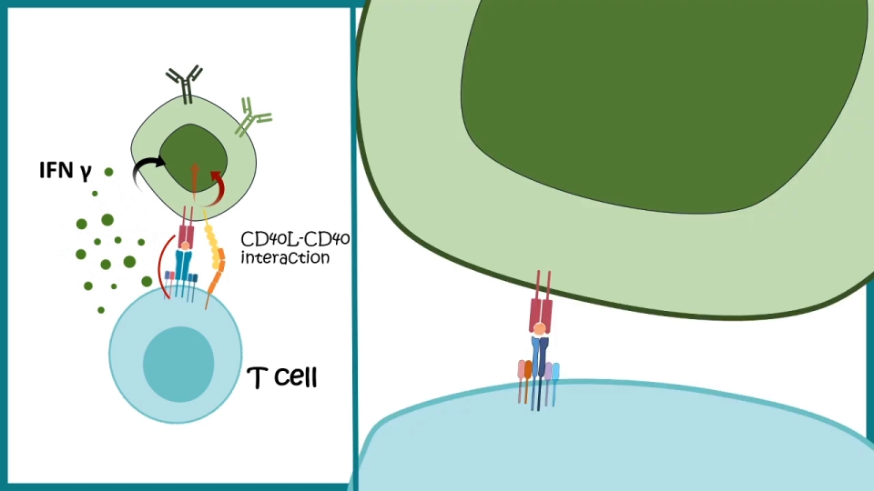
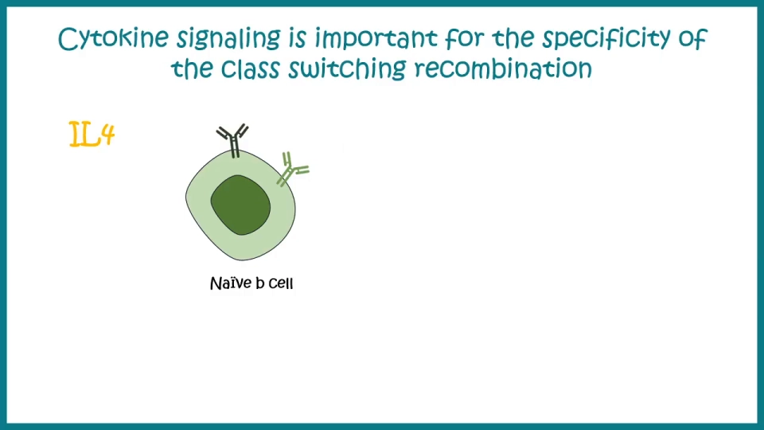
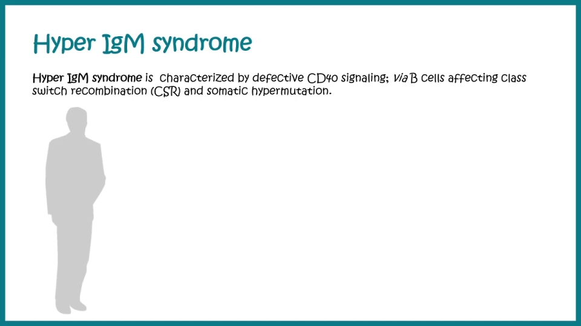

# 抗体类别转换的分子机制：AID 在 S 区下手，细胞因子决定换成哪一类

> 视频来源：[抗体的类别转换/同种型转换](https://www.bilibili.com/video/BV1iL4y1b7gC/)（Bilibili · 东山月光下，译自英文免疫学动画课，时长约 12 分钟）
> 导读：这支视频把"类别转换"拆成四个问题——什么时候发生、在哪里发生、分子上怎么换、换成哪一类由谁决定，最后用高 IgM 综合征收口。本文按这条线索重排，并在末尾把类别转换与体细胞高频突变、抗体人源化三者分开。各类抗体（IgG1–4、IgA、IgM、IgE）本身的结构与效应差异见 3.1.7，本文只讲"怎么换过去"。字幕为机器翻译，术语按画面幻灯片订正。

## 本讲要解决的核心问题（SCQA）

**背景**：初始 B 细胞（naive B cell）表面只挂两种膜结合抗体——IgM 和 IgD。它第一次遇到病原体、被辅助性 T 细胞激活之后，才变成能大量分泌抗体的浆细胞。

**冲突**：可浆细胞分泌的抗体并不只是 IgM。同一支 B 细胞的后代可以分泌 IgG、IgA、IgE——它们的"抗原结合端"完全一样，能对付的病原体却要用不同的方式清除。抗原特异性不能丢，作用方式又必须换。

**疑问**：这个"换"发生在什么时候、什么地方？分子上究竟改动了什么？为什么有时换成 IgG1、有时换成 IgA，是谁在做决定？

**回答（中心思想）**：类别转换（class switching / isotype switching）是一次发生在 DNA 水平、不可逆的重组：B 细胞把重链恒定区基因串中间的一段切掉，让原本的 VDJ 可变区接到另一个恒定区上，于是"识别谁"不变、"怎么打"改变。**什么时候换**取决于 B 细胞是否遇到病原体并被 T 细胞激活；**换成哪一类**取决于 T 细胞给出的 CD40 信号与它分泌的细胞因子——细胞因子把重组精确地导向某一个转换区（S 区）。

## 一、先看清"换"的到底是什么

### 1.1 从膜结合 IgM/IgD 到分泌型 IgG/IgA/IgE

初始 B 细胞表面表达膜结合 IgM 和膜结合 IgD，这是它还没"上过战场"的标志。遇到病原体后，它借助 MHC II 类分子把抗原肽展示在表面，被滤泡辅助性 T 细胞（Tfh）识别；T 细胞给出信号，B 细胞被激活，最终分化成浆细胞。此时浆细胞分泌的抗体就不再是 IgM 和 IgD，而是 IgG、IgA、IgE 这些类别。

[【跳转到 01:27】](https://www.bilibili.com/video/BV1iL4y1b7gC/?t=87)

这里要抓住一个对照：**细胞的抗原特异性没有变，分泌出去的抗体类别变了**。视频反复强调这一点，因为它是后面所有机制讨论的落脚点——如果连"识别谁"都变了，那就不是类别转换，而是另一个克隆的故事了。

### 1.2 三条硬约束：必须先遇病原体、不可逆、发生在 DNA 上

视频先把三条性质摆出来，它们决定了后面机制的形状：

1. **前提是与病原体相遇**。没有病原体，B 细胞不会被激活，同型转换也就不会发生。
2. **不可逆**。一旦 B 细胞变成浆细胞、开始分泌 IgG，它在自己的生命周期里就再也不能产生 IgM 了。这个过程完成之后无法逆转。
3. **发生在 DNA 水平**。同型转换涉及重组事件，DNA 的某些部分被真实地改变——不是把 mRNA 换个剪法，而是把基因本身剪掉一段。

第 3 条是理解全篇的钥匙：正因为改动发生在 DNA 上、并且被切掉的那段序列不会回来，类别转换才天然不可逆。这和第 3.1.4、3.1.5 讲的体细胞高频突变（点突变，可变区）在"改什么、可不可逆"上是两回事，后文第五节会专门对照。

## 二、什么时候、在哪里发生

### 2.1 时间线：骨髓 → 血液 → 淋巴结

视频给出的空间线索很干脆：

- B 细胞在**骨髓**中由共同淋巴样祖细胞发育而来，以不成熟的形式释放进血液；
- 追踪血液中的 B 细胞，它最终迁移到**淋巴结**；
- 在淋巴结内部，它呈递抗原、与 T 细胞相互作用，被激活；
- 激活后先**增殖**，随后依次发生体细胞高频突变（选出高亲和力克隆）与**类别转换**。

所以类别转换的地点是淋巴结，触发条件是"B 细胞遇到病原体并被 T 细胞激活"。视频用一句话总结：时空两方面都很清楚——**淋巴结里、遇到病原体时**。

[【跳转到 05:02】](https://www.bilibili.com/video/BV1iL4y1b7gC/?t=302)

### 2.2 先突变还是先转换？顺序并不固定

视频把"体细胞高频突变"和"类别转换"排成先后两步来讲，但要注意它只是一种叙述顺序。在真实的生发中心反应里，两者都在增殖的 B 细胞中进行，谁先谁后并没有一条铁律；真正固定的是**方向**：类别转换只能从上游的 IgM/IgD 往下游走，走完就回不去。

## 三、分子机制：S 区、AID、UNG 与一次"剪切—粘贴"

### 3.1 14 号染色体上的重链恒定区基因串

在 14 号染色体上可以找到抗体的重链基因。它由两部分组成：一端是已经重排好的 **VDJ 可变区**，另一端是一长串**恒定区基因**，按 $C_\mu$、$C_\delta$、$C_{\gamma 3}$、$C_{\gamma 1}$、$C_{\gamma 2b}$、$C_{\gamma 2a}$、$C_\varepsilon$、$C_\alpha$ 的顺序排列。

[【跳转到 05:23】](https://www.bilibili.com/video/BV1iL4y1b7gC/?t=323)

关键点在于**顺序即命运**：恒定区基因是按固定次序排好的，所以类别转换不是"随便挑一个恒定区接上去"，而是在这条串上做一次**缺失**——把 VDJ 与目标恒定区之间的所有序列切掉，让 VDJ 直接落在目标恒定区前面。换成 IgG1，就是把 $C_\mu$ 到 $C_{\gamma 1}$ 之前的那一段全部丢掉。

### 3.2 S 区：重组的靶点

每个恒定区基因前面都有一段**转换区（switch region，S 区）**，它们是重组事件的靶点。S 区由四个独特的重复序列构成，并且这样的重复有几百个——也就是说，它是一段高度重复、容易被"动手"的序列。

[【跳转到 06:52】](https://www.bilibili.com/video/BV1iL4y1b7gC/?t=412)

为什么需要这么长的重复序列？可以这样理解：重组的本质是**在两个 S 区上各制造一个双链断裂，再把断端接起来**。靶点越长、重复越多，两个断裂点相遇并正确连接的机会就越大——这是一种"用冗余换效率"的设计。

### 3.3 AID：把胞嘧啶变成尿嘧啶

真正"下手"的酶叫**活化诱导的胞苷脱氨酶（activation-induced cytidine deaminase，AID）**。它的动作可以拆成三步：

1. **转录先发生**。RNA 聚合酶正在 S 区上转录，DNA 双链被局部打开——这给 AID 提供了单链底物。
2. **AID 扫描并脱氨**。AID 扫描这个区域，把其中几个胞嘧啶（C）脱氨，变成尿嘧啶（U）。
3. **DNA 里本来不该有 U**。尿嘧啶是 RNA 的碱基，出现在 DNA 上就是一个明确的"错误标记"。

[【跳转到 07:21】](https://www.bilibili.com/video/BV1iL4y1b7gC/?t=441)

这一步是整条通路里最值得记住的：**AID 并不直接切 DNA，它只是把 C 改成了 U**。真正的断裂是接下来的修复系统"处理错误"时造成的。这也是 AID 同时负责体细胞高频突变与类别转换的原因——同一个"改写碱基"的动作，落在可变区就是点突变，落在 S 区就是断裂与重组（对照 3.1.4）。

### 3.4 UNG 与双链断裂

尿嘧啶 DNA 糖苷酶（uracil DNA glycosylase，UNG）负责识别并切除这些 U。切除碱基会在 DNA 上留下一个缺口（无碱基位点），当两个 S 区上同时出现这样的损伤并被进一步加工时，就形成了**双链断裂**。

[【跳转到 07:30】](https://www.bilibili.com/video/BV1iL4y1b7gC/?t=450)

### 3.5 修复机器把断端接起来，中间那一段被丢掉

DNA 修复机器识别出双链断裂，并尝试把断端连接起来。连接的结果是：**中间的序列被删除**，两侧的序列被拼在一起，于是形成一个"VDJ 可变区 + 新恒定区"的组合。被切掉的那一段最终会被降解掉。

[【跳转到 07:55】](https://www.bilibili.com/video/BV1iL4y1b7gC/?t=475)

用一条式子概括这次重组：

$$
V(D)J\text{—}C_\mu \;\longrightarrow\; V(D)J\text{—}C_\gamma
$$

左边是初始状态（VDJ 接在 $C_\mu$ 上，即 IgM），右边是转换之后（VDJ 直接接在 $C_\gamma$ 上，即 IgG）。中间被删掉的那一大段，就是"不可逆"的物理证据：它已经不在染色体上了，细胞没有原件可以退回。

从拼接好的这个区域开始，会转录出 mRNA，最终翻译成抗体。至此，"换成哪一类"在分子上就等价于"VDJ 接在了哪个恒定区前面"。

## 四、换成哪一类：CD40 信号 + 细胞因子指令

### 4.1 两个必需的信号

B 细胞与 T 细胞之间要考虑两种相互作用：

1. **CD40 配体（CD40L）与 CD40 的结合**——接触信号；
2. **T 细胞分泌的细胞因子**——可溶性信号。

### 4.2 细胞因子把重组导向某一个 S 区

以干扰素 γ（IFN-γ）为例，视频把通路走了一遍：CD40 与 CD40L 结合后激活 NF-κB 通路；同时 IFN-γ 通过 IFN-γ 受体被接收，生成 STAT1。**STAT1 与 NF-κB 选择性地结合到 $C_{\gamma 2a}$ 上游的 S 区**，于是重组只在这个位置被触发，而不会在别的随机位置发生。

[【跳转到 08:54】](https://www.bilibili.com/video/BV1iL4y1b7gC/?t=534)

这张图解释了本节的第二个核心结论：**AID 提供"能切"的能力，细胞因子提供"切哪里"的地址**。没有细胞因子信号，AID 照样能把 C 变成 U，但重组不会定向到某个特定 S 区；有了细胞因子，转录因子把 S 区"标记"出来，转换才具有选择性。

### 4.3 体外实验里的对应关系

视频给出了体外（in vitro）实验中"加什么细胞因子、出什么同型"的对应：

| 加入的细胞因子 | 主要产生的同型 |
| --- | --- |
| IL-4 | IgG1 或 IgE |
| TGF-β | IgG2b |
| IL-5 | IgA |
| IFN-γ | IgG2a 或 IgG3 |

[【跳转到 09:51】](https://www.bilibili.com/video/BV1iL4y1b7gC/?t=591)

这张表要按"指令"来读，而不是按"结果"来背：它说明的是**细胞因子信号对类别转换重组具有导向作用**，改变细胞因子就能改变产物。至于每一种同型最终在体内承担什么效应功能（补体、Fc 受体、跨黏膜运输等），属于 3.1.7 的内容，这里不展开。

### 4.4 高 IgM 综合征：缺了 CD40L 会怎样

类别转换的重要性有一个很干净的临床证据：**高 IgM 综合征（hyper-IgM syndrome）**。这类病人的 CD40L–CD40 相互作用有缺陷，信号传不下去，于是类别转换重组被废除。他们只能产生 IgM 这一种亚型，产生不了任何其他类型的抗体，因此免疫系统受损，容易受到多种感染。

[【跳转到 10:41】](https://www.bilibili.com/video/BV1iL4y1b7gC/?t=641)

这个病例同时说明了两件事：一是**类别转换不是可选项**——要对抗多种感染，需要多种抗体同型协同；二是 CD40 信号处在 AID 的上游，它一断，下游的转换与突变就一起停摆。

## 五、三个容易混淆的概念

初学者最常见的混淆，是把"类别转换""体细胞高频突变""人源化改造"都笼统地当成"抗体被改造了"。它们的改动对象、发生场所和可逆性完全不同。

### 5.1 类别转换 vs 体细胞高频突变

| 对比项 | 类别转换 | 体细胞高频突变 |
| --- | --- | --- |
| 改哪里 | 重链**恒定区**（C 区） | 重排后的**可变区**（V 区）基因 |
| 改什么 | DNA 缺失 + 重接，整段换掉 | 单个碱基的点突变，逐个累积 |
| 结果 | 抗原特异性不变，抗体类别与效应方式改变 | 抗原特异性可能变强（亲和力提高） |
| 关键酶 | AID（作用于 S 区） | AID（作用于 V 区） |
| 可逆性 | 不可逆，切掉的序列不再回来 | 突变本身不可逆，但克隆可继续累积 |

两者的共同起点是 AID，分岔点是**AID 落在哪段序列上**：落在 S 区导致断裂与重组，落在 V 区导致点突变。亲和成熟如何在生发中心里被筛选出来，见 3.1.5；AID 与克隆谱系的细节见 3.1.4。

### 5.2 类别转换 vs 人源化改造（本文范围之外）

抗体工程里常说的"人源化"是另一件事：它是**人为改造抗体序列**，目的是降低免疫原性，属于后续抗体工程章节的内容（见 4.x），本文不展开。这里只需建立一个边界感：

- **类别转换**是 B 细胞在体内、通过 DNA 重组**更换恒定区**，天然发生、不可逆；
- **人源化**是在体外对抗体序列做设计性修改，改的是序列来源与框架，不改变"这支抗体属于哪一类"。

把这两件事混在一起，就会得出"人源化等于换类别"这种错误结论。判断方法很简单：问一句"改动发生在体内还是体外、改的是恒定区还是序列来源"。

## 小结

- **类别转换 = 换恒定区，不换可变区**。VDJ 不动，所以"识别谁"不变；恒定区换了，所以"怎么打"改变。
- **三条硬约束**：必须先遇到病原体并被 T 细胞激活；一旦完成不可逆；改动发生在 DNA 水平（整段缺失，不是剪接）。
- **发生地点与时机**：淋巴结内，B 细胞激活、增殖之后；与体细胞高频突变同在生发中心反应中进行。
- **分子机制四步**：S 区提供靶点 → AID 把 C 脱氨成 U → UNG 切除 U 造成双链断裂 → 修复机器接合断端、中间序列成环被丢弃。
- **选择性来自细胞因子**：CD40L–CD40 给"许可"，细胞因子经 STAT/NF-κB 把重组定向到特定 S 区；IL-4→IgG1/IgE、TGF-β→IgG2b、IL-5→IgA、IFN-γ→IgG2a/IgG3（体外）。
- **临床证据**：高 IgM 综合征因 CD40L 缺陷导致类别转换废除，只能产 IgM。
- **别混淆**：类别转换改 C 区（DNA 缺失）、体细胞高频突变改 V 区（点突变）、人源化是体外序列改造。

## 关键术语速查

| 术语 | 一句话解释 |
| --- | --- |
| 类别转换 / 同型转换（class switching / isotype switching） | B 细胞把重链恒定区换成另一类，抗原特异性不变而效应方式改变 |
| 同型（isotype） | 由重链恒定区决定的抗体类别，如 IgM、IgG、IgA、IgE |
| 转换区（S 区，switch region） | 每个恒定区基因上游的重复序列，是类别转换重组的靶点 |
| AID（活化诱导胞苷脱氨酶） | 把 DNA 上的胞嘧啶脱氨为尿嘧啶的酶，是转换与高频突变的共同起点 |
| UNG（尿嘧啶 DNA 糖苷酶） | 切除 DNA 中尿嘧啶的酶，其产物进一步加工成双链断裂 |
| 双链断裂（DSB） | 两个 S 区被切开形成的断端，由修复机器接合 |
| CD40L–CD40 | T 细胞与 B 细胞之间的接触信号，缺失即导致高 IgM 综合征 |
| 高 IgM 综合征 | CD40 信号缺陷导致类别转换（及高频突变）受损、只能产 IgM 的免疫缺陷 |
| 浆细胞 | 分泌抗体的终末分化 B 细胞，其抗体类别已由类别转换固定 |