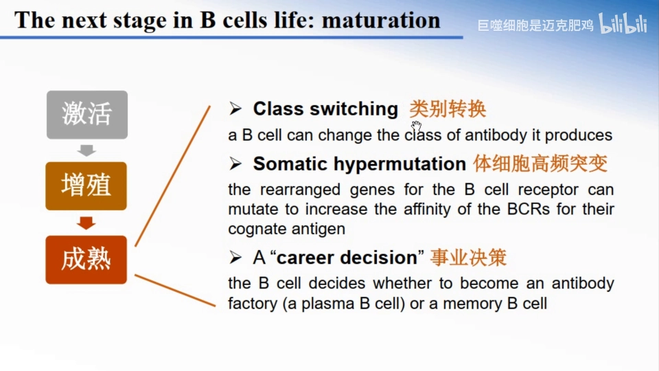
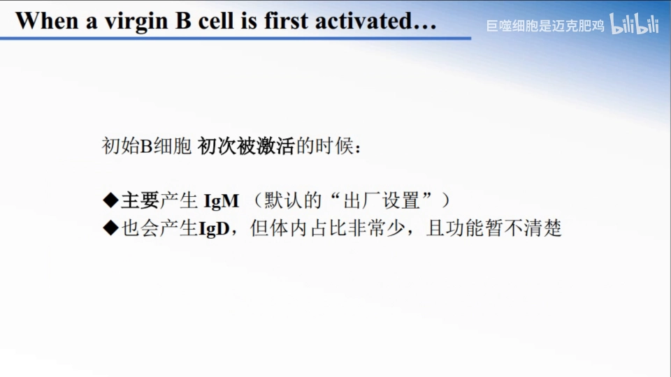
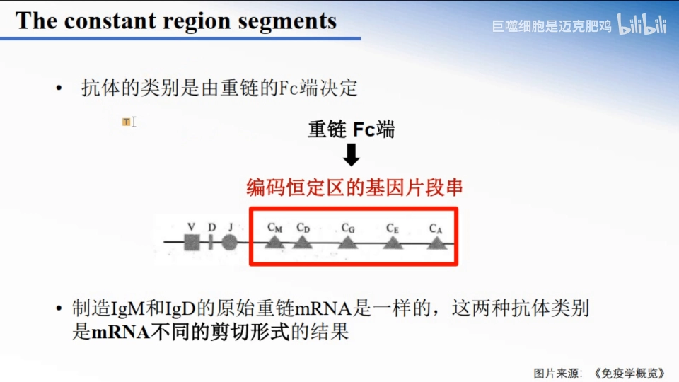
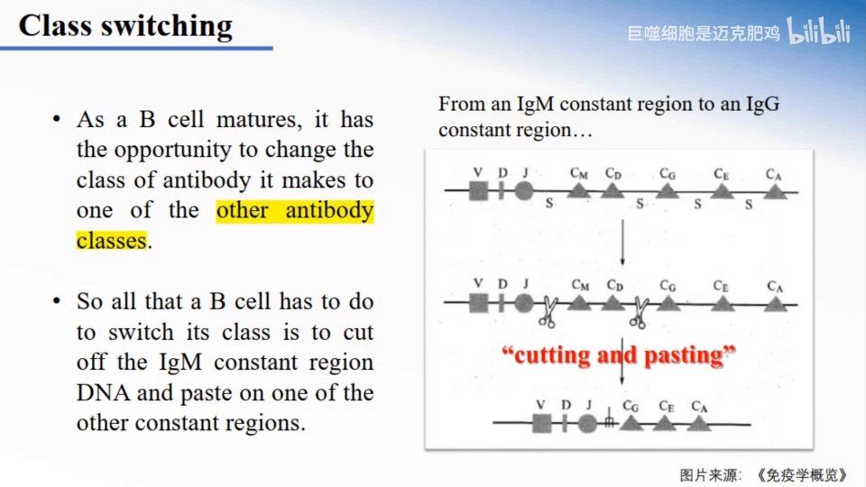
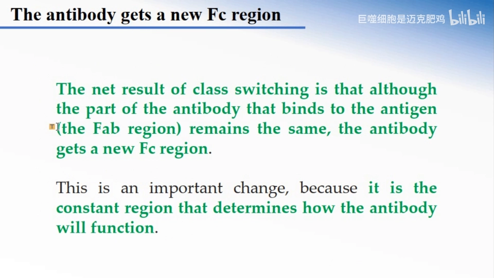

# 类别转换改的是 Fc 端：B 细胞成熟里的一次"剪切粘贴"

> 视频来源：[第三章 B细胞和抗体 (4)抗体的类别转换](https://www.bilibili.com/video/BV1ST411d7Qm/)（Bilibili · 巨噬细胞是迈克肥鸡，讲《How the Immune System Works》第三章，时长约 3.5 分钟）
> 导读：这支短视频不讲酶和通路，只把类别转换放回"B 细胞成熟"的整体框架里，回答一个更朴素的问题——转换前后，抗体到底哪里变了、哪里没变。适合作为机制细节（见同小节另一篇《抗体类别转换的分子机制：AID、S 区与细胞因子的分工》）的前置地图。幻灯片出自《免疫学概览》。

## 本讲要解决的核心问题（SCQA）

**背景**：抗体有多种类型，IgG、IgM 等等。B 细胞被激活、增殖之后，还要经历一个"成熟"阶段，才最终决定自己分泌什么。

**冲突**：成熟阶段里同时发生好几件事——类别转换、体细胞高频突变、以及"成为浆细胞还是记忆细胞"的事业决策。它们常被混为一谈，也常被误认为有固定先后。

**疑问**：类别转换在这套流程里处于什么位置？它在分子上究竟改动了抗体的哪一部分？

**回答（中心思想）**：类别转换只是成熟三步中的一步，而且三步的顺序可以不同、也可以跳过。它做的事非常具体：把染色体上编码恒定区的基因片段"剪掉一段、粘上一段"，让抗体**保留原来的 Fab（抗原结合端）、换上一个新的 Fc（恒定区）**。因为恒定区决定抗体如何发挥功能，所以这一步换掉的是"作用方式"，不是"识别对象"。

## 一、先定位：成熟是激活、增殖之后的第三步

视频把 B 细胞的经历压成三个方框：**激活 → 增殖 → 成熟**。[【跳转到 00:18】](https://www.bilibili.com/video/BV1ST411d7Qm/?t=18)前两步的前提是"特定的 B 细胞只有在被需要的时候才会被激活、增殖、加入战争"；一旦激活并增殖到一定数量，它们才进入成熟。

[【跳转到 00:43】](https://www.bilibili.com/video/BV1ST411d7Qm/?t=43)

成熟阶段包含三件事：

1. **类别转换（class switching）**：B 细胞改变它所产生抗体的类别。
2. **体细胞高频突变（somatic hypermutation）**：已经重排好的 BCR 基因发生突变，提高 BCR 对抗原的亲和性。
3. **事业决策（career decision）**：B 细胞决定自己成为一个抗体工厂（浆细胞 B 细胞），还是成为一个记忆 B 细胞。

这张幻灯片最值得记住的其实是它的排版：三件事并列，而不是串成一条流水线。讲者紧接着强调——**这些成熟步骤的先后顺序可以不一样，也可以跳过其中的某一些步骤**。所以"先转换、再突变"只是一种讲法，不是定律；真正需要记住的是每一步各自改了什么。[【跳转到 01:08】](https://www.bilibili.com/video/BV1ST411d7Qm/?t=68)

## 二、出厂设置：默认先产 IgM（和少量 IgD）

初始 B 细胞第一次被激活时，产生的主要是 IgM。[【跳转到 00:08】](https://www.bilibili.com/video/BV1ST411d7Qm/?t=8)视频用了一个很形象的词：这是 B 细胞的**"出厂设置"**。

[【跳转到 01:21】](https://www.bilibili.com/video/BV1ST411d7Qm/?t=81)

这时的 B 细胞也会产生 IgD，但 IgD 在体内占比非常少，而且功能暂时还不清楚。这一点对初学者很重要：**IgM 和 IgD 都是"还没转换过"的标志**，它们出现在同一支初始 B 细胞表面，并不代表这支细胞已经做过了两次类别转换。

## 三、类别由 Fc 端决定，而 Fc 端由一串基因片段编码

接下来是本节的结构基础。视频先给结论：**抗体的类别是由重链的 Fc 端决定的**。然后指出这些 Fc 端是从哪来的——就在 J 基因旁边，有一串编码各种恒定区的基因片段。

[【跳转到 01:46】](https://www.bilibili.com/video/BV1ST411d7Qm/?t=106)

幻灯片上画的是 $V$–$D$–$J$ 之后依次排列的 $C_\mu$、$C_\delta$、$C_\gamma$、$C_\varepsilon$、$C_\alpha$——分别对应 IgM、IgD、IgG、IgE、IgA 的恒定区。**默认情况下，IgM 和 IgD 的恒定区被用作最初的 BCR，原因很朴素：它们排在前面。**

这里还藏着一个容易忽略的细节：制造 IgM 和 IgD 的初始重链 mRNA 是**同一条**。之所以最终能造出两种不同的抗体类别，是 **mRNA 不同剪接形式**的结果。

这一句把"两种改变类别的方式"区分开了：[【跳转到 02:11】](https://www.bilibili.com/video/BV1ST411d7Qm/?t=131)

- **IgM ↔ IgD**：DNA 不动，只换 mRNA 剪接方式；
- **IgM → IgG/IgE/IgA**：DNA 真的被切掉一段，属于不可逆的类别转换。

所以严格说，IgM 与 IgD 之间的"切换"并不是类别转换的典型例子。真正的类别转换要从 IgM 往下游的 $C_\gamma$、$C_\varepsilon$、$C_\alpha$ 走。

## 四、机制：切掉中间不要的 DNA，把目标片段拼到前面

在 B 细胞成熟过程中，它有机会把抗体从"出厂设置"的类型改成其他类别，比如 IgG、IgG1 或 IgA。[【跳转到 02:19】](https://www.bilibili.com/video/BV1ST411d7Qm/?t=139)做法只有一句话：编码 IgM 恒定区的基因片段旁边，就是编码 IgG、IgE 和 IgA 恒定区的片段，**所以 B 细胞要做的就是把染色体中间不要的那段 DNA 切掉**。

[【跳转到 02:44】](https://www.bilibili.com/video/BV1ST411d7Qm/?t=164)

以 IgM → IgG 为例，染色体是这样干的：把中间这一段丢掉，再把 $C_\gamma$ 拼接到前面。幻灯片上用剪刀和"cutting and pasting"标注了这个动作，非常贴切——**这是一次物理上的删除与连接，不是改写，也不是复制**。

这里可以顺手把两篇内容接起来：被切掉的那段并不是凭空消失，它会形成一个环状片段被丢出染色体；而"在哪里下剪刀"由 S 区（转换区）决定，剪刀本身是 AID 与 UNG 合作造成的双链断裂。这些细节见同小节的另一篇博客。

## 五、净结果：Fab 不变，Fc 换新，功能随之改变

视频用一张幻灯片收尾，也是全篇最重要的一句：

[【跳转到 03:06】](https://www.bilibili.com/video/BV1ST411d7Qm/?t=186)

- 抗体上**结合抗原的那一部分（Fab 端）保持不变**；
- 抗体**获得了一个新的 Fc 端**；
- 这是一个非常重要的改变，因为**正是恒定区决定了抗体会怎样发挥功能**。

把这三句连起来,就是类别转换的完整定义:**同一支抗体、同一个靶点,换一套"执行方式"**。识别对象不变，意味着这支 B 细胞克隆辛苦选出来的特异性没有被浪费；执行方式改变，意味着免疫系统可以用同一种“识别”去配合不同的清除手段。

至于每一种类别具体怎么发挥功能、IgG 各亚类之间又差在哪里，视频明确留给了下一讲[【跳转到 03:28】](https://www.bilibili.com/video/BV1ST411d7Qm/?t=208)——也就是本系列的 3.1.7《免疫球蛋白类别与亚类》。

## 小结

- **位置**：成熟是"激活 → 增殖 → 成熟"的第三步；成熟内部包含类别转换、体细胞高频突变、事业决策三件事，顺序可变、可以跳过。
- **起点**：初始 B 细胞初次激活时主要产 IgM，这是"出厂设置"；同时产少量 IgD，功能尚不清楚。
- **结构基础**：抗体类别由重链 Fc 端决定，Fc 端由 J 基因旁边那串恒定区基因片段编码。
- **两种"换类别"要分清**：IgM 与 IgD 共用一条初始重链 mRNA，靠不同剪接产生；IgM → IgG/IgE/IgA 才是切 DNA 的类别转换。
- **机制一句话**：切掉中间不要的 DNA，把目标恒定区片段拼到 VDJ 后面。
- **净结果**：Fab 不变、Fc 换新；因为恒定区决定功能，所以换的是作用方式而不是识别对象。

## 关键术语速查

| 术语 | 一句话解释 |
| --- | --- |
| 类别转换（class switching） | B 细胞改变所产抗体类别，做法是切掉并重接重链恒定区基因 |
| 出厂设置 | 初始 B 细胞默认产生的抗体类别，即 IgM（以及少量 IgD） |
| 恒定区基因片段 | 位于 J 基因下游的一串基因片段，决定抗体属于哪一类 |
| 可变剪接 | 同一条初始重链 mRNA 通过不同剪接产生 IgM 与 IgD |
| Fab 端 | 抗体结合抗原的部分，类别转换后保持不变 |
| Fc 端 | 由重链恒定区构成的部分，类别转换后被替换，决定抗体功能 |
| 事业决策（career decision） | B 细胞选择成为抗体工厂（浆细胞）还是记忆 B 细胞 |