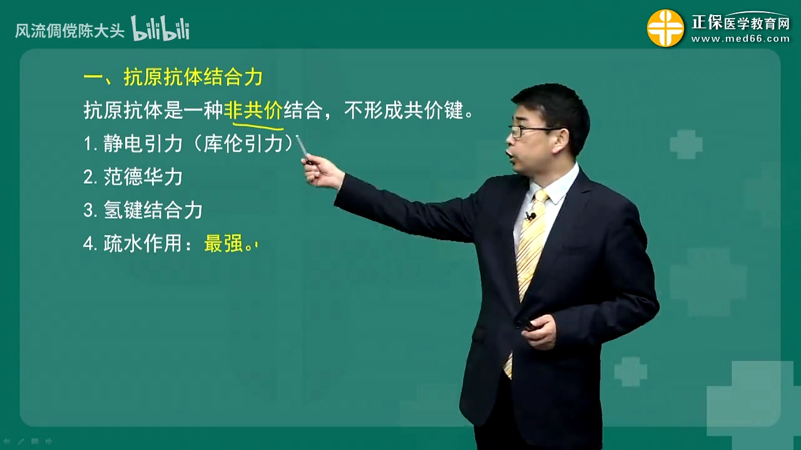
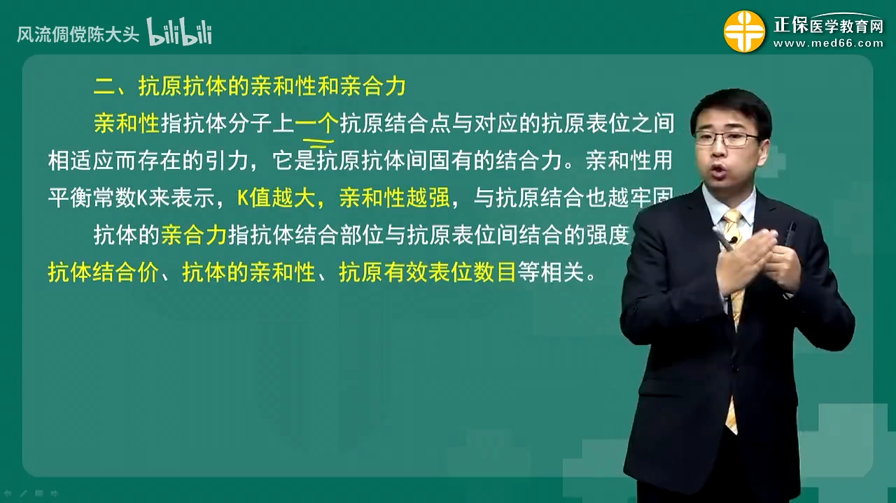
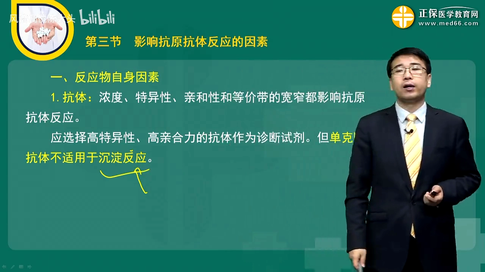
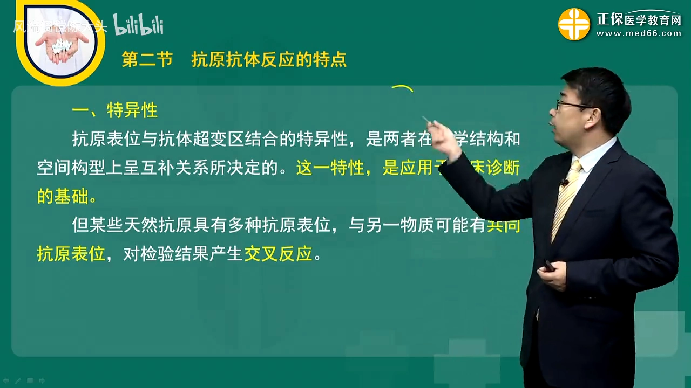
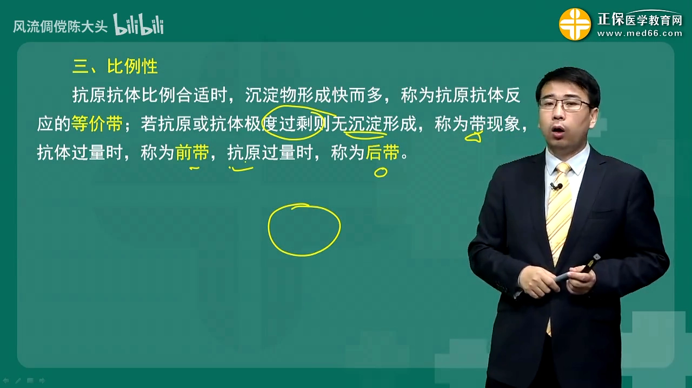
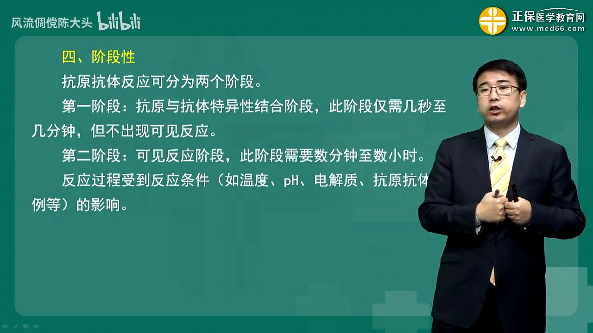
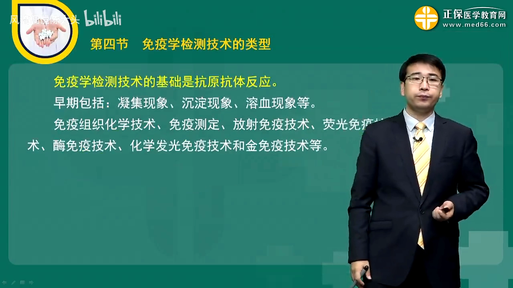

# 亲和性、亲合力与交叉反应：抗原抗体结合的强度、可逆与误判

> 视频来源：[【0201】第 01 讲 抗原抗体反应](https://www.bilibili.com/video/BV1fY9JY8Euz/)（Bilibili · 正保医学教育网课程，UP 主：风流倜傥陈大头，时长约 23 分钟）
> 导读：这是一节按考试大纲组织的医学免疫学课，讲法偏"概念 + 读图 + 记忆口诀"。本文只取与本小节相关的部分：结合力的来源、亲和性与亲合力的区别、交叉反应的机制、可逆性、比例性与阶段性，以及它们如何决定"看得见 / 看不见"的实验现象。kon、koff 与 KD 的动力学写法、SPR 与流式的读数差异，见同目录另一篇《抗体亲和力不是越高越好：avidity、读数与功能取舍》。

## 本讲要解决的核心问题（SCQA）

**背景**：抗体的看家本领是"特异性"——抗原表位与抗体超变区在空间结构上互补，像一把钥匙开一把锁。临床上正是靠这一点，用已知抗体去测未知抗原，或用已知抗原去测未知抗体。

**冲突**：可是同一支抗体，有时会和"另一种"抗原结合；同一个抗体分子，单独一个结合位点的强度，和整个分子抓住抗原的牢固程度，也不是一回事。更麻烦的是，抗体加得越多，沉淀反而可能消失。

**疑问**：一个结合位点的强度、整个抗体的结合强度、以及"结合错了对象"，这三件事该怎么分开描述？

**回答（中心思想）**：抗原抗体结合要先分清三个层次——**亲和性（affinity）**描述"一个结合位点对一个表位"的固有引力，用平衡常数表示；**亲合力（avidity）**描述"整个抗体分子"抓住抗原的强度，它由亲和性、结合价和有效表位数目共同决定；**交叉反应**则是不同抗原携带了结构相似的共同表位，让同一支抗体"认错门牌"，它不是特异性失效，而是特异性落在了共有的那一段结构上。三者之上，还有可逆性、比例性与阶段性三个"现象层"的规则，决定了结合能不能变成肉眼可见的结果。

## 一、结合力从哪来：四种非共价力，因此必然可逆

抗原和抗体能结合，前提是两件事同时成立：**空间构型高度互补**，以及**能够紧密接触**——只有接触足够紧密，才有足够的结合力。

[【跳转到 01:59】](https://www.bilibili.com/video/BV1fY9JY8Euz/?t=119)

这种结合力**不是共价键**，而是四种非共价作用力的叠加：

[【跳转到 02:28】](https://www.bilibili.com/video/BV1fY9JY8Euz/?t=148)

1. **静电引力（库仑引力）**：带相反电荷的基团相互吸引；
2. **范德华力**：靠得很近时分子间的弱吸引；
3. **氢键**：供氢基团与受氢基团之间的定向作用；
4. **疏水作用**：**最强**的一项，来自把水"挤开"、让非极性表面彼此贴合的趋势。

[【跳转到 02:57】](https://www.bilibili.com/video/BV1fY9JY8Euz/?t=177)

这里有一个容易被忽略的推论：**因为是非共价结合，所以结合天然可逆**。讲者反复强调"能够结合也能够解离"，正是为了后面讲可逆性、讲亲和层析做铺垫。换句话说，抗体与抗原之间不是"焊死"的关系，而是一个不断结合、不断解离的动态平衡——这也是为什么后面所有强度指标都要用"平衡常数"来表述。

## 二、亲和性与亲合力：一个位点的强度，与整个分子的强度

这是本讲最需要分清的一对概念。

**亲和性（affinity）**：指抗体分子上**一个**抗原结合位点，与对应的**一个**抗原表位之间相适应而存在的引力。它是抗原抗体之间"固有的结合力"，用平衡常数 $K$ 表示，$K$ 值越大，亲和性越强，与抗原结合也越牢固。

**亲合力（avidity）**：指抗体结合部位与抗原表位之间的**结合强度**，它与三个量相关——**抗体的结合价**、**抗体的亲和性**、**抗原有效表位的数目**。

[【跳转到 03:50】](https://www.bilibili.com/video/BV1fY9JY8Euz/?t=230)

用一个类比来记：亲和性是"一只手能握多紧"，亲合力是"这个人一共能抓住多少东西"。一只手握得再紧，也只有一只手；反过来，手多但每只手都很松，整体也未必抓得牢。所以**亲合力不是亲和性的同义词，而是它的"放大或打折"**：结合价越高、可及的有效表位越密，整体强度就越可能远超单个位点的强度。

这里要注意符号的方向。讲者用的是"$K$ 越大越强"的写法，即结合常数 $Ka$；如果换成解离常数 $KD$，方向正好相反——$KD$ 越小表示亲和力越高。两种写法在文献里都常见，读数值时先看清是哪一个，否则会把"高亲和力"读成"低亲和力"。

亲合力还有一个直接可见的后果：**单价抗原不会出现沉淀**。讲者给出的理由是：单价抗原只有一个位点，彼此交联比较小，无法形成大的复合物；沉淀的前提是彼此交联、形成肉眼可见的大网络。与此呼应，讲者在影响因素一节特别提醒：**单克隆抗体不适合进行沉淀反应**。

[【跳转到 16:27】](https://www.bilibili.com/video/BV1fY9JY8Euz/?t=987)

## 三、交叉反应：不是"认错"，而是认到了共有的那段结构

特异性是抗原抗体反应最核心的特点，也是临床诊断能成立的基础。但某些天然抗原表面带有多种表位，其中某一段可能与另一种物质上的表位结构相近，形成**共同抗原表位**，于是同一支抗体会结合到"另一种"抗原上，这就是**交叉反应**。

[【跳转到 07:59】](https://www.bilibili.com/video/BV1fY9JY8Euz/?t=479)

讲者给了两个经典例子，一个致病、一个用于诊断：

- **链球菌 M 蛋白**：链球菌表面的 M 蛋白与人体心脏、关节、肾脏表面的抗原结构非常相似。链球菌刺激产生的抗体因此会与心脏、关节、肾脏结合，这正是超敏反应的一种机制。
- **外斐反应（Weil-Felix）**：立克次体在体内很难获得，要判断患者是否被立克次体感染，可以取血清与**变形杆菌**反应。若变形杆菌与血清中的抗体结合，再结合临床症状，就怀疑立克次体感染。

第二个例子最能说明交叉反应的本质：外斐反应检测到的，**并不是**"立克次体抗体特异性地结合立克次体"，而是"立克次体抗体结合了带有相似表位的变形杆菌"。所以交叉反应的正确读法是——**抗体的特异性并没有消失，它只是落在了两种抗原共有的那一段结构上**。反过来说，只要两种抗原共享足够相似的表面，交叉反应就是可预期的，而不是"抗体质量差"。

需要区分的是：交叉反应本身只是**结合层面**的现象。它是否会造成实际后果，还要看结合发生在什么组织、抗原是否可及、结合之后能否触发效应功能——这一层判断属于抗体药物开发中的选择性与脱靶问题，见同目录另一篇《抗体亲和力不是越高越好：avidity、读数与功能取舍》，本文不展开。

## 四、可逆性：结合能被"拆开"，才有分离与检测

既然结合靠非共价键，它就"不是那么紧密"，容易被解离。亲和力发生变化，或者反应条件（如离子强度）发生变化，都会让抗原抗体彼此分离。

[【跳转到 09:42】](https://www.bilibili.com/video/BV1fY9JY8Euz/?t=582)

这不是缺点，而是工具。**亲和层析**就是利用这一点：先把抗原抗体结合上，再改变缓冲液的离子强度，让结合能力变弱、二者分离，从而把目标分子纯化出来。

## 五、比例性：为什么抗体加多了，反而看不到沉淀

抗原抗体结合必须在一个合适的比例范围内。比例合适时，反应强、沉淀形成快而多，这个比例称为**等价带**。而如果抗原或抗体**极度过剩**，反而没有沉淀形成，这个表现称为**带现象**：抗体过量叫**前带**，抗原过量叫**后带**。

[【跳转到 12:03】](https://www.bilibili.com/video/BV1fY9JY8Euz/?t=723)

讲者给了一个很好用的记忆法：抗原结构大、抗体结构小。若把二者放到电场里迁移，小的跑得快、在前面，所以**抗体过剩 = 前带**；大的跑得慢、在后面，所以**抗原过剩 = 后带**。

这个规则在实践上的含义是：**"没看到沉淀"不等于"没有抗体"**。如果抗原或抗体加得太多，交联网络反而建立不起来。做沉淀类实验时，滴定比例和"看不见结果"的解释，都要先排除带现象。

## 六、阶段性：先结合，后可见

抗原抗体反应大致分两个阶段，虽然实际过程并没有那么明确的界线：

- **第一阶段**：抗原与抗体特异性结合。只需几秒到几分钟，很快，但此时**不出现可见反应**。
- **第二阶段**：可见反应阶段，需要数分钟到数小时，受温度、pH、电解质、抗原抗体比例等条件影响。

[【跳转到 13:53】](https://www.bilibili.com/video/BV1fY9JY8Euz/?t=833)

这也解释了为什么"刚加完样看不到结果"是正常的：结合已经发生，但可见的复合物网络还没长起来。温度过低反应慢，温度过高蛋白变性、反应又变慢；pH 和电解质浓度同样有最适区间。

## 七、影响结合的因素：反应物自身与环境

**反应物自身**：抗体的浓度、特异性、亲和性，以及等价带的宽窄都会影响结果；实际工作中应尽量选择高特异性、高亲和力的抗体作为诊断试剂。抗原一侧，理化性质、分子量、表位都会影响结果——颗粒性抗原出现**凝集**，可溶性抗原出现**沉淀**，单价抗原不出现沉淀。

[【跳转到 15:35】](https://www.bilibili.com/video/BV1fY9JY8Euz/?t=935)

**环境**：电解质常用 0.85%–0.9% 的生理盐水或其他平衡盐溶液作稀释液；pH 以 6–9 为宜；温度最适范围 15–40 度，最优点在 37 度左右——既能保证最大反应速度，又不至于让蛋白变性；高于 56 度会导致抗原抗体解离甚至变性破坏，所以补体灭活正是用 56 度、30 分钟。适当震荡可以加速反应，原理是增加溶质碰撞、让抗原抗体更容易相遇。

## 八、从现象到检测技术

免疫学检测技术的基础，说到底就是抗原抗体反应。早期检验主要观察凝集、沉淀、溶血这些现象；后来逐步发展出免疫组化、免疫测定、放射免疫、荧光免疫、酶免疫、化学发光、胶体金免疫等技术。

[【跳转到 19:07】](https://www.bilibili.com/video/BV1fY9JY8Euz/?t=1147)

讲者在课末用几道题收束：抗原抗体反应的特点包括特异性、比例性、可逆性、多价性，而"电离性"不属于其反应特点；影响反应的因素包括温度、电解质浓度、pH 与适当震荡，而"隔绝空气"与抗原抗体反应无关；PCR 属于基因扩增，不属于抗原抗体反应。

## 小结

- **结合力**来自静电引力、范德华力、氢键与疏水作用（最强），全部是非共价键，因此结合天然可逆。
- **亲和性**是"一个位点对一个表位"的固有引力，用平衡常数表示；**亲合力**是"整个抗体"的结合强度，由亲和性、结合价与有效表位数目共同决定。
- **交叉反应**的机制是不同抗原共享结构相似的共同表位（链球菌 M 蛋白与心/关节/肾；立克次体与变形杆菌的外斐反应），不是特异性失效。
- **可逆性**让结合可以被拆开，这是亲和层析的原理。
- **比例性**决定沉淀能否出现：等价带最强，抗原或抗体极度过剩时出现带现象（抗体过剩为前带，抗原过剩为后带）。
- **阶段性**提醒我们：结合很快但不可见，可见反应需要时间与合适的温度、pH、电解质条件。
- **单抗不适合沉淀反应、单价抗原不出现沉淀**——可见的交联网络需要多价。

## 关键术语速查

| 术语 | 一句话解释 |
| --- | --- |
| 抗原表位（抗原决定簇） | 抗原表面被抗体实际识别的那一小段结构 |
| 超变区 | 抗体可变区中直接接触表位的部分，决定特异性 |
| 亲和性（affinity） | 单个抗原结合位点与单个表位之间的固有结合引力，用平衡常数表示 |
| 亲合力（avidity） | 整个抗体分子结合抗原的总强度，取决于亲和性、结合价与有效表位数目 |
| 结合价 | 一个抗体分子能同时结合的表位数目 |
| 共同抗原表位 | 两种不同抗原上结构相似、可被同一抗体识别的表位 |
| 交叉反应 | 抗体结合到携带共同表位的另一种抗原上的现象 |
| 等价带 | 抗原抗体比例最合适、沉淀形成最快的区间 |
| 带现象（前带 / 后带） | 抗原或抗体极度过剩时不形成沉淀；抗体过剩为前带，抗原过剩为后带 |
| 亲和层析 | 利用改变离子强度使抗原抗体解离，从而分离纯化目标分子的方法 |