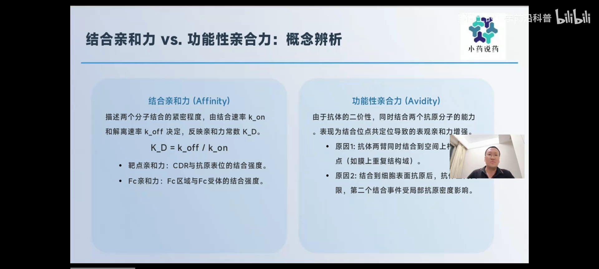
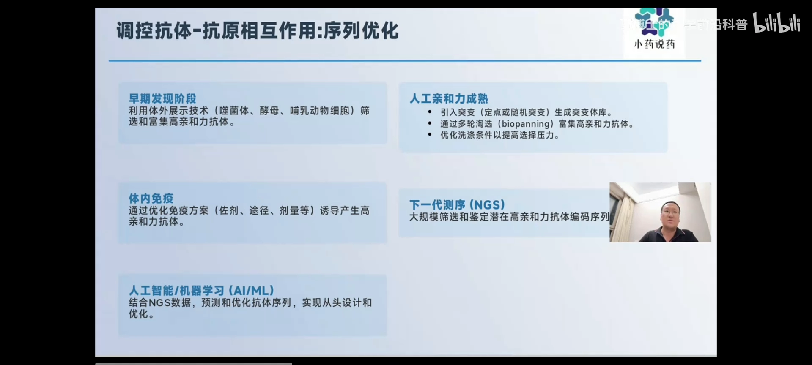
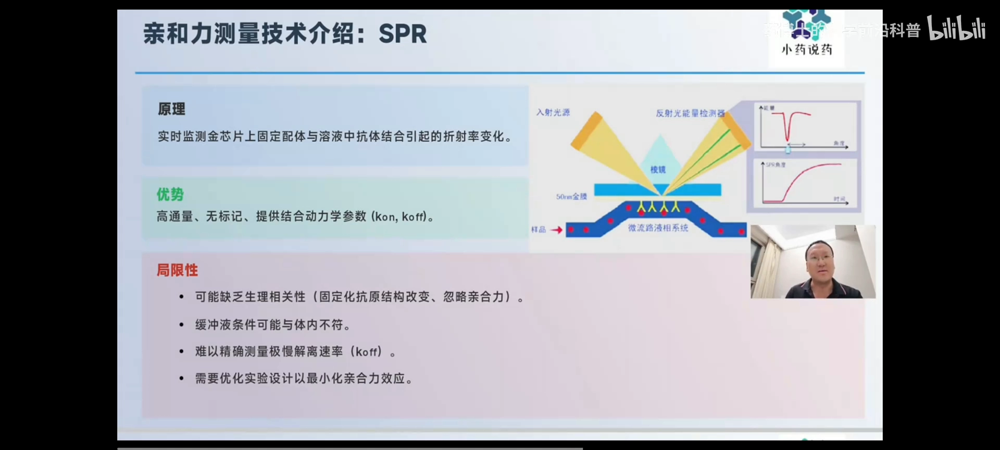
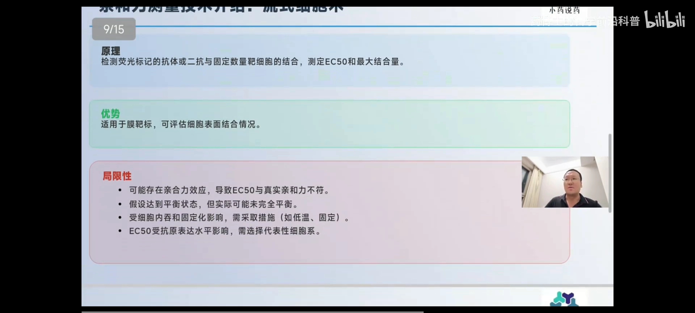
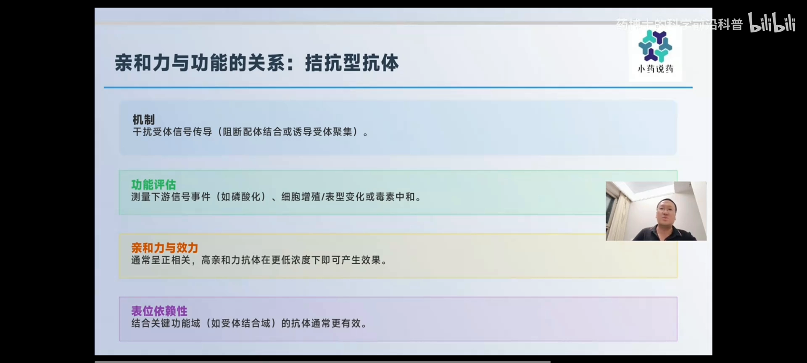
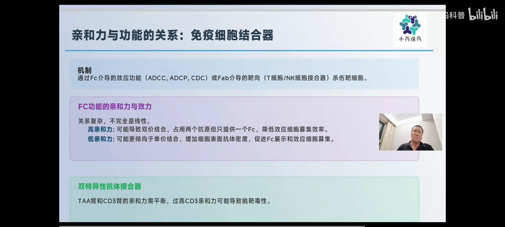
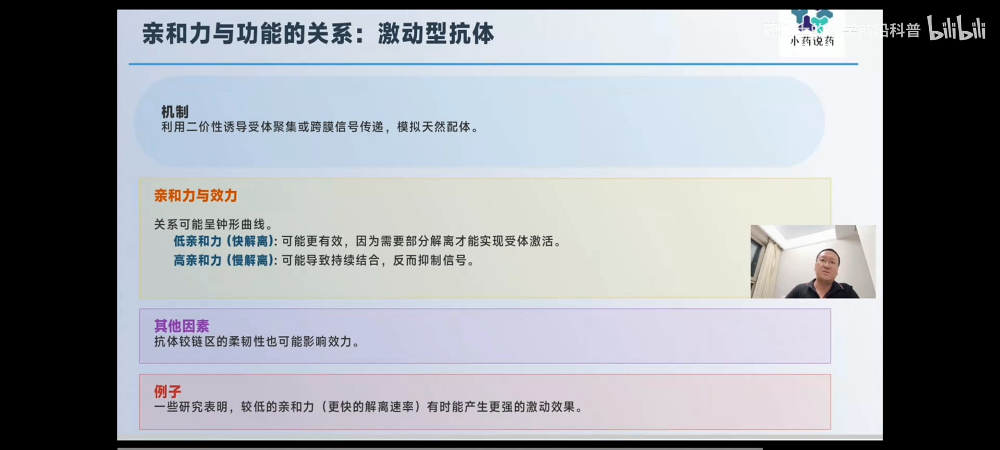
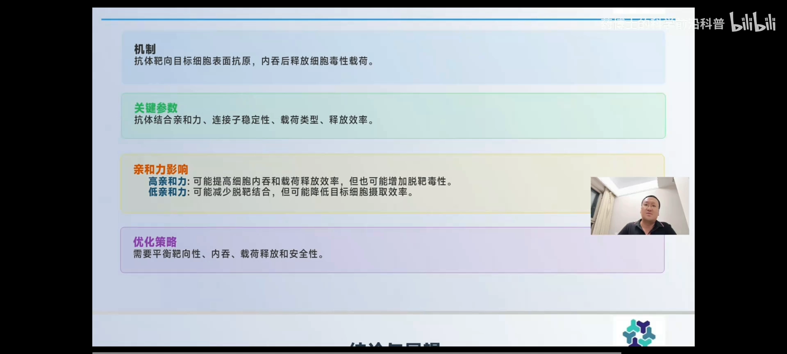
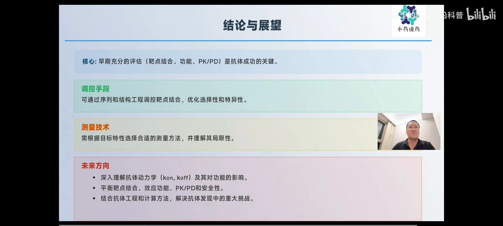

# 抗体亲和力不是越高越好：avidity、读数与功能取舍

> 视频来源：[药博士直播课：抗体亲和力与功能的关系](https://www.bilibili.com/video/BV14huWzQEwy/)（Bilibili · 小药说药知识文库，时长约 22 分钟）
> 导读：这是一场面向抗体药物开发的直播课，讲者以一篇关于"如何定量抗体结合"的综述（MABS，2025）为主线，把"亲和力"拆成 affinity 与 avidity 两层，再分别讨论怎么调、怎么测、以及不同功能类型该往哪个方向调。本文按"概念 → 调控 → 测量 → 功能"重排。kon/koff/KD 的推导与 SPR/BLI 的方法学基础见 B03 系列，本文只保留抗体语境下的增量。字幕为直播 AI 转写，术语按画面幻灯片订正。

## 本讲要解决的核心问题（SCQA）

**背景**：亲和力是抗体最基本的属性之一。要开发一支好抗体，调控抗体与靶标的亲和力是关键；尤其现在双抗、三抗、ADC 等形式越来越多，不同形式对亲和力的要求并不相同。

**冲突**：但"亲和力越高越好"这条直觉会在两个地方失灵。第一，同一支抗体，在芯片上测出的 $K_D$ 和在细胞上测出的 $EC_{50}$ 经常对不上，因为细胞表面的抗体是二价的、膜上的抗原是成簇的。第二，在很多功能场景里，把亲和力推到极高反而让效果变差——激动型抗体有钟形曲线，免疫细胞结合器要考虑 Fc 展示效率，ADC 要考虑脱靶毒性。

**疑问**：那到底什么时候该把亲和力往上调，什么时候该往下调？

**回答（中心思想）**：先分清两个概念——**affinity 是单个结合位点与表位的强度，avidity 是整个抗体（多价）结合抗原的整体强度**；再分清两类读数——**平衡读数（$K_D$、$EC_{50}$）与动力学读数（$k_{on}$、$k_{off}$）回答的不是同一个问题**；最后按功能类型定目标：拮抗型通常越高越好，免疫细胞结合器与激动型要找平衡点，ADC 要在内吞效率与安全性之间取折中。表位是否有"生产力"，往往比亲和力数字更根本。

## 一、affinity 与 avidity：一个位点，还是整个分子

讲者开篇就把这两个容易混淆的概念摆在一起。

**亲和力（affinity）**：描述两个分子之间结合的紧密程度。对抗体来说，它就是 CDR 与抗原表位之间的相互作用；这个 affinity 也可以来自抗体的其他结构域，比如 Fc 区与 Fc 受体的结合强度。

**亲和力常数 $K_D$**：是解离速率 $k_{off}$ 与结合速率常数 $k_{on}$ 的比值，$K_D$ 数值越低，说明抗体的亲和力越高。

$$
K_D = \frac{k_{off}}{k_{on}}
$$

此外，抗体对抗原的亲和力与特异性，是由一系列非共价相互作用决定的：氢键、范德华力，以及 CDR 上氨基酸残基介导的静电相互作用。

**avidity（亲合力 / 功能性亲合力）**：表现为结合位点共定位导致的**表观亲和力增强**，代表抗体抗原相互作用的**整体强度**。它受三个因素影响：affinity、抗体的价数、以及抗体与抗原的结构排列。

[【跳转到 02:12】](https://www.bilibili.com/video/BV14huWzQEwy/?t=132)

avidity 让"表观亲和力"变强，有两个具体原因：

1. **两个臂同时结合空间上相关的位点**（比如带重复结构域的蛋白，或者膜蛋白）。这时要完全解离，就要求**两个臂同时释放**抗原，于是有效的解离半衰期比单个臂长得多。
2. **结合到细胞表面抗原时的"桥接"效应**：一个臂已经结合了抗原，它就像一座桥，让另一个臂更容易结合旁边的抗原。

所以讲者把 avidity 直接称为一种**协同作用**：其中一个臂的结合，会改变另一个臂的结合动力学。

[【跳转到 04:40】](https://www.bilibili.com/video/BV14huWzQEwy/?t=280)

用一句话区分：**affinity 是"手劲"，avidity 是"两只手一起抓"**。这也解释了为什么单价片段（Fab、scFv）和全长 IgG 测出来的"亲和力"经常差好几个数量级——不是抗体变了，而是价数变了。

## 二、怎么调：从展示筛选到 AI 设计

明白了两个概念，接下来是工程问题。讲者把调控手段分成"早期发现"和"后期优化"两段。

**早期发现阶段**：用体外展示技术筛选。以噬菌体展示为例，把编码抗体片段的基因转到噬菌体质粒里，抗体片段就表达在噬菌体外壳上，每个噬菌体相当于展示了一个抗体；把展示不同抗体的噬菌体混在一起，用目标抗原淘洗，通过调节洗脱条件，留下结合的、洗掉不结合的；再重复感染细菌扩增，几轮之后就能富集到高亲和力抗体。除了噬菌体展示，现在还发展出酵母展示、核糖体展示与细胞展示。

**亲和力成熟**：拿到一定亲和力的抗体后进一步优化。一个经典做法是**丙氨酸扫描**——把 CDR 区的氨基酸挨个突变成丙氨酸，如果某个位点突变后亲和力显著下降，说明它是结合的关键位点；关键位点一般不动，转而**对非关键位点建库**，再用展示技术淘选、富集更高亲和力的变体。

[【跳转到 06:20】](https://www.bilibili.com/video/BV14huWzQEwy/?t=380)

此外，优化动物免疫方案（抗原、佐剂、免疫途径、动物）也能筛到高质量抗体，再通过杂交瘤或 B 细胞克隆筛选。最近二代测序与 AI 的应用，让研究者可以学习抗体序列数据、预测哪些突变会提高或降低亲和力，甚至从头设计具有特定功能的抗体。

讲者在这里插了一句重要提醒：**"亲和力越高越好"是要看用途的**。这句话是后半场"功能"部分的伏笔。

## 三、价数与结构排列：双抗、双表位与"顺式/反式"

除了改序列，还可以改"形状"来实现更精准的靶向。

- **双特异性抗体**：同时抓住两个不同靶标，或同一靶标上的两个不同表位，在提高选择性上很有潜力。
- **顺式结合（cis）**：要求同时结合同一细胞上的两个靶点。通过精细调控两个臂的亲和力——一个臂高亲和力提供稳定结合，另一个臂低亲和力减少"单靶点"结合——可以显著提高特异性，**减少对只表达单个靶点的正常细胞的损伤**。
- **反式结合（trans）**：常见于免疫细胞结合器，一头连免疫细胞、一头连目标细胞，把两者拉到一起。也可以把顺式与反式结合组合起来，用瞬时作用作用于目标细胞上的两个靶点，更精准、副作用更少。
- **双表位抗体**：在同一抗原上结合两个不同表位，促进内吞与降解，这对 ADC 特别有利。
- **免疫细胞因子**：把抗体与细胞因子结合，抗体与靶标的亲和力很关键，但结合的表位同样重要。

## 四、表位有没有"生产力"，比亲和力数字更根本

讲者把表位分成两类：

- **有生产力的表位**：结合后能触发预期治疗效果，比如阻断信号通路、激活免疫细胞、或者帮助内吞。
- **无生产力的表位**：即使结合了、即使亲和力很高，对效果也没什么影响。原因可能是空间位阻，或者它根本不参与这条信号通路。

这带来一个判断原则：**找到一个好抗体，不能只看亲和力，还得看它结合的表位**。表位鉴定因此是抗体开发中非常重要的一环。换句话说，亲和力是"抓得多紧"，表位是"抓在哪里"——抓错了地方，抓得再紧也没用。

## 五、两类读数：平衡读数与动力学读数回答的不是同一个问题

测量亲和力的方法很多，讲者把它们分成两大类：

1. **把其中一个分子（通常是抗原）固定在芯片或板子上**，看抗体怎么结合——比如 SPR、BLI；
2. **直接在细胞上做实验**，看抗体怎么结合到细胞表面——比如流式细胞术、动力学排斥实验。

[【跳转到 11:11】](https://www.bilibili.com/video/BV14huWzQEwy/?t=671)

选哪种，取决于靶标是可溶性蛋白还是膜蛋白、需要多高通量、以及结果需要多大的生理相关性。每种方法都有优缺点。

**SPR（表面等离子共振）**：实时监测金芯片上固定配体与溶液中抗体结合引起的折射率变化。优点是实时、无标记，能提供结合速率与解离速率（$k_{on}$、$k_{off}$），非常直观，被称为测量抗体亲和力的金标准之一。局限也很明显：把抗原固定在芯片上可能改变抗原的天然结构；SPR 一般**忽略了细胞膜上复杂的 avidity 效应**；对极慢的解离速率不太敏感；缓冲液条件也可能与体内不符。

[【跳转到 12:26】](https://www.bilibili.com/video/BV14huWzQEwy/?t=746)

**流式细胞术**：给抗体带上荧光标签，看有多少抗体结合到细胞表面，通过测定半数最大结合量对应的抗体浓度（$EC_{50}$）来大致了解亲和力。它特别适合膜上的靶点，因为是在活细胞上做的。但要注意：由于**抗体的二价性能**和细胞表面环境，这里的 $EC_{50}$ 会受膜上受体密度、蛋白表达水平影响，**并不完全等于真实的 affinity**；细胞还会内吞，有时需要固定细胞，这些都会影响结果。

[【跳转到 14:06】](https://www.bilibili.com/video/BV14huWzQEwy/?t=846)

这就是"平衡读数 vs 动力学读数"的实践差别：$K_D$ 和 $EC_{50}$ 都是**平衡量**，只告诉你"在某组条件下结合了多少"；$k_{on}$ 与 $k_{off}$ 是**动力学的量**，告诉你"结合得多快、松开得多慢"。两支 $K_D$ 相同的抗体，完全可以一支结合快、解离快，另一支结合慢、解离慢——而这两者在体内的表现（驻留时间、清除、内吞）可能完全不同。所以讲者在结尾特别强调，未来要更深入地理解抗体动力学（$k_{on}$、$k_{off}$）及其对功能的影响。

## 六、亲和力与功能：四种情形，四个方向

"是不是亲和力越高效果就越好？"讲者的回答是：**并没有那么简单**。首先，高亲和力可能影响抗体在体内的清除速率和分布范围；其次，亲和力与功能的相关性并不完全是线性的，高度依赖药理作用与效应来源。

**（1）拮抗型抗体：通常越高越好。** 这类抗体阻断信号通路，需要牢固结合才能有效阻断信号传递。具体效果还取决于表位是否关键——能结合到配体-受体结合关键部位的抗体往往更有效。所以对这类抗体，提高亲和力通常是好事。

[【跳转到 16:16】](https://www.bilibili.com/video/BV14huWzQEwy/?t=976)

**（2）免疫细胞结合器：要找平衡，甚至要往下调。** 它的任务是招募并激活免疫细胞攻击目标细胞。相对于 Fc 依赖的细胞毒性机制，**高亲和力可能导致双价结合**：占用了两个抗原，却只提供一个 Fc，反而降低效应细胞的募集效率。相比之下，亲和力较低的抗体可能以**单价结合**，提供更多 Fc，产生更大的调理作用，效果更好。

双抗的两个臂要分别调控：针对抗原的结合臂亲和力要足够好；而 **CD3 臂的亲和力不是越高越好**，要平衡细胞毒性作用、降低细胞因子释放相关的风险。

[【跳转到 17:36】](https://www.bilibili.com/video/BV14huWzQEwy/?t=1056)

**（3）激动型抗体：可能是钟形曲线，太高反而不好。** 这类抗体通过结合受体并诱导聚集来激活下游信号，像免疫系统的油门。有些研究表明，对某些激动型抗体，亲和力与功能之间呈钟形关系：**较低的亲和力、也就是更快的解离速率，反而能产生更强的激动效果**。讲者的解释是受体也需要"喘息时间"，部分解离反而有利于激活——一直踩到底，发动机有时反而会熄火。此外，铰链区的柔韧性等因素也会影响效力。

[【跳转到 18:51】](https://www.bilibili.com/video/BV14huWzQEwy/?t=1131)

**（4）ADC：在靶向性与安全性之间取折中。** 这里抗体亲和力非常关键：亲和力太高，确实能更有效地把有效载荷送到目标细胞，但也可能**增加脱靶毒性**；亲和力太低，又可能降低目标细胞的摄取效率。所以 ADC 的亲和力往往要在靶向性、内吞效率、载荷释放与安全性之间找最佳平衡点。

[【跳转到 19:41】](https://www.bilibili.com/video/BV14huWzQEwy/?t=1181)

## 七、把"交叉反应"和"毒性"分开看

上述四种情形合起来，给出一条判读纪律：**结合层面的"多认了一个靶点"，不等于功能层面的"毒性"**。

讲者在双抗部分说得很清楚：真正决定损伤的是"正常细胞是否表达**两个**靶点"——只表达单个靶点的细胞，在精细调控亲和力之后可以被放过。在 ADC 部分，他谈的是"脱靶毒性"，而脱靶之所以成为毒性，前提是抗体被**内吞**、载荷被**释放**。在免疫细胞结合器部分，风险来自 **Fc 效应功能与细胞因子释放**，而不仅是结合本身。

也就是说，从"交叉结合"到"临床后果"之间，至少还隔着几道关卡：靶点在组织中的表达与密度、抗原是否可及（能否被抗体碰到）、价数与结合方式（双价还是单价）、以及结合之后能否触发内吞或效应功能。任何一环不成立，交叉结合就只是一个结合读数，而不是毒性。反过来，看到交叉反应就断定"脱靶有毒"，或者看到没有交叉反应就断定"安全"，都是把两层判断混成了一层。

## 八、结论：早期把三件事一起评估

讲者的收束很清楚：

- **核心**：早期充分的评估（靶点结合、功能、PK/PD）是抗体成功的关键。
- **调控手段**：可通过序列与结构工程调控靶点结合，优化选择性与特异性。
- **测量技术**：需根据目标特性选择合适的测量方法，并理解其局限性。
- **未来方向**：深入理解抗体动力学（$k_{on}$、$k_{off}$）及其对功能的影响；平衡靶点结合、效应功能、PK/PD 与安全性；结合抗体工程与计算方法解决抗体发现中的重大挑战。

[【跳转到 20:56】](https://www.bilibili.com/video/BV14huWzQEwy/?t=1256)

## 小结

- **affinity 与 avidity 是两层强度**：前者是单个位点与表位的强度（$K_D = k_{off}/k_{on}$），后者是整个分子多价结合的整体强度，受亲和力、价数、结构排列三者影响。
- **avidity 放大表观亲和力的两个机制**：两臂同时结合使完全解离需要同时释放；一个臂先结合后像桥一样帮助第二个臂结合邻近抗原。
- **测量读数要分清**：$K_D$、$EC_{50}$ 是平衡量，$k_{on}$、$k_{off}$ 是动力学的量；SPR 忽略膜上 avidity、对极慢解离不敏感，流式的 $EC_{50}$ 受受体密度与内吞影响，不等于真实亲和力。
- **亲和力目标随功能类型变化**：拮抗型通常越高越好；免疫细胞结合器要平衡（CD3 臂不宜过高）；激动型可能是钟形曲线，快解离有时更好；ADC 要在内吞效率与脱靶毒性之间折中。
- **表位比数字更根本**：结合到"无生产力"的表位，亲和力再高也没用。
- **交叉结合不等于毒性**：从结合到后果，还要经过表达与可及性、价数与结合方式、内吞与效应功能这几道关卡。

## 关键术语速查

| 术语 | 一句话解释 |
| --- | --- |
| affinity（亲和力） | 单个结合位点与单个表位之间的结合强度，用 $K_D$ 或 $K_a$ 表示 |
| $K_D$ | 解离常数，等于 $k_{off}/k_{on}$，数值越低亲和力越高 |
| $k_{on}$ / $k_{off}$ | 结合速率常数 / 解离速率常数，描述结合的动力学而非平衡 |
| avidity（亲合力 / 功能性亲合力） | 整个抗体多价结合抗原的整体强度，受亲和力、价数与结构排列影响 |
| 表观亲和力 | 多价结合时由 avidity 放大后"看起来"的亲和力 |
| 顺式结合 / 反式结合 | 同时结合同一细胞上的两个靶点 / 分别结合两个细胞上的靶点 |
| 双表位抗体 | 在同一抗原上结合两个不同表位，可促进内吞与降解 |
| 有生产力的表位 | 结合后能触发预期治疗效果的位点；反之则为无生产力表位 |
| SPR | 表面等离子共振，实时无标记测 $k_{on}$、$k_{off}$ 的方法 |
| $EC_{50}$ | 半数最大结合量对应的抗体浓度，细胞实验中常用的平衡读数 |