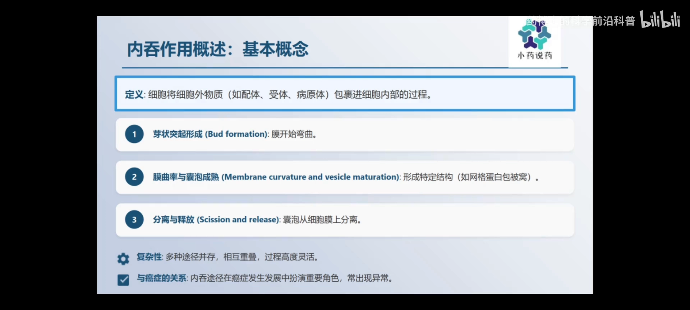
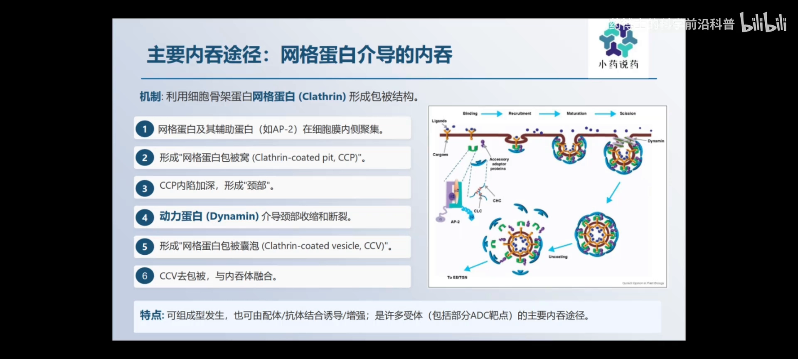
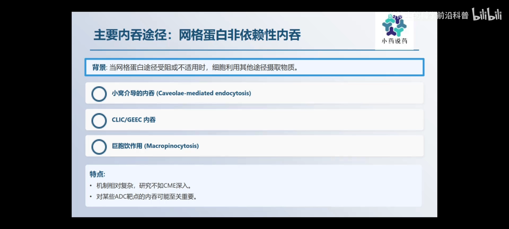
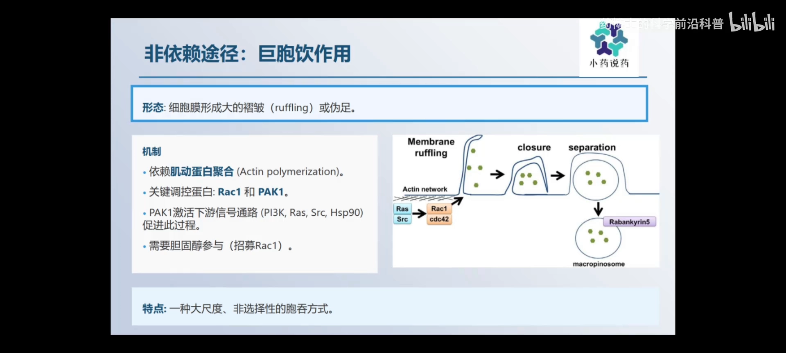
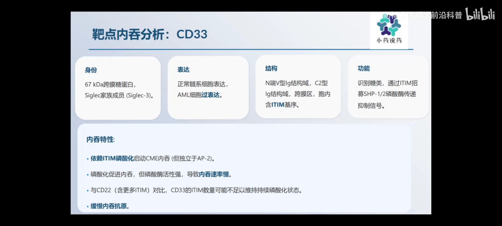
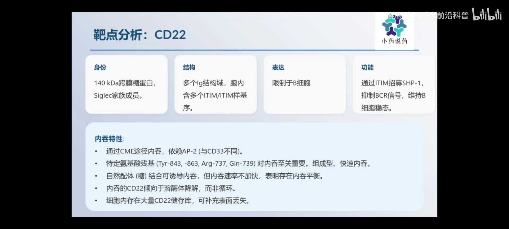
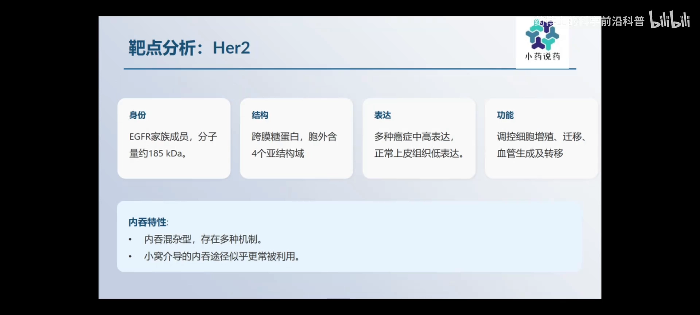
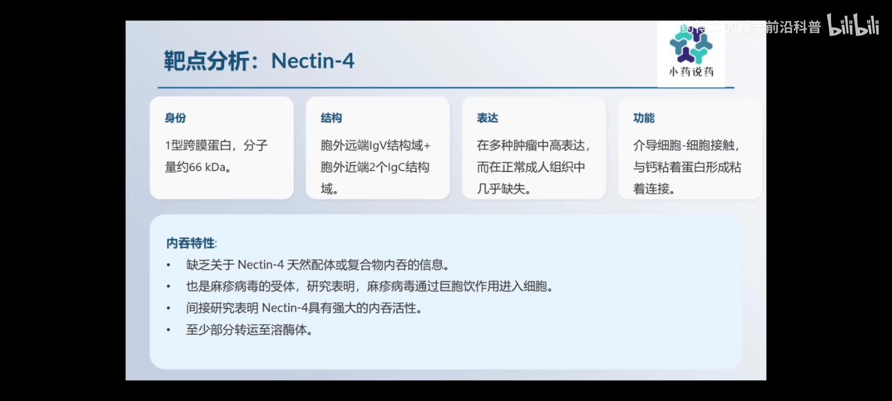

# 受体内化决定抗体药物成败：内吞途径与靶点内吞特性

> 视频来源：[ADC的内吞机制及其靶点内吞特征](https://www.bilibili.com/video/BV1jMbwzoE9r/)（B 站 · UP 主「小药说药知识文库」，时长约 19 分钟）
> 导读：这支视频专门讲抗体结合受体之后「下一步」——受体连同抗体一起被细胞吞进去的过程。它解释了为什么两个都在肿瘤里高表达的靶点，做成 ADC 后效果天差地别：差别不在结合，而在内吞。本文把内吞的四条主要路线和七个靶点的内吞特性整理成可复用的判断框架。

## 本讲要解决的核心问题（SCQA）

**背景**：选 ADC 靶点的常识是「要在肿瘤里高表达、在正常组织里低表达」。按这个标准筛出来的候选靶点很多。

**冲突**：视频开篇就指出，除了过表达，这些抗原的另一个重要因素就是**内吞的效率**，这是药物释放活性所必需的；内吞途径和效率也与 ADC 的疗效和设计息息相关 [【跳转到 00:07】](https://www.bilibili.com/video/BV1jMbwzoE9r/?t=7)。换句话说，抗原表达量再高，如果被抗体结合后不往细胞里走，载荷就永远到不了作用位点。

**疑问**：细胞到底有哪几条内吞路线？不同靶点走的路、走的速度、被调控的方式有什么不同？这些差异如何反过来决定药物设计？

**回答（中心思想）**：内吞不是一种统一的「细胞喝水」动作，而是**四条机制不同、终点不同的路线**；一个靶点「能不能被有效内吞」「内吞后去哪里（溶酶体降解还是循环回表面）」「内吞速度快不快」，共同决定了它适不适合做 ADC 靶点——**结合阳性只是入场券，内吞命运才决定药效**。

---

## 一、内吞的基本动作：三步走

视频先用一分钟把内吞的定义讲清楚：内吞就是细胞把外面的东西——营养分子、信号分子，甚至像 ADC 这样的大分子——通过膜的变形包裹进细胞内部的过程 [【跳转到 00:57】](https://www.bilibili.com/video/BV1jMbwzoE9r/?t=57)。

三步是通用的：

1. **芽状突起形成**：膜开始弯曲，鼓起一个小包；
2. **膜曲率与囊泡成熟**：形成特定结构，比如网格蛋白包被窝；
3. **分离与释放**：囊泡从细胞膜上断开，释放到细胞质里。

幻灯片底部的两条注解值得记住：**多种途径并存、相互重叠，过程高度灵活**；而且内吞途径在癌症发生发展中常出现异常 [【跳转到 01:47】](https://www.bilibili.com/video/BV1jMbwzoE9r/?t=107)。这两条正是后面「耐药」讨论的伏笔。

---

## 二、四条主要路线：一条主力，三条备选

### 2.1 网格蛋白介导的内吞（CME）：细胞的内建回收系统

这是研究得最透彻的一条，也是许多 ADC 靶点走的路。视频把它比作细胞膜上自带的回收系统，核心部件是网格蛋白——由三条重链和三条轻链组成的三脚架结构，能在膜内侧组装成笼子状的包被 [【跳转到 02:12】](https://www.bilibili.com/video/BV1jMbwzoE9r/?t=132)。

流程是：

1. 网格蛋白及辅助蛋白（如 AP-2）在膜内侧聚集；
2. 形成「网格蛋白包被窝」（CCP）；
3. 包被窝内陷加深，形成「颈部」；
4. **动力蛋白（Dynamin）** 缠绕在颈部，水解 GTP 提供能量，把口袋切下来；
5. 形成网格蛋白包被囊泡（CCV）；
6. CCV 去包被，与内吞体融合。

幻灯片特别标注了一个特点：CME **可以组成型发生，也可以由配体/抗体结合诱导增强** [【跳转到 03:02】](https://www.bilibili.com/video/BV1jMbwzoE9r/?t=182)。这句话对 ADC 意义重大——抗体结合本身就可能成为「加速内吞」的信号。

### 2.2 三条不依赖网格蛋白的备选路线

当 CME 受阻或不适用时，细胞会用其他途径摄取物质。视频列了三条，并坦言我们对它们的了解远不如 CME [【跳转到 03:52】](https://www.bilibili.com/video/BV1jMbwzoE9r/?t=232)。

- **小窝介导的内吞**：小窝是膜上富含胆固醇和特殊脂类的小凹陷，骨架蛋白是小窝蛋白（尤其 caveolin-1）。它的囊泡大小固定、不会像 CME 那样长大，**只有约 1% 的小窝会被内吞**，效率相对较低；更麻烦的是，被内吞的小窝**更倾向于走回收路线**而不是去融媒体 [【跳转到 05:07】](https://www.bilibili.com/video/BV1jMbwzoE9r/?t=307)。对 ADC 来说这是个挑战：药物可能还没到作用位点就被送回去了。
- **CLIC/GEEC 内吞**：更像细胞的应激反应，通常在生长因子信号、**抗体交联**或细菌毒素入侵时才被激活；需要膜保持一定流动性，断裂过程不需要肌动蛋白，囊泡会很快与早期内吞体融合 [【跳转到 05:57】](https://www.bilibili.com/video/BV1jMbwzoE9r/?t=357)。
- **巨胞饮作用**：大手笔，细胞形成大的褶皱或伪足，把褶皱拉进来形成巨大囊泡；依赖肌动蛋白聚合，关键调控蛋白是 RAC1 和 PAK1，也需要胆固醇参与招募 RAC1 [【跳转到 06:47】](https://www.bilibili.com/video/BV1jMbwzoE9r/?t=407)。

四条路线的差别不只是「快慢」，而是**终点不同**：CME 主要去融媒体（进而到溶酶体），小窝倾向回收，巨胞饮是非选择性地吞入大量细胞外液体。对 ADC 来说，「进得去」和「进得去之后被送到溶酶体」是两件事。

---

## 三、七个靶点的内吞特性：同样是「高表达」，命运完全不同

视频的主体是逐个分析已获批 ADC 的靶点。这部分信息密度最高，值得按「内吞速度 / 走哪条路 / 内吞后的命运 / 特殊麻烦」四个维度来记。

### 3.1 CD33：慢，因为磷酸化和去磷酸化在拉锯

CD33 是 68 kDa 的跨膜糖蛋白、Siglec 家族成员（Siglec-3），正常髓系细胞表达、AML 细胞过表达；结构上有 V 型 Ig 结构域、C2 型 Ig 结构域、跨膜区和含两个 ITIM 的胞内区 [【跳转到 07:37】](https://www.bilibili.com/video/BV1jMbwzoE9r/?t=457)。

关键在于：**同一个 ITIM 既负责传抑制信号，又负责启动内吞**。磷酸化后的 ITIM 结合 SHP 蛋白启动内吞，且不依赖 AP-2；但细胞内同时有强大的磷酸酶不停把磷酸去掉，两者拉锯的结果是**内吞速度非常慢**，CD33 因此被归为「缓慢内吞的抗原」 [【跳转到 08:52】](https://www.bilibili.com/video/BV1jMbwzoE9r/?t=532)。

### 3.2 CD30：问题不是内吞，而是脱落

CD30 是 120 kDa 的跨膜糖蛋白、TNFR 超家族成员，在激活的 T/B 细胞和霍奇金淋巴瘤等淋巴瘤细胞上表达。它最让人头疼的特性不是内吞，而是**脱落**：容易被 ADAM17、ADAM10 这类基质金属蛋白酶从膜上切下来，变成可溶性 CD30，遇到配体 CD30L 时脱落还会加速 [【跳转到 09:42】](https://www.bilibili.com/video/BV1jMbwzoE9r/?t=582)。

结果是血液中可溶性 CD30 水平很高，甚至能作为监测淋巴瘤进展的血清标志物。但对抗体药来说，**可溶性抗原是「诱饵」**：抗体会被血液里的游离 CD30 吸走，到不了细胞表面。视频的结论很直白：CD30 不是以内吞为主要命运的，反而喜欢脱落，这对 ADC 是个不小的麻烦 [【跳转到 10:07】](https://www.bilibili.com/video/BV1jMbwzoE9r/?t=607)。

### 3.3 CD22：为 ADC 量身定做的内吞特性

CD22 是 140 kDa 的 Siglec 家族成员，主要在 B 细胞上表达，胞内区含多个 ITIM/ITIM 样基序，通过招募 SHP-1 抑制 BCR 信号 [【跳转到 10:57】](https://www.bilibili.com/video/BV1jMbwzoE9r/?t=657)。它的内吞特性几乎每一项都对 ADC 有利：

- 走 **CME**，且**明确依赖 AP-2**（与 CD33 不同）；胞内区的 Tyr-843、Tyr-863 等残基对 AP-2 结合至关重要；
- **组成型、快速内吞**，不需要额外刺激；即使加天然糖配体，内吞速度也不会加快，说明细胞内存在内吞平衡；
- 内吞后**倾向溶酶体降解**，而不是循环回表面；
- 细胞内存在**大量 CD22 储存库**，可随时补充表面丢失 [【跳转到 11:47】](https://www.bilibili.com/video/BV1jMbwzoE9r/?t=707)。

视频的评价是：CD22 的内吞特性简直是为 ADC 量身定做的。

### 3.4 CD79B：整个 BCR 复合物一起被吞

CD79B 是 B 细胞受体（BCR）复合物的组成部分，与 CD79A 非共价结合，在约 80% 的弥漫大 B 细胞淋巴瘤中过表达；胞内区含 ITAM（免疫受体酪氨酸激活基序）[【跳转到 12:37】](https://www.bilibili.com/video/BV1jMbwzoE9r/?t=757)。

它的内吞也走 CME、依赖 AP-2，但有个细节很有意思：**CD79A 直接与 AP-2 的 μ 亚基结合，然后带动 CD79B 一起内吞**；而且研究提示 CD79B 的内吞可能需要整个 BCR 复合物作为一个整体被内吞，而不是 CD79B 单枪匹马行动 [【跳转到 13:02】](https://www.bilibili.com/video/BV1jMbwzoE9r/?t=782)。这提示：**靶点在复合物里的位置，会影响它能不能被带走**。

### 3.5 TROP2：组成型快速内吞，靠聚集

TROP2 是 46 kDa 的单体糖蛋白，在约 30 种肿瘤类型中过表达；胞外区有一段保守序列，让它能形成天然的同源二聚体，可结合 Claudin-1、Claudin-7、cyclin D1、IGF-1、NRG-1 等多种配体 [【跳转到 13:27】](https://www.bilibili.com/video/BV1jMbwzoE9r/?t=807)。

内吞方面它同样出色：走 CME、**组成型且快速**；在肿瘤细胞中的内吞比正常细胞更显著，原因可能是 TROP2 在细胞表面倾向聚集形成簇状结构，这种聚集可能依赖动力蛋白和脂筏 [【跳转到 14:17】](https://www.bilibili.com/video/BV1jMbwzoE9r/?t=857)。

### 3.6 BCMA：信息最少，但糖基化能诱导内吞

BCMA 属于 TNFR 超家族，只有约 20 kDa，在浆细胞和浆母细胞上高表达、正常组织几乎不表达，特异性非常好；结构上有六个 CRD 结构域结合配体 APRIL [【跳转到 14:42】](https://www.bilibili.com/video/BV1jMbwzoE9r/?t=882)。关于它的内吞途径公开信息较少，但有一个发现：胞外区天冬氨酸 42 位点的 N 糖基化如果被唾液酸化修饰，**虽然会干扰它与 APRIL 的结合，却能诱导 BCMA 内吞** [【跳转到 15:07】](https://www.bilibili.com/video/BV1jMbwzoE9r/?t=907)。

这条信息很值得玩味：**「结合变弱」和「内吞变强」可以同时发生**。功能不是由结合强度单调决定的，这正是本小节反复强调的那句话的又一个例证。

### 3.7 HER2：内吞是「混杂」的

HER2 是 185 kDa 的跨膜糖蛋白、EGFR 家族成员，多种癌症中高表达、正常上皮组织低表达 [【跳转到 15:32】](https://www.bilibili.com/video/BV1jMbwzoE9r/?t=932)。它的内吞存在多种机制：

- **CME**：免疫共沉淀显示 HER2 直接与 AP-2 结合；抑制动力蛋白能完全阻断 SKBR3 细胞的 HER2 内吞；
- **小窝介导**：在 HER2 的细胞内激酶结构域中鉴定出小窝蛋白结合基序；
- **CLIC/GEEC**：也有研究支持 [【跳转到 16:22】](https://www.bilibili.com/video/BV1jMbwzoE9r/?t=982)。

视频的总结是：HER2 的内吞是混杂的，小窝介导途径似乎更常被利用。

### 3.8 Nectin-4：靠「借来的证据」判断

Nectin-4 是 66 kDa 的 I 型跨膜蛋白，促进细胞间接触，在多种肿瘤中高表达、正常成人组织几乎缺失 [【跳转到 16:47】](https://www.bilibili.com/video/BV1jMbwzoE9r/?t=1007)。它的内吞信息最欠缺：没有天然配体或抗体-复合物内吞的直接数据，只能借鉴病原体研究——Nectin-4 是麻疹病毒的受体，而麻疹病毒通过**巨胞饮作用**进入乳腺癌和结直肠癌细胞；间接研究表明 Nectin-4 有强大的内吞活性，且至少部分转运至溶酶体 [【跳转到 17:12】](https://www.bilibili.com/video/BV1jMbwzoE9r/?t=1032)。

---

## 四、把内吞特性翻译成设计决策

视频结尾把整段分析收成三条结论，这三条其实可以直接当设计清单用 [【跳转到 17:37】](https://www.bilibili.com/video/BV1jMbwzoE9r/?t=1057)：

1. **靶点能不能被有效内吞，直接决定 ADC 能不能把药物送到细胞内部**。这是选靶点时与「过表达」并列的第二把尺子。
2. **内吞路线、速度、调控方式各不相同，所以连接子的选择必须跟着变**。视频开头就点明：内吞是连接子选择（可切割、不可切割、pH 敏感、还原敏感）的重要因素，也关系到载荷能否在细胞膜上扩散、产生旁观者效应 [【跳转到 00:32】](https://www.bilibili.com/video/BV1jMbwzoE9r/?t=32)。走得慢、去融媒体少的靶点，需要更「耐」的连接子；内吞后能到达溶酶体的靶点，才适合用溶酶体可切割的连接子。
3. **内吞与耐药直接相关**。如果细胞的内吞途径发生改变或被阻断，药物就进不去，自然产生耐药 [【跳转到 18:02】](https://www.bilibili.com/video/BV1jMbwzoE9r/?t=1082)。

视频也坦率承认了当前认知的边界：对这些已批准 ADC 的靶点，内吞机制到底如何，我们了解得还远远不够；深入理解靶点的内吞生物学，是推动下一代 ADC 创新、并最终战胜耐药性的关键 [【跳转到 18:27】](https://www.bilibili.com/video/BV1jMbwzoE9r/?t=1107)。

---

## 五、回到本小节：为什么「结合阳性」不等于「功能阳性」

把这支视频和「中和、阻断、激动、受体内化」这条主线放在一起，可以提炼出四个判断维度：

- **靶点所在的区室**：游离在血液里的细胞因子被结合后就是中和；细胞表面的受体被结合后，还要看下一步发生什么。
- **表位是否落在功能界面上**：只有占住配体-受体接触面的抗体才能阻断；结合在背面、或者被糖链挡住的表位，结合再牢也不阻断。
- **价态与几何**：受体常需要聚集才能启动信号，而 IgG 只有两个 Fab；双抗能桥接两个细胞，靠的正是形式设计而不是亲和力。
- **受体的转运命运**：内吞快不快、走哪条路、去了溶酶体还是回到表面，决定了「阻断」能不能升级成「受体下调」，也决定了 ADC 能不能把载荷送进去。

CD33 与 CD22 的对比最能说明问题：两者都是 Siglec 家族、都在 B/髓系细胞上表达、都能被抗体结合，但一个因为磷酸化-去磷酸化拉锯而内吞缓慢，另一个组成型快速内吞并直奔溶酶体——**同样的「结合阳性」，功能结局完全不同**。BCMA 的例子更极端：糖基化修饰让结合变弱，却让内吞变强。

所以判断一个抗体药物，至少要把四个问题分开问：**结合得上吗？结合在哪个表位？结合之后靶点被怎么处置？处置的结果是不是我们想要的药理作用？**

---

## 小结

- 内吞是三步通用动作（芽状突起、囊泡成熟、分离释放），但具体路线有四条，机制与终点各不相同。
- **CME 是主力**，由网格蛋白与 AP-2 驱动、动力蛋白剪切，可组成型发生也可被抗体结合增强；小窝介导效率低且倾向回收；CLIC/GEEC 与应激、抗体交联相关；巨胞饮是非选择性的大口吞。
- **靶点的内吞特性决定 ADC 成败**：CD33 慢（磷酸化与磷酸酶拉锯）、CD30 爱脱落（可溶性抗原当诱饵）、CD22 快且直奔溶酶体（理想靶点）、CD79B 随整个 BCR 复合物一起内吞、TROP2 靠表面聚集实现快速内吞、BCMA 糖基化可诱导内吞、HER2 内吞混杂、Nectin-4 靠病毒研究间接推断。
- **内吞特性反过来约束设计**：连接子类型、旁观者效应、耐药风险都由此决定。
- **判断功能要分四步**：结合得上、表位对不对、靶点被怎么处置、处置结果是不是想要的药理作用。

## 关键术语速查

| 术语 | 一句话解释 |
| --- | --- |
| 内吞 | 细胞通过膜变形把胞外物质包裹进细胞内部的过程 |
| CME | 网格蛋白介导的内吞，最经典、研究最透彻的一条路线 |
| AP-2 | 衔接蛋白，把膜上的受体招募进网格蛋白包被窝 |
| 动力蛋白（Dynamin） | 在囊泡颈部水解 GTP，把囊泡从膜上剪断 |
| 小窝（Caveolae） | 富含胆固醇的膜凹陷，由 caveolin-1 支撑，内吞效率低且倾向回收 |
| 巨胞饮 | 依赖肌动蛋白与 RAC1/PAK1 的大尺度、非选择性摄取方式 |
| ITIM / ITAM | 免疫受体酪氨酸抑制/激活基序，分别传递抑制与激活信号 |
| 受体下调 | 受体被内化并降解，细胞表面数量下降 |
| 旁观者效应 | 载荷从靶细胞释放后扩散，杀伤邻近抗原阴性细胞 |
| 可溶性抗原脱落 | 膜抗原被蛋白酶切下进入血液，可充当「诱饵」消耗抗体 |