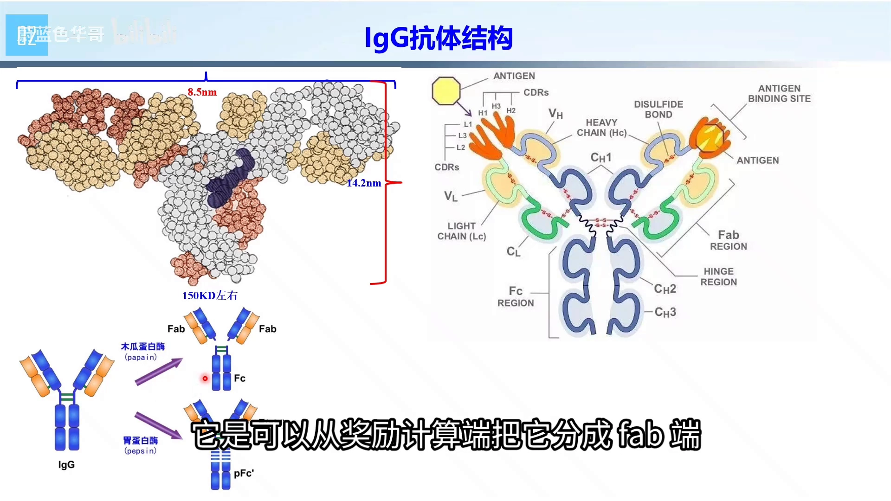
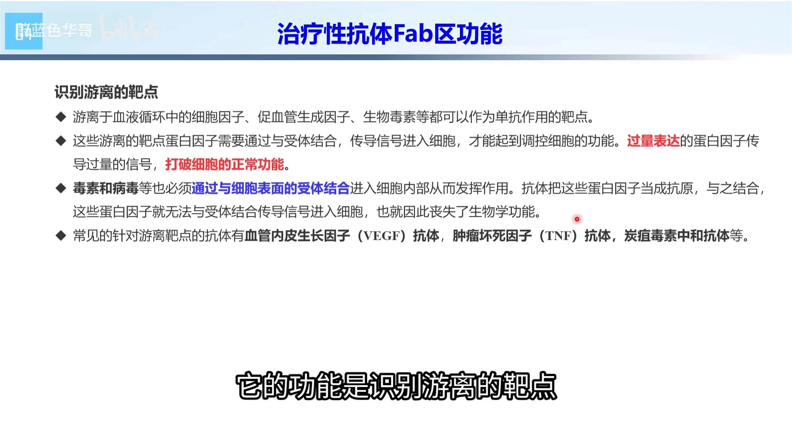
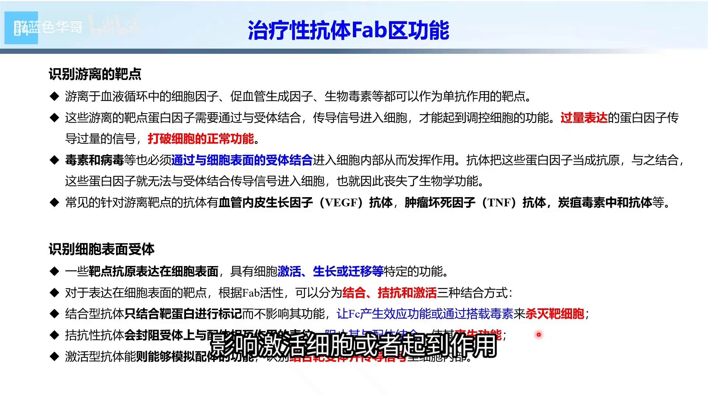
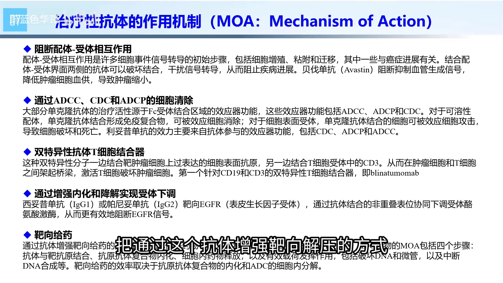
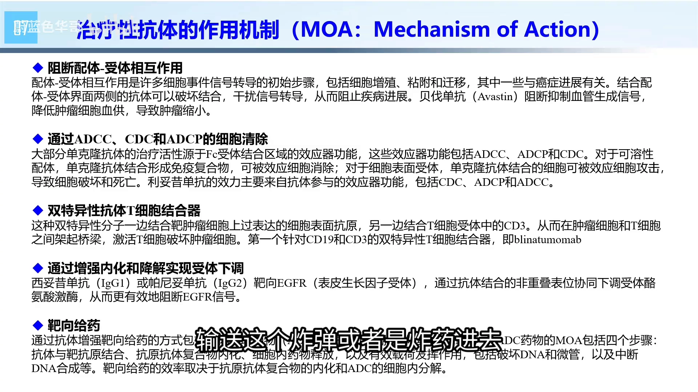
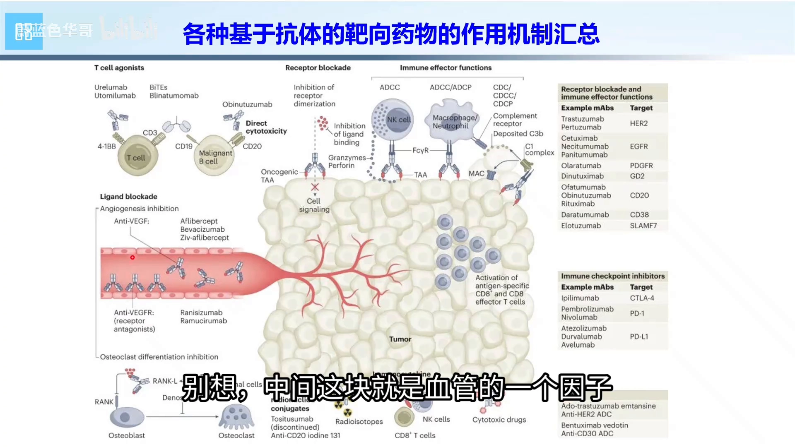
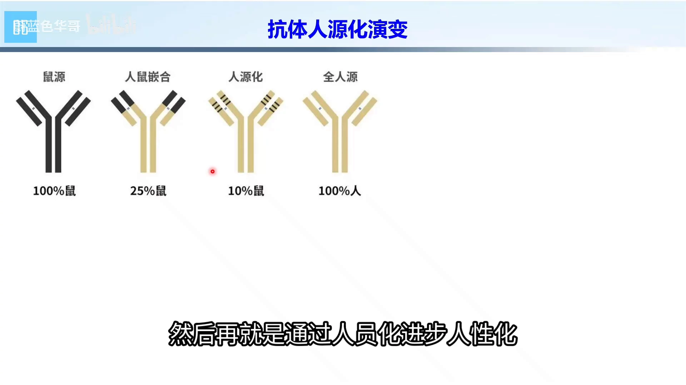
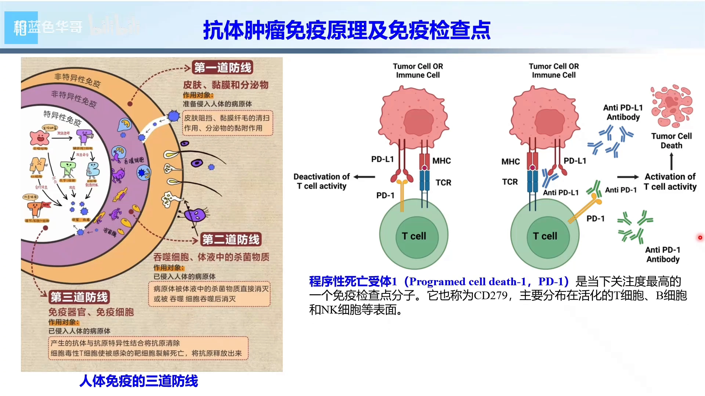
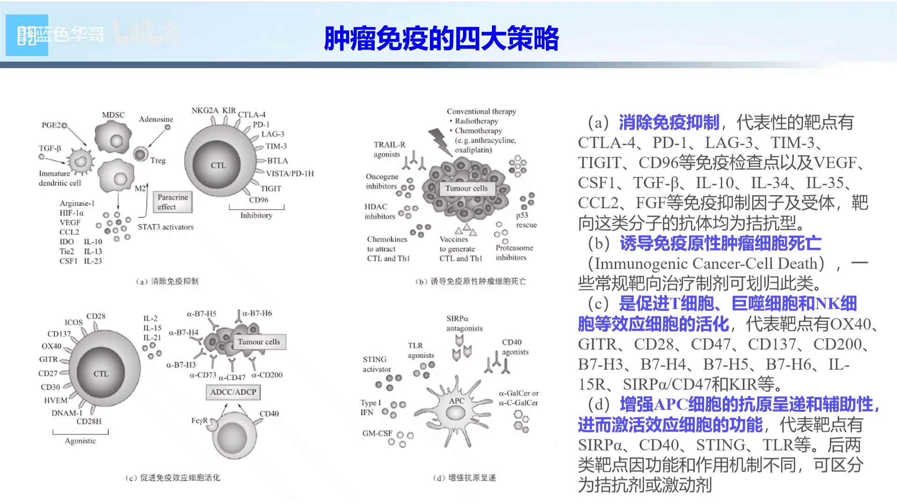

# 抗体结合抗原之后的四条直接作用路径：中和、阻断、激动与受体内化

> 视频来源：[抗体药物开发之三-单克隆抗体蛋白分子结构、功能和作用机制](https://www.bilibili.com/video/BV16wcLzcE1t/)（B 站 · UP 主「蔚蓝色华哥」，时长约 34 分钟）
> 导读：这支视频是一节抗体药物开发的课堂讲授，前半段讲结构与亚型，后半段落到「抗体结合抗原之后到底发生了什么」。本文按小节主题重排：以 Fab 端的直接作用（中和、阻断、激动、受体内化）为主线，Fc 效应、人源化、免疫检查点只作衔接性交代。字幕为机器生成，术语已按上下文订正。

## 本讲要解决的核心问题（SCQA）

**背景**：抗体药物被反复描述成「靶向药」——能精准识别某个靶点。初学者很容易由此得出一个推论：只要抗体能结合靶点，它就该有效。

**冲突**：视频里的幻灯片把 Fab 端的作用拆成「结合、拮抗、激活」三种方式，又单独列出「识别游离的靶点」和「通过增强内化和降解实现受体下调」。同一个「结合成功」，结局可以完全不同：有的只是给细胞贴了个标签，有的把信号通路掐断，有的反而把受体激活，还有的把受体搬进细胞里降解掉 [【跳转到 10:12】](https://www.bilibili.com/video/BV16wcLzcE1t/?t=612)。

**疑问**：抗体结合抗原之后，究竟有哪几条互不相同的功能路径？决定走哪一条的，是亲和力，还是别的东西？

**回答（中心思想）**：抗体结合抗原之后的功能，由**靶点所在的区室（游离还是细胞表面）、表位落在界面的哪个位置、抗体的价态与几何、以及受体本身的转运命运**共同决定；亲和力只回答「结合得牢不牢」，不回答「结合之后会发生什么」。所以「结合阳性」不能当成「功能阳性」。

---

## 一、先分清两端的职责：Fab 决定「打谁」，Fc 决定「打完以后谁来收尾」

视频从 IgG 的结构讲起：一个 IgG 大约 150 kDa，宽约 8.5 nm、高约 14.2 nm，两条重链加两条轻链组成对称的 Y 字形 [【跳转到 03:03】](https://www.bilibili.com/video/BV16wcLzcE1t/?t=183)。

这张图把几个关键部位一次讲清：

- **Fab 端**在 Y 的两臂，抗原结合位点由轻链和重链的可变区（VL、VH）共同构成，真正接触抗原的是 CDR1、CDR2、CDR3 [【跳转到 03:28】](https://www.bilibili.com/video/BV16wcLzcE1t/?t=208)；
- **铰链区**把 Fab 和 Fc 分开，木瓜蛋白酶从铰链区上端切，得到两个 Fab 加一个 Fc；胃蛋白酶切在更靠下的位置，得到 F(ab')₂ 和一堆碎片 [【跳转到 04:18】](https://www.bilibili.com/video/BV16wcLzcE1t/?t=258)；
- **Fc 端**由 CH2、CH3 构成，CH2 结合补体、CH2/CH3 结合 Fcγ 受体，由单核细胞、巨噬细胞、粒细胞、B 细胞、NK 细胞表达这些受体 [【跳转到 05:08】](https://www.bilibili.com/video/BV16wcLzcE1t/?t=308)。

这个解剖学分工正是本小节的分界线：**Fab 端自己就能完成的事**（中和、阻断、激动、把受体带进细胞），和**必须借 Fc 端才能完成的事**（ADCC、ADCP、CDC）是两套机制。后者属于 Fc 介导的效应，本文只在需要对照时提一句。

视频还顺带交代了 IgG 的四个亚型：IgG1 是最常见的结构，IgG2 多了两对二硫键、轻链与重链的连接方式也不同，IgG3 铰链区长、氨基酸数量更多，IgG4 甚至会出现「单价半抗体」 [【跳转到 07:15】](https://www.bilibili.com/video/BV16wcLzcE1t/?t=435)。血清里 IgG1 约占 60%、IgG2 约 25%、IgG3 约 10%、IgG4 约 5%；截至 2023 年已上市的抗体里 IgG1 有 123 个、IgG4 有 47 个、IgG2 有 18 个 [【跳转到 08:30】](https://www.bilibili.com/video/BV16wcLzcE1t/?t=510)。**「价态」从这里开始就是一个变量**：一个 IgG 有两个 Fab、两个结合位点，而 IgG4 的单价半抗体只有一个——同样的可变区，能同时抓住几个靶点并不相同。

---

## 二、靶点在血液里游荡时，抗体的作用是「中和」

视频把 Fab 端的功能分成两大类，第一类是**识别游离的靶点** [【跳转到 08:52】](https://www.bilibili.com/video/BV16wcLzcE1t/?t=532)。

幻灯片给出的逻辑链很短，但很关键：

1. 游离在血液里的细胞因子、促血管生成因子、生物毒素，本身**不能直接作用于细胞**，必须先和细胞表面受体结合，把信号传进细胞，才能调控细胞功能；
2. 过量表达这些因子 = 传递过量信号 = 打破细胞的正常功能；
3. 毒素和病毒也一样，必须通过与细胞表面受体结合才能进入细胞内部发挥作用，「不结合就不会发挥作用」；
4. 抗体把这些因子当成抗原结合掉，它们就没法和受体结合、没法传导信号，也就**丧失了生物学功能** [【跳转到 09:22】](https://www.bilibili.com/video/BV16wcLzcE1t/?t=562)。

这就是**中和（neutralization）**：抗体不与细胞对话，它只是把「配体」这个信使提前拦下来。视频举的例子是血管内皮生长因子（VEGF）抗体、肿瘤坏死因子（TNF）抗体和炭疽毒素中和抗体 [【跳转到 09:47】](https://www.bilibili.com/video/BV16wcLzcE1t/?t=587)。

这里已经藏着「结合阳性 ≠ 功能阳性」的第一层含义：**抗体可以结合一个细胞因子，却结合在无关表位上**——只要没占住该因子与受体接触的那一面，信号照样能传进去。视频没有展开这一点，但幻灯片强调「必须与受体结合才能传导信号」，反过来说明真正起作用的表位是有限的那一小块界面。

---

## 三、靶点在细胞表面时，结合只有三种结局：结合、拮抗、激活

第二类是**识别细胞表面受体**。视频在这里给出了全篇最重要的一张分类表：对于表达在细胞表面的靶点，根据 Fab 的活性可以分成**结合、拮抗、激活**三种方式 [【跳转到 10:12】](https://www.bilibili.com/video/BV16wcLzcE1t/?t=612)。

### 3.1 结合型：只贴标签，不改功能

「结合型抗体只结合靶蛋白进行标记而不影响其功能」，它的杀伤要靠**另一套机制**：让 Fc 去产生效应功能，或者通过搭载毒素来消灭靶细胞 [【跳转到 10:12】](https://www.bilibili.com/video/BV16wcLzcE1t/?t=612)。

这是最重要的一条提醒：**结合本身不是药理作用**。一个只结合、不改变靶点构象也不占住界面的抗体，在体外结合实验里可以非常漂亮，但它的疗效完全依赖 Fc 或载荷——如果这个抗体恰好选了不激活补体、不结合 FcγR 的亚型，那它可能什么也不做。判断一个抗体有没有功能，必须看它走的是哪条下游路径。

### 3.2 拮抗型：封住配体与受体的接触面

拮抗型抗体会**封闭受体上与配体相互作用的表位**，阻止受体与配体结合，使其丧失功能；因为没法传递信号，也就没法让细胞激活或者发挥作用 [【跳转到 10:37】](https://www.bilibili.com/video/BV16wcLzcE1t/?t=637)。

视频在讲治疗性抗体的作用机制（MOA）时，把这条路径讲得更细：配体-受体相互作用是许多细胞事件信号转导的起始步骤，包括增殖、黏附和迁移；**结合在配体-受体界面两侧的抗体都可以破坏这种结合**，干扰信号转导，从而阻止疾病进展。典型例子是贝伐单抗（Avastin）阻断血管生成信号、降低肿瘤血供、导致肿瘤缩小 [【跳转到 16:42】](https://www.bilibili.com/video/BV16wcLzcE1t/?t=1002)。

「界面两侧」这四个字值得单独拎出来：抗体可以结合配体，也可以结合受体，只要表位落在两者接触的那片区域上，结果都是阻断。反过来，如果表位在受体背面、或者被糖链挡住，抗体结合得再好也阻断不了——这就是**表位位置决定功能**。

### 3.3 激活型：模拟配体，但比想象中难

第三类是激活型抗体：它能**模拟配体的功能**，识别并结合受体，把信号传递到细胞内部。视频给出的应用场景是：某些情况下配体表达或分泌不足，导致功能受损，这时用激活性抗体去模拟配体的功能，结合靶受体、激活细胞 [【跳转到 11:02】](https://www.bilibili.com/video/BV16wcLzcE1t/?t=662)。

为什么激动型抗体在数量上远少于拮抗型？视频没有专门论证，但从它给出的结构信息可以推出两个约束：

- **几何约束**：配体-受体结合的界面是「两把锁刚好完整契合」，抗体要模拟配体，就得在正确的位置、以正确的角度把受体「顶」到活性构象，而不是随便贴上去；
- **价态约束**：许多受体需要**二聚化或聚集**才能启动信号，而一个 IgG 只有两个 Fab。如果两个 Fab 的结合位点在空间上凑不到一起，就无法把两个受体拉到一起；反过来，双特异性抗体之所以能把 T 细胞和肿瘤细胞「桥接」起来，正是因为它有两个不同的 Fab，一边结合肿瘤抗原、一边结合 CD3，把两个细胞的距离从物理空间上拉近 [【跳转到 17:46】](https://www.bilibili.com/video/BV16wcLzcE1t/?t=1066)。

也就是说，**激动往往不是「结合得更好」的结果，而是「结合得对、并且能交联」的结果**。这解释了为什么激动型抗体需要更精细的表位筛选和形式设计。

---

## 四、受体内化与降解：把「挡住」升级成「拆掉」

MOA 清单里还有一条容易被忽略的路径：**通过增强内化和降解实现受体下调**。幻灯片给的例子是西妥昔单抗（IgG1）或帕尼单抗（IgG2）靶向 EGFR：抗体结合在**非重叠表位**上，协同下调受体酪氨酸激酶，从而更有效地阻断 EGFR 信号 [【跳转到 18:11】](https://www.bilibili.com/video/BV16wcLzcE1t/?t=1091)。

注意这条路径和「拮抗」的区别：拮抗只是**占着位置不让配体进来**，抗体一解离，信号就恢复；而内化与降解是**把受体从细胞表面搬走**，细胞表面的受体数量下降（受体下调），阻断效果更持久。同一个靶点（EGFR），同样的结合阳性，走不走内化这条路，药效强度完全不同。

「非重叠表位」也值得留意：两个抗体结合在受体上互不重叠的位置，才能同时挂上去、形成更大的复合物，把受体更有效地往细胞内送。这再次说明**表位组合本身就是一种设计变量**。

---

## 五、把 Fab 的作用放大：双抗桥接与 ADC 靶向给药

视频把 MOA 归纳成一张总表，除了上面四条，还有一条**靶向给药**，以及一条借助双抗的**桥接**：

- **双特异性 T 细胞结合器**：一边结合肿瘤细胞上过表达的细胞表面抗原，另一边结合 T 细胞受体中的 CD3，在肿瘤细胞和 T 细胞之间架起桥梁，激活 T 细胞破坏肿瘤细胞。第一个针对 CD19 和 CD3 的双特异性 T 细胞结合器是 blinatumomab [【跳转到 17:46】](https://www.bilibili.com/video/BV16wcLzcE1t/?t=1066)。这里的「激活」不是 Fab 直接激活受体，而是**用几何把两个细胞强行凑近**——又一次说明价态与空间排布决定功能。
- **靶向给药（ADC）**：ADC 的 MOA 包括四个步骤——抗体与靶细胞抗原结合、抗原抗体复合物内化、细胞内药物释放、有效载荷发挥作用（破坏 DNA 和微管、中断 DNA 合成）。视频的原话很直白：这就是利用抗体的靶向性，把炸弹或者炸药输送进去；细胞要把它内化，内化之后进入细胞，毒素分子释放出来，才能杀灭靶细胞 [【跳转到 19:01】](https://www.bilibili.com/video/BV16wcLzcE1t/?t=1141)。

这张汇总图把前面所有路径放在一张肿瘤示意图上：左边是**配体阻断**（抗 VEGF、抗 VEGFR，抑制血管生成）和**破骨细胞分化抑制**（RANKL），中间是**受体阻断**（抑制配体结合、抑制受体二聚化）和**免疫效应功能**（ADCC、ADCP、CDC），左上角是**T 细胞激动剂**（抗 CD3/CD19 的双抗、抗 4-1BB、抗 CD20 的直接细胞毒作用），右下角是**抗体偶联药物**（毒素、放射性同位素、NK 细胞、CD8 T 细胞）。

这张图最值得记住的一点是：**同一个「抗体药物」标签下，机制可以完全不同**。它同时也解释了为什么 ADC 的成败高度依赖「内化」这一步——如果靶点抗原被结合后根本不进细胞，载荷就永远到不了作用位点。

---

## 六、Fc 端效应：与 Fab 端并行的另一套机制

视频用相当大的篇幅讲了 Fc 效应，这里只做定位，细节留给 Fc 介导效应那一节：

- **ADCC**：抗体 Fab 端结合病毒感染细胞或肿瘤细胞表面的抗原表位，Fc 端被 NK 细胞、巨噬细胞、中性粒细胞表面的 FcγRI、FcγRII、FcγRIIA 识别，介导细胞杀伤。抗体本身不直接杀伤靶细胞，它起的是**识别与引导**作用 [【跳转到 13:02】](https://www.bilibili.com/video/BV16wcLzcE1t/?t=782)。
- **ADCP**：单核细胞、巨噬细胞、中性粒细胞通过 FcγRI 吞噬靶细胞，FcγRIIA 是主要受体 [【跳转到 13:27】](https://www.bilibili.com/video/BV16wcLzcE1t/?t=807)。
- **CDC**：补体与抗体、C1q 结合，C2 到 C9 依次结合形成攻膜复合物；很多抗肿瘤抗体（CD20、CD52 等）通过这种方式起效 [【跳转到 13:52】](https://www.bilibili.com/video/BV16wcLzcE1t/?t=832)。

把这三条和 Fab 端的四条放在一起看，就能理解视频反复强调的一句话：**大部分单抗的治疗活性来源于 Fc 受体结合区域的效应功能** [【跳转到 17:21】](https://www.bilibili.com/video/BV16wcLzcE1t/?t=1041)。也就是说，一个「结合阳性」的抗体，其最终药理可能来自 Fc，也可能来自 Fab，还可能两者都有——**必须分别验证**，不能用一个结合读数代替。

---

## 七、人源化：决定抗体能不能反复给药

视频中段还讲了抗体的来源演变：从 100% 鼠源，到含 25% 鼠源基因的人鼠嵌合，到只剩约 10% 鼠源的人源化，再到 100% 人源 [【跳转到 14:50】](https://www.bilibili.com/video/BV16wcLzcE1t/?t=890)。

技术路线对应关系是：鼠源抗体来自小鼠细胞；嵌合抗体用人的恒定区替换小鼠恒定区；人源化单抗从 CDR 或 SDR 入手改造；全人源单抗通过文库技术或转基因技术产生。第一个获批的鼠源抗体是 1986 年，人源化抗体大约在 1994 年出现，不良反应病例明显降低 [【跳转到 15:15】](https://www.bilibili.com/video/BV16wcLzcE1t/?t=915)。代表药物：嵌合的英夫利西单抗、人源化的曲妥珠单抗、全人源的阿达木单抗。

视频在这里给了一个很实在的提醒：**全人源并不意味着没有副作用**。理论上是人源化程度越高、免疫原性越小，但副作用来源于很多因素，即使是全人源抗体也仍然会有各种副作用 [【跳转到 16:05】](https://www.bilibili.com/video/BV16wcLzcE1t/?t=965)。这与本系列「人源化、人源性与免疫原性不是一回事」的讨论一致。

---

## 八、后半段：肿瘤免疫的四大策略与检查点阻断

视频最后把视角从单个抗体拉到抗肿瘤免疫的整体策略，先复习人体三道防线：皮肤黏膜与分泌物、吞噬细胞与体液杀菌物质、免疫器官与免疫细胞 [【跳转到 23:32】](https://www.bilibili.com/video/BV16wcLzcE1t/?t=1412)。

然后是四大策略 [【跳转到 21:47】](https://www.bilibili.com/video/BV16wcLzcE1t/?t=1307)：

1. **消除免疫抑制**：靶点包括 CTLA-4、PD-1、LAG-3、TIM-3、TIGIT、CD96 等检查点，以及 VEGF、CSF1、TGF-β、IL-10 等免疫抑制因子，针对这类分子的抗体**均为拮抗型**；
2. **诱导免疫原性肿瘤细胞死亡**：常规靶向治疗、化疗药物多归此类；
3. **促进 T 细胞、巨噬细胞和 NK 细胞等效应细胞的活化**：靶点有 OX40、GITR、CD28、CD47、CD137、CD200、B7-H3/H4/H5/H6、IL-15R、SIRPα/CD47、KIR 等；
4. **增强 APC 细胞的抗原呈递与辅助功能**：靶点有 SIRPα、CD40、STING、TLR 等，后两类因功能不同，可区分为拮抗剂或激动剂。

这段分类恰好把本文的两条主线接上：**第 1 类是拮抗型（封住抑制信号），第 3、4 类里既有拮抗型也有激动型（踩油门）**。同一套 Fab 端机制，用在不同的通路上就得到完全相反的治疗意图。

视频用 PD-1/PD-L1 把这条逻辑讲透：PD-1（CD279）主要分布在活化的 T 细胞、B 细胞和 NK 细胞表面，与 PD-L1 结合后传递**抑制信号**，本来是防止过度激活、避免误伤正常细胞的刹车 [【跳转到 24:36】](https://www.bilibili.com/video/BV16wcLzcE1t/?t=1476)。肿瘤细胞高表达 PD-L1，把刹车踩住，T 细胞就被「说服」放过它，这就是肿瘤免疫逃逸 [【跳转到 26:41】](https://www.bilibili.com/video/BV16wcLzcE1t/?t=1601)。抗体要做的，是结合 PD-1 或者结合 PD-L1，阻断这一对相互作用，让 T 细胞重新活化、杀伤靶细胞 [【跳转到 28:21】](https://www.bilibili.com/video/BV16wcLzcE1t/?t=1701)——**这正是第三节里「拮抗型抗体封住配体-受体界面」的教科书式应用**。

视频最后还提到检查点通路的冗余：TIGIT 与 CD155 结合是主要通路，被阻断后还可以走 CD112 通路；CD155 除了结合 TIGIT 还能结合 CD96，通路「多种多样」，这也是为什么 PD-1 抗体的响应率只有 20% 多 [【跳转到 31:05】](https://www.bilibili.com/video/BV16wcLzcE1t/?t=1865)。这一段其实又回到本小节的核心：**阻断一个界面，不等于阻断整个信号系统**。

---

## 小结

- **Fab 与 Fc 分工**：Fab 决定结合谁、结合在哪个表位上；Fc 决定结合之后能不能调动免疫系统。二者是并行的两套机制，必须分别验证。
- **靶点在游离区室时，功能是中和**：抗体把细胞因子、毒素、病毒提前拦下，使其无法结合受体，从而丧失生物学功能。
- **靶点在细胞表面时，结合有三种结局**：结合型只做标记（靠 Fc 或载荷杀伤）、拮抗型封住配体界面、激活型模拟配体把信号打开。
- **表位位置决定功能**：只有落在配体-受体界面上的表位才能阻断；非重叠表位的组合才能协同把受体往细胞内送。
- **价态与几何决定激动**：受体常需要二聚化/聚集才能启动信号，一个 IgG 只有两个 Fab；双抗能桥接两个细胞，正是价态与空间设计的产物。
- **内化与降解是「升级版阻断」**：拮抗是占位，内化是把受体搬走、下调表面数量，效果更持久；ADC 更是完全依赖内化这一步。
- **结合阳性 ≠ 功能阳性**：结合读数只回答「结合得牢不牢」，不回答「结合之后发生什么」；功能必须落到具体通路上去测。

## 关键术语速查

| 术语 | 一句话解释 |
| --- | --- |
| Fab 端 | 抗体 Y 字的两臂，含 VL/VH 与 CDR，负责识别并结合抗原 |
| Fc 端 | 抗体 Y 字的尾部，由 CH2/CH3 构成，负责结合补体与 Fcγ 受体 |
| 中和 | 抗体结合游离的配体、毒素或病毒，使其无法结合受体而失去活性 |
| 拮抗型抗体 | 封闭受体上与配体相互作用的表位，阻止信号启动 |
| 激活型抗体 | 模拟配体功能，结合受体并把信号传进细胞 |
| 受体下调 | 抗体促使受体被内化并降解，使细胞表面受体数量下降 |
| 双特异性抗体 | 两个 Fab 分别结合不同靶点，可把两种细胞拉近形成桥接 |
| ADC | 抗体偶联药物，靠抗体的靶向性把细胞毒载荷送进细胞 |
| ADCC / ADCP / CDC | 抗体依赖的细胞毒、吞噬与补体依赖的细胞毒，均依赖 Fc 端 |