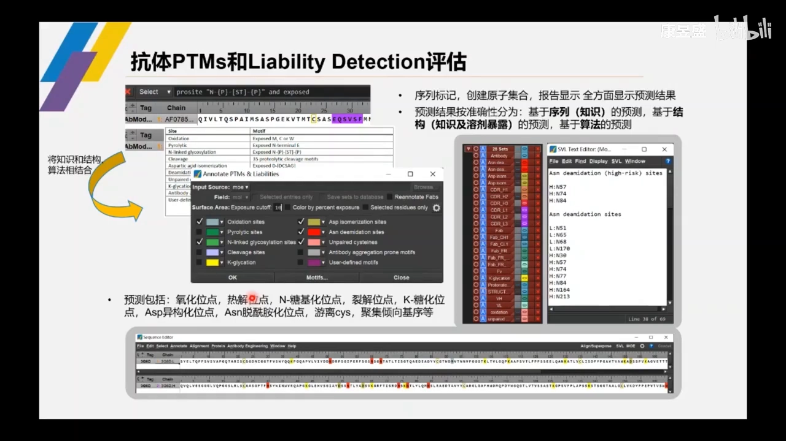
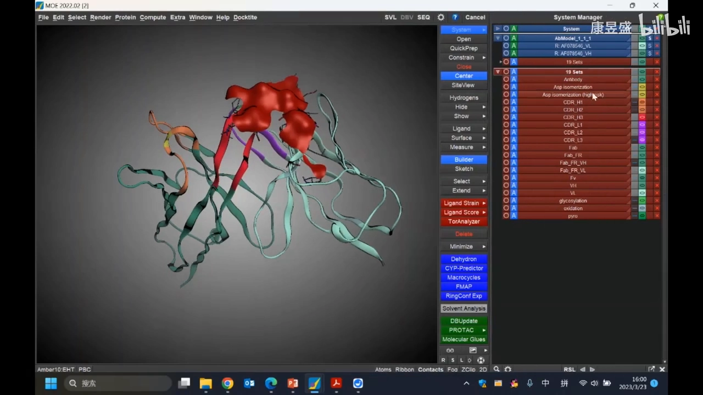
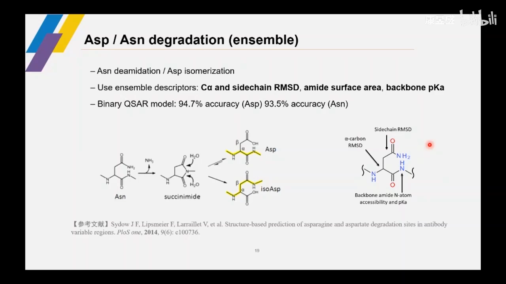
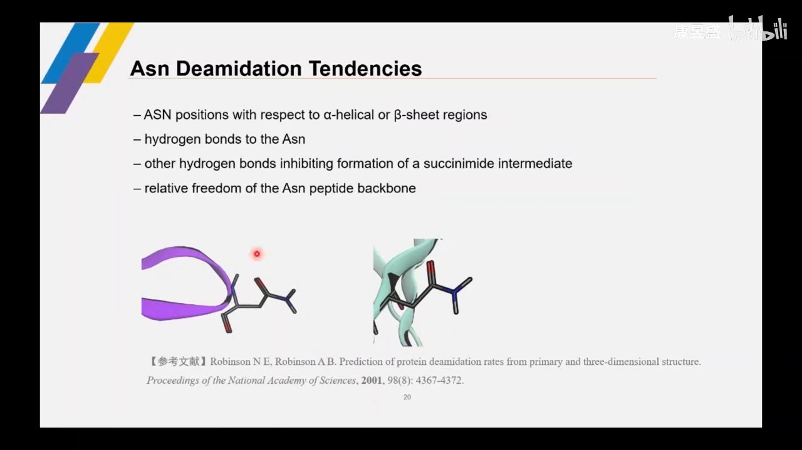
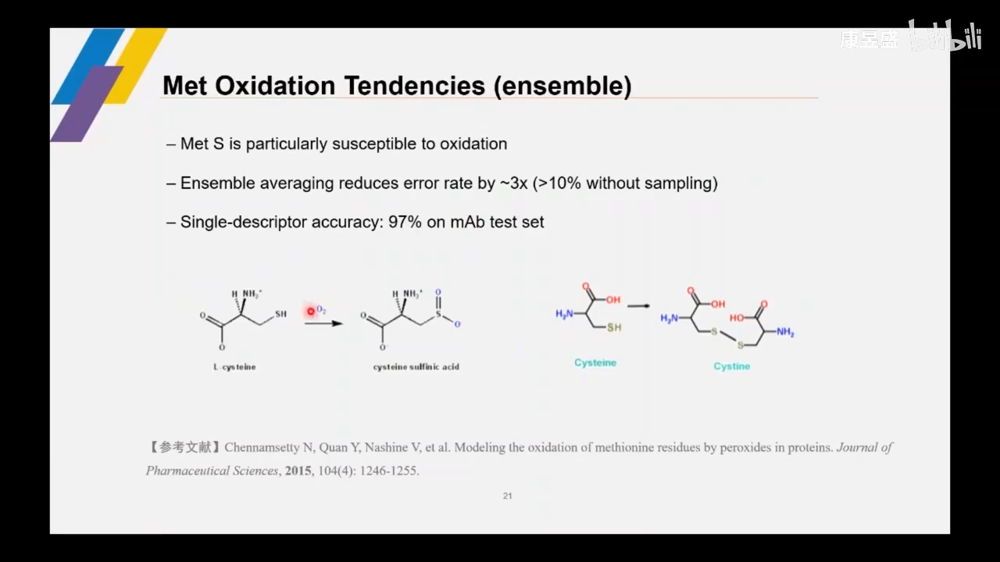
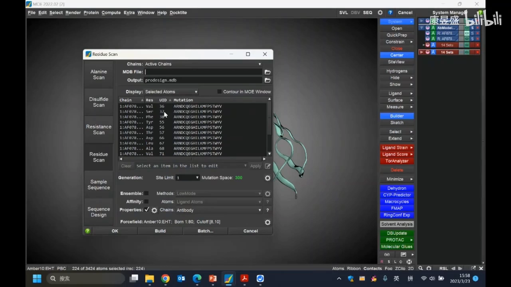
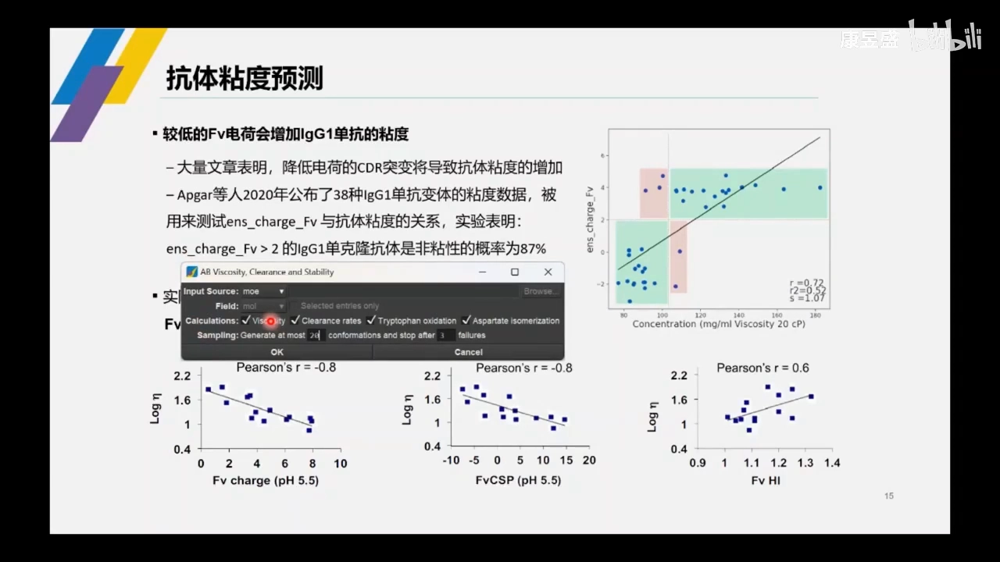
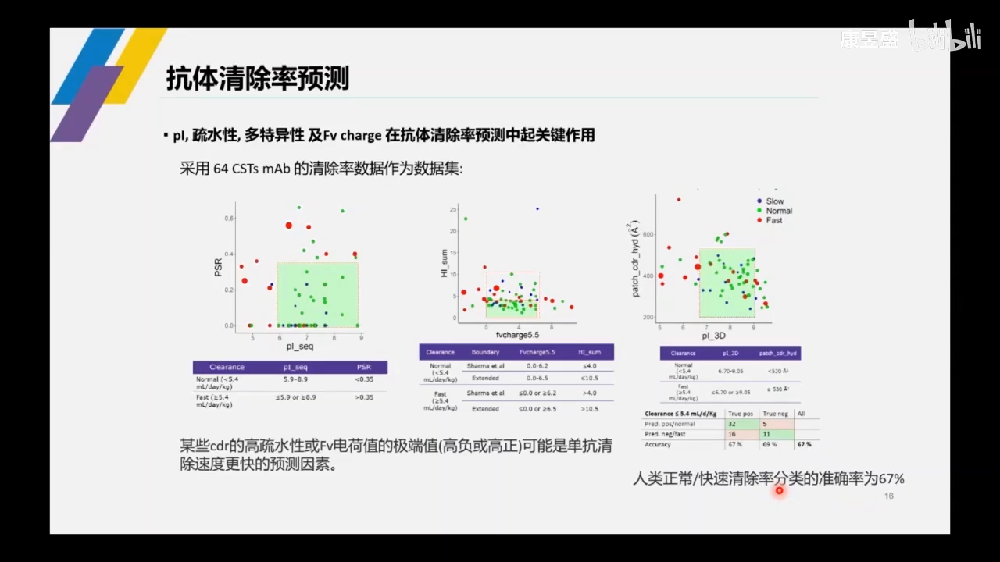
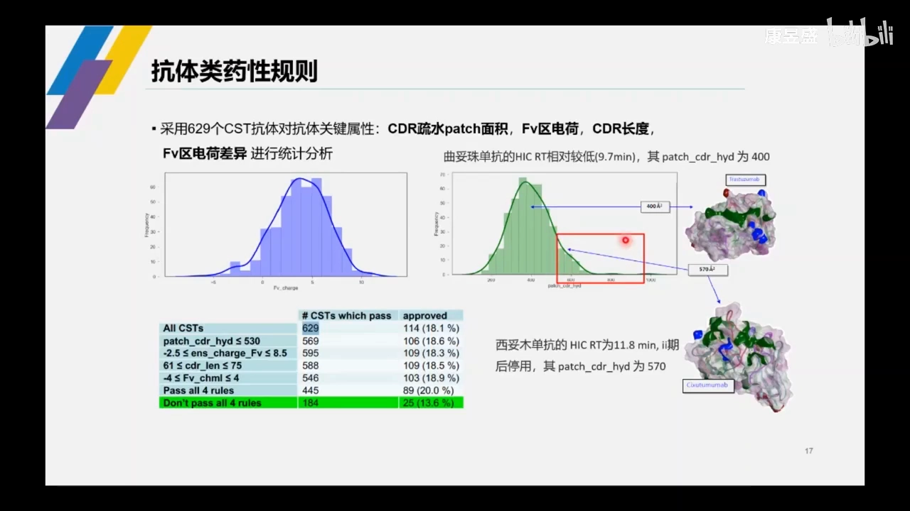

# 在建模阶段就找出化学修饰热点：脱酰胺、氧化与异构化的位点预测与改造

> 视频来源：[MOE抗体药物设计系列讲座第三讲 - 抗体可开发性预测及优化改造](https://www.bilibili.com/video/BV1Gc41157U4/)（Bilibili · 康昱盛，讲者谭畅）｜时长约 61 分钟
> 导读：这是一场以 MOE 软件操作为主的讲座，大量时间花在界面演示上。本文不复述点击路径，只抽取其中**可以迁移到任何工具上的方法论**：怎么判断一个 Asn 会不会脱酰胺、一个 Met 会不会被氧化、一个 Asp 会不会异构化，以及找到热点之后怎么改而不伤结合。字幕中「拖鞋安化」「甜头酰胺」「铁浓氨酸」「图形化」等同音错字，本文已统一订正为脱酰胺、天冬酰胺、天冬氨酸、脱酰胺化。

## 本讲要解决的核心问题（SCQA）

**背景**：全球处于临床前阶段的候选抗体数以万计，但真正能走到上市的是极少数。候选分子在临床阶段失败的原因，很多时候不是「不管用」，而是「做不成药」。

**冲突**：讲者把这类失败原因列了一串：化学稳定性差（某些氨基酸本身化学活性高，容易发生脱酰胺、氧化）、酶切导致降解、清除率异常、沉降与聚集。这些问题的共同点是——**它们在分子序列被选定的那一刻就已经埋下了**，只是要等到工艺开发甚至临床阶段才暴露出来。

**疑问**：能不能在还没有蛋白样品、只有一条序列的时候，就判断出这个分子哪里会坏？如果能，又该怎么改？

**回答（中心思想）**：**化学降解位点是可以预测的，因为它由三个可计算的因素决定——残基的化学性质、它在三维结构中的暴露程度、以及它在构象系综中的柔性**。把「序列知识 + 结构暴露 + 动力学采样」三条证据叠起来，就能在建模阶段给出带风险等级的热点清单；再配合抗体数据库统计与虚拟突变，可以在保持结合与稳定性的前提下把热点改掉。

---

## 一、化学稳定性问题，必须在序列阶段就筛掉

[【跳转到 08:56】](https://www.bilibili.com/video/BV1Gc41157U4/?t=536)

讲者开场就把问题摆到了「选择」的层面：临床前候选抗体数以万计，怎么从中挑出能进临床的那几个，本身就是难题。而挑错的代价很高——分子可能在临床阶段出现化学稳定性不足、酶切降解、清除率异常、沉降聚集，最终导致活性下降甚至失败。

所以思路要反过来：**不是等做出了蛋白再去测稳定性，而是在只有序列的时候就预测属性、排掉高风险分子**。这就是所谓「可开发性评估前移」。

[【跳转到 10:24】](https://www.bilibili.com/video/BV1Gc41157U4/?t=624)

讲者给出的工作流是四步：

1. 从项目里拿到一批候选抗体的序列；
2. 自动建模，得到三维结构；
3. 基于结构计算各类描述符，预测关键属性；
4. 针对预测出的问题位点做结构优化（突变），再回到实验验证。

这里有一个重要的方法论判断：**基于结构的描述符预测，准确率通常高于仅基于序列的预测**。原因是同样的氨基酸，埋在疏水核心里和暴露在溶剂里，化学反应性完全不同——这一点在后面每一类修饰的预测里都会反复出现。

## 二、识别修饰位点的三条证据链

[【跳转到 42:21】](https://www.bilibili.com/video/BV1Gc41157U4/?t=2541)

讲者把「翻译后修饰位点与风险位点检测」拆成三种精度层次，这是整场讲座里最值得记住的框架：

**第一层：基于序列的知识（motif 匹配）**。只要有一条序列就能做，规则来自已知化学：

| 风险类型 | 识别规则（基序） |
| --- | --- |
| 氧化位点 | 暴露的 Met、Cys 或 Trp |
| 焦谷氨酸位点 | 暴露的 N 端 Glu／Gln |
| N-糖基化位点 | N-X-S/T 序列子 |
| 裂解位点 | 特定蛋白酶切基序 |
| 天冬氨酸酸性异构化 | D-HDSAG 类基序 |
| 天冬酰胺脱酰胺 | N-G、N-S 类基序 |
| 游离半胱氨酸 | 未配对的 Cys |
| 聚集倾向基序 | 已知的聚集倾向序列 |
| 赖氨酸糖化 | Lys |

**第二层：基于结构（知识 + 溶剂暴露）**。有了三维结构，就可以判断这个残基到底是不是暴露在表面。讲者给了一个具体阈值：**只有暴露比达到 10 以上，才认为它有可能发生化学反应**。原因很直白——一个 Met 再容易被氧化，如果它被周围的氨基酸严严实实地包住，氧化剂根本进不去。

**第三层：基于算法（机器学习模型）**。前两层是「规则」，第三层是「模型」：引入公开发表的算法，对脱酰胺、异构化、氧化分别给出风险打分。讲者特别强调，预测结果里标为 **high risk** 的位点之所以更可信，是因为它同时满足了三件事——符合化学知识、溶剂可及、且被模型判为高风险。

预测结果会以三种形式呈现：序列上按风险类型着色、三维结构上生成对应的原子集合、以及一份文本报告逐条列出风险位点。对使用者来说，最有价值的其实是第三种——它把「哪里有问题」变成了一张可以逐条核对的清单。

## 三、脱酰胺与异构化：共享一个五元环，由柔性、可及性、pKa 决定

[【跳转到 48:47】](https://www.bilibili.com/video/BV1Gc41157U4/?t=2923)

这张图把化学和计算接在了一起。反应式部分是：Asn 的侧链酰胺氮进攻主链羰基碳，闭环成**琥珀酰亚胺（succinimide）**，再开环水解，走向 **Asp** 或 **isoAsp** 两条路。这条路径与上一篇（抗体电荷异构体）里那张机制图完全一致——脱酰胺与异构化本来就是同一个中间体的两个出口。

既然共享中间体，决定速率的因素也就共享。讲者列出模型用的四个描述符：

- **$\alpha$-碳的 RMSD**：反映主链柔性；
- **侧链 RMSD**：反映侧链能否摆到进攻所需的构象；
- **酰胺表面可及面积**：这个酰胺基团是否暴露、能否被水进攻；
- **主链酰胺氮的 pKa**：越容易被去质子化，氮的孤对电子越活跃，越容易发起进攻。

$$
\text{风险} = f\left(\mathrm{RMSD}_{\alpha},\ \mathrm{RMSD}_{\text{侧链}},\ A_{\text{amide}},\ \mathrm{p}K_a\right)
$$

用这四个描述符构建的二元 QSAR 模型，在验证集上的准确率是：**天冬氨酸异构化 94.7%、天冬酰胺脱酰胺 93.5%**（模型来源为 Sydow 等人的 *PLoS One* 2014 论文）。

### 3.1 为什么必须做「系综」而不是看一张静态结构

[【跳转到 47:21】](https://www.bilibili.com/video/BV1Gc41157U4/?t=2841)

讲者专门解释了一个容易被忽略的陷阱：**晶体结构只是蛋白在某一时刻的一个快照，而蛋白在溶液里、在人体内都是动态的**。用一个静态构象去判断「这个 Asn 暴不暴露」，误差可能很大——某个时刻它恰好被埋住了，但换个构象它就露出来了。

解决办法是做构象采样（ensemble sampling）：对侧链做柔性采样，对主链允许有限度的移动，然后在一批构象上分别计算描述符，再取平均或统计。讲者提到一个量化收益：**做系综平均能把误差率降低约 3 倍**（不做采样时误差率超过 10%）。

### 3.2 另一套模型：从二级结构与氢键出发

[【跳转到 51:13】](https://www.bilibili.com/video/BV1Gc41157U4/?t=3073)

讲者又介绍了一个思路不同、但结论相似的模型。它判断柔性的方式不是算 RMSD，而是看这个 Asn 所处的**二级结构**：位于 loop 区的 Asn，柔性远高于位于折叠区的 Asn。同时它还考虑**氢键**——如果这个 Asn 与周围残基形成了氢键，它就被「固定」住了，不容易发生反应。

这张幻灯片把影响因素列成了四条，与上面的模型一一对应：

- Asn 相对于 $\alpha$-螺旋或 $\beta$-折叠的位置；
- 与 Asn 形成的氢键；
- 其他会阻碍琥珀酰亚胺中间体形成的氢键；
- Asn 附近肽主链的相对自由度。

该模型的输出不是「是／否」，而是一个**脱酰胺倾向打分**，讲者给了经验阈值：

| 打分 | 判读 |
| --- | --- |
| $<1$ | 极高概率会脱酰胺，重点关注 |
| $<5$ | 需要关注 |
| $>5$ 或 $>10$ | 基本不必考虑脱酰胺 |

## 四、甲硫氨酸氧化：暴露的硫醚最危险

[【跳转到 53:18】](https://www.bilibili.com/video/BV1Gc41157U4/?t=3198)

氧化这一类的逻辑比脱酰胺简单：**甲硫氨酸的硫原子本身就是亲核的，特别容易被过氧化物氧化**。所以模型要考虑的核心只有一件事——这个硫原子暴露在什么环境里、溶剂可及性如何。

幻灯片给出了三个关键结论：

- Met 的硫对氧化「格外敏感」；
- 系综平均把误差率降低约 3 倍（不做采样时误差率超过 10%）；
- 单描述符模型在单抗测试集上的准确率达到 **97%**（模型来源为 Chennamsetty 等人的 *Journal of Pharmaceutical Sciences* 2015 论文）。

右侧反应式还顺带说明了半胱氨酸的两条去向：氧化成**半胱氨酸亚磺酸**（cysteine sulfinic acid），或者与另一个游离半胱氨酸形成**胱氨酸**（二硫键）。这解释了为什么「游离半胱氨酸」本身就是一类风险位点——它既可能被氧化，也可能形成非预期的二硫键，进而改变构象与电荷（回到上一篇的酸性／碱性变异体）。

讲者还演示了一个实用的交叉验证技巧：同一个位点用两种不同方法预测，如果两种方法都把它排在第一，那这个位点几乎肯定有问题。他举的例子是第 92 位——两种方法一致指向它，于是「这个位点就需要着重关注，可能需要做一些改造」。

## 五、找到热点之后怎么改：数据库统计与虚拟突变

[【跳转到 13:44】](https://www.bilibili.com/video/BV1Gc41157U4/?t=824)

预测只是第一步，真正难的是**改完之后不能把结合活性改没了**。讲者给了三条改造思路：

1. **凭经验直接改**：比如把某个易氧化的 Met 换成其他氨基酸，在不影响结合活性的前提下改善氧化问题；
2. **查抗体数据库统计**：MOE 自带抗体结构数据库，可以统计「某个位点上，几千上万个抗体里各种氨基酸的分布比例」。知道了这个位点通常是什么氨基酸，突变时就有了候选清单，而不是盲猜；
3. **虚拟突变扫描（Residue Scan）**：选中目标残基，让它随机突变成不同氨基酸，再用能量打分、热稳定性、与抗原的结合活性来筛选——目标是「保持热稳定性、保持结合活性，同时把氧化问题解决掉」。

这套流程的价值在于把「改哪里」和「改成什么」分开了：预测模型负责前者，数据库统计与虚拟扫描负责后者，最后才回到湿实验验证。

## 六、从单点修饰到整分子画像：电荷、疏水斑块、黏度与清除率

单点修饰之外，讲者还展示了如何用同一套结构描述符画出整个分子的「可开发性画像」。这部分虽然不直接是化学修饰，但它解释了为什么修饰位点必须放回整体去看。

### 6.1 疏水斑块与溶解度

[【跳转到 06:36】](https://www.bilibili.com/video/BV1Gc41157U4/?t=396)

蛋白-蛋白相互作用往往由表面较大的**疏水斑块（hydrophobic patch）**驱动，这类相互作用会导致抗体之间互相黏附，最终表现为聚集与沉降。工具的做法是先在表面生成不同性质的斑块（疏水、带正电、带负电），再用斑块分析器给出面积和包含的氨基酸清单；知道是哪些氨基酸之后，就可以定向把它们突变成非疏水残基，把斑块「打散」。

讲者提到，CDR 区疏水斑块的面积本身就可以用来预测溶解度，并与已知的 SAP、Camel 等算法做过相关性比较（用 17 个 IgG4 抗体与 HIC 保留时间做相关性矩阵）。

### 6.2 黏度：Fv 电荷太低会变稠

[【跳转到 33:52】](https://www.bilibili.com/video/BV1Gc41157U4/?t=2032)

高浓度制剂是当前的大趋势（皮下、眼内注射都要求高浓度），而高浓度下黏度是硬约束。讲者引用的规律是：**降低 CDR 电荷的突变会导致抗体黏度增加**。Apgar 等人 2020 年公布了 38 种 IgG1 单抗的黏度数据，用来检验 Fv 区系综电荷与黏度的关系，结论是：**当 Fv 区系综电荷大于 2 时，IgG1 单抗为非黏性的概率达到 87%**。

图中三张散点图分别给出 Fv 电荷、Fv 电荷对称性（FvCSP）、Fv 疏水指数与黏度对数的相关性，Pearson 相关系数分别约为 $-0.8$、$-0.8$、$0.6$。也就是说，电荷越高越不黏，疏水性越强越黏。

### 6.3 清除率：pI 与斑块面积划出的安全区

[【跳转到 36:35】](https://www.bilibili.com/video/BV1Gc41157U4/?t=2195)

清除率预测用的是 64 个 CST 抗体的数据。讲者说这里没有找到简单的线性相关，但能总结出「规律」：把等电点（pI）与多特异性指标（PSR）画在一起，**pI 在 5.9～8.9 之间、PSR 小于 0.35 的方形区域里，几乎全是清除率正常或偏慢的抗体**；而快速清除的抗体几乎都落在这个方框之外。

基于这类规则构建的分类模型，区分「正常清除率」与「快速清除率」的准确率约为 **67%**。讲者还补了一句判断依据：某些 CDR 的高疏水性、或 Fv 电荷的极端值（过高或过低），都可能是清除更快的预测因素。

## 七、类药性规则：629 个临床抗体给出的分布红线

[【跳转到 38:40】](https://www.bilibili.com/video/BV1Gc41157U4/?t=2320)

讲者尝试做了一件类似「里宾斯基五规则」的事：取 629 个已进入临床的抗体，统计四个关键属性的分布，看能不能总结出「正常范围」。

四条规则与阈值是：

| 属性 | 阈值 |
| --- | --- |
| CDR 疏水斑块面积 | $\le 530\ \text{Å}^2$ |
| Fv 区系综电荷 | $-2.5 \sim 8.5$ |
| CDR 长度 | $\le 75$ |
| Fv 区电荷差异 | $-4 \sim 4$ |

统计结果：629 个抗体中，445 个通过全部四条规则，其中 89 个已获批（20.0%）；184 个未通过全部规则，其中 26 个已获批（13.8%）。通过率与获批率之间的这个差距，就是这类「规则」的实际价值——**它筛的是概率，不是判决**。

讲者用两个分子做了对照：

- **曲妥珠单抗**：HIC 保留时间 9.7 min，CDR 疏水斑块面积约 $400\ \text{Å}^2$，落在分布的正中间，属于「正常」；
- **西妥木单抗**：HIC 保留时间 11.8 min，斑块面积约 $570\ \text{Å}^2$，明显偏大；这个分子在临床二期之后被停用。

这个对照很能说明问题：疏水斑块面积不是「能不能成药」的唯一原因，但一个明显偏离临床抗体分布的值，确实是一个值得警惕的信号。

## 小结

- **化学修饰位点可以预测**，因为反应速率由残基化学性质、结构暴露程度、构象柔性三者共同决定。
- **三条证据链叠加才可信**：序列基序给出「可能」，结构暴露给出「能不能」，机器学习模型给出「有多大概率」，三者都命中的才是 high risk。
- **脱酰胺与异构化共享琥珀酰亚胺中间体**，模型用主链／侧链 RMSD、酰胺可及面积、主链 pKa 四个描述符，准确率约 93%～95%。
- **Met 氧化看暴露**，单描述符模型在单抗测试集上准确率约 97%；同一套逻辑也适用于游离 Cys 的氧化与错配。
- **静态结构会骗人**，必须做构象系综采样，系综平均能把误差率降低约 3 倍。
- **改热点要靠证据**：抗体数据库的位点分布 + 虚拟突变扫描，在保持结合与热稳定性的前提下换掉风险残基。
- **单点修饰要放回整分子画像**：疏水斑块、Fv 电荷、pI 共同决定溶解度、黏度与清除率；629 个临床抗体给出的分布区间可以作为早期红线参考。

## 关键术语速查

| 术语 | 一句话解释 |
| --- | --- |
| 可开发性（developability） | 一个分子能否被稳定、经济地做成药的综合属性集合 |
| 化学稳定性 | 分子抵抗脱酰胺、氧化、异构化、裂解等化学反应的能力 |
| 琥珀酰亚胺 | 脱酰胺与异构化共用的五元环中间体 |
| isoAsp | 异天冬氨酸，主链走向与 Asp 不同的异构体，可致活性完全丧失 |
| 系综采样 | 对同一序列生成多个构象并统计属性，避免单一静态结构的偏差 |
| 溶剂可及性 | 残基暴露在溶剂中的程度，是判断能否发生反应的关键门槛 |
| 疏水斑块 | 蛋白表面成片的疏水残基区域，驱动聚集、沉降与高黏度 |
| Fv 区系综电荷 | Fv 结构域在不同构象下的平均净电荷，与黏度强相关 |
| pI | 等电点，影响清除率与色谱行为 |
| 虚拟突变扫描 | 在计算中把目标残基替换为多种氨基酸并评估稳定性与结合 |