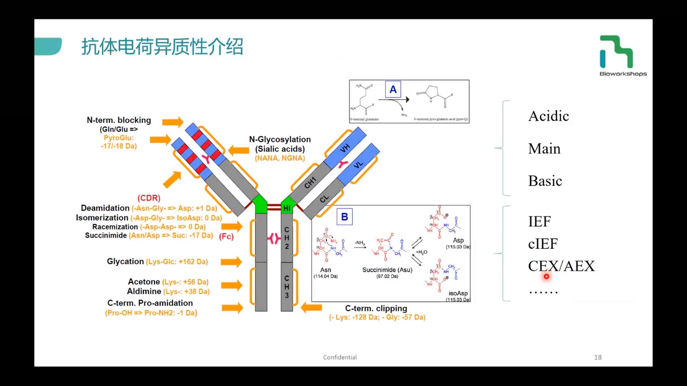
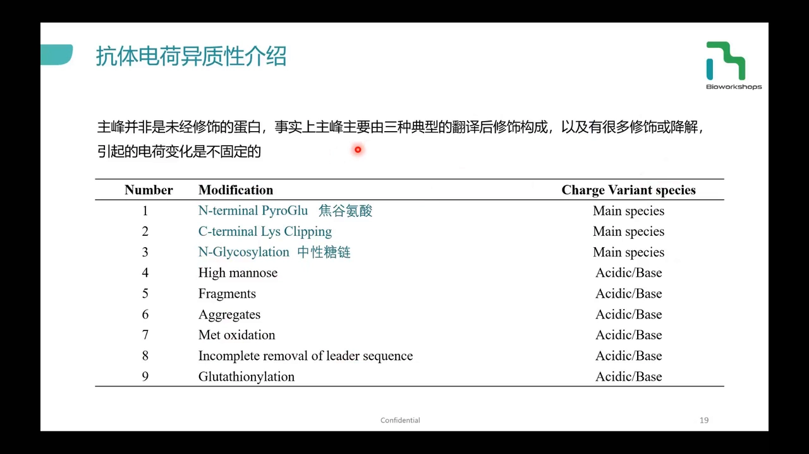
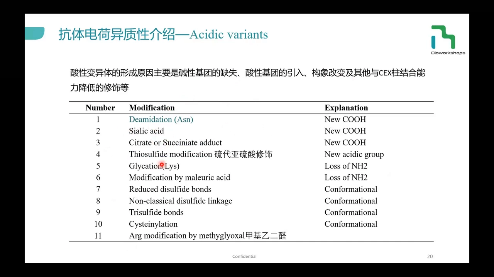
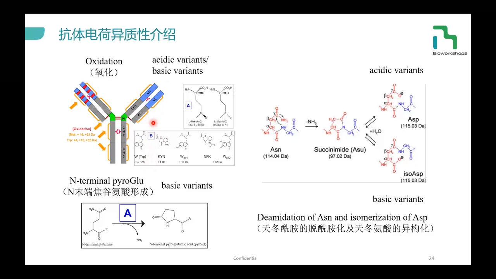
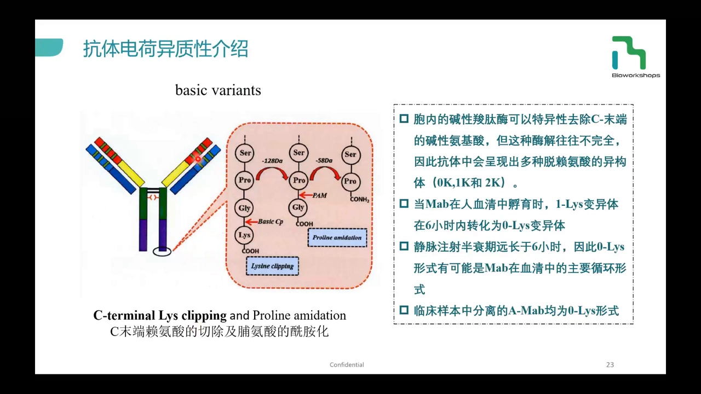
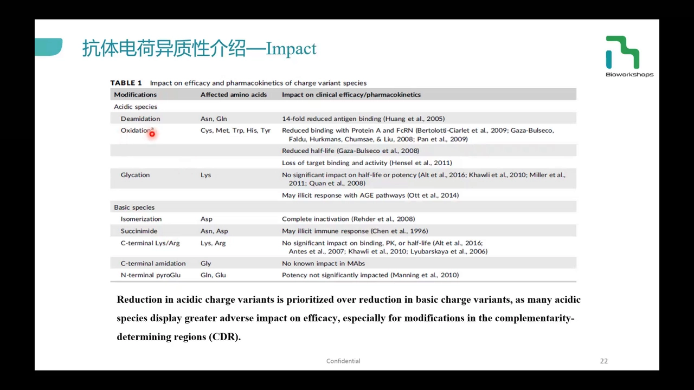
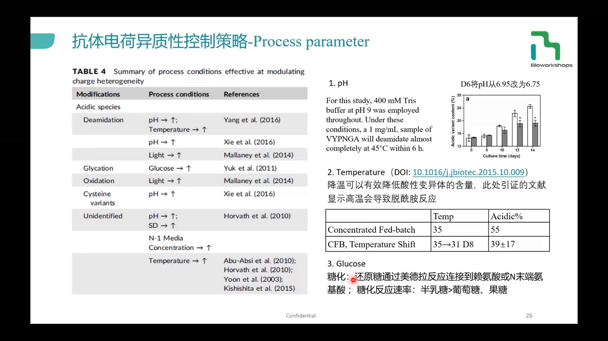
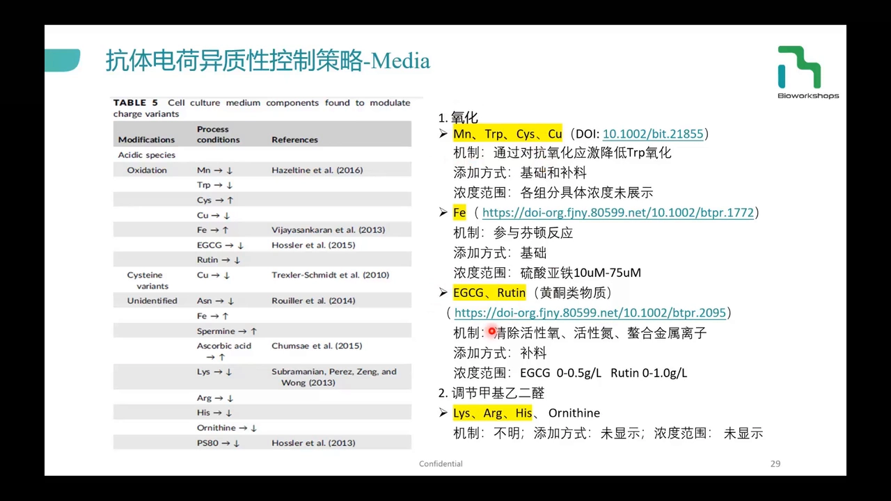
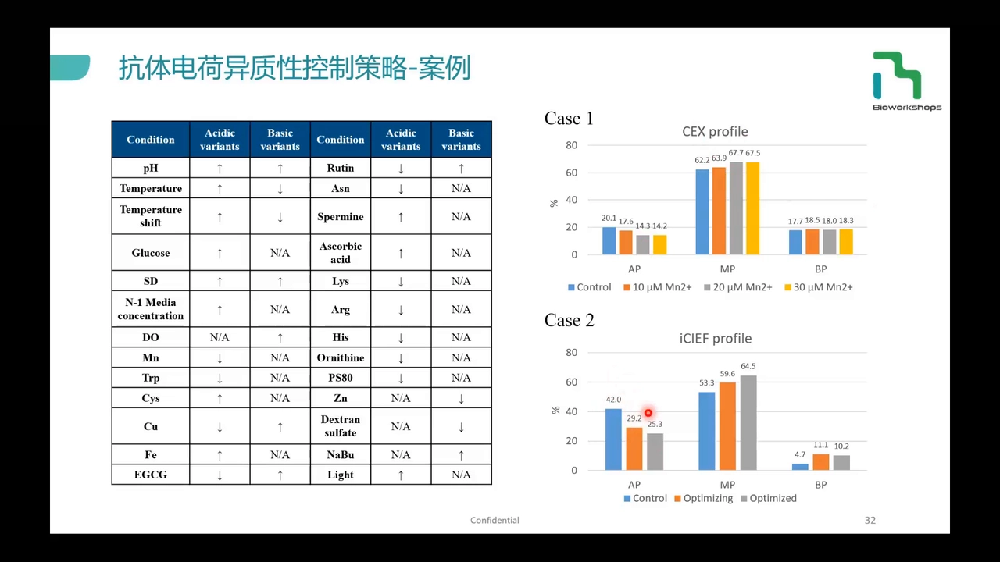

# 抗体电荷异构体：化学修饰如何改变电荷、拖累效价，并被细胞培养左右

> 视频来源：[康日百奥Bioworkshops线上课程《细胞培养过程中抗体关键质量属性的介绍及控制》](https://www.bilibili.com/video/BV198411j7Pa/)（Bilibili · 康日百奥Bioworkshops，讲者潘振华）｜时长约 44 分钟
> 导读：这支课分两大块——前 24 分钟讲 N-糖基化，后 18 分钟讲电荷异质性。糖链加工顺序与 FcγR 亲和机制已在本系列 4.1.5 讲透，本文只保留「糖型作为一类质量属性」的最小背景，主体放在**化学修饰如何把抗体拆成酸性峰、主峰、碱性峰，以及这些修饰怎么被工艺控制**。讲者的口语字幕有大量同音错字（脱酰胺→拖鞋安化、电荷异质性→电荷一致性等），本文已统一订正。

## 本讲要解决的核心问题（SCQA）

**背景**：抗体药物在上游细胞培养阶段被细胞生产出来，此后下游纯化、制剂、储存各环节都可能继续改变它。行业早已接受一个事实：表达出来的抗体不是一条序列对应一种分子，而是一群带不同修饰的变体混合物。

**冲突**：上游细胞培养像一个黑箱——我们只能控制培养环境、培养基和添加物，却很难直接看到细胞里发生了什么。可这些环境变化会实打实地改变抗体最终的修饰谱；而修饰一旦落在关键位置，就可能改变抗原结合、改变半衰期，甚至改变药物的颜色。

**疑问**：抗体上到底有哪些化学修饰？它们如何体现在可测量的质量属性上？又该在哪个环节、用什么手段去控制？

**回答（中心思想）**：**电荷异质性是化学修饰最直接的「总账」**——脱酰胺、氧化、C 端赖氨酸切除不完全、糖基化、二硫键错配等修饰，最终都会以酸性峰或碱性峰的形式出现在阳离子交换色谱上。其中酸性变异体（尤其是脱酰胺）对效价的影响最大，是工艺开发优先压制的对象；而控制它的第一优先级不是下游纯化，而是**上游的 pH、温度与培养基配方**。

---

## 一、主峰不是「没被修饰的抗体」

[【跳转到 23:25】](https://www.bilibili.com/video/BV198411j7Pa/?t=1405)

蛋白表面有大量带电荷的基团。任何改变这些基团种类或数量的修饰，都会改变分子的整体静电荷，从而在电荷分离（CEX／AEX、cIEF 等）上表现为与主成分洗脱时间不同的**电荷异构体**：酸性变异体、主成分、碱性变异体。

讲者强调了一个容易误解的点：**主峰并不是未经修饰的原型蛋白**。

这张图把「修饰位点」和「质量变化」标在了一起，是理解后面所有讨论的地图：

| 修饰 | 位置 | 质量变化 |
| --- | --- | --- |
| N 端焦谷氨酸形成（Gln/Glu → pyroGlu） | 重链、轻链 N 端 | $-17$ 或 $-18$ Da |
| 脱酰胺（Asn-Gly → Asp） | CDR、Fc | $+1$ Da |
| 异构化（Asp-Gly → isoAsp） | CDR、Fc | $0$ Da |
| 消旋化（Asp-Asp） | — | $0$ Da |
| 琥珀酰亚胺（Asn/Asp → Suc） | — | $-17$ Da |
| 糖化（Lys-Glc） | Lys | $+162$ Da |
| 丙酮化、醛亚胺加合 | Lys | $+56$、$+38$ Da |
| C 端脯氨酸酰胺化 | 重链 C 端 | $-1$ Da |
| C 端截断（丢 Lys / 丢 Gly） | 重链 C 端 | $-128$、$-57$ Da |

注意「异构化」和「消旋化」的质量变化是 $0$——它们不改变分子量，只在结构上做了手脚，所以靠完整分子量测不出来，必须靠肽图或色谱行为去发现。这一点在下一篇（用结构预测找修饰热点）里还会展开。

[【跳转到 24:40】](https://www.bilibili.com/video/BV198411j7Pa/?t=1480)

具体到主峰，它主要由三类「几乎人人都带」的修饰构成：**N 端焦谷氨酸、C 端赖氨酸切除、以及中性的 N-糖链**。也就是说，主峰是「标准加工完成」的那一群分子，而不是「什么都没发生」的分子。

这张表把九类修饰归了档：

- **归入主峰**：N 端焦谷氨酸、C 端 Lys 切除、中性糖链；
- **酸性或碱性都可能**：高甘露糖、片段、聚集体、Met 氧化、前导序列切除不完全、谷胱甘肽化。

最后一类之所以「方向不定」，讲者给了解释：聚集体会改变分子表面的电荷分布，但方向不定——既可能表现为酸性峰，也可能表现为碱性峰。所以这一类不能简单地贴标签，只能单独拿出来看。

### 1.1 糖型：一类特殊的「修饰」

[【跳转到 02:05】](https://www.bilibili.com/video/BV198411j7Pa/?t=125)

糖型（N-糖基化）严格说不是化学降解，而是细胞在合成时「装上去」的修饰，但它完全符合本小节的框架：**它改变分子的理化性质、进入 CQA 清单、并强烈依赖工艺条件**。糖链加工顺序与 FcγR 亲和机制已在 4.1.5 讲透，这里只保留「糖型作为质量属性」的要点。

讲者说的「糖型」，主要指 Fc 段第 297 位天冬酰胺上连接的那条寡糖链。核心结构是两个 N-乙酰葡糖胺加三个甘露糖，在此之上依次添加岩藻糖、半乳糖和唾液酸。由此产生的常见糖型有 G0F、G1F、G2F 等。

哪些糖型是「想要的」，取决于抗体的作用机制：

- **需要 ADCC／CDC 的抗体**（例如通过 Fc 端结合到靶细胞上的抗体），希望提升岩藻糖基化水平相关的效应功能；
- **阻断型抗体**（讲者以 PD-1 为例，抗体结合免疫细胞、让癌细胞不能免疫逃逸），反而不希望杀伤活性太高；
- **不想要的糖型**包括高甘露糖，以及带免疫原性的 α1,3-半乳糖和 NGNA 唾液酸——不过这类有免疫原性的糖型在 CHO 细胞里一般不存在，这也是选择 CHO 作为生产宿主的原因之一；
- **无糖型（aglycosyl）会影响药物的 PK**，即使比例不超过 20%，全球大药企的问卷调查也显示大家对此非常重视。讲者的说法很直接：一个单抗要在国内上市，不设糖型标准目前是比较难的。

糖型与电荷的关系也很清楚：**中性糖链落在主峰，末端带唾液酸的糖型则可能落进酸性峰**。这正好解释了为什么「糖型」和「电荷异质性」这两类质量属性总是被放在一起讨论——它们共享同一批分子事件。

讲者还给了两个实操提醒。其一，糖型调节剂的效果在文献里是 case by case 的：添加核苷糖前体在代谢层面确实达到了预期，但最终糖型不一定跟着变，因为代谢瓶颈不一定卡在你添加的那一步，必须做实验验证。其二，**只看 Man5 一个指标会误判**：铜离子会抑制 M9→M8→M7→M6 的甘露糖苷酶，使这些高甘露糖型累积，但 M6→M5 这一步的酶不受铜抑制，所以 Man5 反而可能下降——如果只盯 Man5，就会得出「铜降低了高甘露糖」的错误结论。

## 二、酸性变异体：脱酰胺是头号来源

[【跳转到 25:55】](https://www.bilibili.com/video/BV198411j7Pa/?t=1555)

酸性变异体的形成机制可以归为四类：**碱性基团缺失、酸性基团引入、构象改变、以及与 CEX 柱结合能力下降**。

十一类来源里，讲者点名「最重要、也最受关注」的是**天冬酰胺（Asn）的脱酰胺**——它凭空引入一个羧基（New COOH），直接把分子往酸性方向推。除此之外还有唾液酸（同样引入羧基）、柠檬酸或琥珀酸加合、硫代亚硫酸修饰、糖化（Lys 上丢一个氨基）、马来尿酸修饰、还原态二硫键、非经典二硫键、三硫键、半胱氨酸化、以及甲基乙二醛修饰精氨酸。

其中后面几项（还原二硫键、非经典二硫键、三硫键、半胱氨酸化）的机制是「构象改变」——它们不一定改变带电基团的数目，而是让分子折叠得不太一样，从而改变与色谱柱的相互作用。这解释了为什么同一类修饰有时表现为酸性、有时表现为碱性。

### 2.1 脱酰胺到底发生了什么

[【跳转到 31:29】](https://www.bilibili.com/video/BV198411j7Pa/?t=1889)

右侧那张反应式是本节最该记住的一张图。天冬酰胺的侧链酰胺氮会进攻自己主链的羰基碳，闭环生成一个五元环中间体——**琥珀酰亚胺（succinimide）**，同时脱去一分子氨；这个中间体再被水解开环，就有两条路：

- 开环回到 **Asp**（天冬氨酸），净结果相当于把 Asn 换成了 Asp，分子量 $+1$ Da，同时多出一个羧基 → 酸性峰；
- 开环走另一侧，得到 **isoAsp**（异天冬氨酸），分子量同样是 $+1$ Da，但主链走向变了 → 结构异构，同样影响结合。

$$
\text{Asn} \rightarrow \text{琥珀酰亚胺} \rightarrow \text{Asp} \ \text{或} \ \text{isoAsp}
$$

这就是为什么「脱酰胺」和「异构化」在文献里总是被放在一起讲：它们共享同一个五元环中间体，只是最终落点不同。中间体的生成速率取决于 Asn 的柔性、溶剂可及性和主链酰胺的碱性——这三个因素正是下一篇里机器学习模型的输入特征。

### 2.2 氧化也会造出酸性峰

同一张图左侧是氧化：Met 加一个氧是 $+16$ Da，加两个氧是 $+32$ Da；Trp 的氧化更复杂，有 $+4$、$+16$、$+32$ Da 等多种产物。氧化本身不直接产生羧基，但它会改变局部构象与电荷分布，因此同样会落在酸性或碱性峰里。讲者还提到一个容易被忽略的后果：**氧化会引发片段化，并让抗体的颜色出问题**——这在制剂端是肉眼可见的质量缺陷。

### 2.3 N 端焦谷氨酸：最「无害」的一种环化

图左下角是 N 端谷氨酰胺（或谷氨酸）环化生成**焦谷氨酸（pyroGlu）**的过程，脱去一分子氨，质量减少 $17\sim18$ Da。这一步把 N 端的游离氨基封掉，理论上会减少一个正电荷，属于往酸性方向推的修饰。但从后面的影响表看，它对效价的影响并不显著——这是一个「几乎每个抗体都有、但不必过度焦虑」的修饰。

## 三、碱性变异体：C 端赖氨酸切除不完全

[【跳转到 26:45】](https://www.bilibili.com/video/BV198411j7Pa/?t=1605)

碱性变异体的形成逻辑与酸性变异体镜像对称：**酸性基团缺失、碱性基团不完全切除、额外碱性基团加入、构象改变、与 CEX 柱结合增强**。

其中「碱性基团不完全切除」指的就是重链 C 端的赖氨酸。抗体在细胞内合成时，重链 C 端带一个赖氨酸；胞内的碱性羧肽酶会把它切掉，但**这个酶解往往不完全**，于是产物里同时存在 0-Lys、1-Lys、2-Lys 三种异构体。

讲者用四条证据说明「这件事其实不用太管」：

1. 胞内碱性羧肽酶特异性去除 C 端碱性氨基酸，但酶解不完全，所以会看到多种脱赖氨酸异构体；
2. 单抗在人血清中孵育时，**1-Lys 变体在 6 小时内就转化为 0-Lys 变体**；
3. 静脉注射的半衰期远长于 6 小时，因此 0-Lys 才可能是单抗在血清中的主要循环形式；
4. 从临床样本中分离得到的抗体，全部是 0-Lys 形式。

换句话说，C 端赖氨酸的差异在体外检测里看得见，但进入人体后很快被「补做」掉了，所以它对安全性和有效性几乎没有影响。这解释了为什么业界对碱性变异体的关注度普遍低于酸性变异体。

## 四、哪些修饰真的会伤到效价

[【跳转到 27:35】](https://www.bilibili.com/video/BV198411j7Pa/?t=1655)

讲者把文献里的影响证据汇总成一张表，这是本节最有信息量的一页：

| 修饰 | 受影响氨基酸 | 对效价／药代的影响 |
| --- | --- | --- |
| 脱酰胺 | Asn、Gln | 抗原结合下降可达 14 倍 |
| 氧化 | Cys、Met、Trp、His、Tyr | 与 Protein A、FcRn 结合下降；半衰期缩短；靶点结合与活性丧失 |
| 糖化 | Lys | 对半衰期与效价无显著影响；可能经 AGE 通路引发反应 |
| 异构化 | Asp | 完全失活 |
| 琥珀酰亚胺 | Asn、Asp | 可能引发免疫反应 |
| C 端 Lys／Arg | Lys、Arg | 对结合、PK、半衰期无显著影响 |
| C 端酰胺化 | Gly | 单抗中未见已知影响 |
| N 端焦谷氨酸 | Gln、Glu | 效价无显著影响 |

由此可以提炼出三条判断：

- **脱酰胺与异构化最危险**，因为它们直接动的是结合界面上的化学性质与主链走向；文献里「抗原结合下降 14 倍」和「完全失活」都是这两类修饰的案例。
- **氧化伤的是两条线**：一条是靶点结合（CDR 里的 Met／Trp），另一条是 FcRn 结合与半衰期（Fc 上的 Met）。
- **碱性变异体基本可以放行**，C 端 Lys／Arg、C 端酰胺化、N 端 pyroGlu 都属于「看得见但不必紧张」的一类。

幻灯片底部还有一句总结：**降低酸性变异体的优先级高于降低碱性变异体**，因为许多酸性物种对效价的不利影响更大，尤其是当修饰落在互补决定区（CDR）时。

讲者补充了产业侧的证据：国际大型药企在放行与稳定性研究中，会把**唾液酸、脱酰胺、以及低于 10% 的 Fc 氧化**列为 CQA 加以控制——可见业界对这几项翻译后修饰造成的电荷异质性有多重视。

## 五、控制策略：先动工艺参数，再动培养基

[【跳转到 31:54】](https://www.bilibili.com/video/BV198411j7Pa/?t=1914)

讲者先排除了一个「技术上可行但不划算」的选项：**下游纯化确实能把电荷异构体分开**，代价是收率损失——蛋白已经产出来了，再把它当杂质扔掉，非常心痛。所以更合理的顺序是：**能在上游控制的，就不要留到下游去分**。

### 5.1 序列层面的改造

如果脱酰胺来自序列上的 NG／NS 基序，最彻底的办法是改序列：把 Asn 或紧随其后的 Gly／Ser 换掉，就能显著降低脱酰胺与酸性峰比例。讲者也坦言，这是文献里的做法，业界用序列改造来压酸性峰其实不多——因为改序列要重新验证结合活性，代价不一定比工艺优化小。

### 5.2 pH 与温度是第一优先级

[【跳转到 33:34】](https://www.bilibili.com/video/BV198411j7Pa/?t=2014)

这张表把「什么条件会推高哪类修饰」列得很清楚：

- **pH 升高 → 脱酰胺增加**；温度升高 → 脱酰胺增加；
- **光照 → 氧化增加**；
- **葡萄糖浓度升高 → 糖化增加**；
- 半胱氨酸相关变异与 pH 正相关。

对应的操作就是：**在培养的平台期（大约第 6～8 天）把 pH 和温度降下来**，酸性峰随之下降。幻灯片右侧给了两个具体案例：把 D6 的 pH 从 6.95 调到 6.75，酸性变异体比例明显下降；把温度从恒定 35 ℃ 改为 35 ℃ 降到 31 ℃，酸性变异体从 55% 降到 $39\pm17\%$。

[【跳转到 34:17】](https://www.bilibili.com/video/BV198411j7Pa/?t=2057)

这里有一个绕不开的取舍：细胞培养后期，酸性峰会随着细胞活力下降而增加，所以**缩短培养时间也能降酸性峰**——但滴度会跟着掉。讲者的原话是，这要从上下游整体去算一笔工程账：在保证质量的前提下，让上游产量与下游回收率达到最优平衡。

[【跳转到 35:07】](https://www.bilibili.com/video/BV198411j7Pa/?t=2107)

碱性变异体的方向恰好相反：**温度越高，碱性变异体越低**。这意味着「降温降酸性峰」的收益，有一部分会以「碱性峰上升」的形式还回去。讲者的判断是，降低温度带来的酸性峰减少，可能只是转移到了碱性峰上——所以最终还是要看整体电荷分布，而不是盯单一指标。此外 DoE 实验也证明 pH、溶氧、接种密度会影响碱性变异体。

[【跳转到 35:32】](https://www.bilibili.com/video/BV198411j7Pa/?t=2132)

结论很明确：**遇到电荷异质性问题，最先优化的工艺参数就是 pH 和温度**，具体做法是在平台期同时降 pH 和降温。

### 5.3 培养基与添加物：从机制出发

[【跳转到 36:22】](https://www.bilibili.com/video/BV198411j7Pa/?t=2182)

针对不同修饰，添加物的思路完全不同：

- **抗氧化**：锰、色氨酸、半胱氨酸、铜可以通过降低氧化应激来减少 Trp 氧化；**EGCG、芦丁**这类黄酮类物质能清除活性氧／活性氮并螯合金属离子，属于补料添加（EGCG 0～0.5 g/L，芦丁 0～1.0 g/L）。
- **铁是一把双刃剑**：培养基需要铁来支持细胞生长和蛋白产量，但铁过多会通过**芬顿反应**产生氧自由基，导致蛋白氧化、酸性变异体增加，甚至让抗体颜色出问题。对于氧化敏感的分子，铁浓度必须盯紧。
- **甲基乙二醛**相关修饰（Lys、Arg、His、鸟氨酸）机制尚不明确。
- **糖基化**方面，天冬酰胺的降解会产生氨、影响糖基化；抗坏血酸会生成木酮糖，修饰伯胺，增加半缩醛与席夫碱形式的分子量。

讲者还专门提醒读者去读原文：有些文献里「加了某个组分，酸性峰降了 3.4%」的结论，背景其实是为了把补料浓度从 1 倍提到 2 倍、不加助溶就析出——对一个工艺已经确定的项目，这个结论的可迁移性并不高。**读文献要看它到底解决了什么问题**。

[【跳转到 39:17】](https://www.bilibili.com/video/BV198411j7Pa/?t=2357)

铜和锌是两个需要额外留意的金属离子：很多工艺会加铜来降低乳酸，但加铜之后要回头看电荷异质性有没有变化、碱性峰是不是更高了；锌是许多羧肽酶的辅因子，理论上补锌有助于 C 端赖氨酸的切除，从而降低碱性峰。

## 六、两个真实案例与一条决策路径

[【跳转到 40:20】](https://www.bilibili.com/video/BV198411j7Pa/?t=2420)

左侧那张大表是整节课的「速查卡」，把条件与酸／碱变异体的关系一一对上：pH、温度、温度切换、葡萄糖、溶氧、锰、色氨酸、半胱氨酸、铜、铁、EGCG、芦丁、天冬酰胺、精氨酸、组氨酸、鸟氨酸、PS80、硫酸葡聚糖、光照……每个条件后面都标了酸性、碱性变异体是升还是降。做工艺开发的人可以把它当成假设清单来用。

右侧是两个案例：

- **案例 1（CEX）**：补锰离子后，酸性峰从 20.1% 降到 14.3%，碱性峰基本不变，主峰相应升高——这是最理想的结果，「降下去的酸性峰全都变成了主峰」。
- **案例 2（iCIEF）**：酸性峰从 42.0% 一路优化到 25.3%，但碱性峰从 4.7% 升到 11.1%——典型的「此消彼长」，只能接受一个可接受的平衡。

[【跳转到 41:10】](https://www.bilibili.com/video/BV198411j7Pa/?t=2470)

讲者最后把决策顺序讲成了一条流水线：

1. **先看是酸性峰还是碱性峰的问题**；
2. **优先调工艺参数**——pH、温度能不能改一改就解决；
3. 解决不了，再去**定位是哪种翻译后修饰**造成的（这一步要等检测部门出结果，比较慢）；
4. 针对该修饰**选择对应的添加物或化合物**；
5. 如果手上已经有一套成熟手段，也可以**一次性铺一批不同添加条件的实验**直接拿结果，省掉等待检测的时间。

## 小结

- **电荷异质性是化学修饰的总账**：脱酰胺、氧化、糖化、二硫键变异、C 端截断、N 端环化，最终都会在 CEX／cIEF 上表现为酸性峰、主峰、碱性峰。
- **主峰不是未修饰的蛋白**：它主要由 N 端焦谷氨酸、C 端 Lys 切除、中性糖链这三类「标准加工」构成。
- **酸性变异体的头号来源是 Asn 脱酰胺**，它经琥珀酰亚胺中间体生成 Asp 或 isoAsp，凭空多出一个羧基。
- **危害排序很清楚**：脱酰胺（抗原结合可降 14 倍）与异构化（可完全失活）最危险，氧化伤结合也伤半衰期，而 C 端 Lys、C 端酰胺化、N 端 pyroGlu 基本无影响。
- **碱性变异体可以放行**：1-Lys 在血清中 6 小时内就转成 0-Lys，临床样本里全是 0-Lys。
- **控制优先级**：上游工艺参数（平台期降 pH、降温）> 培养基与添加物（抗氧化剂、控铁、补锌）> 下游纯化（有效但损失收率）。
- **没有免费的午餐**：降温降酸性峰会抬升碱性峰，缩短培养降酸性峰会牺牲滴度，最终要在质量与产量之间找平衡点。

## 关键术语速查

| 术语 | 一句话解释 |
| --- | --- |
| 电荷异质性 | 同一抗体因修饰不同而带不同净电荷，在电荷分离上分成酸性、主、碱性三类 |
| 酸性变异体 | 比主成分更早洗脱的组分，多因碱性基团缺失或酸性基团引入 |
| 碱性变异体 | 比主成分更晚洗脱的组分，典型来源是 C 端赖氨酸切除不完全 |
| 脱酰胺 | Asn 侧链经琥珀酰亚胺中间体转为 Asp 或 isoAsp，分子量 $+1$ Da，产生酸性峰 |
| 异构化 | Asp 经同一中间体转为 isoAsp，质量不变但主链走向改变，可致完全失活 |
| 琥珀酰亚胺 | 脱酰胺／异构化共用的五元环中间体，质量 $-17$ Da |
| 焦谷氨酸 | N 端 Gln／Glu 环化封端，质量 $-17\sim18$ Da，对效价影响不显著 |
| C 端赖氨酸切除 | 胞内碱性羧肽酶切重链 C 端 Lys，常不完全，形成 0-Lys／1-Lys／2-Lys |
| 糖化 | 还原糖经美拉德反应连到 Lys 或 N 端氨基，$+162$ Da |
| CQA | 关键质量属性，对安全性与有效性有影响、需控制在可接受范围内的属性 |