# CHO 培养工艺如何决定产量与糖型：温度、pH、溶氧、补料与灌流

> 视频来源：[【小依学堂】第7期——CHO 细胞培养工艺全类讲解](https://www.bilibili.com/video/BV1mu4y1T76w/)（Bilibili · 依科赛 ExCellBio · 主讲 钱学龙）｜时长约 56 分钟
> 导读：这是培养基厂商做的一场 CHO 培养工艺系统课，覆盖培养方式（批次/补料批次/灌流）、摇瓶到反应器的放大、培养基筛选、温度/pH/溶氧/搅拌四大参数，以及细胞变大、降温、葡萄糖、渗透压、泡沫五类常见问题。本文按"选方式 → 定参数 → 放大 → 排问题"的顺序整理，末尾的产品介绍段落做了压缩，只保留与工艺相关的信息。

## 本讲要解决的核心问题（SCQA）

**背景**：CHO 细胞是抗体、重组蛋白、ADC、疫苗生产的绝对主力——从早年的"药王"修美乐，到如今的 PD-1、PD-L1 单抗，用的宿主细胞都是 CHO。随着无血清培养基和培养工艺的进步，CHO 的表达量已经有了非常显著的提升：超过 10 g/L 的补料批次培养工艺、25 g/L 的浓缩灌流培养工艺都常见于报道。

**冲突**：但"能到 10 g/L"和"你的项目能到 10 g/L"是两件事。细胞株定下来之后，产量和质量就交给了培养工艺：培养方式选错，成本结构就错了；温度、pH、溶氧、搅拌任何一个参数走偏，产量和糖型都会跟着变；放大到 2000 L 时，摇瓶里靠细胞自己维持的平衡会被彻底打破。

**疑问**：培养工艺到底由哪些参数构成？这些参数各自影响什么（产量、活力、糖型、聚体）？从摇瓶放大到生产罐，哪些参数能线性放大、哪些不能？培养后期出现的那些"怪现象"（细胞变大、泡沫泛滥、糖型漂移）该怎么解释和处理？

**回答（中心思想）**：培养工艺的本质是**在"细胞生长"和"产物生成"之间做取舍，并把这种取舍稳定地复制到更大的体积里**。具体做法是：先按分子特性选培养方式（fed-batch 还是灌流），再用五轮迭代把培养基和参数定下来，放大时区分"体积依赖参数"（转速、通气量、补料体积，按比例放大）和"非体积依赖参数"（温度、pH、溶氧，保持恒定），最后用一套经验规律解释和处置培养后期的常见问题。

---

## 一、先认识 CHO：它的优点决定了工艺的边界

[【跳转到 02:00】](https://www.bilibili.com/video/BV1mu4y1T76w/?t=120)

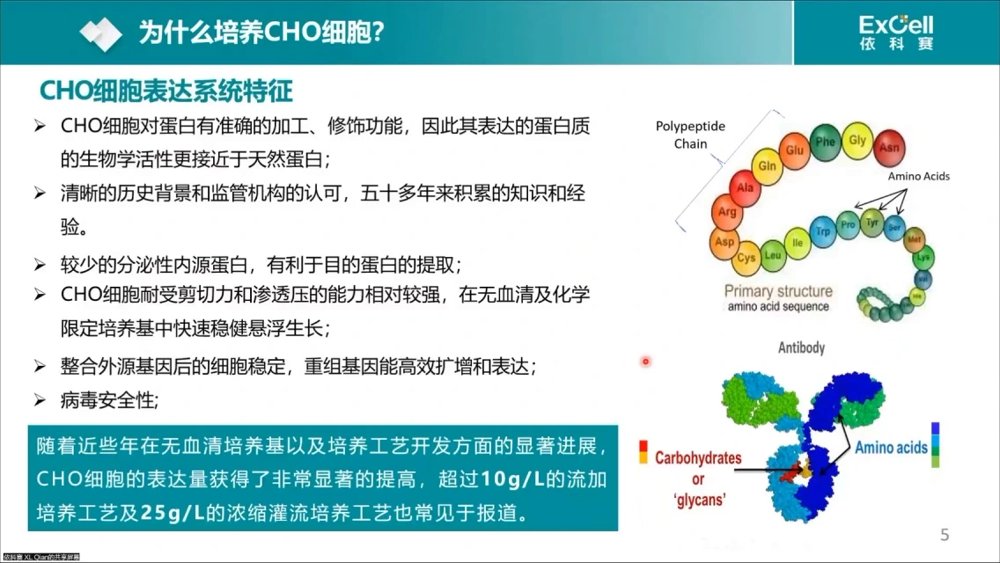

讲者列了六条 CHO 的表达系统特征，前四条在别的场合也常听到，但后两条与工艺直接相关：

1. 对蛋白有准确的加工、修饰功能，产物生物学活性更接近天然蛋白。
2. 历史背景清晰、监管机构认可，五十多年积累。
3. 分泌性内源蛋白较少，利于目的蛋白提取（这条直接减轻下游纯化负担）。
4. **耐剪切力和渗透压的能力相对较强**，在无血清、化学限定培养基中可快速稳健悬浮生长——这是它能上搅拌罐的前提。
5. 整合外源基因后细胞稳定，重组基因能高效扩增和表达。
6. 病毒安全性（非人源细胞）。

第 4 条尤其重要：后面要讲的"搅拌剪切""高渗透压补料"这些工艺手段，本质上都是在**利用** CHO 的这份耐受度。

---

## 二、培养方式：fed-batch 是默认选项，灌流是"用硬件换产量"

### 2.1 三种培养方式的分工

[【跳转到 14:29】](https://www.bilibili.com/video/BV1mu4y1T76w/?t=869)

CHO 的培养方式基本有三种：

| 方式 | 特点 | 适用场景 |
| --- | --- | --- |
| 批次培养（batch） | 一次性加料，不补不加 | 其实不常用 |
| 补料批次（fed-batch） | 培养过程中补加浓缩营养，培养约 14 天 | 应用最广泛，操作简单，产业成熟 |
| 灌流（perfusion） | 连续加新鲜培养基、连续收获，细胞截留在反应器内 | 时间更长，可在更小规模上做到更高产量，综合成本可做得较低 |

灌流的代价讲得很实在：**对反应器硬件有要求**，需要对原有经典 fed-batch 反应器做改造；**对操作人员有专业性要求**。所以它不是一个"想上就上"的选项。

### 2.2 灌流怎么工作：一边养一边收

[【跳转到 14:54】](https://www.bilibili.com/video/BV1mu4y1T76w/?t=894)

灌流的原理可以这样理解：在反应器左边接一个培养袋或培养瓶，源源不断把新鲜培养基泵进培养体系；另一边通过**细胞截留装置**（一般是中空纤维膜）把培养液抽出来，把细胞截留住，把不含细胞的培养上清（含产物）收获出来送去下游纯化。

什么时候该考虑灌流？讲者给了明确判据：**表达产物不稳定、时间长了会分解，或者在浓度比较高时容易分解的项目**。灌流相当于"一边培养一边把产物取走"，避免产物在高浓度、长停留时间下被降解——这对那些"产量上去了但质量掉下来"的分子是刚需。

灌流还有一个容易被忽略的环节：**cell bleed（排液）**。细胞密度越来越高时，为了维持培养体系内细胞密度的稳定，需要排出一部分细胞，这部分细胞对应的培养基里也有产物，构成一定的产物损失。但讲者强调它不是一直排——灌流中活细胞密度（VCD）达到稳态后是在一个值上下波动，到上限才排一点，所以损失还好。

### 2.3 ATF：为什么用交变流而不是单向流

[【跳转到 17:30】](https://www.bilibili.com/video/BV1mu4y1T76w/?t=1050)

现在主流的中空纤维膜截留装置叫 **ATF**（alternating tangential flow filtration，交替切向流过滤）。它下面连一个压力传感器，中间液体流向是一上一下交替变换。

为什么不用单向流？因为灌流体系里细胞密度非常高，**经常可以达到将近 100 million 每毫升**，很容易堵塞纤维膜的孔径。交变形式的液流一旦遇到一点堵塞，立刻会有一个反向液流把它冲刷掉，所以比单向纤维膜更不容易堵，也比较省物料。ATF 目前可以做到上千升规模，小的 3 升反应器上也能接。

讲者还提了一种变体：截留装置不仅截留细胞，连表达产物、蛋白大分子也一起截留住，叫**浓缩补料培养**（concentrated fed-batch），有一些应用但用得不多。

至于一个项目到底选灌流还是 fed-batch，讲者的回答很工程化：**要看项目具体的分子情况，还要算一下成本**。

---

## 三、上游工艺开发是五轮迭代，不是一次实验

[【跳转到 04:02】](https://www.bilibili.com/video/BV1mu4y1T76w/?t=242)

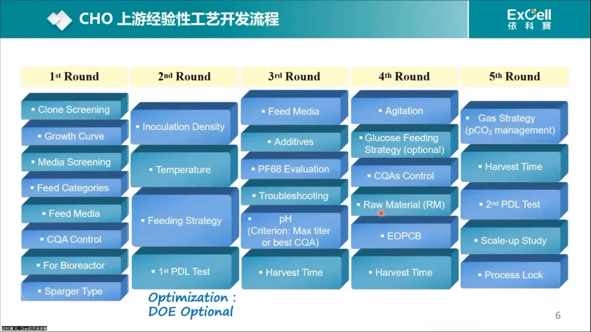

讲者把上游工艺开发拆成五轮，每一轮解决不同层级的问题：

- **第一轮**：克隆筛选、生长曲线、培养基筛选、补料种类、补料培养基、CQA 控制、反应器适配、sparger（通气器）类型。
- **第二轮**：接种密度、温度、补料策略、第一次 PDL 测试（传代倍增水平）。
- **第三轮**：补料培养基、添加剂、PF68 评估、troubleshooting、pH（判据是"最高滴度或最好的 CQA"）、收获时间。
- **第四轮**：搅拌、葡萄糖补料策略（可选）、CQA 控制、原材料（RM）、EOPCB、收获时间。
- **第五轮**：气体策略（pCO₂ 管理）、收获时间、第二次 PDL 测试、放大研究、工艺锁定。

讲者给了一个很实用的"省事原则"：如果你一开始就已经拿到几个稳定的单克隆细胞株、对后续产量已有预估值，只是想快速拿到几个备选细胞株、达到最基本的申报要求，那么很多繁琐的实验**不需要全部都做**。可以第一轮把克隆培养基同步筛选，第二轮只做简单优化、把第一轮中表现不明显的参数规律细化，第三轮在小型反应器（3 L 或 7 L）里做工艺验证——因为摇瓶做不到溶氧和 pH 控制。如果一路顺利，中间不需要额外更复杂的研究。

反过来，如果遇到具体问题，就要加针对性实验。讲者举的例子是**电荷异构体**：某产品的电荷异构体比例与原研有差别（这是监管关注点），做法是在工艺上调整收获时间，比如提前收获，看收获后电荷异构体、酸碱峰的比例分布怎么变，再针对目标预期调整。

---

## 四、从摇瓶到生产罐：设备谱系决定了你能控制什么

[【跳转到 07:19】](https://www.bilibili.com/video/BV1mu4y1T76w/?t=439)

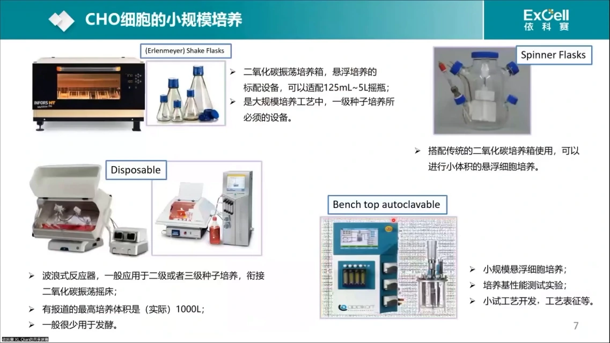

小规模培养主要是摇瓶，在带转速、CO₂ 浓度、温度、湿度调控的摇床或摇瓶培养箱里进行，一次性使用。摇瓶分平底和底部带挡板两种：

- **底部带挡板的摇瓶**：震荡起来会增加液体内的湍流、增加氧传递，从细胞生长、活力维持、产物表达量到副产物累积，各方面都比平底好一点。
- **带挡板的三口瓶**：用法少一些，优势是可以从外部额外供氧（摇瓶里氧传递受限，细胞密度一高氧就不够），还可以接 DO 电极检测，配合磁力挡板和底部磁力搅拌器使用效果更好。

再往上：

- **玻璃罐反应器**（如 3 L）：做培养基性能测试时用 1 L 体积；做工艺开发、工艺表征验证时用 2 L，或用 20 L 罐做 15 L。
- **波浪式反应器**（一次性培养袋）：工业界常用作种子扩增。可以是 batch 形式（加定量培养基和种子，长到密度后接种到反应器），也可以是 batch 到 fed-batch 形式（按最低体积接入，下一次扩张到最大工作体积，同一个袋子里完成两级种子链扩增）。还有带漂浮膜、可做类似灌流操作的高密度袋子，7 到 10 天可用基础培养基把细胞灌到 60 到 80 million 每毫升。
- **微型反应器**（如 ambr 15、ambr 250）：数据与 3 L 玻璃罐比较相似，通量更高，集成了自动化操作和内置检测，整套放在超净台里自动运行保证无菌。
- **大规模**：一次性反应袋最大做到 2000 L，上万升就得用不锈钢罐。

---

## 五、培养基：细胞株之后的第二个决定因素

[【跳转到 19:39】](https://www.bilibili.com/video/BV1mu4y1T76w/?t=1179)

讲者的判断很直接：**对于常规单抗项目，细胞株和培养基是决定蛋白产量与质量高低的最重要的两个因素**。细胞株或单克隆确认之后，就要根据细胞株自身特性和项目开发策略选培养基。

两条路：

- **没有自研培养基能力的公司**：对商业化培养基做筛选，做平行对照实验或简单的 DOE 筛选。
- **有自主开发能力的公司**：从培养基组分出发，与工艺开发团队一起把产量和质量做到最优。

[【跳转到 09:43】](https://www.bilibili.com/video/BV1mu4y1T76w/?t=583)

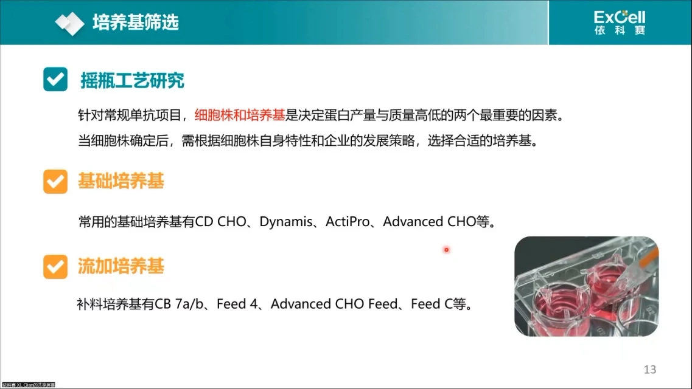

培养基分两类，作用不同：

- **基础培养基**：负责细胞扩增。常见有 CD CHO、Dynamis、ActiPro、Advanced CHO 等。
- **补料培养基（流加培养基）**：负责提升产量、改善产物质量。常见有 CB 7a/7b、Feed 4、Advanced CHO Feed、Feed C 等。

讲者顺带给了两条使用经验：不同品牌的培养基**基础不要混搭使用**；补料则可以做跨品牌对比。

---

## 六、四个核心参数：温度、pH、溶氧、搅拌

### 6.1 温度：37 ℃ 是生长最优，30 ℃ 左右是生产最优

[【跳转到 21:43】](https://www.bilibili.com/video/BV1mu4y1T76w/?t=1303)

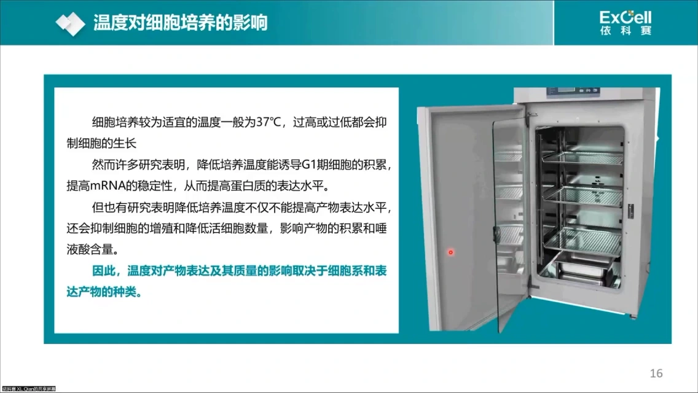

细胞培养较适宜的温度一般是 37 ℃，过高过低都会抑制生长。但降温有另一套逻辑：

- **支持降温的证据**：降低培养温度能诱导 G1 期细胞积累、提高 mRNA 稳定性，从而提高蛋白表达水平。有些公司为了防止培养箱温度波动超过 37.5 ℃ 损伤细胞，会把培养箱设成 36.5 ℃——降一点点温度，换来更好的安全性。
- **反对降温的证据**：也有研究表明降温不仅不能提高表达，还会抑制细胞增殖、降低活细胞数量，影响产物积累和唾液酸含量。

所以讲者的结论是：**温度对产物表达及质量的影响取决于细胞系和表达产物的种类**，它是一个 case by case 的参数，必须做筛选。

### 6.2 pH：7.0 附近，但维持 pH 的手段本身会带来副作用

[【跳转到 22:48】](https://www.bilibili.com/video/BV1mu4y1T76w/?t=1368)

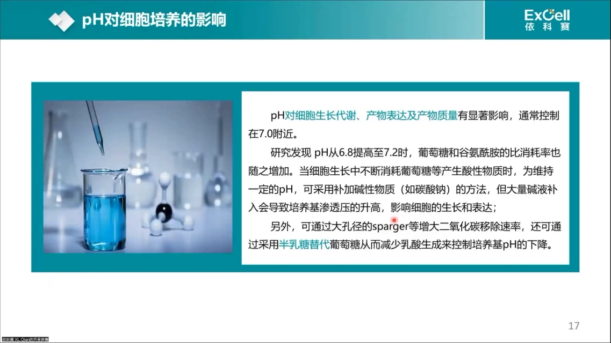

pH 对细胞生长代谢、产物表达、产物质量都有显著影响，通常控制在 **7.0 附近**。研究发现 pH 从 6.8 提高到 7.2 时，葡萄糖和谷氨酰胺的比消耗速率随之增加。

难点在于**维持 pH 的手段会反噬**：细胞消耗葡萄糖产生乳酸等酸性物质，为维持 pH 要补加碱性物质（碳酸钠、碳酸氢钠），但大量碱液补进去会生成盐，**导致培养基渗透压升高**，反过来影响细胞生长和表达。所以 pH 和渗透压是一对必须一起看的参数。

另外两条控制 pH 下降的手段：

- 用**大孔径的 sparger** 通气，增大二氧化碳的移除速率。因为 CO₂ 在液体中溶解度较高，用小孔径会增大 CO₂ 溶解率、在液体内形成碳酸，加速 pH 下降；大孔径则减少 CO₂ 在水中的溶解度。
- 用**半乳糖替代葡萄糖**作为碳源，减少乳酸生成。

### 6.3 溶氧：30% 到 70%，高了低了都出事

[【跳转到 24:49】](https://www.bilibili.com/video/BV1mu4y1T76w/?t=1489)

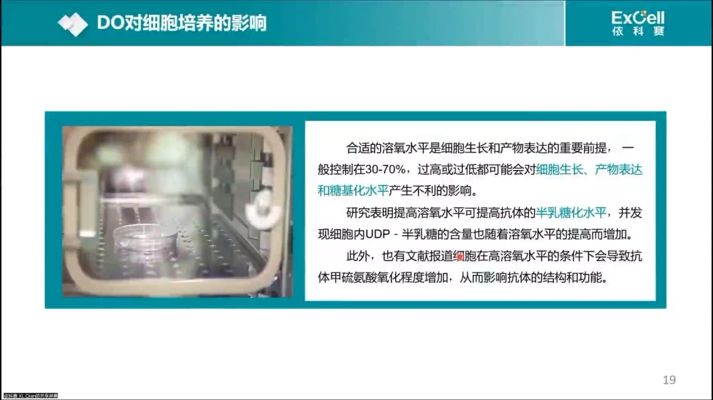

合适的溶氧水平是细胞生长和产物表达的重要前提，一般控制在 **30% 到 70%**，正常反应器设在 40% 上下或 50% 上下波动。

- **过低**：供氧不足，细胞处于缺氧状态，乳酸产量比较高。
- **过高**：研究表明提高溶氧水平可以提高抗体的**半乳糖化水平**，细胞内 UDP-半乳糖含量随溶氧水平提高而增加；但高溶氧条件下抗体的**甲硫氨酸氧化程度**会增加，从而影响抗体的结构和活性功能。

这是一个典型的"糖型与氧化之间的取舍"：溶氧既是产量参数，也是质量参数。

### 6.4 搅拌：混合与剪切的一体两面

[【跳转到 25:55】](https://www.bilibili.com/video/BV1mu4y1T76w/?t=1555)

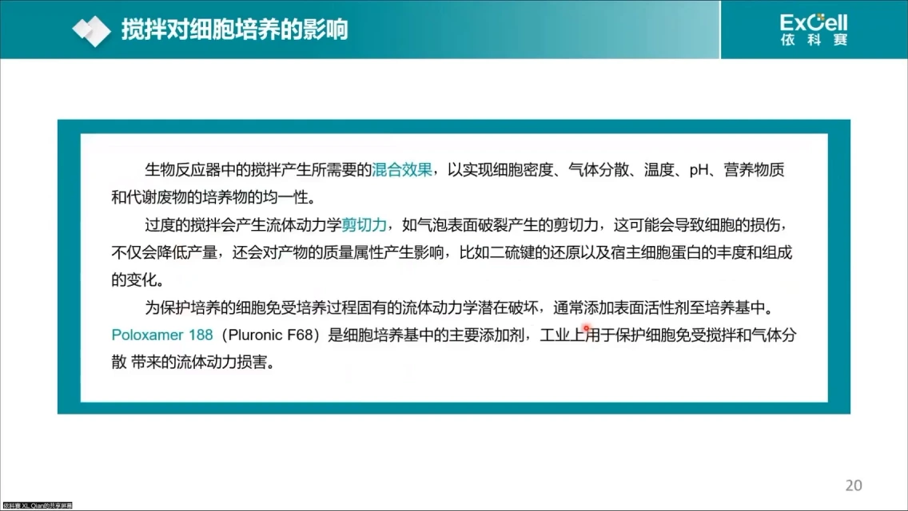

搅拌的作用是让细胞密度、气体分散、温度、pH、营养物质和代谢废物在体系内均匀。但搅拌不足会导致细胞沉降、气体与补料分散不均；**过度搅拌会产生流体动力学剪切力**（包括气泡表面破裂产生的剪切力），导致细胞损伤、活力下降、产量降低。

更隐蔽的后果是**质量属性**：活力下降产生的细胞破裂、释放出的酶，会影响产物的质量属性，比如二硫键的还原，以及宿主细胞蛋白（HCP）的丰度和组成发生变化。

工业上的保护手段是往培养基里加表面活性剂，最常见的是 **Poloxamer 188（Pluronic F68）**，用来保护细胞免受搅拌和气体分散带来的流体动力损伤。

---

## 七、工艺放大：哪些参数能按比例放大，哪些不能

[【跳转到 27:35】](https://www.bilibili.com/video/BV1mu4y1T76w/?t=1655)

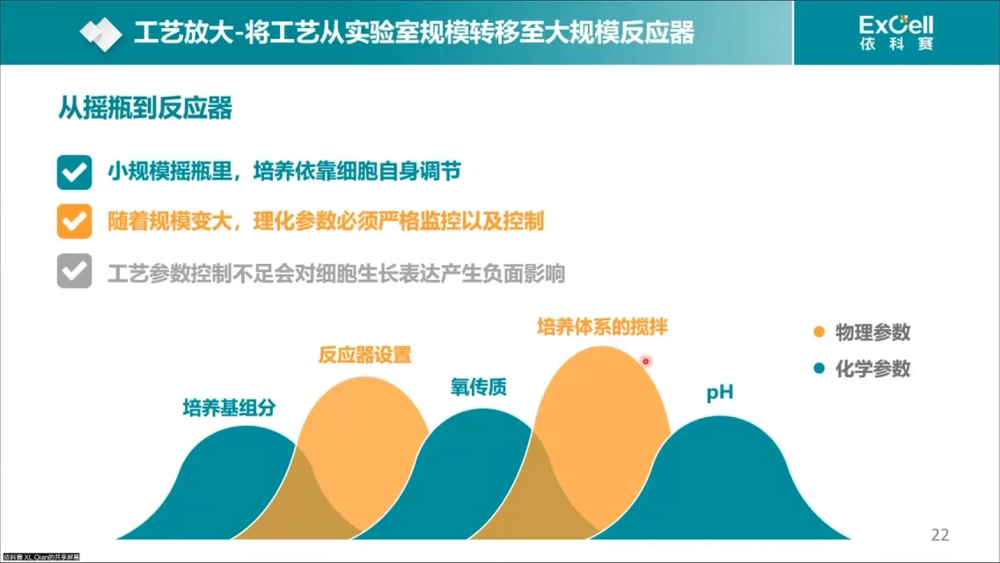

放大的核心矛盾是：**小规模摇瓶里，培养依靠细胞自身调节；规模变大之后，理化参数必须严格监控和控制**，控制不足会对细胞生长表达产生负面影响。

讲者把放大中的影响因素分成两类，一类是生物学的（传代次数、突变概率），一类是化学与物理的（反应器体积变大带来的物理特性改变），后者影响最大。

生物学那部分值得单独记：从小摇瓶复苏到 200 L、2000 L、20000 L，是一条很长的种子链扩增过程，期间伴随一定的突变概率。所以**传代稳定性以及传代后的突变基因检测，是前期细胞株构建时就要做的事**。

[【跳转到 30:30】](https://www.bilibili.com/video/BV1mu4y1T76w/?t=1830)

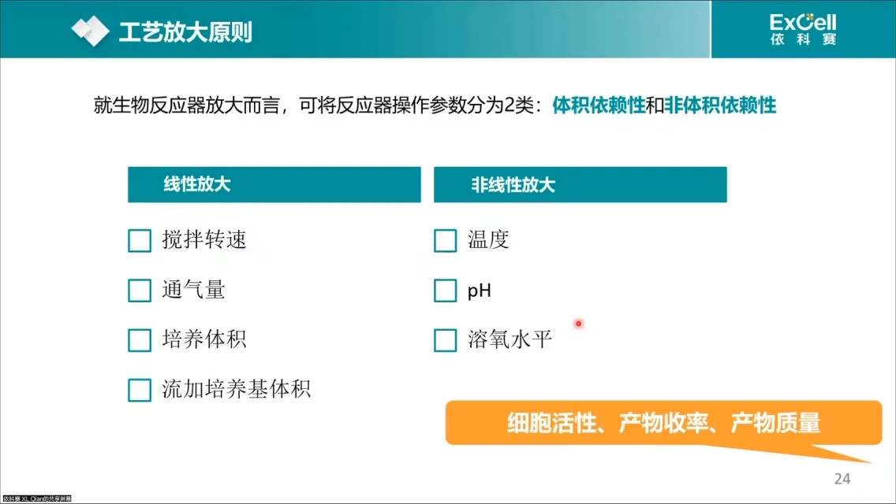

这张图是全场最该记住的一张：

- **线性放大（体积依赖）**：搅拌转速、通气量、培养体积、流加培养基体积——随反应器体积变大而按比例放大。
- **非线性放大（非体积依赖）**：温度、pH、溶氧水平——始终保持在同一目标值。

但讲者紧接着给了一个重要限定：反应器从小到大虽然可能按比例放大，但**里面的螺旋桨剪切力、搅拌、整体传质并不是线性放大的**。所以放大时还要用工程参数做换算，比如维持 **P/V（单位体积功率）恒定**，或者维持 **kLa（传质系数）稳定**。

放大成功与否的判据是三条：细胞生长是否维持、活力、最终产量以及产物质量。

### 7.1 摇瓶和反应器到底差在哪

[【跳转到 33:00】](https://www.bilibili.com/video/BV1mu4y1T76w/?t=1980)

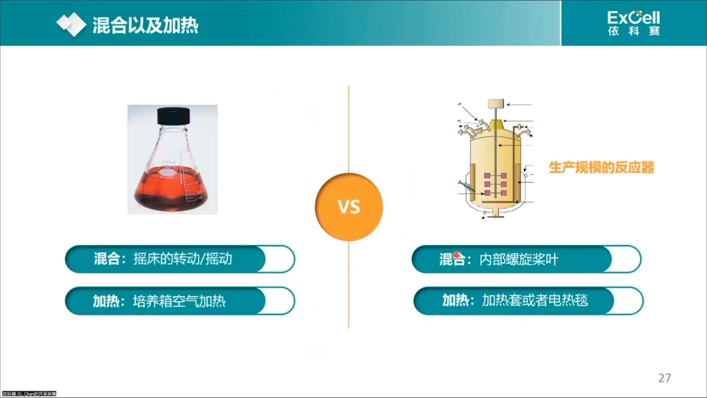

| 维度 | 摇瓶 | 反应器 |
| --- | --- | --- |
| 混合 | 摇床转动/摇动/震荡 | 内部螺旋桨叶、挡板 |
| 加热 | 培养箱空气加热 | 加热套或电热毯 |
| 氧传递 | 顶部空间气体交换，摇动破坏液面，靠气液接触面传质 | 顶部通气 + 底部 sparger 通气，桨叶/挡板辅助混合 |

[【跳转到 33:13】](https://www.bilibili.com/video/BV1mu4y1T76w/?t=1993)

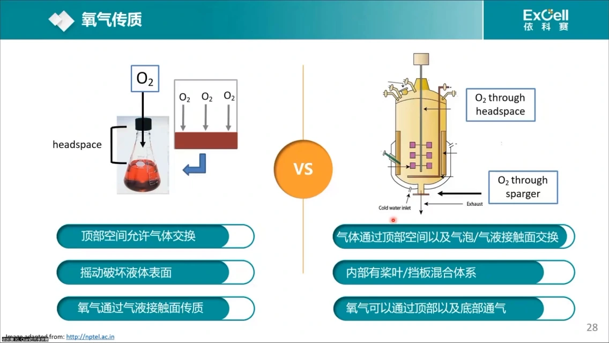

这张对比图解释了为什么摇瓶里"氧不够"是常态：摇瓶只有顶部空间一条供氧路径，靠摇动破坏液面来更新气液界面；反应器有顶部通气和底部 sparger 两条路径，还有桨叶和挡板把氧气打散到整个体系。

### 7.2 pH 控制策略：摇瓶靠缓冲，反应器靠主动调控

[【跳转到 34:40】](https://www.bilibili.com/video/BV1mu4y1T76w/?t=2080)

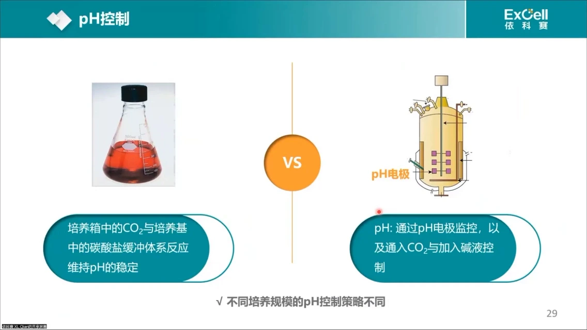

- **摇瓶**：不会刻意控制 pH，也不好控制。培养箱里的 CO₂（比如设 5% 或 8%）与培养基自带的碳酸盐缓冲体系反应，靠这个缓冲体系维持 pH 稳定。
- **反应器**：主动调控。pH 电极在线监控，设定波动范围，通 CO₂ 降 pH、加碳酸钠或碳酸氢钠升 pH，把 pH 控制在目标值范围内波动。

这解释了一个常见的困惑：**摇瓶筛出来的最优 pH 往往无法直接搬到反应器**，因为两者的 pH 控制机制根本不同。

---

## 八、培养后期的五个常见问题

### 8.1 为什么细胞越养越大

[【跳转到 35:55】](https://www.bilibili.com/video/BV1mu4y1T76w/?t=2155)

很多客户刚开始做 CHO 培养时没注意到这个现象，或者以为是仪器测量误差。但它确实存在而且普遍。讲者给了两个解释：

1. **渗透压驱动**：做 fed-batch 时随补料添加，渗透压逐步提升（比如从 270 升到 400）。在渗透压升高的前十几分钟到半小时内，细胞直径会先**变小**（外界渗透压高，细胞像缩水）；但细胞膜是半透膜、表面有离子通道，可以通过主动转运把外界离子转进胞内维持平衡，随后有反馈机制导致细胞直径变大。
2. **降温驱动**：有些数据显示 day 8 之后渗透压没升、甚至下降，细胞仍然变大。原因是降温工艺把细胞周期维持在 G1 期，细胞为了分裂会复制蛋白、复制核酸，体积随之变大——而这正是我们想要的"蛋白生产"状态。

### 8.2 降温策略怎么定

[【跳转到 38:18】](https://www.bilibili.com/video/BV1mu4y1T76w/?t=2298)

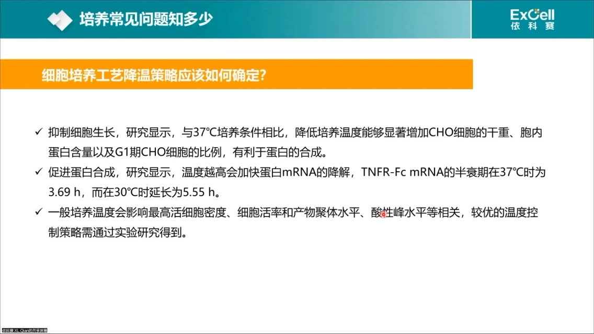

虽然很多项目最后都会采用降温策略，但它**不是普适条件**，有一部分项目不适合降温。所以工艺筛选阶段就要把这个条件定下来。

降温的三条机制：

- **抑制生长**：与 37 ℃ 相比，降温能显著增加 CHO 细胞的干重、胞内蛋白含量以及 G1 期细胞比例，有利于蛋白合成。
- **促进蛋白合成**：温度越高蛋白 mRNA 降解越快。讲者给的例子是 TNFR-Fc 的 mRNA 半衰期，37 ℃ 时为 3.69 h，30 ℃ 时延长到 5.55 h。
- **影响质量**：培养温度会影响最高活细胞密度、细胞活率、**产物聚体水平、酸性峰水平**。

对照实验的结论是：全程不降温的工艺 peak VCD 会稍微更高，活力下降也比降温工艺更延后，但产物聚体水平会受影响。所以"要不要降温、什么时候降、降到多少"必须通过实验确定。

### 8.3 葡萄糖浓度控制到什么水平

[【跳转到 40:01】](https://www.bilibili.com/video/BV1mu4y1T76w/?t=2401)

讲者坦言这个问题"众说纷纭"，因为不同细胞株的葡萄糖消耗量、耐受能力、以及在不同葡萄糖浓度下的乳酸代谢情况都不同。给两种典型情形：

- **后期乳酸积累特别严重的细胞/项目**：建议把第二天的葡萄糖浓度控制在 **1 到 2 g/L** 之间（算上当天消耗，确定明天的目标浓度）。
- **糖型受葡萄糖浓度影响特别明显的细胞株**：情况比较少但确实有，需要把目标浓度控制在更窄的范围内。

代价也要说清楚：**浓度控制得越低，难度越大**。因为补糖量是根据已有数据推测的，本身有误差；而且低浓度意味着第二天有**葡萄糖耗竭**的风险。耗竭对细胞的影响比较致命——耗竭当天可能看不出来，但接下来两三天会有明显的活率下降、细胞密度下降。

### 8.4 渗透压维持在多少，以及它怎么影响糖型

[【跳转到 42:29】](https://www.bilibili.com/video/BV1mu4y1T76w/?t=2549)

- **适宜范围**：280 到 320 mOsm/kg，这也是市面上大多数基础培养基的水平。过高过低对生长和活力维持都不利。
- **耐受上限**：CHO 对渗透压耐受能力比较强，通常 400 或 400 多一点都能很好耐受。
- **后期的高渗透压有正面作用**：培养后期 350 到 450 mOsm/kg 之间，对细胞表达蛋白产物有一定的促进作用——但讲者强调这**不是一个普适的工艺参数**。
- **高渗透压的副作用是糖型**：高渗透压会提升**高甘露糖 Man5** 的比例。而做质量参数评价时通常要求 Man5 小于 5%，所以如果培养期间因高渗透压导致 Man5 超标，后期还要针对高渗透压做针对性解决。

这一条把"工艺参数"和"糖型质量属性"直接连了起来：渗透压不只是产量参数，还是糖型参数。

### 8.5 泡沫：从传质助手变成染菌风险

[【跳转到 44:43】](https://www.bilibili.com/video/BV1mu4y1T76w/?t=2683)

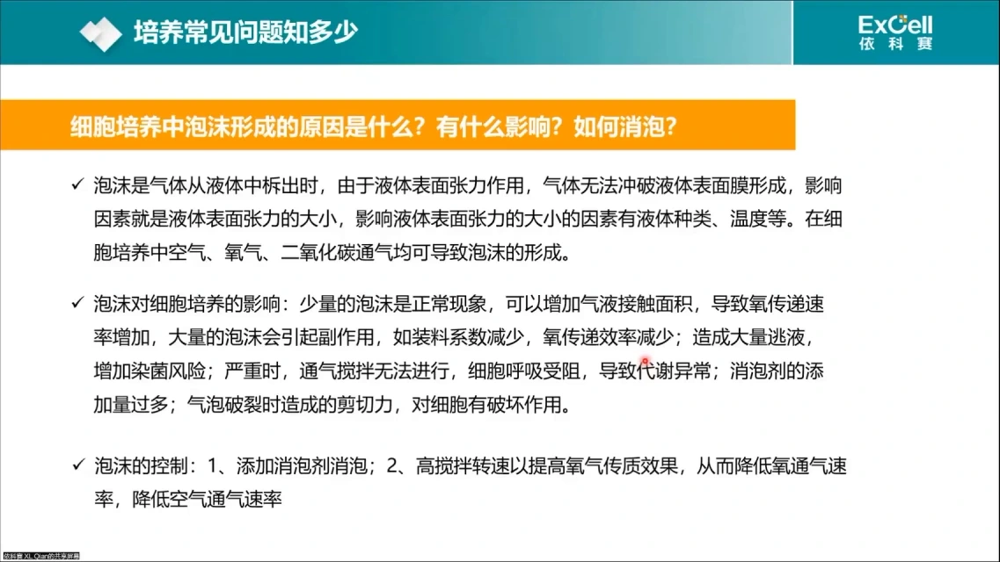

泡沫的形成机制：气体从液体中析出时，由于液体表面张力，气体被困在液体内、无法冲破液体表面膜。影响因素就是表面张力的大小（液体种类、温度），而培养中通空气、氧气、二氧化碳都会导致泡沫。

泡沫的影响是双面的：

- **少量泡沫是正常的**，甚至有益：小泡沫比表面积高，可以增加气液接触面积、提高氧传递效率。
- **大量泡沫有害**：占据反应器空间（2 L 罐做 2 L，泡沫占四五分之一），装料系数下降、氧传递效率下降；泡沫过高会经出气口浸湿空气滤器，滤器进水后密闭性受影响，**染菌风险上升**；严重时通气搅拌无法进行、细胞呼吸受阻、代谢异常；泡沫多就要频繁加消泡剂，而**消泡剂添加过多会影响培养基组分以及后期纯化除杂**；气泡破裂产生的剪切力还会损伤细胞，影响活力、产物活性以及 HCP 含量。

控制手段两条：加消泡剂（担心过量可以稀释后过滤再加）；或者提高螺旋桨转速以提升氧传递效率，从而降低通气速率、减少通气量，从源头减少泡沫。

---

## 小结

- CHO 的六大特征里，"耐剪切、耐渗透压"是它能上搅拌罐、能用高渗补料的底层前提；10 g/L 的 fed-batch 与 25 g/L 的浓缩灌流都已是报道中的常规水平。
- 培养方式三分：batch 不常用，fed-batch 是默认（约 14 天），灌流适合"产物不稳定、浓度高就降解"的分子，但需要改造硬件、对操作有专业要求。
- 灌流的关键部件是 ATF 交变切向流装置，用交变流防堵；cell bleed 是为了稳定细胞密度，会带来一定产物损失。
- 上游工艺开发是五轮迭代：克隆/培养基 → 接种密度/温度/补料 → pH/添加剂/收获时间 → 搅拌/葡萄糖/CQA → 气体策略/放大/工艺锁定。不是每个项目都要全做。
- 细胞株和培养基是决定产量与质量的两个最重要因素；基础培养基管扩增，补料管产量与质量。
- 温度 case by case（37 ℃ 生长、降温促生产但抑制增殖）；pH 控制在 7.0 附近但补碱会抬高渗透压；溶氧 30% 到 70%，高溶氧提高半乳糖化但增加甲硫氨酸氧化；搅拌要混合但避免剪切，靠 P188/F68 保护。
- 放大时区分体积依赖参数（线性放大）与非体积依赖参数（保持恒定），并用 P/V 或 kLa 做工程换算；摇瓶和反应器的混合、加热、供氧、pH 控制机制都不同。
- 五个常见问题各有机制：细胞变大（渗透压 + 降温阻滞 G1）、降温策略（抑制生长、延长 mRNA 半衰期、影响聚体与酸性峰）、葡萄糖控制（低浓度难控且有耗竭风险）、渗透压（350 到 450 促表达但抬高 Man5）、泡沫（传质助手变染菌风险）。

## 关键术语速查

| 术语 | 一句话解释 |
| --- | --- |
| fed-batch（补料批次培养） | 培养过程中分批补加浓缩营养、延长培养期的生产方式，单抗主流工艺，约 14 天 |
| perfusion（灌流培养） | 连续加新鲜培养基、连续收获产物、细胞截留在反应器内的培养方式 |
| ATF（交替切向流过滤） | 灌流用的细胞截留装置，液流一上一下交替，靠反向冲刷防堵塞 |
| cell bleed（排液） | 灌流中为稳定细胞密度而排出部分细胞悬液，会带来少量产物损失 |
| VCD（活细胞密度） | viable cell density，单位体积活细胞数，灌流稳态时在一个区间内波动 |
| sparger（通气器） | 反应器底部通气的部件，孔径大小决定 CO₂ 溶解与移除的平衡 |
| kLa（传质系数） | 表征反应器氧传递能力的工程参数，放大时常要求维持恒定 |
| P/V（单位体积功率） | 搅拌输入功率除以体积，放大时常用的剪切/混合换算基准 |
| Poloxamer 188 / Pluronic F68 | 培养基中的表面活性剂，保护细胞免受搅拌与气泡带来的剪切损伤 |
| Man5（高甘露糖型） | 一种 N-糖型，通常要求小于 5%，高渗透压会抬高其比例 |
| 电荷异构体 / 酸性峰 | 抗体表面电荷不同的变体，用 CEX 或 cIEF 分析，是 CQA 之一 |
| CQA（关键质量属性） | critical quality attribute，必须控制在范围内的产品质量指标 |
| DOE | 实验设计，用最少的实验量找出多参数的影响规律 |
| PDL | population doubling level，细胞群体倍增水平，衡量传代次数 |