# CHO 细胞株构建如何决定抗体产量：宿主、载体、转染与克隆筛选

> 视频来源：[抗体表达 CHO 细胞株构建策略与优化](https://www.bilibili.com/video/BV1k94y1U7Pe/)（Bilibili · 海星生物 Cas9X）｜时长约 62 分钟
> 导读：这是细胞基因编辑平台的一场技术直播，讲的是"一株能产抗体的 CHO 细胞是怎么被造出来的"。本文按宿主、载体、转染、克隆筛选、细胞株改造、低产量排查的顺序整理，保留了讲者给出的四类载体形式、筛选标记、定点整合路线与排查手段；视频末尾的答疑（弱启动子、质粒储存浓度、整合能否移除）也一并收录。

## 本讲要解决的核心问题（SCQA）

**背景**：抗体药物绝大多数由哺乳动物细胞生产，其中 CHO（中国仓鼠卵巢细胞）占了抗体生产的"半壁江山以上"，讲者给出的数字是 70% 以上。做抗体的人迟早要面对一个问题：同一个抗体序列，交给不同的细胞株、不同的载体、不同的克隆，产量可以差出好几倍。

**冲突**：从原理上说，让细胞表达一个抗体非常简单——把质粒转进细胞，细胞就会表达蛋白。但真正落到生产，中间横着一条长长的链条：基因要转录、mRNA 要加工出核、蛋白要翻译折叠、要通过信号肽分泌到胞外，每一步都有变量。更麻烦的是，CHO 细胞本身的遗传背景极不稳定，同一个细胞系的不同亚系、甚至同一亚系的不同单克隆，遗传差异都很大。

**疑问**：那么，产量到底是被哪些环节卡住的？如果筛出来的克隆表达量低于预期，怎么判断是"工艺/构建的问题"还是"这个抗体分子本身难表达"？

**回答（中心思想）**：抗体产量是**宿主、载体、转染、克隆筛选四段串联**的结果，任何一段的天花板都会成为最终产量的天花板；而低产量排查的正确姿势，是沿着"插入位点与拷贝 → 抗体对细胞的毒性 → 转录水平 → 折叠与分泌"这条链路逐段定位，从而把**工艺问题**（可以改构建策略解决）和**分子设计问题**（这个抗体天生难表达）区分开。

---

## 一、宿主：为什么是 CHO，以及 CHO 内部的分化

### 1.1 表达系统是一棵树，哺乳动物细胞是主干

[【跳转到 03:24】](https://www.bilibili.com/video/BV1k94y1U7Pe/?t=204)

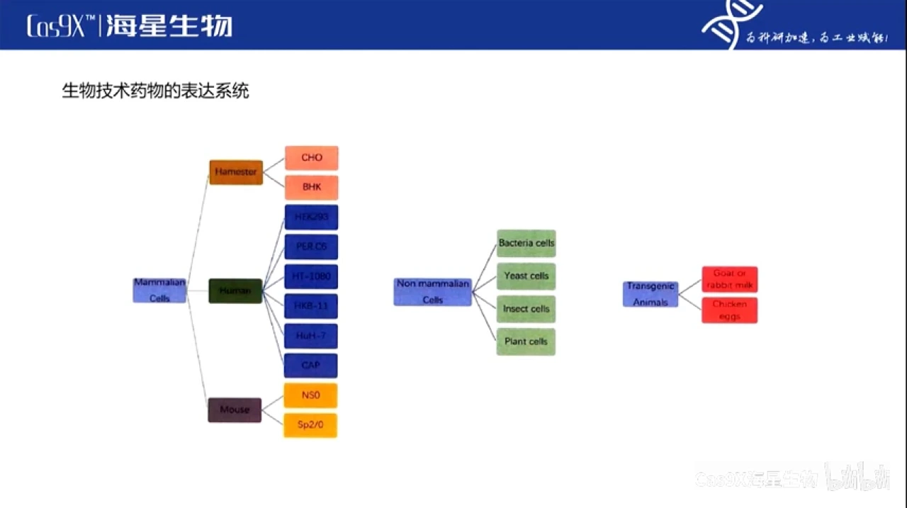

讲者把生物技术药物的表达系统分成三大块：

- **哺乳动物细胞**：仓鼠来源的 CHO、BHK；人源的 HEK293、PER.C6、HT-1080、HKB-11、HuH-7、CAP；小鼠来源的 NS0、Sp2/0。
- **非哺乳动物细胞**：细菌、酵母、昆虫细胞、植物细胞。
- **转基因动物**：转基因山羊、转基因鸡（蛋）。

历史顺序是：早期生物医药以微生物系统为主，因为哺乳动物细胞培养成本高、产量低；甚至一度用过海拉细胞，但担心生物安全问题而放弃。大肠杆菌最大的劣势是**翻译后修饰不足**——它不是真核生物。酵母虽然是真核、蛋白折叠与翻译后修饰比较好，但它不含哺乳动物的分子伴侣，需要改造。再往后才是 CHO 和 293 这样的哺乳动物细胞。

昆虫细胞用得也不少，但它主要作为**替代系统**：可以快速做早期研发和早期工业生产测试。它同样面临非人源折叠的问题，糖基化之类的修饰虽然比微生物系统有明显进步，但仍然有很多问题。

### 1.2 CHO 的五个优点，每一条都直接换算成成本

[【跳转到 12:06】](https://www.bilibili.com/video/BV1k94y1U7Pe/?t=726)

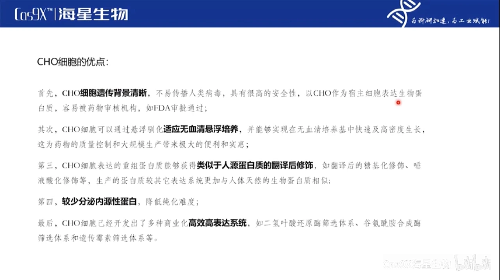

讲者列了五条，值得逐条对照"它省下了什么"：

1. **遗传背景清晰、不易传播人类病毒**，容易被 FDA 之类机构审批通过——省下的是注册风险与时间。
2. **可以通过悬浮驯化适应无血清悬浮培养**，在无血清培养基中快速高密度生长——这是大规模反应器生产的前提。
3. **重组蛋白能获得类似人源蛋白的翻译后修饰**（糖基化、唾液酸化等），产物更接近人体天然蛋白——决定了抗体能不能用。
4. **较少分泌内源性蛋白**，降低纯化难度——直接决定下游收率与成本。
5. **已有多种商业化高效表达系统**（DHFR 筛选体系、GS 筛选体系、遗传霉素筛选体系等）——不用从零搭工具。

### 1.3 CHO 不是一种细胞，而是一个庞大的谱系

[【跳转到 07:32】](https://www.bilibili.com/video/BV1k94y1U7Pe/?t=452)

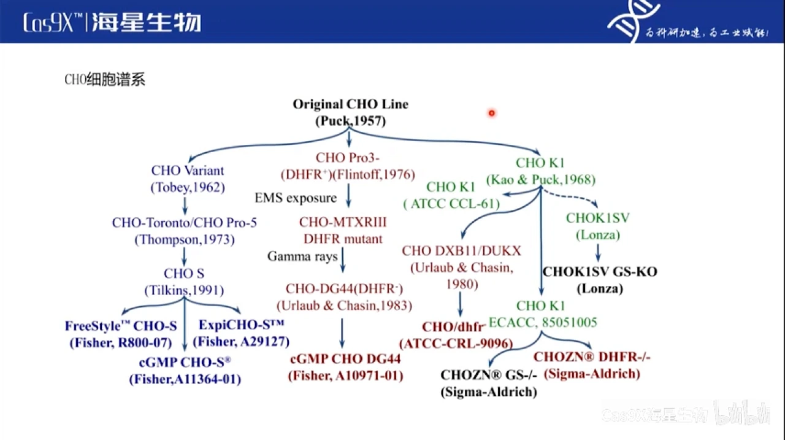

1957 年 Puck 实验室分离出 CHO 细胞之后，经过多次分化形成了一个非常庞大的谱系。讲者强调：这个谱系之所以庞大，一方面是应用广泛，另一方面正是 CHO **遗传不稳定**的特质——这既是优点也是缺点。

目前工业上常用的几类宿主，区别主要在"缺了什么基因"，因为缺什么决定了你用什么筛选标记：

| 细胞株 | 缺陷/特性 | 配套筛选标记 | 特点 |
| --- | --- | --- | --- |
| DG44 | DHFR（二氢叶酸还原酶）双等位基因缺陷 | MTX | 蛋白表达能力比较弱 |
| DXB11 | DHFR 缺陷，但只有一个拷贝突变 | MTX | 表达能力中等，比 DG44 稍好 |
| CHO-S | 野生型，无明显缺陷 | 各种抗生素、CRISPR | 代谢能力中等，比较"普通" |
| CHO-K1 | 野生型衍生，生长代谢快 | 抗生素等 | 产量高、质量好，工业主流 |
| CHO-K1 GS-KO | 谷氨酰胺合成酶（GS）缺失 | MSX | 配合 GS 系统载体可实现高而稳定的表达，工业主流 |

[【跳转到 09:12】](https://www.bilibili.com/video/BV1k94y1U7Pe/?t=552)

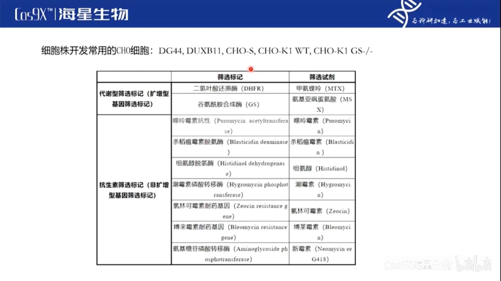

这张表把筛选标记分成两类，这个区分很关键：

- **代谢型筛选标记（可扩增型）**：DHFR 配甲氨蝶呤（MTX）、GS 配氨基酸类似物 MSX。它们的特点是**可以在药物压力下基因扩增**——提高药物浓度，细胞为了活下来会把载体连同目的基因一起多拷贝整合，产量随之提高。
- **抗生素筛选标记（非扩增型）**：嘌呤霉素、杀稻瘟菌素、组氨醇、潮霉素、博来霉素、新霉素（G418）等。它们只负责"选出转进去了的细胞"，不提供扩增通道。

产业界对生产用细胞的要求是四条同时满足：产量高、稳定性高、可放大、合规。所以细胞来源只有两条路：直接买商品化改造后的细胞株（要注意商业条款和许可），或者从 ATCC、ECACC 引进衍生型细胞自己改造（科研免费，商业化生产同样要看条款）。

### 1.4 异质性：为什么不能随便拿一株 CHO 就用

[【跳转到 15:11】](https://www.bilibili.com/video/BV1k94y1U7Pe/?t=911)

讲者用 CHO 的基因组解释了这种不稳定性：仓鼠有 11 对、22 条染色体，而 CHO 的染色体数变异很大。以 CHO-K1 为例，**只有 8 条染色体与野生型细胞完全一致**，另外 13 条都包含大量重排、缺失和位移。更细的一层是：同一个 CHO-K1 细胞系内，像"21 条"这样的数字只是一个**模态数字**——它只代表这个细胞群体可以用 21 来表征，但群体里可能有相当比例是 20 条，甚至 18、19 条。

这带来两个直接后果：

1. **同一株细胞的不同单克隆，产量和质量可以差很多**，所以拿到细胞一定要先验证它是不是高质量细胞，不能直接投产。
2. **整合进去的外源基因也会丢**。传统做法是用质粒过表达、加压筛选，为了拿高表达还会逐级加压；这种整合本身不稳定，后期培养发酵过程中高表达特性可能丧失，传代次数多了特性也会丧失。

---

## 二、载体：把"表达量"写进设计里

### 2.1 先看清蛋白表达的全流程，才知道该在哪里下手

[【跳转到 18:26】](https://www.bilibili.com/video/BV1k94y1U7Pe/?t=1106)

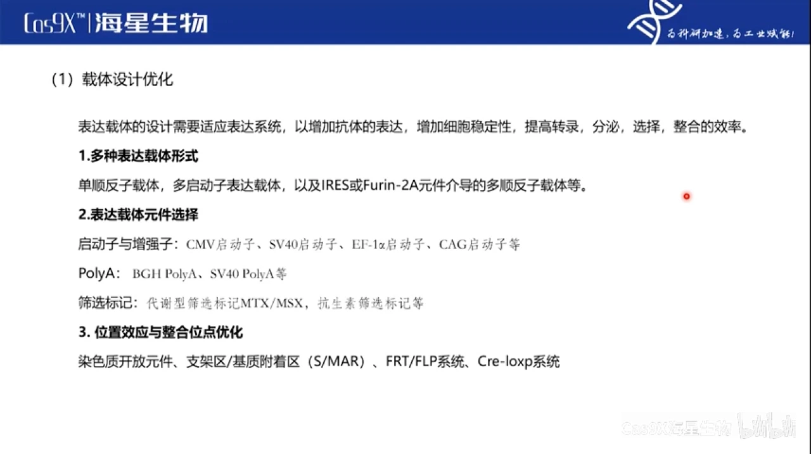

讲者把细胞内蛋白生产拆成一条链：基因组上的基因 → 转录成 mRNA → 在核内加工成成熟 mRNA → 出核 → 在核糖体翻译成蛋白 → 折叠加工形成空间结构 → 通过信号肽转运到内质网和高尔基体 → 分泌到胞外。

CHO 细胞株的构建，本质上就是对这条链做"模拟"：转录和 mRNA 加工环节要管启动子强弱、增强子、插入区域、密码子优化；翻译和翻译后修饰环节要管分子伴侣、异构体、融合标签、序列稳定性；分泌环节要管信号肽。讲者的原话是，**下游筛选的工作量非常大，尤其是 fed-batch，所以要尽可能在前端设计就拿到高效体系**，否则后面的活都是白干。

### 2.2 四种载体形式：轻重链到底怎么摆

[【跳转到 23:44】](https://www.bilibili.com/video/BV1k94y1U7Pe/?t=1424)

抗体和普通蛋白不一样：它是**两条重链 + 两条轻链**的异源四聚体，轻重链的配比本身就影响组装效率。讲者给出四类基础载体形式：

1. **双载体共转染**：一个载体表达重链，另一个载体表达轻链，两个载体一起转进去。
2. **单载体、双启动子**：同一个载体上用两个不同的启动子分别驱动重链和轻链。
3. **单载体、连接元件**：用 IRES（内部核糖体进入位点）或 2A 肽把重链和轻链连起来，实现"一转录本、两蛋白"。
4. **融合表达**：把重链和轻链直接连成一个融合蛋白（讲者提到这是"融合表达"这一类）。

这四类之外的所有变种，本质上都是在这四类基础上改造。核心问题只有一个：**目的基因究竟是独立表达、分开表达，还是融合表达**。

### 2.3 元件选择：目的基因用强启动子，筛选标记用弱启动子

[【跳转到 30:24】](https://www.bilibili.com/video/BV1k94y1U7Pe/?t=1824)

元件层面要做的决定有四个：

- **启动子与增强子**：CMV、SV40、EF-1α、CAG 等，工业上 CMV、SV40 用得比较广泛。
- **PolyA**：BGH PolyA、SV40 PolyA 等。
- **筛选标记**：代谢型（MTX/MSX）还是抗生素型。
- **位置效应**：染色质开放元件、S/MAR（支架/基质附着区）、FRT/FLP 系统、Cre-loxP 系统。

其中最容易被误解的一点是"抗体表达要用弱启动子"。讲者在答疑里专门澄清：**抗体表达并不是用弱启动子**。一个抗体表达质粒上有两套表达元件——目的基因（重链、轻链）的表达元件，和筛选 marker 的表达元件。目的基因用**强启动子**；所谓"弱启动子"是针对筛选 marker 说的。因为做药物胁迫时，希望抗性基因的表达水平比较低，这样**不必用很高的药物浓度就能获得比较高的选择压力**，从而筛出高表达克隆。

### 2.4 位置效应与定点整合：从"撞运气"到"指定地址"

[【跳转到 33:14】](https://www.bilibili.com/video/BV1k94y1U7Pe/?t=1994)

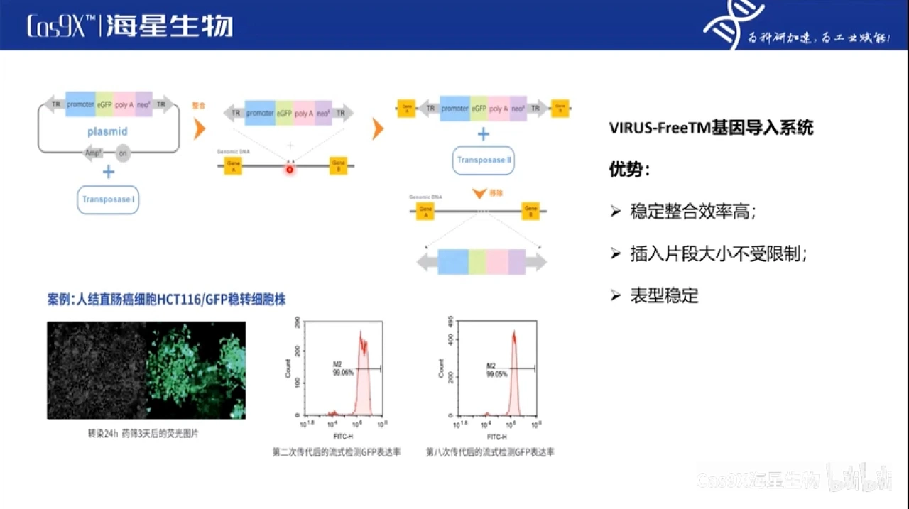

传统随机整合最大的问题是**位置效应**：有时候做出来的细胞株，克隆基本上不表达基因，很可能就是插入位置不好（插进了沉默区域，或者破坏了细胞自身的关键基因）。

讲者介绍的三条改进路线：

1. **转座酶系统**（讲者公司的 VIRUS-Free 系统）：目的基因与转座酶结合后整合到基因组。因为是通过转座酶进行的**稳定整合**，不像传统质粒是在压力筛选下被动整合，所以整合效率高、表达效率高；插入片段大小不受限制，对大片段的插入效果好；整合状态稳定，所以表型稳定。视频里给的数据是：转染 24 小时、药筛 3 天后 GFP 阳性，第二次传代流式检测 GFP 表达率 99.06%，第八次传代 99.05%——传代八次几乎没有衰减。
2. **CRISPR-Cas9 介导的定点整合**：Cas9 与向导 RNA 结合切割基因组双链，激发细胞修复机制；如果有供体模板，就可以通过同源重组把目的基因定点插进去。讲者提醒：**商业化生产环节要关注 CRISPR 的专利问题**，研发环节相对宽松。
3. **两步走的定点整合**：先用转座酶把带筛选标记（比如荧光蛋白）的表达元件整合进基因组，通过流式筛出高荧光、高表达的工具细胞株；第二轮只用重组酶把目的基因定点整合到这个已验证的高表达位点。

[【跳转到 33:56】](https://www.bilibili.com/video/BV1k94y1U7Pe/?t=2036)

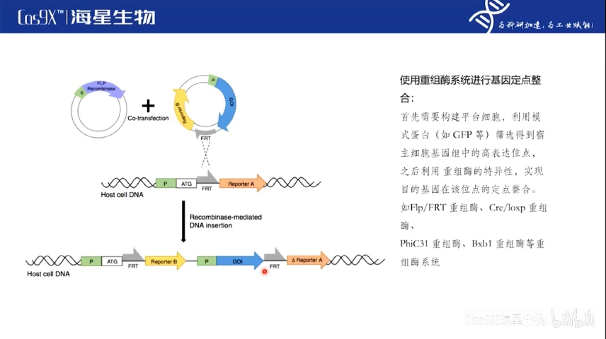

这张图把两步法画得很清楚：宿主细胞 DNA 上先有一个 FRT 位点和一个报告基因（Reporter A），共转染表达 FLP 重组酶的质粒后，报告基因被替换成"启动子 + GOI（目的基因）+ 新报告基因"。讲者列出的重组酶系统包括 Flp/FRT、Cre/loxP、PhiC31、Bxb1。

但定点整合也有它的代价：**定点整合往往只有一拷贝或两拷贝，整合量低，所以基因表达效率目前其实没有随机插入那么高**。所以工业上应用最广的，其实是"转座酶随机插入 + 定点整合筛选"这种混合路线——本质上是先随机插入筛出好位点，再做定点整合。

### 2.5 转染：六个变量，两个目标

[【跳转到 27:46】](https://www.bilibili.com/video/BV1k94y1U7Pe/?t=1666)

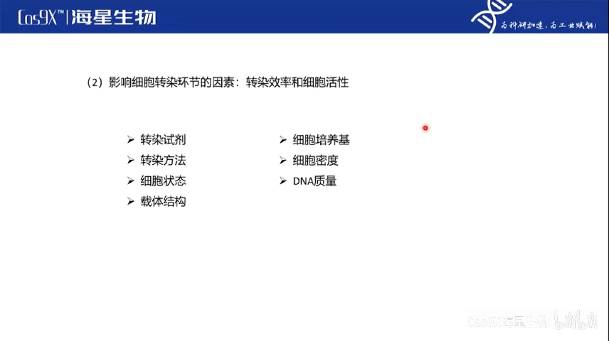

转染环节要同时追求**高转染效率**和**高细胞活性**，这两者需要平衡。变量有六个：转染试剂、转染方法（脂质体还是电转）、细胞状态、载体结构、细胞培养基、细胞密度、DNA 质量。

其中一个细节值得记住：**质粒用线性的还是环状的**。讲者说，为了更高的效率，一般选择**线性化质粒**进行转染——它可以有效防止断链接口的随机整合问题，防止质粒在随机位点发生断裂。

---

## 三、单克隆筛选：法规要求 + 三种主流方法

[【跳转到 27:04】](https://www.bilibili.com/video/BV1k94y1U7Pe/?t=1624)

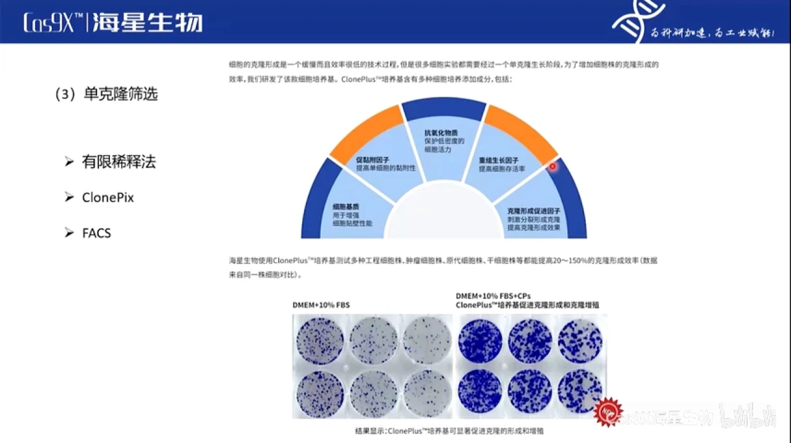

单克隆筛选不只是技术问题，还是**法规问题**：法规要求你提供证据，证明你的生产克隆是从单克隆状态发育而来的。通常的做法是拍照留证。

三种主流方法：

- **有限稀释法**：通过二次稀释，或者稀释加拍照，做单克隆化。
- **ClonePix**：平板单克隆挑选。
- **FACS**：流式单克隆分选。

讲者给了一个很实际的数字：做下游生产时，通常要准备 **10 到 30 个高表达单克隆**做测试，然后再选 **3 到 5 个克隆**做下游放大生产。这意味着前端单克隆的质量直接决定了后面要筛多少——所以他们对克隆培养基做了优化（ClonePlus），把克隆形成率提高 20% 到 150%，用更少的铺板拿到更多可用克隆。

---

## 四、细胞株工程改造：改哪个基因

[【跳转到 38:20】](https://www.bilibili.com/video/BV1k94y1U7Pe/?t=2300)

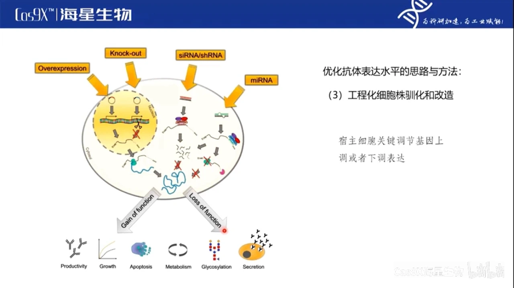

工程细胞株改造的思路是：对宿主细胞的**关键调节基因**做上调或下调，让它获得更好的生长特性、更好的表达特性、更方便的筛选。手段就是常规四件套：过表达、敲除、siRNA/shRNA 干扰、miRNA。对应的表型目标有六类：产量（Productivity）、生长（Growth）、凋亡（Apoptosis）、代谢（Metabolism）、糖基化（Glycosylation）、分泌（Secretion）。

讲者点名了几个"明星基因"：

- **FUT8**（岩藻糖基转移酶）：敲掉它就能生产去岩藻糖基化抗体。
- **GS**（谷氨酰胺合成酶）：配合 MSX 筛选体系。
- **BAX / BAK**：细胞凋亡相关基因，改造后提高抗凋亡能力。

[【跳转到 41:28】](https://www.bilibili.com/video/BV1k94y1U7Pe/?t=2488)

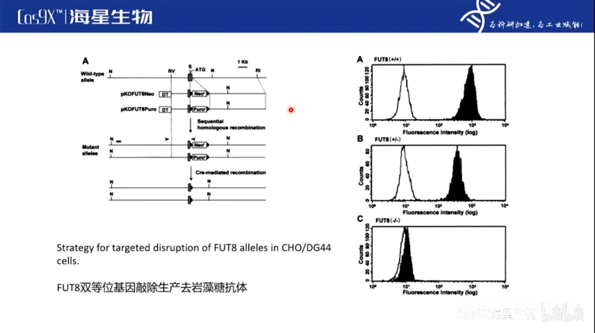

FUT8 是讲者讲得最细的一个案例，因为它是**糖型工程直接影响功能**的典型：日本的一家公司最早发现岩藻糖的关键基因，通过消除 FUT8 获得去岩藻糖的双等位基因敲除抗体，发现 **ADCC 效应提高了 100 多倍**，并在 2012 年上市了第一款去岩藻糖基化抗体药物。

有意思的是方法学的演进：2004 年做这个敲除用的是同源重组——两个不同的载体，各带不同抗性，通过双抗性筛选拿到双敲除，当时相当困难；而现在用 CRISPR 做敲除，已经是一个比较简单的环节。讲者的判断是，**现在其实是构建自主知识产权工程细胞株最好的时机**：靶点多、工具好、可以做通量化的单克隆筛选。

---

## 五、产量低于预期怎么排查：把工艺问题和分子问题分开

[【跳转到 47:47】](https://www.bilibili.com/video/BV1k94y1U7Pe/?t=2867)

这是全场最实用的一段。讲者说，前面讲的是"设计端"和"实验端"的优化，但真正落地时，最常遇到的问题是：**筛到最后拿到的细胞株，表达量低于预期**。

可能的原因有一大串：载体设计本身有问题；载体设计正常但压力筛选过程中载体发生突变、整合到基因组上的拷贝丢失；或者**这个抗体本身就是难以表达的抗体**——序列结构复杂、对细胞有毒性、在细胞内直接形成包涵体或聚体而难以分泌，或者能分泌但很难正常组装和折叠。

讲者给出的排查路径是四步：

1. **先怀疑插入位点**。因为常规做法是随机插入、质粒转染，插入位点可能破坏基因结构或细胞结构，导致功能降低。验证方法就是改用定点整合，看产量是否恢复。
2. **再怀疑抗体对细胞的毒性**。做法是设一个正常对照抗体，与目标抗体做对照表达；或者用**四环素诱导系统**——不诱导时看细胞是否生长正常，诱导后看细胞是否生长异常，就能判断这个抗体的表达对细胞有没有毒性。
3. **看转录水平是否已经异常**。用 qPCR 测重链、轻链的 mRNA 表达水平是否正常。如果 mRNA 就低，问题在上游（载体、整合、启动子）；如果 mRNA 正常而蛋白少，问题在翻译之后。
4. **看折叠与分泌**。用 pulse-chase 实验跟踪蛋白的折叠和分泌情况。

这四步的价值在于它给出了一个**判据**：如果换位点、换宿主都能救回来，那是构建/工艺问题；如果怎么换都表达不出来，那大概率是这个分子本身的设计问题——这时候该考虑的是改序列（比如降低聚集倾向、调整轻重链比例），而不是继续在工艺上耗。

讲者最后给了一条很朴素但重要的建议：**磨刀不误砍柴工**。不要随便拿一株 CHO 细胞就开始做实验，先拿到一株经过验证的高质量细胞，再做下游生产。

---

## 六、答疑里的三个实操细节

[【跳转到 53:37】](https://www.bilibili.com/video/BV1k94y1U7Pe/?t=3217)

- **质粒储存浓度**：如果只是单纯为了储存、保证质粒稳定，用冻干粉比较好。如果储存要兼顾实验使用，储存浓度往往要高于转染浓度——正常质粒转染浓度要达到微克级及以上，所以储存最好也在微克级（1 到 5 微克）。再低就很难做有效的高浓度转染。讲者补了一句机制：质粒进入细胞后的拷贝数，其实决定了细胞能整合到基因组上的拷贝数上限，因为通常只有 1% 到 1‰ 这么低的整合量。
- **整合之后还能移除吗**：转座酶系统本身是转座系统，整合之后可以通过再加入整合酶移除。但抗体 CHO 工程细胞株构建通常不需要移除，只有在回补实验、或者"表达之后再移除来观察表型"的探索性实验里才用。
- **两步法定点整合到底怎么走**：第一轮用重组酶把带荧光标签和筛选标记的质粒整合进基因组，用荧光筛出高表达位点；第二轮用重组酶把目的基因定点整合到这个位点。因为第二轮整合发生在已验证的高表达区域，效率更高，位点也固定。它本质上是**把随机插入的优势（多拷贝、高表达）和定点整合的优势（位点确定、表型稳定）拼在一起**。

---

## 小结

- 抗体产量是**宿主 × 载体 × 转染 × 克隆筛选**四段串联的结果，任何一段的天花板都是最终产量的天花板。
- CHO 之所以成为主流，是因为遗传背景清晰、可无血清悬浮高密度生长、翻译后修饰接近人源、内源分泌蛋白少（利于纯化）、且有成熟的 DHFR/GS/抗生素筛选体系。
- CHO 是一个庞大且**遗传不稳定**的谱系：DG44、DXB11 靠 DHFR/MTX，CHO-K1 GS-KO 靠 GS/MSX，CHO-S 走抗生素路线；同一细胞系的不同单克隆差异也很大，拿到细胞必须先验证。
- 载体设计解决的是"轻重链怎么摆"（双载体、双启动子、IRES/2A、融合）和"元件怎么选"（目的基因强启动子、筛选标记弱启动子、polyA、位置效应元件）。
- 位置效应是随机整合的固有缺陷；转座酶、CRISPR 定点整合、两步法（先筛高表达位点再定点插入）是三条改进路线，但定点整合拷贝数低、表达效率目前不如随机插入。
- 单克隆筛选既是技术也是法规要求；前端铺 10 到 30 个克隆、选 3 到 5 个放大，是行业常规节奏。
- 细胞株工程改造的抓手是少数关键基因：FUT8（去岩藻糖，ADCC 提升百倍级）、GS、BAX/BAK。
- 产量低于预期时按"插入位点 → 抗体毒性 → 转录水平 → 折叠分泌"四步排查，才能把工艺问题和分子设计问题分开。

## 关键术语速查

| 术语 | 一句话解释 |
| --- | --- |
| CHO（中国仓鼠卵巢细胞） | 抗体生产最主流的哺乳动物宿主细胞，占抗体药物生产 70% 以上 |
| DHFR / MTX | 二氢叶酸还原酶 / 甲氨蝶呤，一对"缺陷基因 + 药物"的代谢型筛选与基因扩增系统 |
| GS / MSX | 谷氨酰胺合成酶 / 氨基酸类似物 MSX，另一套可扩增的代谢型筛选系统 |
| 单顺反子 / 多顺反子载体 | 一个转录本带一个基因 / 带多个基因的载体形式 |
| IRES / 2A 肽 | 让同一个 mRNA 翻译出两个蛋白的连接元件 |
| 位置效应 | 外源基因插在不同基因组位置，表达水平天差地别的现象 |
| 转座酶系统 | 借助转座酶把目的基因稳定整合进基因组的工具，整合效率高、插入片段不受限 |
| 定点整合 | 把目的基因插到预先验证过的高表达位点（同源重组、CRISPR、FLP/FRT、Cre-loxP 等） |
| 有限稀释 / ClonePix / FACS | 三种单克隆化方法：梯度稀释、平板克隆挑取、流式分选 |
| FUT8 | 岩藻糖基转移酶基因，敲除后产生去岩藻糖抗体，ADCC 显著增强 |
| pulse-chase | 脉冲-追踪实验，用同位素或标签跟踪蛋白折叠与分泌过程 |
| fed-batch（补料批次培养） | 培养过程中分批补加营养、延长培养期的生产方式，下游筛选用它做模拟生产 |