# 抗体下游纯化的收率账本：Protein A 捕获、低 pH 洗脱与聚体控制

> 视频来源：[抗体类药物下游纯化工艺关键要素解析——博格隆直播回顾](https://www.bilibili.com/video/BV1FQAHebEUS/)（Bilibili · 博格隆 Bestchrom · 主讲 贾秋敏博士）｜时长约 49 分钟
> 导读：这是一场层析填料厂商做的下游纯化工艺课。前半段讲抗体结构与纯化目标，中段讲 Protein A 捕获层析的结合原理、淋洗去 HCP、低 pH 洗脱与聚体控制，后半段逐一介绍阴离子、阳离子、复合模式、疏水、凝胶过滤五种精纯手段，并给出每一步的收率与纯度实测数据。文中数据均来自视频幻灯片，产品型号仅作为案例保留，不代表推荐。

## 本讲要解决的核心问题（SCQA）

**背景**：抗体药物的下游纯化已经有一套相当标准的平台工艺：收获澄清 → 亲和捕获 → 病毒灭活 → 深层过滤 → 精纯（一到两步）→ 纳滤 → 原液。这套流程之所以能"平台化"，是因为抗体的 Fc 区域可以被 Protein A 特异性结合，一步就能把纯度拉到 90% 以上。

**冲突**：平台工艺不等于免费午餐。每一步层析都在同时做三件事：提纯度、去杂质、损失产物。而且这三件事经常互相打架——想把聚体去干净，收率就掉；想把 HCP 压下去，就得用更苛刻的淋洗和洗脱条件；低 pH 洗脱能洗得干净，却可能把抗体本身逼成聚体。一支单抗从收获液到原液，收率是一步一步被"扣"掉的。

**疑问**：每一步到底在扣什么？Protein A 捕获这一步的收率和聚体是怎么被洗脱 pH 决定的？精纯那几步（AEX、CEX、MMC、HIC、GF）各自擅长去什么杂质、代价是什么？怎么在"纯度达标"和"收率不崩"之间找平衡？

**回答（中心思想）**：下游纯化的本质是一本**收率账本**——每一步都在用收率换纯度，而决定这笔交易划不划算的关键，是**目标蛋白与杂质之间有没有可利用的属性差异**（特异性、等电点、疏水性、分子大小）。理解这一点，就能理解为什么 Protein A 之后的每一步都要围绕"聚体、片段、HCP、HCD、电荷异构体"这几类杂质来设计，也就能理解为什么"温和洗脱"这种看似微小的填料差异，会直接体现在收率 95% 与 85% 的差距上。

---

## 一、先看全流程：五步走完，产物从"收获液"变成"原液"

[【跳转到 13:59】](https://www.bilibili.com/video/BV1FQAHebEUS/?t=839)

抗体在纯化之前，先通过离心或过滤进行**收获**，去除细胞和碎片，得到澄清收获液。之后是标准的下游链条：

1. **亲和捕获**：一步亲和快速拿到纯度较好的目的蛋白，同时去除 HCP、HCD 和培养基组分。
2. **病毒灭活**：去除脂包膜病毒（通常是低 pH 孵育）。
3. **深层过滤**：进一步去除 HCP 和 Protein A 脱落配基。
4. **精纯**：根据项目纯度需求或前序工艺表现，用一步或两步精纯进一步去除工艺相关杂质和产品相关杂质。
5. **纳滤 + 浓缩换液**：去除潜在病毒颗粒，得到原液。

讲者强调，这套流程的设计不是照抄模板，而是要先回答三个问题：

- **目标是什么**：最终产品需要达到的纯度、活性、产量要求。
- **差异在哪里**：目的蛋白与杂质之间有哪些**关键属性差异**（这就是选择纯化方法的依据）。
- **怎么验证**：要有快速的检测分析技术，确认每一步真的达到了纯化效果。

还有三条工程原则：每一阶段的样品调节要尽可能少（简化工艺、便于衔接）；纯化过程中尽可能少用添加剂，并尽早去除对样品有损害的杂质；在达到纯化目标的前提下**尽量减少纯化步骤**。

---

## 二、纯化方法的底层逻辑：找差异

[【跳转到 16:38】](https://www.bilibili.com/video/BV1FQAHebEUS/?t=998)

所有层析技术都可以按"利用什么差异"来分类：

| 利用的差异 | 层析技术 |
| --- | --- |
| 特异性（生物识别） | 亲和层析（Protein A/G/L、IgM 捕获） |
| 等电点（电荷） | 离子交换层析（AEX 阴离子、CEX 阳离子） |
| 疏水性 | 疏水层析（HIC） |
| 等电点 + 疏水性 | 复合模式层析（MMC、MMA） |
| 分子大小 | 凝胶过滤层析（GF） |

而每一步的设计，本质上是在四个指标之间做平衡：**分辨率、载量、速度、回收率**。这四个指标很难同时最优——追求高分辨率往往要牺牲载量或收率，追求高载量往往要牺牲分辨率。

---

## 三、捕获：Protein A 亲和层析

### 3.1 为什么是 Protein A

[【跳转到 19:03】](https://www.bilibili.com/video/BV1FQAHebEUS/?t=1143)

Protein A 是金黄色葡萄球菌的细胞壁蛋白，分子量 42 kD，可以特异性地结合抗体分子。**通过一步纯化就能把产品纯度提高到 90% 以上**，同时对样品进行浓缩——这就是它能成为平台工艺第一步的原因。

捕获层析的目的不只是"提纯"，还包括两个常被忽略的功能：**快速分离、稳定样品**（去除收获液中可能破坏目标样品的酶等杂质），以及**浓缩、减小后续处理通量**。

[【跳转到 13:59】](https://www.bilibili.com/video/BV1FQAHebEUS/?t=839)

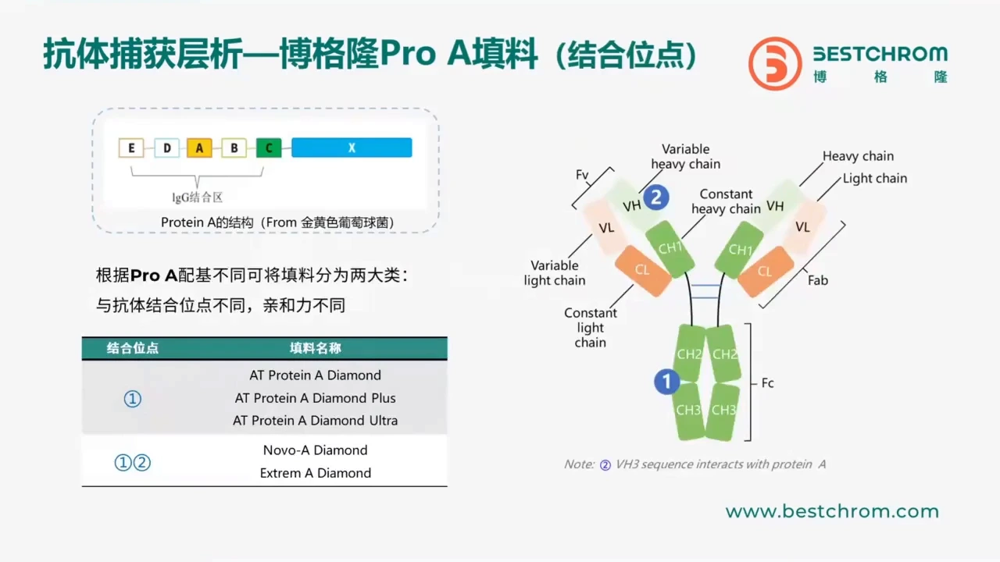

结合原理讲得很细：Protein A 有 E、D、A、B、C 五个结构域，五个结构域都能和抗体结合，每个都能形成三个阿尔法螺旋，其中两条反平行的阿尔法螺旋与抗体 Fc 区域的 **CH2-CH3 连接区域**结合。此外，某些结构域除了结合 Fc，还能与 **Fab 的 VH 区域（VH3 序列）**结合——这一点很关键，因为它决定了不同配基来源的填料在亲和力和洗脱行为上的差异。

相互作用的力包括疏水作用、氢键和盐桥。

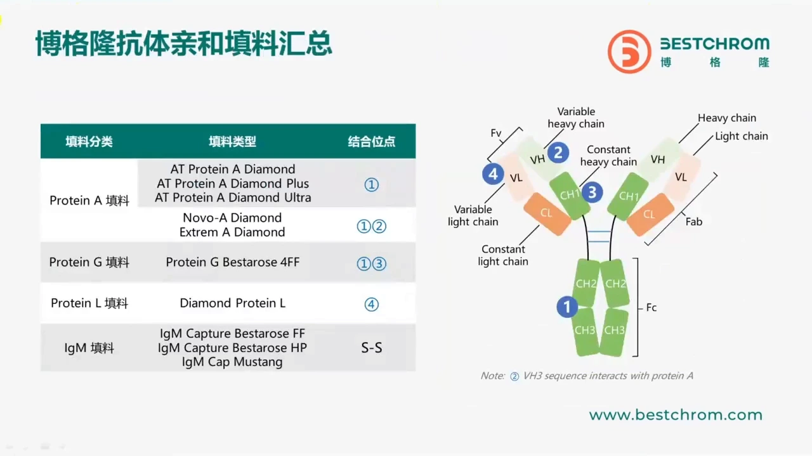

这张汇总表解释了为什么亲和填料要分这四类：Protein A 主要结合 Fc（部分配基还能结合 VH3），Protein G 结合 Fc 与 CH1，Protein L 结合轻链可变区（VL），IgM 则用二硫键相关的捕获方式。**抗体形式变了（Fab、scFv、VHH、IgM、双抗），可用的捕获配基也就变了**——这也是平台工艺遇到新分子形式时，第一个要重新考虑的地方。

### 3.2 捕获这一步要盯住七个指标

[【跳转到 19:03】](https://www.bilibili.com/video/BV1FQAHebEUS/?t=1143)

对亲和层析这一步，除了填料载量、批间稳定性、填料寿命，还要盯住：**整体收率、产品纯度、HCP 去除、配基脱落值**。

填料的选型考量则是：根据蛋白结构和表达通量需求，按结合位点和结合载量选；还要看可放大性、压力流速表现、批间一致性（保证工艺可重复），以及使用寿命——对亲和填料来说，寿命体现在**配基脱落情况**和**清洁难易程度**，也就是**耐碱稳定性**。

优化方向分三块：上样量与保留时间；洗脱条件（综合收率、杂质含量，还要防止聚体形成）；CIP 条件（在保证填料寿命的前提下尽量用彻底的 CIP，以保证产品纯度）。

### 3.3 淋洗去 HCP：精氨酸的浓度-效果曲线

[【跳转到 21:14】](https://www.bilibili.com/video/BV1FQAHebEUS/?t=1274)

上样之后，目的蛋白与 Protein A 配基特异性结合，但过程中也会有一些**非特异性结合**——这就是 HCP 残留的主要来源之一，靠**淋洗（wash）步骤**去除。

常用淋洗添加剂是氯化钠；在 HCP 挑战比较大的项目里，还可以尝试精氨酸、盐酸胍、尿素等。讲者给了两个单抗项目的实测数据：

| 项目 | 不加精氨酸时洗脱液 HCP | 加精氨酸后 | 备注 |
| --- | --- | --- | --- |
| 单抗项目一 | 284 ppm | 0.5 M 时明显下降，0.8 M 达 83 ppm，1 M 约 80 ppm | 到一定浓度后去除效果趋于平稳 |
| 单抗项目二 | 870 ppm | 1 M 时 42 ppm | 去除效果非常显著 |

这组数据的启示是：精氨酸浓度不是越高越好，**存在一个收益递减的拐点**（项目一在 0.5 到 0.8 M 之间就基本到位）。浓度越高，成本、黏度、以及后续超滤换液的负担都越大。

### 3.4 低 pH 洗脱：收率与聚体的正面冲突

[【跳转到 22:55】](https://www.bilibili.com/video/BV1FQAHebEUS/?t=1375)

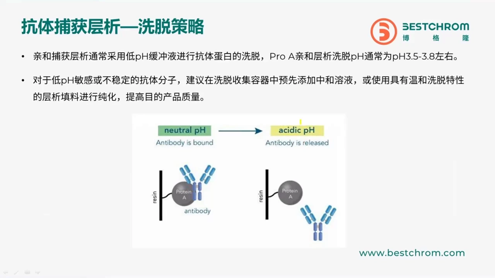

Protein A 亲和层析通常是**中性 pH 结合、低 pH 洗脱**，洗脱 pH 一般在 **3.5 到 3.8**。这个 pH 区间本身就是病毒灭活的条件，所以捕获和灭活常常合并在一步里。

问题是：**低 pH 对抗体是压力**。对于低 pH 敏感或不稳定的抗体分子，讲者给了两条对策：

1. **在洗脱收集容器中预先加入中和溶液**（比如 Tris），让洗脱下来的抗体立刻被中和，避免长时间处于低 pH 环境造成聚体形成。
2. **选用具有温和洗脱特性的层析填料**——这类填料的配基来源不同、亲和力不同，可以在更高的 pH（比如 4.0）就完成洗脱。

[【跳转到 23:17】](https://www.bilibili.com/video/BV1FQAHebEUS/?t=1397)

讲者用一个对比实验说明了"温和洗脱"值多少钱：实验设计是中性上样，洗脱设两个 pH 梯度，先在 pH 4.0 洗脱，再用 3.5 洗脱。

| 填料 | 洗脱行为 | 收率 | SEC 纯度 | 聚体 |
| --- | --- | --- | --- | --- |
| 温和洗脱填料（Nova Diamond） | pH 4.0 即完成全部洗脱，3.5 无出峰 | 95% | 94.35% | 低 |
| 对照国产填料 | pH 4.0 有洗脱，3.5 仍继续出峰 | 85.61% | 91.13% | 3.5 洗脱部分达 8% |

讲者对聚体来源给了两个可能：一是把柱上结合的高聚物洗了下来（低 pH 洗脱能力更强，把原本结合更牢的杂质也拽下来了）；二是低 pH 洗脱条件本身造成了目标产物在洗脱样品中聚集。**不管是哪种来源，温和洗脱都能规避这个风险**。

这一段的账很清楚：**同一份收获液，同样的上样量，只因为洗脱 pH 不同，收率差 9.4 个百分点，纯度差 3.2 个百分点，聚体差 8 个百分点**。这就是"聚体与降解限制纯化收率"的具体形态。

### 3.5 填料的工程参数：DBC、粒径、耐碱、耐压

[【跳转到 25:28】](https://www.bilibili.com/video/BV1FQAHebEUS/?t=1528)

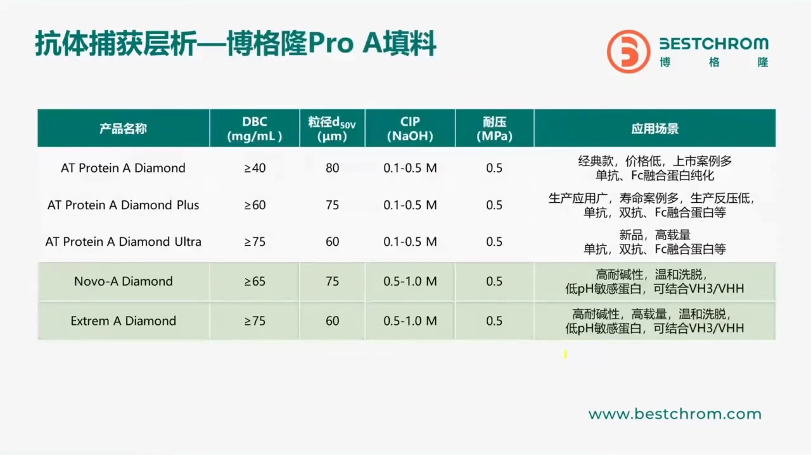

讲者列了五款 Protein A 填料的参数，可以看出工业填料是怎么"分层"的：

| 型号 | 动态载量 DBC | 粒径 d50v | 耐碱 CIP | 应用场景 |
| --- | --- | --- | --- | --- |
| AT Protein A Diamond | ≥40 mg/mL | 80 μm | 0.1–0.5 M NaOH | 经典款，价格低，单抗与 Fc 融合蛋白 |
| AT Protein A Diamond Plus | ≥60 mg/mL | 75 μm | 0.1–0.5 M NaOH | 生产应用广、寿命案例多、反压低 |
| AT Protein A Diamond Ultra | ≥75 mg/mL | 60 μm | 0.1–0.5 M NaOH | 高载量，单抗、双抗、Fc 融合蛋白 |
| Novo-A Diamond | ≥65 mg/mL | 75 μm | 0.5–1.0 M NaOH | 高耐碱、温和洗脱、可结合 VH3/VHH |
| Extrem A Diamond | ≥75 mg/mL | 60 μm | 0.5–1.0 M NaOH | 高耐碱、高载量、温和洗脱 |

[【跳转到 27:02】](https://www.bilibili.com/video/BV1FQAHebEUS/?t=1622)

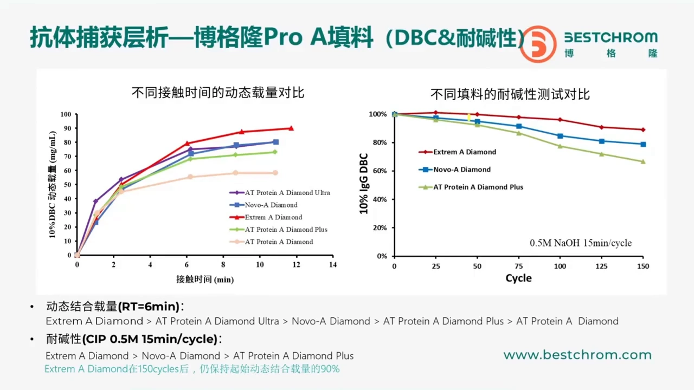

两张曲线图说明了两件事：

- **动态载量随接触时间上升**：接触时间从 0 拉到 12 分钟，载量持续上升。但生产工艺考虑通量，不会用很长的接触时间——以 6 分钟为基准，载量排序是 Extrem A Diamond > AT Protein A Diamond Ultra > Novo-A Diamond > AT Protein A Diamond Plus > AT Protein A Diamond。
- **耐碱性决定寿命**：0.5 M NaOH、15 分钟、每个 cycle 做一次 CIP，150 个 cycle 后，Extrem A Diamond 仍保持起始动态载量的 **90%**；排序为 Extrem A Diamond > Novo-A Diamond > AT Protein A Diamond Plus。

耐碱为什么重要？因为 CIP 越彻底，越能保证批间清洁与产品纯度；而填料能不能扛住高浓度碱，直接决定了你能不能用"彻底"的 CIP。**这是"纯度"和"填料成本"之间的另一笔账。**

压力流速方面，讲者强调它除了受配基影响，还和**粒径、柱高**强相关，其中柱高影响很大：AT Protein A Diamond Plus 粒径 75 μm、装柱 21.3 cm，5 分钟保留时间下柱前压小于 1 bar；Extrem A Diamond 粒径 60 μm、装柱 25.5 cm（更高），理论上压力流速更有挑战，但实测 5 分钟保留时间下柱前压也在 1.5 bar 左右。

---

## 四、精纯：五种手段各管一段

[【跳转到 29:17】](https://www.bilibili.com/video/BV1FQAHebEUS/?t=1757)

经过捕获层析，HCP、HCD 去除了一部分，但**也引入了 Protein A 配基**；同时产品相关的杂质（聚体、片段、电荷异构体）还需要进一步去除。这就是精纯存在的理由。

### 4.1 阴离子交换（AEX）：流穿模式，主攻工艺相关杂质

[【跳转到 17:22】](https://www.bilibili.com/video/BV1FQAHebEUS/?t=1042)

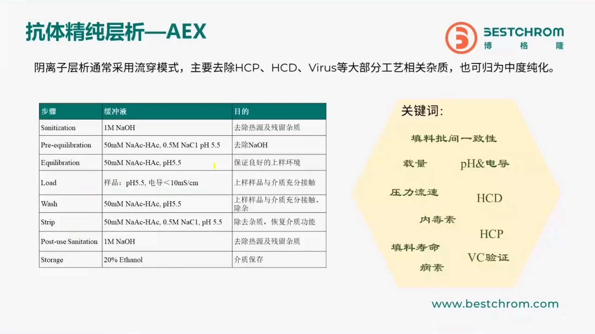

阴离子层析通常采用**流穿模式**（flow-through）：抗体在特定 pH/电导下不带正电或正电很弱，直接流穿；而 HCP、HCD、病毒、内毒素这些带负电的杂质被吸附。它主要去除工艺相关杂质，也可以归为"中度纯化"。

它还有一个额外价值：**是病毒清除验证中比较有效的病毒去除步骤**。关键参数是 pH 与电导（上样电导一般控制在 10 mS/cm 以下）。

### 4.2 阳离子交换（CEX）：结合洗脱，主攻产品相关杂质

[【跳转到 19:04】](https://www.bilibili.com/video/BV1FQAHebEUS/?t=1144)

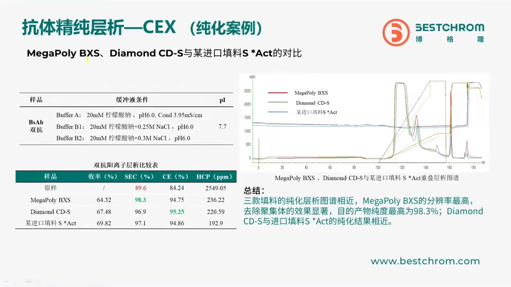

阳离子层析用**结合洗脱**模式，去除 HCP、HCD，以及**聚体、片段、电荷异构体**这些产品相关杂质。开发方法是先拉线性梯度分样，从组分收集判断样品与杂质的区分位置，再尝试优化成等度洗脱。关键参数同样是 pH 与电导。

讲者给了一个双抗的 CEX 案例，这组数据把"收率换纯度"的账算得很直白：

| 样品 | 收率 | SEC 纯度 | CE 纯度 | HCP |
| --- | --- | --- | --- | --- |
| 原样 | — | 89.6% | 84.24% | 2549.05 ppm |
| MegaPoly BXS | 64.32% | 98.3% | 94.75% | 236.22 ppm |
| Diamond CD-S | 67.48% | 96.9% | 95.25% | 220.59 ppm |
| 某进口填料 | 69.82% | 97.1% | 94.86% | 192.9 ppm |

**SEC 纯度从 89.6% 提到 98.3%，代价是收率只剩 64%。HCP 从 2549 ppm 降到 200 ppm 量级。** 这就是精纯步骤的常态：用三成多的收率，换近九个百分点的纯度。

### 4.3 复合模式（MMC / MMA）：离子交换 + 疏水，一次当两次用

[【跳转到 32:12】](https://www.bilibili.com/video/BV1FQAHebEUS/?t=1932)

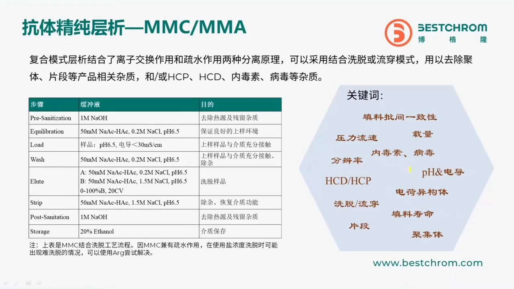

复合模式层析结合了**离子交换作用**和**疏水作用**两种分离原理，可以采用结合洗脱或流穿模式，去除聚体、片段等产品相关杂质，以及 HCP、HCD、内毒素、病毒等杂质。

它有两个工程上的好处：

- **耐电导更高**。单纯的离子交换层析上样前往往要稀释（把电导降到 10 mS/cm 以下甚至 5 左右），而复合模式耐受了更高的电导，**稀释倍数明显降低**——这直接减少了料液体积和处理时间。
- **对难洗脱组分有解法**。MMC 是弱阳离子交换模式、兼有疏水作用，用盐浓度洗脱时可能出现难洗脱，讲者建议尝试**添加精氨酸**或改用 **pH 梯度**。

[【跳转到 33:02】](https://www.bilibili.com/video/BV1FQAHebEUS/?t=1982)

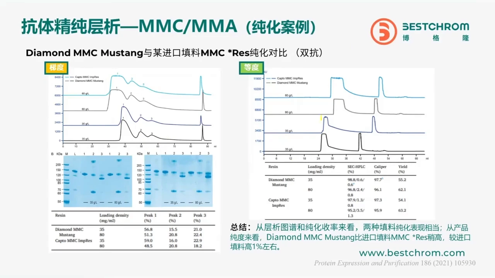

一个双抗的 MMC 案例：梯度洗脱图谱相近，转成等度洗脱后，在不同载量（35、80 mg/mL）下比较，产品纯度上 Diamond MMC Mustang 比进口填料高约 1 个百分点，收率相当。

[【跳转到 33:52】](https://www.bilibili.com/video/BV1FQAHebEUS/?t=2032)

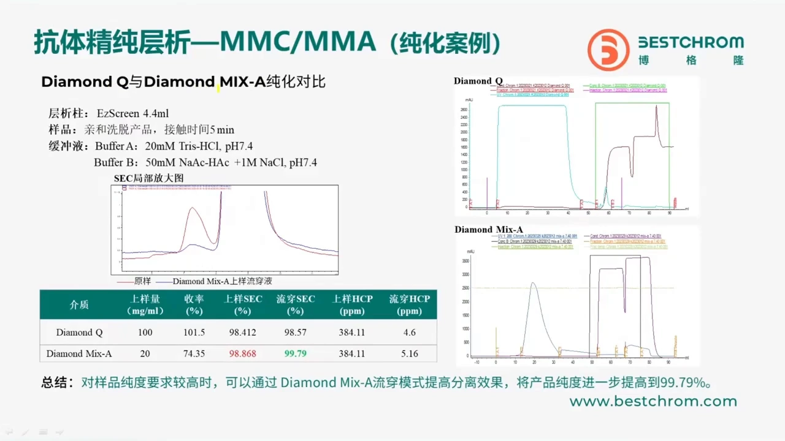

另一个案例更能说明"什么时候该换手段"：上样料液纯度已经在 98% 以上，用 Diamond Q 在 100 mg/mL 载量流穿模式下，纯度提升很有限（98.412% → 98.57%），但收率 101.5%（说明基本没有损失）；换成复合阴离子 Diamond Mix-A 并优化上样量后，纯度进一步提高到 **99.79%**，HCP 从 384 ppm 降到 5.16 ppm——代价是收率只有 **74.35%**，上样量也从 100 降到 20 mg/mL。

**这是一笔典型的高纯度交易：为了最后 1.2 个百分点的纯度，付出 25 个百分点的收率和 5 倍的载量。**

### 4.4 疏水层析（HIC）：高盐上样、低盐洗脱，怕温度

[【跳转到 34:42】](https://www.bilibili.com/video/BV1FQAHebEUS/?t=2082)

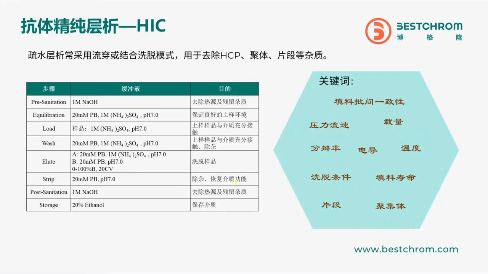

疏水层析可以用流穿或结合洗脱模式，去除 HCP、聚体、片段。在结合洗脱模式下，它是**高盐上样、低盐洗脱**——这与离子交换正好相反，所以在工艺衔接上要额外考虑料液的盐浓度调节。

它有一个其他层析方式不需要额外注意的点：**对温度敏感**。为了达到更好的分离效果和层析可重复性，必须保持温度一致。

[【跳转到 35:07】](https://www.bilibili.com/video/BV1FQAHebEUS/?t=2107)

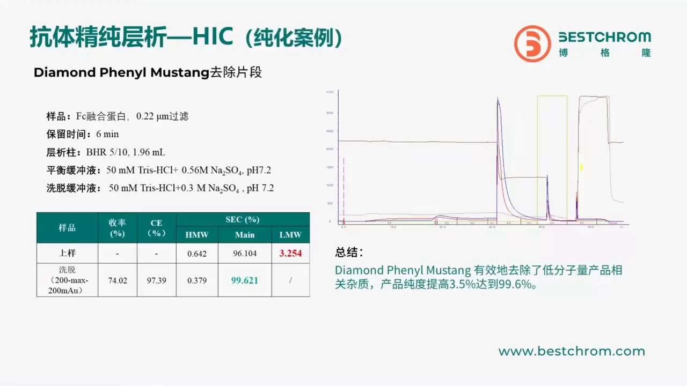

一个 Fc 融合蛋白的 HIC 案例：上样主峰 96.104%、低分子量片段 3.254%；经结合洗脱后，片段基本去净，SEC 主峰达 **99.621%**，收率 **74.02%**。

### 4.5 凝胶过滤（GF）：分辨率高，但载量低到不适合大生产

[【跳转到 35:57】](https://www.bilibili.com/video/BV1FQAHebEUS/?t=2157)

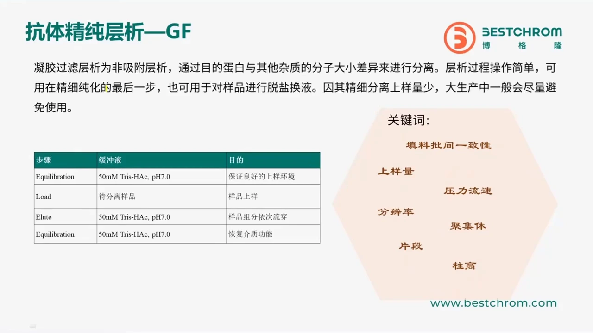

凝胶过滤是**非吸附层析**，靠目的蛋白与其他杂质的分子大小差异分离，过程简单、只需一种缓冲液，可以用在精纯的最后一步，也可以用于脱盐换液。

但它有一个硬伤：**精细分离时上样量很少，一般只有 0.5% 到 5% 的柱体积**。所以大生产中一般尽量避免使用，多用在脱盐或样品制备阶段。关键参数是上样量、流速、柱高（影响分辨率）。

### 4.6 精纯的组合策略：没有唯一答案

[【跳转到 36:05】](https://www.bilibili.com/video/BV1FQAHebEUS/?t=2165)

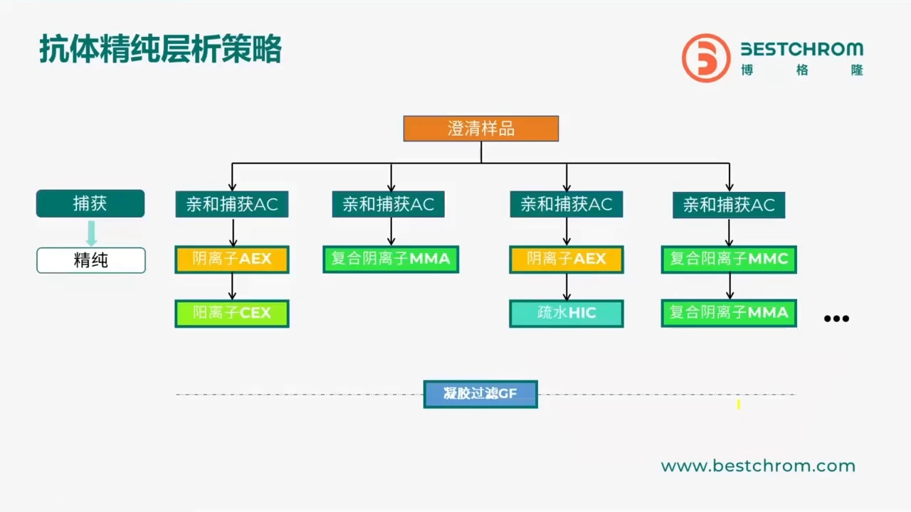

这张流程图给出了精纯的"菜单"：

- 亲和捕获 → 阴离子 AEX → 阳离子 CEX
- 亲和捕获 → 复合阴离子 MMA
- 亲和捕获 → 阴离子 AEX → 疏水 HIC
- 亲和捕获 → 复合阳离子 MMC → 复合阴离子 MMA
- 若以上都达不到要求，再用凝胶过滤 GF 兜底

讲者的原话是：精纯可以通过不同纯化方式的组合来实现，如果这些方法都达不到，还可以通过凝胶过滤做进一步纯化。**没有唯一答案，只有针对这个分子的杂质谱做出来的答案。**

---

## 五、把账算完：收率是怎么被扣掉的

把视频里散落的数字串起来，一支单抗的收率账本大致是这样的（数据来自各案例，不代表同一条生产线）：

| 步骤 | 收率（案例值） | 主要代价 |
| --- | --- | --- |
| 捕获（Protein A，温和洗脱） | 95% | 低 pH 洗脱带来的聚体风险 |
| 捕获（Protein A，低 pH 3.5 洗脱） | 85.61% | 聚体升到 8%，纯度降到 91.13% |
| 精纯（CEX 结合洗脱） | 64%–70% | 用三成收率换九个点纯度 |
| 精纯（HIC 去片段） | 74.02% | 高盐上样、温度敏感 |
| 精纯（复合阴离子高纯度模式） | 74.35% | 上样量降到 1/5 |
| 精纯（AEX 流穿） | 101.5%（基本无损失） | 但对纯度提升有限 |

这张表想说明的是：**纯化收率的限制，很少来自"操作失误"，更多来自"纯度要求"与"分子稳定性"这两个约束**。纯度要求越高，越要用苛刻条件（更低 pH、更高盐、更窄的收集窗口），收率就越低；分子越不稳定（低 pH 敏感、易聚集），能用的条件窗口就越窄，收率也越低。

而聚体与降解这两个因素，恰恰同时踩在这两条线上：它们既是**必须被去除的杂质**（推高纯度要求），又是**工艺条件本身制造出来的副产物**（低 pH 洗脱、剪切、高浓度存放）。这就是为什么"聚集、降解与糖型"会直接限制纯化收率——它们既是账本上的支出项，又是决定你能用多狠的条件的约束项。

---

## 六、答疑里的几个实操判断

[【跳转到 36:05】](https://www.bilibili.com/video/BV1FQAHebEUS/?t=2165)

- **复合层析的优势场景**：它有多种作用力，用好了能实现比单一作用力更好的分辨率；面对比较挑战性的杂质去除可以尝试；另外它能去除的杂质种类更多（单一作用力可能只能去掉一定比例，复合模式能去得更多）。
- **氯化钠洗脱时 pH 先降后回升，要不要管**：理论上不会特别影响层析表现；如果一定要避免，可以调整洗脱液的盐种类、基础 buffer 的种类或强度。
- **同源二聚体与半抗怎么去**：先看杂质与产品之间有没有电荷差异、疏水性差异；如果靠这些很难分离，可以尝试亲和层析——在亲和层析上研究去除同源二聚体和半抗已有不少研究和论文。
- **纯化过程中聚体是否会增加**：有可能，一般与填料基质以及蛋白之间的相互作用有关。
- **弱结合流穿的纯化条件有没有推荐值**：没有固定条件，必须依赖蛋白本身的性质做具体开发。
- **离子交换填料 CIP 后 pH 难洗回中性**：可以加一个高盐步骤解决。
- **温和洗脱填料的洗脱 pH**：正常低 pH 3.5 到 3.8 也能洗脱；如果走温和洗脱，清洗步骤推荐 pH 大于等于 6，后续用 pH 4 洗脱时，洗下来的样品 pH 大约在 5 左右。
- **纯度分析方法**：SDS-PAGE 可以看，但定量受上样量等因素影响较大，属于直观观察手段；更精准的定量要靠 CE-SDS、酸碱峰、SEC-HPLC 等方法。

---

## 小结

- 下游平台工艺五步：收获澄清 → 亲和捕获 → 病毒灭活 → 深层过滤 → 精纯（1–2 步）→ 纳滤与浓缩换液 → 原液。
- 所有层析方法都按"利用什么差异"分类：特异性（亲和）、等电点（IEX）、疏水性（HIC）、两者兼有（复合模式）、分子大小（GF）；每一步都在分辨率、载量、速度、回收率之间做平衡。
- Protein A 捕获一步就能把纯度拉到 90% 以上，靠的是与 Fc 的 CH2-CH3 连接区结合（部分配基还能结合 Fab 的 VH3）；这一步要盯收率、纯度、HCP、配基脱落、载量、寿命、批间一致性七个指标。
- 淋洗加精氨酸能显著降 HCP（284→80 ppm、870→42 ppm），但存在收益递减拐点。
- 低 pH 洗脱是聚体的主要来源之一：同一份料液，温和洗脱（pH 4.0 完成）收率 95%、SEC 94.35%；低 pH 3.5 洗脱收率 85.61%、聚体 8%、纯度 91.13%。
- 精纯五种手段各管一段：AEX 流穿去工艺相关杂质（兼病毒清除），CEX 结合洗脱去聚体/片段/电荷异构体（收率 64%–70%），MMC/MMA 兼两种作用力且耐更高电导，HIC 去片段但对温度敏感，GF 分辨率高但载量只有 0.5%–5% 柱体积。
- 收率账本的本质：纯度要求越高、分子越不稳定，可用条件窗口越窄，收率越低；聚体与降解既是要去除的杂质，又是工艺条件制造的副产物。

## 关键术语速查

| 术语 | 一句话解释 |
| --- | --- |
| Protein A | 金黄色葡萄球菌细胞壁蛋白（42 kD），特异性结合抗体 Fc，是捕获层析的配基 |
| DBC（动态结合载量） | 在流动条件下单位体积填料能结合的蛋白量，随接触时间增加而上升 |
| CIP（在线清洗） | 用 NaOH 等清洗填料，耐碱性决定填料寿命与批间清洁度 |
| 淋洗（wash） | 上样后、洗脱前的清洗步骤，用于去除非特异性结合的 HCP 等杂质 |
| 低 pH 洗脱 | Protein A 洗脱方式，pH 3.5–3.8，同时兼顾病毒灭活，但易诱导聚体 |
| 温和洗脱 | 配基经改造后可在更高 pH（如 4.0）完成洗脱，降低聚体风险、提高收率 |
| AEX / CEX | 阴离子 / 阳离子交换层析，分别常用流穿模式与结合洗脱模式 |
| 流穿模式（flow-through） | 目的蛋白直接流穿、杂质被吸附的模式，收率高但纯度提升有限 |
| MMC / MMA | 复合模式层析，兼有离子交换与疏水作用，耐更高电导 |
| HIC（疏水层析） | 高盐上样、低盐洗脱，去聚体与片段，对温度敏感 |
| GF（凝胶过滤） | 非吸附层析，按分子大小分离，上样量仅 0.5%–5% 柱体积 |
| HCP / HCD | 宿主细胞蛋白 / 宿主细胞 DNA，工艺相关杂质 |
| SEC-HPLC | 分子排阻色谱，测纯度与聚体含量 |
| CE-SDS | 毛细管电泳 SDS，测纯度与片段 |
| 电荷异构体 / 酸性峰 | 表面电荷不同的抗体变体，CEX 与 cIEF 可分析 |
| 纳滤（nanofiltration） | 用纳米级孔径膜去除潜在病毒颗粒并浓缩换液 |