# 抗体免疫原性的三层证据：从 T 细胞表位预测到临床 ADA

> 视频来源：[Dr. Yongliang Fang: Three-Layered Immunogenicity Risk Assessment in Protein Therapeutic Development](https://www.youtube.com/watch?v=jg7C-LDeNb4)（YouTube · ProImmune 研讨会 · 讲者方永亮，道尔生物）｜时长约 38 分钟
> 导读：这是一场带着自家管线数据讲的工业界报告。它不讨论"怎么把人源化做漂亮"，而是回答一个更实际的问题：序列预测、人 PBMC 实验、猴的 ADA/PK、临床 ADA 这四层证据，各自能信到什么程度，冲突时该听谁的。文中的案例数字均来自幻灯片。

## 本讲要解决的核心问题（SCQA）

**背景**：治疗性蛋白（单抗、多域蛋白、融合蛋白）进入人体后，免疫系统可能把它当成外来物，产生**抗药抗体（ADA，anti-drug antibody）**。业界早已有一套预警手段：看序列的人源性、用算法预测 T 细胞表位、在体外用人的 PBMC 看 T 细胞会不会被激活。

**冲突**：这些预警经常和现实对不上。讲者展示的两个自家案例里，一个 VHH 在序列预测上是"低风险"，猴子里却几乎全部阳转，到了人身上只有 20% 产生 ADA 且对 PK 影响有限；另一个工程化人蛋白在猴子里 12/12 全部阳转，人身上却只有 3.4%–5%。同一支分子，四层模型给出四种结论。

**疑问**：既然没有哪一层能单独说准，那这些预测还有没有用？研发到底该拿什么做决策？

**回答（中心思想）**：**没有任何单一模型能可靠预测人的免疫原性，价值在于多层数据的"收敛"**。序列预测负责高通量初筛与去免疫原性改造，人 PBMC 负责功能验证，猴负责系统暴露与 PK 关联，临床是唯一终审。四层的强弱项互补，冲突本身就是信息——它提示你去看剂量、糖型、患者背景这些序列之外的因素。

---

## 一、ADA 是免疫原性的读数，不是它的同义词

### 1.1 免疫原性看的是"倾向"，ADA 是它留下的痕迹

[【跳转到 00:05】](https://www.youtube.com/watch?v=jg7C-LDeNb4&t=5)

讲者把**免疫原性（immunogenicity）**定义为：治疗性蛋白引发针对自身（以及相关蛋白）的免疫反应、并由此导致免疫相关不良事件的**倾向**。这个定义里有两层意思：一是"倾向"而非"必然"，同一支药在不同人身上差别很大；二是它同时包含免疫反应本身和由此带来的临床后果。

而 **ADA** 是这套反应在血里留下的可测量产物。二者不能划等号：有 ADA 不等于有临床后果，没有测到 ADA 也不等于没有发生免疫反应（检测方法的药物耐受性会漏检，详见配套的另一篇《抗药抗体检测的分层策略》）。

### 1.2 ADA 可以从三个方向毁掉一支药

[【跳转到 02:41】](https://www.youtube.com/watch?v=jg7C-LDeNb4&t=161)

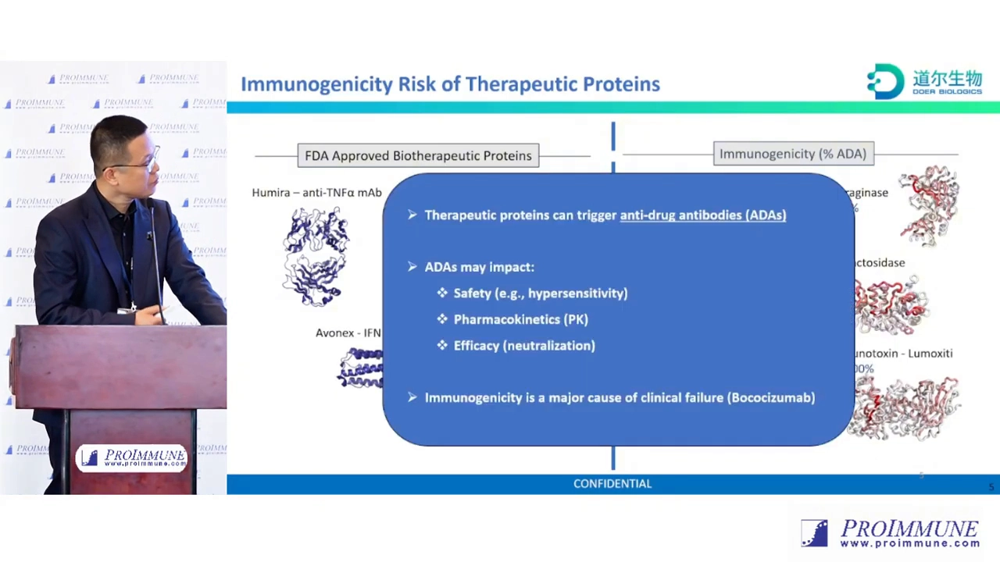

讲者把 ADA 的危害归成三条线：

- **安全性**：超敏反应，例如输液反应；
- **药代动力学（PK）**：ADA 与药物结合形成免疫复合物，加速清除、降低暴露；
- **疗效**：如果 ADA 是**中和性**的，会直接封住药物与靶点的结合，功能活性被抑制。

幻灯片点名的例子是 PCSK9 抗体 **bococizumab**——免疫原性被列为它临床失败的主要原因之一。讲者反复强调的一句话是：免疫原性可以成为临床失败的主因，而不只是一个"顺带记录的副作用"。

### 1.3 已上市抗体之间的 ADA 发生率能差二十倍

[【跳转到 01:52】](https://www.youtube.com/watch?v=jg7C-LDeNb4&t=112)

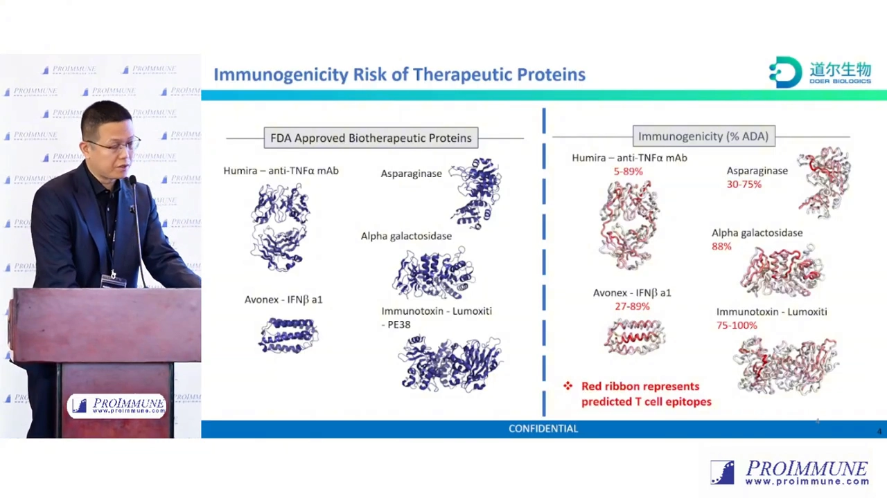

这张图是整场报告的出发点。左边是几个获批的治疗性蛋白结构，右边的红色缎带是算法预测出的 T 细胞表位——它们**几乎铺满整个蛋白**。但对应的临床 ADA 率从 5% 到 100% 不等，和红色缎带的密度并不成比例。

讲者的结论很克制：预测表位**多数时候**与 ADA 反应相关，但**有时并不相关**。所以表位预测不能当作判决书，只能当作筛选器。

### 1.4 免疫原性是多因素的，序列只是其中一格

[【跳转到 03:19】](https://www.youtube.com/watch?v=jg7C-LDeNb4&t=199)

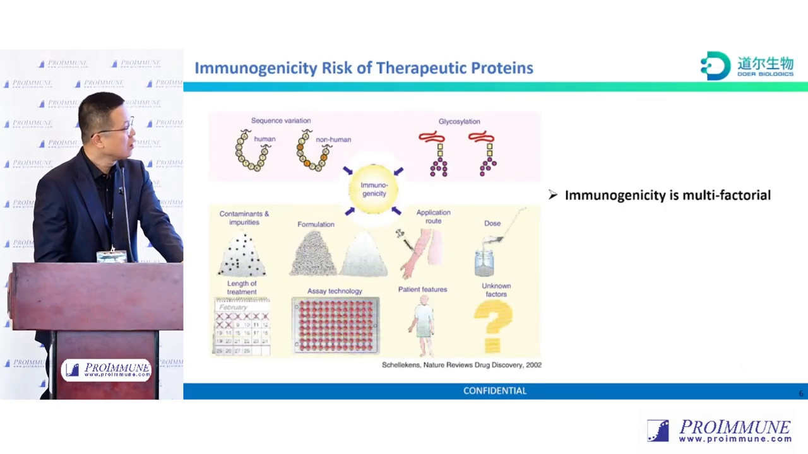

讲者引用了这张被反复使用的经典图（Schellekens 2002），把影响因素摊开：序列变异、糖基化、污染物与杂质、制剂、给药途径、剂量、疗程长短、检测技术、患者特征，还有一个"未知"。

他特别举了一个反直觉的例子：某个**嵌合抗体**（含鼠源序列）在人身上的免疫反应反而较低，而最常见的免疫反应针对的是它的**糖基（glycan）**而不是蛋白序列；换一个表达宿主、改变糖型之后，这个问题就消失了。他的判断是：**糖型、制剂、杂质、给药途径、剂量这些"非序列"因素，很多时候比序列本身影响更大**。

这一条对做抗体工程的人很关键：把序列改到"人源化 100%"并不能自动换来低免疫原性，工艺与给药方案同样在决定结局。

---

## 二、免疫原性发生的机制：一条从抗原呈递到浆细胞的链

[【跳转到 11:05】](https://www.youtube.com/watch?v=jg7C-LDeNb4&t=665)

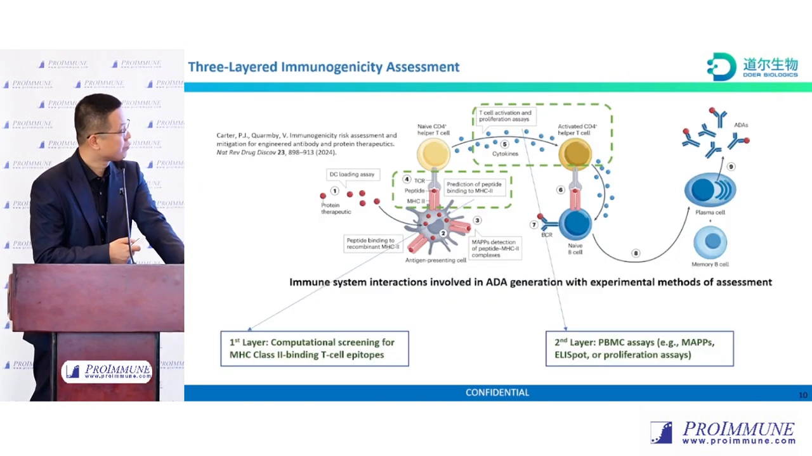

讲者用一张机制图把"为什么要分三层"讲清楚了。治疗性蛋白要变成 ADA，需要走完下面这条链：

1. **摄取**：树突状细胞（DC）等抗原呈递细胞把治疗性蛋白吞进去；
2. **加工与装载**：蛋白被降解成肽段，其中一部分被装到 **MHC II 类分子**上，呈递到细胞表面；
3. **T 细胞识别**：带有匹配 T 细胞受体（TCR）的 **CD4 辅助 T 细胞**识别"肽—MHC II"复合物后被激活、增殖；
4. **B 细胞协助**：活化的滤泡辅助 T 细胞（Tfh）给识别到药物的 B 细胞提供辅助信号；
5. **分化与产出**：B 细胞分化为浆细胞与记忆 B 细胞，浆细胞分泌 ADA。

这条链解释了为什么"预测 MHC II 结合肽"是最上游、最便宜的一层：它只考察第 2 步的物理化学可能性。而第 3 步之后是真正的细胞行为，需要活细胞才能看；第 5 步之后是系统层面的暴露与清除，只有整体动物或人才能看到。

> 补充（非讲者原话）：这条链是**T 细胞依赖**的。所以免疫原性强的治疗性蛋白，往往在 CD4 T 细胞能被有效激活的患者里更容易出 ADA；而 T 细胞表位的"外源性"只是必要条件，不是充分条件。

---

## 三、三层证据：每一层能回答什么，不能回答什么

[【跳转到 04:28】](https://www.youtube.com/watch?v=jg7C-LDeNb4&t=268)

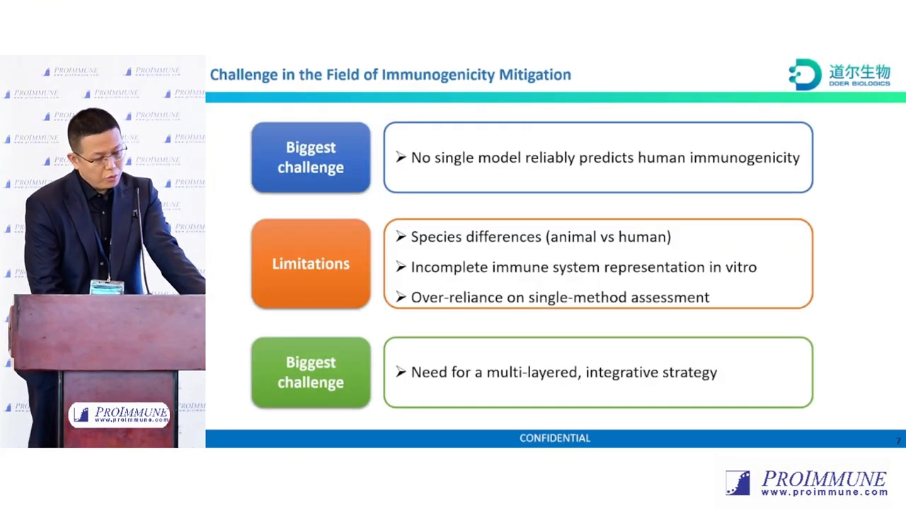

在展开分层之前，讲者先把问题定性：**没有任何单一模型能可靠预测人的免疫原性**。动物与人存在物种差异，体外实验的免疫系统是不完整的，只依赖一种方法必然偏；解法只能是多层整合。

[【跳转到 05:17】](https://www.youtube.com/watch?v=jg7C-LDeNb4&t=317)

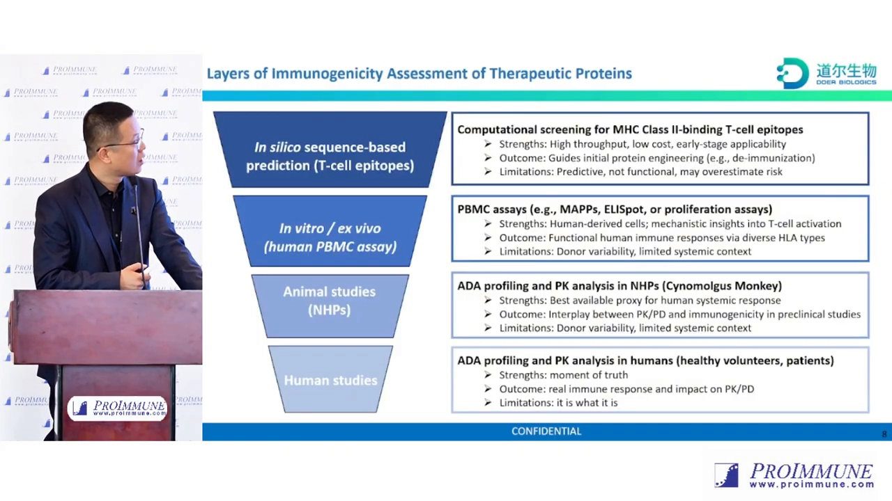

这张表是整场报告的骨架。讲者的公司把前三层做成内部流水线，用于候选分子的风险评级与排序；第四层（临床）不是他们能"设计"的，只能承受。

### 3.1 第一层：in silico 序列预测——高通量、低成本，但只会高估

这一层做的事是**计算筛选能与 MHC II 类分子结合的 T 细胞表位**。

- **优势**：通量极高、成本极低，特别适合早期阶段——手里有几百上千条序列时，只有这一层跑得动；结果可以直接指导蛋白工程改造（去免疫原性设计）。
- **局限**：它只是**预测**，不是验证；而且多数算法只看**线性序列**，不是功能性评估；**大多数时候会高估风险**。

讲者给了一个很实用的判据：即使是人的抗体，算法也会预测出一堆表位；但如果你把这段序列拿去和人自身的免疫库（repertoire）比对，会发现它"完全没问题"——因为人对自己的序列是有耐受的。**预测器不知道耐受，它只认识"能不能结合 MHC"。**

[【跳转到 12:03】](https://www.youtube.com/watch?v=jg7C-LDeNb4&t=723)

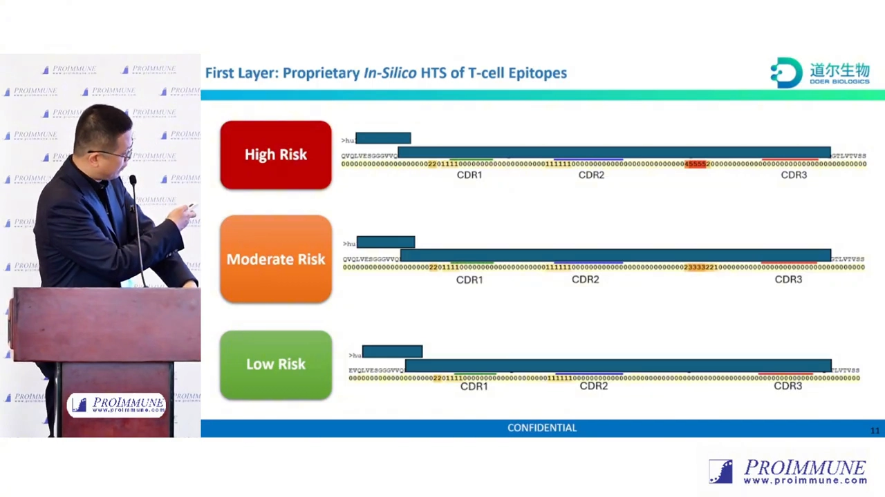

这张图展示了这一层在实操中长什么样：横轴是序列位置，纵轴方向的条纹密度代表预测到的表位聚集程度。三个分子是同一靶点、同一抗体家族，差别在**框架区**：

- 第一个：CDR 区看着还行，但**框架区**有明显风险热点，可以通过引入突变去免疫化；
- 第二个：CDR1、CDR3 都还行，属于中风险，改几个位点就能降下来；
- 第三个：通过多点突变把风险基本消除，判为低风险。

注意这里的信息量：**风险热点可以落在框架区而不是 CDR**，所以"把 CDR 嫁到人框架上"并不等于消除了 T 细胞表位。

### 3.2 第二层：人 PBMC 实验——用人的细胞看功能，但受供者限制

第二层是把候选蛋白加到**人外周血单个核细胞（PBMC）**里，看 T 细胞会不会被激活、增殖。讲者公司用的是 **CD8 清除后的 T 细胞增殖实验**：PBMC 去掉 CD8 细胞，用 CFSE 标记，加蛋白刺激 7 天，用流式看 CD4 细胞的增殖；阳性对照是 KLH，阴性对照是培养基。

[【跳转到 13:53】](https://www.youtube.com/watch?v=jg7C-LDeNb4&t=833)

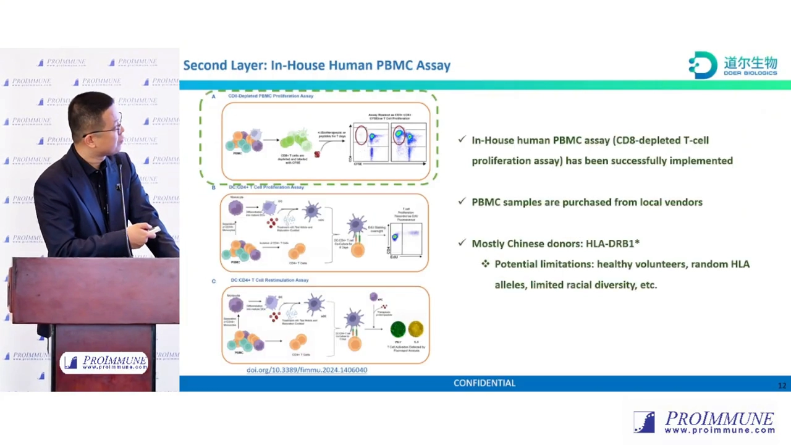

- **优势**：用的是**人的细胞**，而且走完了"抗原呈递细胞加工—呈递—T 细胞激活"这个功能过程，能看到机制层面的信息；如果供者库够大，还能覆盖多样的 HLA 型别。
- **局限**：
  - **供者变异**：小公司拿不到足够多、足够好的供者，实验质量不稳定；
  - **不是系统给药**：体外培养皿里没有药代、没有引流淋巴结、没有剂量累积；
  - 讲者公司自己的补充：PBMC 多来自**健康志愿者**，拿不到代表性患者人群的样本；供者 HLA 随机、种族多样性有限。

这一层的输出是"阳性率"——比如 31% 的供者对某个分子产生了增殖反应。这个数字不是临床发生率，只是"在体外，有相当一部分人的 T 细胞认得它"。

### 3.3 第三层：猴的 ADA 与 PK——唯一的系统视图，但物种不同

第三层是标准的非人灵长类（多为食蟹猴）药代与毒理研究，血样同时测 **ADA** 与 **PK**。

- **优势**：这是目前**最接近人的系统反应替代物**。讲者引用了一篇约十年前发表的论文：它分析了猴的免疫反应与人体试验的相关性，结论大约只有**五成**的把握对得上——即便如此，它仍是现有最好的技术。这一层还能看到 ADA 与 PK 曲线的相互作用；如果选对模型（比如肥胖或糖尿病猴），甚至能看 PD 标志物与免疫原性的关系。
- **局限**：猴与猴之间差异大；成本极高（讲者提到当年因猴资源紧张，价格涨得很厉害）。

讲者在问答里补充了第三层**不可替代**的理由：中国的监管机构高度依赖猴的毒理数据，如果不知道猴的免疫原性，毒理结论就没法解释——猴看起来"完全安全、完全耐受"，到底是因为分子毒性低，还是因为猴产生了中和抗体把药全清掉了？不看 ADA 就永远分不清。

### 3.4 第四层：临床——唯一的终审，且没有回头路

[【跳转到 09:52】](https://www.youtube.com/watch?v=jg7C-LDeNb4&t=592)

临床研究是"moment of truth"（真相时刻）：能拿到真实的免疫反应，以及它对 PK、甚至 PD 标志物的影响。局限讲得很直白：**一旦进入人体试验，就没有回头路**——多数情况下你不再有机会把分子重新改一遍再回到临床，失败就是失败。

---

## 四、两个案例：预测与实测能差多远

### 4.1 案例一：序列低风险、猴全阳、人只有 20%

[【跳转到 15:38】](https://www.youtube.com/watch?v=jg7C-LDeNb4&t=938)

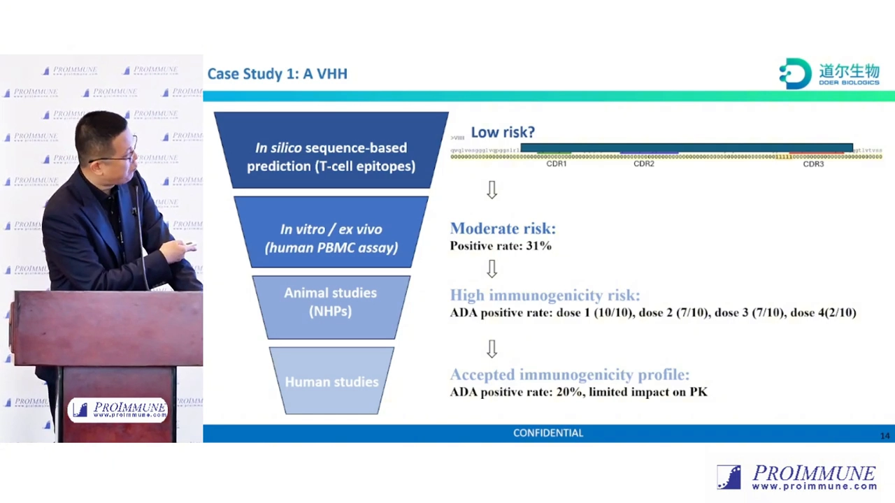

四层给出的结论依次是：

| 层级 | 结果 | 判读 |
| --- | --- | --- |
| in silico | 低风险 | 表位密度低 |
| 人 PBMC | 阳性率 31% | 上调为中风险 |
| 猴 | 剂量 1–4 组分别为 10/10、7/10、7/10、2/10 | 判为高风险 |
| 临床 | ADA 阳性率 20%，对 PK 影响有限 | 可接受的免疫原性画像 |

讲者的复盘是：如果只看猴，这个分子会被判死刑；但把前三层放在一起看，"中风险"这个判断其实一直成立，最终临床结果也确实落在"可接受"一侧。注意猴那一行里**剂量越低的组阳转率越高**（10/10 对 2/10），这个反直觉现象在第二篇博客里会解释——它和免疫耐受有关，而不是检测假象。

### 4.2 案例二：猴 12/12 全阳，人只有 3.4%

[【跳转到 18:08】](https://www.youtube.com/watch?v=jg7C-LDeNb4&t=1088)

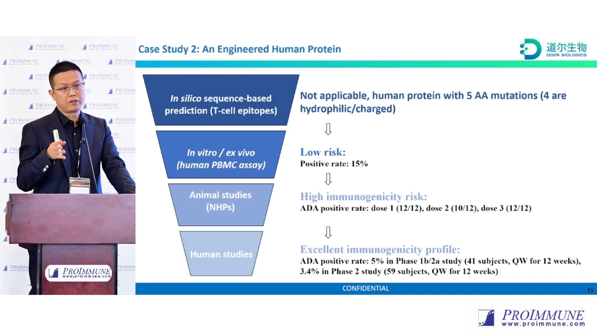

这个案例更极端。因为分子本身就是人蛋白、只改了 5 个氨基酸（其中 4 个换成亲水或带电荷的残基，这正是去免疫原化时偏好的替换方向），讲者的判断是**这一层根本不适用**——人蛋白序列在算法里没有意义。

人 PBMC 给出 15% 阳性率，判低风险。猴的结果却是 12/12、10/12、12/12 全部阳转，高到连长期毒理试验的设计都要和监管机构重新商量：猴的 ADA 滴度最终会高到把药全部清掉，这样的长期毒理数据不具代表性。

但临床上：1b/2a 期 41 例每周给药 12 周，ADA 阳性率 5%；2 期 59 例同样方案，3.4%。

讲者的总结是：**如果只看猴，这个项目会被直接砍掉**；把 PBMC 结果和对去免疫化的理解一起放进来，才和人体表现对得上。

> 需要提醒的是，讲者在问答中明确拒绝了一个更强的推论：不能因此说"猴的 ADA 与临床结局相关"。两个案例样本量太小，而且他们自己也见过猴与人一致的、也见过不一致的。

### 4.3 相关性到底有多好：两组 12 个蛋白的对照

[【跳转到 20:38】](https://www.youtube.com/watch?v=jg7C-LDeNb4&t=1238)

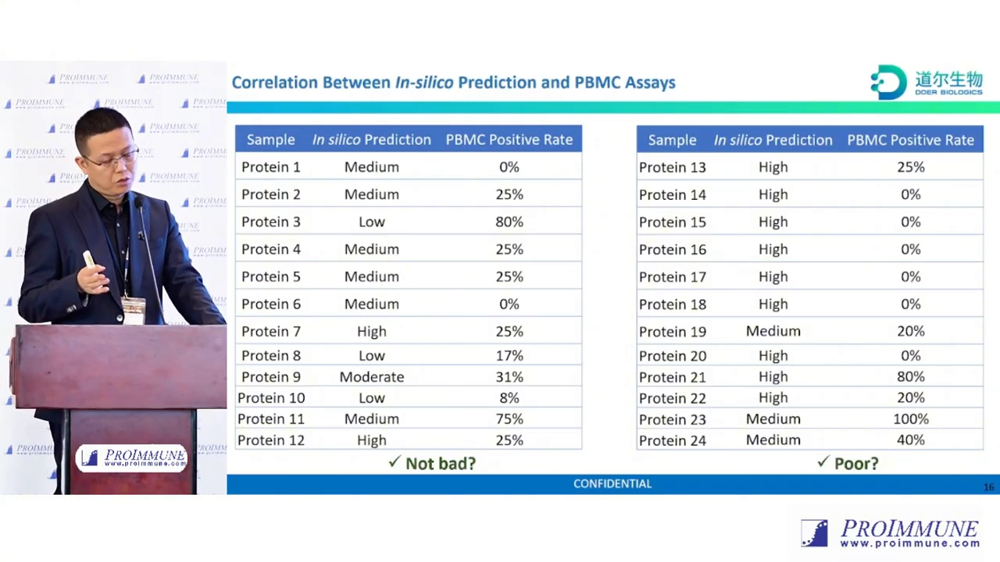

讲者把内部做过的 24 个蛋白分成两组对比：第一组的 in silico 判读与 PBMC 阳性率大致对得上（"not bad"），第二组则几乎对不上（"poor"）——比如一批被判为高风险的蛋白，PBMC 阳性率全是 0%。

他对这个现象的解释是自建 PBMC 实验的局限：样本量小、HLA 多样性低、供应商不是专门做这个的、实验操作与经验差异、没有专门的质量控制团队。改进方向是**和专业供应商合作**。

反过来，把 PBMC 结果与猴的 ADA 结果对照，相关性就明显好于"in silico 对 PBMC"——但仍有例外（讲者提到有两个蛋白不一致）。这支持了他的核心论点：**层次越往下（越接近功能与系统），相关性越好，但成本和通量代价越大**。

---

## 五、剂量与给药条件：同一序列可以有两种命运

[【跳转到 24:22】](https://www.youtube.com/watch?v=jg7C-LDeNb4&t=1462)

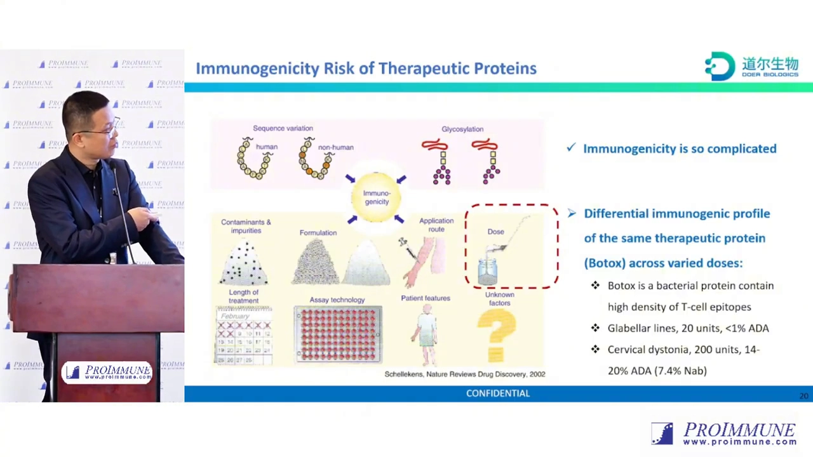

这是全场最有说服力的一段。肉毒毒素是细菌蛋白，T 细胞表位密度极高——in silico 会"满屏红"，PBMC 实验的反应率也高达 60%–80%。按序列判断，它是典型的强免疫原。

但临床数据是：

- 医美用途（眉间纹）：每次 **20 单位**，ADA 发生率 **低于 1%**；
- 治疗用途（颈部肌张力障碍）：每次 **200 单位**，ADA 发生率跳到 **14%–20%**，其中约 7.4% 是中和抗体，会削弱疗效。

**同一序列、同样的三层预测结果，只因为剂量不同，临床结局差了一个数量级。** 讲者的解释是抗原量：剂量太低时，能被呈递到淋巴结的抗原量不足以驱动有效的免疫应答（问答中他提到 20–30 单位大约只有 7–9 皮克量级）。反过来，剂量足够高时，抗原过量反而更容易诱导耐受——这一点在下一篇博客的"免疫耐受"一节里有数据支撑。

这个例子对研发的启示是：**剂量、给药途径、给药频次不是免疫原性评估之外的变量，它们本身就是免疫原性的一部分**。同一分子换适应症、换剂量，风险评级要重做。

---

## 六、怎么用这套证据做决策

[【跳转到 24:47】](https://www.youtube.com/watch?v=jg7C-LDeNb4&t=1487)

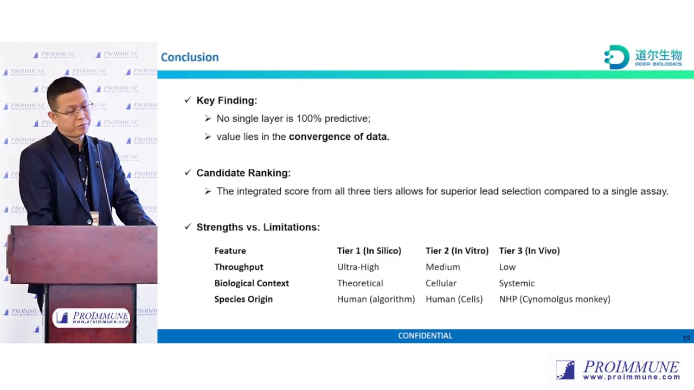

讲者的结论可以归成三条：

1. **没有任何单一层次是 100% 预测性的，价值在数据的收敛**。判断的关键不是某一层给了什么分数，而是几层之间是否一致、不一致时能不能解释。
2. **整合评分适合做候选排序**。三层合起来的排序比任何单层实验更能选出好lead。
3. **早期去风险是关键**。越晚发现免疫原性问题，代价越大——因为临床阶段没有回头路。

### 6.1 决策还要看适应症与作用机制

问答里有个很实际的追问：如果 in silico 和 PBMC 都提示中高风险，而猴是低风险，还敢不敢推？讲者的回答不是简单的"推/不推"，而是先问两件事：

- **适应症是肿瘤还是非肿瘤**：肿瘤领域对免疫原性的容忍度通常更高（免疫激活有时甚至是机制的一部分）；
- **机制是否涉及 T 细胞激活**：如果是 T 细胞衔接器（T cell engager）或免疫激动剂，免疫原性的后果完全不同，要格外小心。

换句话说，**同一个 ADA 阳性率，在不同机制、不同适应症下的"可接受度"不一样**。这也是为什么监管沟通里"免疫原性风险"必须和"临床后果"一起谈。

### 6.2 监管现状：猴是硬要求，前两层是加分项

讲者明确说明：按 NMPA 的要求，**非人灵长类数据是必须的**；前两层（in silico 与 PBMC）在征求意见稿里对 T 细胞衔接器、免疫调节类产品提到过 T 细胞增殖实验，但**不是强制要求**，国内多数公司并不做这两层。他自己因为学术背景把这条流水线建在了公司内部。

这也解释了为什么"三层"是工业界的**自愿加码**：它买到的不是合规通行证，而是更早的决策依据与更好的候选排序。

---

## 小结

- **免疫原性 ≠ ADA 阳性率**。免疫原性是一种"倾向"，ADA 是它在血里的读数；两者之间还隔着检测方法的灵敏度与药物耐受性。
- **ADA 从三个方向伤害药物**：安全性（超敏、输液反应）、PK（复合物加速清除）、疗效（中和抗体封闭功能）。bococizumab 是被点名的主因案例。
- **免疫原性是多因素的**：序列只是其中一格，糖型、制剂、杂质、给药途径、剂量、疗程、患者特征都在其中；讲者举的嵌合抗体案例说明糖型可以比序列更关键。
- **机制链条决定分层逻辑**：DC 摄取 → MHC II 呈递 → CD4 T 细胞激活 → B 细胞协助 → 浆细胞分泌 ADA。第一层预测第 2 步，第二层观察第 3 步，第三层看系统结局。
- **三层各有硬伤**：in silico 高通量但只会高估、且不懂免疫耐受；PBMC 用人的细胞但受供者与体外环境限制；猴是唯一的系统视图，但物种不同、成本高、相关性约五成。
- **预测与实测的差距是常态**：VHH 案例中序列判低风险、猴全阳、人 20%；工程化人蛋白案例中猴 12/12、人 3.4%–5%。单看任何一层都会做错决定。
- **剂量能改变结局**：肉毒毒素 20 单位 ADA <1%，200 单位 14%–20%。同一序列，不同剂量与适应症，风险评级必须重做。
- **决策要结合适应症与机制**：肿瘤 vs 非肿瘤、是否 T 细胞激活，决定了同一个 ADA 率是否可接受。

## 关键术语速查

| 术语 | 一句话解释 |
| --- | --- |
| 免疫原性（immunogenicity） | 治疗性蛋白引发针对自身的免疫反应、并导致免疫相关不良事件的倾向 |
| ADA（抗药抗体） | 患者针对药物产生的抗体，是免疫原性在血中的可测读数 |
| 中和抗体（NAb） | 能封闭药物与靶点结合、直接削弱疗效的 ADA 子集 |
| T 细胞表位 | 能被 MHC 分子呈递、被 T 细胞受体识别的肽段；免疫原性预测的主要对象 |
| MHC II 类分子 | 把外源蛋白降解后的肽段呈递给 CD4 T 细胞的分子，是 T 细胞依赖型免疫应答的入口 |
| in silico 预测 | 用算法在序列层面筛选 MHC II 结合肽，高通量、低成本、易高估 |
| PBMC 实验 | 用人外周血单个核细胞在体外观察 T 细胞是否被候选蛋白激活、增殖 |
| 食蟹猴（cynomolgus） | 非人灵长类，PK/毒理与 ADA 评估的常用物种，是人系统反应的最佳现有替代 |
| 去免疫化（de-immunization） | 通过定点突变消除预测到的 T 细胞表位，降低免疫原性风险 |
| 免疫耐受 | 抗原长期、足量存在时免疫系统不再对其反应的状态，可解释"低剂量反而更多 ADA" |