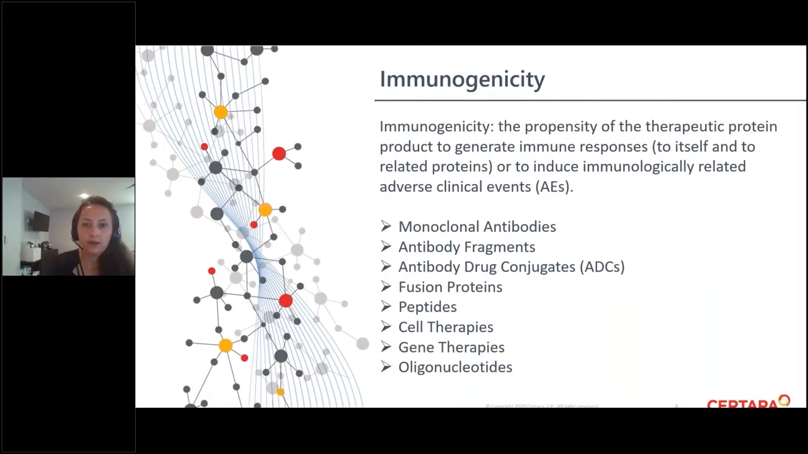
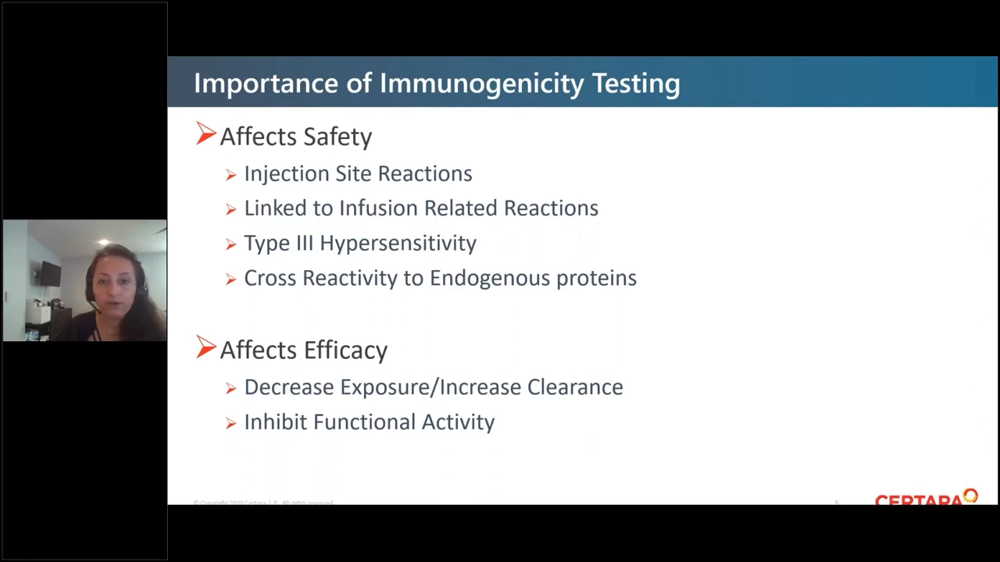
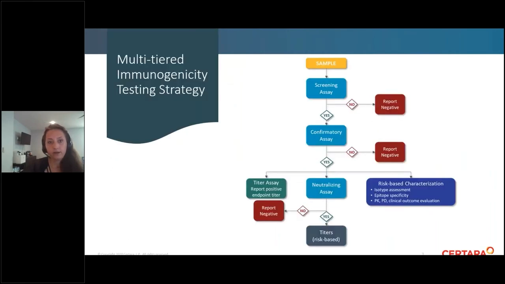
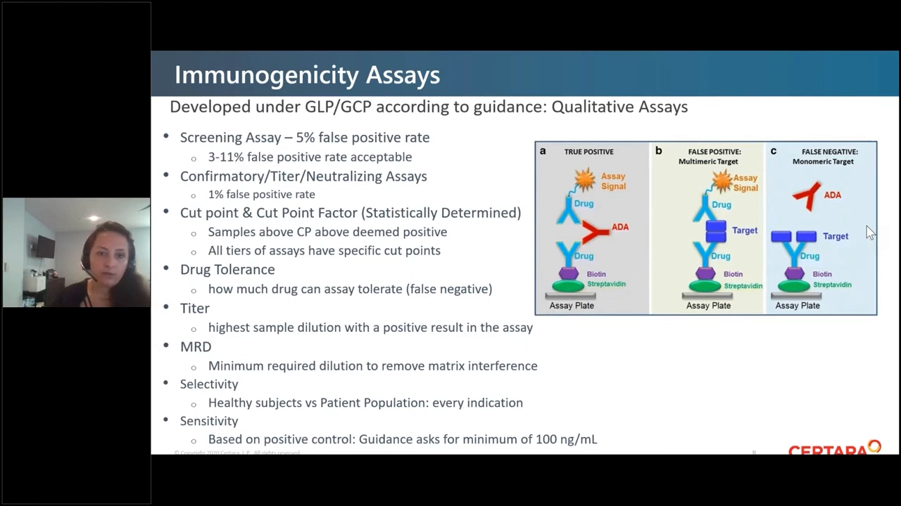
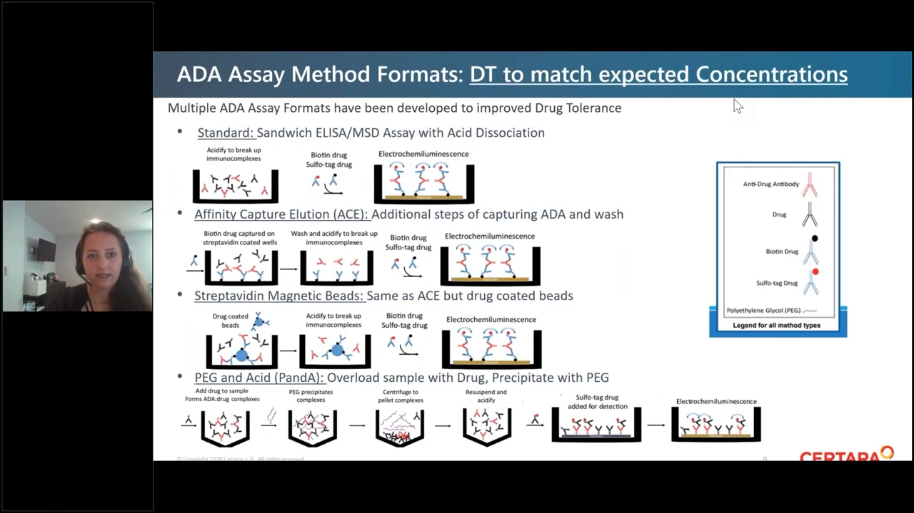
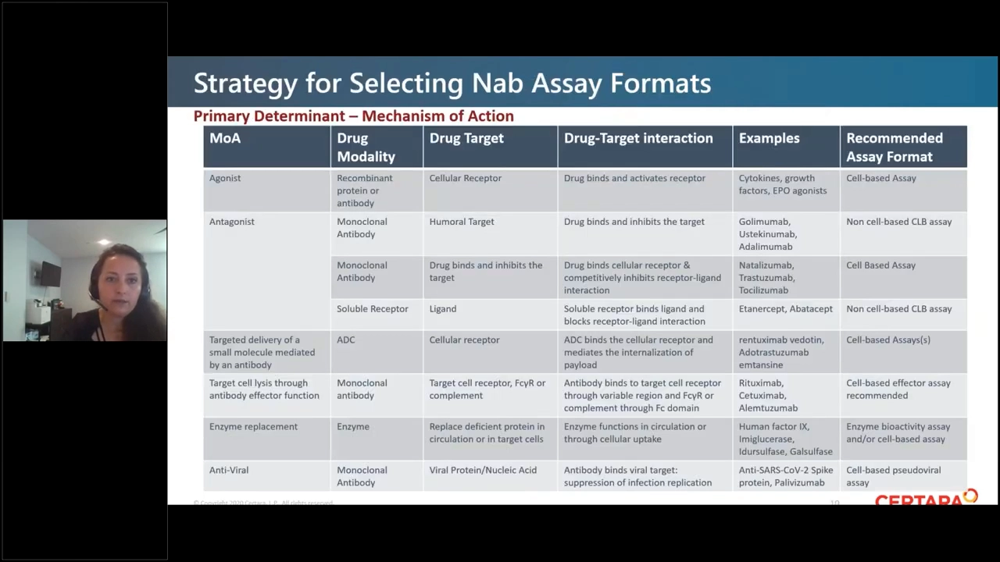
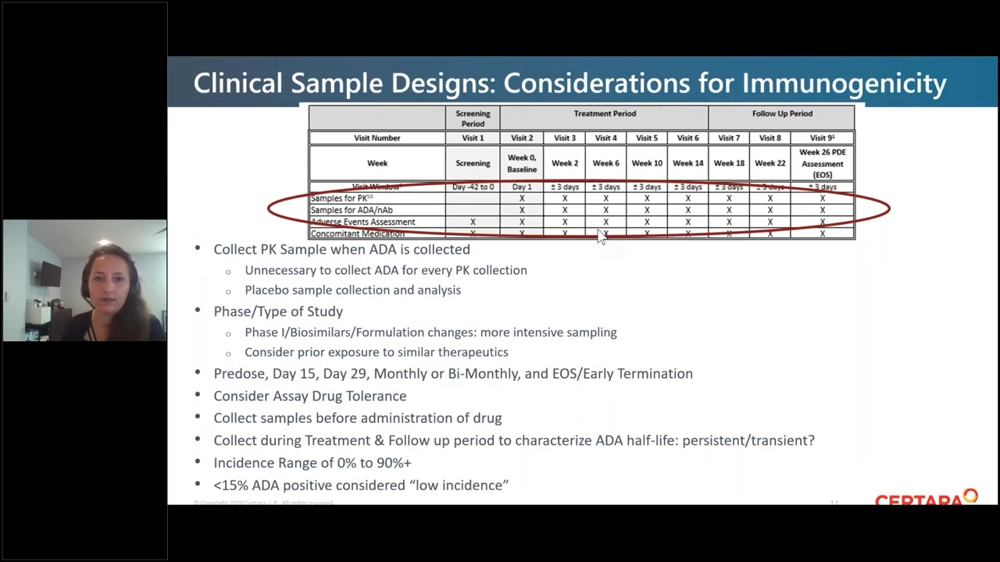
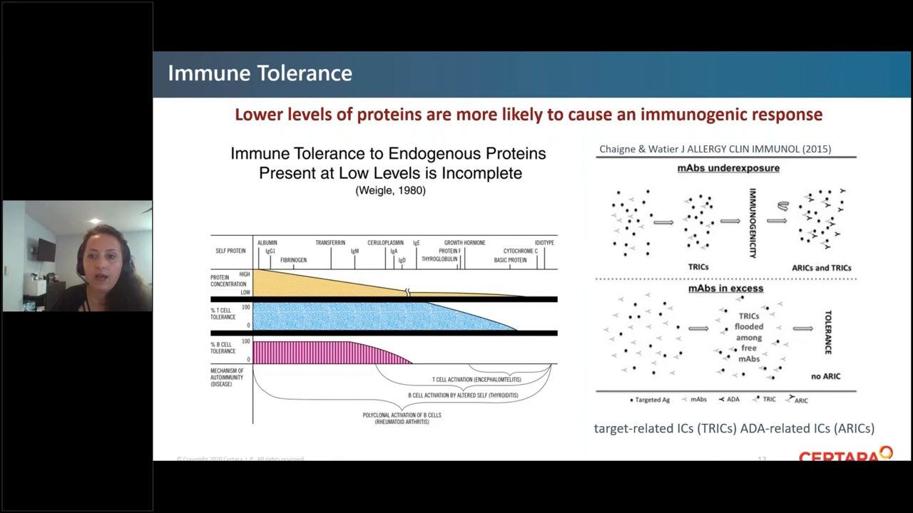

# 抗药抗体怎么测：筛查、确证、滴度与中和抗体的分层策略

> 视频来源：[Predicting and Taming Immunogenicity: Overview of Immunogenicity & ADA Assays](https://www.youtube.com/watch?v=wYpF1UF_fcU)（YouTube · Cértara 网络研讨会）｜时长约 11 分钟
> 导读：这是一支讲"怎么测"的短课。它把 ADA 检测从一句"测抗体"拆成一条四级流水线，并解释了为什么药物耐受、切点、滴度这些参数会在后期变成几十万美元的返工。公式与统计细节不多，但工程味很足。

## 本讲要解决的核心问题（SCQA）

**背景**：治疗性蛋白几乎都会引发一定程度的免疫反应，各国监管机构因此都要求做免疫原性检测。检测的对象是患者血里的**抗药抗体（ADA，anti-drug antibody）**。

**冲突**：ADA 检测和测一个小分子浓度完全不同——它没有标准曲线，是**定性**的方法；样本里还残留着高浓度的药物，药物会把 ADA "藏"起来，让结果变成假阴性。也就是说，检测方法本身可以制造"没有免疫原性"的假象。

**疑问**：一套能支撑监管决策的 ADA 检测，应该怎么设计和判读？

**回答（中心思想）**：ADA 检测是**分层**的——先用高灵敏的筛查层把可疑样本捞出来（宁可假阳性），再用确证层证明结合是特异的，然后才做滴度与中和抗体；每一层都要有统计学确定的切点，并且必须在方法里解决**药物耐受**问题，否则后面所有结论都建立在漏检之上。

---

## 一、为什么要测：免疫原性的两类后果

[【跳转到 00:05】](https://www.youtube.com/watch?v=wYpF1UF_fcU&t=5)

讲者先给出定义：**免疫原性是治疗性蛋白引发针对自身（以及相关蛋白）的免疫反应、或导致免疫相关不良事件的倾向**。需要做评估的模态远不止单抗：抗体片段、抗体偶联药物（ADC）、融合蛋白、多肽，甚至细胞治疗、基因治疗与寡核苷酸都在名单上。

[【跳转到 01:00】](https://www.youtube.com/watch?v=wYpF1UF_fcU&t=60)

为什么监管机构这么在意？讲者把后果分成两栏：

- **安全性**：注射部位反应、输液相关反应、III 型超敏反应，以及**与内源性蛋白的交叉反应**；
- **疗效**：降低暴露、增加清除（ADA 与药物形成复合物被加速清除），以及**抑制功能活性**（中和）。

她还讲了一个很直观的体验：如果患者每次给药都在产生免疫应答，等于**每次给药都在给自己"加强免疫"**（boosting），反应会越来越强。

### 1.1 ADA 不是一类东西

讲者强调"not all ADAs are created equal"（并非所有 ADA 都一样），可以按两层来分：

| 分类维度 | 类型 | 含义与风险 |
| --- | --- | --- |
| 结合能力 | 结合型 ADA（binding ADA） | 所有 ADA 首先都是结合型，能结合药物但不一定影响功能 |
| 结合能力 | 中和型 ADA（neutralizing ADA, NAb） | 能封闭药物与靶点的结合，直接削弱疗效；检测比结合型少见 |
| 交叉反应 | 交叉反应性中和 ADA | 最危险的一类：既中和药物，又与体内的**内源性同源蛋白**交叉反应 |
| 持续时间 | 一过性 / 持续性 | 与给药方案和免疫记忆有关，需要在随访期采样才能区分 |

其中"针对内源性蛋白的交叉反应性中和抗体"是**最少见但风险最高**的一类——因为它可能造成内源蛋白的功能缺失，后果远超"药效变差"。

---

## 二、四级流水线：筛查 → 确证 → 中和 → 滴度

[【跳转到 01:44】](https://www.youtube.com/watch?v=wYpF1UF_fcU&t=104)

这张流程图是整支视频的主干。四级的分工是：

1. **筛查层（screening）**：把"可能含 ADA"的样本捞出来。它的统计目标是**5% 的假阳性率**（可接受范围 3%–11%）。讲者特别说明监管的取向：**宁可假阳性，也不要假阴性**——漏掉一个真有免疫应答的样本，比多报几个可疑样本危险得多。
2. **确证层（confirmatory）**：往样本里**再加入过量药物**，看信号是否被特异性地抑制。如果加了药信号掉下来，说明之前的信号确实来自"能和药物结合的东西"，判为阳性；不掉，就是非特异结合，报告阴性。
3. **中和层（neutralizing）**：确证阳性的样本才进入中和抗体检测，判断这些抗体是否真的能阻断药物的功能。
4. **滴度层（titer）**：给出免疫反应的"强度"——滴度越高，反应越强。

讲者还提到一个"按风险加做"的分支：确证阳性之后，可以根据风险做更细的特征分析，比如**同种型（isotype）**、**表位特异性**，以及和 PK、PD、临床结局的关联。这一步不是每个项目都做，取决于分子的风险等级。

> 补充（非讲者原话）：这套"筛查—确证—中和"的结构是各国免疫原性指导原则的通用框架。它的逻辑是**逐层提高特异性、同时保持筛查层的灵敏度**，避免在第一步就把真信号过滤掉。

---

## 三、一套 ADA 方法必须交代的六个参数

[【跳转到 04:10】](https://www.youtube.com/watch?v=wYpF1UF_fcU&t=250)

这一页信息密度最高，逐个说：

**切点（cut point）与切点因子**：切点是统计确定的阈值，高于它判阳性、低于它判阴性。筛查层按 5% 假阳性率设，确证/滴度/中和层按 **1%** 假阳性率设。**每一层都有自己的切点**，不能混用。如果某个项目的方法表现不好，可以退一步做**患者特异性或研究特异性**的切点。

**药物耐受（drug tolerance）**：讲者说这是最常被误解的概念——它指的是**这个方法能容忍多少药物**。样本里如果残留高浓度的药物（或可溶性靶点），药物会把 ADA 的结合位点占住，检测就变成**假阴性**。幻灯片右侧的 c 格画的就是这个情形：单价靶点时，药物把 ADA 的桥连挡住了，信号消失。

如果药物耐受没设好，后果是**整套方法要重新验证和重新确认**，讲者给的成本估计是 **10 万到 25 万美元**。所以方法要尽早开发到位。

**滴度（titer）**：阳性结果的**最大稀释倍数**。滴度 200 和滴度四百万，临床含义完全不同——前者通常不必紧张，后者说明免疫反应很强。

**MRD（minimum required dilution，最小必要稀释倍数）**：为了去掉基质干扰必须做的稀释。但不能无限稀释——超过 1:100 之后，ADA 本身也被稀释掉了，可能漏检。所以稀释倍数既要去干扰，又要能自圆其说。

**选择性（selectivity）**：健康人和你要去的每一个适应症的患者人群都要评估，因为患者样本里可能有健康人没有的干扰因素。

**灵敏度（sensitivity）**：指导原则要求最低 **100 ng/mL**。

---

## 四、方法形式：为了让"药物耐受"达标

[【跳转到 06:21】](https://www.youtube.com/watch?v=wYpF1UF_fcU&t=381)

如果药物在谷浓度时就有 100 μg/mL，想在这样的背景里测到 ADA 非常困难。讲者列出四种形式，都是为了把**药物耐受**做上去：

| 形式 | 做法 | 特点 |
| --- | --- | --- |
| 标准夹心 ELISA/MSD + 酸解离 | 先酸化把 ADA—药物复合物拆开，再加生物素化药物与磺基标记药物，形成桥连后读电化学发光 | 最通用的基线方案 |
| 亲和捕获洗脱（ACE） | 在酸解离基础上增加捕获 ADA 与洗涤步骤，把药物洗掉 | 药物耐受更好，步骤更多 |
| 链霉亲和素磁珠 | 与 ACE 同理，但用药物包被的磁珠 | 同上，适合自动化 |
| PEG 与酸（PanDA） | 先加过量药物把复合物"顶"出来，再用 PEG 沉淀，离心、复溶、酸化后检测 | 药物耐受最强，但方法受专利保护、需要授权，不是所有实验室都能做 |

讲者的评价是：PanDA 是"极好的"提高药物耐受的方式，但有 licensing 门槛。

---

## 五、中和抗体实验：形式由作用机制决定

[【跳转到 07:10】](https://www.youtube.com/watch?v=wYpF1UF_fcU&t=430)

中和抗体（NAb）实验不能随便选形式，**首要决定因素是药物的作用机制**：

- **激动剂**（细胞因子、生长因子、EPO 激动剂）：作用在细胞受体上，必须用**细胞实验**；
- **拮抗剂 + 可溶性靶点**（如阿达木单抗、戈利木单抗、乌司奴单抗）：可以用**非细胞的竞争配体结合实验（CLB）**；
- **拮抗剂 + 细胞受体靶点**（如曲妥珠单抗、纳武利尤单抗）：需要**细胞实验**；
- **可溶性受体（如依那西普、阿巴西普）**：结合的是配体，可用 CLB；
- **ADC**：需要细胞实验（可能不止一个）；
- **依赖效应功能的靶细胞杀伤**（利妥昔单抗、西妥昔单抗、阿仑单抗）：推荐**细胞效应实验**；
- **酶替代**（凝血因子、伊米苷酶等）：需要**酶活性实验和/或细胞实验**；
- **抗病毒抗体**：需要**细胞假病毒实验**。

时间安排上：一般在 **2b 期**希望有 NAb 方法可用，**3 期必须有**。讲者也提醒成本结构：只有筛查阳性、确证阳性的样本才进 NAb 实验，所以可能花很多时间和钱，最后只测了少量样本——但这是必须的。

---

## 六、临床采样设计：什么时候抽血，比抽多少更重要

[【跳转到 08:44】](https://www.youtube.com/watch?v=wYpF1UF_fcU&t=524)

讲者的采样原则很具体：

- **采 ADA 时一定同时采 PK，反之不必**——因为 ADA 的解读离不开当时的药物浓度；
- **必须在给药前采**（predose），否则样本里药物浓度最高，最容易假阴性；
- **时点**：基线、第 15 天（看是否早期起病）、第 29 天，之后每月或每两月，以及研究结束时——**随访期采样是为了区分持续性与一过性 ADA**；
- **1 期、生物类似药、处方变更**这类研究要更密集采样；
- 还要考虑**既往是否用过同类药物**（可能已经有免疫记忆）。

发生率方面：不同项目从 0% 到 90% 都有，讲者把**低于 15%** 视为低发生率。

---

## 七、反直觉现象：低剂量组反而更容易产生 ADA

[【跳转到 10:24】](https://www.youtube.com/watch?v=wYpF1UF_fcU&t=624)

这是全场最有价值的一个机制解释。讲者先给一个常识类比：人不会对白蛋白产生自身免疫，因为白蛋白在体内浓度很高——**一个蛋白在体内越充足，免疫系统越倾向于对它耐受**。

把这个逻辑套到药物上：

- **药物不足（低剂量）**：药物与靶点形成**靶点相关免疫复合物（TRIC）**，这种复合物更容易进一步形成 **ADA 相关免疫复合物（ARIC）**，从而打破耐受、促进 ADA 产生；
- **药物过量（高剂量）**：TRIC 被大量游离药物"淹没"，无法形成 ARIC，反而倾向于**耐受**。

所以她反复看到：**猴的低剂量组 ADA 发生率明显高于高剂量组**，临床早期的低剂量队列也一样。她特别提醒：不要把这个现象误当成"检测的药物耐受问题"——前提是你已经理解了方法的药物耐受、并且能在谷浓度检测到 ADA。

> 这一条和上一篇博客里肉毒毒素的剂量效应正好互为补充：低剂量时抗原量不足以驱动应答（20 单位 ADA <1%），高剂量时抗原过量反而诱导耐受；而在中间地带，剂量越高、复合物越容易促成 ADA。剂量与免疫原性的关系不是单调的，取决于抗原量、复合物形式与给药间隔。

---

## 小结

- **免疫原性是"倾向"，ADA 是读数**；需要做评估的模态远不止单抗，还包括片段、ADC、融合蛋白、多肽乃至细胞与基因治疗。
- **ADA 的危害分两栏**：安全性（注射部位反应、输液反应、III 型超敏、与内源蛋白交叉反应）与疗效（暴露下降、清除加快、功能被中和）。
- **ADA 要分类看**：结合型是基础，中和型直接削弱疗效，**交叉反应性中和 ADA 最少见但最危险**；持续性与一过性要靠随访期采样区分。
- **检测是四级的**：筛查（5% 假阳性，宁可假阳不可假阴）→ 确证（加药抑制验证特异性）→ 中和 → 滴度，每层有独立切点（后三层按 1% 假阳性率）。
- **药物耐受是方法的核心指标**：样本里的药物会造成假阴性；设不好要花 10 万–25 万美元返工。酸解离、ACE、磁珠、PanDA 都是为提高药物耐受而生。
- **NAb 实验形式由机制决定**：激动剂与受体靶点要细胞实验，可溶性靶点的拮抗剂可用竞争配体结合实验，酶替代要活性实验，抗病毒要假病毒实验。
- **采样设计决定结论**：采 ADA 必采 PK、必须给药前采、随访期采样区分持续性、1 期与生物类似药要加密。
- **低剂量可能更容易产生 ADA**：抗原不足时形成靶点相关免疫复合物，反而促进 ADA；抗原过量时倾向耐受。

## 关键术语速查

| 术语 | 一句话解释 |
| --- | --- |
| ADA（抗药抗体） | 患者针对治疗性蛋白产生的抗体，免疫原性的主要检测对象 |
| 结合型 ADA | 能结合药物但不一定影响功能的 ADA，是所有 ADA 的基础形态 |
| 中和抗体（NAb） | 能阻断药物与靶点结合、直接削弱疗效的 ADA 子集 |
| 筛查实验 | 第一层检测，按 5% 假阳性率设计，目标是尽量不漏掉真阳性 |
| 确证实验 | 第二层，通过加入过量药物观察信号是否被特异性抑制来确认阳性 |
| 切点（cut point） | 统计学确定的阳性判定阈值，每层实验各自独立 |
| 药物耐受（drug tolerance） | 方法能容忍的样本内药物浓度；不足会造成假阴性 |
| 滴度（titer） | 仍呈阳性结果的最大样本稀释倍数，反映免疫反应强度 |
| MRD | 最小必要稀释倍数，用于去除基质干扰，一般不超过 1:100 |
| 免疫耐受 | 抗原充足时免疫系统不反应的状态，可解释低剂量组 ADA 更多的现象 |
| TRIC / ARIC | 靶点相关免疫复合物 / ADA 相关免疫复合物，后者是打破耐受的关键中间体 |