# ADC 偶联设计：位点越精确，工艺越贵

> 视频来源：[每日一讲：ADC偶联技术综述](https://www.bilibili.com/video/BV1SkYUz9Eya/)（Bilibili · 小药说药知识文库）｜时长约 15 分钟
> 导读：这是一节把「ADC 怎么把药挂上去」讲成技术谱系的课。讲者不按「随机／位点特异」的二分法，而是把偶联方法切成三级：随机、位点特异但非选择性、完全位点特异且选择性。本文顺着这条主线走，重点落在每一级「换来什么、付出什么」。字幕为 AI 生成，文中术语已按幻灯片原文订正；连接子的可裂解性与旁观者效应本片未展开，文末以「补充」形式单独说明，并明确标注。

## 本讲要解决的核心问题（SCQA）

**背景**：抗体能精准识别肿瘤细胞表面的蛋白，小分子化疗药能杀死细胞但不认路。ADC（antibody-drug conjugate，抗体偶联药物）就是把这两件事接起来——用抗体做导航，用细胞毒小分子做弹头。

**冲突**：接起来这一步远比听起来难。抗体是脆弱的生物大分子，偶联反应必须在水中进行，对 pH 和温度都敏感，稍有不慎就失败。更麻烦的是「接几个、接在哪」这件事本身：同一个抗体上挂 0 个药和挂 8 个药，是性质完全不同的分子，而一批生产里往往几种同时存在。

**疑问**：怎样才能把细胞毒载荷稳定、可控地挂到抗体上？不同的做法各自付出什么代价？

**回答（中心思想）**：偶联方法可以按「位点可控程度」排成三级——随机偶联、位点特异但非选择性偶联、完全位点特异且选择性偶联。**均一性每升一级，CMC（化学、制造与控制）复杂度也升一级**：随机法工艺最成熟但 DAR 分布最乱，工程化位点法均一性最好但要改抗体序列、要特殊表达系统、要更复杂的分析与纯化。所以选哪一种，本质是在均一性、工艺复杂度、成本与已有临床数据之间做权衡，没有免费午餐。

## 一、ADC 由四个部件组成，而「接几个」是一个独立的设计变量

讲者开篇先把 ADC 拆成可设计的部件。幻灯片把整个分子标成一张「偶联位点地图」：抗体骨架之外，还标出了赖氨酸偶联、半胱氨酸偶联、酶促偶联、糖基重塑、工程化半胱氨酸、非天然氨基酸六类连接方式各自落在分子的哪个位置。

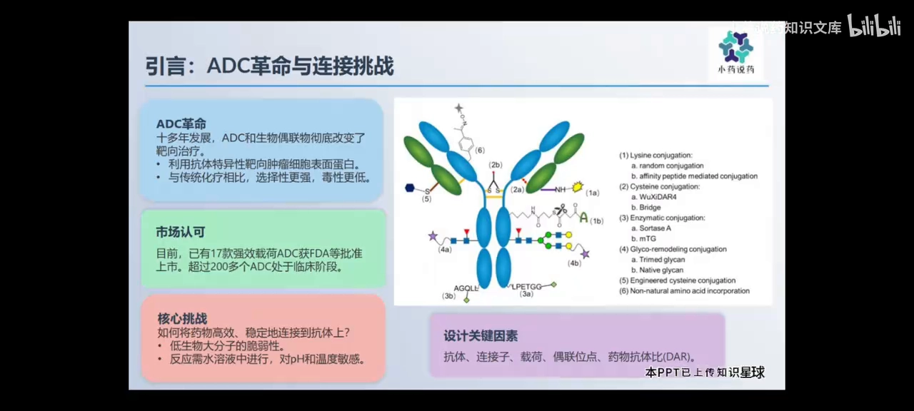

幻灯片右下角把「设计关键因素」列成五项：**抗体、连接子、载荷、偶联位点、药物抗体比（DAR）**。前三个是大家熟悉的「三要素」，后两个才是这节课真正的主角：

- **偶联位点**：药物挂在抗体的哪个氨基酸上。挂在不同位置，分子的疏水性、稳定性、甚至 Fc 段的功能都可能不同。
- **DAR（drug-to-antibody ratio，药物抗体比）**：平均每个抗体挂了多少个药物分子。DAR 太低则杀伤力不够，DAR 太高则分子变得疏水、容易聚集、清除变快。

讲者也给了行业背景：已有 17 款强效 ADC 获批上市，200 多款在临床阶段；而核心挑战始终是「如何将药物高效、稳定地连接到抗体上」。

[【跳转到 00:32】](https://www.bilibili.com/video/BV1SkYUz9Eya/?t=32)

## 二、按「位点可控程度」把偶联方法分成三级

传统上，偶联方法被分成两类：随机连接与位点特异性连接。讲者认为这个二分法太粗，提出一个更细的三分法：

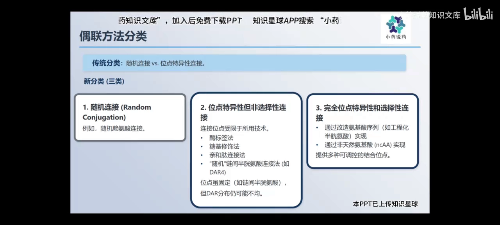

1. **随机连接（random conjugation）**：最典型的是随机赖氨酸连接。药物挂在哪几个赖氨酸上完全由化学反应的概率决定。
2. **位点特异性但非选择性连接**：位点是固定的，但「固定在哪」是由你用的技术决定的，而不是你主动挑选的。酶标签法、糖基修饰法、亲和肽连接法，以及「随机」链间半胱氨酸连接（如 DAR4）都属于这一类。讲者特意点出这一类的一个陷阱：**位点虽然固定，DAR 分布仍可能不均匀**。
3. **完全位点特异性和选择性连接**：通过改造氨基酸序列（如工程化半胱氨酸）或引入非天然氨基酸（ncAA），在抗体上「创造」全新的、可预测的连接位点。

这三级之间的差别，可以用一张表说清：

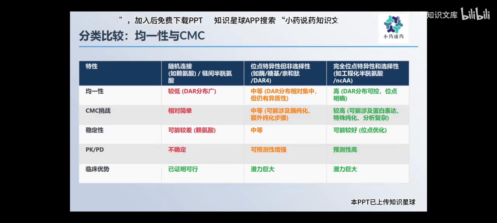

表格的读法是「从左到右，均一性上升、CMC 难度上升」：随机法均一性低、CMC 相对简单、已有临床验证；完全位点特异法均一性高、PK/PD 可预测性高，但 CMC 挑战也最高。中间那一档则是「均一性中等、DAR 分布相对集中但仍有异质性」。

[【跳转到 02:33】](https://www.bilibili.com/video/BV1SkYUz9Eya/?t=153)

## 三、第一级：随机赖氨酸偶联——最成熟，也最不均匀

赖氨酸偶联利用的是抗体表面约 40 个溶剂暴露的赖氨酸残基上的氨基（-NH₂）。这些氨基在中性条件下亲核性强，容易被亲电子试剂（如 NHS 酯、异氰酸酯）攻击。

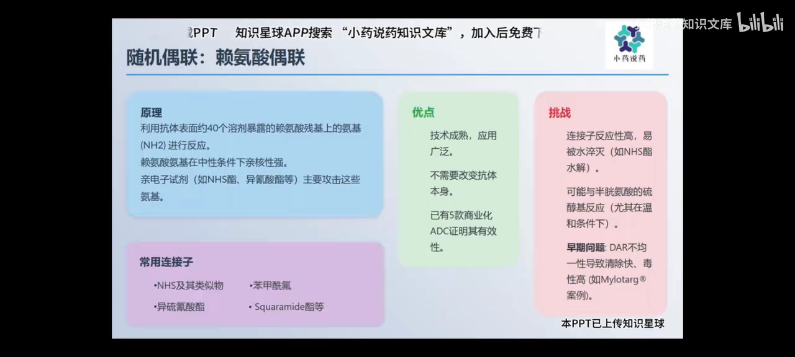

**优点很实在**：技术成熟、应用广泛，不需要对抗体本身做任何改动，已有 5 款商业化 ADC 用它做成，证明其有效性。

**挑战同样实在**，幻灯片列了三条：

1. 连接子反应性高，容易被水淬灭（NHS 酯水解），导致产率下降。
2. 在温和条件下，亲电子试剂可能更倾向于跟半胱氨酸的巯基反应，而不是赖氨酸。
3. 早期问题最致命：**DAR 不均一导致清除快、毒性高**，幻灯片直接点名 Mylotarg® 案例。

讲者补充了这段历史：早期 Mylotarg 因为 DAR 分布太乱、药物释放太快、毒性太大，一度撤市，后来调整剂量重新获批，但被 FDA 打上了黑框警告。这是「偶联方式会变成临床问题」的最直观例子。

[【跳转到 03:49】](https://www.bilibili.com/video/BV1SkYUz9Eya/?t=229)

## 四、第二级：位点特异但非选择性——位点固定，分布仍可能散

这一级有四种常见做法，共同点是「位点由技术锁死」，你不能自由挑选。

### 4.1 链间半胱氨酸偶联：目前的主流

IgG1 抗体通常有 4 对链间二硫键，位于溶剂暴露区域。用还原剂（如 TCEP、DTT）打开，可得到 8 个游离的巯基（-SH）。巯基比赖氨酸的氨基「更软」，更容易发生迈克尔加成反应，因此可以用马来酰亚胺类连接子高效、定量地接上药物。

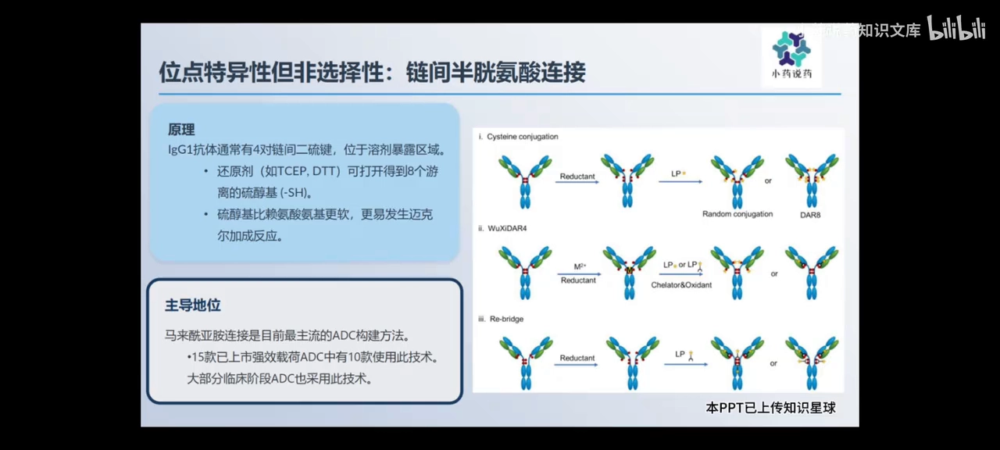

图里画了三条路线：

- **随机还原**：8 个巯基全部可用，理论 DAR 可到 8，但实际得到的是 0~8 的混合物。
- **WuXiDAR4**：通过控制还原与螯合/氧化条件，把药物定向分配到 4 个位点上。
- **再桥接（re-bridge）**：先用还原剂打开二硫键，接上药物后再把二硫键「桥」回去，兼顾位点与结构完整性。

幻灯片给出的行业事实很关键：**马来酰亚胺连接是目前最主流的 ADC 构建方法，15 款已上市强效 ADC 中有 10 款使用该技术**，大部分临床阶段 ADC 也采用它。

[【跳转到 05:04】](https://www.bilibili.com/video/BV1SkYUz9Eya/?t=304)

### 4.2 酶标签偶联：均一性最好，但要多加一套酶反应

原理是用能识别特定氨基酸序列的酶，把载荷「定点」转移上去。幻灯片列了四种常用酶：

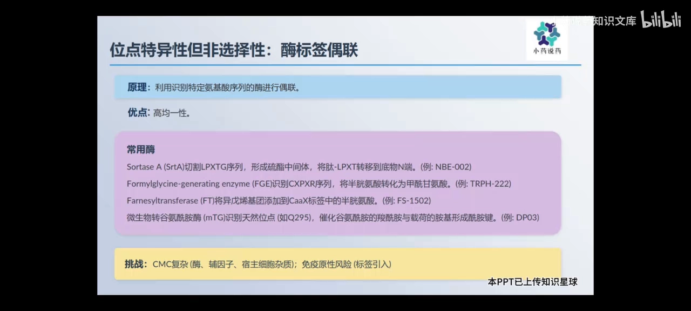

- **Sortase A（SrtA）**：切割 LPXTG 序列，形成硫酯中间体，把带 LPXT 的肽转移到产物 N 端（例：NBE-002）。
- **甲酰甘氨酸生成酶（FGE）**：识别 CXPXR 序列，把半胱氨酸转化为甲酰甘氨酸（例：TRPH-222）。
- **法尼基转移酶（FT）**：将异戊烯基团加到 CaaX 标签中的半胱氨酸上（例：FS-1502）。
- **微生物转谷氨酰胺酶（mTG）**：识别天然位点（如 Q295），催化谷氨酰胺的羧酰胺与载荷的胺基形成酰胺键（例：DP03）。

优点是高均一性；挑战写在幻灯片最下面一行：**CMC 复杂（酶、辅因子、宿主细胞杂质），并且引入的标签本身有免疫原性风险**。

[【跳转到 06:36】](https://www.bilibili.com/video/BV1SkYUz9Eya/?t=396)

### 4.3 糖基修饰偶联：借用 Fc 上天然的糖链

抗体 Fc 区的 N297 位点天然连着一根 N-聚糖，可以拿它当连接位点。早期做法是用化学试剂氧化糖链上的羟基生成醛基，再进一步修饰；现在更流行「糖基重塑」：先用内切糖苷酶切掉天然糖链，再装上带特殊化学基团（如叠氮）的糖链，最后用点击化学把药物连上去。

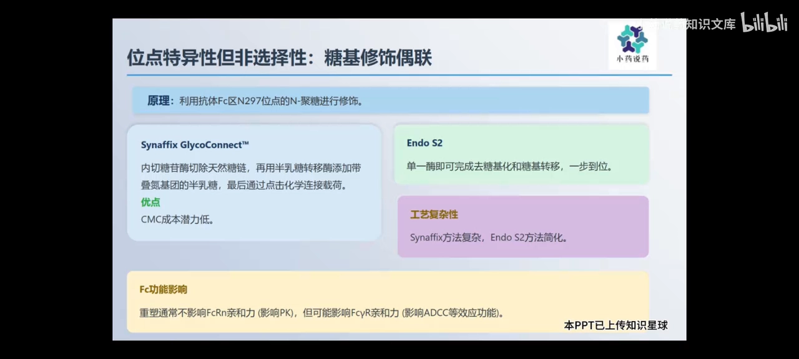

- **Synaffix GlycoConnect™**：内切糖苷酶切糖 → 半乳糖转移酶装带叠氮的半乳糖 → 点击化学接载荷。缺点是步骤多、成本高。
- **Endo S2**：单一酶一步完成去糖基化和糖基转移，工艺更简单，CMC 成本潜力更低。

幻灯片底部还有一条容易被忽略的提醒：**重塑糖链通常不影响 FcRn 亲和力（即不太影响半衰期），但可能影响 FcγR 亲和力，从而影响 ADCC 等效应功能**。也就是说，你为了挂药而动的那个位点，可能顺手改掉了分子的另一半功能。

[【跳转到 07:26】](https://www.bilibili.com/video/BV1SkYUz9Eya/?t=446)

### 4.4 亲和肽偶联：让肽段把连接子「领」到 Fc 的固定位置

思路借自纯化：Protein A / Protein G 能特异结合抗体 Fc 区。把这段结合序列改造成短肽，接在连接子上，肽段就会像向导一样把连接子带到 Fc 的特定位置（如 K248、K288 或 K337 附近），提高局部浓度、加速与邻近赖氨酸的反应。

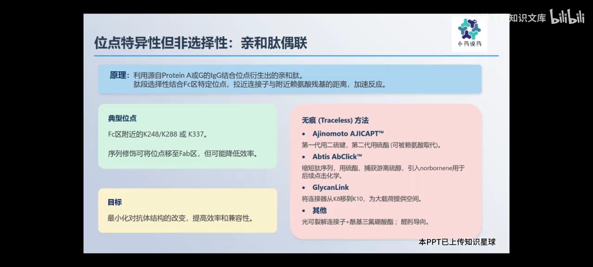

为了不留下多余结构，业界发展出多种「无痕（traceless）」方案：Ajinomoto 的 AJICAPT™（第一代用二硫键，第二代用硫酯）、AbClick（缩短肽序列、用硫酯捕获游离巯基、引入 norbornene 做后续点击化学）、GlycanLink（把连接点从 K8 挪到 K10，为大载荷腾空间），以及光可裂解连接子、酰基三氟硼酸酯等。目标是一致的：**尽量少改动抗体结构，同时拿到位点特异性和高效率**。

[【跳转到 09:31】](https://www.bilibili.com/video/BV1SkYUz9Eya/?t=571)

## 五、第三级：完全位点特异——改造序列，自己造一个位点

### 5.1 工程化半胱氨酸：把某个氨基酸换成半胱氨酸

通过基因工程把抗体序列中特定位置的氨基酸换成半胱氨酸，就人为造出一个唯一的、带巯基的连接位点。这个概念最早由 Junutula 等人提出，做成了著名的 Thiomab。

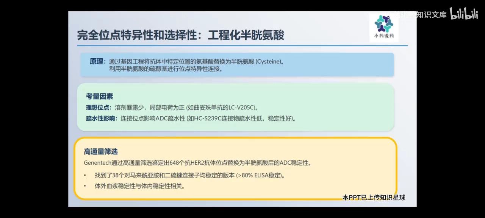

关键在于「换哪个位置」。幻灯片给了两条判据：

- **理想位点**：溶剂暴露少、局部电荷为正。例如曲妥珠单抗的轻链 V205C 位点被证明是个不错的选择。
- **疏水性影响**：连接位点会改变 ADC 的整体疏水性。例如 HC-S239C 连接的分子疏水性低、稳定性好。

但理性设计并不够，还要靠筛。Genentech 把抗 HER2 抗体上 648 个位点逐一换成半胱氨酸，用高通量方法测每个位点做出的 ADC 稳定性，最终找到 38 个对马来酰亚胺和二硫键连接子都稳定的版本（>80% ELISA 稳定），并发现**体外血浆稳定性与体内稳定性正相关**。讲者的结论是：通过理性设计加筛选，确实能找到既特异又选择性的最佳偶联位点。

[【跳转到 11:11】](https://www.bilibili.com/video/BV1SkYUz9Eya/?t=671)

### 5.2 非天然氨基酸：在翻译时就把「化学把手」装进去

最后一种做法是遗传密码扩展：在蛋白质合成时，通过正交的氨酰-tRNA 合成酶/tRNA 对，把非天然氨基酸（ncAA）同步翻译引入到预突变的终止密码子（通常是 TAG）位置，再用生物正交反应（如酮缩合、SPAAC）偶联。

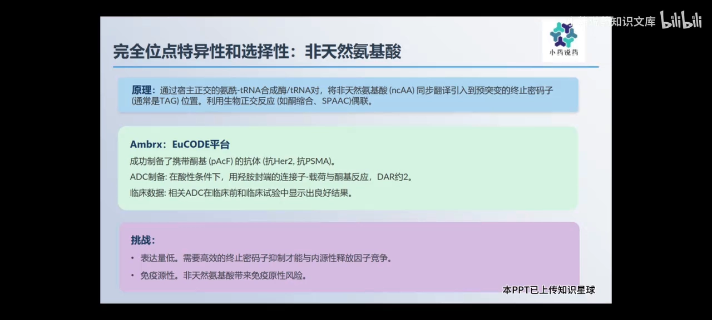

幻灯片以 Ambrx 的 EuCODE 平台为例：成功制备了携带酮基（pAcF）的抗 HER2、抗 PSMA 抗体；在酸性条件下用羟胺封端的连接子-载荷与酮基反应，DAR 约 2；相关 ADC 在临床前和临床试验中显示良好结果。

挑战也很明确：**表达量低**（需要高效的终止密码子抑制才能与内源释放因子竞争），以及**免疫原性**（非天然氨基酸带来额外风险）。讲者补充：实际掺入效率往往不高，最终产品中带 ncAA 的比例可能远低于预期。

[【跳转到 12:51】](https://www.bilibili.com/video/BV1SkYUz9Eya/?t=771)

## 六、取舍：均一性、CMC 与临床数据构成一个三角

讲者最后用一张总表把八种技术并排比较，读法是看三列：CMC 复杂度、均一性、临床验证。

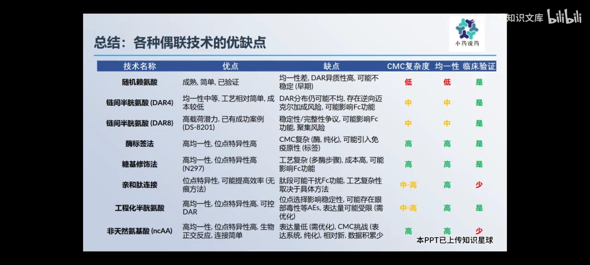

几个可以直接拿来用的结论：

- **随机赖氨酸**：CMC 低、均一性低、临床已验证。适合「先做出来」。
- **链间半胱氨酸 DAR4**：CMC 中、均一性中、临床已验证，是当下的主力。DAR8 有高载荷潜力（如 DS-8201 案例），但稳定性与完整性有争议，聚集风险更高。
- **酶标签与糖基修饰**：均一性高，但 CMC 复杂度也高，前者还有标签免疫原性、后者有多步酶反应的成本。
- **亲和肽**：试图在特异性与工艺之间找平衡，但临床数据还少。
- **工程化半胱氨酸与 ncAA**：均一性和选择性最高，但表达量、杂质控制、位点选择都会反过来限制你。

讲者的收尾判断是：选择哪种技术，需要在**均一性、CMC 复杂度、成本、已有临床数据、以及具体的药物-连接子组合需求**之间权衡。

[【跳转到 14:31】](https://www.bilibili.com/video/BV1SkYUz9Eya/?t=871)

## 七、补充：连接子的可裂解性决定了「在哪里放药」

> 以下内容本片未展开，属于补充背景，用来补上「三要素」中连接子与载荷这一环。

偶联只解决了「挂上去」，还没解决「什么时候放下来」。连接子按释放机制分两类：

- **不可裂解连接子**：靠抗体在溶酶体中被完全降解后释放载荷。血浆稳定性好，但释放出的载荷带一段氨基酸残基、往往缺乏细胞通透性，因此**基本不产生旁观者效应**。
- **可裂解连接子**：由蛋白酶（如组织蛋白酶 B 识别 Val-Cit 二肽）、谷胱甘肽还原、或酸性 pH 触发。因为载荷以不带残基的形式释放，可以扩散出抗原阳性细胞、杀死周围抗原阴性的邻近细胞，这就是**旁观者效应（bystander effect）**。

这一环与本节的关系是：**偶联位点决定了 DAR 与均一性，连接子决定了释放位置，载荷决定了杀伤强度**，三者共同决定治疗窗。本片讨论的「均一性 vs CMC」取舍，在加入连接子与载荷之后只会更复杂——例如高 DAR 加上疏水载荷，聚集风险会叠加。

## 小结

- ADC 的可设计变量不止「抗体、连接子、载荷」三要素，还包括**偶联位点**与**DAR**这两个由偶联化学决定的变量。
- 偶联方法按位点可控程度分三级：随机、位点特异但非选择性、完全位点特异且选择性。**均一性升一级，CMC 复杂度也升一级。**
- 随机赖氨酸偶联工艺最成熟（约 40 个位点、5 款上市产品），但 DAR 分布宽，早期 Mylotarg 的毒性问题就是教训。
- 链间半胱氨酸偶联是当前主流（15 款上市中 10 款用马来酰亚胺），DAR4 是平衡点，DAR8 有载荷优势但聚集与稳定性风险更高。
- 酶标签、糖基修饰、亲和肽属于「位点固定但不可自由选择」，均一性高、工艺复杂；糖基重塑还可能顺带改变 FcγR 相关的效应功能。
- 工程化半胱氨酸与 ncAA 提供最高均一性，代价是位点筛选、表达量与免疫原性风险。
- 选择依据不是「哪个最先进」，而是均一性、CMC、成本、临床数据与具体载荷需求的联合权衡。

## 关键术语速查

| 术语 | 一句话解释 |
| --- | --- |
| ADC | 抗体偶联药物，用抗体做导航、细胞毒小分子做弹头 |
| DAR | 药物抗体比，平均每个抗体挂了多少个药物分子 |
| 偶联位点 | 药物连接在抗体上的具体氨基酸位置 |
| 随机偶联 | 反应位点由化学概率决定，产物 DAR 分布宽 |
| 位点特异性但非选择性 | 位点固定，但由所用技术锁死，不能自由挑选 |
| 工程化半胱氨酸 | 用基因工程把某位点改成半胱氨酸，造出唯一位点 |
| ncAA | 非天然氨基酸，通过遗传密码扩展在翻译时掺入 |
| CMC | 化学、制造与控制，指工艺与分析表征的整体复杂度 |
| 马来酰亚胺连接 | 与巯基发生迈克尔加成的主流偶联化学 |
| 旁观者效应 | 载荷释放后扩散出靶细胞，杀死邻近抗原阴性细胞（补充） |
| 可裂解连接子 | 由酶、还原或酸性 pH 触发释放的连接子（补充） |