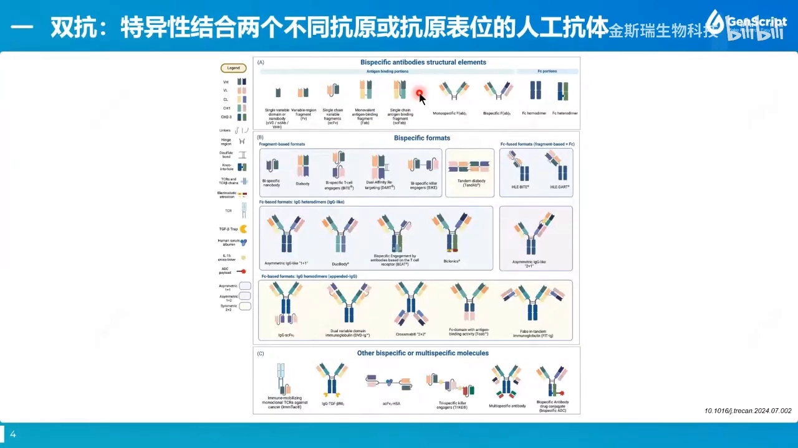
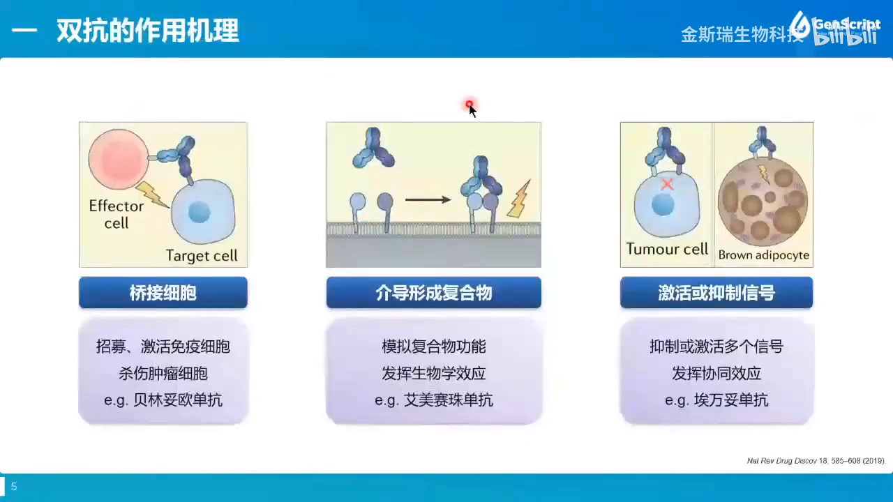
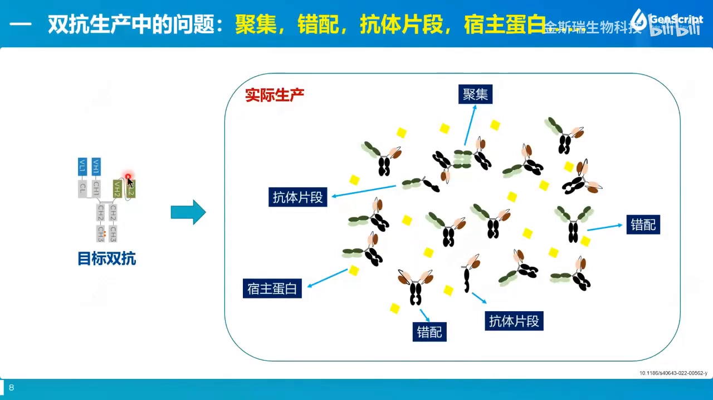
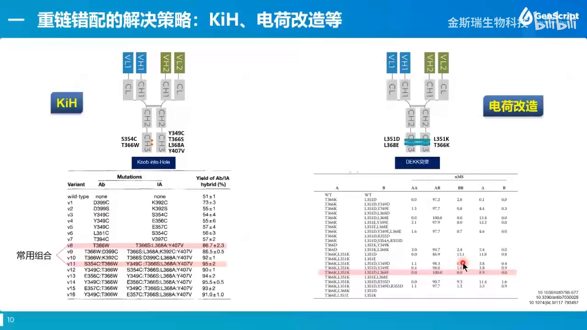
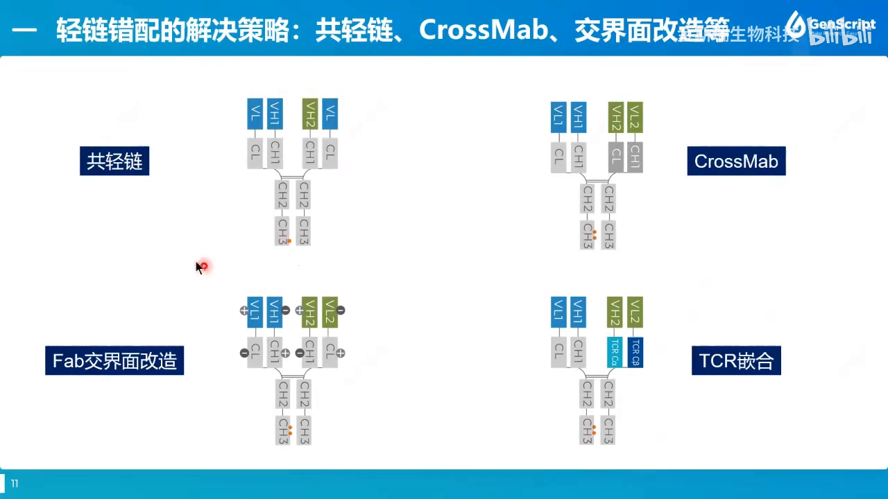
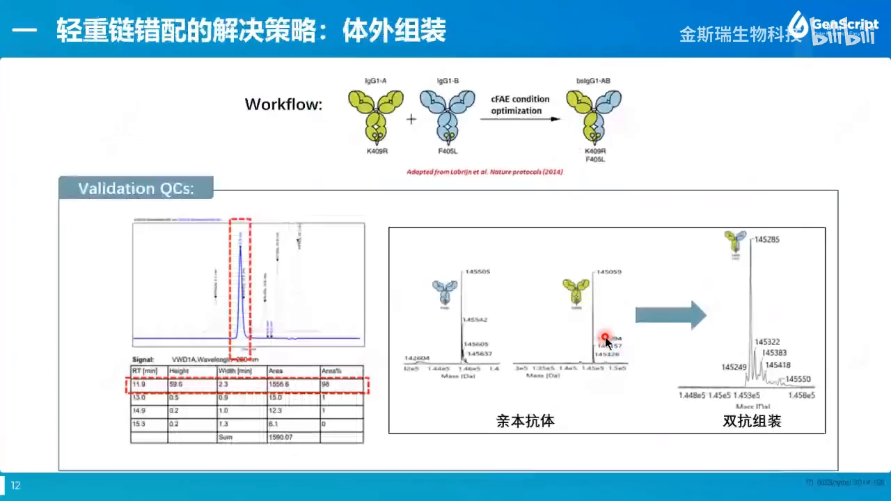
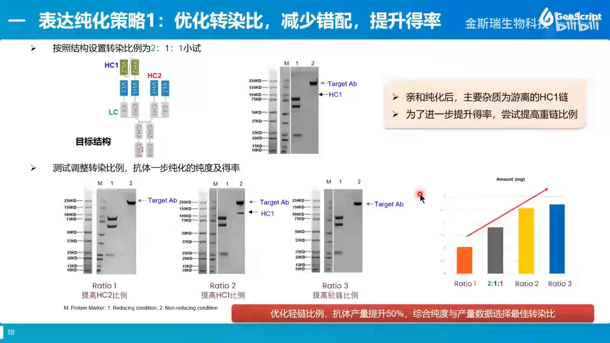
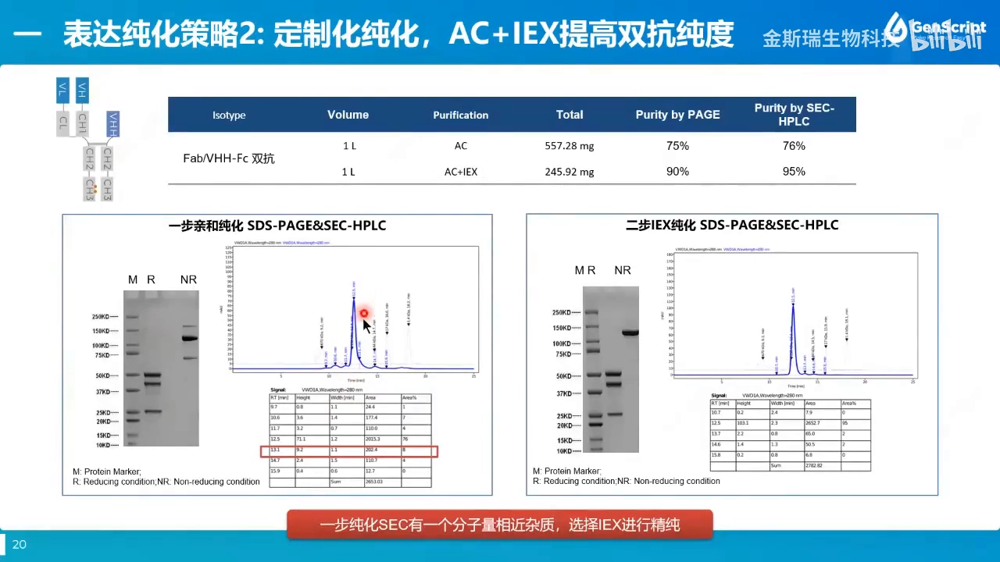
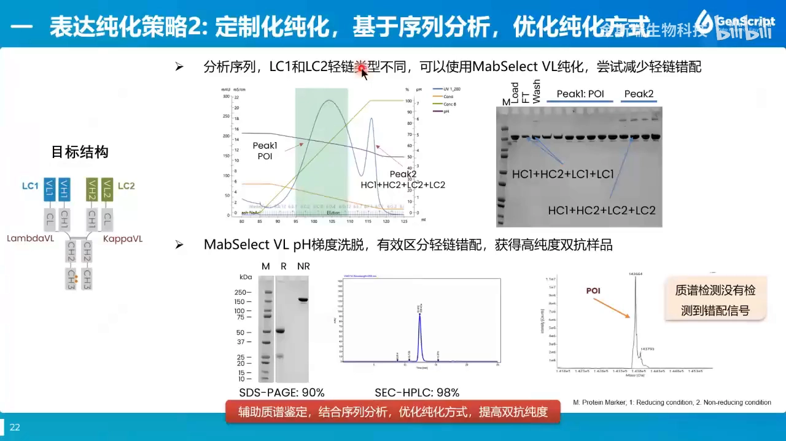
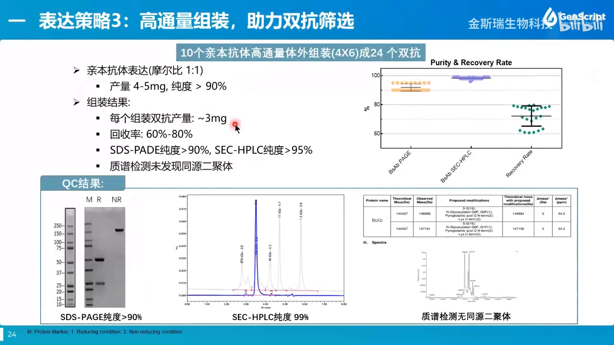

# 双抗的组装难题：错配、聚集与得率决定了构型能不能成药

> 视频来源：[双抗结构设计与表达纯化策略](https://www.bilibili.com/video/BV1MDoPYyEm2/)（Bilibili · 金斯瑞生物科技，讲者王杰博士）｜时长约 26 分钟
> 导读：这是一节从「做分子」的角度讲双抗的课：前半段梳理形式与作用机理，后半段几乎全部给了工程问题——错配、聚集、抗体片段、宿主蛋白，以及怎么用转染比、纯化柱和质谱把它们一个个解决掉。本文按「形式 → 杂质 → 设计对策 → 工艺对策 → 案例」的顺序重排，重点放在「为什么双抗的可开发性比单抗难」。字幕为 AI 生成，术语已按幻灯片原文订正。

## 本讲要解决的核心问题（SCQA）

**背景**：单抗是左右对称的分子，两条重链、两条轻链完全一样，细胞表达出来自然就配对正确。双抗要同时抓住两个不同的靶点，于是「左边和右边必须不一样」。

**冲突**：一旦左右不一样，细胞里就会出现四种链（重链 A、重链 B、轻链 A、轻链 B），它们按概率随机组合，绝大多数产物是错配的废品。除此之外，非天然的结构还带来聚集、片段化、表达量低等问题。

**疑问**：既然错配几乎不可避免，双抗是怎么被做出来的？设计层面和工艺层面各自能解决哪一段？

**回答（中心思想）**：双抗的可开发性问题是「结构不对称」的必然代价，解决办法分成三层。**设计层**用 KiH、电荷改造、共轻链、CrossMab、TCR 嵌合等手段把配对「引导」到正确组合；**表达层**用密码子优化、转染比例、pH 调整提高正确产物的比例；**纯化层**用 Protein A 变体、离子交换、分子筛加质谱把残余杂质切掉。三层缺一不可——因为没有任何单一手段能把错配降到零。

## 一、双抗的两大类：有没有 Fc，决定了半衰期和可制造性

讲者给的定义很干脆：双抗是**特异性结合两个不同抗原、或同一抗原上两个不同表位的人工抗体**。

按构型分，业界通常切成两类：

- **非 IgG-like（无 Fc）**：主要由抗体的可变区构成，分子量小。典型如 BiTE、Diabody。优点是结构简单、组织穿透好；缺点是**半衰期短**，因为没有 FcRn 循环那条回收通路。
- **IgG-like（有 Fc）**：保留了 Fc 段，分子量大、半衰期长。典型如 DVD-Ig，以及基于 CrossMab 或 KiH 设计的各种形式。

这张图值得逐层看，因为它把「双抗」这个大词拆成了可组合的零件：

- **最上层是元件**：单可变区（VHH／纳米抗体）、单链可变区片段（scFv）、单价抗原结合片段（Fab）、单链抗原结合片段（scFab），以及 Fc 同源二聚体／异源二聚体。
- **中间层是片段型形式**：双特异性纳米抗体、Diabody、双特异性 T 细胞衔接器（BiTE）、双亲和重靶向分子（DART），以及加了 Fc 的 HLE-BiTE、HLE-DART。
- **再往下是含 Fc 的形式**，又分成异源二聚体（不对称 IgG-like 1+1、Duobody、Biclonics、不对称 2+1）和同源二聚体（IgG-scFv、DVD-Ig、CrossMab 2+2、Fcab、串联 Fab）。
- **最下面还有其他多特异性分子**：免疫动员单克隆 TCR 抗体、IgG-TGFβRII 融合、scFv-HSA、三特异性杀伤衔接器（TriKE）等。

[【跳转到 01:29】](https://www.bilibili.com/video/BV1MDoPYyEm2/?t=89)

## 二、为什么要两个靶点：三种作用机理

形式是为机理服务的。讲者把双抗的生物学逻辑归成三类：

1. **桥接细胞**：一头抓住杀伤细胞、一头抓住肿瘤细胞，把两者拉到一起，招募并激活免疫细胞杀伤肿瘤。代表是贝林妥欧单抗（Blinatumomab，CD19×CD3）。
2. **介导形成复合物**：模拟某个天然复合物的功能，发挥相应的生物学效应。代表是艾美赛珠单抗（Emicizumab），它模拟凝血因子 VIII 的辅因子作用，把因子 IXa 和 X 拉到一起。
3. **激活或抑制信号**：同时抑制或激活多个信号通路，发挥协同效应。代表是埃万妥单抗（Amivantamab，EGFR×MET）。

讲者还统计了已上市药物的构型分布，发现**占比最大的一类是基于 Duobody 的体外组装形式**。原因很实际：这种形式允许你先分别做两个普通单抗，再在体外把它们拼起来，因此可以「组合不同的单抗去快速筛选更合适的双抗组合」——对早期探索特别友好。

[【跳转到 02:29】](https://www.bilibili.com/video/BV1MDoPYyEm2/?t=149)

## 三、生产现场：一个目标分子周围全是「长得像」的杂质

这是全课最重要的一张图。左边是你想要的目标双抗（一半 Fab、一半 scFv，重链引入 KiH 突变以降低重链错配），右边是实际发酵罐里真实存在的东西。

四类杂质分别是：

- **错配**：重链同源二聚（A-A 或 B-B）、轻链错配（轻链 A 配到重链 B 上），以及半抗（只有一条重链加一条轻链）。
- **聚集**：共价与非共价聚集。幻灯片特别指出一个反直觉的点——为了提高稳定性而额外引入的二硫键，本身可能**造成后续的共价聚集**。
- **抗体片段**：重链或轻链被截断、或装配不全的产物。
- **宿主蛋白残留**：来自表达系统的杂蛋白。

讲者强调，即使已经引入了 KiH 这样的防错配措施，上述杂质依然可以预见地存在。**这就是双抗与单抗在可开发性上的根本差别：单抗的杂质主要是「产物降解」，双抗的杂质主要是「产物本身长错了」。**

[【跳转到 04:18】](https://www.bilibili.com/video/BV1MDoPYyEm2/?t=258)

## 四、设计层：把配对「引导」到正确组合

### 4.1 重链错配：KiH 与电荷改造

重链配对的第一代方案是 **knob-into-hole（KiH，杵臼结构）**：在一条重链的 CH3 上引入一个大侧链（knob，"杵"），在另一条上挖一个凹槽（hole，"臼"），让异源二聚在空间上更有利。

幻灯片把两种策略并排放，并附上了实验数据：

- **KiH**：常用组合是 T366W（knob）配 T366S/L368A/Y407V（hole），有时再加 S354C/Y349C 形成二硫键加固。表格里可以看到，野生型异源二聚体比例只有约 51%，而优化后的组合能到 90% 以上。
- **电荷改造（DEKK 突变）**：利用「同种电荷相斥、异种电荷相吸」的原理，在 CH3 界面上把一条链的某些残基换成带正电的赖氨酸、另一条换成带负电的天冬氨酸/谷氨酸（如 L351D/L368E 配 L351K/T366K）。表格里同样能看到不同组合的异源二聚体比例差异很大。

讲者的说法是：这两类是目前常用的两种组合方式，实际项目里常常还会叠加额外的二硫键来加强稳定性。

[【跳转到 10:05】](https://www.bilibili.com/video/BV1MDoPYyEm2/?t=605)

### 4.2 轻链错配：四种思路

重链配对解决之后，轻链错配才是更难的一关——因为轻链没有 CH3 那样的天然二聚界面可以改造。幻灯片列了四条路：

1. **共轻链（common light chain）**：让两个抗原结合臂共用同一条轻链。这样只需要解决重链错配，轻链问题自动消失。代价是必须找到一条能同时配合两个重链的轻链，通常要靠文库筛选。
2. **CrossMab**：交换一个 Fab 的 CH1 与 CL 结构域，使轻链只能与「对应交换过」的重链配对。幻灯片提到它还有第二、第三种交换形式（如 CrossMab Fab 的交换方式），各有优缺点。
3. **Fab 交界面电荷改造**：在 CH1/CL 界面上做静电改造，用同电相斥、异电相吸引导正确配对。
4. **TCR 嵌合**：把 Fab 的恒定区换成 TCR 的恒定区（TCRα/β），利用 TCR 天然只与自身配对的性质来避免错配。

[【跳转到 11:17】](https://www.bilibili.com/video/BV1MDoPYyEm2/?t=677)

### 4.3 体外组装：干脆不在细胞里配对

第三种思路是绕开细胞内的随机配对：分别表达两个完整的单抗，再在体外把它们「拆开重装」。

以 Duobody 为代表：在两个 IgG1 的 CH3 区分别引入 K409R 与 F405L 突变，混合后在可控的氧化还原条件下发生 Fab 臂交换（cFAE，controlled Fab-arm exchange）。讲者特别说明了一个关键细节：**还原过程会选择性地只断开铰链区的二硫键，而不破坏轻链与重链之间的二硫键**，因此轻链不会跑错位置；随后再氧化，把铰链重新连上。

图下方的验证数据说明了这类分子怎么放行：SEC 主峰面积占比 90%，质谱上亲本抗体的两个峰（145505、145059）消失、出现双抗组装的特征峰（145285 等）。

[【跳转到 12:32】](https://www.bilibili.com/video/BV1MDoPYyEm2/?t=752)

## 五、表达层：转染比例和培养条件也能改产物比例

设计只能把配对概率「偏向」正确组合，剩下的要靠工艺。讲者说得很直白：双抗相比单抗，除了错配，还有一个明显问题是**得率低**——一半来自表达水平低，一半来自杂质多。

### 5.1 优化转染比例

案例里的分子由 HC1、HC2、LC 三条链组成，初始按 2:1:1 转染。一步亲和纯化后发现**主要杂质是游离的 HC1 链**。于是团队测试了不同比例：

- 提高 HC2 比例 → 目标条带变化有限
- 提高 HC1 比例 → 游离 HC1 反而明显增高
- 提高轻链比例 → 游离 HC 链降低，产量提升约 50%

结论不是「某个比例最好」，而是「**要综合纯度与产量数据选最优转染比**」——因为提高比例可能让一步纯度下降，但如果二步能去掉，最终得率反而更高。

[【跳转到 16:49】](https://www.bilibili.com/video/BV1MDoPYyEm2/?t=1009)

### 5.2 其他表达层手段

讲者还提到两条通用做法：

- **密码子优化**：新一代密码子优化对低表达分子的提升倍数尤其明显。
- **调整 pH 抑制聚集**：scFv 类结构在生产中容易聚集，除了调整 linker，略微提高 pH 也能有效降低聚集。

## 六、纯化层：不同杂质要用不同的柱子

### 6.1 亲和 + 离子交换：把分子量相近的杂质分开

案例是一个 Fab/VHH-Fc 非对称双抗。一步 Protein A 亲和（AC）后，SEC-HPLC 纯度 76%，主峰旁有一个**分子量相近的杂质**——分子筛分不开它。改用二步离子交换（IEX）后，纯度升到 95%，代价是总回收量从 557 mg 降到 246 mg。

讲者的判断是：**即便是相同构型，也要根据一步纯化的杂质情况去选择合适的二步策略**。另一个同类案例里，杂质是共价聚集，团队选择的则是「亲和 + 分子筛」的路线。

[【跳转到 19:31】](https://www.bilibili.com/video/BV1MDoPYyEm2/?t=1171)

### 6.2 利用序列差异做定制化纯化

一个「knob-IgG」形式的分子只做了重链防错配，轻链之间没有任何防错配设计，理论上必然出现轻链错配。团队分析序列后发现两条轻链的类型不同——一条是 Lambda 链、一条是 Kappa 链，于是用 MabSelect VL 做 pH 梯度洗脱，把两种配对分开：Peak1 是目标分子（HC1+HC2+LC1+LC1），Peak2 是错配体（HC1+HC2+LC2+LC2）。

最终 SDS-PAGE 纯度 90%、SEC-HPLC 98%，质谱检测未发现错配信号。这条案例的方法论意义大于分子本身：**当设计层无法消除错配时，可以从序列差异里找纯化抓手**。

[【跳转到 20:40】](https://www.bilibili.com/video/BV1MDoPYyEm2/?t=1240)

### 6.3 质谱：判断「这个峰到底是不是我要的」

讲者反复强调一个容易被忽视的环节：当两侧抗体的分子量比较接近时，常规 HPLC 或 SEC 无法判断某个峰到底是目标分子、同源二聚体还是别的杂质。这时必须用**LC-MS 确认杂质种类与比例**，再决定下一步纯化策略。否则会出现「一步纯化后对主峰或目标峰误判」的情况。

## 七、把流程跑通：24 个双抗的高通量组装

讲者最后给了一组平台化数据，用来回答「这套流程能不能批量跑」：

- 亲本抗体按 1:1 摩尔比表达，产量 4~5 mg，纯度 >90%。
- 10 个亲本抗体组合成 24 个双抗，每个组装产量约 3 mg。
- 回收率 60%~80%，SDS-PAGE 纯度 >90%，SEC-HPLC 纯度 >95%，质谱未发现同源二聚体。

这套流程的价值在于**支持早期筛选**：当你有几十个靶点组合要试的时候，能在一两周内拿到毫克级、纯度够做功能实验的双抗，比优化单个分子的工艺更重要。

[【跳转到 22:19】](https://www.bilibili.com/video/BV1MDoPYyEm2/?t=1339)

## 八、表征清单：双抗要比单抗多测什么

讲者列的检测项目可以当成一张核对表：

| 层面 | 检测项 | 双抗特有的关注点 |
| --- | --- | --- |
| 基本性质 | 浓度、纯度、SEC-HPLC、SDS-PAGE | 半抗、同源二聚体、片段 |
| 结构确认 | LC-MS 完整分子量 | 错配体与目标分子质量接近，必须靠质谱区分 |
| 功能 | BI／SPR 结合、细胞层面活性 | 两个靶标是否同时结合、亲和力是否平衡 |
| 安全 | 内毒素、HCP、HCD 残留 | 与单抗相同 |

其中「两个靶标是否同时结合」是双抗独有的功能评价难点：能分别结合两个抗原，不等于能同时结合；而同时结合才是桥接类双抗起效的前提。

## 小结

- 双抗按有无 Fc 分两大类：非 IgG-like 半衰期短、结构简单；IgG-like 半衰期长、可制造性更接近单抗。
- 三种作用机理（桥接细胞、介导复合物、激活/抑制信号）决定了要选哪种形式；已上市药物中 Duobody 类体外组装形式占比最大，因为它支持快速组合筛选。
- 双抗的杂质谱与单抗根本不同：主要不是降解产物，而是**长错了的产物**——重链同源二聚、轻链错配、半抗，外加聚集、片段与宿主蛋白。
- 设计层对策：重链用 KiH 或电荷改造（异源二聚体比例可从约 51% 提到 90% 以上）；轻链用共轻链、CrossMab、Fab 界面电荷改造或 TCR 嵌合；也可以干脆在体外做 Fab 臂交换。
- 表达层对策：密码子优化、转染比例调整（案例中提高轻链比例使产量提升约 50%）、pH 调节抑制 scFv 聚集。
- 纯化层对策：亲和加离子交换或分子筛，按杂质性质选柱子；利用轻链类型差异做定制化洗脱。
- 质谱不是可选项：分子量相近的错配体只能靠它识别，否则会误判主峰。
- 平台化能力（10 个亲本 → 24 个双抗，3 mg 级、纯度 >90%）比单个分子的极限优化更能支撑早期筛选。

## 关键术语速查

| 术语 | 一句话解释 |
| --- | --- |
| IgG-like / 非 IgG-like | 有 Fc 段的双抗 / 只由可变区构成的双抗 |
| 重链错配 | 两条不同重链随机配对，产生同源二聚体 |
| 轻链错配 | 轻链配到了错误的重链上 |
| 半抗 | 只有一条重链加一条轻链的不完整分子 |
| KiH | knob-into-hole，用「杵臼」空间互补促进重链异源二聚 |
| DEKK 突变 | 在 CH3 界面做正负电荷互补，用电荷相吸促进异源二聚 |
| CrossMab | 交换一个 Fab 的 CH1/CL，使轻链只能与对应重链配对 |
| 共轻链 | 两个抗原结合臂共用同一条轻链，从源头消除轻链错配 |
| cFAE | 控制性 Fab 臂交换，体外把两个单抗拆开重装成双抗 |
| 异源二聚体比例 | 正确配对产物占总产物的百分比，是设计优劣的直接指标 |
| SEC / IEX | 分子筛（按体积分离）/ 离子交换（按电荷分离） |
| LC-MS | 液相色谱-质谱联用，用于确认分子量与杂质身份 |