# 双特异性抗体：靶标组合决定能不能起效，分子形式决定能不能做出来

> 视频来源：[双特异性抗体介绍与结构设计](https://www.bilibili.com/video/BV1Dg411n7HW/)（Bilibili · 汰汰Vera，课件来源 AtaGenix 晋健生物）｜时长约 52 分钟
> 导读：这是目前能找到的最系统的中文双抗结构设计课：先讲靶标组合的生物学逻辑（为什么选这两个靶点），再讲把两个臂装进一个分子的工程手段（KiH、CrossMab、共轻链、DVD-Ig、Duobody、BiTE、DART、DNL 等），最后落到「同样的靶点、不同结构，活性不一样」和「双抗的亲和力怎么测」。本文按「定义 → 靶标组合 → 发展史 → 各类机制 → 价态与几何 → 技术单元 → 评价」重排。字幕为 AI 生成，术语已按幻灯片原文订正；Fc 受体与补体通路、scFv/Fab 的结构基础分别见 4.1.3 与 2.1.4，本文只做必要引用。

## 本讲要解决的核心问题（SCQA）

**背景**：普通单抗的两个 Fab 一模一样，结合同一个抗原表位。它的效果取决于「抓住一个靶点有多紧」。

**冲突**：很多疾病的机制一个靶点不够用。更关键的是，有些功能是两个单抗联合**根本做不到**的——比如把一个 T 细胞和一个肿瘤细胞强行拉到一起，或者模拟一个需要两个底物靠近才有活性的酶促反应。

**疑问**：怎么让一个分子同时抓住两个不同的东西？这样做的代价是什么？

**回答（中心思想）**：双抗的设计空间可以拆成两件互相牵制的事。**靶标组合**（选哪两个靶点）决定生物学机制，也就是「能不能起效」；**分子形式**（用什么结构把两个结合臂装进一个分子）决定可制造性，也就是「能不能做出来」。两者之间由一条硬约束连接：只要分子左右不对称，就必然出现重链与轻链的错配——所以每一个双抗平台的真正创新点，往往不在结合表位，而在「怎么让两条不同的链乖乖配对」。

## 一、双抗的定义：不是「两个单抗绑一起」，而是「左右不一样」

讲者给的定义很干脆：双特异性抗体（bispecific antibody，BsAb）是**两个结合位点指向两个不同抗原、或同一抗原上两个不同表位的抗体**。

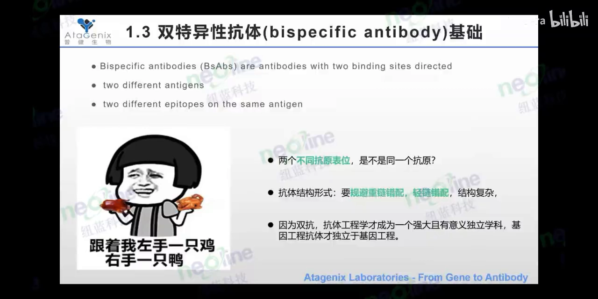

幻灯片右下角那三行才是重点：

- **「两个不同抗原表位，是不是同一个抗原？」**——不重要。双抗的关键是「两个表位不同」，至于这两个表位在不在同一个抗原分子上，只影响机制，不影响它是不是双抗。
- **「结构形式：要规避重链错配、轻链错配，结构复杂」**——这是双抗一切工程难题的源头。
- **「因为双抗，抗体工程学才成为一个强大且有意义的独立学科」**——讲者的观点：单抗本质上还是「把一个天然分子拿来用」，双抗才是真正「设计一个天然不存在的分子」。

讲者用一句很形象的话概括对称性的丧失：普通抗体是左右手一模一样的对称结构，双抗则像「左手一只鸡、右手一只鸭」——两边必须不同，而细胞并不知道你要的是哪一种组合。

[【跳转到 01:14】](https://www.bilibili.com/video/BV1Dg411n7HW/?t=74)

## 二、靶标组合的五种场景：先想清楚两个靶点在哪

选哪两个靶点，取决于两个靶点在空间上是什么关系。讲者给了一张模式图，把双抗的结合场景分成五类：

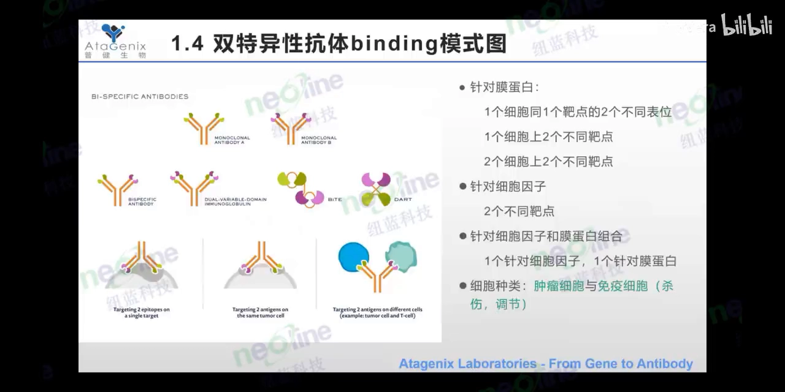

**针对膜蛋白**，有三种空间关系：

1. **一个细胞上、同一个靶点的两个不同表位**：例如把抗 HER2 的两个不同表位的抗体做成一个分子（后文的 ZW25）。
2. **一个细胞上的两个不同靶点**：例如同时阻断 EGFR 与 MET 两条通路。
3. **两个细胞上各一个靶点**：这是最引人注目的一类——把肿瘤细胞和免疫细胞拉到一起。

**针对非膜蛋白**（细胞因子等在血液里运输的蛋白）：两个不同靶点，例如同时中和 TNFα 与 IL-17A。

**细胞因子与膜蛋白的组合**：一个臂抓可溶性因子，一个臂抓细胞表面分子。

幻灯片最后一行点出了双抗的「细胞学底色」：它作用的细胞种类主要是**肿瘤细胞与免疫细胞**（杀伤、调节）。讲者因此建议，学双抗之前最好先把免疫系统里各类细胞的功能过一遍——因为双抗的机制几乎都是「借免疫细胞的手」。

[【跳转到 02:32】](https://www.bilibili.com/video/BV1Dg411n7HW/?t=152)

## 三、六十年，两次里程碑

双抗不是一个新概念，它的历史比很多人想象的更长：

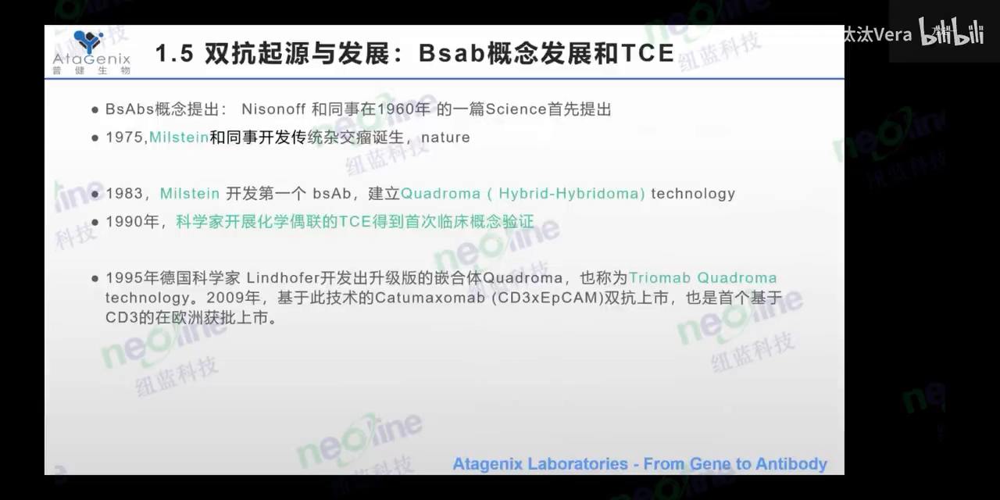

- **1960 年**：Nisonoff 和同事在 *Science* 上首次提出 BsAb 概念。当时只有概念，怎么做、怎么用都不清楚。
- **1975 年**：Milstein 和同事开发传统杂交瘤技术（*Nature*），单抗时代开始。
- **1983 年**：同样是 Milstein，开发出第一个双抗，建立 Quadroma（hybrid-hybridoma，二次杂交）技术。
- **1990 年**：科学家用化学偶联做出双抗，TCE（T 细胞衔接器）概念首次获得临床概念验证。
- **1995 年**：德国科学家 Lindhofer 开发出升级版的嵌合 Quadroma，即 Triomab Quadroma 技术。
- **2009 年**：基于该技术的 Catumaxomab（CD3×EpCAM）在欧洲获批上市，是首个基于 CD3 的双抗。

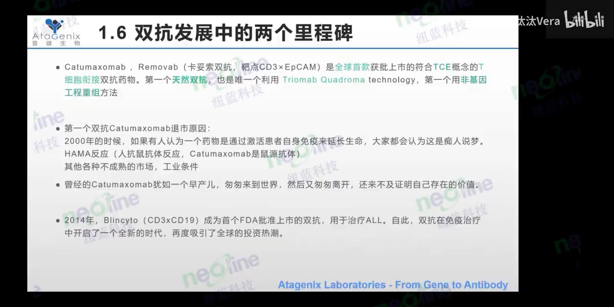

讲者对 Catumaxomab 的评价很有意思：它是**全球首个获批上市的符合 TCE 概念的 T 细胞衔接双抗**，也是第一个「天然」双抗（用 Triomab Quadroma 技术，非基因工程重组），但 2017 年退市。退市原因幻灯片列了三条：

1. **概念太超前**：「2000 年的时候，如果有人认为一个药物是通过激活患者自身免疫来延长生命，大家都会认为这是痴人说梦。」
2. **HAMA 反应**：它是大鼠/小鼠嵌合抗体，人抗鼠抗体反应难以避免。
3. **工业条件不成熟**：当时的双抗工程化基础与市场都不成熟。

讲者补充了自己的判断：HAMA 其实不是最主要的原因（该药是腹腔给药治疗腹水，Fc 效应不是主角），**真正的问题是它「出生得太早」**——没赶上一个时代。他提到这个分子目前正在重新启动临床。

第二个里程碑是 **2014 年的 Blincyto（CD3×CD19）**，首个 FDA 批准的双抗，用于治疗急性淋巴细胞白血病（ALL）。讲者说，自此双抗在免疫治疗中「开启了一个全新的时代」。

[【跳转到 07:07】](https://www.bilibili.com/video/BV1Dg411n7HW/?t=427)

### 上市的九个分子，只用了六个平台

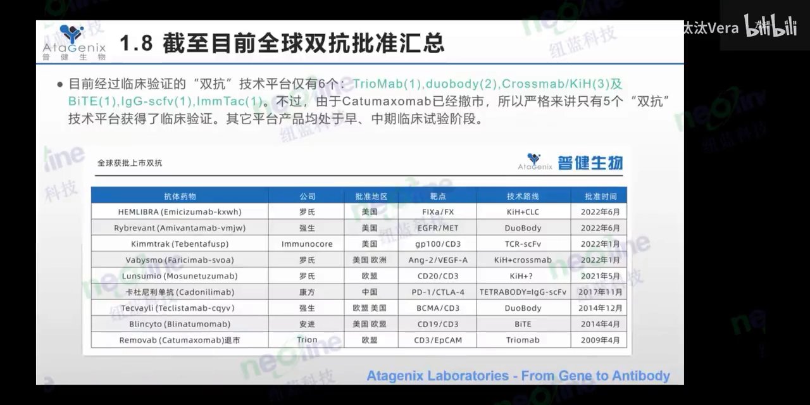

这张表信息量很大，值得记住的是「技术路线」那一列：

| 药物 | 靶点 | 技术路线 |
| --- | --- | --- |
| Hemlibra（Emicizumab） | FIXa / FX | KiH + CLC（共轻链） |
| Rybrevant（Amivantamab） | EGFR / MET | DuoBody |
| Kimmtrak（Tebentafusp） | gp100 / CD3 | TCR-scFv（ImmTac） |
| Vabysmo（Faricimab） | Ang-2 / VEGF-A | KiH + CrossMab |
| Lunsumio（Mosunetuzumab） | CD20 / CD3 | KiH + ? |
| 卡度尼利单抗（Cadonilimab） | PD-1 / CTLA-4 | TETRABODY = IgG-scFv |
| Tecvayli（Teclistamab） | BCMA / CD3 | DuoBody |
| Blincyto（Blinatumomab） | CD19 / CD3 | BiTE |
| Removab（Catumaxomab，已退市） | CD3 / EpCAM | Triomab |

幻灯片的统计结论是：经过临床验证的双抗技术平台只有 6 个——TrioMab（1 个）、DuoBody（2 个）、CrossMab/KiH（3 个）、BiTE（1 个）、IgG-scFv（1 个）、ImmTac（1 个）。由于 Catumaxomab 已撤市，严格来说只有 5 个平台拿到了临床验证，其余平台都还在早、中期临床阶段。

[【跳转到 08:47】](https://www.bilibili.com/video/BV1Dg411n7HW/?t=527)

## 四、最成功的一类：把 T 细胞拉到肿瘤旁边

### 4.1 为什么需要「衔接器」

免疫学家早就知道，杀伤性 T 细胞识别肿瘤靠的是 TCR 识别「肽-MHC 复合物」。但讲者点出一个关键限制：**天然 TCR 与 pMHC 的亲和力不够高，有效杀伤能力有限**。于是有了一个思路：能不能用别的方法把 T 细胞「抓」到肿瘤旁边？

这就是 TCE（T cell engager，T 细胞衔接器）的由来——它是免疫学家和抗体工程师两拨人合作的结果：一拨人研究免疫细胞怎么杀伤肿瘤，另一拨人研究怎么把两个抗体连在一起。

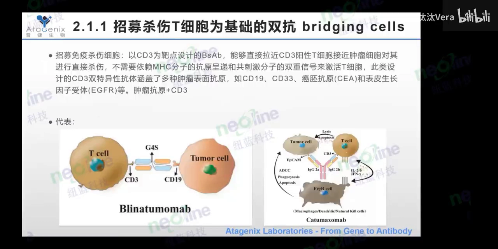

幻灯片把这类分子的机制写得很清楚：以 CD3 为靶点设计的 BsAb 能直接把 CD3 阳性 T 细胞拉近肿瘤细胞，对其进行直接杀伤，**不依赖 MHC 分子的抗原呈递，也不需要共刺激分子的双信号来激活 T 细胞**。这类设计覆盖了多种肿瘤表面抗原：CD19、CD33、癌胚抗原（CEA）、表皮生长因子受体（EGFR）等。

图里还藏着一个重要区别：Blinatumomab 是纯粹的双功能分子（只有两个 scFv 串联），而 Catumaxomab 的 Fc 端还能结合 FcγR——所以它实际上是个**三功能分子**：一手抓 T 细胞、一手抓肿瘤、Fc 再招募巨噬细胞/NK 细胞。

[【跳转到 10:11】](https://www.bilibili.com/video/BV1Dg411n7HW/?t=611)

### 4.2 CD3 双抗的设计有多「简单」

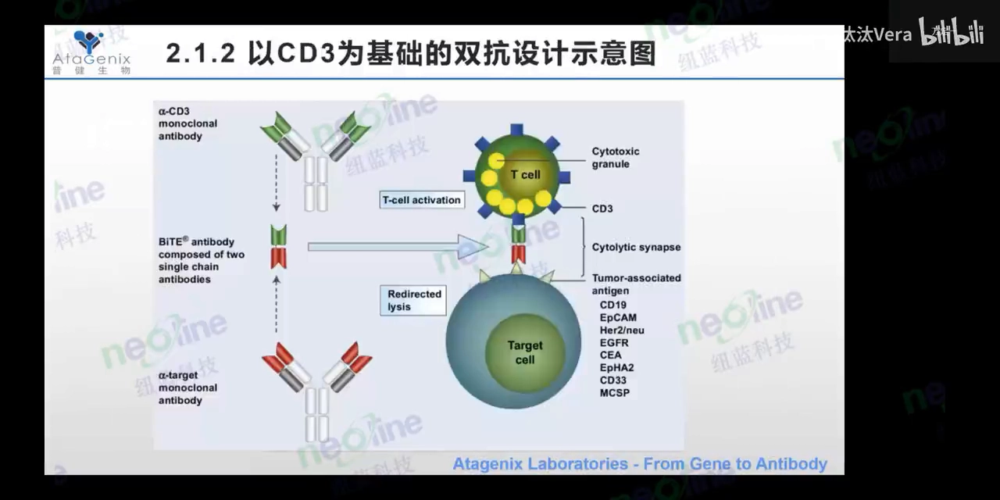

讲者说，以 CD3 为基础的双抗设计「比较简单」：**一个靶点必须是抗 CD3 的抗体，另一个必须是肿瘤上的 TSA 或 TAA marker**，然后把这两个抗体通过某种结构设计连到一起，把两个细胞拉到一起。

幻灯片列出了可选的肿瘤端靶点：CD19、EpCAM、Her2/neu、EGFR、CEA、EpHA2、CD33、MCSP。讲者还做了一个有意思的观察：**这些 marker 和 ADC 的靶点高度重叠**——也就是说，同一个靶点，你可以选择「用双抗把 T 细胞叫过来」，也可以选择「用 ADC 送一个毒素过去」。他还进一步类比：TCE 双抗 ≈ CAR-T（靶标几乎一样），NK 细胞衔接双抗 ≈ CAR-NK。**做 TCE 双抗的公司和做 CAR-T 的公司，其实是在用两种手段竞争同一批靶点。**

[【跳转到 11:51】](https://www.bilibili.com/video/BV1Dg411n7HW/?t=711)

### 4.3 TCE 与 CAR-T 的关系

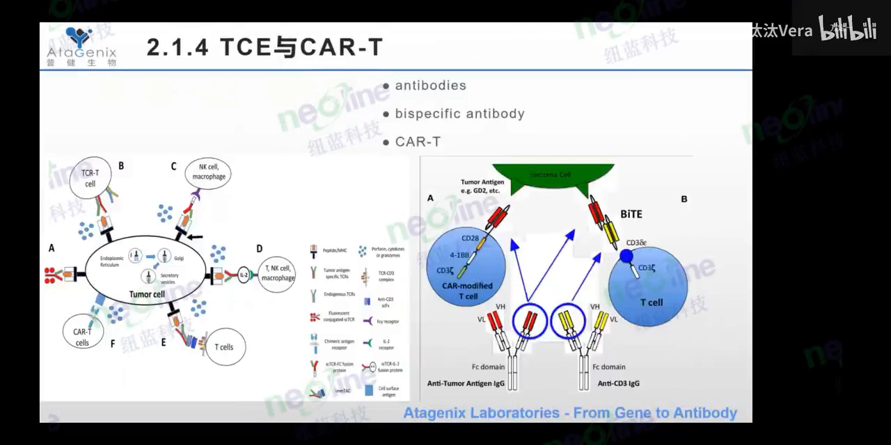

这张图把「抗体—双抗—CAR-T」放在同一条线上：三者都是给 T 细胞装一个「认肿瘤」的导航，区别在于导航装在哪——装在可溶的抗体分子上（双抗，打一针管几天），还是装在 T 细胞自己身上（CAR-T，一次改造长期存在）。

[【跳转到 13:42】](https://www.bilibili.com/video/BV1Dg411n7HW/?t=822)

## 五、换一种杀伤细胞：NK、巨噬细胞、检查点

T 细胞不是唯一的执行者。讲者依次讲了另外几条路：

**招募 NK 细胞（NKCE）**：T 细胞的标记是 CD3，NK 细胞的标记是 CD16A。设计思路完全平行——一个臂抗 CD16A，一个臂抗肿瘤 marker。讲者提出一个尖锐的问题：普通单抗的 Fc 本来就能结合 FcγRIII（CD16）招募 NK 细胞，为什么还要专门设计一个抗 CD16A 的臂？答案是：**单靠 Fc 招募细胞的能力不如专门设计一个高亲和力的结合臂**。他还提到这类分子常做成四价（图里那个分子有四个结合臂），以增强亲合力。

[【跳转到 14:32】](https://www.bilibili.com/video/BV1Dg411n7HW/?t=872)

**招募巨噬细胞（CD47-SIRPα）**：巨噬细胞的杀伤力在三种杀伤细胞里最强，因此身体给它装了很多抑制信号，最重要的一条是 CD47-SIRPα。几乎所有正常细胞都表达 CD47 来避免被误杀，肿瘤则高表达 CD47 来传递「don't eat me」信号。所以这类双抗的机制**不是招募，而是解除刹车**：一个臂阻断 CD47，另一个臂抓肿瘤 marker。

**双检查点阻断**：肿瘤会利用 PD-1/PD-L1、CTLA-4 等抑制性信号让杀伤细胞「不干」。单抗阻断一个检查点如果不够，就用双抗同时阻断两个——本质上是一个「cocktail 做进一个分子」。

**细胞因子双靶**：例如 TNFα × IL-17A 或 IL-23，用于自身免疫病。这类设计既不需要招募细胞，也不需要搭桥，纯粹是「两个信号通路一起堵」。

**肿瘤生长与血管**：肿瘤的两个特征是自身长得快、周围血管也长得快。经典例子是 VEGF × DLL4 双抗——同时阻断肿瘤生长信号和血管生成信号。

**跨机制组合**：例如 CD3 × EGFR，一个臂招募 T 细胞、一个臂阻断肿瘤生长信号，把两种机制塞进一个分子。

**双表位（biparatopic）**：同一个靶点、两个不同表位。讲者举了 HER2 的例子——HER2 有四个胞外结构域（ECD1~4），曲妥珠单抗针对 ECD4、帕妥珠单抗针对 ECD2，把这两个表位做成一个双抗（ZW25），效果类似「鸡尾酒」但只需生产一个分子。

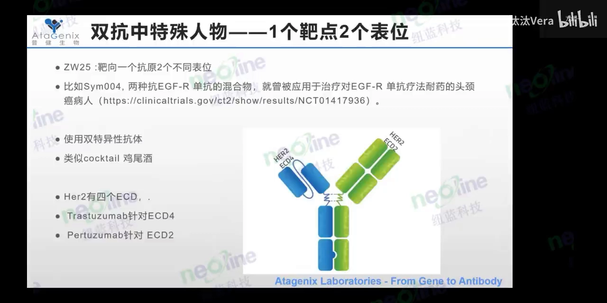

讲者还提到一个反例，用来提醒「设计意图 ≠ 实际机制」：有人设计了 CD3×PD-L1 双抗，本意是把 T 细胞通过 PD-L1 招募到肿瘤旁边；但实验数据显示，它实际招募的是 DC 细胞和 T 细胞，靠的是**让 DC 更好地呈递抗原、从而增强 T 细胞杀伤力**。他的结论是：免疫调节信号非常复杂，双抗可以按生物学机制任意设计，但最终效果是不是你预料的那样，必须靠实验验证。

[【跳转到 20:41】](https://www.bilibili.com/video/BV1Dg411n7HW/?t=1241)

## 六、价态与几何：同样的靶点，结构不同活性就不同

这是全课最能体现「形式即功能」的一段。

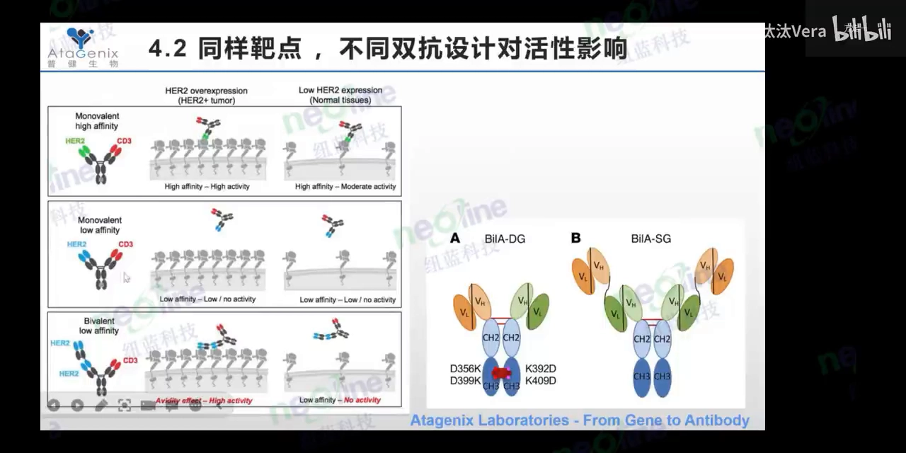

图里比较了三种设计，靶点完全相同（HER2 × CD3），只是亲和力和价态不同：

- **单价、高亲和力**：在 HER2 高表达的肿瘤上活性高，但在 HER2 低表达的正常组织上也有中等活性——**治疗窗变窄**。
- **单价、低亲和力**：两边活性都低，几乎无效。
- **双价、低亲和力**：在 HER2 高表达肿瘤上活性高，在低表达组织上**几乎无活性**。

第三行就是**亲合力（avidity）效应**：单个结合臂的亲和力很低，但两个臂同时结合同一个细胞表面的多个 HER2，整体结合强度被「多价」放大，于是只在抗原密度高的肿瘤上有效。这提供了一条设计原则：**如果你想让药物只在靶点高表达的细胞上起作用，就不要提高单价亲和力，而要降低单价亲和力并增加价态。**（亲合力与亲和力的基本区别见 3.2.3。）

讲者还强调另一点：**CD3 端的亲和力必须「合适」**。太高会导致非特异性激活（没有肿瘤细胞时也能激活 T 细胞），太低则招募不到 T 细胞。所以双抗的活性不是「越高越好」，而是在两个臂之间找平衡。

[【跳转到 50:45】](https://www.bilibili.com/video/BV1Dg411n7HW/?t=3045)

## 七、把两个臂装进一个分子：技术单元与平台

讲者把双抗技术拆成「基础元件 + 防错配技术 + linker + 具体形式」四层。这张汇总页几乎可以当目录用：

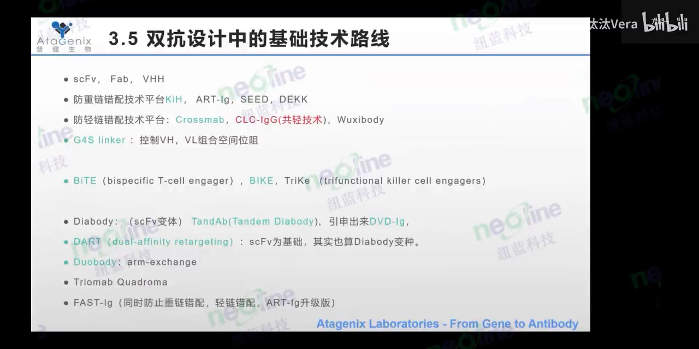

- **基础元件**：scFv、Fab、VHH（纳米抗体）。所有双抗形式都是这三种零件的不同拼法。
- **防重链错配**：KiH、ART-Ig、SEED、DEKK。
- **防轻链错配**：CrossMab、CLC-IgG（共轻链技术）、WuXiBody。讲者补充了一句实测经验：WuXiBody 的表达量可能不如 CrossMab。
- **G4S linker**：控制 VH、VL 组合的空间位阻。讲者反复强调 linker 的重要性——**同样一个序列，把 linker 的长度和氨基酸组成改一改，最终形成的双抗结构就可能不一样**。
- **具体形式**：BiTE、BiKE、TriKE（三功能杀伤衔接器）、Diabody 及其衍生物 TandAb、DVD-Ig、DART、Duobody、Triomab Quadroma、FAST-Ig（同时防重链与轻链错配，是 ART-Ig 的升级版）。

### 7.1 Diabody 与 DVD-Ig：靠 linker 决定配对方向

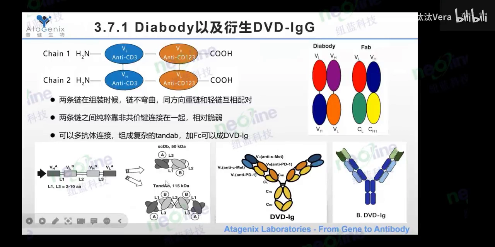

Diabody 的原理很巧妙：把 VH 和 VL 拆到两条不同的链上，两条链各含一个抗 CD3 的臂和一个抗 CD123 的臂。**组装时链不弯曲，同方向的重链与轻链互相配对**，于是自然形成「一边抗 CD3、一边抗 CD123」的双抗。

它的缺点也写在同一页：两条链之间**纯粹靠非共价键连接，相对脆弱**。解决办法是串联——把多个 Diabody 连起来做成 TandAb（四价），或者加上 Fc 做成 DVD-Ig。

DVD-Ig 的特点值得单独记：它是**双抗里唯一可以实现左右对称的结构**，而且非常稳定。代价是分子量大、结构复杂。

### 7.2 Duobody：干脆在体外组装

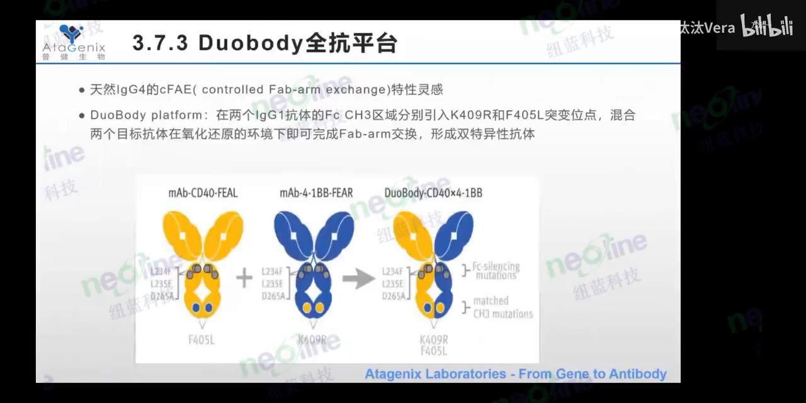

Duobody 的灵感来自天然 IgG4：天然 IgG4 在体内就能发生 Fab 臂交换（cFAE），形成双特异性分子。工程化的做法是：在两个 IgG1 抗体的 CH3 区分别引入 K409R 和 F405L 突变，混合后在氧化还原环境下完成 Fab 臂交换。

它的工程优势是「不用在一个细胞里同时表达四条链」——先分别做两个普通单抗，再在体外拼装。这也是为什么它在已上市双抗中占比最大（见第三节的表格）。详细的生产与纯化流程见本节的另一篇《双抗的组装难题》。

### 7.3 更远的形式：DNL 与 ImmTAC

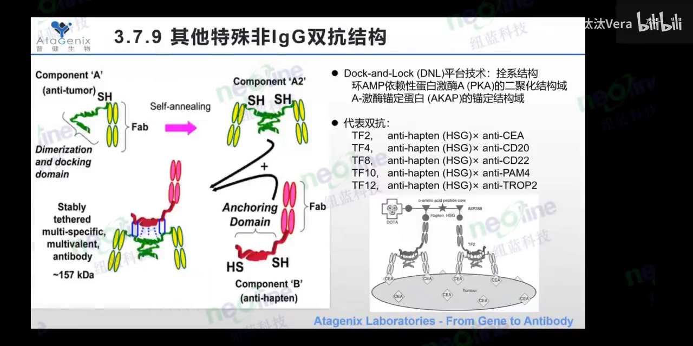

Dock-and-Lock（DNL）平台利用 cAMP 依赖性蛋白激酶 A（PKA）的二聚化结构域与 A-激酶锚定蛋白（AKAP）的锚定结构域，让两个组件自组装成稳定的多价分子（约 157 kDa）。代表分子是 TF 系列：TF2、TF4、TF8、TF10、TF12，都是「抗半抗原（HSG）× 抗肿瘤靶点」的形式——先给一个抗 HSG 的抗体做预靶向，再用带放射性螯合基团的 HSG 肽去结合，本质上是把双抗当成放疗的定位装置。

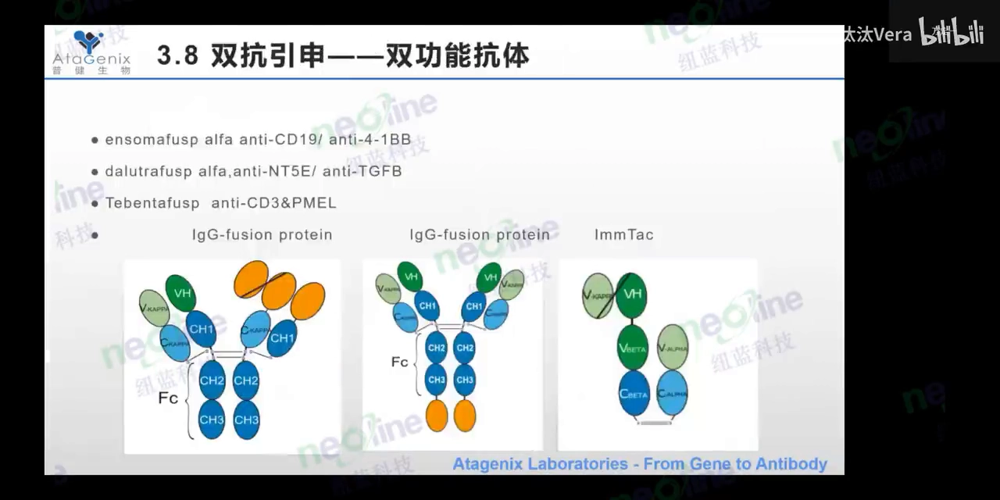

ImmTac（immune-mobilizing monoclonal TCR against cancer）是另一条路：把工程化的 TCR 与抗 CD3 的 scFv 连起来。它的意义在于**把靶标从「细胞表面蛋白」扩展到「MHC 呈递的胞内肽」**——很多肿瘤的特异性突变发生在胞内蛋白上，只有以肽-MHC 的形式才会出现在细胞表面，普通抗体抓不到，工程化 TCR 可以。讲者认为这可能是未来很有前景的方向。

## 八、双抗不只治肿瘤

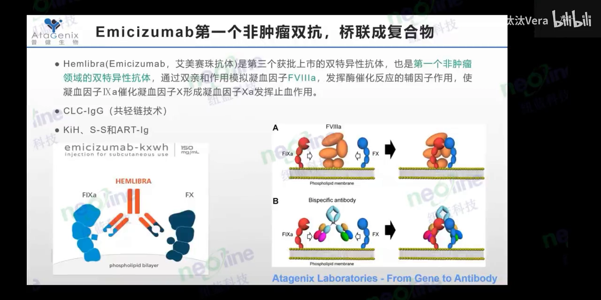

讲者认为最有趣的一个分子是 **Emicizumab（Hemlibra）**：它既不阻断信号、也不招募细胞、也不影响肿瘤生长，而是**模拟一个酶分子的作用**。凝血因子 VIII 缺失时凝血过程无法完成；这个双抗把下游的两个底物——因子 IXa 和因子 X——拉得更近，形成一个类似催化剂的复合物，让 IXa 去催化 X 的活化，从而恢复止血。

它的工程细节也很值得记：这是**第一个用共轻链（CLC-IgG）技术设计的双抗**。因为两条轻链一模一样，整个分子只有三条链（而不是四条），因此只需要解决重链错配（用 KiH 加静电突变），轻链错配问题从源头消失。

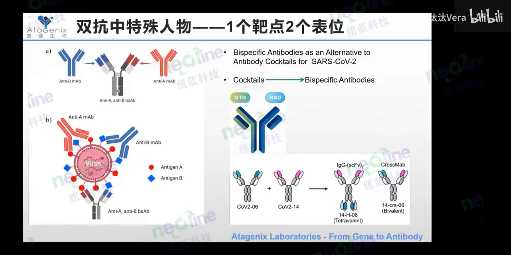

另一个方向是抗感染。新冠期间很多公司上市的是「鸡尾酒」——两个或三个抗体混在一起。讲者的观点是：**生产一个双抗，可能比生产两三个单抗再混合的工艺更简单**。例如把针对 RBD 的中和抗体与针对 NTD（更保守、不易逃逸）的抗体做成一个双抗（如 4A8 这类 NTD 抗体），既保留广谱性，又简化生产。

讲者还提到纳米抗体路线：用 VHH 做双抗几乎不存在重链/轻链错配问题（VHH 没有轻链），设计大大简化。他举例的那家以纳米抗体管线著称的公司，其双抗有两个特点：一是多靶向细胞因子，二是很多分子带一个**抗人血清白蛋白的 VHH**——因为 VHH 没有 Fc，无法通过 FcRn 循环延长半衰期，只能靠结合白蛋白来「搭便车」。讲者提醒：**这种分子严格说算不算双抗值得讨论**，因为其中一个臂并不针对疾病靶点，只是用来延长半衰期。

## 九、功能评价：双抗要多测什么

讲者最后落到检测。双抗的亲和力测定比单抗麻烦，因为有两个结合事件：

- **不带 Fc 的双抗**：包一个抗原、加抗体、洗一次得到一个结合数据；再加第二个抗原，得到第二个数据。
- **带 Fc 的双抗**：既可以按上面的两步法测，也可以先用 anti-human Fc 抗体把双抗「抓」在芯片上，再分两次加入两个靶标抗原。两种方式得到的结合与解离曲线不同，但道理一样。

除了亲和力，双抗还必须回答两个单抗不需要回答的问题：**两个靶标能不能同时结合**（分别结合不等于同时结合），以及**在细胞层面能不能产生预期的功能读数**（桥接、激活、杀伤）。

讲者把设计原则总结成四条：**重链轻链不要错配、不要出现聚集或少聚集、保证纯化容易、保证得率**。这四条听起来朴素，但正是双抗从「设计出来」到「做成药」之间最难跨的那段距离。

[【跳转到 51:10】](https://www.bilibili.com/video/BV1Dg411n7HW/?t=3070)

## 小结

- 双抗的定义是「两个结合位点指向两个不同表位」，两个表位是否在同一抗原上不影响定义，只影响机制。
- 靶标组合有五类场景：同细胞同靶点双表位、同细胞双靶点、两细胞双靶点、双细胞因子、细胞因子加膜蛋白。
- 六十年历史里有两次里程碑：2009 年 Catumaxomab（首个 TCE 双抗，2017 退市，原因是概念太超前、HAMA 反应、工业条件不成熟）与 2014 年 Blincyto（首个 FDA 批准的双抗）。
- 已上市双抗只用了六个平台，其中 CrossMab/KiH 与 DuoBody 占多数；平台的价值在于解决链配对，而不在于结合表位。
- TCE 的核心是绕开 TCR-pMHC 的低亲和力，用抗 CD3 直接把 T 细胞拉到肿瘤旁；同一思路可换成 CD16A 招募 NK、或阻断 CD47 解除巨噬细胞的刹车。
- 价态与几何是独立的设计维度：降低单价亲和力、提高价态，可以靠亲合力效应把活性限制在靶点高表达的细胞上；CD3 端亲和力则要「合适」而非「越高越好」。
- 技术单元只有四层：基础元件（scFv/Fab/VHH）、防重链错配（KiH/ART-Ig/SEED/DEKK）、防轻链错配（CrossMab/共轻链/WuXiBody）、linker（G4S，长度与组成决定结构）。
- 具体形式各有取舍：Diabody 靠非共价配对（脆弱）、DVD-Ig 是唯一对称且稳定的形式、Duobody 在体外组装、DNL 靠结构域自组装、ImmTac 把靶标扩展到肽-MHC。
- 双抗不限于肿瘤：Emicizumab 用共轻链模拟 FVIIIa 的辅因子作用，抗感染领域则用双抗替代抗体鸡尾酒。
- 功能评价要额外回答「能否同时结合两个靶标」与「细胞层面是否产生预期读数」；设计原则是四句话：不错配、少聚集、易纯化、有得率。

## 关键术语速查

| 术语 | 一句话解释 |
| --- | --- |
| BsAb | 双特异性抗体，两个结合位点指向不同表位 |
| TCE | T 细胞衔接器，用抗 CD3 臂把 T 细胞拉到肿瘤旁 |
| BiTE | 双特异性 T 细胞衔接器，两个 scFv 串联、无 Fc |
| Triomab | 大鼠/小鼠杂交瘤二次杂交得到的天然双抗（Catumaxomab） |
| KiH | knob-into-hole，用「杵臼」空间互补促进重链异源二聚 |
| CrossMab | 交换一个 Fab 的 CH1/CL，使轻链只能与对应重链配对 |
| CLC-IgG | 共轻链技术，两条轻链相同，从源头消除轻链错配 |
| Duobody | 在两个 IgG1 的 CH3 引入 K409R/F405L，体外做 Fab 臂交换 |
| Diabody | 把 VH/VL 拆到两条链上，靠同方向配对形成双特异 |
| DVD-Ig | 双可变结构域免疫球蛋白，对称、稳定、分子量大 |
| DART | 双亲和重靶向分子，以 scFv 为基础，可视为 Diabody 变种 |
| DNL | Dock-and-Lock，用 PKA/AKAP 结构域自组装多价分子 |
| ImmTac | 工程化 TCR 加抗 CD3 scFv，靶标为肽-MHC |
| 亲合力（avidity） | 多个结合臂同时结合带来的整体结合强度放大 |
| 双表位（biparatopic） | 同一抗原上两个不同表位的双抗，如 ZW25 |
| NKCE | NK 细胞衔接器，用抗 CD16A 臂招募 NK 细胞 |