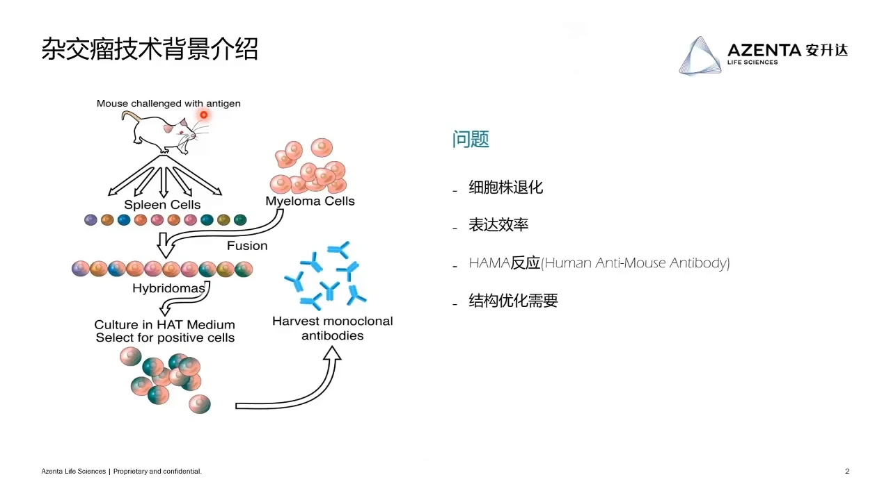
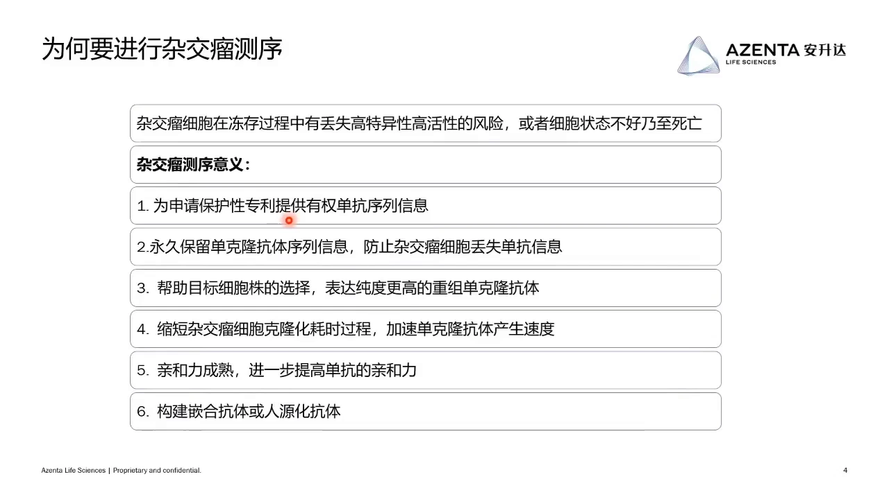
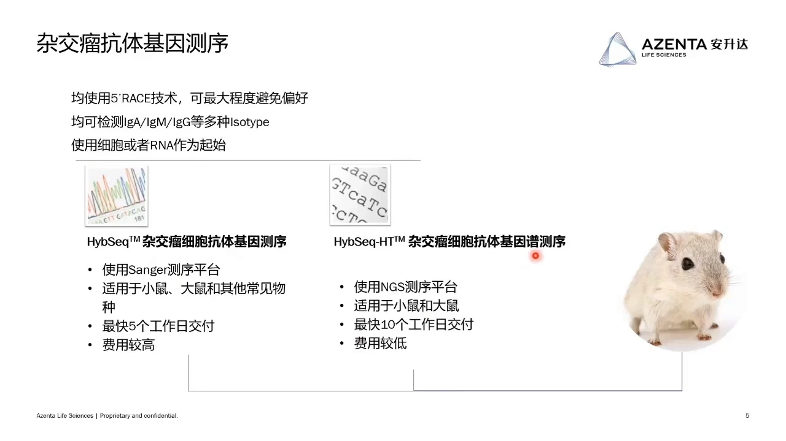
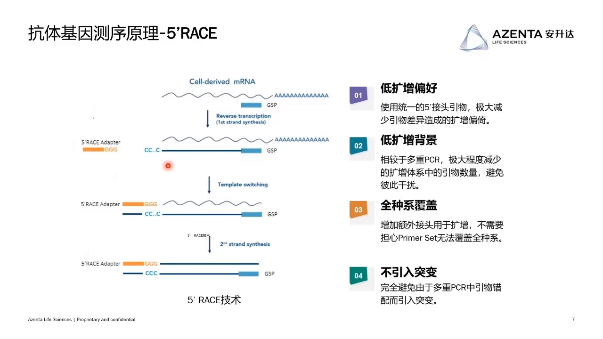
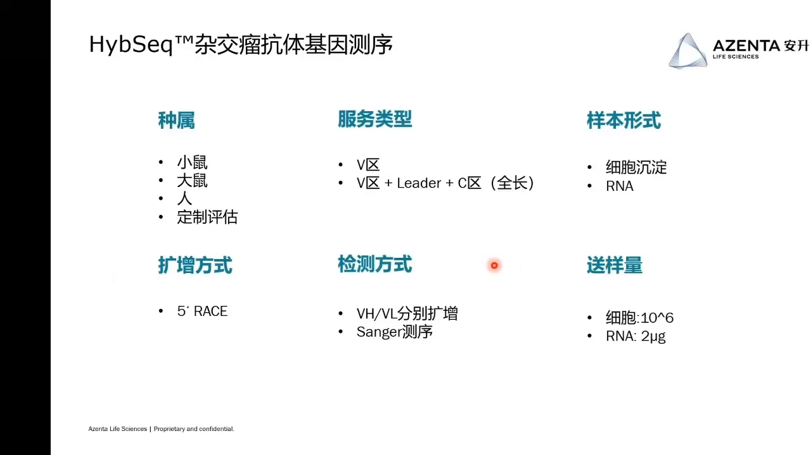
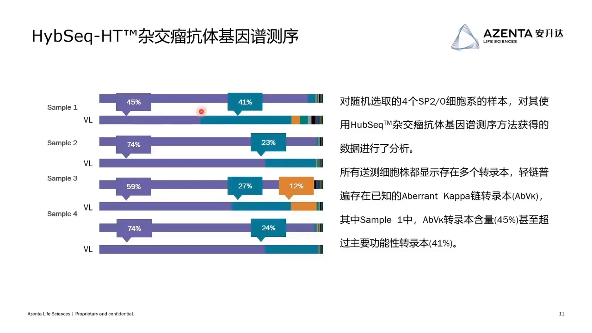
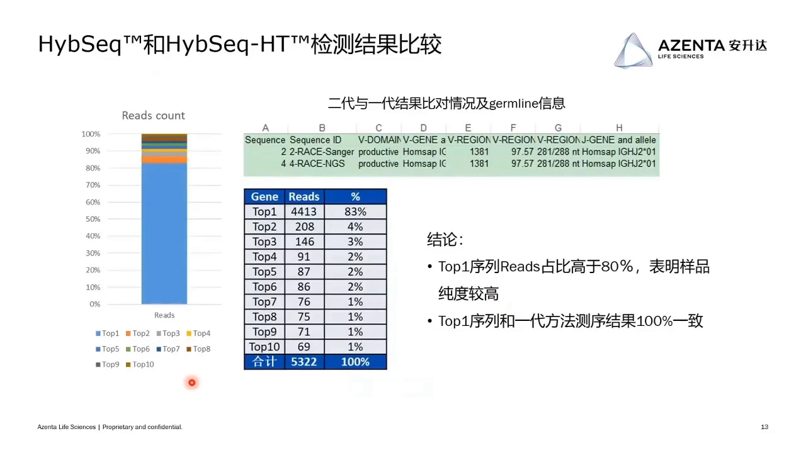
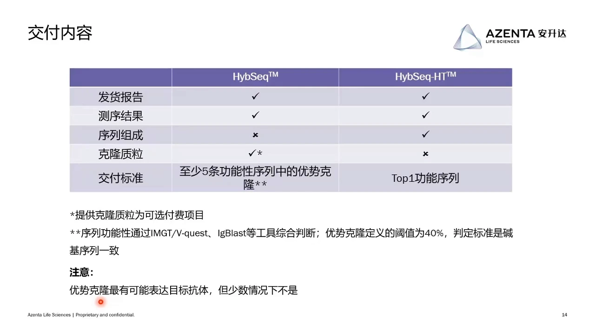
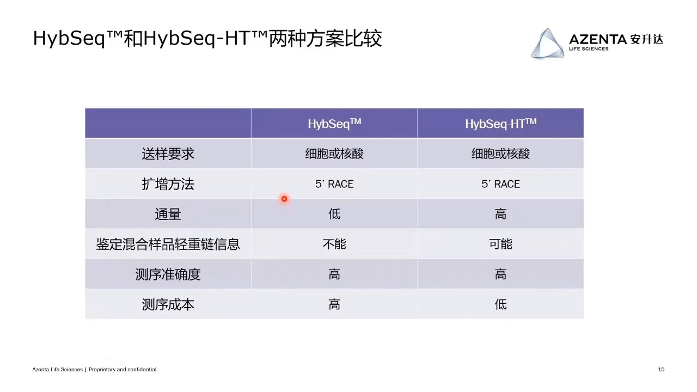

# 杂交瘤测序：把"一株细胞"变成"一串可复现的序列"

> 视频来源：[杂交瘤细胞株抗体基因测序介绍（Bilibili）](https://www.bilibili.com/video/BV1L34y1Y74g/)（UP 主：金唯智生物科技）｜时长约 19 分钟
>
> 导读：这是安升达（Azenta）关于杂交瘤抗体基因测序的产品讲解，前半段讲"为什么必须测序"，中间讲 5'RACE 怎么把可变区调出来，后半段用自家数据揭示了一个反直觉现象：不少被当作"单克隆"的杂交瘤其实并不纯。本文按"为什么测 → 怎么测 → 测出什么 → 怎么判读"重排，并订正了字幕中的若干术语。

## 本讲要解决的核心问题（SCQA）

**背景**：杂交瘤是抗体发现最经典的平台，绝大多数药厂做药物开发都基于它建立。融合、筛选、克隆化之后，研究者手上是一株能稳定分泌抗体的活细胞。

**冲突**：活细胞是脆弱的资产。它会退化、会丢失高特异性高活性的序列、状态变差甚至死亡；它的产抗能力还取决于小鼠个体的健康状况与免疫状态，不同细胞株生产出的抗体在一致性、重复性和效率上都有差异；动物源抗体进入人体还可能引起过敏反应。更要紧的是，下游的人源化、序列优化、稳定细胞株构建，需要的都是**序列**而不是细胞。

**疑问**：怎么把杂交瘤里的抗体信息完整取出来、长期保存、并保证取出来的就是那株细胞真正在用的那对重链和轻链？

**回答（中心思想）**：做**杂交瘤抗体基因测序**——用 5'RACE 从细胞或总 RNA 中把重链、轻链的可变区分别调出来，再用 Sanger 或高通量测序读出序列。它把"一株活细胞"变成"一串可复现、可专利、可重组表达的信息"，同时顺带暴露了一个事实：**很多所谓的单克隆细胞株，在转录本层面并不纯**，因此测序结果必须回到功能层面验证。

---

## 一、为什么"有一株好细胞"还不够

[【跳转到 01:28】](https://www.bilibili.com/video/BV1L34y1Y74g/?t=88)

讲者先复述了经典流程：用特定抗原免疫小鼠（也可以是大鼠、兔子），免疫后脾细胞或淋巴细胞中增殖出针对该抗原的特异性 B 细胞；把这些细胞分离出来与骨髓瘤细胞融合，得到的融合细胞就是杂交瘤。它的两个亲本一个提供"分泌特异性抗体"的能力，一个提供"无限增殖"的能力。

在经典流程里，分离出的杂交瘤会直接用于下游的抗体表达和生产。但讲者明确指出：**现代抗体生产一般不再直接使用这些杂交瘤细胞**，原因有四条：

1. **细胞株会退化**：杂交瘤会丢失高特异性、高活性的序列，或者细胞株状态变差乃至死亡，导致后续研究无法进行；
2. **产抗能力依赖小鼠**：抗体生产取决于小鼠能否产生目标特异性抗体，而这与小鼠个体的健康状况、免疫状态等因素相关；
3. **一致性与效率不稳**：不同杂交瘤生产的抗体，在一致性、重复性和效率上都会受影响；
4. **免疫原性**：动物源抗体可能引起患者过敏反应——幻灯片上写作 HAMA 反应（Human Anti-Mouse Antibody，人抗鼠抗体反应）。

[【跳转到 02:18】](https://www.bilibili.com/video/BV1L34y1Y74g/?t=138)

解决办法是把"细胞"换成"基因"：把杂交瘤里分泌抗体的那些特定基因测出来，然后做人源化处理、序列优化，构建特定的细胞系——比如把表达抗体的基因转导进 CHO 细胞或其他常见的哺乳动物表达细胞，让这些细胞来大规模生产。在这个链条里，抗体基因测序是非常关键的一步。

### 1.1 测序的六项收益

[【跳转到 03:10】](https://www.bilibili.com/video/BV1L34y1Y74g/?t=190)

讲者把测序的意义列成六条，可以分成三组理解：

- **资产化**：为申请保护性专利提供有权单抗序列信息；永久保留单克隆抗体的序列信息，防止杂交瘤细胞丢失导致单抗信息丢失。细胞会死，序列不会。
- **提效**：帮助目标细胞株的选择，表达纯度更高的重组单抗；缩短杂交瘤细胞克隆化的耗时过程，加速单抗产生速度。
- **为改造铺路**：亲和力成熟可以进一步提高单抗亲和力；构建嵌合抗体或人源化抗体也需要序列作为起点。

## 二、两条产品线：Sanger 与高通量，共用同一套前端

[【跳转到 03:51】](https://www.bilibili.com/video/BV1L34y1Y74g/?t=231)

讲者介绍了两条产品线：经典的**杂交瘤细胞抗体基因测序**（基于 Sanger 测序平台）和面向药企大规模需求的**杂交瘤抗体基因谱测序**（基于高通量测序平台）。

**共性有三点**：都使用 5'RACE 技术，可最大程度避免偏好；都能检测 IgA、IgM、IgG 等多种 isotype；起始材料都是细胞或总 RNA。

**差异主要是平台带来的**：

| 维度 | Sanger 平台 | 高通量（NGS）平台 |
| --- | --- | --- |
| 交付周期 | 最快 4~5 个工作日 | 最快 8~10 个工作日 |
| 单样本成本 | 高 | 低（大规模平行测序摊薄） |
| 通量 | 五天可处理几十株细胞 | 两周可处理几百株细胞 |
| 能否识别混合样本 | 不能 | 可以 |

[【跳转到 05:31】](https://www.bilibili.com/video/BV1L34y1Y74g/?t=331)

讲者特别提到，很多药企关注点就在通量上——高通量方案能支撑几百株规模的高通量筛选。

## 三、5'RACE：怎么把可变区"钓"出来

[【跳转到 06:21】](https://www.bilibili.com/video/BV1L34y1Y74g/?t=381)

杂交瘤抗体基因测序本质上是一个**调取基因**的过程：从 RNA 中把抗体基因序列调取出来。流程是先从杂交瘤细胞株中分离总 RNA，用 5'RACE 调取抗体基因序列，然后分支——Sanger 路线做 TA 克隆、Sanger 测序和数据分析；NGS 路线对调取出来的大量序列做文库制备、高通量测序和高通量数据分析。

[【跳转到 07:11】](https://www.bilibili.com/video/BV1L34y1Y74g/?t=431)

讲者指出，杂交瘤测序有两条技术路线：**5'RACE** 和**多重 PCR**。这里讲的是前者。

### 3.1 三步理解 5'RACE

[【跳转到 07:36】](https://www.bilibili.com/video/BV1L34y1Y74g/?t=456)

正常情况下对 mRNA 做反转录，最常见的是用 oligo dT 引物，然后根据设计好的引物扩增。5'RACE 的不同在于它利用了反转录酶 MMLV 的一个特殊活性：

1. **加尾**：MMLV 把 RNA 反转录成 DNA、合成结束时，会发挥**末端转移酶活性**，在 cDNA 末端加上连续几个 C 碱基；
2. **模板转换**：用特殊设计的 5'RACE 接头与这些 C 碱基杂交，此时反转录酶又发挥**依赖 DNA 聚合酶的活性**，把接头序列接到 cDNA 的 5' 端；
3. **扩增**：这样得到的序列 5' 端是已知的，就可以根据设定的**恒定区引物**来扩增、测定目标抗体序列。

[【跳转到 08:01】](https://www.bilibili.com/video/BV1L34y1Y74g/?t=481)

讲者用一句话概括了这套设计的价值：**抗体可变区的 5' 端序列本来是未知的，5'RACE 用一个"通用接头"把它变成了已知序列**，于是任何一条抗体转录本都能用同一套恒定区引物扩增出来。

### 3.2 为什么不用多重 PCR

[【跳转到 08:51】](https://www.bilibili.com/video/BV1L34y1Y74g/?t=531)

幻灯片把 5'RACE 的优势列为四条，正好对应多重 PCR 的四个短板：

| 优势 | 含义 |
| --- | --- |
| 低扩增偏好 | 使用统一的 5' 接头引物，极大减少引物差异造成的扩增偏倚 |
| 低扩增背景 | 相比多重 PCR，扩增体系中的引物数量大幅减少，避免彼此干扰 |
| 全种系覆盖 | 增加额外接头用于扩增，不必担心引物组合覆盖不到某些种系 |
| 不引入突变 | 避免多重 PCR 中引物错配而引入突变 |

[【跳转到 09:11】](https://www.bilibili.com/video/BV1L34y1Y74g/?t=551)

另一个关键点是**引物**。讲者说他们对引物序列做了优化、检测和验证，把设计好的引物体系与 5'RACE 结合，就能以很低的扩增背景、全种系覆盖地获得杂交瘤抗体基因；从胶图上看扩增效果比较好，也包括针对不同 isotype 设计的引物。

### 3.3 重链轻链分别扩增：配对信息是天然带出来的

[【跳转到 09:57】](https://www.bilibili.com/video/BV1L34y1Y74g/?t=597)

技术方案一页写得很清楚：

- **种属**：小鼠、大鼠、人，其他物种定制评估；
- **服务类型**：只测 V 区，或测 V 区加 Leader 加 C 区（全长）；
- **样本形式**：细胞沉淀或 RNA；
- **扩增方式**：5'RACE；
- **检测方式**：**VH、VL 分别扩增，Sanger 测序**。

"VH/VL 分别扩增"这几个字是杂交瘤路线最容易被忽略的优势。因为重链和轻链来自**同一个细胞、同一份 RNA**，扩出来的 VH 与 VL 天然就是配对的：不需要像某些文库路线那样去推测配对关系，也不存在"重轻链配错"的问题。这一点在后续重组表达时至关重要——只有把一对天然配对的重轻链一起转进表达细胞，才有可能复现原来的结合活性。（这一层因果属于对流程的推论，讲者只讲到"分别扩增、可直接做下游表达"。）

[【跳转到 10:31】](https://www.bilibili.com/video/BV1L34y1Y74g/?t=631)

另一条产品线"基因谱测序"只能检测可变区序列，搭配双端 300 bp（PE300）的测序平台。用这个平台可以分别测通重链和轻链，**不需要把重链轻链打断**，因此能保留低拷贝的转录组信息。

## 四、测序结果怎么读：从"一条序列"到"一组序列"

[【跳转到 11:16】](https://www.bilibili.com/video/BV1L34y1Y74g/?t=676)

这是本讲最有信息量的一段。基因谱测序会为每个样本挑选丰度占比最高的十条序列分析，统计重链和轻链 top1 到 top10 的序列及分布，并做图形化展示。

### 4.1 意外发现：多克隆的概率远高于预期

[【跳转到 11:21】](https://www.bilibili.com/video/BV1L34y1Y74g/?t=681)

讲者的原话是：杂交瘤基因测序中出现的**多克隆概率远高于预期**。查阅文献后，文献也支持这个观点。甚至一些常见的、经过多轮筛选、大家认定是单克隆的杂交瘤，**实际上在融合时也可能发生了多细胞融合**，使得最终表达出来的产物并不一致。

[【跳转到 12:11】](https://www.bilibili.com/video/BV1L34y1Y74g/?t=731)

为什么以前没发现？因为 Sanger 路线一般只挑 5~10 个功能性克隆去测，这种混合信息**通常会被漏掉**；而高通量测序可以清楚展示杂交瘤里所有与抗体相关的序列，哪些成分占比是 top1、top2 一直到 top10 都有明确罗列。

[【跳转到 12:36】](https://www.bilibili.com/video/BV1L34y1Y74g/?t=756)

具体数据：重链 top1 的占比在 90%~97%，比较干净；轻链则出现各种变异情况。讲者解释这是**符合预期、符合领域认知**的现象——原因是小鼠品系 SP2/0 中有一条特有的**无功能 kappa 链**，会带来无效转录本信息（图上记作 AbVk，异常 kappa 转录本）。最极端的是 Sample 1：AbVk 占 45%，甚至超过了主要功能转录本的 41%。

### 4.2 两种方案的一致性验证

[【跳转到 13:43】](https://www.bilibili.com/video/BV1L34y1Y74g/?t=823)

讲者用相同样本分别做了 Sanger 和高通量测序，并做比对。

结论有两条：NGS 方案 top1 序列的 reads 占比高于 80%，说明**这个样本比较纯**；NGS 的 top1 序列与 Sanger 方法的检测结果 **100% 一致**，说明两种方案的测序准确度都很高。换句话说，高通量方案不是用准确度换通量，而是用通量换"看得见的全貌"。

### 4.3 交付标准：什么叫"优势克隆"

[【跳转到 15:18】](https://www.bilibili.com/video/BV1L34y1Y74g/?t=918)

讲者给出的判定规则很具体：

- 功能性序列的判定使用 **IMGT、IgBLAST** 等工具综合判断，这也是目前国际上比较认可的判定方式，IMGT 更是行业里的金标准；
- **优势克隆的阈值定义为 40%**：占比高于 40% 才定义为优势克隆；
- 判定标准是**碱基序列的一致性**——因为氨基酸层面一致时，碱基层面仍可能有差异；
- Sanger 路线的交付标准是"至少 5 条功能性序列中的优势克隆"，还可以额外提供克隆质粒，客户不用再做基因合成，可直接做下游表达实验；高通量路线交付的是 top1 功能序列与 top10 序列组成。

## 五、最关键的一句提醒：优势克隆不一定是有功能的那个

[【跳转到 16:08】](https://www.bilibili.com/video/BV1L34y1Y74g/?t=968)

讲者在讲交付标准时插入了一段"注意"，这是整场讲座最值得记住的判断：

**对于优势克隆（也就是主克隆），我们一般说它最有可能表达目标抗体，但很多情况下并非如此。**

[【跳转到 16:33】](https://www.bilibili.com/video/BV1L34y1Y74g/?t=993)

原因回到第一节：也许筛出来的那一株看起来很纯的杂交瘤，来源并不是单一 B 细胞与单一骨髓瘤细胞的融合——可能来自多个细胞融合，也可能自身发生了变异。因此它可能表达两种甚至三种抗体。其中占优势的那条序列，表达出来的抗体**可能根本没有亲和力**：它只是在增殖过程中具有某种选择优势，才被表达出来，并不能很好地结合抗原。

[【跳转到 16:58】](https://www.bilibili.com/video/BV1L34y1Y74g/?t=1018)

所以测序结果必须回到功能层面验证：拿到序列、重组表达、再做结合检测，才能确认这条"优势序列"是不是真正的功能抗体。

> **补充背景**（非讲者原话）：这段话其实重新定义了"克隆性"这个词。有限稀释和显微观察证明的是**起始细胞数**——一个孔里当初只有一个细胞；它证明不了**这个细胞株只表达一种抗体**。要证明后者，需要转录本层面的证据（top1 占比、AbVk 这类异常转录本的比例）加上功能层面的证据（重组表达后能否结合抗原）。这也解释了为什么高通量测序在杂交瘤路线里越来越常见：它给出的不是一个答案，而是一张分布图。

## 六、两条路线怎么选

[【跳转到 17:28】](https://www.bilibili.com/video/BV1L34y1Y74g/?t=1048)

讲者把选择逻辑收成一张表：

| 维度 | Sanger 路线 | 高通量路线 |
| --- | --- | --- |
| 送样要求 | 细胞或核酸 | 细胞或核酸 |
| 扩增方法 | 5'RACE | 5'RACE |
| 通量 | 低 | 高 |
| 鉴定混合样品轻重链信息 | 不能 | 可能 |
| 测序准确度 | 高 | 高 |
| 测序成本 | 高 | 低 |

Sanger 路线的优势在于：可以按需测定恒定区序列，还能提供主要克隆的质粒，方便直接做下游表达实验；代价是要做 TA 克隆、挑单克隆，挑几十甚至上百个克隆才可能找到有功能的序列，成本、时间和工作量都高。高通量路线不需要单克隆，直接建库测序，一次可以完成重链、轻链各 1000 条序列的测定，能检测出样本中所有抗体类型序列，大幅提高通量、降低筛选时间和成本。

## 七、杂交瘤路线的固有局限

本节视频是产品视角的讲解，对杂交瘤路线本身的局限只点到"细胞株退化、依赖小鼠、一致性差、免疫原性"四条。为完整理解这条路线在小节中的位置，补充三点（均为补充背景，非讲者原话）：

- **免疫耐受决定能拿到什么抗体**：杂交瘤依赖动物免疫，对高度保守的自身抗原往往难以产生强免疫应答，这类靶点通常要转向文库或单 B 细胞路线；
- **通量与周期**：一次融合、克隆化、筛选、亚克隆的周期以周计，通量受限于铺板与检测能力——这也是高通量测序与"主克隆直接测序"这类提速手段出现的动因；
- **鼠源抗体必须改造**：HAMA 反应是这条路线进入人体的天然障碍，人源化因此成为标配环节，而人源化又需要序列作为输入——这正好把"测序"和"成药"连了起来。

## 小结

- 杂交瘤的价值在细胞，风险也在细胞：会退化、会丢序列、会死，产抗能力还依赖小鼠个体。把细胞变成序列，资产才可长期保存、可专利、可重组表达。
- 测序的六项收益可分三组：资产化（专利、序列留存）、提效（选株、缩短克隆化）、为改造铺路（亲和力成熟、嵌合与人源化）。
- 5'RACE 的核心是三步：MMLV 在 cDNA 末端加 C、接头模板转换、恒定区引物扩增。它带来低偏好、低背景、全种系覆盖、不引入突变四项优势。
- 重链与轻链分别扩增，配对信息天然来自同一个细胞，这是杂交瘤测序相对其它路线的结构性优势。
- 高通量测序揭示了反直觉的事实：多克隆概率远高于预期，SP2/0 的异常 kappa 转录本（AbVk）在个别样本中占到 45%，超过主要功能转录本。
- 优势克隆的判定是"占比高于 40% 且碱基序列一致"，用 IMGT/IgBLAST 判功能性；但优势克隆不一定是有功能的那个，必须重组表达后回验。
- 两条路线共用 5'RACE 前端：Sanger 胜在能测恒定区、能给质粒，高通量胜在通量、成本与"看得见全貌"。

## 关键术语速查

| 术语 | 一句话解释 |
| --- | --- |
| 杂交瘤测序 | 从杂交瘤细胞或总 RNA 中调取并读出抗体基因序列的技术 |
| 5'RACE | 快速扩增 cDNA 5' 末端的技术，用接头把未知的 5' 端变成已知序列 |
| 模板转换 | 反转录酶在 cDNA 末端加 C 后，与接头杂交并继续合成的过程 |
| MMLV 反转录酶 | 莫洛尼鼠白血病病毒反转录酶，兼具末端转移酶活性 |
| 恒定区引物 | 结合在抗体恒定区、用于扩增可变区的引物 |
| 多重 PCR | 用多组引物同时扩增的技术路线，易产生偏好与背景 |
| 全种系覆盖 | 引物体系能覆盖所有 V 基因种系，不遗漏稀有序列 |
| isotype | 抗体类别（IgG、IgM、IgA 等），由恒定区决定 |
| TA 克隆 | 把 PCR 产物直接连入载体、挑单克隆测序的经典做法 |
| 优势克隆 | 占比超过 40%、碱基序列一致的序列，被判定为主克隆 |
| AbVk | 异常 kappa 转录本，SP2/0 骨髓瘤亲本带来的无功能轻链转录本 |
| IMGT / IgBLAST | 抗体序列注释与功能性判定的国际通用工具与数据库 |
| HAMA 反应 | 人抗鼠抗体反应，鼠源抗体进入人体后引发的免疫应答 |
| CHO 细胞 | 中国仓鼠卵巢细胞，抗体重组表达最常用的哺乳动物细胞之一 |