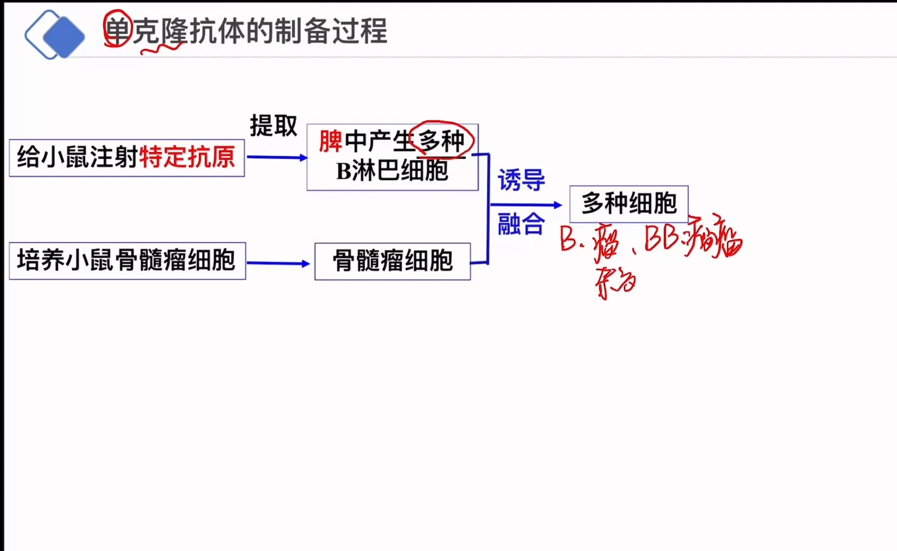
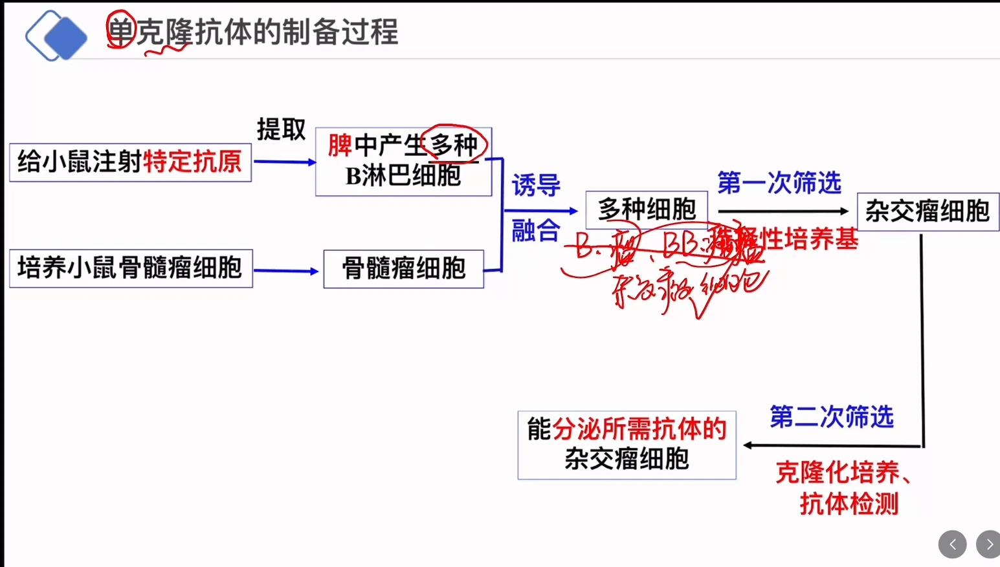
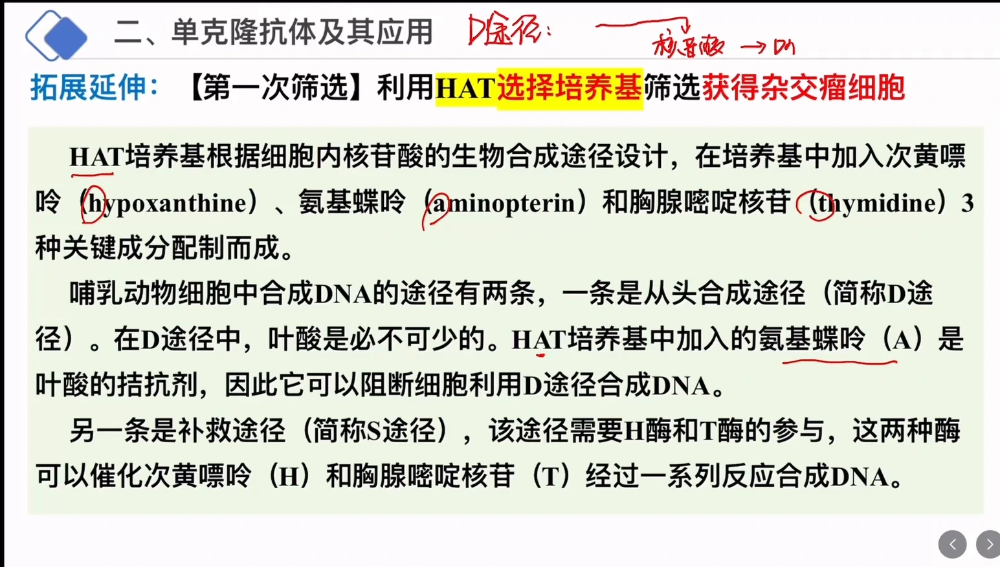
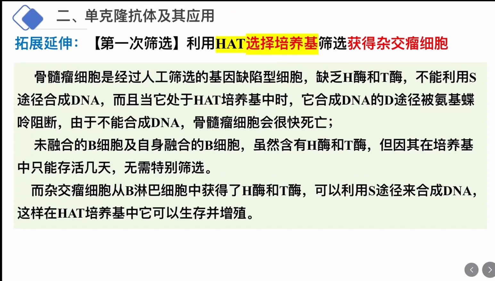
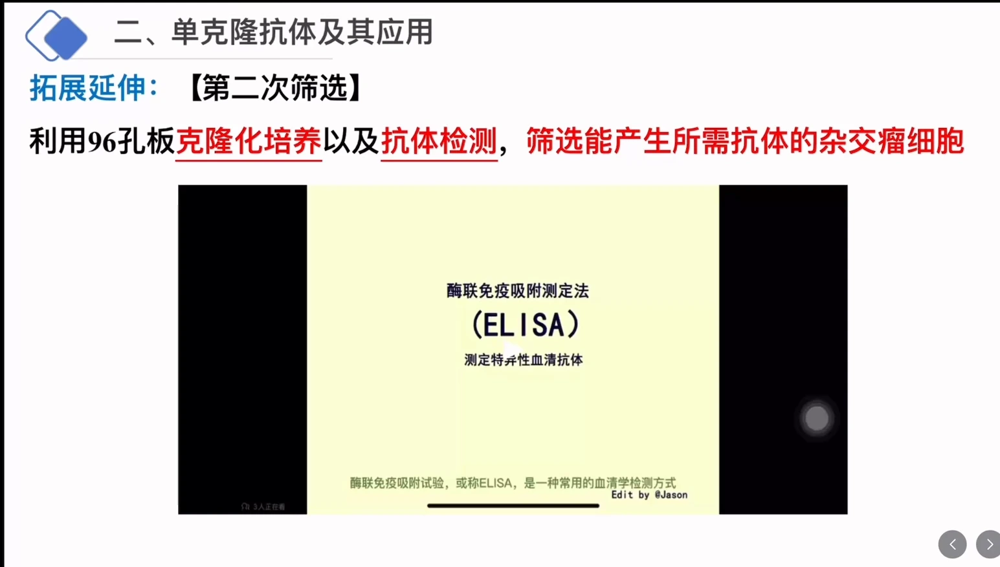
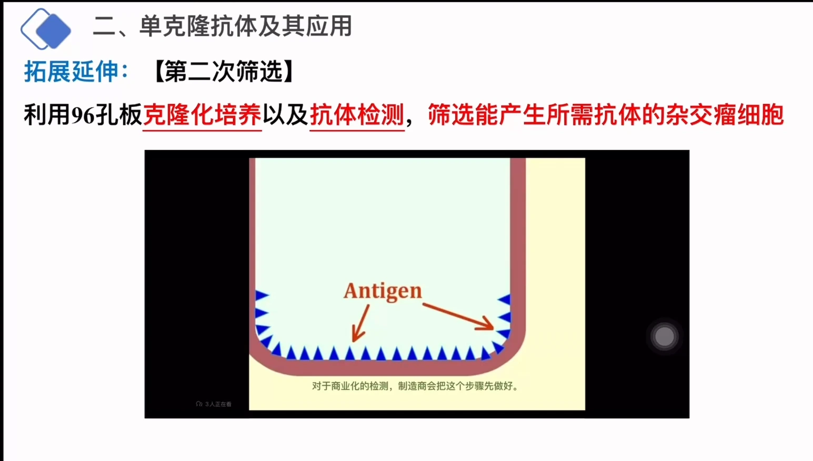
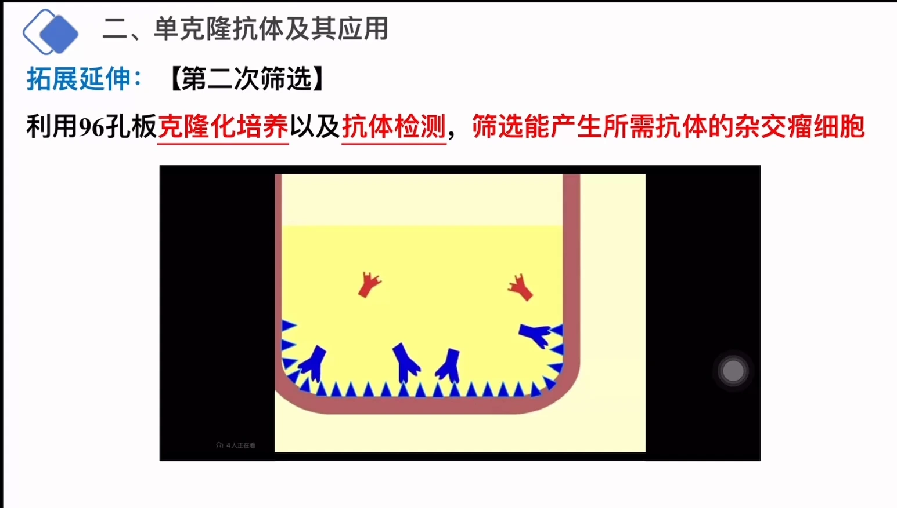
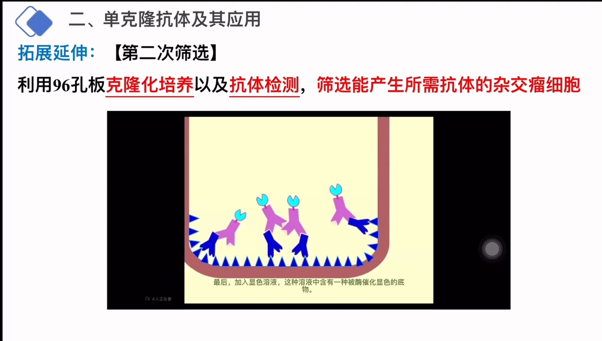
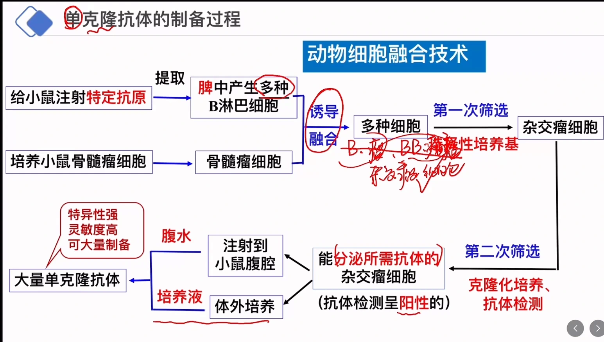

# 杂交瘤的两道筛选：HAT 培养基只留下融合细胞，克隆化加抗体检测只留下对的克隆

> 视频来源：[杂交瘤细胞筛选：HAT培养基和抗体检测（Bilibili）](https://www.bilibili.com/video/BV1S7QaYGEAp/)（UP 主：清清的风就是清风）｜时长约 18 分钟
>
> 导读：本讲从高中生物「单克隆抗体制备」的考点视角出发，把两次筛选的原理讲透——第一次用 HAT 培养基做代谢选择，第二次用 96 孔板克隆化加 ELISA 做抗体检测。本文保留讲者的推理链，并补足术语背景；具体培养基配方、融合比例等操作参数不在讨论范围内。

## 本讲要解决的核心问题（SCQA）

**背景**：单克隆抗体要求所有抗体分子来自同一个 B 细胞克隆、识别同一个表位。B 细胞能分泌抗体，但在体外培养只能活几天；骨髓瘤细胞能无限增殖。把两者融合，得到的杂交瘤同时具备两种本领——这是杂交瘤技术的基本思路。

**冲突**：融合是一个"批量随机"的过程。培养体系里除了杂交瘤，还有大量未融合的 B 细胞、未融合的骨髓瘤细胞，以及同种细胞彼此融合的产物。杂交瘤可能只占极少数，而且这些杂交瘤彼此也不一样——因为它们来自不同的 B 细胞。

**疑问**：怎么先把杂交瘤从这一堆细胞里挑出来？挑出来之后，又怎么找到分泌"我要的那个抗体"的那一株？

**回答（中心思想）**：杂交瘤制备需要**两道筛选，各自解决一个不同的问题**。第一道是**代谢选择**：用 HAT 培养基堵死所有细胞的核苷酸从头合成途径，只有从 B 细胞那里继承了补救途径两个关键酶的杂交瘤才能活——它回答"这是不是一个融合细胞"。第二道是**克隆化加抗体检测**：把细胞稀释到 96 孔板、让每个孔尽量只有一个细胞，再用 ELISA 检测上清——它回答"这一株是不是我要的那个克隆"。前者筛的是细胞的来源，后者筛的是抗体的特异性。

---

## 一、为什么要融合：单抗的"单"与 B 细胞的"短命"

[【跳转到 01:15】](https://www.bilibili.com/video/BV1S7QaYGEAp/?t=75)

先拆"单克隆"三个字。"单"指单一的克隆，也就是大量同种类型的细胞与抗体。回忆抗体产生的基本链条：B 淋巴细胞被抗原活化后增殖、分化成浆细胞，由浆细胞分泌抗体。而**一种 B 淋巴细胞只能产生一种抗体**——这一条正好满足"单"的要求。

问题出在另一半：**体外培养下 B 淋巴细胞不能无限增殖**。它能产抗体，但活不长，无法支撑持续生产。于是需要动物细胞融合技术，让它与一种能无限增殖的细胞融合，使杂交细胞同时具备两者的特点。这个提供"无限增殖"能力的细胞就是骨髓瘤细胞。

[【跳转到 01:40】](https://www.bilibili.com/video/BV1S7QaYGEAp/?t=100)

流程上，先给小鼠注射特定抗原完成免疫，再从脾这个免疫器官中取出 B 淋巴细胞，同时培养小鼠骨髓瘤细胞，然后诱导两者融合。

## 二、融合之后，体系里有五类细胞，我们要的只是其中一类

### 2.1 取到的 B 细胞本来就是"多种"

[【跳转到 02:30】](https://www.bilibili.com/video/BV1S7QaYGEAp/?t=150)

讲者特别强调：从脾中提取到的是**多种** B 淋巴细胞。这一点决定了后面为什么需要两次筛选——如果取到的正好是我们想要的那一种，就少了一次筛选。

为什么会是"多种"？讲者给了两条理由：

1. **只有活化后的 B 淋巴细胞才能产生抗体**，而脾中还有一部分没有接触抗原、没有经过两个信号激活的未活化 B 淋巴细胞，提取时会一起被取到；
2. 小鼠生活环境里有其他病原体抗原，也可能保留着针对其他抗原的记忆 B 细胞。因此取到的细胞里，有的未活化，有的活化过但分泌的不是我们需要的抗体。

### 2.2 融合产物不止杂交瘤一种

[【跳转到 04:10】](https://www.bilibili.com/video/BV1S7QaYGEAp/?t=250)

即使诱导方法正确，融合结果也不可控。体系里至少有这几类细胞：

| 细胞类型 | 来源 | 是否我们要的 |
| --- | --- | --- |
| 未融合的亲本细胞 | 单独的 B 细胞、单独的骨髓瘤细胞 | 否 |
| 融合的具有同种核的细胞 | B 与 B 融合（BB）、瘤与瘤融合（瘤瘤） | 否 |
| 杂交瘤细胞 | B 与骨髓瘤细胞融合 | 是 |

课本把前两类合称"未融合的亲本细胞"和"融合的具有同种核的细胞"，这个说法在填空题里经常出现。我们要的是第三类——B 淋巴细胞与骨髓瘤细胞融合成的杂交瘤细胞。

### 2.3 两道关卡的分工

[【跳转到 05:00】](https://www.bilibili.com/video/BV1S7QaYGEAp/?t=300)

**第一次筛选**的目的是得到杂交瘤细胞、去掉杂细胞，方法是用选择培养基。这里的"选择"和微生物培养里的选择培养基同理：允许特定类型细胞生长，同时抑制或阻止其他类型细胞。

**第二次筛选**做的是克隆化培养和抗体检测。为什么还要再筛一次？因为参与融合的 B 淋巴细胞有多种，得到的杂交瘤细胞自然也有多种。第二次筛选要从这些杂交瘤里挑出**能分泌所需抗体**的那一株——这样的细胞在抗体检测时呈阳性。

经过两次筛选，得到的细胞同时具备两个亲本的特点：既能产生所需抗体，又能在体外培养条件下无限增殖。

## 三、第一道关卡：HAT 培养基用核苷酸代谢把非杂交瘤细胞"饿死"

[【跳转到 08:45】](https://www.bilibili.com/video/BV1S7QaYGEAp/?t=525)

第一次筛选的关键在于：**选择压力不是"识别抗体"，而是"能不能合成 DNA"**。这是整套设计最巧妙的地方，也是课本没有展开、习题却常考的部分。

### 3.1 HAT 的三个字母与两条核苷酸合成途径

[【跳转到 09:03】](https://www.bilibili.com/video/BV1S7QaYGEAp/?t=543)

HAT 培养基的名字来自三种关键成分的首字母：**次黄嘌呤**（hypoxanthine，H）、**氨基蝶呤**（aminopterin，A）、**胸腺嘧啶核苷**（thymidine，T）。

哺乳动物细胞合成 DNA 有两条途径：

- **从头合成途径（D 途径）**：从简单原料一步步合成核苷酸，**叶酸是必不可少的成分**；
- **补救途径（S 途径）**：直接把现成的碱基"回收"成核苷酸，需要两个酶参与——**H 酶**（催化次黄嘌呤）和**T 酶**（催化胸腺嘧啶核苷）。

### 3.2 氨基蝶呤堵死 D 途径，只剩 S 途径

[【跳转到 09:58】](https://www.bilibili.com/video/BV1S7QaYGEAp/?t=598)

HAT 里的 **A（氨基蝶呤）是叶酸的拮抗剂**，它阻断细胞利用 D 途径合成 DNA。于是有一个大前提：**在 HAT 培养基里，所有细胞的 D 途径都被堵死了**，想增殖就只能走 S 途径。

[【跳转到 11:13】](https://www.bilibili.com/video/BV1S7QaYGEAp/?t=673)

这就把"能不能活"简化成了一个可判定的问题：**这个细胞有没有 H 酶和 T 酶？**

### 3.3 骨髓瘤细胞是"人工制造的缺陷株"

[【跳转到 12:21】](https://www.bilibili.com/video/BV1S7QaYGEAp/?t=741)

用于融合的骨髓瘤细胞并不是野生型，而是**经过人工筛选的基因缺陷型，缺乏 H 酶和 T 酶**。因此它自己走不了 S 途径，而 D 途径又被氨基蝶呤封住——两条路都断，它很快死亡。

四类细胞的命运因此被区分开：

| 细胞 | 有 H 酶、T 酶吗 | D 途径 | 结局 |
| --- | --- | --- | --- |
| 未融合的骨髓瘤细胞、瘤瘤融合细胞 | 没有 | 被氨基蝶呤阻断 | 无法合成 DNA，很快死亡 |
| 未融合的 B 细胞、BB 融合细胞 | 有 | 被阻断 | 能走 S 途径，但没有无限增殖能力，只能活几天后自然死亡 |
| 杂交瘤细胞 | 有（继承自 B 细胞） | 被阻断 | 走 S 途径合成 DNA，同时继承骨髓瘤的无限增殖能力，存活并增殖 |

讲者点出了这套设计的要害：**杂交瘤从 B 淋巴细胞中获得了 H 酶和 T 酶，相当于借用了 B 细胞的补救途径**；而无限增殖能力来自骨髓瘤细胞。两个亲本各贡献一半，缺一不可。

> **补充背景**（非讲者原话）：正因为骨髓瘤亲本必须预先敲掉 H 酶（HGPRT）或 T 酶（胸苷激酶），HAT 筛选才有意义。如果骨髓瘤自己带着这两个酶，融合后它和杂交瘤在 HAT 里都能活，这道关卡就失效了。这也是为什么文献里常见的骨髓瘤株都标注为 HGPRT 缺陷型。

## 四、第二道关卡：克隆化培养加抗体检测

[【跳转到 13:36】](https://www.bilibili.com/video/BV1S7QaYGEAp/?t=816)

HAT 筛选只保证"活下来的是融合细胞"，不保证"活下来的是我要的那一株"。第二道关卡在 96 孔板上完成：**克隆化培养加抗体检测**。

"克隆化"要解决的问题是：一个孔里的细胞如果不止一个，那么孔里的抗体就是混合的，测到阳性也说不清是谁分泌的。因此要把细胞稀释铺板，让每个孔尽量只有一个细胞起始，长起来的就是一个克隆。

> **补充背景**（非讲者原话）：这一步在实验室里通常叫有限稀释，判断"一个孔里是不是真的只有一个克隆"靠的是统计与观察——按泊松分布估算铺板密度，再在显微镜下确认孔里只有一个细胞团。这也是后面讨论"克隆性证据"时最关键的一环：有限稀释证明的是"起始细胞数"，不是"抗体只有一种"。

### 4.1 ELISA 怎么把"有没有目标抗体"变成"有没有颜色"

[【跳转到 14:00】](https://www.bilibili.com/video/BV1S7QaYGEAp/?t=840)

讲者放了一段 ELISA 动画，并提示：把动画里的"血清样品"换成第一次筛选后的杂交瘤细胞上清即可。整个检测分五步：

1. **包被抗原**：检测前先用目标抗原铺满每个孔的孔底。对商业化检测，制造商已经把这个步骤做好。
2. **加样品**：加入稀释过的样品。如果其中有相应抗体，就会与固定在孔底的抗原结合；**只有抗原特异性抗体才会留在孔里**。
3. **洗涤**：用缓冲液冲走没有结合上去的抗体。
4. **加二抗**：加入含动物抗体的溶液（这种动物抗体能抗人的抗体，即二抗），二抗上共价连着一个酶。再次清洗，除去未结合的酶标二抗。
5. **显色**：加入显色液，底物被酶催化显色。颜色深浅对应目标抗体的浓度，可以肉眼观察，也可以用仪器定量读取。

### 4.2 换成杂交瘤上清之后，这套检测在测什么

[【跳转到 16:21】](https://www.bilibili.com/video/BV1S7QaYGEAp/?t=981)

把动画里的样品换成第一次筛选后的杂交瘤细胞，逻辑完全一样：

- 孔底包被的"目标抗原"，就是最初免疫小鼠用的那个抗原；
- 加入杂交瘤细胞后，细胞在孔里增殖的同时分泌抗体。**当然有的杂交瘤不分泌抗体**；
- 如果分泌的正是所需抗体（动画里用蓝色抗体表示），就会与抗原特异性结合；分泌的不是所需抗体就结合不上，洗涤时被洗掉；
- 第二次加的二抗是能与单克隆抗体特异性结合的抗体，它的作用是**把酶带进来**；酶催化底物显色，于是颜色的有无就间接反映了特异性抗体的有无。

[【跳转到 17:30】](https://www.bilibili.com/video/BV1S7QaYGEAp/?t=1050)

一句话概括第二道关卡的判据：**孔里的细胞在长、上清在显色，这两个条件同时成立，这个孔才值得往下走。**

## 五、拿到阳性克隆之后：腹水还是体外培养

[【跳转到 07:05】](https://www.bilibili.com/video/BV1S7QaYGEAp/?t=425)

得到"能分泌所需抗体的杂交瘤细胞"之后，剩下的就是放大生产。讲者给出两条路：

- **体内法**：把细胞注射到小鼠腹腔内，让它在腹腔里增殖并产抗体，最后从**腹水**中收集单克隆抗体；
- **体外法**：用动物细胞培养技术在培养瓶中扩增，从**培养液**中收集单克隆抗体。

讲者顺带总结了单抗相对传统抗体的优点：因为经过筛选，分泌的都是所需抗体，能识别抗原的细微差别，所以**特异性强、灵敏度高**；又因为杂交瘤能大量增殖，所以**可以大量制备**。

整个流程用到的动物细胞工程技术有两条主线：一次**动物细胞融合**（B 细胞与骨髓瘤细胞），以及贯穿始终的**动物细胞培养**——不管哪一次筛选，都要在营养充足、无菌无毒、温度与 pH 与渗透压适宜、气体环境合适的条件下进行。

## 六、这套流程的边界

本节视频是考点视角的讲解，没有展开工业与临床层面的限制。为避免与同系列其它文章重复，这里只列出与本小节直接相关的三点，并明确标注哪些是补充：

- **筛选只认"结合"，不认"功能"**：ELISA 阳性只说明抗体能结合抗原，不说明它能中和、能阻断、能激活（补充背景）。
- **克隆化不等于克隆性**：有限稀释能保证起始细胞数，但一个"看起来单克隆"的细胞株仍可能表达不止一种抗体——这一点在同系列《杂交瘤抗体基因测序》一文中有直接的测序证据。
- **鼠源抗体与人源化**：杂交瘤来自小鼠，鼠源抗体用于人体需要改造，这部分属于下游工程化环节（补充背景）。

## 小结

- 融合的动机是互补：B 细胞会产抗体但活不长，骨髓瘤细胞能无限增殖。杂交瘤同时继承两者。
- 融合产物有多类细胞（未融合的 B、未融合的瘤、BB、瘤瘤、杂交瘤），只有 B 与骨髓瘤融合的杂交瘤是目标；取到的 B 细胞本身也是"多种"，所以筛选必须做两次。
- 第一次筛选靠代谢：HAT 里的氨基蝶呤封死 D 途径（叶酸被拮抗），细胞只能走需要 H 酶和 T 酶的 S 途径；骨髓瘤亲本是缺这两种酶的缺陷株，因此只有杂交瘤能活。
- 四类细胞的结局可以整表记住：瘤与瘤瘤死于"两条路都断"，B 与 BB 死于"没有无限增殖能力"，杂交瘤两条都占。
- 第二次筛选靠克隆化加抗体检测：96 孔板分散细胞，ELISA 用"包被抗原 → 加样品 → 洗涤 → 酶标二抗 → 显色"把抗体有无变成颜色有无。
- 两道关卡分工明确：第一道筛"是不是融合细胞"，第二道筛"是不是我要的那个克隆"。
- 放大生产有两条路：小鼠腹腔收腹水，或体外培养收培养液。

## 关键术语速查

| 术语 | 一句话解释 |
| --- | --- |
| 单克隆抗体 | 来自单一 B 细胞克隆、只识别一个表位的抗体 |
| 杂交瘤 | B 淋巴细胞与骨髓瘤细胞融合形成的细胞，既产抗体又能无限增殖 |
| 未融合的亲本细胞 | 没有发生融合的单个 B 细胞或单个骨髓瘤细胞 |
| 融合的具有同种核的细胞 | 同种细胞彼此融合的产物（BB、瘤瘤），不是目标细胞 |
| HAT 培养基 | 含次黄嘌呤、氨基蝶呤、胸腺嘧啶核苷的选择培养基 |
| D 途径 | 核苷酸从头合成途径，需要叶酸，被氨基蝶呤阻断 |
| S 途径 | 核苷酸补救途径，需要 H 酶与 T 酶，把现成碱基回收成核苷酸 |
| H 酶（HGPRT） | 次黄嘌呤-鸟嘌呤磷酸核糖转移酶，S 途径的关键酶之一 |
| T 酶（胸苷激酶） | 催化胸苷磷酸化的酶，S 途径的另一个关键酶 |
| 氨基蝶呤 | 叶酸拮抗剂，HAT 中负责封死 D 途径的成分 |
| 克隆化培养 | 把细胞稀释到单细胞起始、长成单一克隆的过程 |
| ELISA | 酶联免疫吸附试验，用酶标二抗催化底物显色来检测特异性抗体 |
| 腹水法 | 把杂交瘤注射进小鼠腹腔，从腹水中收集单抗的体内生产方法 |