# 单 B 细胞分选与分泌筛选：从抗原特异性分选到配对序列回收

> 视频来源：[Antibody Discovery by Single B Cell Screening on Beacon](https://www.youtube.com/watch?v=K3UKYfi4JLo)（YouTube · scientist.com / Inside Scientific 与义翘神州联合网络研讨会；讲者 Amy Shang，义翘神州技术客户经理）｜时长约 46 分钟
>
> 导读：本讲以 Beacon 光导平台为主线，把「单 B 细胞抗体发现」拆成细胞分离、芯片加载、分泌筛选、细胞导出与基因扩增四段，并用抗独特型抗体、磷酸化特异抗体、CD47 抗体、猴痘 A29 抗体四个项目给出逐级漏斗数据。字幕为自动生成，术语与数字已按幻灯片订正（如 B220、SIRPα、A29）。

## 本讲要解决的核心问题（SCQA）

**背景**：杂交瘤技术用了近五十年，至今仍是最常用的抗体制备方法；噬菌体展示则把抗体基因搬到体外做展示与淘选。两者都能拿到单克隆抗体。

**冲突**：杂交瘤的融合成功率极低（讲者给的数字是即使电融合也只有约千分之一），周期两到三个月，而且受骨髓瘤细胞系限制、可开发的物种有限；噬菌体展示虽然快，但文库里的轻重链是随机组合的，**没有天然配对**，且大多数抗体没经过体内亲和成熟，亲和力受限。

**疑问**：如果直接从免疫动物身上把「已经通过体内筛选的那一个 B 细胞」拿出来，会损失什么、又能得到什么？在纳升尺度上「读分泌」这件事，凭什么可信？

**回答（中心思想）**：单 B 细胞路线的核心收益是**天然 VH/VL 配对 + 体内已完成的亲和成熟 + 不受物种限制**；它的代价是把「克隆性」从细胞学证据换成了分子证据，因此必须在流程里额外守住三道关——浆细胞富集的纯度、一个纳升孔一个细胞的单细胞化、以及「重组抗原结合」与「天然细胞结合」的一致性。

---

## 一、先分清两种 B 细胞：记忆 B 细胞与浆细胞

[【跳转到 01:27】](https://www.youtube.com/watch?v=K3UKYfi4JLo&t=87)

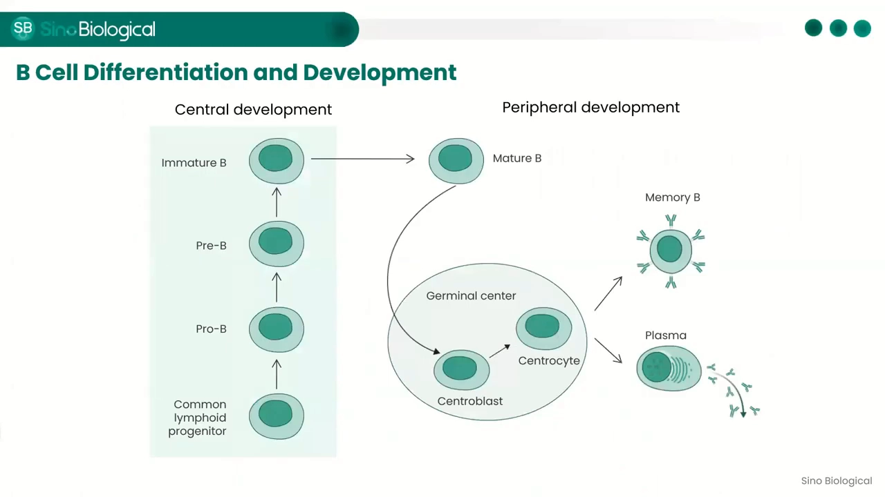

B 细胞是体内唯一能产生抗体的免疫细胞，它的发育分两个阶段：

- **中枢发育**在骨髓里完成，顺序是共同淋巴样祖细胞 → pro-B 细胞 → pre-B 细胞 → 未成熟 B 细胞 → 成熟 B 细胞。这个过程依赖骨髓微环境，涉及基因重排、BCR 表达和阴性选择。
- **外周发育**在外周免疫器官：成熟 B 细胞在 T 细胞辅助下被特异性抗原激活，增殖分化形成生发中心，最终走向两个终点——**浆细胞**和**记忆 B 细胞**。

这两个终点的性质完全不同，也直接决定了后面两条技术路线的分工：

| | 浆细胞 | 记忆 B 细胞 |
| --- | --- | --- |
| 分化状态 | 终末分化 | 长期存活、可再激活 |
| 主要功能 | 大量分泌抗体 | 再次遇到同一抗原时迅速分化成浆细胞 |
| 胞内抗体 RNA | 含量高，容易拿到抗体基因 | 含量相对低 |
| 表面特征 | 不再依赖膜上 BCR 结合抗原 | 膜上 BCR 可直接被荧光抗原标记 |

讲者后面反复用到这个区别：**FACS 路线筛的是记忆 B 细胞（靠膜上 BCR 结合荧光抗原），Beacon 路线筛的是浆细胞（靠分泌出来的抗体）**。

## 二、三代平台的取舍：为什么还要做单 B 细胞

### 2.1 杂交瘤：成熟、便宜，但融合率是硬约束

[【跳转到 03:22】](https://www.youtube.com/watch?v=K3UKYfi4JLo&t=202)

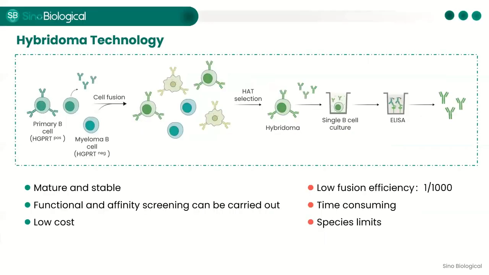

流程是：从免疫动物的免疫器官（通常是脾脏）制备单细胞悬液，与骨髓瘤细胞融合（PEG 介导或电融合，后者效率更高），融合体系里同时存在未融合的脾细胞、未融合的骨髓瘤细胞和融合成功的杂交瘤，用 HAT 选择让杂交瘤存活，再用 ELISA 筛阳性克隆，有限稀释复筛得到能稳定产生单一抗体的单克隆杂交瘤。

讲者给出的优缺点很清楚：

- **优点**：方法成熟、成功率很高；筛选过程中可以同步做功能和亲和力检测；不需要专门设备，成本低。
- **缺点**：融合效率可能很低，**即使电融合，成功率也只有约千分之一**；合适的骨髓瘤细胞系并非随时可得，因此可开发的抗体物种受限；周期长，从融合到拿到阳性克隆一般要两到三个月。

### 2.2 噬菌体展示：快，但丢了两样东西

噬菌体展示把抗体基因插入噬菌体外壳蛋白的结构基因，通过融合蛋白把抗体展示在噬菌体表面，再用固相包被的抗原来淘选（biopanning），经过三到五轮「吸附—洗脱—扩增」富集特异性噬菌体。

它的优点是适用物种广（小鼠、兔、羊驼、鸡，甚至人源文库已有商品化产品）、成本相对低。缺点是讲者点出的三条：

1. 高度依赖文库的质量和容量；
2. 文库中大多数抗体**没有经过体内亲和成熟**，亲和力有限；
3. **没有天然的抗体配对**——轻重链基因在文库中是随机组合的，拿到的抗体亲和力可能被削弱。

### 2.3 单 B 细胞：把体内已经筛过的那一个细胞拿出来

[【跳转到 09:12】](https://www.youtube.com/watch?v=K3UKYfi4JLo&t=552)

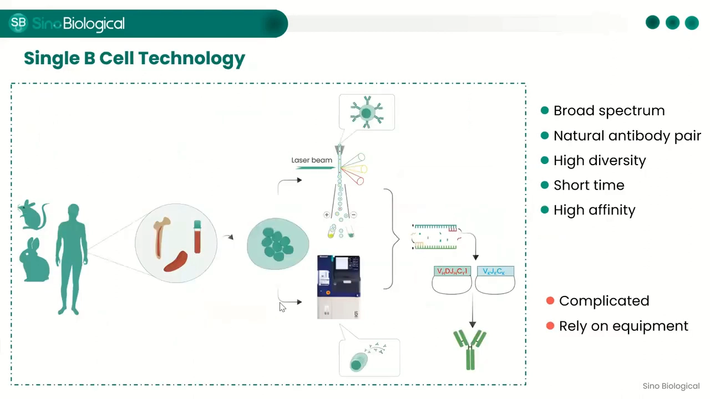

单 B 细胞技术的流程是：从外周血或免疫器官用 FACS 或 Beacon 分离抗原特异性 B 细胞 → 单细胞 PCR 拿到 VH/VL 序列 → 装入表达载体 → 表达纯化得到单克隆抗体。

讲者列出的五个优点，每一条都对应前面两个平台的一个短板：

| 优点 | 对应补上的短板 |
| --- | --- |
| 物种范围广（人、鼠、兔等） | 杂交瘤受骨髓瘤细胞系限制 |
| 天然 VH/VL 配对 | 噬菌体展示的轻重链随机组合 |
| 多样性高 | 噬菌体展示受文库容量限制 |
| 周期短（一天内可筛大量候选） | 杂交瘤需两到三个月 |
| 亲和力高 | 筛的是记忆 B 细胞或浆细胞，已在体内完成亲和成熟 |

代价也明确：流程复杂，依赖单细胞分选设备，**设备成本高**。

## 三、FACS 与 Beacon 的分工：四个维度上的互补

[【跳转到 11:02】](https://www.youtube.com/watch?v=K3UKYfi4JLo&t=662)

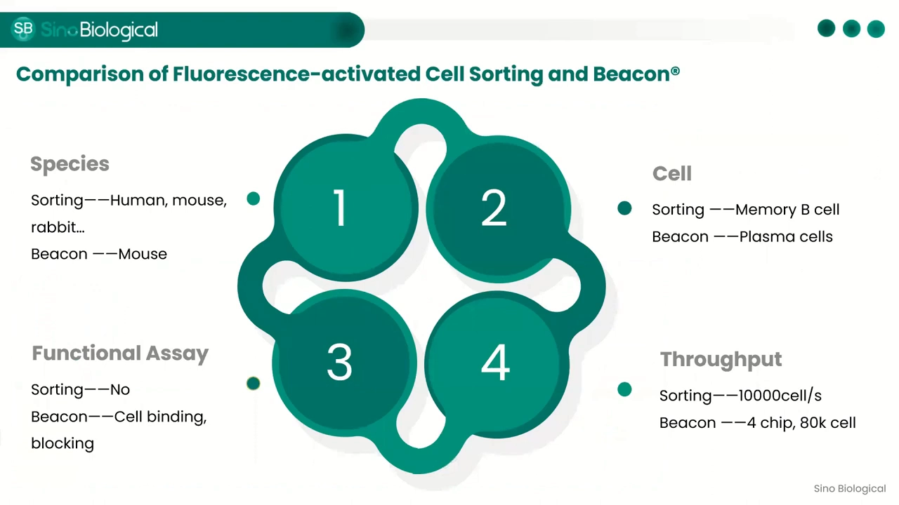

同属单 B 细胞技术，FACS 与 Beacon 的定位差别很大：

| 维度 | FACS 分选 | Beacon |
| --- | --- | --- |
| 物种 | 人、鼠、兔等 | 目前只有小鼠（缺少浆细胞分离试剂） |
| 目标细胞 | 记忆 B 细胞 | 浆细胞 |
| 功能实验 | 筛选与分选过程中能做的功能验证不多 | 可做细胞结合、阻断等验证 |
| 通量 | 约 10 000 细胞/秒 | 4 张芯片，一次 8 万细胞 |

这张表解释了两条路线的本质差异：**FACS 的判断依据是「膜上 BCR 能不能结合荧光抗原」，Beacon 的判断依据是「分泌出来的抗体能不能结合抗原」**。前者要求抗原能被荧光标记且不破坏构象，后者要求细胞能持续分泌——所以浆细胞（胞内抗体 RNA 含量高、正在大量分泌）天然适合 Beacon。

讲者也点出了 FACS 的两个具体限制：

- 如果抗原的表达和纯化很困难，用荧光抗原去分选 B 细胞就很吃力；
- 分选过程本身对细胞有损伤（这一点在后面的问答里还会展开）。

而 Beacon 的对应解法是：对难以表达纯化的抗原，用**重组细胞系**代替可溶抗原来筛抗体。

## 四、纳升孔为什么能测到单细胞的分泌

[【跳转到 13:53】](https://www.youtube.com/watch?v=K3UKYfi4JLo&t=833)

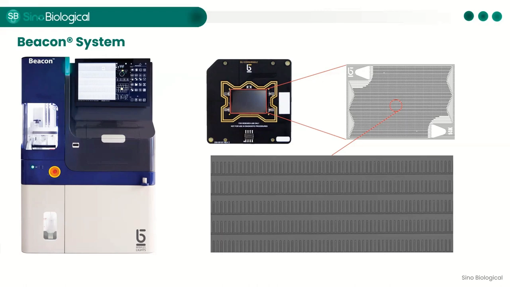

Beacon 是一台把细胞培养箱、生物安全柜、荧光显微镜和自动机械臂集成在一起的设备，整合了微流控、信号检测和光诱导技术。核心耗材是芯片：每张芯片由**水平通道**和**垂直纳升孔（nanopen）**组成，按纳升孔数量分为 11K、14K、20K 等规格；以 14K 芯片为例，它有 10 条通道、超过 14 000 个纳升孔，**每个纳升孔的体积不到 1 纳升**。

关键在流体设计：

- 培养基以很低的流速流过通道，营养物质通过**扩散**进入纳升孔，细胞代谢废物同样扩散到通道中被带走；
- 但细胞、微珠这类较大颗粒进入纳升孔后就留在原处，不受流动相影响。

于是可以长期动态培养并观察。而纳升孔体积约为 96 孔板单孔的一万分之一，**即使是单细胞水平，分泌物的浓度也相对很高**——这就是单细胞级检测能成立的根本原因：不是检测器更灵敏，而是把稀释体积压到了一万分之一。

[【跳转到 16:03】](https://www.youtube.com/watch?v=K3UKYfi4JLo&t=963)

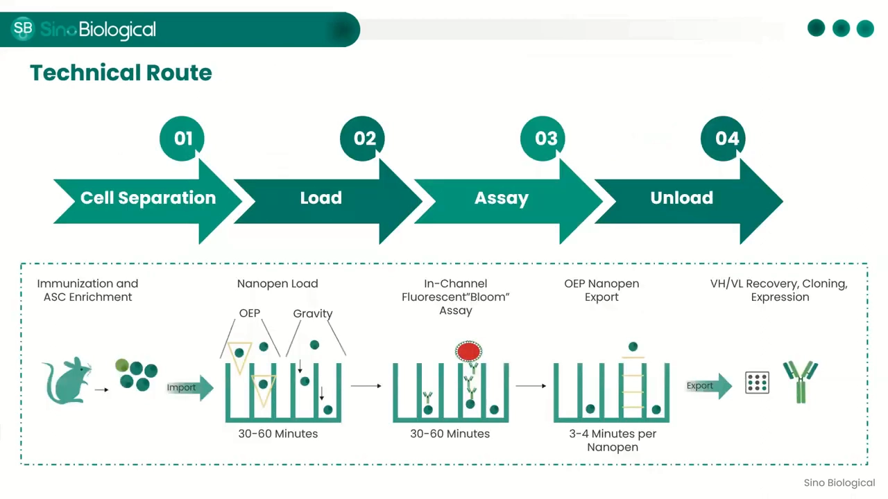

整条技术路线被压成四步：**细胞分离 → 加载 → 检测 → 导出**，每步都有明确的时间预算：

1. 免疫与抗体分泌细胞（ASC）富集；
2. 纳升孔加载（OEP 光诱导电定位或重力沉降），30–60 分钟；
3. 通道内荧光「开花」检测，30–60 分钟；
4. OEP 导出目标纳升孔中的细胞，每个纳升孔 3–4 分钟；
5. 之后是 VH/VL 回收、克隆与表达。

## 五、浆细胞富集：为什么要先做磁珠分选

[【跳转到 16:35】](https://www.youtube.com/watch?v=K3UKYfi4JLo&t=995)

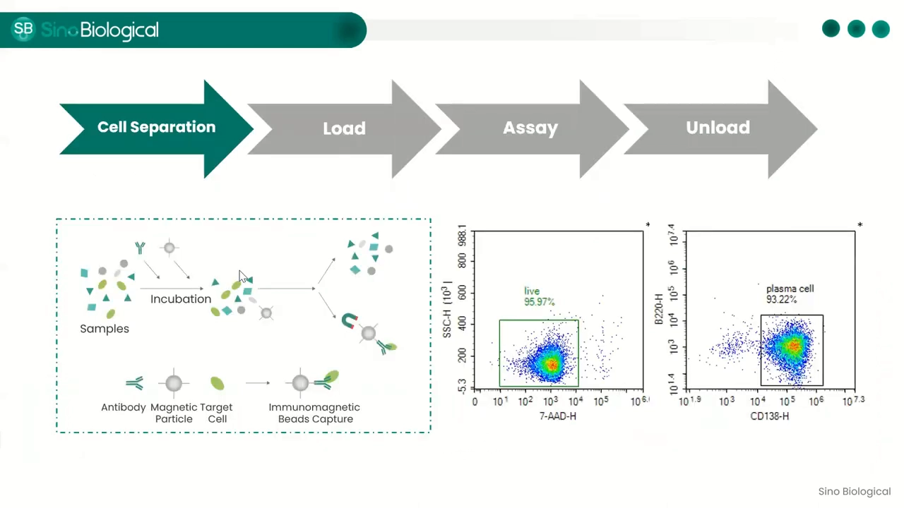

Beacon 用浆细胞做筛选，所以必须先从淋巴组织里把浆细胞富集出来。两条路：FACS 和磁珠分选。讲者的选择是磁珠，理由是**更快、对细胞损伤更小**。

原理是细胞表面抗原与偶联特异性抗体的磁珠结合，在外加磁场中，带磁珠的细胞被吸附滞留，从而分离目标细胞。分选分两类：

- **阳性筛选**：直接拿到目标细胞；
- **阴性去除**：把非目标细胞去掉。

以小鼠为例，浆细胞表型是 **CD138 阳性、B220 阴性**。实际操作把两者结合：先用阴性去除去掉 B220 阳性的细胞，再用阳性选择拿到 CD138 阳性的细胞。经过这样两轮「先阴后阳」，**浆细胞纯度可达 90%、细胞活率保持在 98%**，一只免疫后的小鼠通常能得到约 100 万个浆细胞。

这里有一个值得记住的量化关系：富集后的纯度是 90%，意味着每 10 个进入芯片的细胞里仍有约 1 个不是浆细胞。这个数字是后面所有「假阳性」讨论的起点。

## 六、单细胞化：浓度是第一个误差开关

[【跳转到 20:00】](https://www.youtube.com/watch?v=K3UKYfi4JLo&t=1200)

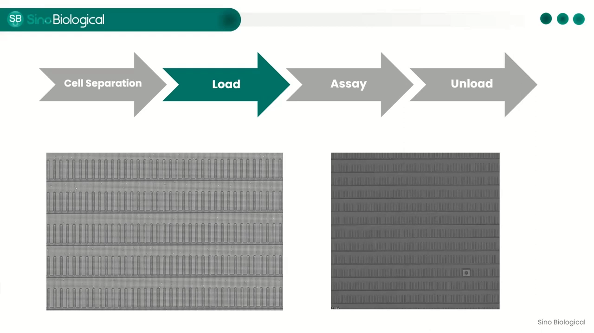

浆细胞导入芯片分两步：先把细胞导入通道并使其均匀分布，再用**光诱导电定位（OEP）**把通道中的浆细胞逐个推入纳升孔，同时把通道里多余的细胞冲流出芯片，最后系统自动切换到培养模式。

讲者专门强调了导入浓度这个参数：

- **浓度过高** → 细胞黏连，一个纳升孔里落入多个细胞 → 产生**多克隆抗体**；
- **浓度过低** → 大量纳升孔是空的 → 芯片利用率下降。

图中展示的是一张分布良好的芯片：绝大多数纳升孔里只有一个单 B 细胞。这是整条流程里最「物理」也最容易被忽视的误差来源——一旦一个孔里有两个细胞，后面测到的序列可能来自另一个细胞，而荧光信号却来自目标细胞，**配对错误就此产生，且无法从数据本身发现**。

## 七、分泌筛选：把「结合」变成可读的荧光

[【跳转到 20:36】](https://www.youtube.com/watch?v=K3UKYfi4JLo&t=1236)

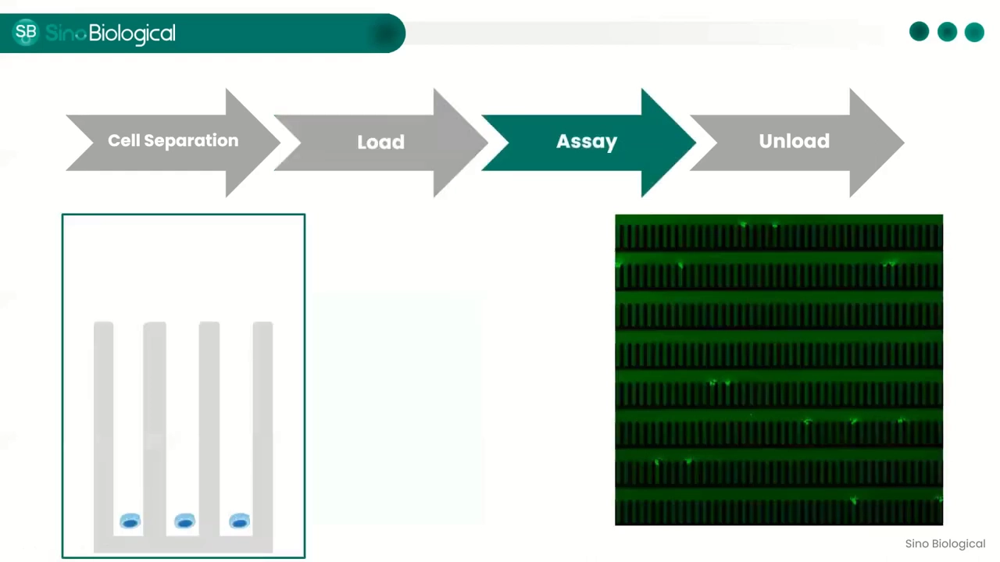

筛选依据是抗原—抗体结合：把**包被了抗原的磁珠**和**荧光二抗**导入通道。如果纳升孔里的细胞分泌的正是目标特异性抗体，抗体就会同时结合磁珠上的抗原和被二抗识别，形成「磁珠—抗原—抗体—荧光二抗」的夹心结构；Beacon 通过连续多次拍照捕捉荧光微珠，并观察荧光随时间增强的动态过程（即「开花」），据此筛出阳性克隆。

[【跳转到 21:51】](https://www.youtube.com/watch?v=K3UKYfi4JLo&t=1311)

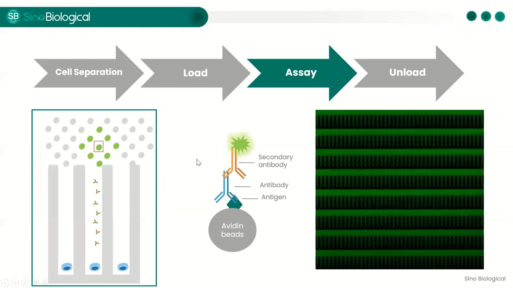

这张图把夹心结构画得很清楚：Avidin 磁珠 → 生物素化抗原 → 目标抗体 → 荧光二抗。理解了这个结构，就能理解后面两个「可替换的零件」：

1. **换抗原**：把磁珠上包被的抗原换成其他物种的抗原，用同样方式验证，就能检查**种属交叉反应**；
2. **加配体**：在抗原上先结合配体，就能把「结合」升级成「阻断」。

### 7.1 重组抗原的构象问题：一个无法在芯片上消除的误差

讲者主动点出了一个方法学局限：磁珠上包被的通常是**重组蛋白**，而重组蛋白的构象与天然蛋白并不完全一致，**这可能导致用重组抗原筛到的抗体未必能结合天然蛋白**。

他们的两个补救办法是：

- 增加细胞层面的验证（后面 CD47 案例里就出现了「弱结合红细胞」的筛除）；
- 对 GPCR 这类在体外难以表达纯化、拿不到结构稳定重组抗原的靶点，改用**稳定的重组细胞系**代替磁珠。

### 7.2 阻断验证的两种做法

[【跳转到 22:58】](https://www.youtube.com/watch?v=K3UKYfi4JLo&t=1378)

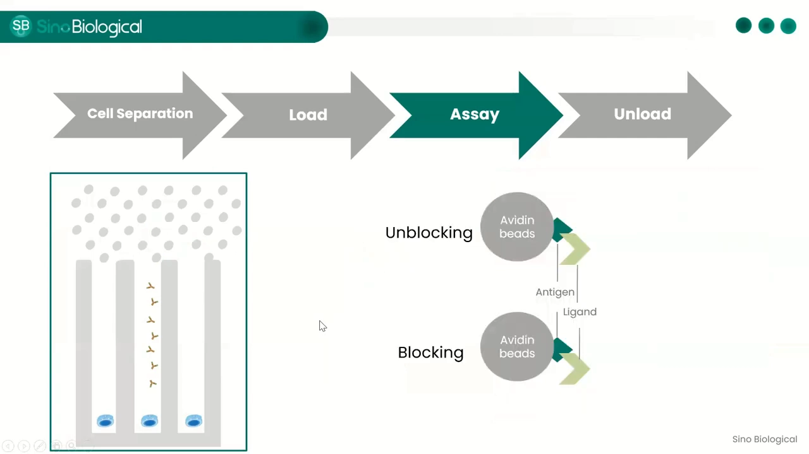

「结合」和「阻断」是两件事，讲者给了两种验证顺序：

- **先封后测**：先用配体把磁珠上的抗原封闭，形成稳定的复合微珠，再导入微珠和荧光二抗。如果浆细胞产生的是阻断型抗体，抗体无法结合已被配体占据的抗原，荧光二抗也就连不上去，**微珠不发光**；反之产生非阻断型抗体时微珠发荧光。
- **先结合后加配体**：先把包被抗原的磁珠导入纳升孔，让分泌的抗体先与抗原结合，再导入荧光标记的配体。若捕获到荧光，说明抗体没有挡住配体（非阻断型）；无荧光则为阻断型。

图里给出了判读示例：四个被标记的纳升孔中，两个蓝色孔检测到荧光（非阻断），两个红色孔无荧光（阻断）。**阻断与否是功能属性，不能从结合强弱推断**，这也是为什么后面抗独特型抗体项目要把「结合抗体药物」「不结合人 IgG」「与靶蛋白竞争」三项验证分开做。

## 八、导出与基因回收：两种成本不同的选择

目标克隆经验证确认后，用 OEP 技术把细胞从纳升孔推出、冲入流动相导出。讲者提到一个容易被忽略的选项：**Beacon 也可以直接在芯片上做逆转录反应**，也就是直接拿到目标抗体的 cDNA 序列，但成本会相对更高。

导出之后是标准的后续流程：抗体基因扩增 → 克隆入表达载体 → 表达纯化 → ELISA/Western blot 等功能验证。讲者在抗独特型抗体案例里给这条后段流程标了时间：基因扩增 1 周、表达纯化与检测 2 周。

## 九、四个案例：漏斗数据比原理更能说明问题

### 9.1 抗独特型抗体：三道验证把 11 978 个克隆收敛到 56 + 97

[【跳转到 27:18】](https://www.youtube.com/watch?v=K3UKYfi4JLo&t=1638)

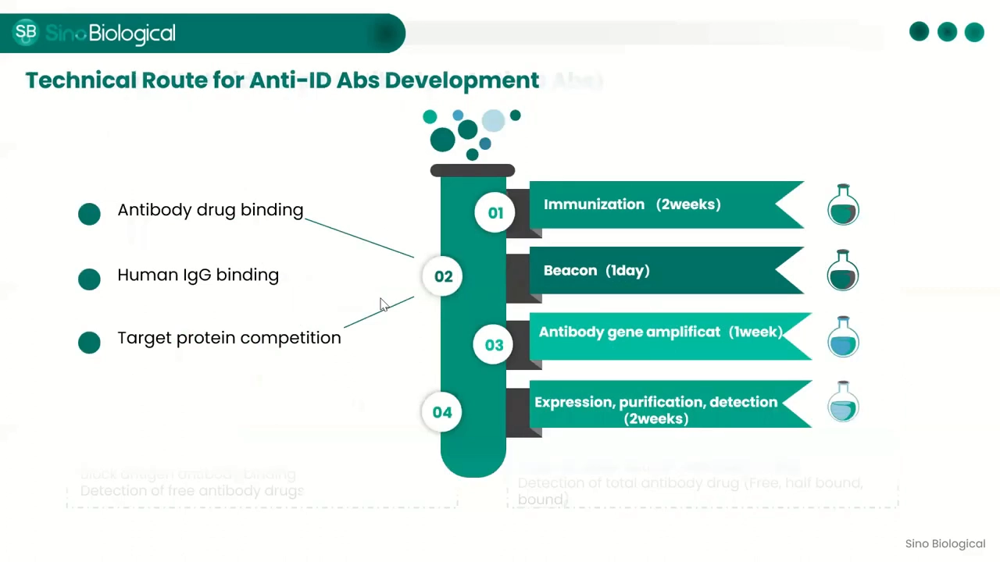

时间账更值得注意：快速免疫 2 周拿到浆细胞 → Beacon 上 1 天完成三项验证并导出细胞 → 基因扩增 1 周 → 表达纯化与 ELISA/竞争验证 2 周。**筛出阳性克隆总共约 35 天**，讲者说这比传统杂交瘤快了近两个月。

[【跳转到 29:05】](https://www.youtube.com/watch?v=K3UKYfi4JLo&t=1745)

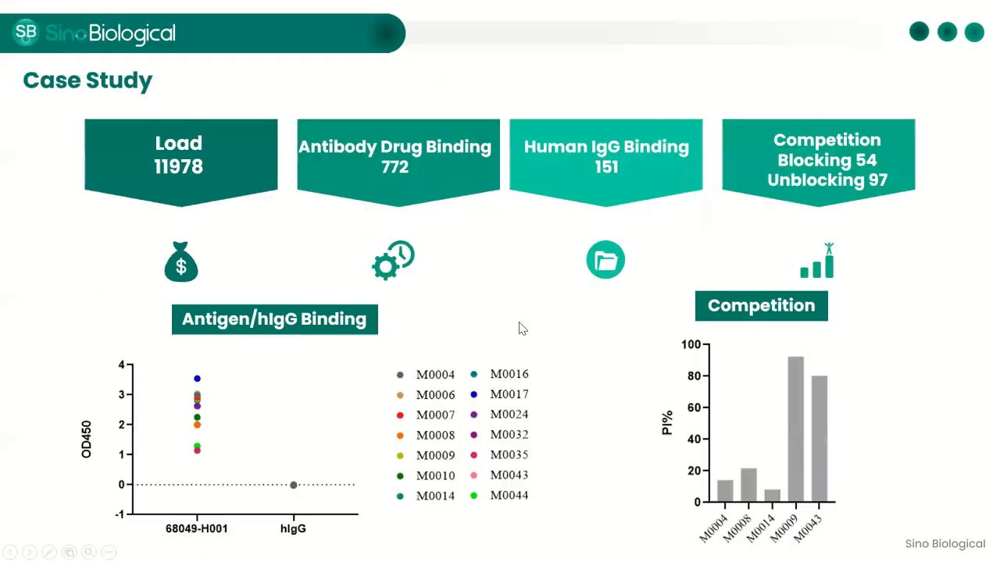

抗独特型抗体（anti-ID）是能特异性识别抗体可变区的抗体，用于抗体药物的 PK/PD 研究：竞争型用于检测游离药物，非竞争型用于检测总药物（游离 + 已结合靶蛋白）。它的筛选难点在于必须同时满足三个条件——**结合抗体药物、不结合普通人 IgG、能或不能与靶蛋白竞争**。

漏斗数据是：

| 环节 | 克隆数 |
| --- | --- |
| 加载到芯片 | 11 978 |
| 结合抗体药物 | 772 |
| 其中不结合人 IgG | 151 |
| 竞争性（阻断）| 54 |
| 非竞争性 | 97 |

从 11 978 到 151，**约 1.3%** 的克隆通过了前两道验证；这也是「为什么要一次加载上万个细胞」的直接理由——单看通过率很低，但绝对数量足够。

### 9.2 磷酸化特异抗体：用「配对筛选」排除非磷酸化交叉

磷酸化是最常见的翻译后修饰之一。这类抗体的难点是必须区分**同一段多肽的磷酸化与非磷酸化形式**——序列完全相同，只差一个磷酸基团。

做法是：用磷酸化多肽做免疫原，筛阳性克隆时**同时用磷酸化和非磷酸化抗原做配对筛选**，只保留「结合磷酸化多肽、不结合非磷酸化多肽」的克隆。这个项目导入 12 400 个克隆，109 个结合磷酸化多肽，其中 63 个不结合非磷酸化多肽——**最终只有 63 个是真正需要的磷酸化特异性克隆**。

这个案例的方法学意义在于：**「结合」永远是相对于某个对照而言的**。如果只做正向筛选，109 个里会混进 46 个泛特异性抗体。

### 9.3 CD47 抗体：从 331 到 73，还要再排除红细胞结合

[【跳转到 33:37】](https://www.youtube.com/watch?v=K3UKYfi4JLo&t=2017)

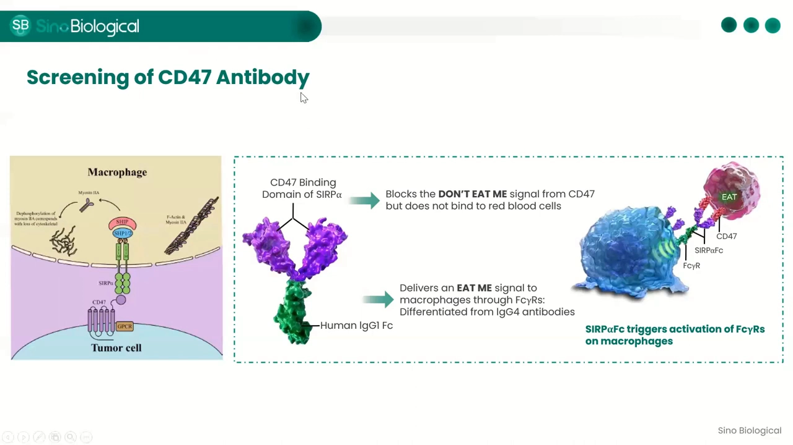

CD47 是广泛表达在正常细胞表面的免疫抑制分子，与巨噬细胞表面的 SIRPα 结合后激活保护性通路、抑制吞噬。癌细胞会模仿正常细胞高表达 CD47 来逃避吞噬，因此用抗体阻断 CD47–SIRPα 是肿瘤免疫治疗的思路；经 Fc 区优化后还能通过 FcγR 触发 ADCC/CDC/ADCP。

但 CD47 在红细胞和血小板上高表达，早期 CD47 抗体药物在临床试验中常引起严重贫血。所以这个项目的筛选目标不是「结合 CD47」，而是「**结合肿瘤细胞上的 CD47、但不（或弱）结合红细胞**」。

漏斗是：331 个既结合抗原又结合天然细胞的阳性克隆 → 表达纯化后 108 个 ELISA 阳性 → 73 个能阻断 CD47 与 SIRPα 结合 → 进一步验证发现**其中 2 个会弱结合红细胞**，被排除。亲和力验证显示，Beacon 筛出的抗体与参比抗体几乎处于同一水平。

这个案例把「细胞层面的反向筛选」的价值讲得很清楚：如果只做蛋白层面的结合与阻断，那 2 个会结合红细胞的克隆就会被当成好候选推进下去。

### 9.4 猴痘 A29：难表达靶点的替代方案

猴痘病毒的 A29 蛋白与痘苗病毒 A27 同源、免疫原性更强，是猴痘特异性单抗与中和抗体的关键靶点。用重组 A29 免疫小鼠、快速免疫平台完成免疫后，Beacon 筛出 321 个阳性克隆，经表达纯化与 Western blot、ELISA 检测，获得多个高亲和力结合 A29 的抗体。

## 十、与杂交瘤的误差来源对比：证据的性质不同

这是本讲最实用的一段，讲者在问答里直接比较了两条路线。

### 10.1 克隆性的证据来自哪里

- **杂交瘤**：克隆性由「一个融合细胞经有限稀释长成一个克隆」保证，是**细胞学证据**。它怕的是亚克隆不纯，以及长期培养中的漂移——杂交瘤是需要持续维护的活细胞系，细胞状态会随时间变化（这一点属于补充背景，本讲未展开）。
- **单 B 细胞**：克隆性由「一个纳升孔一个细胞 + 一条配对序列」保证，是**分子证据**。它怕的是孔内多细胞（浓度过高导致黏连）和 PCR/扩增环节的交叉污染。

两类误差的性质不同：杂交瘤的污染是「细胞层面的混入」，会在后续培养中被稀释或放大；单 B 细胞的混入是「分子层面的错配」，一旦配对错误，产出的抗体序列本身就是错的，**只能靠重新分选来纠正**。

### 10.2 通量与适用场景

讲者的判断很直接：

- **少量到中等数量、要求高亲和力的克隆** → 杂交瘤更合适。方法直接、不需要昂贵专用设备、成本更低；而且拿到阳性克隆后想多要抗体，把细胞取出来常规培养纯化即可。
- **需要大量反向筛选**（例如靶点异构体之间同源性很高，要排除其他异构体）→ 杂交瘤平台可能来不及做，单 B 细胞分选更合适。
- **需要大量克隆保证多样性**（比如 200、300、400 个针对同一蛋白的克隆）→ 杂交瘤平台过于繁琐漫长，单 B 细胞分选能承担。

### 10.3 三个具体的数字

讲者在问答里给了三个可以直接用来做实验设计的数字：

1. **阳性率**：分选或筛选出的群体中，通常约 **30%–40%** 是阳性特异性克隆，条件优化得好比例更高。损耗发生在血清效价、分选细胞状态、分选与 PCR、最终重组表达这几个环节。
2. **血清效价门槛**：效价不够高，阳性克隆的数量和质量都不会高。他们的标准是**兔至少 25 000 倍稀释、小鼠 16 000 倍稀释**。
3. **不建议「先 FACS 再融合」**：分选过程本身对细胞有损伤，特异性 B 细胞在群体中比例又很小，如果再对分选出的细胞做 PEG 融合或电融合，会进一步损伤细胞、降低阳性克隆成活率，**最后可能一个阳性克隆都拿不到**。他们的做法是直接单细胞 PCR，或分选后短暂培养再做 PCR，然后重组表达。

第 3 点尤其值得记住：它说明「把两个平台的优点拼起来」在细胞层面并不成立——**分选和融合都在消耗同一份细胞活力，而这份活力是不可再生的**。

## 十一、把误差来源列成一张表

| 环节 | 可能的误差 | 本讲给出的控制手段 |
| --- | --- | --- |
| 免疫 | 血清效价不足，阳性克隆少且质量差 | 快速免疫方案；兔 ≥25 000、鼠 ≥16 000 倍稀释的门槛 |
| 浆细胞富集 | 纯度不足（约 90%），混入非浆细胞 | 磁珠先阴后阳两轮；活率保持 98% |
| 单细胞化 | 浓度过高导致一孔多细胞 → 多克隆抗体、配对错配 | 控制导入浓度；OEP 逐个定位；明场核对单细胞分布 |
| 抗原 | 重组蛋白构象与天然蛋白不一致 → 结合重组蛋白但不结合天然蛋白 | 增加细胞结合验证；难表达靶点改用重组细胞系 |
| 结合 vs 阻断 | 把「结合」当成「阻断」 | 两种阻断验证方案；抗独特型项目三项验证分开做 |
| 特异性 | 只做正向筛选，混入泛特异性抗体 | 配对筛选（磷酸化 vs 非磷酸化）；反向筛选（红细胞） |
| 基因回收 | 扩增失败、序列错误 | 导出后单细胞 PCR；可选在片逆转录（成本更高） |

## 小结

- **两条路线的分工由细胞类型决定**：FACS 筛记忆 B 细胞（读膜上 BCR），Beacon 筛浆细胞（读分泌抗体）；前者物种广、通量高，后者能在筛选中纳入结合、阻断、细胞结合与功能实验。
- **纳升孔能测单细胞分泌，靠的是体积而不是灵敏度**：单孔不到 1 纳升，约为 96 孔板单孔的一万分之一，分泌物浓度因此足够高。
- **单细胞化是第一个也是最隐蔽的误差开关**：浓度过高会让一个孔落入多个细胞，产生多克隆抗体和配对错配，且无法从数据本身发现。
- **浆细胞富集纯度约 90%**：先阴（去 B220⁺）后阳（取 CD138⁺）两轮磁珠，活率保持 98%，一只小鼠约得 100 万浆细胞。
- **「结合」必须相对于对照来定义**：磷酸化项目 109 个阳性里只有 63 个是真特异；CD47 项目 73 个阻断抗体里还有 2 个会弱结合红细胞。
- **重组抗原的构象是芯片上无法消除的误差**：只能靠细胞层面验证来兜底，或改用重组细胞系。
- **与杂交瘤的差别在证据性质**：杂交瘤靠细胞学克隆性（怕亚克隆不纯），单 B 细胞靠分子克隆性（怕孔内多细胞与污染）；「先 FACS 再融合」会因细胞损伤而得不偿失。
- **平台选择取决于项目形状**：少量高亲和力克隆选杂交瘤更经济；需要大量反向筛选或大量克隆保多样性时，单 B 细胞分选才划算。

## 关键术语速查

| 术语 | 一句话解释 |
| --- | --- |
| 抗体分泌细胞（ASC） | 正在大量分泌抗体的 B 细胞，主要指浆细胞与浆母细胞 |
| 纳升孔（nanopen） | Beacon 芯片上体积不足 1 纳升的微孔，用于隔离单细胞并富集其分泌物 |
| OEP（光诱导电定位） | 用光在电极上形成电场、把单个细胞精确推入指定纳升孔的技术 |
| 开花（blooming） | 纳升孔中荧光信号随时间增强的现象，代表分泌抗体结合了荧光抗原 |
| 抗独特型抗体（anti-ID） | 识别抗体可变区（独特型）的抗体，用于 PK/PD 检测与阳性对照 |
| 竞争型 / 非竞争型抗独特型抗体 | 前者与靶蛋白竞争结合药物（测游离药物），后者不竞争（测总药物） |
| 配对筛选 | 同时用修饰型与未修饰型抗原筛选，只保留对修饰型特异的克隆 |
| 磁珠分选 | 用偶联抗体的磁珠在外加磁场中富集目标细胞，比 FACS 更快、损伤更小 |
| 重组细胞系筛选 | 用过表达靶点的细胞代替可溶抗原做筛选，适用于 GPCR 等难表达靶点 |
| 反向筛选 | 用不想要结合的靶标（如红细胞、非目标异构体）排除候选克隆 |