# 单 B 细胞测序发现抗体：天然配对序列、重组表达与高通量 SPR 复核

> 视频来源：[Discovering Antibodies in Months: New Advances in HT-SPR, Single Cell BCR-seq and RNA-seq](https://www.youtube.com/watch?v=N-mXbl0F7i4)（YouTube · Science/AAAS 网络研讨会，Carterra 赞助；讲者 Derek Croote，IgGenix 联合创始人兼 CTO；Lucy Lu，Alloy Therapeutics 全球生物分析高级总监）｜时长约 70 分钟
>
> 导读：本讲用两家公司的真实流程回答一个问题——单 B 细胞路线到底靠什么把「一个细胞」变成「一株可复核的抗体」。前半段讲单细胞测序（为什么必须单细胞、怎么分离、序列怎么拼、克隆型怎么读），后半段讲重组表达与高通量 SPR 复核，并用转基因小鼠 + FACS 分选、Beacon、纳升微孔三条支线给出数据。字幕为自动生成，人名、公司名与部分术语已按幻灯片订正（如 IgGenix、ATX-Gx）。

## 本讲要解决的核心问题（SCQA）

**背景**：抗体是两条重链加两条轻链的异源二聚体，重链和轻链由不同染色体上的不同基因编码，靠配对决定特异性。传统做法要么把 B 细胞与骨髓瘤融合成杂交瘤，要么把抗体基因装进噬菌体做展示。

**冲突**：只要在群体水平上裂解细胞，重链和轻链的「谁配谁」这条信息就永久丢失，事后无法重建；而单细胞路线虽然保住了配对，却把困难转移到了别处——细胞怎么分、序列怎么拼、拼出来的序列怎么变成蛋白、变成蛋白之后又怎么证明它真的结合。

**疑问**：单 B 细胞抗体发现这条链路上，每一步各自会引入什么误差？哪些环节可以用实验交叉验证，哪些只能靠流程设计来防？

**回答（中心思想）**：单 B 细胞路线的价值不只是「快」，而是它同时保住了**天然配对**和**B 细胞来源信息**；代价是证据链变长，必须用「分选时的抗原特异性 → 序列层面的克隆型一致性 → 重组蛋白层面的结合与阻断 → 细胞层面的结合」四道独立的关口互相印证，任何一道关口单独成立都不足以判定候选抗体。

---

## 一、为什么必须单细胞：配对信息一旦丢失就不可逆

[【跳转到 03:17】](https://www.youtube.com/watch?v=N-mXbl0F7i4&t=197)

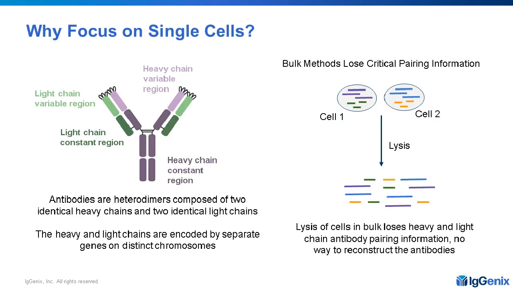

讲者用一张对照图把这件事讲清楚了：左边是抗体的结构——两条相同的重链、两条相同的轻链，重链可变区与轻链可变区共同构成抗原结合位点；右边画了两个 B 细胞，各自带着一套重链（紫色、蓝色）和轻链（绿色、橙色）转录本，一旦把细胞混在一起裂解，所有重链和轻链的 mRNA 就混成一锅，**没有任何办法知道哪条重链原本和哪条轻链在同一个细胞里**。这就是所谓 bulk（群体）方法的结构性缺陷：它能告诉你「这个免疫库里有哪些重链、哪些轻链」，但不能告诉你「哪一对能结合抗原」。

单细胞路线之所以成立，就是把「一个细胞」当成最小的信息单元：在裂解之前先完成物理隔离，让每个单元的转录本只属于一个 B 细胞。

## 二、单细胞 RNA 测序多给了一样东西：B 细胞的来源信息

[【跳转到 03:52】](https://www.youtube.com/watch?v=N-mXbl0F7i4&t=232)

讲者强调，选单细胞 RNA 测序而不只是单细胞 PCR，是因为一次测序能同时拿到四类信息：

1. **序列**：重链和轻链的可变区，因而得到特异性；
2. **基因表达**：判断这个细胞是初始 B 细胞、记忆 B 细胞还是浆母细胞/浆细胞，以及它处在什么状态、沿什么轨迹分化；
3. **基因剪接与变异**：部分方案支持，能看出转录本层面的差异；
4. **细胞表面蛋白**：如果分选时用了荧光标记抗体，表面标记信息可以和转录本一起被记录下来。

对做抗体发现的人来说，第 2 点常被低估。同一株抗体，来自浆母细胞还是来自记忆 B 细胞，意味着它在体内经历过多少轮亲和成熟；这一点在后面 Alloy 的数据里会直接体现为亲和力差异。

## 三、单细胞怎么分离：灵敏度、通量与「能不能按抗原挑」的三难

[【跳转到 04:45】](https://www.youtube.com/watch?v=N-mXbl0F7i4&t=285)

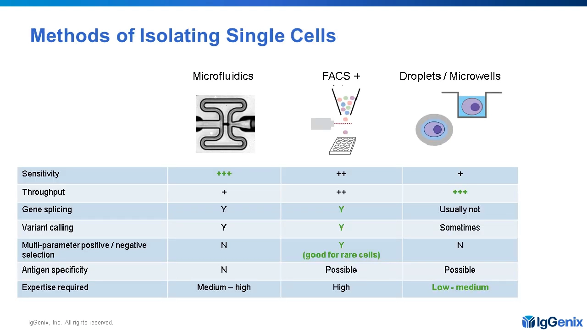

讲者把主流分离方式归成三档，并给了一张逐项打分的对照表：

| 维度 | 微流控 | FACS 分选到 96/384 孔 | 液滴 / 微孔 |
| --- | --- | --- | --- |
| 灵敏度 | 高 | 中 | 低 |
| 通量 | 低 | 中 | 高 |
| 基因剪接信息 | 有 | 有 | 通常没有 |
| 变异检测 | 有 | 有 | 有时有 |
| 多参数阳/阴性选择 | 不支持 | 支持（适合稀有细胞） | 不支持 |
| 抗原特异性 | 不能 | 可以 | 可以 |
| 所需专业门槛 | 中—高 | 高 | 低—中 |

读这张表的正确方式不是找「最好的方法」，而是先问自己的瓶颈在哪：

- 目标是**极稀有细胞**（比如过敏个体血液里产 IgE 的 B 细胞），那必须能按表面标记和抗原做多参数阴/阳选择，只有 FACS 能胜任，通量低一点也要接受；
- 目标是**几万个细胞的免疫组库全景**，那液滴/微孔的高通量更划算，代价是丢掉剪接和部分变异信息，且拿不到分选级别的抗原特异性；
- 目标是**极低起始量、要求最高灵敏度**，微流控仍然有优势，但通量最低。

## 四、分子生物学前提：只有「全长 cDNA」类方案才能回收抗体

[【跳转到 05:46】](https://www.youtube.com/watch?v=N-mXbl0F7i4&t=346)

讲者提醒了一个很容易踩的坑：现在有几十甚至上百种单细胞 RNA 测序方案，但**并不是所有方案都能回收单克隆抗体序列**。区别在于 mRNA 最初怎么被反转录、cDNA 怎么被处理：

- 能用的方案会产生「全长 cDNA」，例如 Smart-seq2，或 10x Genomics 的 V(D)J 产品；
- 不能用的方案侧重 3' 端计数——它们本来只为定量基因表达设计，拿不到重建完整可变区所需的全长信息。

### 4.1 短读段怎么拼成一条完整可变区

[【跳转到 06:41】](https://www.youtube.com/watch?v=N-mXbl0F7i4&t=401)

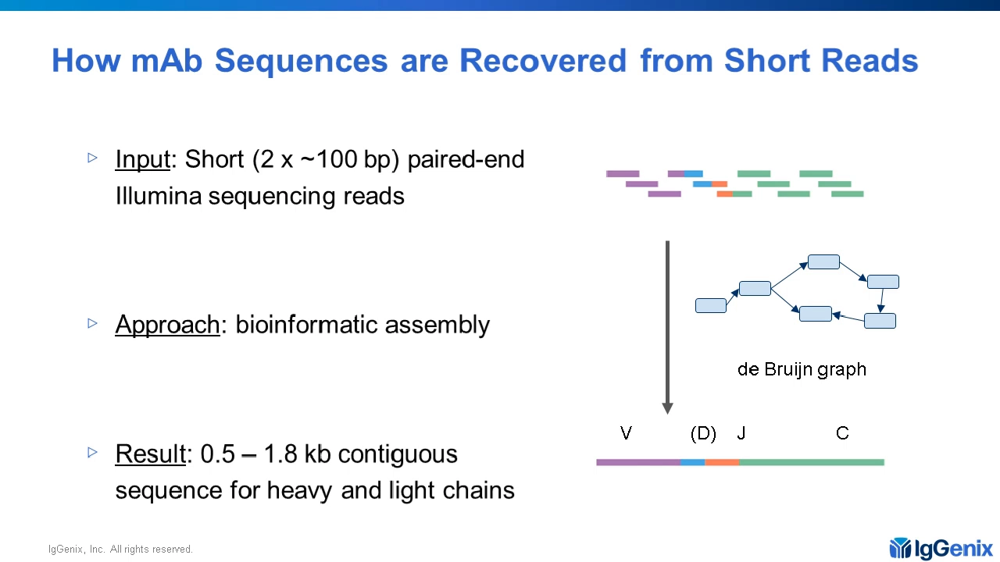

二代测序给出的是很短的配对末端读段（2×100 bp 左右，MiSeq 上最多 2×300），远短于一条重链或轻链的连续序列。因此必须有一步「组装」：

1. 输入是短读段；
2. 用 de Bruijn 图之类的算法，依据读段之间的核苷酸重叠把片段连起来；
3. 输出是一条 0.5–1.8 kb 的连续序列，覆盖 V、(D)、J 和恒定区。

这一步是纯生物信息学的，但它决定了后面所有判断的可信度：组装错误会直接变成「一条看起来合理、实际不存在的抗体序列」。

## 五、序列怎么读：克隆型、亲和成熟与趋同进化

[【跳转到 06:51】](https://www.youtube.com/watch?v=N-mXbl0F7i4&t=411)

拿到序列之后，最有信息量的分析是**克隆型（clonotype）划分**：把 V 基因相同、J 基因相同、CDR3 长度相同、且 CDR3 序列相似度在某个阈值内的序列归为一组。阈值可以按需要的严格程度调整，本质上是在判断「这些细胞是不是来自同一个祖先」。

讲者给了三类用途：

1. **检测免疫扰动**：例如近期感染会在组库里留下特征性的克隆扩增；
2. **找抗原特异性扩增的克隆**：他研究过流感疫苗接种，接种后第 7 天到第 21 天之间出现了一个很大的浆母细胞群体，把这两个时间点上优势克隆的抗体克隆表达出来，得到的抗体对流感抗原是特异的；
3. **刻画亲和成熟轨迹**：如果能拿到同一个体的重复样本，可以构建系统发生树，把免疫应答随时间的路径、以及抗体如何一步步提高亲和力画出来。

### 5.1 趋同进化：不同人会长出几乎相同的抗体

[【跳转到 08:16】](https://www.youtube.com/watch?v=N-mXbl0F7i4&t=496)

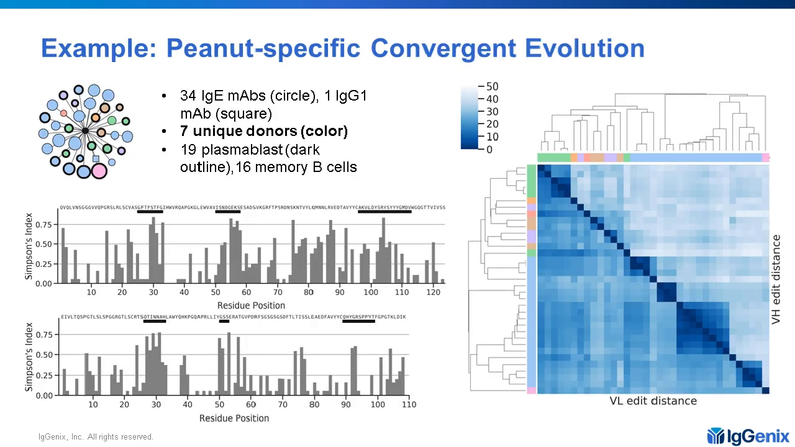

这是全讲最有说服力的一张图：七个完全无关的花生过敏个体，重组出了**几乎相同**的抗 Ara h 2 抗体（图中 34 个圆点为 IgE 单抗、1 个方点为 IgG1 单抗，颜色代表 7 名供者，深色描边是浆母细胞、浅色是记忆 B 细胞）。

图里还有两层信息：

- 左下的柱状图是每个残基位置上的 Simpson 指数（多样性指标），可以看到多样性集中在 CDR 区，符合体细胞高频突变（SHM）靶向 CDR 的预期；
- 右侧是按 VH 与 VL 编辑距离做的聚类热图，颜色按供者分组——**成组聚集说明：尽管不同个体重组出了相似抗体，各自的亲和成熟路径仍是独立的**。

对方法学的启示是：如果你只看「序列相似」，很容易把不同供者的独立事件误判成同一个克隆；判断克隆关系必须同时看基因使用、CDR3 和编辑距离，并保留供者来源标签。

### 5.2 把基因表达叠加上去

讲者还演示了如何把单细胞转录组与抗体序列叠在一起看：在 Tabula Sapiens 联盟 26.4 万个免疫细胞的 UMAP 上，可以清楚分出初始 B 细胞、记忆 B 细胞聚类，以及来自骨髓的浆细胞聚类；换成弥漫性大 B 细胞淋巴瘤样本，则能把恶性细胞与健康浸润细胞区分开。他的结论是：**整合多种正交数据的价值，在于你不仅知道抗体，还知道产生抗体的那个细胞**。

## 六、从序列到蛋白：重组表达的四个动作

[【跳转到 10:46】](https://www.youtube.com/watch?v=N-mXbl0F7i4&t=646)

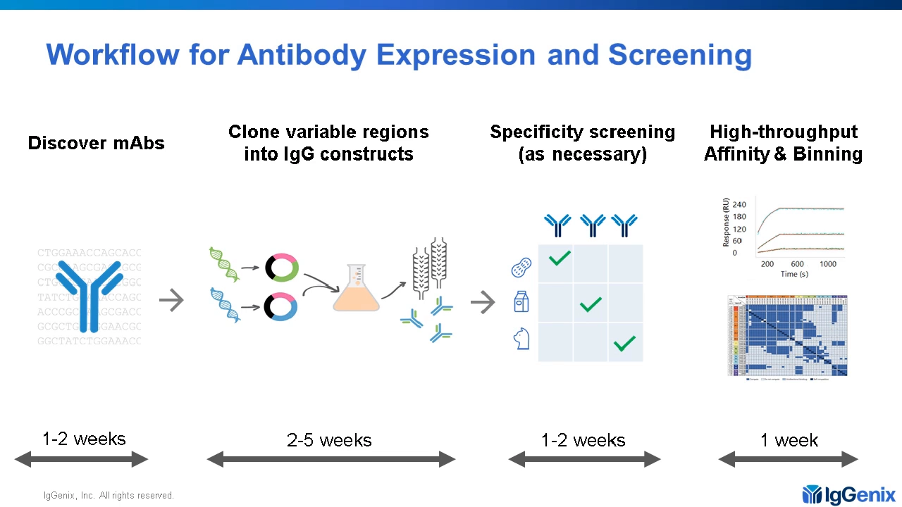

测序之后你手上是**配对的重链和轻链可变区**，接下来是标准的四步：

1. **合成可变区**，分别克隆进重链和轻链表达载体；
2. **共转染**哺乳动物细胞——生物技术领域常用 HEK293，更常见的是 CHO，很多细胞系已针对高滴度抗体生产做过优化；
3. 让细胞把抗体分泌到上清，收集上清，用 **Protein A** 纯化并洗脱；
4. 得到与测序发现的那条序列相对应的**实体蛋白**。

这张图同时给出了时间预算：发现单抗 1–2 周、克隆与表达 2–5 周、按需做特异性筛选 1–2 周、高通量亲和力与分箱 1 周。讲者特意说明，这些数字只是大致参考，会随方案、样本稀有程度和基础设施齐备程度大幅变化。

### 6.1 特异性信息可能来自分选，也可能必须补做

这里有一个容易被忽略的分岔：

- 如果分选阶段就带了抗原特异性（例如流式做抗原特异性分选，或某些微孔/包裹方案在测序阶段就嵌入了特异性读数），那么测序完成时你已经知道这株抗体「应该是」结合什么的；
- 如果用的是**无偏**平台，测序和表达时其实不知道特异性。讲者自己的 SeekSifter 平台就是无偏的——它把个体血液里所有产 IgE 的 B 细胞都找出来，然后才用一组过敏原去筛。

无偏平台的好处是不会漏掉「意料之外的特异性」，代价是必须补一整轮特异性筛选，工作量和抗原试剂消耗都上去了。

## 七、功能复核：高通量 SPR 一次给出亲和力与表位

[【跳转到 12:47】](https://www.youtube.com/watch?v=N-mXbl0F7i4&t=767)

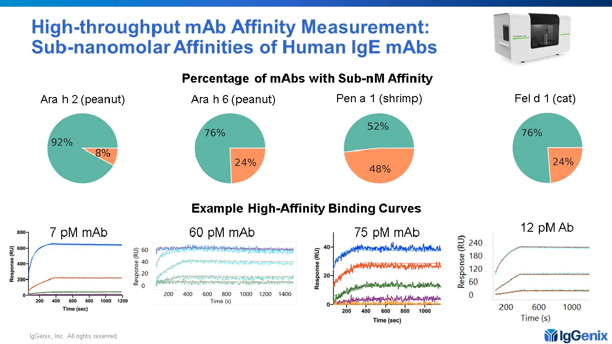

讲者用一台 Carterra LSA 平台做亲和力测定，这里是汇总而不是几百条曲线。四个过敏原的数据是：

| 过敏原 | 来源 | 亚纳摩尔亲和力抗体占比 |
| --- | --- | --- |
| Ara h 2 | 花生 | 92% |
| Ara h 6 | 花生 | 76% |
| Pen a 1（原肌球蛋白） | 虾 | 52% |
| Fel d 1（唾液蛋白） | 猫 | 76% |

他的解读是：从过敏个体身上拿到的抗体亲和力极高，低到个位数皮摩尔——这反过来证明「用人源样本做抗体来源」在靶点合适时完全可行，因为这些人源抗体已经在体内完成了亲和成熟。

### 7.1 表位分箱：用两两竞争把抗体按表位归类

[【跳转到 14:29】](https://www.youtube.com/watch?v=N-mXbl0F7i4&t=869)

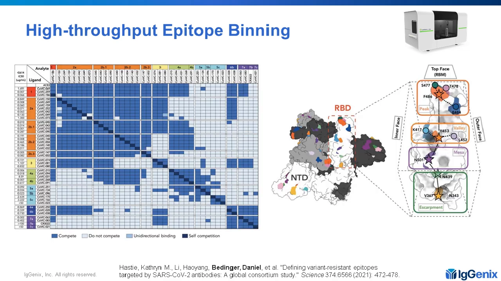

表位分箱（epitope binning）的实验设计很巧：先把第一个抗体（配体）固定在阵列表面，注入抗原，再注入第二个抗体（分析物）。

- 如果两个抗体**共享同一表位**，配体抗体挡住分析物抗体，传感图上**没有信号升高**；
- 如果两个抗体**结合不同表位**，配体不阻挡分析物，出现「夹心」，传感图上**信号陡增**。

把所有抗体两两做一遍，就得到一张竞争矩阵；对矩阵做聚类，就能数出一个抗原上有几个不同的表位。图里是 SARS-CoV-2 的一个联合体数据：深蓝表示竞争、浅蓝表示不竞争，右侧把分出来的表位箱映射到 RBD 的不同表面区域（Top Face、Inner Face、Outer Face 等）。

讲者说这个步骤的实际价值是**收敛**：不必把几百株抗体都推进到表位定位，先按表位箱去重，每个箱留代表株即可。对他们自己而言，表位分箱还回答了「哪个表位是免疫优势的」——并非所有表位生而平等，驱动过敏反应性的往往只是少数几个。

## 八、把流程跑起来：转基因小鼠 + FACS 分选 + NGS 增强

讲者之后由 Alloy Therapeutics 的 Lucy Lu 接棒，给出了一条更「工程化」的路线：用带人源可变区的转基因小鼠做免疫，用 FACS 按抗原分选记忆 B 细胞，再结合 NGS 免疫组库把候选补全。

### 8.1 人源化小鼠的抗体库像不像人

[【跳转到 20:15】](https://www.youtube.com/watch?v=N-mXbl0F7i4&t=1215)

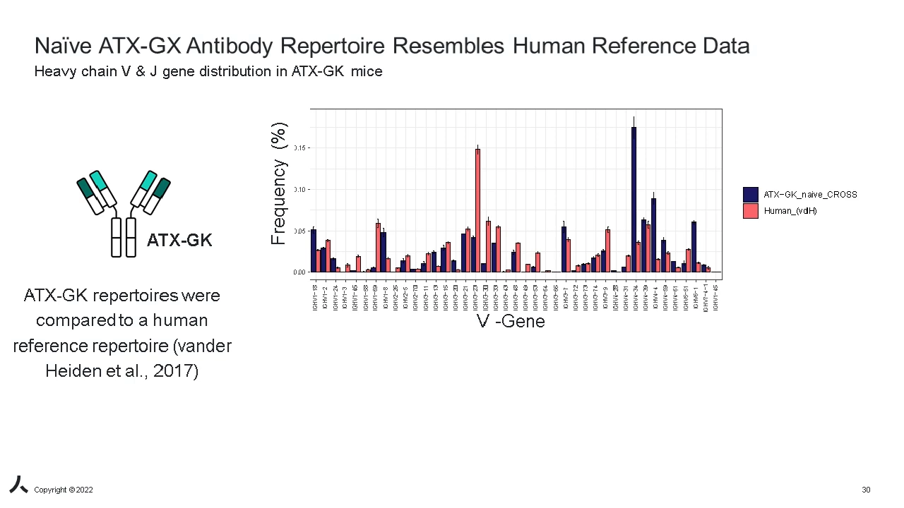

Alloy 的 ATX-Gx 系列小鼠把重链和轻链可变区完全人源化。为了降低某些靶点上的免疫优势效应，他们把重链 V 基因座拆成近端和远端两半，做成两个品系；此外还有 λ 链品系和超免疫品系，用来对付困难靶点。

验证分两层：

- **免疫表型**：脾脏大小、脾脏 B/T 细胞数量、脾脏与骨髓浆细胞数量、血清 IgG 与 IgM 浓度，各品系与野生型可比；
- **组库相似性**：V 基因使用频率、J 基因使用频率、以及 V 基因与胚系的一致百分比（本质上反映 SHM 水平），都与人类参考数据高度接近。

这一步的意义在于：如果小鼠的组库本身就偏离人类，那么后面筛出来的「人源抗体」在多样性上先天不足，再怎么优化也补不回来。

### 8.2 FACS 门控与 NGS 互补

[【跳转到 24:37】](https://www.youtube.com/watch?v=N-mXbl0F7i4&t=1477)

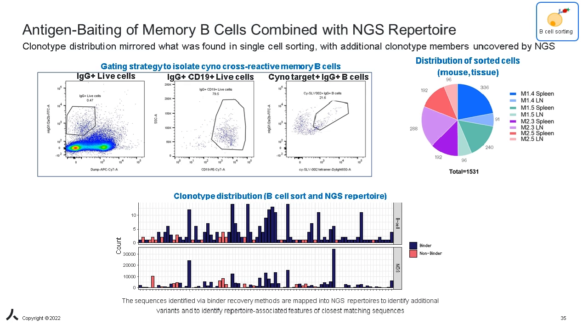

以肿瘤相关抗原（TAA）为例，用人的抗原免疫、再用靶标信号去选，目的是拿到**跨种属交叉反应**的克隆。设门是三级：

1. IgG 阳性的活细胞（排除死细胞与非 B 细胞）；
2. IgG 阳性、CD19 阳性的 B 细胞；
3. 抗原四聚体阳性的 B 细胞。

四只小鼠、每只取脾脏和淋巴结两个组织，共分选出 1531 个细胞。下面两张柱状图是这张幻灯片的关键：上面是分选得到的克隆型分布，下面是 NGS 组库的克隆型分布，两者**形状吻合**——分选到的克隆在组库里都能找到对应，而组库里还有分选没抓到的同克隆成员。

于是流程可以「反向补全」：用分选得到的序列作为锚点，回到 NGS 组库里把同一克隆的其他变体捞出来，扩大候选集。这个项目最终从分选中得到 88 个跨种属交叉反应克隆、代表 46 个独特克隆型。

## 九、另外两条支线：浆细胞分泌筛选与纳升微孔

### 9.1 Beacon：把「分泌」变成可读的荧光信号

[【跳转到 25:35】](https://www.youtube.com/watch?v=N-mXbl0F7i4&t=1535)

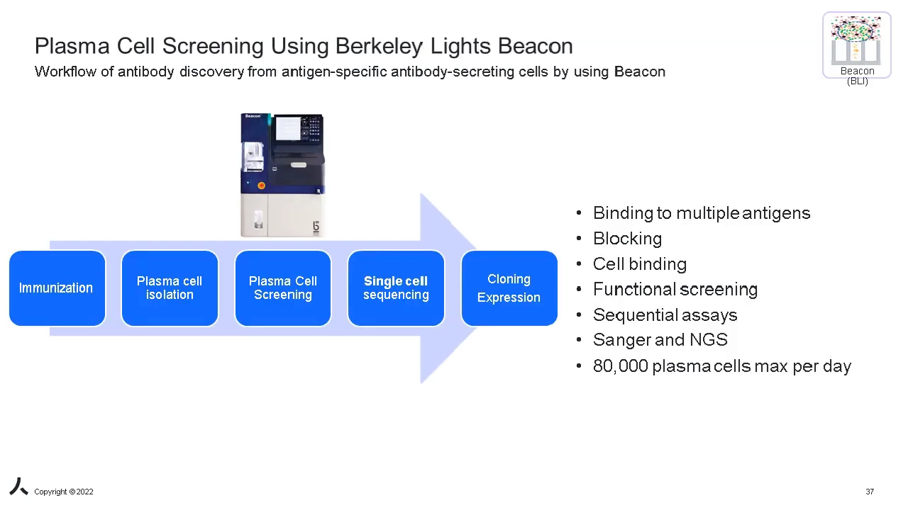

Beacon 的路线与 FACS 不同：它不靠膜上 BCR 结合抗原，而是让**浆细胞把抗体分泌到纳升孔里**，再用带抗原的微珠和荧光二抗去读「分泌出来的抗体是否结合抗原」。可选检测包括多抗原结合、阻断、细胞结合、功能筛选（例如报告细胞系）、连续多轮实验，测序可用 Sanger 或 NGS，每天最多 8 万个浆细胞。

[【跳转到 26:45】](https://www.youtube.com/watch?v=N-mXbl0F7i4&t=1605)

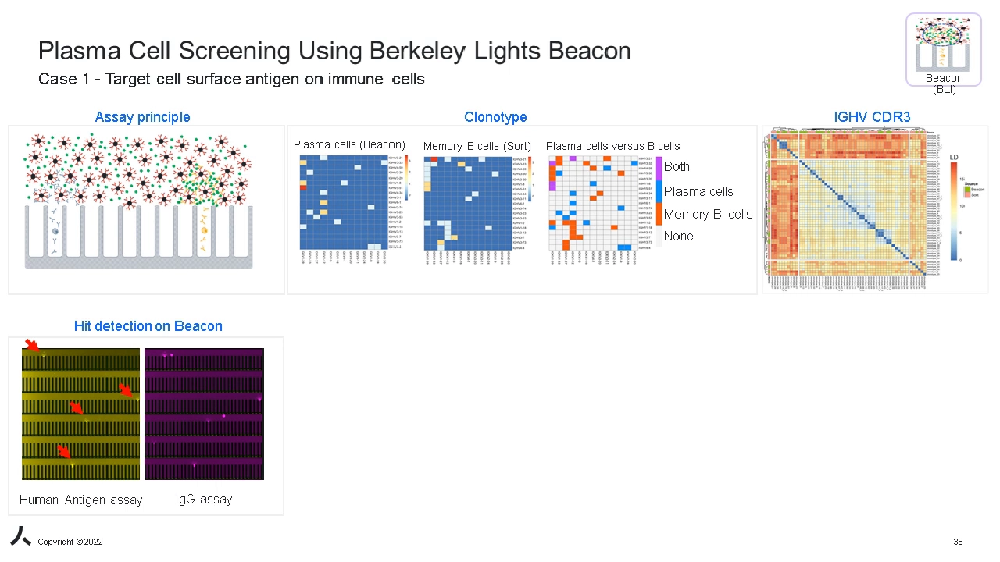

这张合成图把三件事放在一起：

- 左边是原理：浆细胞坐在纳升孔里分泌抗体，上方微珠载着抗小鼠抗体把分泌的抗体抓住，绿色点代表荧光标记抗原，信号随时间增强就是「开花（blooming）」；
- 中间是克隆型热图：横轴轻链 V 基因、纵轴重链 V 基因，左边是 Beacon 选出的浆细胞、中间是同一靶点用分选得到的记忆 B 细胞、右边是两者叠加（紫色为共用、蓝色为浆细胞独有、橙色为记忆 B 细胞独有）——**两者的重轻链家族配对模式差别非常大**；
- 右下是实际命中图像：人抗原实验与 IgG 实验，要挑的是两个实验都亮的孔。

讲者的结论是：浆细胞来源的克隆不仅克隆型分布与记忆 B 细胞不同，**亲和力也更高**。

### 9.2 纳升微孔：靠内壁预包被的抗原直接「钓」分泌抗体

[【跳转到 31:19】](https://www.youtube.com/watch?v=N-mXbl0F7i4&t=1879)

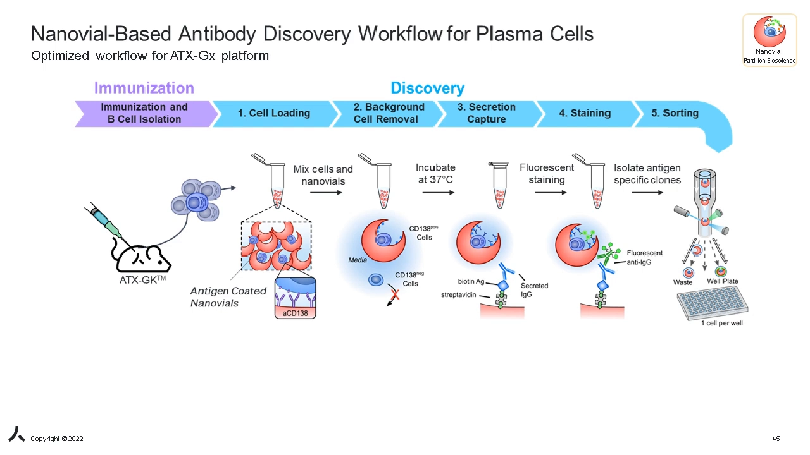

纳升微孔（nanovial）的流程是：

1. 把细胞与纳升微孔混合加载，微孔内壁预包被了 CD138 抗体（帮助捕获浆细胞）和抗原；
2. 洗去游离细胞；
3. 37 ℃ 孵育约 1 小时，浆细胞开始分泌抗体——识别抗原的抗体被微孔内壁捕获，不识别的被洗掉；
4. 用荧光标记的抗小鼠 IgG 染色；
5. 上机分选，每个孔一个细胞落入微孔板，进入测序。

这个项目分选了 130 个浆细胞，62 个成功回收到序列，代表 53 个克隆型；蛋白层面约 37% 结合单价 ECD，细胞层面 40% 显示结合。

## 十、误差从哪里来：四条独立证据链与它们的失效方式

把上面几段拼起来，就能看清单 B 细胞路线的误差结构。讲者的数据里其实埋了好几个「反例」，值得单独拎出来。

### 10.1 蛋白层面结合 ≠ 细胞层面结合

[【跳转到 29:47】](https://www.youtube.com/watch?v=N-mXbl0F7i4&t=1787)

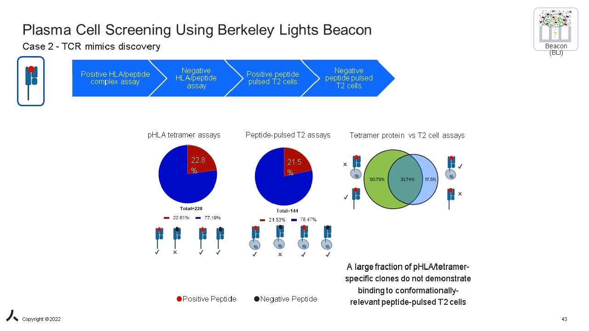

这是全讲对「误差来源」最直接的一段证据。靶点是 TCR 模拟物：同一个 HLA 等位基因下，HLA 部分完全相同，唯一差别是顶部嵌合的 8–10 个残基多肽，有些多肽之间只差两个氨基酸。

筛选做了四道：阳性 HLA/多肽复合物 → 阴性 HLA/多肽复合物 → 阳性多肽负载的 T2 细胞 → 阴性多肽负载的 T2 细胞。结果是：

- 蛋白（pHLA 四聚体）层面 228 个克隆中有 22.8% 特异阳性；
- 细胞（多肽负载 T2）层面 144 个克隆中有 21.5% 阳性；
- 两组**只重叠 31.74%**。

也就是说，如果只做蛋白层面的实验，**不到一半的阳性克隆能在细胞上重复出来**。讲者的判断是：细胞结合更接近生理条件，所以细胞实验必须纳入筛选，不能当作可选项。

### 10.2 表位箱里藏着「结合蛋白但不结合细胞」的克隆

纳升微孔项目里也有同类现象：把细胞结合结果映射到表位分箱图上，红色箱里的两个克隆结合同一表位，而这个表位在细胞表面显然不呈现、或被埋在里面——这两个克隆蛋白层面阳性、细胞层面阴性；其他克隆则细胞结合阳性，EC50 达到亚纳摩尔。

[【跳转到 30:19】](https://www.youtube.com/watch?v=N-mXbl0F7i4&t=1819)

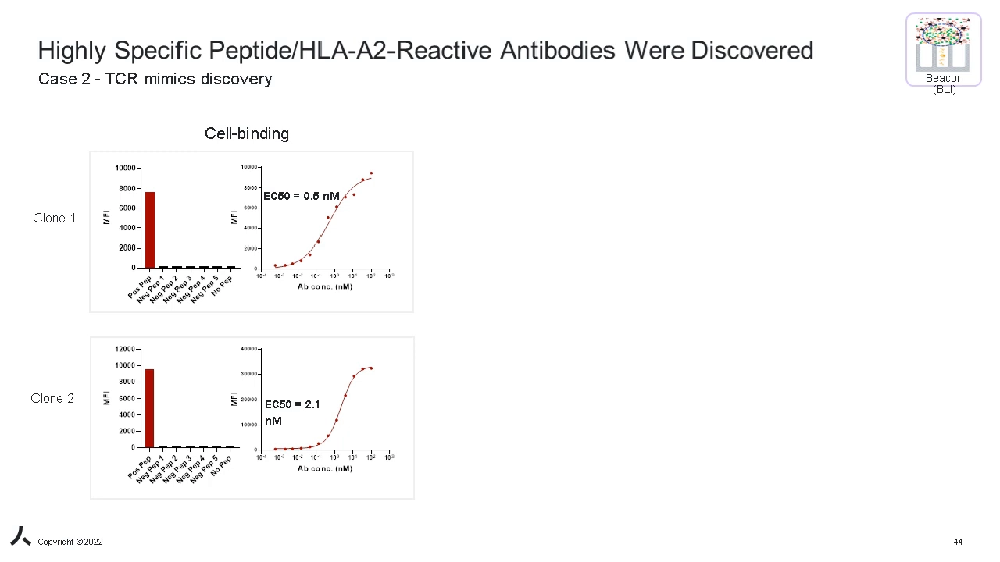

真正合格的克隆长这样：左侧柱状图显示只对阳性多肽负载的细胞有信号、对五个阴性多肽全部无信号；右侧曲线给出浓度依赖的 EC50（0.5 nM 与 2.1 nM）。**特异性（对负面对照无信号）和亲和力（EC50）是两件必须分开看的事**，前者靠对照，后者靠滴定。

### 10.3 四条证据链与各自的失效方式

| 环节 | 提供什么证据 | 典型失效方式 |
| --- | --- | --- |
| 分选 | 这个细胞结合了荧光标记抗原 | 抗原标记破坏了构象、抗标签抗体交叉反应、双细胞被当成单细胞 |
| 序列 | 拿到了天然配对的重轻链 | 组装错误、孔内多细胞导致配对错配、PCR 交叉污染 |
| 重组蛋白 | 这株抗体确实结合抗原 | 表达失败或折叠异常、只结合重组蛋白不结合天然蛋白 |
| 细胞实验 | 这株抗体能结合真实细胞表面 | 靶点表达量过低导致假阴性、细胞系与生理表达谱不一致 |

讲者对「能不能用亲和力给浆细胞排序」这个问题的回答很值得记住：除非同时做了 IgG 分泌量检测，否则变量太多，他们**只做「是/否」判断，不做亲和力排序**。这与「高通量 SPR 给的是可信的相对亲和力」形成对照——读数的可信度取决于它在流程的哪个位置产生。

## 十一、与杂交瘤路线的差别：证据的性质不同

本讲没有系统比较杂交瘤，但把两条路线的差异归纳出来是清楚的（以下为结合本讲内容的整理）：

- **克隆性的证据来源不同**。杂交瘤的克隆性由「一个融合细胞经有限稀释长成一个克隆」来保证，是**细胞学证据**；单 B 细胞路线的克隆性由「一个孔里一个细胞 + 一条配对序列」来保证，是**分子证据**。前者怕的是亚克隆不纯，后者怕的是孔内多细胞和交叉污染。
- **序列来源不同**。杂交瘤拿到的是杂交瘤细胞里的抗体序列，细胞本身可以长期保存、随时扩增；单 B 细胞拿到的是终末分化细胞里的一次性转录本，细胞用完即弃，**序列是唯一留存的资产**，所以组装和配对的可信度权重更高。
- **可变区的「原样程度」不同**。单 B 细胞保留的是体内真实发生的重轻链组合；噬菌体展示则是体外把轻重链基因组合到一起（这一点属于补充背景，本讲未展开），因此配对是人为构建的，而非体内筛选出来的。
- **误差的集中位置不同**。杂交瘤的损耗集中在细胞融合这一步（融合效率是公认的瓶颈，属于补充背景）和长期培养的稳定性；单 B 细胞路线的损耗集中在分选纯度、单细胞化、PCR/组装和重组表达成功率。

## 十二、通量与成本：没有全面更优的平台

讲者在问答里给了一组很实用的横向对比（数字来自讲者，属于其平台经验值）：

| 平台 | 通量 | 特点 |
| --- | --- | --- |
| FACS 分选 | 一天可筛数百万细胞 | 通量高、可按多参数与抗原分选，但分选过程对细胞有损伤 |
| 纳升微孔 | 与 FACS 同属分选路线，通量高 | 新技术，测序/条形码与部分细胞实验仍在开发 |
| Beacon | 一天约 2–4 万细胞（设备侧上限 8 万） | 成熟稳健、可在筛选中纳入结合/阻断/细胞/功能实验，但通量相对低 |

成本侧的判断也来自讲者：单 B 细胞路线需要单细胞分选设备，因此**设备投入高于杂交瘤**；但它在「需要大量克隆保证多样性」或「需要大量反向筛选排除同源异构体」的场景里，省下的是人力与时间，而不是试剂。

## 小结

- **单细胞是不可替代的前提**：抗体由不同染色体上的基因编码重链和轻链，群体裂解后配对信息不可恢复；单细胞路线保住的是「天然配对 + B 细胞来源」这两样东西。
- **分离方法的选择取决于瓶颈**：要稀有细胞和抗原特异性就选 FACS，要组库规模就选液滴/微孔，要极限灵敏度才选微流控；三者不能同时最优。
- **分子生物学方案必须先过「全长 cDNA」这一关**：3' 端计数类方案拿不到完整可变区；短读段必须靠组装拼成 0.5–1.8 kb 的连续序列，组装质量直接决定后续判断。
- **克隆型分析要防止把独立事件误判成同一克隆**：V/J 基因、CDR3 长度与相似度、加上供者来源标签要一起看；花生 Ara h 2 的趋同进化就是最好的反例教材。
- **重组表达是标准四步**：合成可变区 → 克隆进重/轻链载体 → 共转染 HEK293/CHO → Protein A 纯化；特异性信息可能来自分选，也可能必须补做。
- **功能复核要分层**：高通量 SPR 给亲和力（亚纳摩尔比例可以很高）和表位箱；细胞实验给生理相关性。TCR 模拟物项目里蛋白与细胞两层阳性只重叠约三成，说明单层证据不够。
- **与杂交瘤的差别在证据性质**：杂交瘤靠细胞学克隆性，单 B 细胞靠分子克隆性；前者怕亚克隆不纯，后者怕孔内多细胞与污染。

## 关键术语速查

| 术语 | 一句话解释 |
| --- | --- |
| 天然配对（native pairing） | 同一个 B 细胞里原本配对的那条重链和那条轻链，未被体外随机重组打乱 |
| 全长 cDNA 方案 | 反转录时保留完整可变区的单细胞建库方式，如 Smart-seq2、10x V(D)J；3' 端计数方案不适用 |
| de Bruijn 图组装 | 用短读段之间的 k-mer 重叠关系重建连续序列的算法框架 |
| 克隆型（clonotype） | 按 V/J 基因、CDR3 长度与相似度归为一组的、推定同源的 B 细胞集合 |
| 体细胞高频突变（SHM） | 生发中心里由 AID 引入的可变区点突变，是亲和成熟的分子基础 |
| 趋同进化 | 不同个体针对同一表位独立重组出高度相似抗体的现象 |
| 表位分箱（epitope binning） | 用抗体两两竞争实验把结合同一表位的抗体归为一箱 |
| 亚纳摩尔亲和力 | 解离常数在 10⁻¹⁰ M 量级以下，通常认为属于高亲和力抗体 |
| 纳升微孔（nanovial） | 体积在纳升量级、内壁可预包被抗原的微孔，用于单细胞分泌物捕获与分选 |
| 可开发性（developability） | 熔解温度、聚集倾向、溶解度、表达滴度、纯度与稳定性等成药相关属性的统称 |