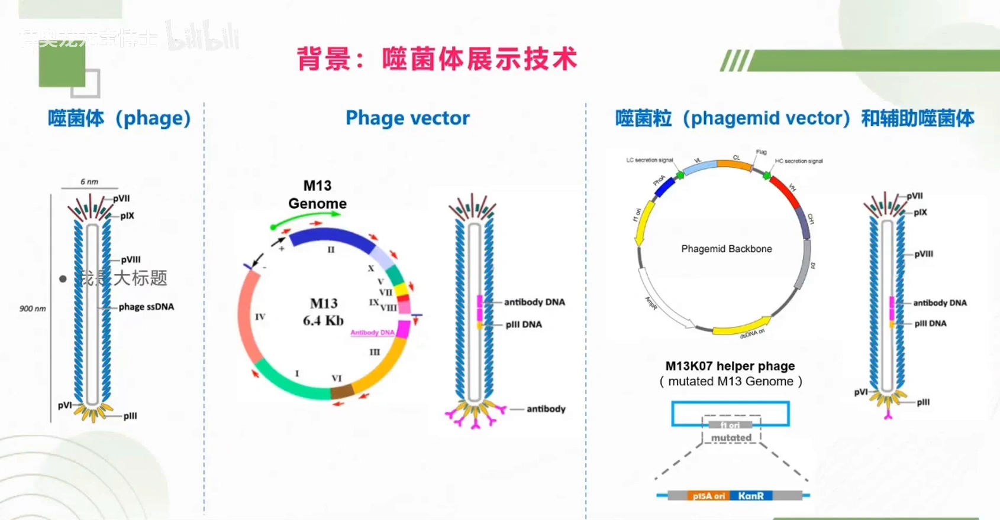
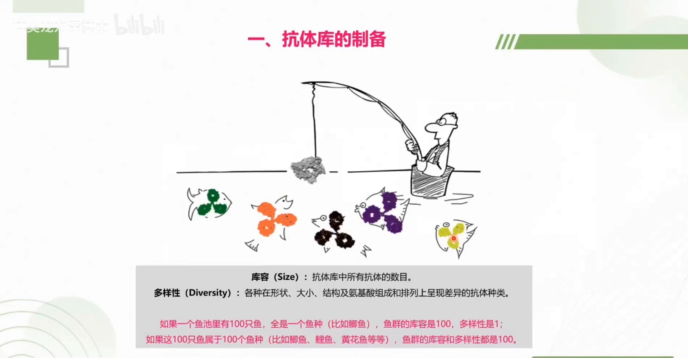
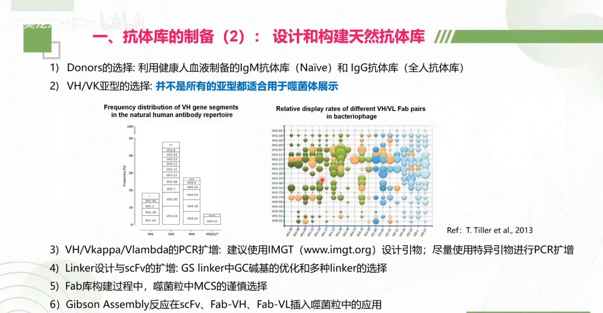
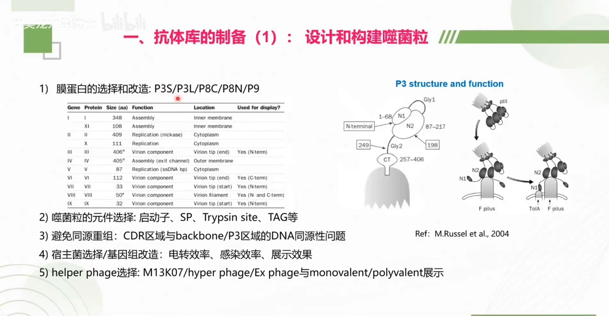
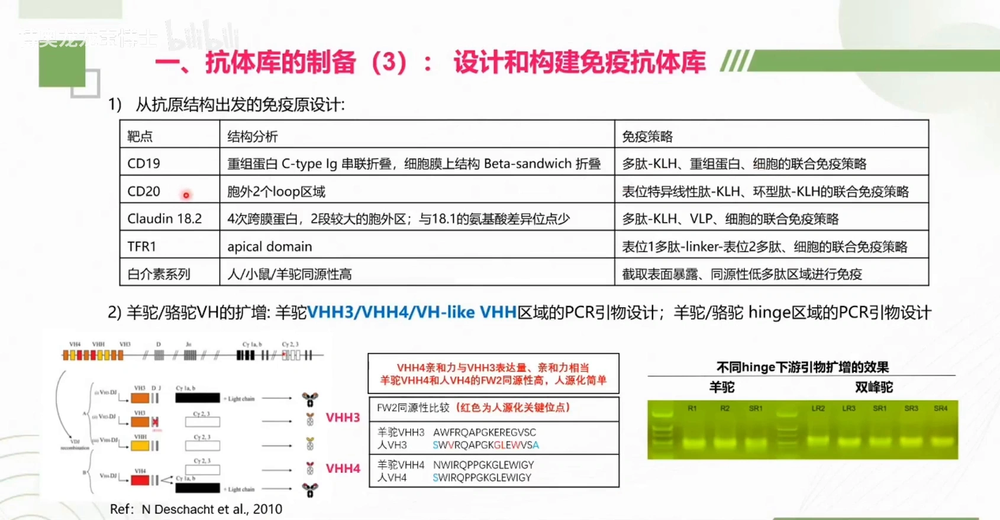
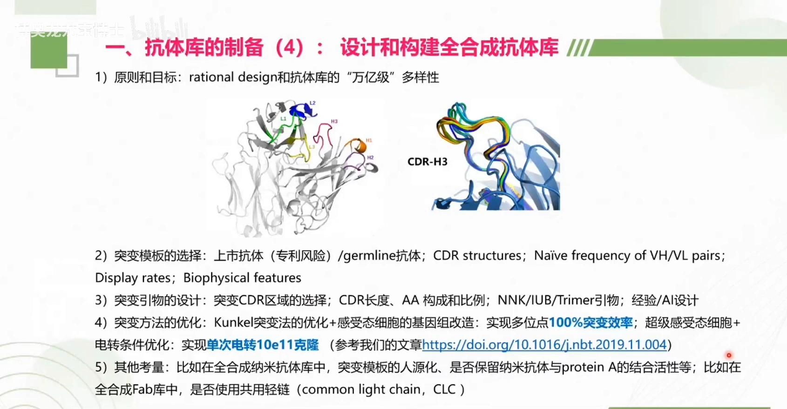
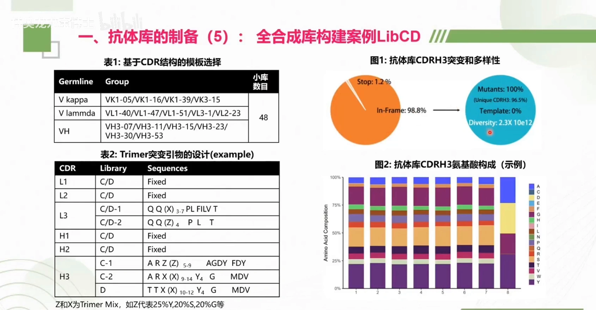
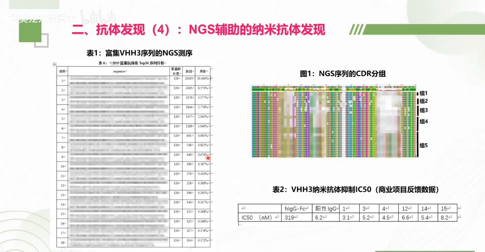
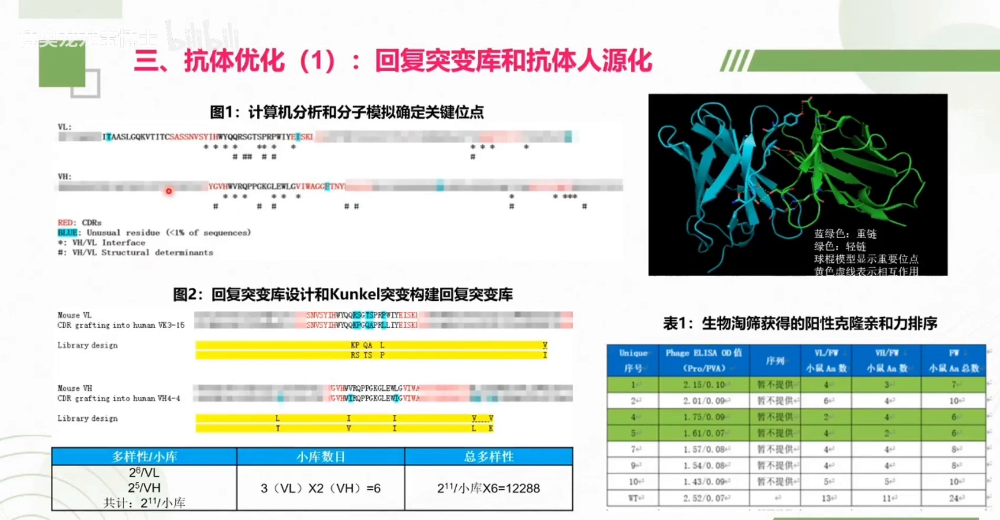
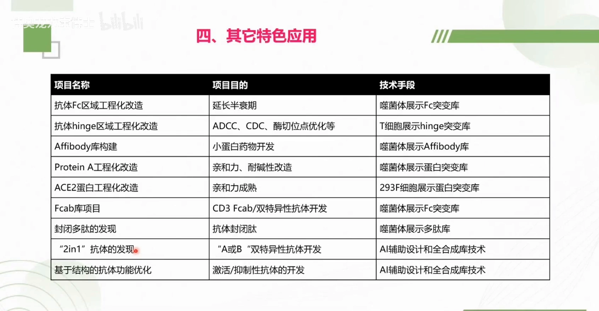

# 噬菌体展示抗体库的构建：库容不等于多样性，展示偏差决定你能筛到什么

> 视频来源：[《噬菌体展示技术》完整版](https://www.bilibili.com/video/BV1fX4y197Qv/)（Bilibili · 博奥龙公开课；讲者 刘江海，盛世君联创始人、药理学博士）｜时长约 53 分钟
>
> 导读：这是一场做过十多年噬菌体展示的一线从业者讲的经验课，重点不在「淘选怎么做」，而在「库是怎么造出来的、造出来为什么不够用」。讲者把库容与多样性拆成两个数，逐条讲展示偏差、引物与 linker 的坑、全合成库的突变设计，最后用 NGS 数据回答「库的质量怎么验」。字幕为 AI 生成，术语、公司名与软件名已按幻灯片订正（如 Kunkel、Gibson、IMGT、Genedes）。

## 本讲要解决的核心问题（SCQA）

**背景**：抗体发现想要的是「先按功能把候选挑出来，再回头读它的序列」。噬菌体展示之所以能这么干，是因为它把一份抗体基因和它编码的抗体蛋白装进了同一个噬菌体颗粒——颗粒外面挂着抗体，颗粒里面装着这份抗体的 DNA，两者一一对应。

**冲突**：既然连接成立，那库做得越大，筛到好抗体的机会就应该越多。可现实是：库容可以从十亿做到万亿，筛十个抗原却只成一两个；而且筛到的抗体往往挤在少数几个「优势表位」上，想要的功能表位根本没人去。

**疑问**：一个展示文库真正能提供多少种**不同的**抗体？从「设计」到「可被淘选的颗粒」之间，有哪些环节在悄悄过滤序列？

**回答（中心思想）**：基因型—表型连接只是地基，真正决定成败的是**有效覆盖度**——它是物理库容被四道过滤器逐级打折后的结果：

$$
N_{\text{有效}} \approx N_{\text{库容}} \times f_{\text{插入}} \times f_{\text{展示}} \times f_{\text{折叠组装}} \times f_{\text{读出}}
$$

插入率、展示效率、折叠与轻重链组装、以及测序读出的可及性，任何一项塌陷，库容都只是纸面数字。所以讲者的经验是：**多样性比库容重要，展示偏差比多样性更隐蔽**。

---

## 一、基因型—表型连接：为什么可以「先选功能、再读序列」

[【跳转到 02:35】](https://www.bilibili.com/video/BV1fX4y197Qv/?t=155)

讲者先交代了硬件。噬菌体是很小的病毒类物质，纳米级别，基因组简单：大的十个 kb 以内，小的只有两三个 kb；常用的 M13 大约 6.4 kb、编码十几个蛋白。基因组小意味着**插入外源基因的余地大**——这正是它能当展示载体的前提。

图上三栏对应三种做法：

1. **噬菌体（phage）本身**：长丝状，直径约 6 nm、长约 900 nm，一端是 p3（pIII），管身是成千上万个 p8（pVIII），里面包着单链 DNA。
2. **噬菌体载体（phage vector）**：把抗体基因直接插进 M13 基因组，和 p3 基因融合。这样五个 p3 全都是融合蛋白，颗粒表面挂满抗体。
3. **噬菌粒（phagemid）+ 辅助噬菌体**：抗体基因放在一个小质粒上（只带 f1 ori 和抗性），p3 由辅助噬菌体 M13KO7 提供。这样颗粒上只有一部分 p3 是融合蛋白，其余是野生型。

这个「挂几个」的差别，直接决定了后面两件事，讲者讲得很直白：

- **挂满五个会毁掉感染性**。幻灯片把 p3 与宿主菌的 F 菌毛、TolA 画在一起，说明 p3 承担的是感染入口的角色；如果五个 p3 全都换成了「p3 + 抗体」，颗粒基本失去感染能力，**无法扩增**。所以用 p3 展示时往往不会五个都用上，实际只有一到两个。
- **要挂很多拷贝就换位置**。p8、p7、p9 与感染无关，可以在这些位置展示更多拷贝——代价是失去单价性（多价展示会把低亲和力也「拉」得很像高亲和力）。

这就是本小节的核心逻辑：**颗粒既是「基因的容器」，又是「蛋白的载体」**，所以对颗粒做的任何一次选择（结合、洗脱、感染扩增），都等价于对它内部那份 DNA 做了一次选择。反过来说，凡是让「蛋白挂不上去」或「颗粒感染不了」的因素，都会让某一段 DNA 从库里消失——即使它被成功克隆进去了。

## 二、库容与多样性是两个数：鱼塘里 100 条鱼

[【跳转到 03:59】](https://www.bilibili.com/video/BV1fX4y197Qv/?t=239)

讲者把这件事拆成两个词：

- **库容（size）**：库里所有抗体克隆的**数目**。
- **多样性（diversity）**：在形状、大小、结构、氨基酸组成和排列上**呈现差异的抗体种类**。

然后给了一个很好记的类比：一个鱼塘里有 100 条鱼，如果全是同一种鱼，库容是 100、多样性是 1；如果 100 条鱼分属 100 个鱼种（鲤鱼、鲫鱼、黄花鱼……），库容是 100、多样性也是 100。

为什么多样性更值钱？因为筛抗体的目标不是「拿到一个能结合的抗体」，而是**拿到结合到特定表位的抗体**。同一个抗原身上有很多表位，只有一部分与功能相关（阻断配体、激活受体、介导内吞）。如果库里所有抗体都长得差不多，它们会挤在少数几个「优势表位」上，你反复筛也只能得到同一类抗体。

[【跳转到 05:39】](https://www.bilibili.com/video/BV1fX4y197Qv/?t=339)

讲者还强调了一个不对称：**库容可以做到无限大，多样性不行**。多做几次电转、多摇几升菌（10 L、100 L、1000 L），克隆数就能做到十亿级、百亿级、千亿级、万亿级。但多样性受限于「你往里放了多少种真正不同的序列」。库容大而多样性低，直接后果是**筛选成功率低**——拿十个抗原去筛，可能只有一两个能筛到好抗体，而且亲和力还偏低，后面还要做亲和力成熟。

## 三、展示偏差：不是所有序列都能被「挂」到颗粒上

这是全篇最有价值的一段，也是「覆盖度」最容易被忽略的一层。讲者把偏差分成三类：**亚型偏差、载体结构偏差、构建过程偏差**。

### 3.1 亚型偏差：VH3 挂得上去，VH4 挂不上去

[【跳转到 10:19】](https://www.bilibili.com/video/BV1fX4y197Qv/?t=619)

幻灯片引的是 T. Tiller 等 2013 年的工作。左图是天然人抗体库里各 VH 基因片段的**频率分布**——VH3 家族占大头，VH1、VH4 少一些。右图是同一批 VH/VL 组合在噬菌体上的**相对展示率**，每个点是一个 VH（行）× VL（列）的 Fab 组合，**圈越大表示展示效果越好，圈越小表示展示效果越差**。

讲者的结论是：VH3 这个亚型比较适合展示，而 VH4 以及 VH5、VH6 等「根本就不太适合展示」。这意味着什么呢？

> 如果你按天然库的**频率**去取样，你会以为库里 VH3 最多；但按**可展示性**去筛，VH3 会被进一步放大，而 VH4 这类亚型会被系统性压低——甚至完全消失。库的「多样性」在测序层面可能看起来正常（DNA 都在），但在颗粒层面已经偏了。

所以讲者提出一个值得商量的问题：**是不是要把所有 VH、所有 kappa/lambda 都拿来展示？** 全拿会得到「名义多样性」，但其中一部分注定展示不出来；只拿展示得好的亚型，名义多样性下降，实际可淘选的多样性反而更高。

### 3.2 载体结构偏差：p3 截短与否，决定大抗体能不能挂

[【跳转到 06:34】](https://www.bilibili.com/video/BV1fX4y197Qv/?t=394)

幻灯片左侧的表格把 M13 的十一个基因产物列了出来：p3（406 aa，virion tip，可用于 N 端展示）、p6、p7（33 aa，tip，N 端）、p8（50 aa，virion filament，N 端与 C 端都可用）、p9（32 aa，tip）。右侧是 p3 的结构：N1（1–68）、N2（87–217）两个结构域，加一个 CT（257–406）锚在膜上。

讲者由此解释「为什么 p3 要选截短型还是全长」：

- **大抗体（如 Fab）挂在 N 端会撑爆膜外空间**。Fab 体积大，在 N 端再接一个 Fab，膜外区域变得非常大，会干扰噬菌体本身的感染。
- **截掉 N1、N2 就能缓解**。把 N1、N2 去掉，只留 CT 锚定，展示大分子的空间就宽松了。
- **小分子（多肽、小蛋白）挂 N 端影响不大**，不必截短。

同一张幻灯片还列了另外四个「设计变量」，每一个都影响覆盖度：

1. **膜蛋白的选择和改造**：P3S / P3L / P8C / P8N / P9（即 p3 短版、p3 长版、p8 的 C 端或 N 端、p9）。
2. **噬菌粒元件**：启动子、信号肽（SP）、胰蛋白酶切位点、TAG（琥珀终止密码子）。
3. **避免同源重组**：CDR 区与骨架、p3 区之间的 DNA 同源性会导致重组丢失。
4. **宿主菌选择与基因组改造**：决定电转效率、感染效率、展示效果。
5. **辅助噬菌体选择**：M13KO7 / Hyperphage / Ex-phage，以及单价展示还是多价展示。

### 3.3 展示拷贝数是一把双刃剑

[【跳转到 07:49】](https://www.bilibili.com/video/BV1fX4y197Qv/?t=469)

讲者点出了一个反直觉的权衡：**启动子强弱决定每个颗粒挂多少个抗体，而挂得越多，筛到的抗体亲和力可能越低**。

原因不难想：淘选看的是「颗粒整体结合得牢不牢」，而多价展示让一个颗粒上多个抗体同时抓住抗原，产生亲合力（avidity）加成。一个单分子亲和力很弱的抗体，只要挂得够多，也能被留下来；反过来，展示得越少（接近单价），淘选就越接近「优中选优」，最后筛到的抗体亲和力最好、展示效果最好、结构也最规整。

这也解释了为什么讲者在后面讲多肽库时特意说：多肽很短，必须用 p8 展示很多很多拷贝，才能形成足够高的亲和力结合，否则亲和力很低、特异性也差。**同一个「拷贝数」参数，对多肽是必需品，对抗体是干扰项。**

### 3.4 构建过程偏差：分子生物学层面的「隐性截短」

[【跳转到 11:34】](https://www.bilibili.com/video/BV1fX4y197Qv/?t=694)

这一段是纯经验，但直接决定功能性克隆比例：

- **引物**：很多人用参考文献里的简并引物，结果会在抗体 N 端或 C 端引入「奇怪的氨基酸」。讲者的做法是到 IMGT 网站重新设计引物，尽量用**单一引物对**做特异性扩增，而不是简并引物——现在合成引物和 PCR 都很便宜，没必要省这一步。
- **linker**：scFv 常用的 (G4S)3 linker 好用，但用它做 overlap PCR 时容易错配、丢碱基，最后导致移码——**扩出来的 scFv 条带长度是对的，中间却总有终止密码子**。解决办法是优化 linker 的密码子，或者换用非经典氨基酸组成来降低错配。
- **酶切位点**：Fab 库往往先插重链、再插轻链，多次酶切时可能切进 VH 或 Vκ/Vλ，产生**截短型突变体**，库的质量就掉下来了。
- **克隆方法**：讲者偏好 Gibson Assembly / SLiCE 这类同源重组，理由是插入效率高、引入突变的几率小。

## 四、三类文库：天然库、免疫库、全合成库

讲者把「建什么库」作为第二个决策点，并逐类讲了各自的瓶颈。

### 4.1 天然库：多样性有个天花板

[【跳转到 16:54】](https://www.bilibili.com/video/BV1fX4y197Qv/?t=1014)

天然库的做法是从健康人血液里提取 IgM 或 IgG，构建天然库或全人库。讲者给了一个非常具体的经验数字：

> 不管采多少人的血——100 人、200 人、1000 人、1 万人——库容都做上去了，多样性却做不上去。有效多样性大概就是 $10^{7}$ 到 $10^{8}$。并不是做 100 个人多样性就提高 100 倍，因为**人与人之间的抗体序列本来就比较接近**。

这句话把「库容」和「多样性」的区别落到了具体数字上：采血人数是线性投入，多样性却是饱和增长。饱和之后，库容再大也只是把相近的序列重复更多遍。

### 4.2 免疫库：难的不是建库，是抗原

[【跳转到 14:51】](https://www.bilibili.com/video/BV1fX4y197Qv/?t=891)

讲者的判断很直接：**免疫库的构建办法并不复杂，最难的地方是抗原**。幻灯片把这件事摊开成一张表：

| 靶点 | 结构分析 | 免疫策略 |
| --- | --- | --- |
| CD19 | 重组蛋白是 C-type Ig 串联折叠，细胞膜上是 β-sandwich 折叠 | 多肽-KLH、重组蛋白、细胞的联合免疫 |
| CD20 | 胞外 2 个 loop 区域 | 表位特异性线性肽-KLH、环型肽-KLH 联合免疫 |
| Claudin 18.2 | 4 次跨膜，2 段较大胞外区；与 18.1 的氨基酸差异位点少 | 多肽-KLH、VLP、细胞的联合免疫 |
| TFR1 | apical domain | 表位 1 多肽-linker-表位 2 多肽、细胞的联合免疫 |
| 白介素系列 | 人/小鼠/羊驼同源性高 | 截取表面暴露、同源性低的多肽区域免疫 |

这张表的逻辑是：**你免疫进去的构象，决定了库里有哪些构象的抗体**。CD19 的重组蛋白和膜上蛋白折叠不同，所以很容易拿到结合重组蛋白的抗体，却拿不到结合 CD19 表达细胞的抗体。CLDN18.2 与 18.1 差异位点太少，就得靠表位特异性的多肽或细胞联合免疫把差异「放大」。TfR1 的膜外表位是两个分开的位点，得用 linker 把它们强行拉到一起，模拟生理状态的空间结构。

幻灯片下半部分讲羊驼和骆驼的 VH 扩增，讲者纠正了一个常见误解：传统文献都只讲 VHH3，但羊驼其实还有 **VHH4** 亚型，以及既不属于 VHH3 也不属于 VHH4 的亚型。VHH4 的价值在于：亲和力与表达量和 VHH3 相当，但它的 FW2 区与人 VH4 的 FW2 同源性很高（图上标红的就是人源化关键位点），**基本不用人源化就很好用**。只扩 VHH3，等于主动放弃了一半库。

他还提到引物数量的经验：羊驼文献说两对、三对，实际还有第三对；骆驼有人说三对、有人说四对，他们发现其实有五对。而且美洲羊驼与澳大利亚羊驼、中国双峰驼与单峰驼、中亚驼之间都有差异——所以**从头设计引物**（在 IMGT 上取序列）比抄文献更可靠。

### 4.3 全合成库：把多样性变成可设计的参数

[【跳转到 17:44】](https://www.bilibili.com/video/BV1fX4y197Qv/?t=1064)

既然天然库的多样性会饱和，那就换一条路：**以一个或几个抗体为模板，在 CDR 区做高通量突变**。幻灯片把全合成库的决策点列成五条，每一条都直接对应覆盖度：

1. **原则和目标**：rational design + 万亿级多样性。
2. **突变模板的选择**：上市抗体（有专利风险）还是 germline 抗体；还要看 CDR 结构、天然 VH/VL 配对的频率、**展示率**、生物物理性质。
3. **突变引物的设计**：突变哪些 CDR、CDR 长度、氨基酸构成和比例，用 NNK / IUB / Trimer 引物，靠经验还是 AI 设计。
4. **突变方法的优化**：Kunkel 突变法优化 + 感受态细胞基因组改造，实现多位点 **100% 突变效率**；超级感受态 + 电转条件优化，实现**单次电转 $10^{11}$ 克隆**（幻灯片上给出了他们 2019 年那篇文章的 DOI）。
5. **其他考量**：全合成纳米抗体库里要不要保留与人源化、与 protein A 的结合活性；全合成 Fab 库里要不要用**共用轻链**（common light chain, CLC）。

第 3 条里有个很实在的取舍。讲者说他们第一代库六个 CDR 全突变，筛完发现 L1、L2 不用变；建第二代库再筛，又发现 H1、H2 相对固定，最后只突 L3 和 H3。**这就是「用筛选结果反过来收缩设计空间」**——把突变预算集中到真正决定表位识别的两个环上。

氨基酸构成也是同一逻辑。讲者说最开始只选很少几种氨基酸（比如偏向 Y、S、G 这类容易带来高亲和力的残基），结果很容易筛到高亲和力抗体，但**抗体容易聚集、发黏（sticky）**。后来逐步加到 5、8、9、13、15 种，发现 15 种又太多，再降回来。这解释了为什么「极限突变」的合成库会带来额外的理化风险：多样性上去了，可开发性下来了。

## 五、文库质量评估：三个可以量出来的数

讲者反复强调「库做完要验」，并且给了三类可测指标。

### 5.1 插入率与读框正确率

[【跳转到 22:06】](https://www.bilibili.com/video/BV1fX4y197Qv/?t=1326)

这是讲者自己的 LibCD 库案例，一张幻灯片把「设计」和「实测」放在一起对照：

- **表 1（模板选择）**：V kappa 用 VK1-05/VK1-16/VK1-39/VK3-15，V lambda 用 VL1-40/VL1-47/VL1-51/VL3-1/VL2-23，VH 用 VH3-07/VH3-11/VH3-15/VH3-23/VH3-30/VH3-53，一共 **48 个小库**。
- **表 2（Trimer 引物设计）**：L1、L2、H1、H2 固定（Fixed），只对 L3、H3 做长度与序列的多样化；Z 和 X 是 Trimer mix，比如 Z 代表 25% Y、20% S、20% G 的混合。
- **图 1（实测）**：In-Frame **98.8%**、Stop **1.2%**；突变体比例 **100%**、唯一 CDRH3 占 **96.5%**、模板残留 **0%**、多样性 **$2.3\times10^{12}$**。
- **图 2（实测）**：CDRH3 各位置的氨基酸构成堆叠柱，用来核对「实测构成是否等于设计构成」。

这几个数字正好对应四种不同的质量问题：**in-frame 98.8%** 说明读框没被破坏；**stop 1.2%** 是不可避免的终止密码子比例；**template 0%** 说明模板被彻底替换、没有「没突变的克隆」混进来；**unique CDRH3 96.5%** 说明序列之间真的不一样，而不是同一序列的重复扩增。

[【跳转到 22:31】](https://www.bilibili.com/video/BV1fX4y197Qv/?t=1351)

讲者说，做完库他们会做二代测序，看**氨基酸构成是否与设计一致**——一致就说明库的质量比较高。这是最便宜也最有效的一道质检：它同时能发现「合成失败」「引物偏好」「某类序列在宿主里被淘汰」三类问题。

### 5.2 规模：小库、大库与总多样性

[【跳转到 21:41】](https://www.bilibili.com/video/BV1fX4y197Qv/?t=1301)

讲者给了一组可复用的换算：一个小库（一个模板 + 一套突变设计）的多样性大概 $10^{10}$、即 $1\sim5\times10^{10}$；一个大库包含 20 到 80 个小库，所以一个大库是 $1\sim5\times10^{12}$ 的多样性。至于他们自己的库规模，字幕在这里识别不清（「3000 以及多样性」），按上下文只能确定是千亿级这个量级。

这组数字解释了为什么「48 个小库」这种设计是必要的：单个模板的 CDR 组合空间有限，靠**多模板 × 多突变方案**才能把总多样性堆到万亿级。

### 5.3 丰度：NGS 能告诉你「哪个克隆值得挑」

[【跳转到 29:06】](https://www.bilibili.com/video/BV1fX4y197Qv/?t=1746)

这张图把「挑克隆」的算术讲清楚了。左表是 NGS 测到的 Top30 序列，第 1 条占 30.4%，第 10 条降到 0.587%，第 18 条只有 0.172%。讲者算了一笔账：

- 第 1 条占 30%，十个克隆里就有三个，随便挑都挑得到；
- 第 10 条占 0.5%，200 个克隆里有一个，可能还挑得到；
- 第 20 条只占 1‰，**要挑 1000 个克隆才可能碰到**，挑十块 96 孔板都不能保证。

右侧表 2 是同一个商业项目的 IC50 反馈：hIgG-Fc 对照 319 nM、阳性 IgG 6.2 nM，而 3 号克隆 3.1 nM、4 号 5.2 nM、12 号 6.6 nM、14 号 5.4 nM、**15 号 8.2 nM**。讲者特别指出：15 号这个克隆的丰度大概只有 2‰，**按传统挑克隆的方式很可能根本挑不到它**，但它的活性已经接近阳性对照（而且阳性是全长的，这个只是纳米抗体）。

这就是 NGS 对覆盖度的第二个贡献：**它把「库里有」变成「库里有且找得到」**。中间那张 CDR 分组图（组 1 到组 5）是配套手段——按 CDR 序列聚类，每组挑一两个代表去表达，就能覆盖到丰度排名 20 名以外的序列。

## 六、覆盖度的两个硬天花板：读长与轻重链配对

[【跳转到 47:57】](https://www.bilibili.com/video/BV1fX4y197Qv/?t=2877)

问答环节有个很专业的问题：二代测序读长有限，怎么关联一个克隆不同区域的序列？讲者的回答把「覆盖度」的边界讲得很清楚：

- **二代测序只能测 400 bp 左右**。纳米抗体（单个 VHH 结构域）没问题；全长抗体重链加轻链 800 bp，二代测序**肯定不能满足**，只能上三代测序。
- **全合成库有个结构性优势**：骨架区是恒定的，所以可以用 Kunkel 把六个 CDR「强行拉到一块」，再送二代测序——问题就解决了。
- **全人库最难**：要么挑单克隆去测，要么做单细胞，要么等三代测序便宜下来。强行测 VH 再测 VL、然后分组、组间配对，工作量非常大；也有团队用 AI 辅助配对，能产生一些效果。
- 结论：**纳米抗体和全合成抗体库能很好解决，全人的全长抗体不太容易解决。**

这一段其实是「基因型—表型连接」在测序层面的翻版：淘选把「蛋白功能」和「颗粒」绑定了，但测序只能读到一段短序列；如果读不到全长，**轻链和重链的配对信息就会在读出环节丢失**——这跟单 B 细胞路线要解决的配对问题是同一个问题的两种形态。

## 七、同一套平台上的后续工程：小库也有大用处

讲者后半段讲了展示平台在抗体优化上的用法。这部分与「文库构建」共享同一套逻辑，但库的规模小得多，值得单独看一眼，因为它展示了**覆盖度的另一端**：当你知道要改哪里时，库不需要大。

[【跳转到 33:03】](https://www.bilibili.com/video/BV1fX4y197Qv/?t=1983)

人源化的思路是：用计算机或分子模拟确定关键位点——不常见的残基（人的抗体里少见，可能是免疫风险位点）、VH/VL 界面位点、决定结构的位点、Vernier 区——然后在这些位点做回复突变，让它在人和小鼠（或羊驼）之间「二选一」。

算一下库有多大：VL 六个位点、每位点两种选择，是 $2^{6}$；VH 五个位点，是 $2^{5}$；合计 $2^{11}=2048$。幻灯片上按 3 个 VL 库 × 2 个 VH 库 = 6 个小库算，总共 **12288** 种多样性。这个库小到「全部表达一遍」都做不完，但用来淘选已经足够——**因为它覆盖的是「关键位点的所有组合」，而不是「所有可能的抗体」**。

讲者还提到同一平台上的其他用法：饱和突变库 + 组合突变库做亲和力成熟（一代库提升有限，二代库提升明显）；HDX-MS 找热点（分辨率有限，序列窗口偏窄，要往上下游延伸）；His scanning 做 pH 依赖的 sweeping 抗体；NNK 扫描 + 不同 pH 下筛选做 Fc 的酸性结合增强；多肽库做封闭态（masked）抗体，用不同浓度抗原洗涤来拿「IC50 适中」的多肽；以及共用轻链方便做双特异性抗体。

[【跳转到 41:46】](https://www.bilibili.com/video/BV1fX4y197Qv/?t=2506)

这张表把「展示平台能做什么」收了个尾：Fc 区域工程（延长半衰期）、hinge 区域工程（ADCC/CDC、酶切位点）、Affibody 库、Protein A 工程（亲和力、耐碱性）、ACE2 蛋白工程、Fcab 库（CD3 Fcab/双特异性）、封闭多肽、2in1 抗体、基于结构的功能优化。注意「技术手段」一列：有的用噬菌体展示，有的用 T 细胞展示、293F 细胞展示——**同一个「建库 + 选择」的框架，可以换不同的展示载体**。

讲者最后强调了一句：每一种抗体或小蛋白的展示，都要考虑用 p3 还是 p8、p9，「这里面都需要一些系统的工作」。多肽库用 p8 是因为要多拷贝，Fc 有二硫键、复杂蛋白怎么展示，都是另外的问题。

## 八、补充：核糖体展示与哺乳动物细胞展示的位置（非讲者主讲内容）

讲者在开场时列了一句「我就不过多讲噬菌体展示和杂交瘤、转基因小鼠、酵母展示、核糖体展示这些技术的区别」，之后没有展开。为了让「基因型—表型连接」这张地图完整，这里补一段定位（**以下为背景补充，不是讲者原话**）：

| 形式 | 连接方式 | 主要代价 |
| --- | --- | --- |
| 噬菌体展示 | 抗体基因在颗粒内，抗体融在 p3/p8 上 | 原核折叠，复杂蛋白折不好 |
| 酵母表面展示 | 基因在细胞内，蛋白经 Aga1p/Aga2p 锚在壁上 | 转化效率低，库容小两三个数量级 |
| 核糖体 / mRNA 展示 | 蛋白与自己的 mRNA 停在同一个核糖体复合物上，靠体外翻译建立连接 | 没有细胞，无法筛选折叠与分泌；需要二硫键的抗体片段不适用 |
| 哺乳动物细胞展示 | 基因整合或瞬转进细胞，蛋白展示在细胞膜上 | 库容最小，但折叠与翻译后修饰最接近天然 |

核糖体展示和 mRNA 展示的优点是**彻底绕开了转化效率**——文库在试管里转录翻译，不需要把每个成员都送进一个细胞，所以库容可以做到比噬菌体展示更高；代价是连接只存在于「蛋白—mRNA—核糖体」这个瞬时复合物里，**没有任何细胞替你做折叠质检**，因此更适合多肽、scFv 这类单链小分子，而不适合需要糖基化和多链组装的抗体。

哺乳动物细胞展示则相反：库容最小，但折叠环境最接近真实。讲者在问答里就提到，像 SARS-CoV-2 的 RBD 这类**需要形成三聚体**的复杂蛋白，在噬菌体上展示效果不好，换到哺乳动物细胞（293 等）上展示效果就可以。这也是为什么第七节那张「其它特色应用」表里，hinge 区域工程用 T 细胞展示、ACE2 蛋白工程用 293F 细胞展示——**载体是按「这个蛋白需要什么样的折叠环境」来选的**。

## 小结

- **基因型—表型连接是地基**：抗体 DNA 在颗粒内、抗体蛋白挂在 p3 或 p8 上，所以「选颗粒」等于「选 DNA」；一旦蛋白挂不上去或颗粒感染不了，这段 DNA 就从库里消失了。
- **库容和多样性是两个数**：库容可以做到万亿级，多样性受限于「真正不同的序列有多少」；天然库采血人数再多，有效多样性也只到 $10^{7}$–$10^{8}$。
- **展示偏差比多样性更隐蔽**：VH3 展示得好、VH4/5/6 展示得差；p3 截短与否决定大抗体能不能挂；启动子强弱决定拷贝数，而拷贝数越高、筛到的亲和力可能越低。
- **三类文库各有瓶颈**：天然库卡在多样性饱和，免疫库卡在抗原设计，全合成库卡在突变效率与可开发性（氨基酸种类太少会发黏）。
- **文库质量要量出来**：in-frame 比例、stop 比例、模板残留、唯一 CDR 比例、氨基酸构成是否符合设计——这五个数一起看，才能判断库是「真的大」还是「只是重复得多」。
- **丰度不等于功能**：NGS 能告诉你哪个克隆值得挑（2‰ 的克隆靠挑板几乎挑不到），但丰度只反映富集程度，功能还要靠表达验证。
- **读长是覆盖度的硬边界**：二代测序 400 bp 够测纳米抗体，不够测全长抗体的重链加轻链；全合成库靠恒定骨架绕开这个问题，全人库目前还没有好办法。
- **展示载体的选择服从折叠需求**：噬菌体胜在库容，酵母胜在折叠与定量，核糖体/mRNA 展示胜在库容上限但无折叠质检，哺乳动物细胞展示库最小但折叠环境最真。

## 关键术语速查

| 术语 | 一句话解释 |
| --- | --- |
| 噬菌体展示 | 把外源蛋白与噬菌体衣壳蛋白融合，使蛋白展示在颗粒表面、其基因留在颗粒内 |
| 噬菌粒（phagemid） | 只带 f1 ori 与抗性、不带全套衣壳基因的小质粒，需要辅助噬菌体提供结构蛋白 |
| 辅助噬菌体 | 提供野生型衣壳蛋白（如 M13KO7 提供 p3）的帮手噬菌体，决定单价还是多价展示 |
| p3 / p8 | 噬菌体末端与管身的衣壳蛋白；p3 参与感染（拷贝少），p8 数量多但与感染无关 |
| 库容（size） | 库中抗体克隆的总数目，可以通过多做电转、多摇菌无限放大 |
| 多样性（diversity） | 序列与结构上真正不同的抗体种类数，决定能覆盖多少表位 |
| 展示偏差 | 不同序列在颗粒表面的展示效率不同，导致库的「名义多样性」与「可淘选多样性」不一致 |
| 天然库 / 免疫库 / 全合成库 | 分别来自健康人抗体组库、免疫动物、以及以模板 + CDR 随机化人工设计的库 |
| Kunkel 突变 | 用含尿嘧啶的单链模板做定点突变的方法，可多位点同时引入突变 |
| in-frame 比例 | 插入片段读框正确的克隆占比，直接决定功能性克隆比例 |
| NGS + CDR 分组 | 用二代测序读库/淘选产物，按 CDR 序列聚类分组，从每组挑代表去表达验证 |