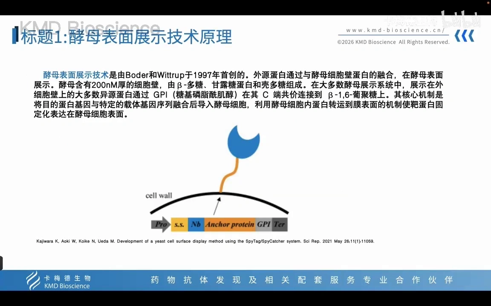
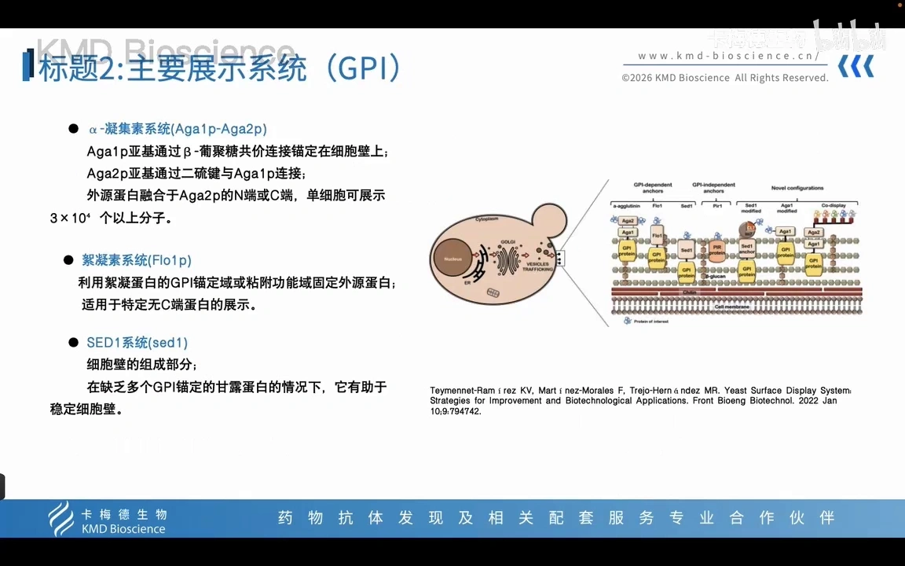
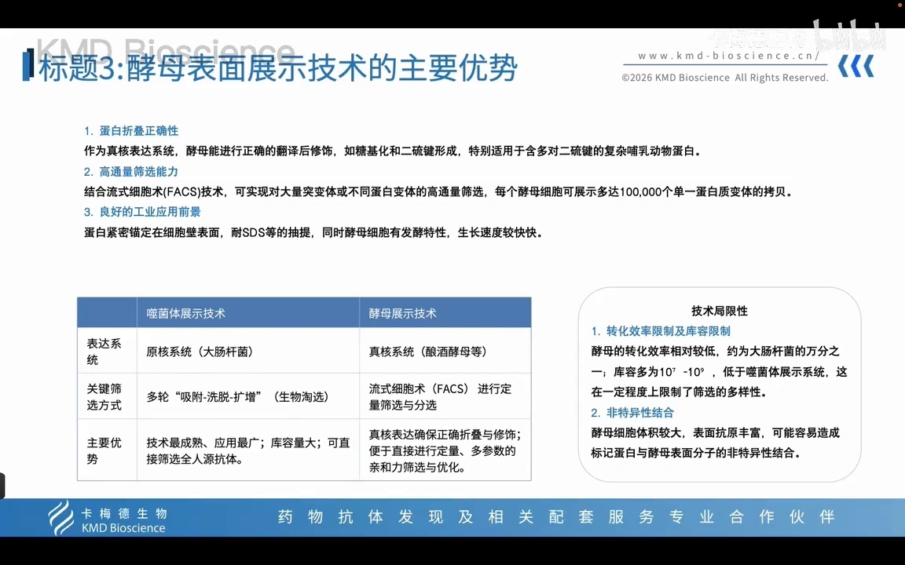
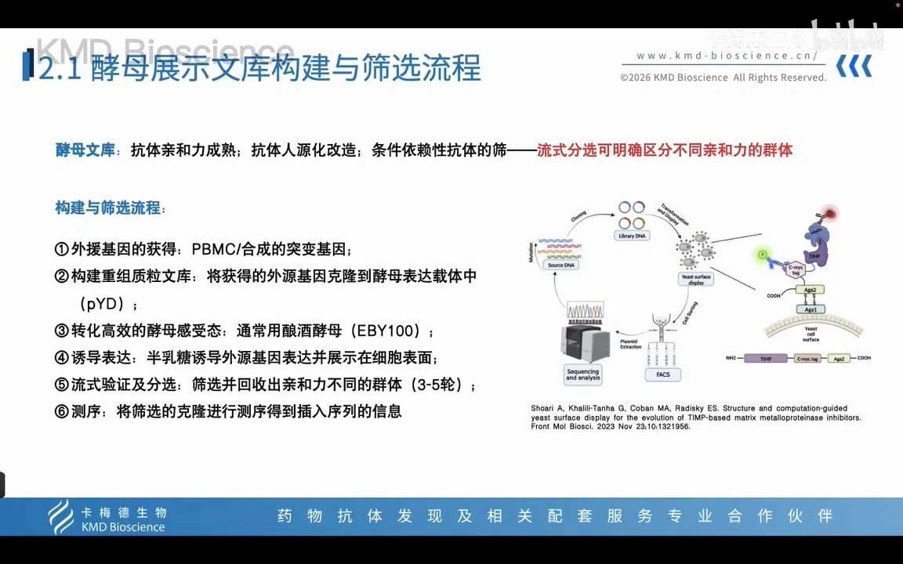
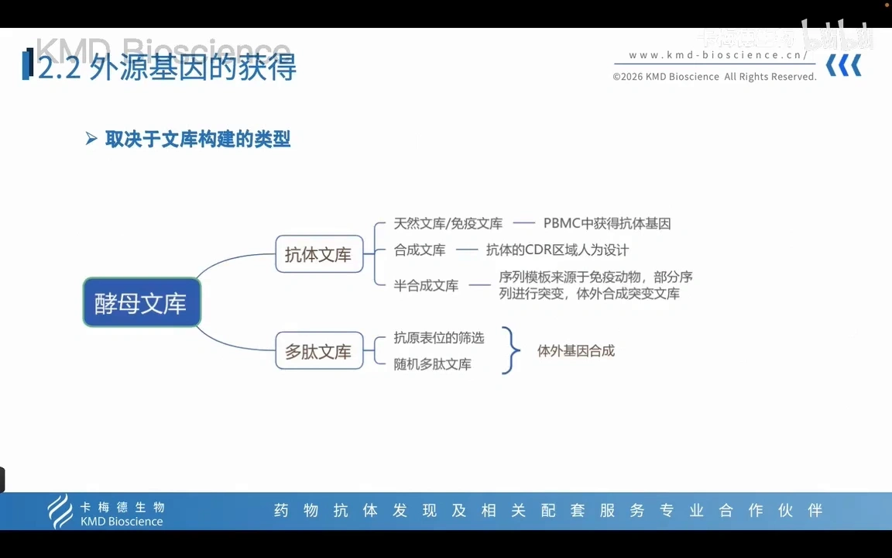
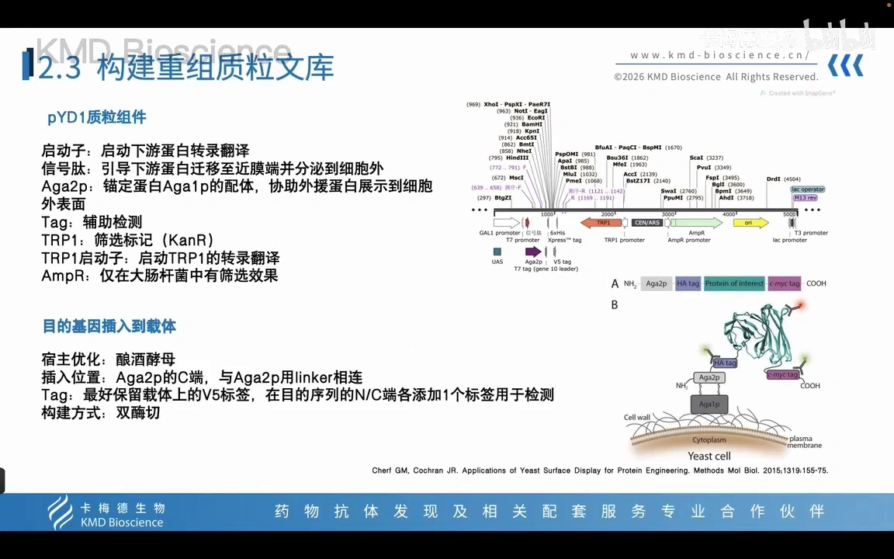
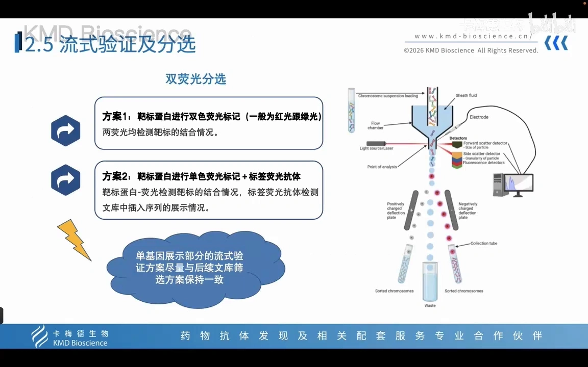
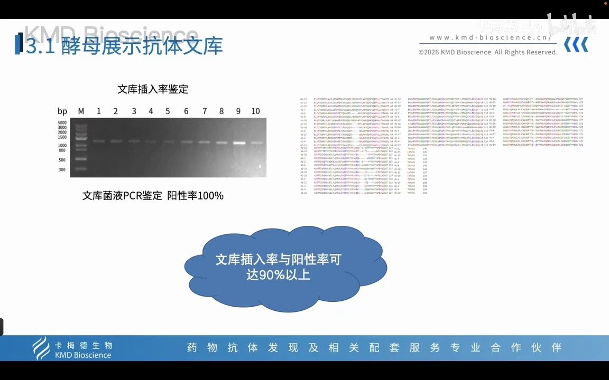
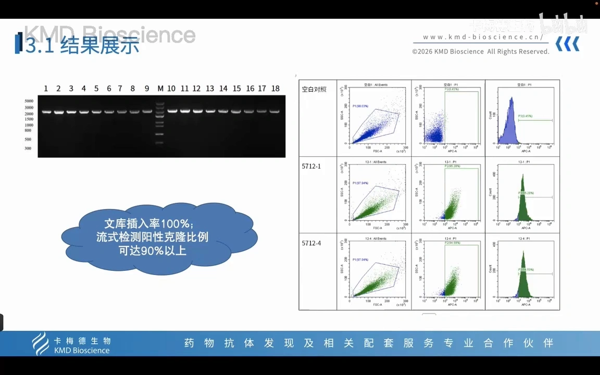
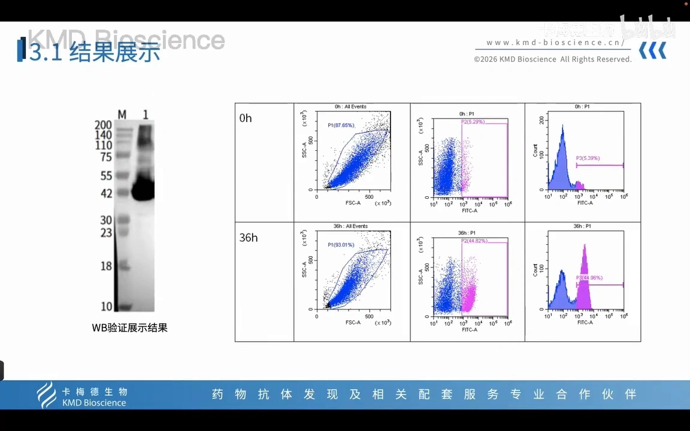

# 酵母表面展示抗体文库：凝集素锚定、真核折叠与转化瓶颈

> 视频来源：[酵母表面展示技术文库构建如何筛选高亲和力抗体](https://www.bilibili.com/video/BV16EuE6LErA/)（Bilibili · 卡梅德生物 KMD Bioscience 技术分享）｜时长约 12 分钟
>
> 导读：这是一支短而密的技术讲解，把酵母展示的「为什么用它」和「它的代价」放在一起讲：前半段讲 α-凝集素如何把蛋白共价锚在细胞壁上、为什么真核折叠与流式定量值得为它付出库容代价；后半段讲 pYD1 载体的元件、插入率与展示效率这两个必须分开验证的数。字幕为 AI 生成，Aga1p/Aga2p、Flo1p、SED1、pYD1 等名称已按幻灯片订正。

## 本讲要解决的核心问题（SCQA）

**背景**：噬菌体展示把抗体挂在噬菌体表面，库容大、成本低，是抗体发现的主流平台。但它的宿主是大肠杆菌——原核系统。

**冲突**：很多抗体片段和小蛋白需要二硫键、需要糖基化才能折成正确构象，在大肠杆菌里折不出来；而且噬菌体淘选本质上是一个「洗与不洗」的二元判断，只能告诉你「结合」还是「不结合」，给不出结合强弱的定量刻度。

**疑问**：换成真核细胞做展示，能同时解决折叠和定量吗？代价是什么？

**回答（中心思想）**：酵母表面展示用 α-凝集素的 Aga1p/Aga2p 系统把外源蛋白**共价锚定在细胞壁上**，用流式细胞术做**定量分选**，把「折叠正确」和「可定量」两件事一起解决了；代价是库容掉两到三个数量级（$10^{7}$–$10^{9}$），而且**展示效率本身成了覆盖度的瓶颈**——同一个库，诱导 36 小时后阳性比例能从 5.29% 升到 44.62%，说明「库里有」和「挂在表面」是两个不同的数。

---

## 一、展示逻辑：把蛋白锚在细胞壁上

[【跳转到 00:12】](https://www.bilibili.com/video/BV16EuE6LErA/?t=12)

讲者先交代了这项技术的出处和物理基础：酵母表面展示由 **Boder 和 Wittrup 于 1997 年**首创。酵母细胞壁厚约 **200 nm**，由 β-葡聚糖、甘露糖蛋白和壳多糖组成。在大多数酵母展示系统中，展示在外细胞壁上的外源蛋白通过 **GPI（糖基磷脂酰肌醇）锚**在 C 端共价连接到 **β-1,6-葡聚糖**上。

幻灯片下方的示意图把融合结构画得很清楚：`Pro（启动子）— s.s.（信号肽）— Nb（目标蛋白）— Anchor protein（锚定蛋白）— GPI — Tcr`。也就是说，目标蛋白不是「吸附」在表面，而是被**基因融合**进了锚定蛋白，再由细胞自己的分泌途径送到壁外、由 GPI 共价接到葡聚糖上。

[【跳转到 00:56】](https://www.bilibili.com/video/BV16EuE6LErA/?t=56)

讲者把核心机制总结成一句：把目的蛋白基因与特定的载体基因序列融合后导入酵母细胞，**利用酵母细胞把蛋白转运到膜表面的机制**，使靶蛋白固定化表达在酵母细胞表面。

这句话和噬菌体展示是同一个逻辑：**基因在细胞里，蛋白在细胞外，两者一一对应**。区别只在载体——噬菌体用的是病毒颗粒，酵母用的是细胞本身。这个区别带来两个直接后果：细胞比噬菌体颗粒大得多（可以用流式逐个分选、逐个读数），但细胞也比噬菌体难转化得多（库容上不去）。

## 二、三个展示系统：Aga1p/Aga2p 是主角

[【跳转到 01:19】](https://www.bilibili.com/video/BV16EuE6LErA/?t=79)

讲者列了三个系统，并把每个系统的锚定方式讲清楚：

1. **α-凝集素系统（Aga1p-Aga2p）**——这是最常用的一个。**Aga1p 亚基**通过 β-葡聚糖共价连接锚定在细胞壁上；**Aga2p 亚基**通过**二硫键**与 Aga1p 连接；外源蛋白融合于 Aga2p 的 N 端或 C 端。单个细胞可展示 **$3\times10^{4}$ 个以上**分子。
2. **絮凝素系统（Flo1p）**——利用絮凝蛋白的 GPI 锚定域或黏附功能固定外源蛋白，适用于特定无 C 端蛋白的展示。
3. **SED1 系统（sed1）**——细胞壁的组成成分，在缺乏多个 GPI 锚定甘露蛋白的情况下有助于稳定细胞壁。

为什么 Aga1p/Aga2p 成为主流？从结构上能看出原因：**Aga1p 负责「钉在墙上」，Aga2p 负责「挂东西」，两者之间是二硫键**。这个二硫键很关键——它让融合在 Aga2p 上的抗体片段与细胞壁之间保持了一段柔性距离，抗体不会贴着壁面被挡住；同时 Aga2p 很小，不会像噬菌体的 p3 那样因为体积大而干扰「感染」（酵母不需要感染这一步）。

## 三、为什么值得用酵母：折叠、定量、工业

[【跳转到 02:09】](https://www.bilibili.com/video/BV16EuE6LErA/?t=129)

讲者给了三条优势，每条都对应噬菌体展示的一个短板：

- **蛋白折叠正确性**：作为真核表达系统，酵母能进行正确的翻译后修饰，如糖基化和二硫键形成，**特别适用于含多个二硫键的复杂哺乳动物蛋白**。这是原核系统补不上的。
- **高通量筛选能力**：结合流式细胞术（FACS），可对大量突变体或蛋白变体做高通量筛选，每个酵母细胞可展示多达 **100000 个**单一蛋白变体的拷贝。
- **良好的工业应用前景**：蛋白紧密锚定在细胞壁表面，**耐 SDS 等抽提**；同时酵母有发酵特性、生长速度较快。

第二点值得展开一句：噬菌体展示的「读数」是淘选后的富集倍数，是一个**群体层面**的量；酵母展示的读数是一个个细胞上的荧光强度，是**单细胞层面**的量。这个差别决定了后面筛选策略的不同——流式可以设门（gate），可以同时看两个通道，可以只收「结合强但展示量也够」的那一群。

## 四、与噬菌体展示的分工：库容换定量

同一张幻灯片的下半部分是两者的对照表，讲者逐行念了一遍：

| | 噬菌体展示技术 | 酵母展示技术 |
| --- | --- | --- |
| 表达系统 | 原核系统（大肠杆菌） | 真核系统（酿酒酵母等） |
| 关键筛选方式 | 多轮「吸附-洗脱-扩增」（生物淘选） | 流式细胞术（FACS）定量筛选与分选 |
| 主要优势 | 技术最成熟、应用最广、库容量大；可直接筛选全人源抗体 | 真核表达确保正确折叠与修饰；便于直接进行定量、多参数的亲和力筛选与优化 |

[【跳转到 03:54】](https://www.bilibili.com/video/BV16EuE6LErA/?t=234)

然后是代价，讲者讲得很干脆，两条局限：

1. **转化效率限制与库容量限制**：酵母的转化效率相对较低，**约为大肠杆菌的万分之一**；库容量一般在 $10^{7}$–$10^{9}$，低于噬菌体展示系统，这在一定程度上限制了筛选的多样性。
2. **非特异性结合偏多**：酵母细胞体积较大、表面抗原丰富，容易造成标记蛋白与酵母表面分子的非特异性结合。

把这两条和第三节的优势放在一起看，酵母展示的定位就很清楚了：**它不是「更好的噬菌体展示」，而是用两三个数量级的库容，换折叠正确性与单细胞定量**。所以它最适合的场景不是「从零开始筛一个未知抗原」，而是「已经有一个先导序列，要在它附近做精细的亲和力成熟、人源化、条件依赖性改造」——这类任务的库本来就不需要很大，但每个克隆都必须折得对、量得准。

讲者列出的五个应用方向也印证了这一点：抗体工程与筛选（人源化、亲和力成熟、条件依赖性抗体）、酶工程改造（稳定性、活性、底物特异性）、疫苗研发（展示病毒蛋白或病原体抗原）、酵母传感器、生物修复（重金属吸附与有机物降解）。

## 五、文库构建六步：从基因到展示

[【跳转到 06:00】](https://www.bilibili.com/video/BV16EuE6LErA/?t=360)

讲者把流程拆成六步，并强调这个循环的终点是「测序 → 回到质粒文库」：

1. **外源基因的获得**：PBMC 或合成的突变基因。
2. **构建重组质粒文库**：把外源基因克隆到酵母表达载体（pYD）中。
3. **转化高效的酵母感受态**：通常用酿酒酵母（EBY100）。
4. **诱导表达**：半乳糖诱导外源基因表达并展示在细胞表面。
5. **流式验证及分选**：筛选并回收亲和力不同的群体，通常经过 3~5 轮。
6. **测序**：把筛选到的克隆测序，得到插入序列的信息。

第 3 步里的 EBY100 是这套系统的标准宿主（补充：它的特点是 Aga1 整合在基因组里、由 GAL 启动子控制，所以「加拉糖才展示」）。这也解释了第 4 步为什么必须用半乳糖诱导——**展示是被开关控制的**，不诱导就不展示。

### 5.1 外源基因从哪来：文库类型决定插入片段

[【跳转到 06:59】](https://www.bilibili.com/video/BV16EuE6LErA/?t=419)

讲者把酵母文库分成两大类，抗体文库再分三小类：

- **天然文库 / 免疫文库**：从 PBMC 中获得抗体基因。
- **合成文库**：抗体的 CDR 区域人为设计。
- **半合成文库**：序列模板来自免疫动物，对部分序列做体外突变，合成突变文库。
- **多肽文库**：又分抗原表位筛选文库和随机多肽文库，都由体外基因合成。

这个分类和噬菌体展示完全一致——**文库类型是「序列从哪来」的问题，与展示载体无关**。同一个天然库的基因池，既可以装进噬菌粒，也可以装进 pYD 载体。

### 5.2 载体元件：每个部件都有明确职责

[【跳转到 07:41】](https://www.bilibili.com/video/BV16EuE6LErA/?t=461)

讲者逐个元件念了一遍，每个元件都对应一个功能：

- **启动子**：启动下游蛋白的转录翻译。
- **信号肽**：引导下游蛋白迁移至近膜端并分泌到细胞外。
- **Aga2p**：锚定蛋白 Aga1p 的配体，协助外源蛋白展示到细胞外表面。
- **Tag**：辅助检测。
- **TRP1 筛选标记（KanR）**、**TRP1 启动子**：用于筛选。
- **AmpR**：仅在大肠杆菌中有筛选效果（因为质粒要先在大肠杆菌里扩增）。

插入方式是：宿主用酿酒酵母优化，**目的基因插在 Aga2p 的 C 端，与 Aga2p 用 linker 相连**；最好保留载体上的 **V5 标签**，并在目的序列的 N 端、C 端各加一个标签用于检测；构建方式是**双酶切**。

这里有个容易被忽略的设计要点：**「两端各加一个标签」是为了把「有没有展示」和「有没有结合」拆成两个可独立测量的信号**。这一点在第六节的双荧光方案里会直接用到。

## 六、插入率与展示效率：两个必须分开验的数

讲者把质控讲得很细，而且顺序不能颠倒。

[【跳转到 08:31】](https://www.bilibili.com/video/BV16EuE6LErA/?t=511)

**第一步，电转后验插入率。** 因为酵母转化效率比较低，电转结束后需要挑单克隆做 PCR 检测，看插入是否正确。**第二步，插入率合格才诱导。** 用半乳糖低温诱导，插入率验证合格之后才能做单基因的展示。**第三步，Western 合格才做流式。** 挑插入正确的单克隆做 Western 和流式检测，**Western 验证合格前不做流式验证**——因为流式看到的是「表面有没有蛋白」，如果蛋白根本没表达出来，流式的阴性是假阴性。**第四步，整库放大培养并诱导，诱导后做质检。**

这个顺序的意义在于：**它把「库里有这个基因」「这个基因表达出了蛋白」「这个蛋白挂到了表面」三件事分开验证**。任何一步混在一起，出了问题都定位不到。

### 6.1 双荧光分选：把「展示」和「结合」分成两个通道

[【跳转到 09:04】](https://www.bilibili.com/video/BV16EuE6LErA/?t=544)

讲者给了两个方案：

- **方案一**：靶标蛋白做**双色荧光标记**（一般是红光和绿光），两荧光均检测靶标结合情况。
- **方案二**：靶标蛋白做**单荧光标记**，再加一个**标签荧光抗体**——靶标荧光检测结合情况，标签荧光抗体检测文库中插入序列的**展示情况**。

方案二正是第五节「两端各加一个标签」的用途所在。它把每个细胞变成二维图上的一个点：横轴是「展示了多少」（抗标签抗体信号），纵轴是「结合了多少」（靶标信号）。这样就可以设门只收「展示量够、结合也强」的细胞，而不是把「展示量高但不结合」和「结合强但展示少」混在一起。

讲者还补了一句操作要点：**单克隆展示部分的流式筛选方案，要尽量与后续文库筛选方案保持一致**。否则从单克隆上得到的门（gate）搬到文库上就不适用了。

### 6.2 三个案例：插入率、阳性率、诱导时间

[【跳转到 09:50】](https://www.bilibili.com/video/BV16EuE6LErA/?t=590)

第一个案例是插入率：文库菌液 PCR 鉴定的电泳图显示，十个克隆都有正确条带，**阳性率 100%**。讲者说他们常规构建的文库，**插入率和阳性率都可以达到 90% 以上**。

[【跳转到 10:20】](https://www.bilibili.com/video/BV16EuE6LErA/?t=620)

第二个案例：电泳显示所有克隆都有正确条带，**插入率 100%**；流式结果显示，与空白对照相比，5712-1 和 5712-4 两个样本的阳性克隆比例**都超过 90%**。

[【跳转到 10:41】](https://www.bilibili.com/video/BV16EuE6LErA/?t=641)

第三个案例是全场最有信息量的一组数据。左侧 Western 验证目的蛋白正确表达；右侧流式显示：

- **诱导 0 小时**：阳性比例只有 **5.29%**；
- **诱导 36 小时**：阳性比例显著提升到 **44.62%**（字幕作 44.22%，以画面为准）。

讲者的结论是：**半乳糖诱导有效提升了目的蛋白的展示效率**。

这组数字正好把「覆盖度」这件事说透了：插入率 100%、Western 也正确，但**诱导前只有 5% 的细胞真的把蛋白挂到了表面**。如果跳过展示效率这一层，直接拿这个库去做分选，你实际在筛的是一个只有 5% 有效成员的库——**名义库容和有效库容差了二十倍**。而诱导 36 小时后也只到 44.62%，也就是说**即使条件优化到位，仍有一半以上的细胞没有有效展示**。

## 七、把酵母库放进「覆盖度」框架

回到本小节的主线：一个展示文库的有效覆盖度，是物理库容被逐级打折的结果。酵母展示的折扣点和噬菌体展示不完全一样：

| 折扣环节 | 噬菌体展示 | 酵母表面展示 |
| --- | --- | --- |
| 建库（转化/电转） | 电转效率高，可到 $10^{11}$ 量级 | 约为大肠杆菌的万分之一，库容 $10^{7}$–$10^{9}$ |
| 展示 | 受 p3/p8 位置、拷贝数、亚型展示率影响 | 受诱导条件影响极大（0 h 5.29% → 36 h 44.62%） |
| 折叠与组装 | 原核系统，复杂蛋白折不好 | 真核系统，二硫键与糖基化正确 |
| 读出 | 淘选富集倍数（群体层面） | 流式荧光强度（单细胞层面，可双通道拆分展示与结合） |
| 非特异 | 相对较低 | 细胞体积大、表面抗原丰富，非特异结合偏多 |

这张表能解释一个常见的困惑：**为什么酵母库小得多，却在亲和力成熟上更好用**。因为它的折扣主要发生在「建库」这一环（可以靠多做几次电转、多做几个亚库来补），而在「折叠」和「读出」这两环上折扣很小甚至为负（读出精度反而更高）。反过来，噬菌体展示的折扣集中在「折叠」和「读出」——库再大，折不对的序列也筛不出来，读出的也只是群体富集倍数。

## 小结

- **展示的本质是基因与蛋白的一一对应**：酵母用 α-凝集素的 Aga1p/Aga2p 把外源蛋白共价锚在细胞壁上，基因在细胞内、蛋白在壁外，所以「选细胞」等于「选基因」。
- **三个系统各有锚定方式**：Aga1p-Aga2p 靠 β-葡聚糖共价连接加二硫键，Flo1p 靠絮凝蛋白的 GPI 锚定域，SED1 是细胞壁组成成分。
- **酵母的价值在折叠与定量**：真核翻译后修饰（糖基化、二硫键）让复杂哺乳动物蛋白折得对；流式给的是单细胞层面的定量读数，还能用双通道把「展示」和「结合」拆开。
- **代价是库容与转化效率**：转化效率约为大肠杆菌的万分之一，库容 $10^{7}$–$10^{9}$，比噬菌体展示低两到三个数量级；此外酵母表面非特异结合偏多。
- **质控要分层做**：插入率（PCR）→ 表达（Western）→ 展示（流式），顺序不能颠倒，否则阴性结果无法定位。
- **展示效率是覆盖度的隐藏折扣**：插入率 100%、Western 正确的库，诱导前只有 5.29% 的细胞真正展示，诱导 36 小时后到 44.62%——名义库容与有效库容可能差二十倍。

## 关键术语速查

| 术语 | 一句话解释 |
| --- | --- |
| 酵母表面展示 | 把外源蛋白与酵母细胞壁蛋白融合，使蛋白锚定在细胞表面、其基因留在细胞内 |
| α-凝集素系统 | 由 Aga1p（锚在壁上）与 Aga2p（挂蛋白）组成的展示系统，两者以二硫键相连 |
| GPI 锚 | 糖基磷脂酰肌醇锚，把蛋白的 C 端共价连接到细胞壁的 β-1,6-葡聚糖上 |
| Flo1p / SED1 | 另外两个展示锚定系统：絮凝素系统的 GPI 锚定域、以及细胞壁组成蛋白 SED1 |
| pYD1 | 酵母展示常用载体，含 GAL 启动子、信号肽、Aga2p、V5 标签与 TRP1 标记 |
| EBY100 | 酵母展示常用宿主菌，Aga1 整合在基因组中，需半乳糖诱导才展示 |
| 插入率 | 克隆中插入片段正确的比例，用菌液 PCR 或测序判定 |
| 展示效率 | 细胞表面真正挂上目标蛋白的比例，用抗标签抗体流式定量 |
| 双荧光分选 | 用两个荧光通道分别读「展示量」与「靶标结合量」，据此设门分选 |
| 亲和力成熟 | 在已有先导序列附近建突变库，筛出亲和力更高的变体 |