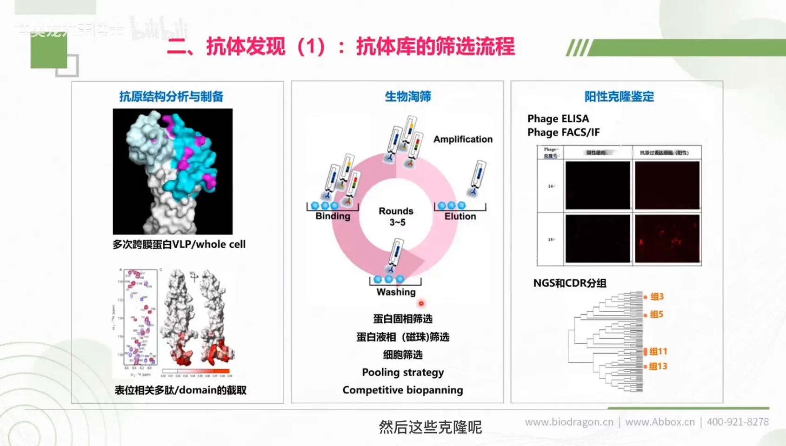
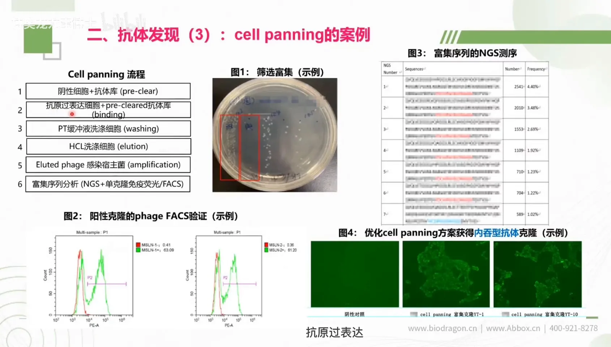
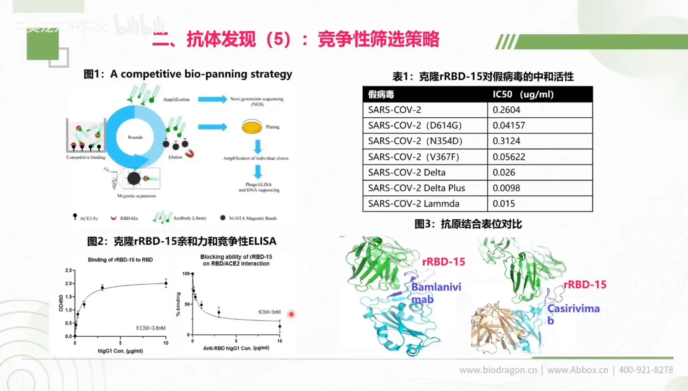
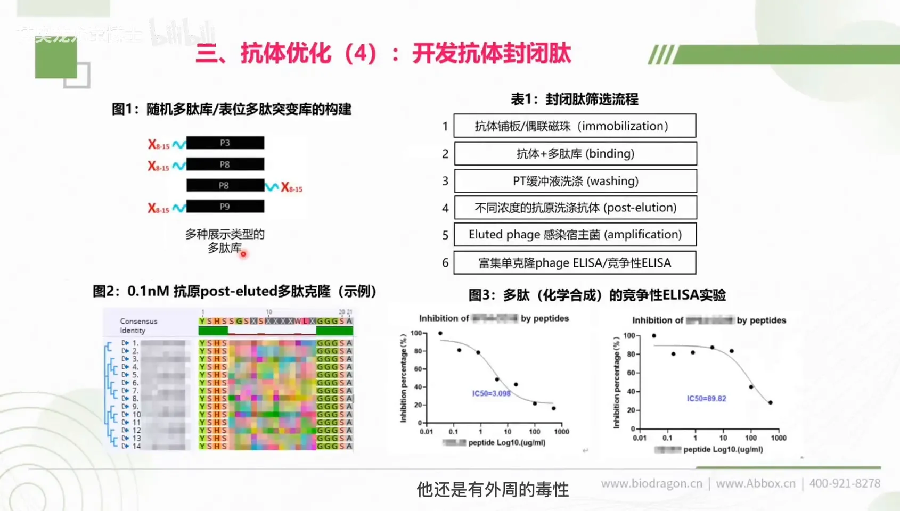
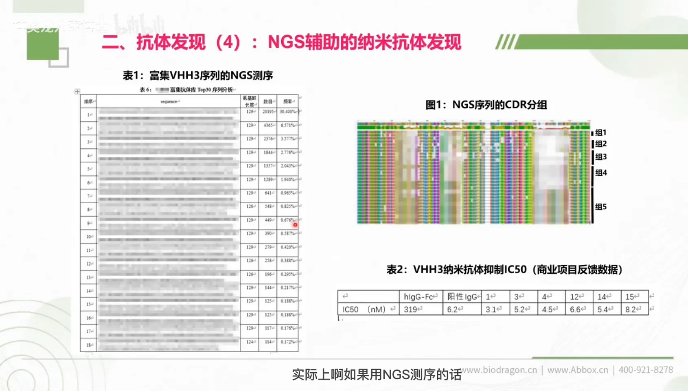
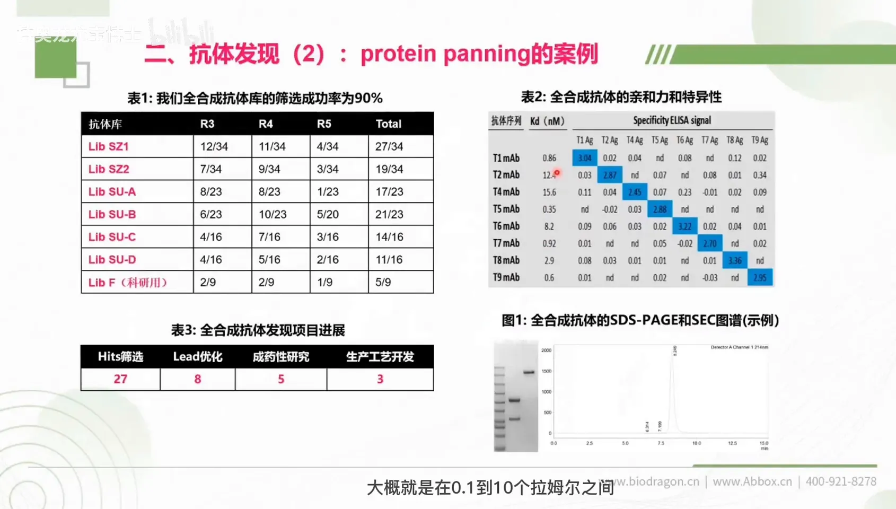

# 噬菌体淘选的三重压力：负筛、竞争与富集判读

> 视频来源：[噬菌体展示技术在抗体药物发现和优化中的应用](https://www.bilibili.com/video/BV1fX4y197Qv/)（Bilibili · 博奥龙公开课；讲者刘江海，盛世君联创始人、药理学博士）｜时长约 53 分钟
>
> 导读：本讲前半段讲文库构建（库容与多样性的区别、展示元件选择、全合成库设计），后半段讲「怎么把库变成候选抗体」——淘选流程、细胞筛选的负筛、竞争性淘选、NGS 分组挑克隆、以及优化阶段的小库筛选。本文只取后半段中与**筛选压力、反向筛选、富集判读、克隆验证**有关的部分，文库构建与展示体系原理请参看本系列 5.1.6。字幕为 AI 生成，术语与数字已按幻灯片订正（如 biopanning、pre-clear、CDR 分组、IC50）。

## 本讲要解决的核心问题（SCQA）

**背景**：噬菌体展示把抗体基因与外壳蛋白融合，让「抗体」和「它的基因」装在同一个噬菌体颗粒里。因此只要能把某个噬菌体留下来，就能通过感染宿主菌把它扩增出来、再读出它的序列。这让「从十亿个克隆里找出会结合的那几个」第一次变成可操作的事。

**冲突**：但「留下来」并不等于「结合了目标」。一个克隆被留下来，可能是因为它真的结合抗原，也可能是因为它粘塑料、粘封闭剂、粘磁珠、粘细胞表面别的蛋白，或者只是长得快、扩增效率高。这些原因在读数上完全一样——都是「这一轮的池子里它变多了」。

**疑问**：一轮淘选里，究竟哪些环节在施加选择压力？当某一轮测序结果显示某个克隆丰度暴涨时，凭什么说它是真结合，而不是被筛出来的假象？

**回答（中心思想）**：淘选的本质是**把「结合能力」翻译成「被捕获并被扩增的概率」**，所以任何一次富集都同时混着三类信号——真实结合、非特异粘附、扩增偏倚。要拿到真候选，必须同时施加三种压力：**捕获压力**（抗原形态、洗涤强度、洗脱条件）、**排除压力**（负筛与竞争性淘选）、**判读压力**（用跨轮富集与序列分组排序，而不是用丰度排序），最后回到单克隆重组表达做验证。

---

## 一、一轮淘选的四步，每一步都在改「存活概率」

[【跳转到 22:45】](https://www.bilibili.com/video/BV1fX4y197Qv/?t=1365)

讲者把常规淘选流程讲得很朴素：把抗原固定在 96 孔板上，抗体库加进去，能结合的留下来，不结合的用 washing off 洗掉，结合的噬菌体再往下走去感染宿主菌扩增；这样走 3 到 5 个循环，目标序列就被富集起来。

四步各自的物理含义不同，施加的压力也不同：

| 步骤 | 这一步在做什么 | 改变它会改变什么 |
| --- | --- | --- |
| Binding（结合） | 让噬菌体上的抗体与固相抗原达到结合平衡 | 抗原密度、结合时间、温度决定「谁能结合上」以及「结合得够不够久」 |
| Washing（洗涤） | 把没结合或结合很弱的噬菌体冲走 | 洗涤次数、缓冲液严格度、是否加去污剂，决定「多弱的结合会被淘汰」 |
| Elution（洗脱） | 把还留在抗原上的噬菌体赶下来 | 酸性/碱性洗脱、竞争洗脱，决定「哪些克隆能进入下一轮」 |
| Amplification（扩增） | 洗脱的噬菌体感染宿主菌、扩增成下一轮的输入 | 扩增效率差异会直接改写下一轮的起始丰度 |

幻灯片中间那个环形箭头写的是「Rounds 3~5」——**富集不是一次事件，而是一个循环**。每一轮结束时池子的组成，就是下一轮的起点；上一轮的任何偏倚都会被下一轮继承并放大。

幻灯片下方还列了五种筛选形式：蛋白固相筛选、蛋白液相（磁珠）筛选、细胞筛选、Pooling strategy、Competitive biopanning。它们的差别本质上就是**抗原以什么形态出现**——纯化的重组蛋白、挂在磁珠上的液相抗原、过表达目标蛋白的活细胞，还是加了竞争者的抗原。抗原形态决定了「什么样的表位是可见的」，这本身就是一层很强的选择压力：用重组蛋白筛，拿到的是识别折叠后重组蛋白的抗体；用细胞筛，才可能拿到识别天然构象的抗体。

---

## 二、负筛决定「留下来的理由」

[【跳转到 27:19】](https://www.bilibili.com/video/BV1fX4y197Qv/?t=1639)

讲者指出，有些膜蛋白结构非常复杂，做不了重组蛋白，只能用细胞来筛。用细胞立刻带来一个新问题：**细胞表面很脏**。除了目的抗原，还有成百上千种其他膜蛋白。这时候如果直接拿抗体库去结合，留下来的很大一部分会是「结合细胞表面别的东西」的克隆。

他的解法是**负筛（pre-clear）**：先用一个空白细胞或阴性细胞（不表达目的抗原的细胞）去吸附抗体库，把那些非特异的先去掉，再用抗原过表达的细胞株去结合 pre-clear 过的库。

幻灯片左侧把这个流程写成了六步，其中第一步就是负筛，第三步、第四步是洗涤与洗脱：

1. 阴性细胞 + 抗体库（pre-clear）
2. 抗原过表达细胞 + pre-clear 过的抗体库（binding）
3. PT 缓冲液洗涤细胞（washing）
4. HCl 洗涤细胞（elution）
5. 洗脱的噬菌体感染宿主菌（amplification）
6. 富集序列分析（NGS + 单克隆免疫荧光/FACS）

讲者说，这样经过几轮循环，就会出现明显的富集——图 1 那块培养皿照片里，红框标出的区域就是富集之后的克隆分布；图 3 的 NGS 表则把富集量化了：第一条序列 2541 条 reads、占 4.40%，第二条 2010 条、3.48%，往下依次递减到 1% 附近。

富集之后，讲者强调有两条验证途径，而不是直接相信测序结果：

- **流式（phage FACS）**：看它是不是只特异性地结合过表达细胞株。幻灯片图 2 是两条流式曲线，红峰（阴性细胞）和绿峰（阳性细胞）分得很开，说明这个克隆对阳性细胞有明确结合。
- **免疫荧光（IF）**：直接看——阴性细胞不结合、阳性细胞结合，才算好克隆，然后再送去测序。

这里有一个容易被忽略的判读细节：**「富集」这个现象本身不区分原因**。培养皿上长出的克隆变多、NGS 里某条序列占比上升，都只说明「这一轮它更容易被留下来」。要把它归因到「结合目标抗原」，必须有一组对照——阴性细胞不结合。没有阴性对照的富集，只是「变多了」，不是「变特异了」。

讲者还提到非特异克隆的一个来源：早期用细菌噬菌体展示做的全合成库，因为刻意引入了一些氨基酸、或者突变策略上有问题，最后抗体容易形成「黏黏的」现象（sticky）。随着库一代代改进——改模板、改突变、设计氨基酸构成，现在还加入了 AI 设计——这个问题基本消失，随便拿一个抗体出来，SEC 曲线也很干净，基本没有高分子量聚集体或异常峰型。

这提示一件事：**非特异富集有一部分是「库的性质」决定的，不完全是筛选参数的问题**。如果库里天然富集了一批疏水或带强电荷的骨架，那么再严格的洗涤也只能减少、不能消除它们的富集。

---

## 三、竞争性淘选把「结合」升级成「结合在正确的位置」

[【跳转到 30:40】](https://www.bilibili.com/video/BV1fX4y197Qv/?t=1840)

讲者说得很直接：整个 panning/biopanning 过程是**基于亲和力**的筛选，但很多时候我们要的不是「亲和力最高的」，而是「有功能的」。这时候就要做**竞争性筛选策略**——在筛选过程中加入一个竞争者。

幻灯片给的例子是新冠 RBD：把 ACE2-Fc 作为竞争者放进筛选体系，抗原是 RBD-His，用 Ni-NTA 磁珠做分离。逻辑是：如果某个噬菌体抗体只是「能结合 RBD」，它会被 ACE2 挤掉；只有那些**结合位点与 ACE2 重叠、能真正挡住 ACE2 与 RBD 结合**的克隆，才能在竞争压力下留下来。

这样筛出来的克隆 rRBD-15，讲者给了两组数据：

- **中和活性**：对 SARS-CoV-2 原始株 IC50 为 0.2604 μg/mL，对 D614G 为 0.04157，对 N354D 为 0.3124，对 V367F 为 0.05622，对 Delta 为 0.026，对 Delta Plus 为 0.0098，对 Lambda 为 0.015。也就是说它对当时一系列流行变异株都有中和能力。
- **表位**：讲者说再做抗原表位对比，发现它结合的是**一个新的表位**——幻灯片图 3 把它与已上市的 Bamlanivimab、Casirivimab 画在一起对比。

这一步的机制值得单独说清楚：**竞争性淘选改变的不是「结合强度」这个标量，而是「结合在哪里」这个位置信息**。普通淘选只能按「结合得牢不牢」排序，无法区分「结合在功能表位」和「结合在无关表面」；加入一个已知占用功能表位的竞争者之后，功能表位被占住了，能留下来的克隆就被迫去结合别处、或者必须强到能把竞争者顶开。前者给你新表位，后者给你强阻断——两种结果都比「随便一个结合位点」有用。

---

## 四、把抗原浓度当旋钮：post-selection 洗涤

[【跳转到 38:16】](https://www.bilibili.com/video/BV1fX4y197Qv/?t=2296)

这一节讲的是「封闭肽」的开发：有些抗体在外周毒性很大，思路是用一段多肽先把它的活性区域封住，等抗体到了肿瘤部位，再通过酶切把抗体与多肽之间的 linker 切掉，让活性部位暴露出来。

这个应用对亲和力的要求很特殊，讲者把两端的失败模式都讲清楚了：

- **亲和力太高**：多肽永远封住抗体，抗体就没有生物学活性；
- **亲和力太低**：在体外周的时候封不好，还是会有外周毒性。

所以需要的不是「越高越好」，而是**「恰到好处」**——更准确地说，是 IC50 比较适中的那一档。

怎么在淘选里筛出「适中」而不是「最高」？讲者给的答案是改洗涤条件。幻灯片表 1 的六步流程里，第 4 步写的是「**不同浓度的抗原洗涤抗体（post-elution）**」——注意这一步的位置：它不在结合之前，而在洗脱之后。用不同浓度的可溶性抗原去洗已经结合上的噬菌体，本质上是在做一次**竞争解离**：浓度越高，越能把低亲和力的克隆从固相抗原上「拉走」，留下的就越偏向高亲和力。反过来说，把浓度调到一个中间档位，就能把「太高」的那批也筛掉一部分，让池子向目标区间收窄。

结果是可核查的：图 2 展示的是用 0.1 nM 抗原 post-eluted 之后得到的多肽克隆序列比对，14 条序列在核心区高度一致（Y-S-H-S-S-G-S-K-S-K-S-K-W-L-K-G-G-G-S-A 这一串骨架基本固定），说明压力确实让池子收敛了；图 3 是化学合成多肽的竞争 ELISA，两条曲线的 IC50 分别是 3.098 与 89.82（单位 μg/mL），差了近 30 倍——同一个筛选流程能产出亲和力差两个数量级的克隆，这正说明「压力档位」是可以调的。

> **补充（非讲者原话）**：用可溶性抗原来做竞争洗脱，在文献里常被称为「竞争性洗脱」或「off-rate selection」，其原理是：可溶抗原与固相抗原竞争结合同一个抗体，解离快的克隆更容易被抢走。这类方法的压力强度由「可溶抗原浓度 × 洗涤时间」共同决定。

---

## 五、丰度不是亲和力：NGS 分组才是判读工具

[【跳转到 28:41】](https://www.bilibili.com/video/BV1fX4y197Qv/?t=1721)

这是全讲最实用的一段。讲者先算了一笔「挑克隆」的账：

- 筛完之后挑克隆，一个板子 96 个，挑十个板子不到 1000 个；
- NGS 测完，第一条序列 2 万条 reads、占 **30%**——十个克隆里有三个是它，很好挑；
- 到第十条序列只剩 **0.5%**——200 个克隆里才有一个，也许还挑得到；
- 到第二十条序列就是 **千分之一**——要挑 1000 个克隆才可能碰到它。

结论是：**挑几百个克隆，不能保证挑到第 20 名以后的序列**。而真正的候选，往往就在第 20 名以后。

### 5.1 一个反例：IC50 最好的克隆，丰度只有千分之二

讲者给了一个商业项目的真实数据（幻灯片表 2）：15 号克隆的抑制 IC50 是 **8.2 nM**，阳性对照 IgG 是 6.2 nM，两者相当接近——而且阳性是全长的 IgG，这个只是纳米抗体。回头看它在 NGS 里的位置：**频率 0.188%，约千分之二**。

千分之二意味着要挑 500 个克隆才能碰到它，很可能就挑不到。这就是「丰度」与「真实结合能力」分离的最干净的证据：**如果按丰度排序取 Top 10，这个克隆根本不会进入候选名单**。

### 5.2 分组：把「排序」换成「分层抽样」

讲者的做法是：NGS 测完之后按 CDR 区域把序列**分组**，每组挑 1 到 2 个去表达验证，因为序列非常多，这样在第 20 条以外的序列里也能拿到候选。

分组的前提假设讲者在问答环节讲得很清楚：

- 分组依据是 CDR 区域氨基酸的**长度和构成**。常用的软件是 GENEius，但它把整个抗体全长一起考虑，效果有时不够好，还要人工强行再分。
- 他们现在开发的做法是**只针对 H3 和 L3 区域分组**，效果更好——因为跟抗原结合的主要区域大多数情况下就是 L3 和 H3。
- 假设是：分组之后，每组氨基酸长度和构成差异明显，**可能结合到抗原的不同表位区域**。

但讲者紧接着自己拆了这个假设：他们最近做的一个小工作分了四组，四组的氨基酸长度和构成差别非常大，结果**其中三组结合在相近甚至相同的表位，只有一组结合在另一个表位**。

所以他的结论是：**分组是出于一个假定，真正是不是能结合到那个抗原表位，还是需要后期的表达验证**。

这一步的工程价值在于它把「按丰度排序取前 N」换成了「按多样性分层抽样」：即使分组假设不完全成立，你也至少覆盖了多个序列家族，而不是把预算全花在同一个家族的近亲上。而且验证完之后可以**回到原来的组里继续捞**——20 组每组挑 1 到 2 个，就是 20 到 40 个；验证完再回组里挑，做第二次表达。这是一个可以反复迭代的循环，而不是一次性的挑克隆。

---

## 六、克隆验证与成功率：把「富集」变成「可复核的结合」

[【跳转到 25:23】](https://www.bilibili.com/video/BV1fX4y197Qv/?t=1523)

讲者给了一组「筛选到底有多成功」的量化数据。表 1 是七个全合成抗体库在第三轮、第四轮、第五轮的阳性克隆数：

| 抗体库 | R3 | R4 | R5 | 合计 |
| --- | --- | --- | --- | --- |
| Lib SZ1 | 12/34 | 11/34 | 4/34 | 27/34 |
| Lib SZ2 | 7/34 | 9/34 | 3/34 | 19/34 |
| Lib SU-A | 8/23 | 8/23 | 1/23 | 17/23 |
| Lib SU-B | 6/23 | 10/23 | 5/20 | 21/23 |
| Lib SU-C | 4/16 | 7/16 | 3/16 | 14/16 |
| Lib SU-D | 4/16 | 5/16 | 2/16 | 11/16 |
| Lib F（科研用） | 2/9 | 2/9 | 1/9 | 5/9 |

三个观察：

1. **不同库的「出阳性」能力差别很大**，从 5/9 到 27/34；库的质量（多样性、展示效率）在筛选之前就已经决定了一部分结果。
2. **R4 常常比 R3 多，R5 又明显变少**。讲者说三轮、四轮、五轮加起来整体筛选成功率在 **80% 到 90%** 这个范围；但单看某一轮，轮次越多不等于阳性越多——压力继续加，池子会收敛到更少的家族，能挑出的独立阳性克隆自然变少。
3. 从全合成库拿到的抗体，亲和力大概在 **0.1 到 10 nM** 之间。

表 2 是特异性验证：把 T1 到 T9 九个抗原（其中 T2、T4、T5、T6 属于同一个蛋白家族）两两交叉做 ELISA。对角线是强信号（1.04、2.87、2.45、2.88、1.22、2.10、1.36、2.95），非对角线基本是 0.0x 甚至负值。讲者的解读是：**它基本只跟自己结合，不跟家族里的其他成员结合**。

这一步是整条链上最容易被跳过、但最不能跳过的一环。前面所有的富集、分组、排序，都只是在「池子」层面做推断；只有把单个克隆重组表达成蛋白、拿纯抗原做交叉 ELISA，才能把「它在池子里变多了」变成「它结合这个抗原、不结合那个抗原」。

表 3 给了整个项目的漏斗：Hits 筛选 27 个 → Lead 优化 8 个 → 成药性研究 5 个 → 生产工艺开发 3 个。从 27 到 3，**每一步都在丢掉大部分候选**——这也解释了为什么前面必须一次拿出几十个候选，而不是一个「最好的」。

---

## 七、小结

- **淘选是概率工程，不是结合力测量**。一轮里的结合、洗涤、洗脱、扩增四步各自改变「谁被留下来」的概率，3 到 5 轮循环会把任何偏倚继承并放大。
- **抗原形态是第一层压力**。重组蛋白、磁珠液相抗原、过表达细胞、加竞争者的抗原，决定了「什么样的表位是可见的」。用细胞筛才能拿到识别天然构象的抗体，代价是必须做负筛。
- **负筛提供「排除」的证据**。空白细胞或阴性细胞 pre-clear 去掉非特异，富集之后再用流式与免疫荧光确认「阴性不结合、阳性结合」。没有阴性对照的富集只是「变多了」。
- **竞争性淘选改变的是「结合在哪里」，不是「结合多牢」**。加入 ACE2-Fc 这样的竞争者，能筛出真正阻断功能表位、甚至结合新表位的克隆。
- **抗原浓度是亲和力的旋钮**。post-selection 用不同浓度可溶抗原洗涤，可以把池子推向目标亲和力区间——既筛掉太弱的，也筛掉「太强反而不合适」的。
- **丰度不等于亲和力**。丰度 30% 的克隆好挑，丰度 0.188% 的克隆 IC50 却有 8.2 nM。按丰度取 Top N 会系统性错过真候选。
- **CDR 分组是分层抽样的启发式，不是表位预测**。分四组结果三组落在同一表位，讲者自己就用这个例子说明「分组只是假定，必须回到表达验证」。
- **验证是闭环**。挑克隆 → 重组表达 → 交叉 ELISA 看特异性 → 流式/免疫荧光看细胞结合；项目漏斗 27 → 8 → 5 → 3 说明候选必须批量进入验证。

## 关键术语速查

| 术语 | 一句话解释 |
| --- | --- |
| biopanning（生物淘筛） | 用固定化抗原反复「结合—洗涤—洗脱—扩增」，把结合目标的噬菌体从库里富集出来 |
| pre-clear（负筛/预吸附） | 先用不表达目标抗原的空白细胞或阴性抗原吸附抗体库，去掉非特异克隆 |
| 非特异富集 | 克隆变多不是因为结合目标，而是因为粘塑料、粘封闭剂、粘细胞杂蛋白或扩增更快 |
| 竞争性淘选 | 在筛选体系里加入已知的竞争者（如受体、配体），只留下能与之竞争的克隆 |
| post-selection 洗涤 | 洗脱之后再用不同浓度的可溶抗原洗，用竞争解离把池子推向目标亲和力 |
| 富集倍数 | 某一序列在两轮之间的相对占比变化，反映「被留下来的概率」变化，不等于亲和力变化 |
| 克隆丰度 | 某一序列在某一轮池子里的 reads 占比，受扩增效率与展示效率影响 |
| CDR 分组 | 按 CDR（尤其 H3、L3）的长度与氨基酸构成把 NGS 序列聚类，用于分层抽样挑克隆 |
| phage ELISA / FACS / IF | 用噬菌体本身做检测：ELISA 看结合抗原、FACS 与免疫荧光看结合细胞 |
| IC50 | 抑制 50% 效应所需的浓度；在竞争 ELISA 或中和实验里用来比较功能强度 |