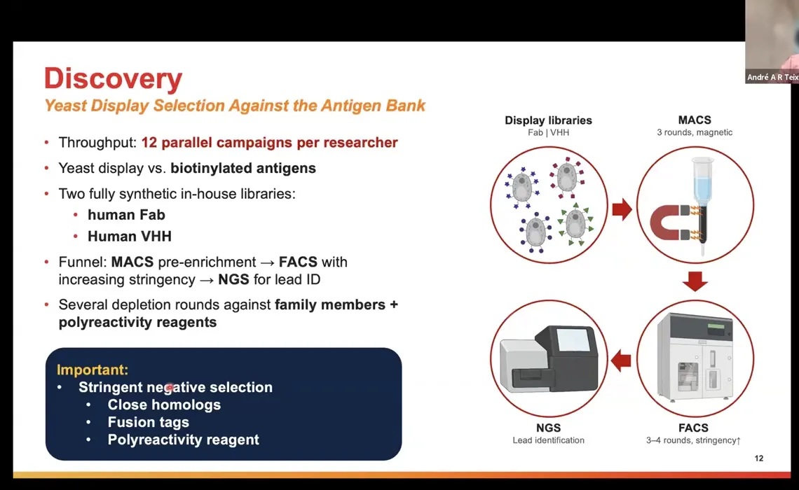
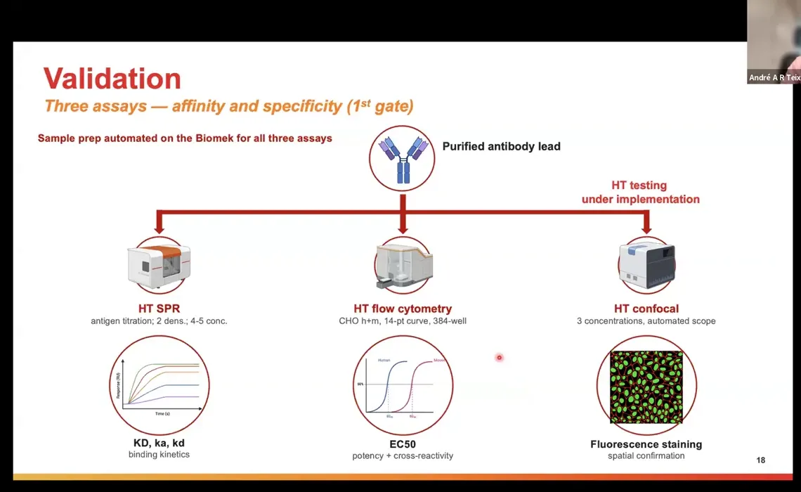
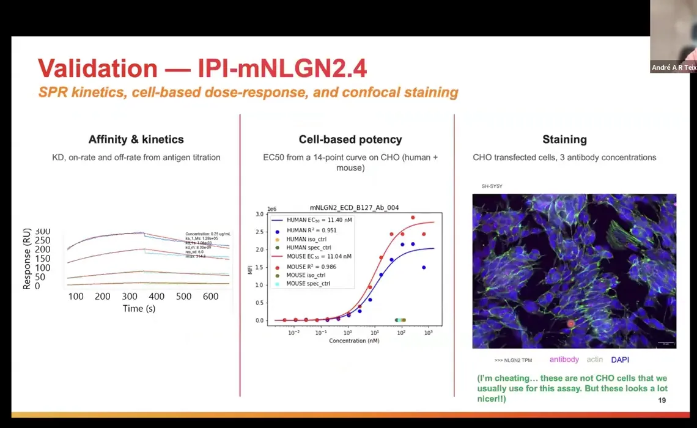
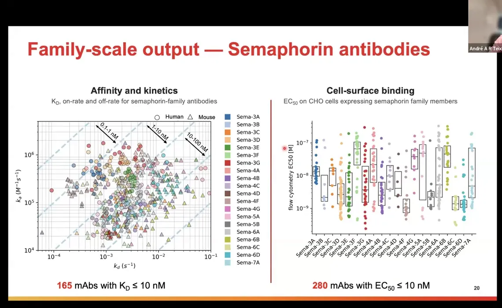

# 酵母展示分选的严格度爬坡：亲和力压力、反向剔除与克隆验证

> 视频来源：[End-to-End Antibody Discovery: Yeast Display, Automation, AI and Multispecifics](https://www.youtube.com/watch?v=aGwGLHhWIHE)（YouTube · MiLaboratories 网络研讨会；讲者 André R Teixeira，Institute of Protein Innovation 抗体平台高级总监；主持 Stan Poslavsky）｜时长约 60 分钟
>
> 导读：本讲用一家非营利研究所（IPI）的真实产线，把「从展示文库到可复核抗体」的每一步摊开：抗原制备、三轮磁珠预富集、3 到 4 轮流式分选、全量 NGS、24 个 lead 的重组表达与三条并行验证通道。本文只取与**选择压力、反向剔除、富集判读、克隆验证**有关的部分；文库构建与展示体系原理请参看本系列 5.1.6。字幕为自动生成，术语与数字已按幻灯片订正（如 MACS、Attune、HT-SPR、CHO、semaphorin）。

## 本讲要解决的核心问题（SCQA）

**背景**：酵母展示把抗体（Fab 或 VHH）展示在酵母细胞表面，一个细胞一个表型；因为细胞可以被荧光标记的抗原染色，所以能用流式细胞仪**按荧光强度定量地**把「结合得强的细胞」和「结合得弱的细胞」分开。这是它相对噬菌体淘选最大的不同——淘选只能给出「留下/冲走」，流式可以给出「留多少」。

**冲突**：定量分选立刻带来一个设计问题：门（gate）设在哪里。设松了，一轮下来池子里全是弱结合甚至非特异；设紧了，可能一个都分不出来，或者把真正稀有但优秀的克隆连同噪声一起丢掉。更麻烦的是，很多团队把「某克隆频率高」直接当成「亲和力高」，于是每一轮都在给同一批「容易长、容易染上」的克隆加码。

**疑问**：一轮一轮之间，严格度应该按什么节奏加？「反向剔除」到底要剔掉哪些东西？分选出来的序列，凭什么说它真的结合目标、而且结合得够好？

**回答（中心思想）**：IPI 的做法是把筛选拆成**漏斗 + 爬坡 + 全量测序**三件事——先用三轮磁珠把库压下来，再用 3 到 4 轮流式分选，每轮把抗原浓度从约 120 nM 一路压到 1 nM（**亲和力爬坡**）；每一层都做严格负筛（同源蛋白、融合标签、多反应性试剂）；测序不挑克隆，而是**至少测四轮**、看跨轮富集与绝对频率；最后 24 个 lead 走 SPR、细胞流式、共聚焦三条并行通道验证。核心判断是：**频率不等于亲和力，富集轨迹才是判据；分选只负责缩小范围，结论必须由重组蛋白的独立测量给出。**

---

## 一、漏斗：三轮磁珠压下来，3 到 4 轮流式收口

[【跳转到 17:27】](https://www.youtube.com/watch?v=aGwGLHhWIHE&t=1047)

讲者把整个发现阶段概括成一个漏斗：**展示文库 → 磁珠分选（MACS，3 轮）→ 流式分选（FACS，3 到 4 轮，严格度逐轮递增）→ NGS 定 lead**。

几个设计选择值得注意：

- **抗原全部生物素化**，这样可以用链霉亲和素磁珠或荧光链霉亲和素做捕获与检测，同一套抗原能同时服务于磁珠分选和流式分选。
- **两个全合成库**：human Fab 库与 human VHH 库，都超过 $10^{10}$ 转化子。Fab 库只在重链 CDR3 上有多样性，轻链只有四条且完全固定——讲者的理由是下游 reformat 时不用为轻链订基因、不用管轻重链配对，把生产成本和复杂度砍掉一半；重链带条形码，一次 Illumina 测序就知道重链和轻链的身份。
- **序列风险位点在建库阶段就删掉**：所有 CDR（包括 CDRH3）里的序列 liability 都被移除，目的是提高 campaign 的成功率。

这里有一个重要的分工：**文库设计负责「让好抗体更容易出现」，筛选负责「把好抗体挑出来」**。讲者反复强调后面这一点——如果流程不够好，你可能要筛 100、200、1000 个分子才能找到想要的那个；如果流程建得好，就不需要筛那么多。文库构建的细节属于 5.1.6 的范围，这里只需要记住：**筛选压力的起点，是库本身已经排除了哪些坏性质**。

---

## 二、负筛要剔掉三类东西，而不是一句「加个对照」

[【跳转到 17:52】](https://www.youtube.com/watch?v=aGwGLHhWIHE&t=1072)

讲者对负筛的表述很硬：「你必须做严格的负筛。我们在 MACS 里做负筛，在 FACS 里也做负筛。」他给出的理由是：这才能保证我们做出的是**针对目标抗原**的抗体，而不只是「能结合某个东西」的抗体。他还补了一句——这在发现项目里是个非常常见的错误：只对目标做筛选，既不剔除库，也不测交叉反应。

幻灯片左下角的框里列了三类必须剔除的对象，这三类对应三种完全不同的假阳性来源：

1. **close homologs（近缘同源蛋白）**。每个蛋白在进化上通常都有同源物（基因复制），人蛋白质组里就存在大量相似蛋白。如果不对同源物做剔除，你筛到的是「结合这个家族」的抗体，而不是「只结合这一个成员」的抗体。讲者在问答里还补了一层：如果你在对 target A 筛选、同时对 target B（与 A 有 90% 同一性）做反选，那就更难拿到高亲和力抗体——**选择性和亲和力在这里是互相拉扯的**。
2. **fusion tags（融合标签）**。他们大量使用融合标签来表达和纯化抗原，所以必须对标签本身做剔除，否则筛出来的是抗标签抗体。这是重组抗原路线特有的假阳性：抗原是「目标蛋白 + 标签」的融合体，抗体分不清哪部分才是目标。
3. **polyreactivity reagents（多反应性试剂）**。讲者的原话是「我们不想要 sticky 抗体，通常是高度疏水或带强电荷的抗体」。多反应性（一个抗体能弱结合很多不相关的东西）是开发阶段最常见的失败模式之一，它在筛选阶段的表现就是「什么都结合一点」，因此必须专门设一层反选把它压下去。

把这三类放在一起看，会发现它们对应三个不同的「非目标」：**同源蛋白是非目标的序列相似性，融合标签是非目标的抗原组成部分，多反应性是非目标的抗体自身性质**。三者都不能靠「洗涤更狠」解决，只能靠专门加一层负筛。

---

## 三、亲和力爬坡：严格度必须一轮比一轮紧

[【跳转到 20:42】](https://www.youtube.com/watch?v=aGwGLHhWIHE&t=1242)

这一页是全讲最核心的机制页。讲者把「back-sorting」（回捞式分选）的流程拆成五步：

1. **先做最大程度的剔除**：拿样品对 off-target 抗原做 max depletion，然后**取流穿液（flow-through）**进入下一步。注意这一步的方向——被 off-target 拉走的是要丢掉的部分，流穿液才是要继续的。
2. **在 96 孔板里染色**：把流穿液分到 96 孔板，每个孔用不同条件染色。讲者说得很具体——**对目标抗原做浓度滴定，包括 0 nM**；同时**对 off-target 也染色**。
3. **用高通量流式读整板**：所有孔都在高通量流式细胞仪（Attune HT）上读，这样一次能看到整块板的结果，而不是一管一管手动跑。
4. **看结果再决定分选哪个**：讲者举了两个对照——某个样品在 20 nM 就有很好的结合，那就分选它；另一个靶点的样品要到 100 nM 才有好结合，那就分选那一个。**门不是统一设的，而是按每个靶点的实际结合强度现场定**。
5. **分选后扩增，再循环 3 到 4 次**，每轮严格度递增。

### 3.1 爬坡的具体数字

幻灯片上写的是 **100 → 20 → 4 → 1 nM**；讲者口述的版本是「通常从 120 开始，试着滴到 1 nM」。他还给了一条硬底线：**如果 100 nM 还看不到结合，就直接判定失败**——因为亲和力差于 100 nM 的抗体对他们没有多大用处。

这条「失败线」的意义常被忽略：它不是在挑最好的，而是在**定义什么叫不可接受**。有了这条线，每一轮的输入就自动被截断在「至少能结合到某个程度」的范围内，弱结合克隆不会靠数量优势一路混到最后一轮。

### 3.2 为什么「先看整板再设门」比「统一设门」更可靠

流式分选的门是一个**绝对荧光阈值**，但荧光强度同时受抗原标记密度、细胞表面展示量、染色效率影响。同一个门，对不同靶点、不同批次的抗原，含义完全不同。讲者的做法是把「设门」变成一个**相对判断**：在 96 孔板上同时放多个抗原浓度（含 0 nM）和多个 off-target，用整板结果反推「这个样品在什么浓度下还有结合」，再据此决定分选哪一群。

这也解释了为什么他们强调「0 nM」这一孔：它是**每块板自带的本底对照**，用来界定「非特异染色的天花板在哪」。没有它，你无法判断某个信号是结合还是粘附。

### 3.3 爬坡不是线性的，也不是总能爬到底

讲者明确说：滴到 1 nM 并不总是可能，尤其取决于剔除——如果 off-target 与目标非常接近，就更难拿到高亲和力抗体。这句话把「严格度」和「选择性」的矛盾摆到了台面上：**反选越狠，能活下来的克隆越少，其中高亲和力的也更少**。爬坡的终点不是设定值，而是「还能分出足够细胞」的那个点。

---

## 四、测序不是为了挑克隆，而是为了看富集轨迹

[【跳转到 22:44】](https://www.youtube.com/watch?v=aGwGLHhWIHE&t=1364)

讲者直接否掉了挑克隆这条路，理由是算术：

- 一个 campaign 要挑三到四板，每板几十上百个克隆；
- Sanger 测序一个样品约 9 美元，挑四到七板，**光测序就要花掉约 1 万美元**；
- 再加上挑克隆、培养、处理的人力。

他的结论是：挑克隆唯一的优势是**验证更快**（挑出来就能立刻测结合，绕过 NGS 和合成生产），但它永远无法匹配 NGS 的数据量。

他们的替代方案是**全量测序**：

- **至少测四轮分选产物**。一次 MiSeq 有约 2000 万 reads，每个样品需要约 10 万 reads，所以一次能装很多样品——这让他们可以「把每一轮都测一遍」，而不是只测最后一轮。
- **on-target 和 off-target 都测**。即使某个 off-target 的结合弱一些，也测，用来把可能有交叉反应的抗体排除掉。
- **看三样东西**：绝对频率、跨轮富集（round-over-round enrichment）、序列聚类。
- **同一遍做 liability 筛查**：在 reformat 之前就把有问题的克隆标出来。

### 4.1 「频率不等于亲和力」——本讲最该记住的一句

主持人在问答里问：从 NGS 和从挑克隆拿到的 lead，质量有差别吗？讲者的回答是：

> 在展示领域，我们历史上就知道**频率不一定与亲和力相关**。做挑克隆的时候，你被限制在最高频的那些克隆里，你没法挖得更深，没法看聚类，没法对整个人群有鸟瞰，也没法追踪富集。

他接着给出了「NGS 能做什么挑克隆做不到的事」的具体例子：**看「当你降低抗原浓度时，谁在富集」，看「当你换靶点时，谁在富集」**。

这两句话把「富集判读」的判据讲清楚了：

- **单纯的高频率**可能来自扩增偏倚、展示量高、或者只是长得快；
- **在压力加严时频率还在上升**（降低抗原浓度后仍富集），才说明这个克隆的结合足够强；
- **在换靶点后频率下降**（对另一个靶点不富集），才说明这个克隆是特异的。

换句话说，**判据不是「这一轮谁最多」，而是「跨轮、跨条件的频率变化方向」**。这正是「富集倍数」与「丰度」的区别：丰度是一个截面的高度，富集倍数是两个截面之间的斜率。

### 4.2 功能类抗体：把「构象」也变成负筛对象

讲者在最后一个问题里给了一个更激进的例子：他们有一个**激动剂（agonist）项目**，把受体设计成两种构象——一种失活构象，一种锁定在活性构象。然后**对活性构象做筛选，对失活构象做剔除**，这样富集出来的是能区分两种构象的抗体。

他解释了机制：对 GPCR 和好几类受体来说，稳定活性构象就能驱动激动——抗体找到受体、把受体稳定在活性构象、从而激活它。而**受体越难稳定，能区分构象的克隆就越稀有，用挑克隆就越难找到**。

这里的教训是：**负筛的对象可以是「同一个分子的另一个状态」**。当你要的不是「结合」，而是「结合并产生特定功能」时，最有效的反选往往不是别的蛋白，而是同一个蛋白的无功能构象。

---

## 五、克隆验证：24 个 lead 的生产与三条并行通道

[【跳转到 26:23】](https://www.youtube.com/watch?v=aGwGLHhWIHE&t=1583)

从测序到蛋白，中间还有一段容易被忽略的工程：**每个靶点约 24 个 lead**，重排成项目需要的形式（绝大多数是 IgG 或 VHH-Fc）。

讲者特别强调这一步必须自动化：如果一次要转染 300、400 个抗体，手工匹配重链和轻链、把正确的质粒组合放到正确的孔里，是不现实的。他们用 Biomek i7 做转染与配对，Expi293 表达 5 到 7 天，再用正压（而不是磁珠）做 Protein A 纯化——原因是 VH3-23 胚系和 VHH 本身会结合 Protein A，磁珠洗脱效率差，柱上加正压效果好得多。

QC 有两项：**HPLC-SEC 看聚集**、**自动化 ELISA 看多反应性**（对 OVA、胰岛素、DNA、亲和素等）。但讲者说了一句很关键的话：**这个 QC 不是进入下一阶段的门控**。

理由是格式：所有东西都在 96 孔板里，把失败的挑出去反而比全都测一遍更麻烦。所以即使某个分子在聚集或多反应性上不合格，它仍然会进入下游的结合、生物传感与成像测试。这是一个**流程设计上的取舍**：为了保持流水线的连续性，允许「已知有风险的分子」继续走完，代价是浪费一些验证通量，收益是不用做 cherry-picking、也不会因为一次 QC 假阴性丢掉好分子。

### 5.1 三条并行验证通道：SPR、细胞流式、共聚焦

[【跳转到 30:14】](https://www.youtube.com/watch?v=aGwGLHhWIHE&t=1814)

纯化的抗体同时进三条通道，输出三种不同的证据：

| 通道 | 怎么做 | 输出 | 回答什么问题 |
| --- | --- | --- | --- |
| HT-SPR | 表面固定 2 到 3 个抗体密度，4 到 5 个抗原浓度、3 到 4 倍梯度稀释 | KD、ka、kd | 结合多强、结合多快、解离多快 |
| HT 流式 | CHO 细胞转染人源与鼠源同一基因，14 点滴定，384 孔板 | EC50、种属交叉 | 能不能结合细胞表面的天然构象 |
| HT 共聚焦 | 3 个浓度，自动化显微镜 | 荧光图像 | 结合的位置对不对（空间确认） |

这三条通道的差别不是「精度高低」，而是**被测对象不同**：SPR 测的是纯化的重组抗原与纯化的抗体之间的结合；细胞流式测的是细胞膜上的抗原与抗体的结合；共聚焦测的是「结合发生在哪个位置」。讲者说得很直白：这样才能看到**对表达受体的细胞的结合，而不只是对重组蛋白的结合**。

### 5.2 一个具体例子：IPI-mNLGN2.4

[【跳转到 31:38】](https://www.youtube.com/watch?v=aGwGLHhWIHE&t=1898)

讲者给了一个完整的三联图：

- **左（SPR）**：四条不同抗原浓度的传感图，拟合出亲和力；
- **中（细胞流式）**：对表达目标的人源细胞与鼠源细胞分别做 14 点滴定，人源 EC50 为 11.40 nM，鼠源 EC50 为 11.04 nM——两条曲线几乎重合，说明这个抗体**跨物种交叉反应**；下方还有同型对照与特异性对照，都没有结合；
- **右（共聚焦）**：抗体染色与 actin、DAPI 叠合，看到膜上的定位。

讲者在这里还主动做了一次诚实声明：这张共聚焦图用的不是他们常规的 CHO 细胞，而是天然表达该靶点的癌细胞，只是为了「好看一点」。这个细节值得记下来——**图好看和图是标准流程产物，是两件事**。

---

## 六、结果尺度：165 个 KD 不大于 10 nM，280 个 EC50 不大于 10 nM

[【跳转到 32:53】](https://www.youtube.com/watch?v=aGwGLHhWIHE&t=1973)

讲者用 semaphorin 家族（20 个成员，参与轴突导向与免疫突触）做了一次「家族尺度」的展示：约 500 个抗体，其中 **165 个的 KD 不大于 10 nM**；同一批抗体在细胞上测，**280 个的 EC50 不大于 10 nM**。

这张图值得细看两点：

1. **左图的坐标轴是 ka 和 kd，不是 KD**。斜向虚线是等亲和力线——同一条线上的点 KD 相同，但动力学完全不同。这提醒一件事：**KD 相同的两个抗体，可能一个结合快解离快、一个结合慢解离慢**，而在体内（尤其需要长时间占据靶点时）表现会差很多。所以判读「亲和力」时，只看 KD 会丢掉一半信息。
2. **两个读数不一致**：SPR 上 KD 不大于 10 nM 的有 165 个，细胞上 EC50 不大于 10 nM 的有 280 个，数字对不上。原因不难理解——细胞表面受体密度高、存在二价结合与 avidity 效应，EC50 会被「拉低」；而 SPR 测的是单价结合。**同一批分子在两个体系里排序不同，是常态而不是异常**。

讲者还给了「从展示库出来能拿到什么亲和力」的经验值：在 semaphorin 这个例子里，大约**三分之一的抗体亲和力好于 10 nM**；这非常依赖靶点——LRR 结构域、β-propeller 结构域这类刚性靶点容易拿到好的抗体，甚至几个亚纳摩尔级的；而无序蛋白就很难。

---

## 七、多聚抗原的陷阱：avidity 会冒充 affinity

[【跳转到 53:00】](https://www.youtube.com/watch?v=aGwGLHhWIHE&t=3180)

问答里有人问：用 HT-SPR 测多聚抗原的结合动力学，怎么避免 avidity 和再结合的干扰？讲者的回答很干脆：**你避免不了**。

- 只要有二聚体、三聚体，你测到的就是**表观亲和力（apparent affinity）**，不是可靠的亲和力读数。
- 但如果抗原在自然界就是二聚体，那**单体亲和力其实不重要**——它永远以二聚体形式存在，测二聚体才是对的。
- 真正的问题是**人为制造的二聚**：很多人用 Fc 融合来表达抗原，一个天然单体的抗原被做成了二聚体，这时候你测的是 avidity，而抗原在体内并不以二聚体存在——**你测错了东西**。
- 细胞上的测量同样有 avidity：细胞表面有很多受体，抗体会同时结合多个。

这一段对「克隆验证」的意义在于：**验证读数必须与抗原的真实存在形式匹配**。用 Fc 融合抗原筛出来的「高亲和力」，可能在单体抗原上是另一个数字；反过来，用单体抗原筛出来的抗体，在细胞上可能表现更好。判断一个验证结果能不能采信，第一件事是问「这个抗原以什么形式存在」。

---

## 八、小结

- **漏斗的形状决定了每一层的压力**。三轮 MACS 负责把 $10^{10}$ 量级的库压到可操作规模，3 到 4 轮 FACS 负责按结合强度收口，NGS 负责在收口后的池子里排序。
- **负筛要剔三类东西**：近缘同源蛋白（决定选择性）、融合标签（决定是不是抗标签抗体）、多反应性试剂（决定会不会是 sticky 抗体）。三者都不能靠「洗得更狠」解决。
- **亲和力爬坡是显式设计的**：100 → 20 → 4 → 1 nM，口述版本是 120 → 1 nM；100 nM 还测不到结合就判失败。严格度的终点不是设定值，而是「还能分出足够细胞」的那个点。
- **门要按靶点现场定**。96 孔板里同时放多个抗原浓度（含 0 nM）和多个 off-target，用整板结果反推该分选哪一群；0 nM 孔是每块板自带的本底对照。
- **频率不等于亲和力**。挑克隆被限制在最高频的克隆里，看不到聚类、看不到富集轨迹；NGS 的价值在于能回答「降低浓度后谁在富集」「换靶点后谁在富集」。
- **富集倍数与丰度是两个不同的量**：丰度是某一轮的截面高度，富集倍数是两轮之间的斜率。判据是斜率的方向，不是高度。
- **负筛的对象可以是同一个分子的另一个构象**。激动剂项目对活性构象筛选、对失活构象剔除，这是把「功能」写进选择压力的办法。
- **验证必须多通道且互相独立**：SPR 给 KD/ka/kd，细胞流式给 EC50 与种属交叉，共聚焦给空间定位。同一批分子在两个体系里排序不同是常态。
- **验证读数要与抗原的真实形式匹配**。人为二聚化（如 Fc 融合）会把 avidity 冒充成 affinity。

## 关键术语速查

| 术语 | 一句话解释 |
| --- | --- |
| MACS | 磁珠激活细胞分选；用磁珠捕获结合了生物素化抗原的酵母，做粗富集与负筛 |
| FACS 与 back-sorting | 荧光激活细胞分选；把上一轮分选产物重新染色、按荧光强度设门再分选 |
| affinity ramp（亲和力爬坡） | 每一轮把抗原浓度降低一档（如 100 到 20 到 4 到 1 nM），用浓度作为选择压力 |
| depletion（剔除、负筛） | 用 off-target 抗原、同源蛋白、融合标签或多反应性试剂把不需要的克隆拉走 |
| 富集倍数（enrichment） | 同一序列在两轮之间的相对占比变化；反映被选中的概率变化，不等于亲和力变化 |
| 绝对频率（absolute frequency） | 某一序列在某一轮池子里的 reads 占比；受展示量、扩增效率影响 |
| KD、ka、kd | 平衡解离常数、结合速率常数、解离速率常数；KD 相同不代表动力学相同 |
| EC50 | 细胞结合或功能达到最大值一半时的抗体浓度；受受体密度与 avidity 影响 |
| avidity（亲合力） | 多价结合带来的总结合强度；与单价 affinity 不是一回事 |
| liability | 序列层面的风险位点（如易聚集、易脱酰胺的基序），可在建库或测序分析阶段标记 |