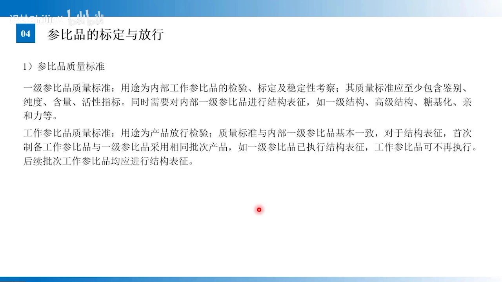
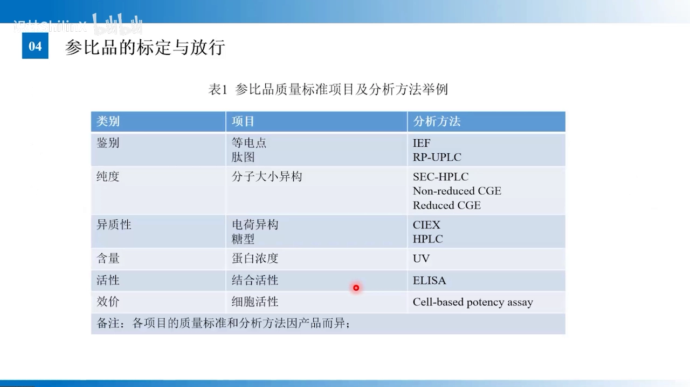
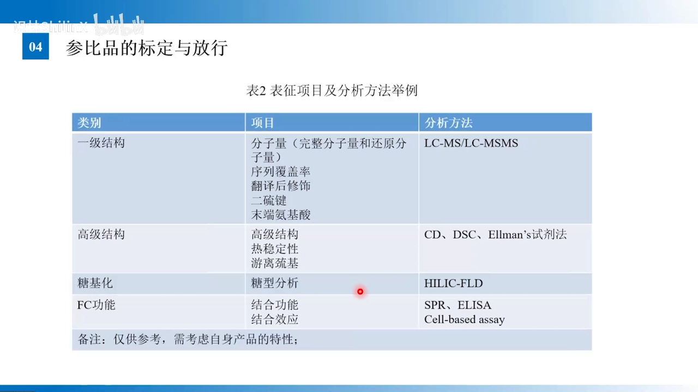
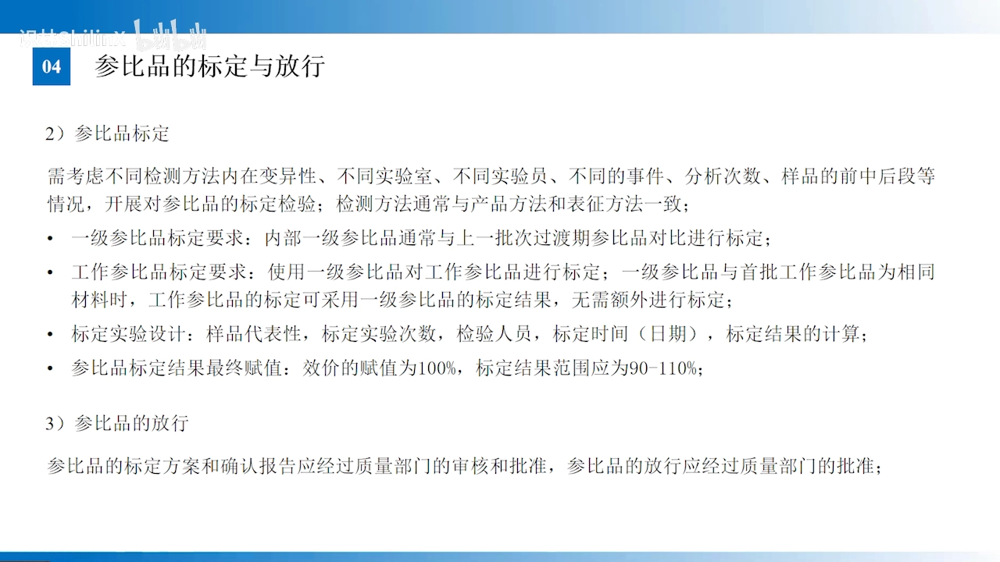

# 参比品的标定与放行：怎样给一把尺子定刻度

> 视频来源：[生物制品参比品的标定与放行](https://www.bilibili.com/video/BV1e24y1k7LJ/)（Bilibili · 识林 ShilinX）｜时长约 7.5 分钟
> 导读：这是一节很短的法规实务课，只讲一件事——参比品（reference standard）本身作为一种"物料"，它的质量标准怎么定、怎么标定、怎么放行。它正好补上上一篇《抗体药物的质量标准账本》里被略过的一环：所有"相对读数"的锚点从哪来。字幕为 AI 生成，"参比品"曾被识别成"餐饮品/产品品/菜品品"，已统一订正。

## 本讲要解决的核心问题（SCQA）

**背景**：抗体实验里绝大多数关键读数都是**相对的**——效价报"相对参比品 105%"，结合活性报"相对参比品 98%"，糖型报"相对参比品的分布"。这些数字之所以能跨批次、跨年份、跨实验室比较，全靠同一支参比品当锚。

**冲突**：可参比品自己也是一瓶蛋白。它会降解、会换批、会由不同的人在不同的日子测。如果参比品本身没有质量标准、没有经过标定、没有经过放行，那它就只是一瓶"看起来像样"的样品——用它校准出来的所有数字，都是在一个不确定的刻度上量出来的。

**疑问**：参比品要满足什么质量标准？它的效价值凭什么被定为 100%？标定要考虑哪些变异来源？标定范围为什么不能太宽也不能太窄？谁有权放行一支新的参比品？

**回答（中心思想）**：参比品是**一把尺子的刻度**，它的标定过程本质上是一次**方法变异性的测量**——正因为不同实验室、不同实验员、不同日期、样品的前中后段都会让结果漂移，才必须用多因素、多次重复的实验设计去定这个刻度，并把效价赋值为 100%、把标定结果的允许范围收在一个窄区间（如 90%~110%）。刻度定完，还要经质量部门审核批准才能放行。**参比品的质量不是"测出来的一个数"，而是"一套被批准的方案 + 报告 + 赋值"。**

---

## 一、先分清两级参比品：一级定标准，工作做放行

[【跳转到 00:07】](https://www.bilibili.com/video/BV1e24y1k7LJ/?t=7)

讲者开篇就把参比品分成两类，用途完全不同：

| | 一级参比品 | 工作参比品 |
| --- | --- | --- |
| 用途 | 为内部工作参比品的**检验、标定及稳定性考察**提供依据 | **产品放行检验** |
| 质量标准 | 至少包含鉴别、纯度、含量、活性指标 | 与内部一级参比品基本一致 |
| 结构表征 | 必须做（一级结构、高级结构、糖基化、亲和力等） | 首次制备时若与一级参比品同批次同制备方式，可引用一级的结果，不再重复；**后续批次必须做** |

这个两级结构很好理解，类比一下：一级参比品是**国家的原器（标准米尺）**，平时锁在恒温柜里，只在需要时拿出来校准；工作参比品是**车间里天天用的钢卷尺**，每天量产品用的是它，但它必须定期跟原器对一次。

[【跳转到 00:57】](https://www.bilibili.com/video/BV1e24y1k7LJ/?t=57)

讲者特别交代了一个省事的例外：**首次制备的工作参比品，如果和一级参比品用的是相同批次产品或同样的制备方式，那么工作参比品标定中的结构表征部分可以直接参考一级参比品的结果**，不必重做。但这条豁免只对首次有效——后续批次换了材料，就必须做全面的检定和相应的表征。

[【跳转到 01:22】](https://www.bilibili.com/video/BV1e24y1k7LJ/?t=82)

这个细节说明法规逻辑的重点不是"每一项都要重做"，而是**"每一项都要有来源"**。同源可以引用，换源必须重做。

## 二、参比品的质量标准长什么样：一张放行表 + 一张表征表

### 2.1 放行层面的项目

[【跳转到 01:34】](https://www.bilibili.com/video/BV1e24y1k7LJ/?t=94)

讲者给了一张传统单克隆抗体的示例表，把类别、项目、分析方法三列并排：

| 类别 | 项目 | 分析方法 |
| --- | --- | --- |
| 鉴别 | 等电点、肽图 | IEF、RP-UPLC |
| 纯度 | 分子大小异构 | SEC-HPLC、非还原 CGE、还原 CGE |
| 异质性 | 电荷异构、糖型 | CIEX、HPLC |
| 含量 | 蛋白浓度 | UV |
| 活性 | 结合活性 | ELISA |
| 效价 | 细胞活性 | 细胞学效价方法（cell-based potency assay） |

[【跳转到 01:59】](https://www.bilibili.com/video/BV1e24y1k7LJ/?t=119)

注意这张表和产品放行表高度相似——这并不奇怪，因为工作参比品的用途就是"产品放行检验"，它必须能当**阳性对照**用。如果参比品自己的纯度、电荷异构、糖型都不合格，它给出的"合格"就没有说服力。

[【跳转到 02:24】](https://www.bilibili.com/video/BV1e24y1k7LJ/?t=144)

讲者反复强调一句：**"各项目的质量标准和分析方法因产品而异的，应该根据自家产品的特性制定合适的标准、项目和方法。"** 表里最下面那行备注写的就是这句。所以这张表是模板，不是清单。

### 2.2 表征层面的项目

[【跳转到 03:14】](https://www.bilibili.com/video/BV1e24y1k7LJ/?t=194)

第二张表是参比品的**表征**项目，分四类：

| 类别 | 项目 | 分析方法 |
| --- | --- | --- |
| 一级结构 | 分子量（完整分子量与还原分子量）、序列覆盖率、翻译后修饰、二硫键、末端氨基酸 | LC-MS / LC-MS/MS |
| 高级结构 | 高级结构、热稳定性、游离巯基 | CD、DSC、Ellman 试剂法 |
| 糖基化 | 糖型分析 | HILIC-FLD |
| Fc 功能 | 结合功能、结合效应 | SPR、ELISA、细胞学方法 |

[【跳转到 03:39】](https://www.bilibili.com/video/BV1e24y1k7LJ/?t=219)

把两张表放在一起看，就是上一篇讲过的"放行 vs 表征"分工在参比品上的具体版本：**放行表保证参比品"能用"，表征表保证参比品"被认识"**。一级参比品必须两张都齐；工作参比品在首次制备时可以只做放行表 + 引用一级的表征结果。

## 三、标定：把"100%"这个数字钉在什么材料上

[【跳转到 04:35】](https://www.bilibili.com/video/BV1e24y1k7LJ/?t=275)

这是全讲最核心的一页。讲者先列了标定必须考虑的变异来源，然后给标定路径、实验设计要素和赋值规则。

### 3.1 变异来源清单：为什么一次实验定不了刻度

讲者列出的因素有六类：

1. **不同检测方法内在的变异性**——方法本身的精密度上限
2. **不同实验室**——仪器、环境、操作习惯
3. **不同实验员**——人员带来的差异
4. **不同的事件/时间**——不同日期做，结果不同
5. **分析次数**——重复次数
6. **样品的前中后段**——同一瓶样品，取样位置不同

[【跳转到 04:10】](https://www.bilibili.com/video/BV1e24y1k7LJ/?t=250)

这六项里，前三项是**系统性的**（换实验室、换人就换一个偏移），后三项是**随机性的**（时间、次数、取样位置）。一个合格的标定方案必须同时覆盖这两类，否则你定出来的刻度只对"那一天的、那个人的、那一瓶的上半段"有效。

这也解释了为什么标定不能"做一次、取个平均值就完事"。**标定的本质不是测一个值，而是测这个值的分布**。

### 3.2 两条标定路径

讲者给了两条路径，区别在于"拿什么当参照"：

- **一级参比品的标定**：通常与**上一批过渡期参比品对比**进行。也就是说，新一级不是凭空赋值，而是"接着上一支往下传"。
- **工作参比品的标定**：用**一级参比品**来标定工作参比品。
- **例外**：如果一级参比品与首批工作参比品是**相同材料**，工作参比品的标定可以直接采用一级参比品的标定结果，无需额外标定。

[【跳转到 05:00】](https://www.bilibili.com/video/BV1e24y1k7LJ/?t=300)

这三条合起来是一条**传递链**：过渡期参比品 → 一级参比品 → 工作参比品 → 每一批产品。链条上每一环都要有记录，任何一环断了，后面所有相对读数就失去了溯源路径。

### 3.3 实验设计要素与赋值规则

讲者列了标定实验设计必须写清楚的五件事：**样品的代表性、标定实验次数、检验人员、标定时间（日期）、标定结果的计算方式**。

[【跳转到 05:25】](https://www.bilibili.com/video/BV1e24y1k7LJ/?t=325)

然后是赋值规则，两句话：

- **效价的赋值为 100%**；
- **标定结果的范围应为 90%~110%**。

[【跳转到 05:50】](https://www.bilibili.com/video/BV1e24y1k7LJ/?t=350)

这个 90%~110% 不是随口定的。讲者的解释是：它"基于你所用的检测方法本身的变异性和实验次数综合确定"——方法越不精密、重复次数越少，这个区间就得越宽；反之可以收窄。

[【跳转到 06:15】](https://www.bilibili.com/video/BV1e24y1k7LJ/?t=375)

讲者还补了一句很实用的提醒：**这个范围不能过于宽泛，过宽就起不到控制作用；也不能定义得太窄，太窄标定过程中就会发生偏差，需要做充分的调查**。这是一个典型的"控制限设定"权衡：限太松，等于没限；限太紧，正常波动也会被判成异常，每次都启动调查，成本反而更高。

> 补充（非讲者原话）：相对效价的常规算法是用参比品与样品的半数有效浓度之比来换算，即
>
> $$
> \text{相对效价} = \frac{EC_{50}^{\text{参比品}}}{EC_{50}^{\text{样品}}} \times 100\%
> $$
>
> 所以参比品被赋值为 100%，等于给这条公式定了分母。分母一动，所有历史数据的"相对效价"就整体平移——这就是为什么换批参比品必须做桥接（bridging），而不能直接换。

### 3.4 标定结果怎么变成一份可放行的东西

[【跳转到 06:40】](https://www.bilibili.com/video/BV1e24y1k7LJ/?t=400)

讲者说，经过标定，最后会出**参比品的 COA**（检验报告），并根据所有标定与表征的结果出**参比品的确认报告**。经过确认和标定之后，参比品才会进行放行。

放行的要求是：**标定方案和确认报告都应经过质量部门的审核和批准，参比品的放行应经过质量部门的批准**，才能放行新批次的参比品。

[【跳转到 07:05】](https://www.bilibili.com/video/BV1e24y1k7LJ/?t=425)

这里有个容易被忽略的点：被批准的不仅是"结果"，还有"方案"。**方案先批、结果后批**，这是 GMP 体系的基本顺序——如果先做实验再补方案，那这个结果在监管眼里是不可采信的。

## 四、这套逻辑对发现阶段意味着什么（本节补充）

以下是把法规实务迁移到发现阶段的建议，不是讲者原话。

1. **发现阶段也该有一支内部参比品**。哪怕只是一小管早期批次冻干分装，它也能让"这个抗体在 3 月和 9 月测的 $K_D$"具备可比性。没有它，你无法区分"分子变了"和"方法漂了"。
2. **参比品要按物料管理，而不是按试剂管理**。给它批号、给它 COA、给它储存条件、给它有效期。实验记录里写"用参比品 X 批号 Y"，而不是"用上次那管"。
3. **换参比品必须做桥接**。新旧两支参比品同时测同一批样品，确认偏移在可接受范围内，再切换。否则前后两批数据不能放在一张图上排序。
4. **把"样品前中后段"这条写进 SOP**。分装冻存的样品，取上清还是取底部、冻融几次，都会改变聚体比例，而聚体比例会改变结合读数。
5. **标定范围要跟你的方法变异匹配**。如果你的 SPR 重复测量 $K_D$ 的批内 CV 就有 20%，却把参比品标定范围定在 ±5%，那你会一直在做无效调查。

## 小结

- **参比品分两级**：一级参比品定标准（用于工作参比品的检验、标定、稳定性考察），工作参比品做产品放行检验。
- **一级必须做结构表征**；工作参比品首次制备若与一级同源，可引用一级的表征结果，后续批次必须重做。
- **参比品的质量标准与产品放行表高度相似**，因为它要当阳性对照用；但具体项目、标准、方法都因产品而异。
- **标定要考虑六类变异**：方法内在变异、实验室、实验员、时间、分析次数、样品前中后段。
- **标定是传递链**：过渡期参比品 → 一级 → 工作 → 每一批产品。
- **效价赋值为 100%，标定结果范围通常 90%~110%**；范围太宽失去控制作用，太窄则频繁触发偏差调查。
- **放行要经质量部门批准方案与报告**，方案先批、结果后批。
- **参比品是所有相对读数的分母**，换批必须桥接，否则历史数据不可比。

## 关键术语速查

| 术语 | 一句话解释 |
| --- | --- |
| 参比品（reference standard） | 用于校准和比较的基准物质，所有相对读数的锚点 |
| 一级参比品 | 最高层级的内部标准品，用于标定工作参比品与稳定性考察 |
| 工作参比品 | 日常放行检验用的标准品，须与一级参比品保持一致 |
| 标定（calibration） | 确定参比品各项赋值（尤其效价）的实验过程 |
| 赋值 | 给参比品规定一个数值，效价通常定为 100% |
| 过渡期参比品 | 上一代参比品，用于给新一级参比品做对比标定 |
| COA | 检验报告（Certificate of Analysis），逐项列出检测结果 |
| 确认报告 | 汇总标定与表征结果、证明该批参比品合格的报告 |
| 桥接（bridging） | 新旧参比品同时测同批样品，确认偏移可接受后再切换 |
| 相对效价 | 样品相对于参比品的效价百分比，参比品为 100% |
| CGE | 毛细管凝胶电泳，按分子大小分离蛋白 |
| CIEX | 阳离子交换色谱，按电荷分离，看电荷异构体 |
| HILIC-FLD | 亲水作用色谱配荧光检测，常用于糖型分析 |
| DSC | 差示扫描量热，测热稳定性（$T_m$） |