# 抗体药物的质量标准账本：放行检测、表征与批次一致性

> 视频来源：[抗体药物的开发过程和质量标准](https://www.bilibili.com/video/BV1F3411k7gn/)（Bilibili · 检测家 Easylab · 讲者 杨晓明，杭州奕安济世生物药业）｜时长约 27 分钟
> 导读：这是一场面向 CMC 从业者的基础报告，从"一个批次值多少钱"讲到放行检测清单、表征清单、稳定性研究与成药性评估。本文只取"质量属性与放行"这条主线：宿主/载体/培养/纯化流程的细节见本系列 4.2.4，化学修饰机制见 4.2.3，本文不重复。字幕为 AI 生成，CMC、CPD、PC、PV、SEC、CE 等术语已按上下文订正。

## 本讲要解决的核心问题（SCQA）

**背景**：抗体药物是细胞生产出来的大分子，一条基因序列并不对应一种分子，而是一群带不同修饰的变体混合物。所以"这一批抗体好不好"不能靠看，只能靠一整套检测去测。

**冲突**：麻烦在于，这套检测不是一个固定清单。同一个分子，在临床一期、三期和商业化阶段，工艺不一样、制剂不一样、批次数量不一样，需要证明的东西也不一样。更麻烦的是，"放行检测合格"和"这个分子被表征清楚了"是两件不同的事，而很多团队在早期把它们混为一谈——早期做得太少，后面在工艺开发和生产阶段集中爆雷。

**疑问**：一批抗体到底要测哪些项目？放行检测和表征分析的分界线在哪里？批次之间的差异从哪里来，又该怎么被证明"不是分子变了"？在只有几个候选分子、只有小批量样品的发现阶段，这套账本该怎么用？

**回答（中心思想）**：抗体质量标准的本质是一本**分批次的证据账本**——放行检测回答"这一批能不能用"，表征分析回答"这个分子到底是什么"，稳定性研究回答"这批能放多久"，而成药性评估回答"这个分子将来能不能稳定地做出批次"。四件事各有各的用途，任何一件被省略，批次差异就会以"读数漂移"的形式出现在结合与功能实验里，而你还不知道漂的是分子还是批次。

---

## 一、质量标准不是一张固定清单，而是"产品—工艺—阶段"三者的函数

[【跳转到 00:45】](https://www.bilibili.com/video/BV1F3411k7gn/?t=45)

讲者用一张图定义了 CMC 的位置：左边是从一堆分子里筛到几个候选的 discovery 漏斗，右边是临床一期到商业化的整条时间轴，中间那条橙色横条写着 CMC P&PD Activities。

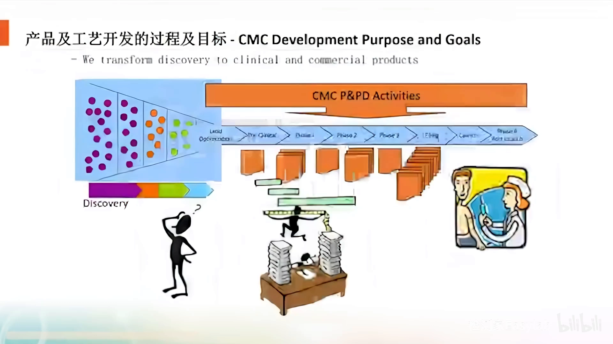

这张图说明：**质量标准不是从天上掉下来的，它是 CMC 这条横条在每个阶段留下的证据累积**。发现阶段交出去的是"分子"，CMC 交出去的是"能证明这个分子被稳定做出来的证据链"。

### 1.1 一个批次值多少钱：为什么"批次"是质量讨论的基本单位

[【跳转到 02:48】](https://www.bilibili.com/video/BV1F3411k7gn/?t=168)

讲者先给了一个很直白的数字：一个生产批次的价值通常**超过 100 万美金**，把生产加检测全算上，做下来至少是 600 万到七八百万人民币。所以每一个批次的成败，都是真金白银。

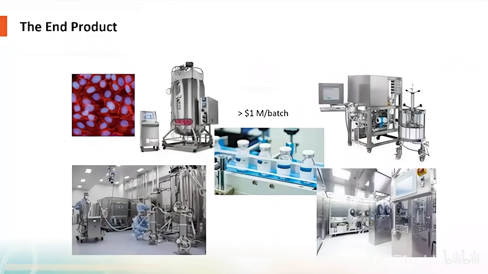

这个数字解释了为什么质量体系要做得这么重：批次太贵，不能靠"多做几批试试"来兜底，只能靠**在放行前就把该测的都测掉**。也解释了为什么批次一旦出问题，调查成本极高——你没法重来一次。

### 1.2 阶段不同，要证明的东西不同

[【跳转到 04:29】](https://www.bilibili.com/video/BV1F3411k7gn/?t=269)

讲者把工艺开发按临床阶段切开，每个阶段对应一类 CMC 工作：

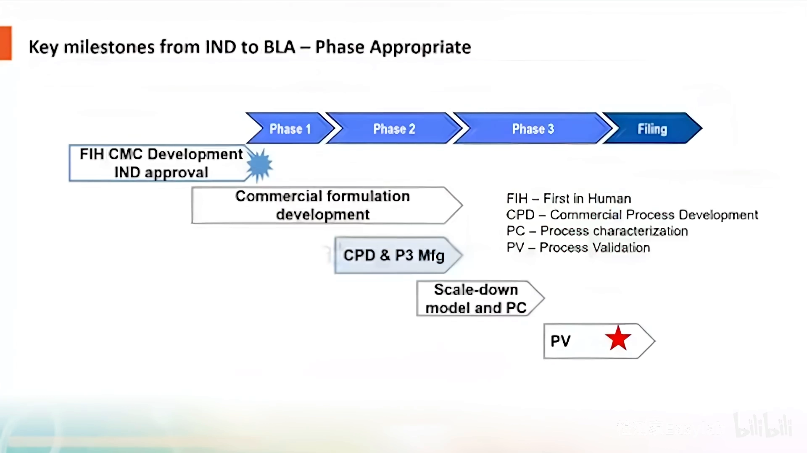

| 阶段 | 要完成的事 | 缩写 |
| --- | --- | --- |
| 一期临床前 | 早期工艺、早期制剂、分析方法，支撑毒理与一二期临床 | FIH（first in human） |
| 一期临床后 | 商业化制剂开发；开始为三期做新工艺 | CPD（commercial process development） |
| 上市申报前 | 工艺表征：搞清楚工艺参数与质量属性的关系 | PC（process characterization） |
| 上市申报前 | 工艺验证：证明工艺在商业化规模上稳定可重复 | PV（process validation） |

讲者特别提醒了一个常见的翻车点：**商业化的 formulation 和早期上临床的 formulation 一定不一样**，至少灌装体积、包装形式要变；一变就要重做稳定性。同样，三期临床的工艺基本就是你上市的工艺，**不能再变**。所以"什么时候开始为三期做新工艺"是一个必须早做的决定——临床三期数据再漂亮，CMC 没跟上，批准也可能 delay 一两年，甚至不批。

[【跳转到 07:30】](https://www.bilibili.com/video/BV1F3411k7gn/?t=450)

这张"按时间排序的主要工作块"把整条线串了起来，注意第 1 项和第 5 项的性质完全不同：

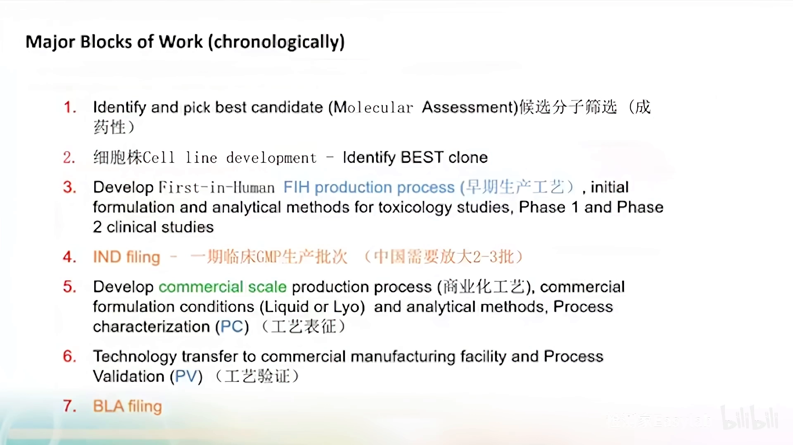

1. 选出最好的候选分子（分子评估 / 成药性）
2. 细胞株开发，找到最好的克隆
3. 开发 FIH 生产工艺、初始制剂和分析方法
4. IND 申报（一期临床 GMP 批次）
5. 开发商业化规模工艺、商业化制剂条件、分析方法，以及工艺表征（PC）
6. 技术转移与工艺验证（PV）
7. BLA 申报

第 1 项是**分子设计证据**，第 5、6 项是**工艺一致性证据**。这个区分是本文后面第六节的主线。

### 1.3 一批样品背后是一摞文件

[【跳转到 01:53】](https://www.bilibili.com/video/BV1F3411k7gn/?t=113)

讲者说 CMC 的工作产出是六类东西：带表征的细胞库、实验与分析（含分析方法开发）、报告与文件、毒理样品、制剂成品，以及 troubleshooting。

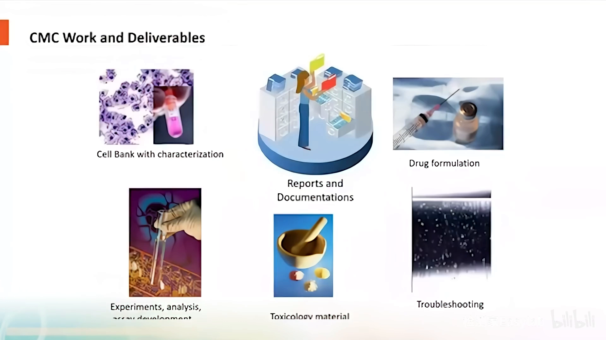

这张图说明一件事：**质量属性不是检测出来的数字，而是"数字 + 方法 + 报告"的组合**。同一个数字，用没验证过的方法测出来，在监管眼里等于没有。

---

## 二、放行检测：一张覆盖外观、鉴别、纯度、杂质、效价、浓度、安全的清单

[【跳转到 20:13】](https://www.bilibili.com/video/BV1F3411k7gn/?t=1213)

这是本讲最核心的一张表。讲者说，这些要求中美基本类似，中国也已加入 ICH 体系。

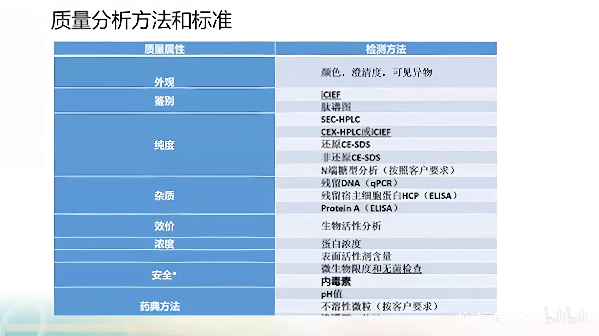

| 质量属性 | 检测方法 | 这一项在防什么 |
| --- | --- | --- |
| 外观 | 颜色、澄清度、可见异物 | 肉眼可见的异常（沉淀、颗粒） |
| 鉴别 | icIEF、肽图谱 | 确认"这瓶里确实是这个分子" |
| 纯度 | SEC-HPLC、CEX-HPLC 或 icIEF、还原 CE-SDS、非还原 CE-SDS、N 端糖型分析（按客户要求） | 聚体、片段、电荷异构体、糖型分布 |
| 杂质 | 残留 DNA（qPCR）、残留宿主细胞蛋白 HCP（ELISA）、Protein A（ELISA） | 工艺相关杂质 |
| 效价 | 生物活性分析 | 这批分子"有没有功能" |
| 浓度 | 蛋白浓度、表面活性剂含量 | 剂量对不对 |
| 安全 | 微生物限度与无菌检查、内毒素、pH 值 | 微生物与热原风险 |
| 药典方法 | 不溶性微粒（按客户要求）、可见异物、渗透压等 | 药典强制项 |

### 2.1 纯度为什么要两三种方法

讲者强调，纯度"一般来说至少要有两三种不同的方法"。原因在表的第二行就能看出来：**不同的方法看的是不同尺度的"不纯"**。

- **SEC-HPLC**：按分子大小分离，看的是聚体（HMW）和片段（LMW）。讲者说这是做聚集体"最常用"的方法。
- **CEX-HPLC / icIEF**：按电荷分离，看的是电荷异构体——脱酰胺、C 端赖氨酸残留、糖化这些修饰会改变表面电荷。
- **还原 / 非还原 CE-SDS**：在变性条件下按分子量分离，非还原看完整 IgG 与片段，还原看重链、轻链是否配对正确。

一个只测 SEC 的"纯度 99%"，完全可能藏着一大堆电荷异构体；一个只测 CEX 的"纯度 95%"，也可能藏着一批聚体。所以纯度不是一个数，是**一组正交的数**。

### 2.2 杂质三项残留：工艺留下的指纹

残留 DNA、残留宿主细胞蛋白（HCP）、残留 Protein A，这三项是标准都要检测的。它们不来自分子设计，而来自生产过程——宿主细胞、纯化用的亲和配基。所以这三项本质上是**工艺一致性的指标**：如果某一批的 HCP 突然高出几个数量级，你该怀疑的是纯化步骤，而不是分子。

### 2.3 效价与浓度：最容易被误读的两项

讲者把生物活性分成两类：**结合性的活性分析**（ELISA 之类）和**细胞活性分析**。此外还有中和活性、阻断活性这些按机理设计的读数。

这里有个初学者常踩的坑：效价（potency）和结合活性（binding）不是一回事。结合活性只说明"能结合"，效价说明"结合之后能不能产生预期的生物学效应"。一个聚体含量偏高的批次，结合读数可能不降反升，但细胞效价会掉——因为聚体可以多价结合，却不一定能正常交联受体（这一点是本文补充的机制解释，讲者没有展开）。

浓度这一项看着最无害，但它直接决定后面所有以浓度为单位的结果：你按标称浓度配制系列稀释液，如果实际浓度比标称低 20%，那测出来的 $EC_{50}$ 和 $K_D$ 都会系统性偏移。**浓度是所有定量读数的分母**。

### 2.4 安全性：原液和成品的宽松度不一样

讲者给了一个很实用的细节：**无菌检测对成品最重要；对原液来讲，还允许低量的有菌情况，并不是要求完全无菌**。这是因为原液后面还要经过除菌过滤和灌装。理解这一点，就不会拿成品的标准去要求中控样品。

---

## 三、表征不是放行：放行回答"这批合不合格"，表征回答"这个分子是什么"

[【跳转到 22:32】](https://www.bilibili.com/video/BV1F3411k7gn/?t=1352)

讲者明确说了一句关键的话：**"除了放行的这些检测以外，实际上我们还需要从申报角度做更详细的表征分析"**。这两套东西不是一回事。

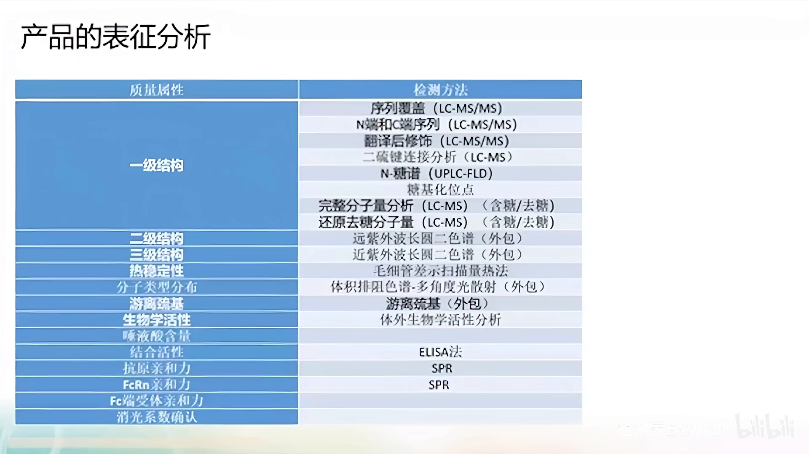

| 层次 | 项目 | 方法 |
| --- | --- | --- |
| 一级结构 | 序列覆盖、N/C 端序列、翻译后修饰、二硫键连接、N-糖谱、糖基化位点、完整分子量（含糖/去糖）、还原去糖分子量 | LC-MS/MS、LC-MS、UPLC-FLD |
| 二级结构 | 远紫外圆二色谱 | CD（常外包） |
| 三级结构 | 近紫外圆二色谱 | CD（常外包） |
| 热稳定性 | 熔解温度 | 毛细管差示扫描量热 |
| 分子类型分布 | 聚体/单体分布与分子量 | SEC-MALS（常外包） |
| 游离巯基 | 未配对半胱氨酸 | Ellman 法（常外包） |
| 生物学活性 | 体外功能 | 细胞学方法 |
| 唾液酸含量 | 糖链末端修饰 | 色谱法 |
| 结合活性 | 与抗原结合 | ELISA |
| 抗原亲和力 | 亲和常数 | SPR |
| FcRn 亲和力 | 半衰期相关 | SPR |
| Fc 端受体亲和力 | 效应功能相关 | SPR |
| 消光系数确认 | 浓度换算系数 | UV |

讲者提到一级结构的一个硬指标：**序列覆盖率要做到百分之百**。意思是，我生产出来的抗体序列，要和我当初设计的序列对得上——因为 CHO 细胞表达之后会加各种翻译后修饰，序列"对不对"必须用质谱证明，不能默认。

他还提到一个很现实的安排：圆二色谱、SEC-MALS、游离巯基这些项目**不必内部都具备，可以外包**。这句话对资源有限的团队很重要——表征的完整性不等于设备的完整性。

**放行与表征的分工，可以这样记**：

| | 放行检测（release） | 表征分析（characterization） |
| --- | --- | --- |
| 回答的问题 | 这一批能不能放出去 | 这个分子到底是什么 |
| 频次 | 每一批都做 | 通常一次或少数几次（首次、变更后） |
| 项目数 | 少而精，围绕关键质量属性 | 多而全，覆盖各级结构 |
| 方法要求 | 必须经过验证，能出合格/不合格判断 | 可以是研究性方法，能出结构信息即可 |
| 谁看 | QA 放行、监管审评 | 研发、工艺、注册资料 |

初学者最容易犯的错，是把"表征做得很全"当成"放行没问题"，或者反过来——只做放行项目，就以为分子被搞清楚了。

---

## 四、稳定性研究：批次一致性的时间维度

[【跳转到 25:01】](https://www.bilibili.com/video/BV1F3411k7gn/?t=1501)

放行检测是"出厂那一刻"的快照，稳定性研究才是"这批货能撑多久"的答案。讲者给的时间点是：原液要做 0、1、2、3、6、12、18、24、36 个月的长期稳定性，同时做加速稳定性；成品类似，只是检测项目不同（原液多冻存，成品是液体或冻干）。

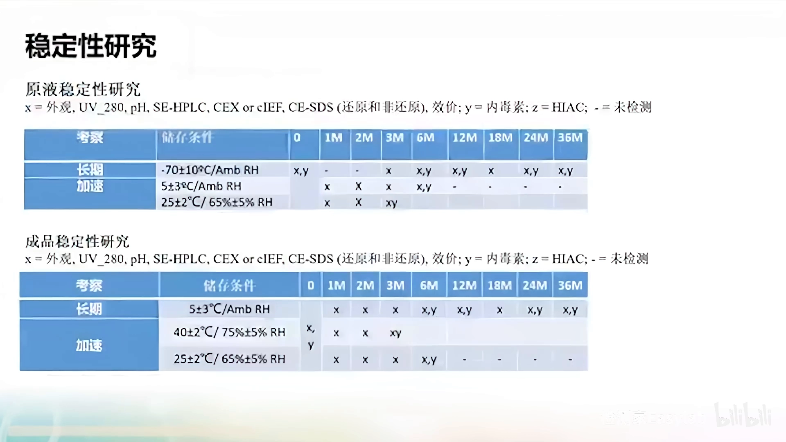

注意表里用 x、y、z 表示不同的检测项组合，而且**不是每个时间点都测全部项目**——这是一个很实际的取舍：稳定性研究的成本随"时间点 × 项目数"增长，所以只在关键时间点做全项，其余时间点做核心项。

稳定性数据还有一个隐藏用途：**它是判断"批次差异是不是时间造成的"的唯一依据**。两个批次测出来不一样，如果其中一个已经在 2~8 ℃ 放了 18 个月，那差异可能只是老化，不是工艺。

---

## 五、成药性评估：在发现阶段就把"将来做不出批次"的分子筛掉

### 5.1 三部分工作

[【跳转到 18:27】](https://www.bilibili.com/video/BV1F3411k7gn/?t=1107)

讲者说，早期大家手上通常有好几个分子，"从生物学角度讲都差不多"，这时候就要用成药性来评价哪一个更值得往前推。成药性评估分三块：

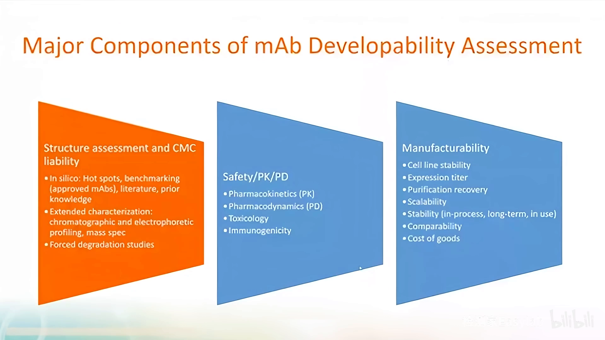

| 板块 | 内容 |
| --- | --- |
| 结构与 CMC 风险 | 计算机预测热点、与已上市抗体比对、文献与既往经验；扩展表征（色谱与电泳图谱、质谱）；强制降解研究 |
| 安全性 / PK / PD | 药代、药效、毒理、免疫原性 |
| 可生产性 | 细胞株稳定性、表达滴度、纯化回收率、可放大性、稳定性（中控/长期/使用中）、可比性、成本 |

讲者强调这一块"很多公司早期比较薄弱、做得太少"，后果是后面在工艺开发和生产阶段集中出问题。他还给了一个很硬的理由：成药性评估能让你未来的投入大大减少、降低风险，"这是一个关键步骤"。

### 5.2 案例：40 ℃ 强制降解下，A 与 B 的差别不在"分子"而在"条件"

[【跳转到 19:10】](https://www.bilibili.com/video/BV1F3411k7gn/?t=1150)

这是全讲最有信息量的一张图。两个候选分子 A 和 B，各自配三种缓冲液（Buffer 1/2/3），在 40 ℃ 下放 0、2、4 周，测四个指标：

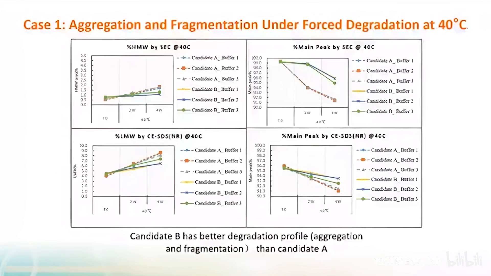

- 左上：SEC 测的高分子量聚体占比（%HMW）
- 右上：SEC 测的主峰占比（%Main peak）
- 左下：非还原 CE-SDS 测的低分子量片段占比（%LMW）
- 右下：非还原 CE-SDS 测的主峰占比

结论写在图下方：**候选 B 的降解谱（聚集与片段化）优于候选 A**。

但真正值得学的是这张图的读法。四条曲线里，A 和 B 的**起点（T0）几乎一样**，差别是在 4 周里逐渐拉开的；而且同一个分子在三种缓冲液里的曲线也不重合——A 在 Buffer 2 里的主峰掉得最快。这意味着：

1. **同一个分子、不同缓冲液 = 不同的质量属性读数**。这就是"批次差异"最朴素的来源：不是分子变了，是配方变了。
2. **要判断"哪个分子更好"，必须让两个分子在同一条件下比**。如果 A 用 Buffer 1、B 用 Buffer 2，你得到的结论可能是缓冲液的差别。
3. **强制降解把差异放大**。常温下 4 周可能看不出差别，40 ℃ 下 4 周就能排序。

这张图正是"工艺一致性证据 vs 分子设计证据"的教科书式示例：**分子设计证据要求控制变量，工艺一致性证据要求覆盖变量**。

### 5.3 制剂开发：从可生产性评估到 DOE

[【跳转到 15:52】](https://www.bilibili.com/video/BV1F3411k7gn/?t=952)

制剂开发分两段，讲者用一张表把两段的输入输出列清楚了：

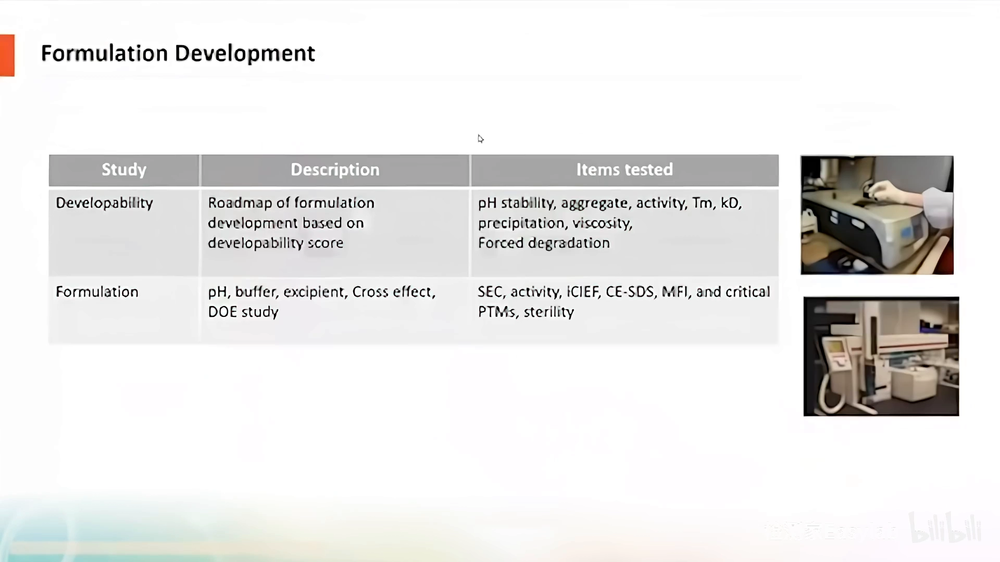

| 研究 | 描述 | 检测项目 |
| --- | --- | --- |
| Developability（成药性） | 基于成药性评分画出制剂开发路线图 | pH 稳定性、聚集、活性、$T_m$、$k_D$、沉淀、黏度、强制降解 |
| Formulation（配方） | pH、缓冲液、辅料、交叉效应、DOE 研究 | SEC、活性、icIEF、CE-SDS、MFI、关键 PTM、无菌 |

注意第二行的检测项目里出现了 **MFI**（微流成像，用于数不溶性微粒）和**关键 PTM**（翻译后修饰）。这两项在放行表里没有——又一次说明：**同一批样品，在不同目的下要测不同的东西**。

---

## 六、工艺一致性证据 vs 分子设计证据：怎么用正交证据排除

把前面几节拼起来，可以得到一张判断表。当你在发现阶段看到"同一个抗体，两次测出来的 $K_D$ 或 $EC_{50}$ 不一样"时，先问自己：这是分子的问题，还是批次的问题？

| 观察到的现象 | 更像分子设计问题 | 更像工艺/批次问题 |
| --- | --- | --- |
| 换一个表达体系（CHO → HEK293）后亲和力变了 | 可能（糖型影响构象） | 也可能（表达体系改了糖型） |
| 同一批样品分两次测，结果不同 | 不像 | 像（方法变异、样品降解） |
| 不同批次之间 SEC 聚体比例差 2 倍 | 不像 | 像（纯化步骤、冻融） |
| 同一分子、不同缓冲液，40 ℃ 下降解谱不同 | 不像 | 像（配方） |
| 电荷异构体比例偏移，同时结合活性下降 | 可能（CDR 脱酰胺） | 也可能（培养 pH 漂移） |
| 细胞株传代次数增加后产量下降 | 不像 | 像（细胞株稳定性） |

讲者在讲 IND 时间表时，其实把"正交证据"的骨架画出来了：

[【跳转到 08:25】](https://www.bilibili.com/video/BV1F3411k7gn/?t=505)

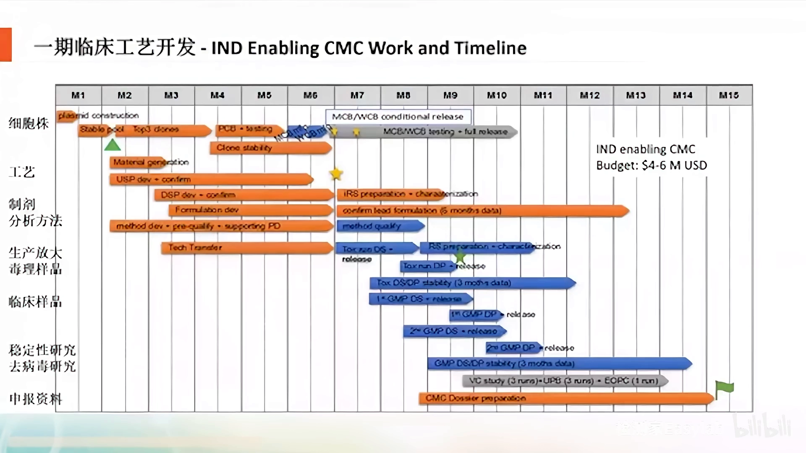

这张甘特图里有几条泳道值得单独看：

- **分析方法**：先 method development + pre-qualify，再 method quality（方法验证）。方法没验证之前，所有读数都只是"参考值"。
- **参比品**：中段有 IRS（内部参比品）preparation + characterization，之后毒理批次和 GMP 批次都要 release。参比品是后面所有相对读数的锚点（下一篇专门讲）。
- **稳定性**：毒理 DS/DP 要做 3 个月稳定性数据，GMP DS/DP 也要做 3 个月，这是申报的硬门槛。
- **去病毒研究**：VC study、UPB、EOPC 各跑若干轮，属于安全性证据，与分子设计无关。

把这些泳道按"证据类型"重新归类，就得到本节的结论：

| 证据类型 | 回答什么 | 典型产出 |
| --- | --- | --- |
| 分子设计证据 | 这个序列/结构本身好不好 | 亲和力、表位、成药性预测、强制降解排序 |
| 工艺一致性证据 | 我的工艺能不能稳定地做出同一个东西 | 批记录、PC/PV、批间质量属性趋势、HCP/DNA 残留 |
| 方法学证据 | 我的读数本身可不可信 | 方法验证、系统适用性、参比品标定 |
| 安全性证据 | 这批东西安不安全 | 无菌、内毒素、病毒清除 |

**排除法的顺序应该是**：先排除方法（同一批样品重复测），再排除样品状态（冻融、存放时间），再排除配方/缓冲液，最后才归因到分子。反过来做——一看到读数变了就改分子——是最贵的错误。

[【跳转到 25:46】](https://www.bilibili.com/video/BV1F3411k7gn/?t=1546)

讲者在结尾列了一期临床申报的药学要求清单，十几项里既有"细胞株开发""上游工艺开发""下游工艺开发"这类工艺项，也有"分析方法开发""分析方法验证""稳定性研究"这类证据项，还有一栏单独的第三方检测（细胞库表征、病毒清除验证、未处理细胞收获液检测等）。

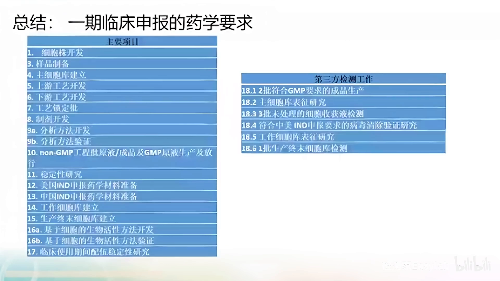

这张清单的价值在于它把"证据类型"摊开了：**同一个批次，要同时提供工艺证据、方法证据、稳定性证据和安全性证据**。少任何一类，申报都过不去。讲者还提到，到了 BLA 阶段研究会更细，因为批次更多，批间稳定性要做更多工作——这正是"批次一致性"从纸面变成数据的时刻。

---

## 七、把 CMC 的账本翻译回发现阶段（本节补充）

讲者讲的是 CMC 与放行体系，发现阶段的团队往往觉得"这跟我没关系"。但两者的逻辑是同一套，只是规模不同。以下是本文的迁移建议，不是讲者原话：

1. **给每个候选分子建一份"批次卡"**。至少记录：表达体系（CHO/HEK293）、批号、纯化方式（Protein A 一步还是加了 SEC 精纯）、缓冲液、浓度测定方法、冻融次数。没有这张卡，后面所有读数都无法归因。
2. **浓度必须用同一方法、同一标准品测**。BCA、A280（用理论消光系数）、A280（用实测消光系数）三者可以差 10% 以上，而 10% 的浓度误差会直接搬进 $K_D$ 和 $EC_{50}$。
3. **同一批样品分装冻存，一次性用完**。反复冻融会引入聚体，而聚体在 SPR 上会造成"亲合力假象"——多位点结合让解离变慢，拟合出来的 $K_D$ 偏小（更好看）。这是本文补充的机制，讲者未展开。
4. **比较分子时，缓冲液必须统一**。5.2 节那张 40 ℃ 的图已经说明：同一个分子换缓冲液，主峰曲线就不一样。
5. **至少测一次 SEC 纯度再报亲和力**。如果 SEC 主峰只有 85%，那个 $K_D$ 里就混着聚体的贡献。
6. **保留一份"内部参比品"**。哪怕只是一小管冻干的早期批次，它也能让不同时间点的读数有共同锚点。

发现阶段不需要做全的表征，但需要知道**哪些质量属性会污染你的读数**。这就是 4.2.4（产量与纯化）和 4.2.3（化学修饰）那两篇要解决的问题在测量端的投影。

---

## 小结

- **质量标准的形状由三件事决定**：产品特性、工艺阶段、监管要求。所以它不是一张通用清单，而是"产品—工艺—阶段"的函数。
- **放行检测回答"这批能不能用"**：外观、鉴别、纯度、杂质、效价、浓度、安全七类，纯度必须用两三种正交方法（SEC 看大小、CEX/icIEF 看电荷、CE-SDS 看片段）。
- **表征分析回答"这个分子是什么"**：一级结构要做到 100% 序列覆盖，高级结构、糖型、Fc 功能各有对应方法；放行项目少而精，表征项目多而全。
- **稳定性研究是批次一致性的时间维度**，也是判断"批次差异是不是老化"的唯一依据。
- **成药性评估要在发现阶段做**：结构风险、安全性/PK/PD、可生产性三块，早期少做，后期集中爆雷。
- **同一个分子换缓冲液，质量属性读数就会变**（40 ℃ 强制降解案例）；所以比较分子必须控制变量。
- **排除法顺序**：方法 → 样品状态 → 配方 → 分子。反过来做是最贵的错误。
- **参比品是相对读数的锚点**，它的标定与放行见下一篇。

## 关键术语速查

| 术语 | 一句话解释 |
| --- | --- |
| CQA（关键质量属性） | 会影响安全性与有效性的质量属性，是放行标准的来源 |
| 放行检测（release） | 每一批都要做、有合格判定标准的检测 |
| 表征分析（characterization） | 为搞清分子结构而做的深度分析，通常只做一次或少数几次 |
| SEC-HPLC | 体积排阻色谱，按分子大小分离，看聚体与片段 |
| CEX-HPLC / icIEF | 按电荷分离，看酸性/碱性电荷异构体 |
| CE-SDS（还原/非还原） | 毛细管电泳，变性条件下按分子量分离，看片段与链配对 |
| HCP | 宿主细胞蛋白残留，工艺相关杂质 |
| 效价（potency） | 产生预期生物学效应的能力，与结合活性不是一回事 |
| 强制降解 | 用高温、光照、反复冻融等条件加速降解，用于比较稳定性 |
| $T_m$ | 熔解温度，蛋白开始解折叠的温度 |
| $k_D$ | 动态光散射里的相互作用参数，反映分子间吸引/排斥倾向 |
| MFI | 微流成像，用于数不溶性微粒 |
| PC / PV | 工艺表征 / 工艺验证，证明工艺参数与质量属性的关系、以及工艺的重复性 |
| IRS | 内部参比品，所有相对读数的锚点 |