# ELISA 终点信号的三个决定因素：固相包被、封闭与背景

> 视频来源：[Resolution of Several Common Immunoassay Performance Issues](https://www.youtube.com/watch?v=X3tSSOYijz4)（YouTube · ImmunoChemistry Technologies 网络研讨会；讲者 Brian Lee，公司创始人、前总裁，现技术顾问）｜时长约 51 分钟
>
> 导读：这是一场以「问题排查」为线索的免疫分析讲座，讲者用 ELISA 板作例子，把抗原下压、夹心、竞争、磁珠、ELISpot、侧向流六种固相构型串起来讲，重点落在**包被与封闭这两个最容易被当成「照做就行」的步骤**上，最后 10 分钟答疑全是真实故障判读。字幕为 YouTube 自动生成，术语已按幻灯片订正（如 non-contiguous epitope、Hook effect、TMB）。本文只讲终点法读数本身，结合动力学测量（SPR/BLI）见本系列 5.2.2，EC50/IC50 曲线判读见 5.2.6。

## 本讲要解决的核心问题（SCQA）

**背景**：ELISA 是实验室里最常见的抗体结合测量方法。它的操作看起来毫无神秘感——包被、封闭、加样、加二抗、加底物、读板，六步走完得到一个 OD 值。既然步骤固定，结果似乎应当稳定可比。

**冲突**：但同一个抗体、同一批样本，换一块板、换一天、换一个人操作，OD 值可以差出一倍。更麻烦的是，读数偏高时你分不清是「样本里抗体多」还是「二抗粘板了」；读数偏低时也分不清是「没有抗体」还是「抗原在包被时被压坏了」。这些原因在读数上完全一样——都是「这一孔的颜色深了一点或浅了一点」。

**疑问**：在一个只测**单一时间点信号强度**的终点法里，究竟是什么在决定这个数字？哪些环节会把「结合能力」悄悄改写成「信号强度」？

**回答（中心思想）**：终点法测的从来不是「结合了多少抗体」，而是**「洗完之后还留在固相上的酶有多少，以及这个酶把底物转成了多少颜色」**。所以信号由三段串联决定：**固相上的抗原/抗体是否还保持可被识别的构象**（包被）、**未被占满的表面是否真的被盖住了**（封闭）、**背景噪声与信号是否落在可分辨的区间内**（背景与剂量响应）。这三段里任何一段出问题，读数都会偏离真实的结合强弱，而且偏离方向不可预测。

---

## 一、终点法的共同骨架：用一个固相把「结合」变成「留存」

[【跳转到 05:30】](https://www.youtube.com/watch?v=X3tSSOYijz4&t=330)

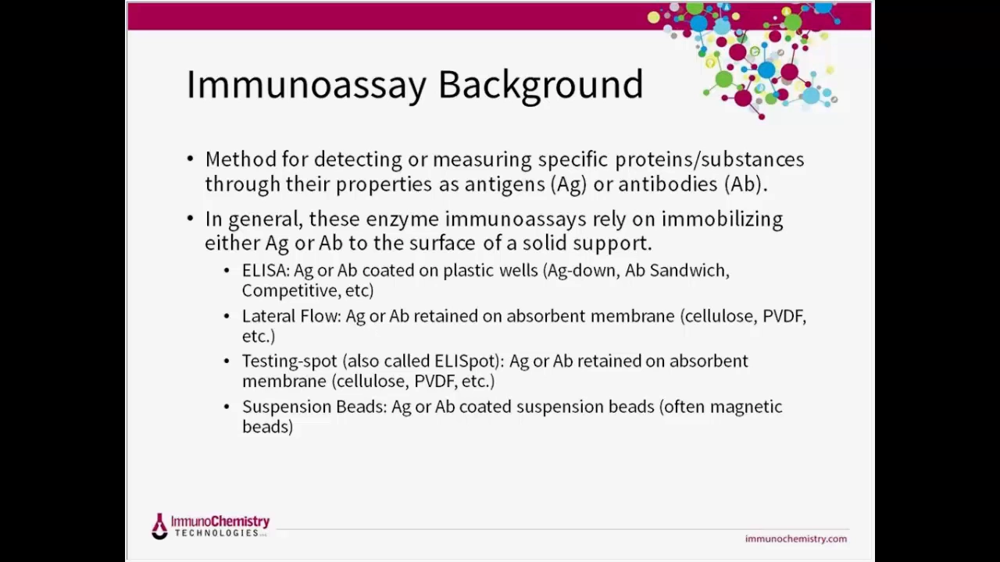

讲者一开场就把范围放得很宽：ELISA、侧向流试纸条、微珠悬液，看起来是完全不同的产品，但它们的共同点只有一个——**都依赖一个固相支撑，让你能把未结合的东西洗掉**。没有固相，就没有「洗」这个动作；没有「洗」，结合与不结合在读板上就无法区分。

这句话点出了终点法的本质。溶液里的抗体与抗原结合是一个动态平衡，随时在结合与解离；终点法并不去观察这个过程，它做的是：

1. 让结合达到（或接近）平衡；
2. 用洗涤把溶液相全部带走，只留下固相；
3. 用酶标二抗 + 底物把「留在固相上的抗体量」翻译成一个可读的强度值。

因此终点信号是一个**三段串联的乘积**，而不是一个直接测量：

$$
S \propto \underbrace{\theta_{\text{包被}}}_{\text{固相上有多少可用位点}} \times \underbrace{f_{\text{结合}}}_{\text{这些位点被样本抗体占据的比例}} \times \underbrace{n_{\text{酶}}}_{\text{每个抗体带几个有活性的酶}}
$$

（此式为本文据讲者叙述整理的补充表达，非幻灯片原文。）

三段中只有中间那段是「结合」，前后两段都是实验条件。这就是为什么终点法的读数天然是**半定量**的：它能把「有/没有」和「强/弱」分开，但把强度直接换算成亲和力或浓度，需要额外的标准曲线与对照。

讲者随后把这类分析的常见故障归纳成一张清单，本文的其余部分就是逐条展开这张清单：

[【跳转到 25:08】](https://www.youtube.com/watch?v=X3tSSOYijz4&t=1508)

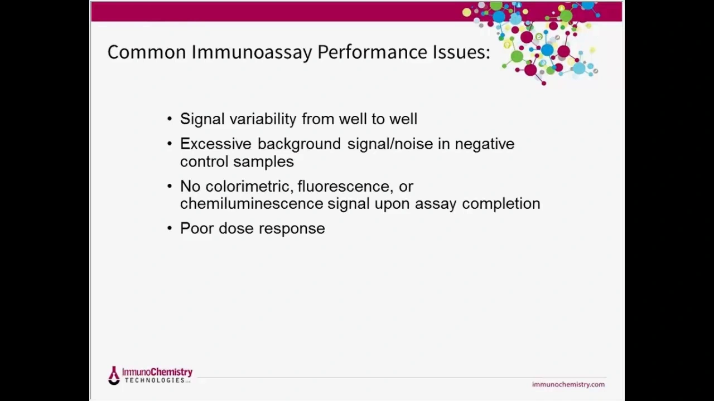

四条问题里，后三条（背景、无信号、剂量响应差）都直接对应「信噪比」这个终点法唯一的判读资源；第一条（孔间变异）则对应固相的不均匀。讲者特别强调，**背景高的时候你根本看不见阳性信号**——不是信号不存在，而是它被噪声淹没了。

---

## 二、包被之前先问：这个表位在被吸附之后还活着吗

[【跳转到 06:02】](https://www.youtube.com/watch?v=X3tSSOYijz4&t=362)

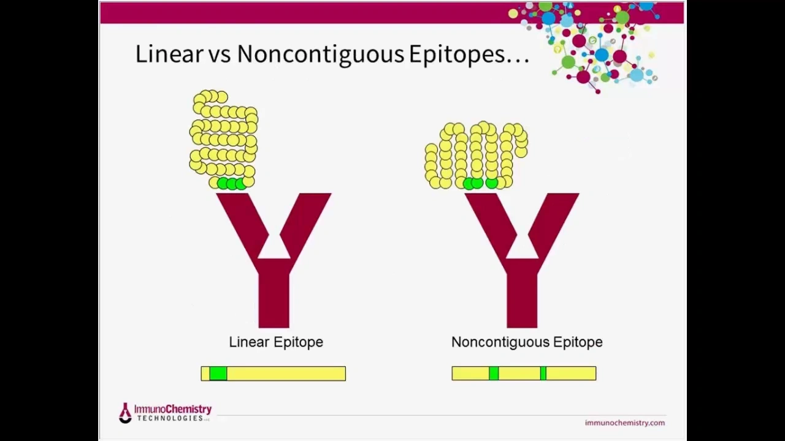

讲者先补了一段结构背景：抗体识别的表位分两类。**线性表位**是一段连续的氨基酸序列；**非连续表位**（non-contiguous epitope）由空间上邻近、序列上却隔得很远的两段残基拼成。他说，绝大多数抗体识别的是非连续表位——也就是说，**抗体识别的不是一段序列，而是一个形状**。

这一句直接决定了 ELISA 的一个先天局限。当你把抗原被动吸附到聚苯乙烯板上时，蛋白会「躺下去」贴住表面；如果蛋白很小，它可能在吸附过程中被摊平，原本拼在一起的两段残基被拉开，那个形状就没了。讲者的原话是：抗原「铺」在板上之后，绿色标记的表位就不再存在了。

这条限制有两个直接后果：

- **用小肽包被做「抗原下压」检测，会系统性漏检**。你只能检出识别线性表位的抗体，而这类抗体在真实免疫应答里是少数。
- **同一个抗体在 ELISA 里「不结合」，在细胞上可能结合得很好**。因为细胞表面的抗原保持天然构象，而板上的抗原已经变形。这一点是后面比较 ELISA 与流式读数时最常被忽略的差异（见本系列 5.2.1 的流式两篇）。

---

## 三、六种固相构型：同一套骨架，不同的「谁被固定」

讲者用同一张板的示意图把主流构型过了一遍。它们的差别本质上只有一件事：**被吸附在固相上的是抗原还是抗体，以及信号是正读数还是负读数**。

### 3.1 抗原下压（antigen-down / 间接法）：测的是「样本里有没有抗体」

[【跳转到 08:12】](https://www.youtube.com/watch?v=X3tSSOYijz4&t=492)

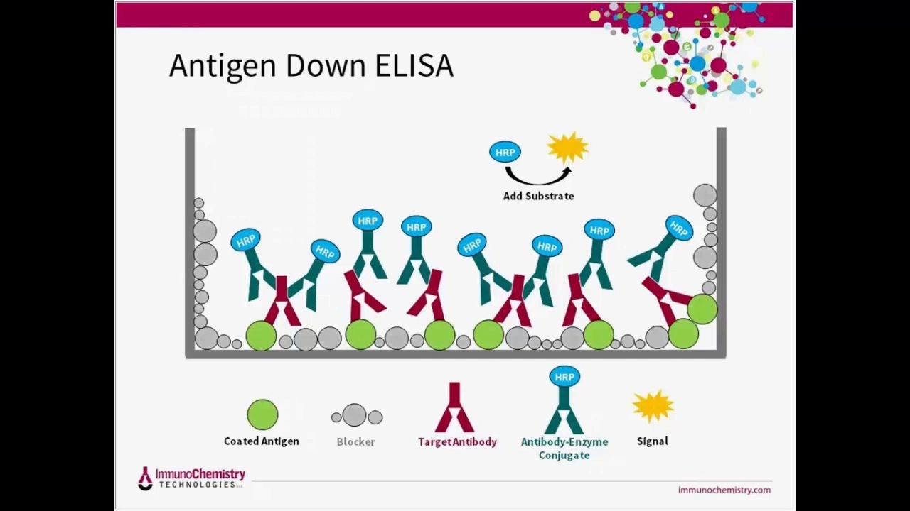

流程是：抗原吸附到孔底 → 封闭空位 → 加样本（待测抗体）→ 洗涤 → 加带 HRP 的抗种属二抗 → 加底物显色。信号强度反映**样本中能结合该抗原的抗体量**。

讲者举的用例是兽医与野生动物血清学：用某种病毒抗原包被，检测牛、猪、禽的血清，判断这群动物是否接触过该病原；同理可用于鹿、麋鹿种群的病原暴露调查。他在这里强调了一个判读要点——**这类检测是「过去时」**：它测的是 IgG 记忆，不是当前感染，因为 Ig 的回忆应答不会在急性期立刻出现。这是一个典型的「终点信号能回答什么」的边界：能回答「有没有暴露过」，不能回答「现在有没有病原」。

### 3.2 抗体夹心：测的是「样本里有多少抗原」

[【跳转到 11:57】](https://www.youtube.com/watch?v=X3tSSOYijz4&t=717)

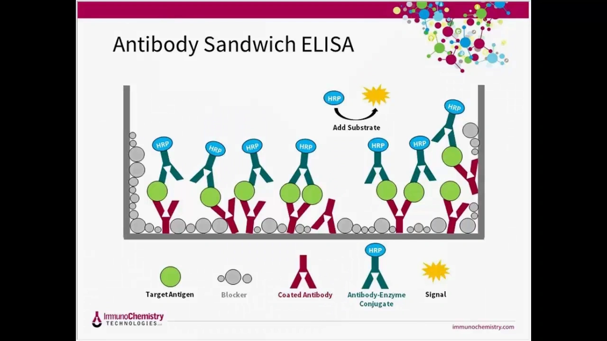

夹心法的顺序反过来：**捕获抗体**吸附在板上 → 加样本，抗原被捕获 → 洗涤 → 加**识别抗原另一个位点**的酶标检测抗体 → 底物。讲者说这是临床诊断里最常用的构型，可测血清、尿、血浆中的抗原，灵敏度可以做到纳克到皮克每毫升级，底物常用 TMB。

夹心法对「表位」的要求比间接法更苛刻：它需要**两个不同的、空间上不重叠的表位**同时可及。如果包被过程把其中一个表位压坏了，夹心就配不成对，信号直接归零——而抗原本身可能好端端地待在孔里。讲者因此提醒：做夹心法「一开始就得知道自己在做什么」，否则到加样本那一步才发现配不上对，前面全部白做。

### 3.3 负读数抗原竞争：信号越低，抗原越多

[【跳转到 14:02】](https://www.youtube.com/watch?v=X3tSSOYijz4&t=842)

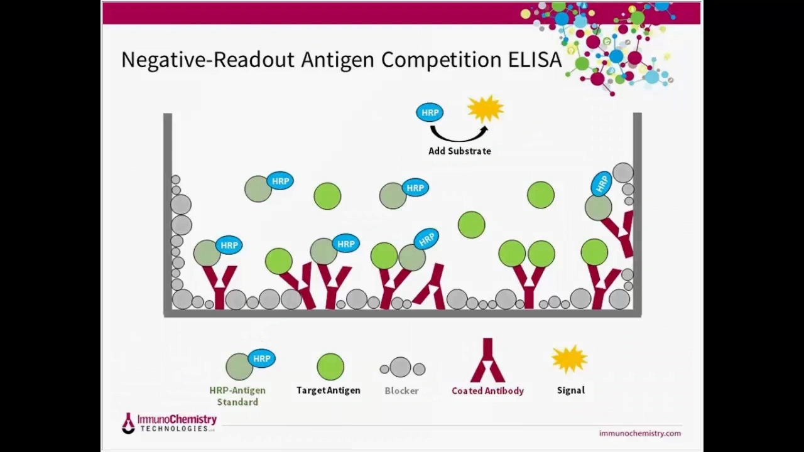

第三种构型把读数方向整个翻过来。做法是：板上包被**针对目标抗原的抗体**；然后同时加入**固定浓度的 HRP 标记抗原**（讲者说他过去用 2 到 3 倍过量，以保证没有样本抗原时能充分占位）与样本。若样本里没有目标抗原，HRP-抗原全部结合到板上，信号最强；若样本里有目标抗原，它和 HRP-抗原抢同一批位点，洗完之后留在板上的 HRP 就变少，**信号随抗原浓度升高而下降**。

讲者称这类构型在特定场景下很常用，因为小分子抗原往往难以做成夹心（没有两个表位），竞争法反而是唯一可行路线。判读上要注意：竞争曲线是**下降**的，与夹心法的上升曲线方向相反，做数据拟合时不能套用同一个模型。

### 3.4 磁珠：把「静态板」换成「高速运动的表面」

[【跳转到 15:58】](https://www.youtube.com/watch?v=X3tSSOYijz4&t=958)

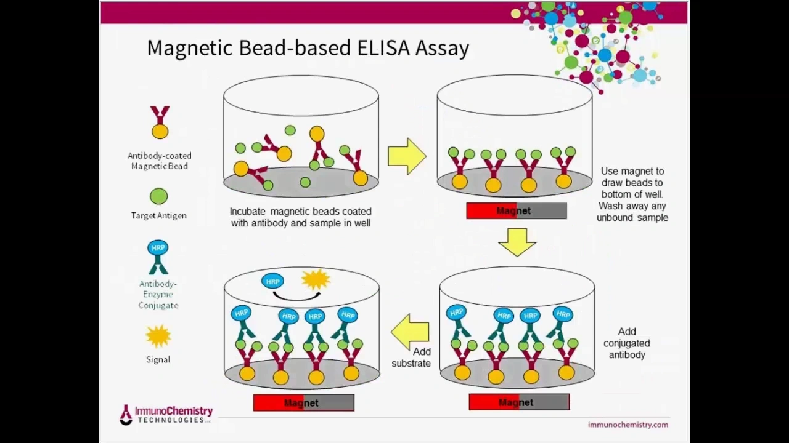

讲者把磁珠称为「固相的另一种形态」，但它带来两个实质变化：

- **表面积大**：单位体积内的可用结合面远大于平板孔底，捕获容量更高。
- **结合动力学快**：微珠在液相中运动，抗原不需要靠扩散「游到」孔底，结合速度明显快于静态板。讲者说很多大诊断公司的急诊样本用这种体系，一小时以内出结果。

还有一个判读上的差别值得记住：这类自动化体系往往**不需要等到平衡**。仪器在开发阶段就校准过检测器，运行时读的是曲线**斜率的变化**，某个斜率对应某个抗原浓度。也就是说，它把「终点强度」换成了「固定时刻的速率」——这已经离开经典终点法一步，但仍然是单点读数，不是完整的动力学曲线。

### 3.5 ELISpot：把「一个孔的强度」拆成「一个个斑点」

[【跳转到 19:01】](https://www.youtube.com/watch?v=X3tSSOYijz4&t=1141)

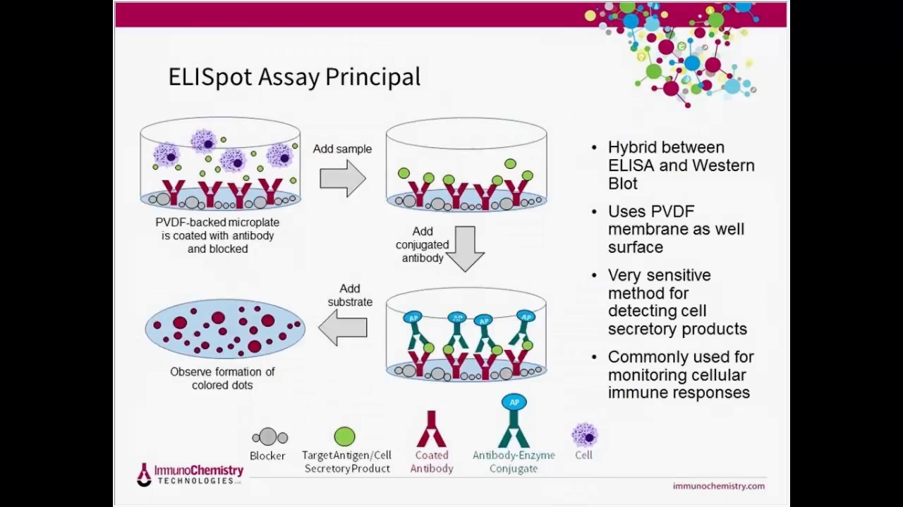

ELISpot 用 PVDF 膜代替聚苯乙烯孔底，先包被抗体，再让细胞直接长在孔里。细胞分泌的细胞因子在**分泌点附近**就被捕获，来不及扩散，于是每个分泌细胞在膜上留下一个局限的斑点。最后按夹心法加酶标抗体和底物，数斑点。

讲者说它是 ELISA 与 Western blot 的混合体，灵敏度很高，常用于监测细胞免疫应答。它的读数单位从「强度」变成了「个数」，因此不受酶标放大饱和的限制——这是终点法家族里一个聪明的绕路。

### 3.6 侧向流：终点法的便携版本

[【跳转到 20:24】](https://www.youtube.com/watch?v=X3tSSOYijz4&t=1224)

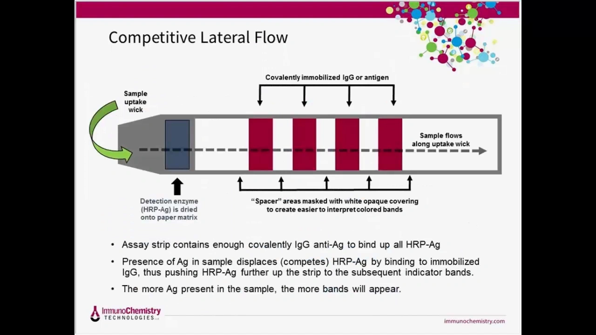

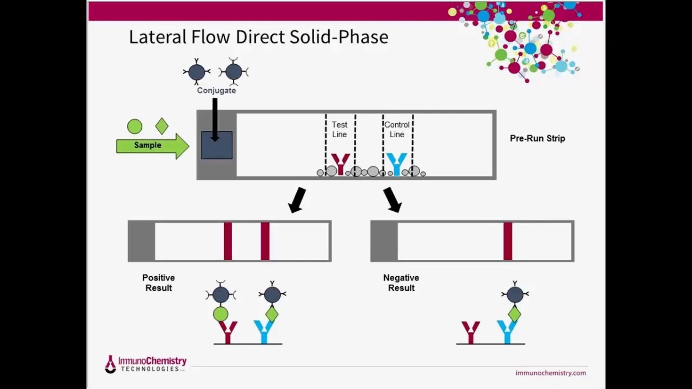

讲者展示了两种侧向流。竞争型把「负读数」做成了条带位置：条带上固定了足量的抗原来截留 HRP 标记抗原，样本里抗原越多，HRP 标记抗原被推得越远，出现的条带越多，可以粗略分级。直接型则是我们熟悉的两条线：检测线（test line）与控制线（control line）。

他特别点出控制线的作用：**没有抗原时你只会看到控制线**。控制线本身不提供任何关于分析物的信息，它提供的是「这次层析有没有跑起来、偶联物有没有活性」这一条元信息。这就是终点法里最朴素的一种过程对照——它不能证明特异性，只能排除「整条试纸失效」。

---

## 四、包被：固相上的抗体朝向，决定了灵敏度上限

讲到这里，讲者把话题从「构型」收回到「工艺」，因为所有构型的第一个共同步骤都是把蛋白弄到塑料上。

[【跳转到 25:33】](https://www.youtube.com/watch?v=X3tSSOYijz4&t=1533)

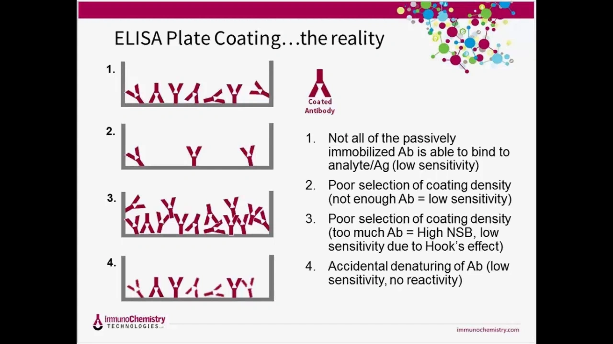

他先给出「理想情况」：所有抗体都**Fc 朝下、抗原结合面朝上**，整齐排成一列。然后说「现实中通常是第一种样子」——被动吸附的抗体朝向随机，有的横躺、有的倒插，Fab 段被压在塑料上，根本够不到抗原。这一条就解释了为什么很多抗体的 ELISA 灵敏度远低于它在流式或 SPR 上的表现：**不是抗体不好，是它被粘反了**。

一个可行的补救是**先用蛋白 A 预包被**，让抗体通过 Fc 段定向结合，这样 Fab 段统一朝上。代价是多一层蛋白、多一步封闭，且蛋白 A 与某些种属/亚型的结合能力不同。

接下来三种是失败模式：

| 现象 | 机制 | 读数表现 |
| --- | --- | --- |
| 包被量不足 | 孔底可用位点太少，捕获容量成为瓶颈 | 整体信号低、标准曲线低平 |
| 包被量过量 | 抗体在表面堆叠，产生空间位阻；堆叠层本身疏水 | 背景升高，高浓度端信号反而下降（钩状效应） |
| 包被过程中变性 | 缓冲条件过苛，蛋白在吸附时失活 | 灵敏度低甚至完全无反应 |

**钩状效应（Hook effect）** 值得单独说一句：当抗原浓度极高时，抗原把捕获抗体与检测抗体分别饱和，反而无法形成「捕获抗体—抗原—检测抗体」的三元夹心，信号在高浓度端掉下来。它和「包被过量」不是同一件事，但讲者在这里把两者放在一起讲，因为它们都会让「加更多样本」变成「信号更低」。判读上的含义是：**高浓度端的下降不能读成浓度低**，必须做稀释系列确认。

### 4.1 包被缓冲液：传统配方是为「老塑料」设计的

[【跳转到 27:38】](https://www.youtube.com/watch?v=X3tSSOYijz4&t=1658)

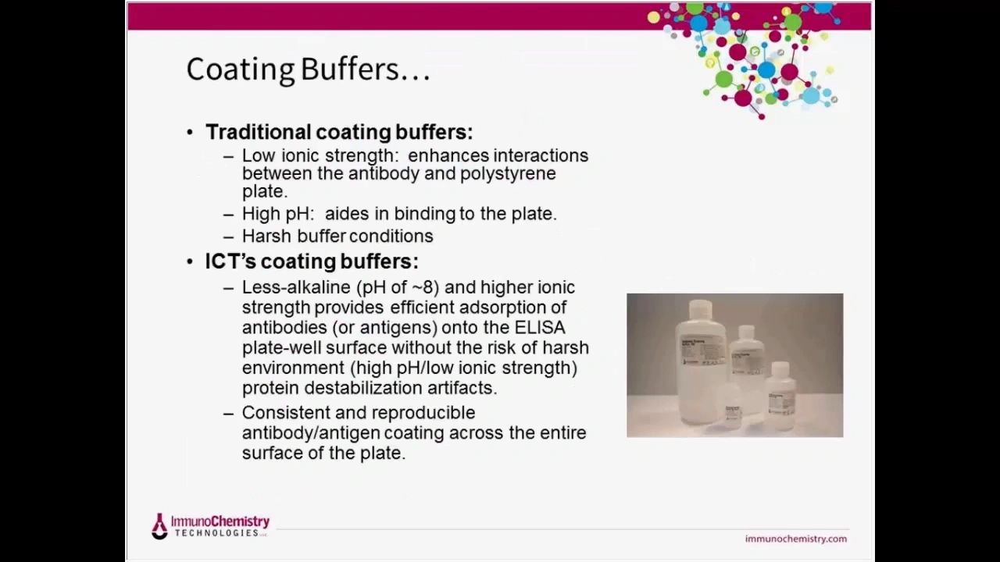

讲者解释了教科书配方的来历：经典的 0.02 M 碳酸盐缓冲液 pH 9.6，低离子强度 + 高 pH。这套条件之所以极端，是因为**当年的聚苯乙烯板质量差、结合能力弱**，必须用苛刻条件把蛋白「逼」上去。

问题是，这套条件对蛋白本身不友好。高 pH 加低离子强度会让部分抗体在吸附过程中变性——这正是上表第四种失败模式的来源。讲者说他们公司改用 pH 8 左右、离子强度更高的配方，在如今的高结合板上同样能得到高效率包被，而且**整块板的孔间一致性更好**。

孔间一致性这句话是重点：包被不均匀是「孔间信号变异」最直接的原因。同一浓度的样本在不同孔里得到不同读数，第一嫌疑永远是包被这一步没做匀，而不是检测抗体。

---

## 五、封闭：目标很清楚，失败方式有四种

[【跳转到 29:23】](https://www.youtube.com/watch?v=X3tSSOYijz4&t=1763)

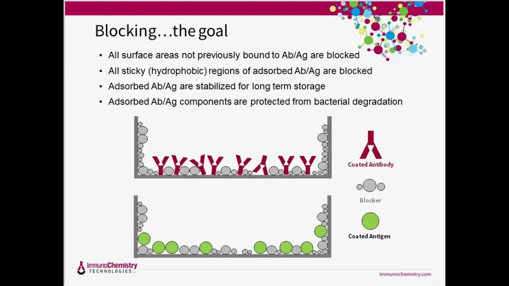

讲者先把封闭的目标列清楚，一共四条：盖住未被占据的表面；盖住已吸附蛋白的疏水斑块；稳定已吸附的成分以支持长期保存；加抗菌剂防止细菌降解。注意后两条经常被忽略——**封闭不只是「防粘」，还是「保鲜」**。如果你打算把板干燥后存半年，封闭液里没有抗菌剂、没有稳定剂，蛋白会在储存期间慢慢失活，而你会在半年后把它误判成「抗体失效」。

然后他给出封闭的「现实版」：

[【跳转到 30:13】](https://www.youtube.com/watch?v=X3tSSOYijz4&t=1813)

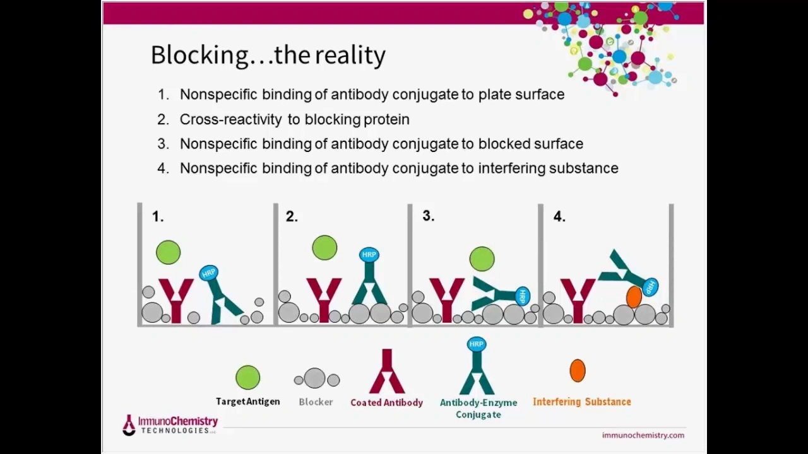

四种失败机制各不相同，但读数表现几乎一样：**阴性孔也显色**。

1. **酶标抗体直接粘板**：封闭没盖全，二抗落在裸塑料上。表现为所有孔（包括空白孔）都有底色。
2. **二抗与封闭蛋白交叉反应**：封闭用的是奶蛋白或明胶，而二抗恰好对这些蛋白有反应性。这是最隐蔽的一种——它不随样本变化，只随封闭剂批次变化。
3. **酶标抗体粘在封闭层上**：封闭蛋白本身形成了「魔术贴」表面，把二抗非特异吸附住。
4. **样本中的干扰物搭桥**：样本里存在粘性 Ig（讲者举例某些人的 IgM 特别粘），它先粘到封闭层上，再把酶标抗体拉过来。这种干扰是**样本依赖**的，所以表现为「某些样本偏高、标准曲线却正常」。

第四种是答疑环节第一个问题的答案，下面会再展开。

讲者给的处理思路是：这四种失败不能靠「换一种封闭剂」盲试，而要**先判断是哪一种**——空白孔有没有底色（区分 1）、换封闭剂批次是否变化（区分 2）、换样本是否变化（区分 4）。只有定位到机制，才谈得上优化。

---

## 六、稳定化：酶标抗体有两个必须同时保住的东西

[【跳转到 38:10】](https://www.youtube.com/watch?v=X3tSSOYijz4&t=2290)

讲者用 HRP 举例说明「稳定」这件事比想象中复杂。一个酶标抗体要同时保住两样东西：

- **抗体与酶的蛋白折叠**（二级、三级结构），否则结合能力或酶活丧失；
- **酶的催化位点**，HRP 靠血红素环完成氧化还原循环，催化位点一旦破坏，蛋白看起来完好、结合也很好，但**不产生颜色**。

他的说法很直白：一个「长得很漂亮、结合也很好」的 HRP 抗体，如果没有催化位点，就是个「不参与比赛的选手」。这解释了为什么有些酶标抗体在效价检测里结合正常、显色却很弱——问题不在抗体，在酶的活性位点。

固相与液相的稳定性问题不同：吸附到板上的蛋白因为**多点附着**而部分被稳定，干燥状态下还避开了水解与蛋白酶降解；液相里的酶标抗体则要同时靠缓冲盐、离子强度、添加稳定剂与抗菌剂来维持。这一段对终点法读数的意义是：**信号漂移可能来自试剂的老化，而不是实验本身**，做长期对比实验时必须把试剂批号与保存条件记进记录。

---

## 七、答疑里的四个真实故障：怎么从读数反推原因

最后十分钟的问答是全场信息密度最高的部分，四个问题正好覆盖了终点法最常见的四类异常。

### 7.1 样本读数偏高，但标准曲线正常

[【跳转到 42:22】](https://www.youtube.com/watch?v=X3tSSOYijz4&t=2542)

讲者给了两个方向，而且方向相反：

- **非特异结合**：样本里有东西让酶标抗体非特异粘上去，读数虚高。
- **基质效应**：血浆/血清这类复杂基质会**抑制**抗原抗体结合，结合动力学变差，同样浓度的分析物给出更低信号，表现为**回收率偏低**。

所以「样本偏高」这个描述本身不够——要先确认是「比预期高」还是「比标准曲线换算值高」。前者可能是非特异，后者要看回收率实验。讲者的建议是把标准品稀释在**与实际样本相同的基质**里做曲线，这样基质效应被一起标定进去。

### 7.2 孔间与批间不一致

[【跳转到 43:37】](https://www.youtube.com/watch?v=X3tSSOYijz4&t=2617)

两个原因：**包被不均匀**（某些孔捕获容量更高）与**边缘效应**。后者是温度导致的：在 37 °C 孵育时，板的外周升温快于中心，外周的结合动力学更快，于是外周孔信号偏高、中间偏低。

讲者给的缓解办法有三条：不要把板叠放；延长孵育时间（让所有孔都走到接近平衡，短孵育时温度差的影响被放大）；以及保证洗板一致。第三条在下一个问题里展开。

### 7.3 洗板到底怎么洗

[【跳转到 46:32】](https://www.youtube.com/watch?v=X3tSSOYijz4&t=2792)

讲者的操作要点很具体：

- 吸液要**吸干净**，孔里不能残留上一次的液体；
- 加洗液要**每孔等量**，自动洗板机的管路或歧管若某一路出液偏少，那个位置就会系统性偏高；
- **至少洗三次，最好四次**；
- 每次加洗液后**静置一小会儿**再吸掉，让非特异吸附的材料有时间脱附；
- 加了酶标抗体之后的那一轮，**一定要洗满四次**；
- 加底物之前**不要让孔干掉**。

这几条背后是同一个物理图像：洗涤不是「冲一下」，而是一个**解离过程**——你需要给非特异结合的分子离开表面的时间。洗得急，等于只洗掉了「本来就会掉」的那部分。

### 7.4 标准曲线低平、点间分不开

[【跳转到 48:37】](https://www.youtube.com/watch?v=X3tSSOYijz4&t=2917)

讲者按「信号链」从上游到下游给了四个可调项：

1. **提高包被浓度**（增加固相捕获容量）；
2. **延长样本孵育时间**（让更多分析物被捕获）；
3. **提高酶标抗体浓度**（增加每个捕获事件的酶数）；
4. **换更灵敏的底物**（TMB 有不同灵敏度等级）。

这四项的顺序不是随意的：它对应第一节那个串联公式的三段——先修「有多少位点」，再修「占了多少」，最后修「每个位点放大了多少」。如果包被容量本身不够，单纯提高二抗浓度只会把背景一起抬高，信噪比并不会改善。

---

## 八、终点法能回答什么，不能回答什么

把全场的线索收拢，终点法（ELISA 与流式都属于这一类）的能力边界可以列成一张表：

| 问题 | 终点法能否回答 | 原因 |
| --- | --- | --- |
| 有没有结合 | 能 | 阳性孔与阴性孔的信号差异 |
| 相对强弱、排序 | 能（同板、同批试剂内） | 同一条件下信号可比 |
| 半定量浓度 | 能，需标准曲线且基质匹配 | 信号与浓度单调相关 |
| EC50 / 半数有效浓度 | 能（需完整稀释系列） | 曲线拟合得到，见 5.2.6 |
| 真实 $K_D$ | 不能 | 固相多价展示、洗脱扰动平衡，测得的是「表观亲和力」 |
| $k_{on}$ / $k_{off}$ | 不能 | 终点法不记录时间过程，见 5.2.2 |
| 抗体是否能激活/中和 | 不能 | 结合 ≠ 功能，需功能实验 |

关于「真实 $K_D$ 不能测」这一条，讲者的材料里没有直接展开，但本文据其叙述可以推出理由：终点法在读数前要洗板，洗涤会把已达成的平衡往解离方向推；同时固相上的抗原/抗体是多价展示，二价抗体可以同时抓住两个位点，产生亲合力（avidity）加成。这两个因素叠加，使终点法测到的是**表观结合强度**，而不是溶液相的真实平衡常数。（此段为补充说明。）

---

## 小结

- **终点法测的是「洗完之后留下的酶」，不是「结合了多少抗体」**。信号是三段串联：包被位点数 × 被占据比例 × 每个抗体的有效酶数。
- **固相的第一道关卡是构象**。多数抗体识别非连续表位，抗原被吸附摊平后表位消失；这是 ELISA 与细胞法读数不一致的常见根源。
- **六种构型的差别只在「谁被固定」与「正/负读数」**。夹心法要求两个不重叠表位同时可及；竞争法用信号下降表示浓度上升；磁珠用运动换速度；ELISpot 把强度换成斑点计数。
- **包被的三种失败（不足、过量、变性）分别对应低信号、高背景加钩状效应、无反应**。蛋白 A 预包被可以让抗体定向，缓解「粘反了」的问题。
- **封闭有四条失败路径**，读数表现都是「阴性孔显色」，必须靠空白孔、换封闭剂、换样本三种手段定位机制。
- **孔间变异的两大来源是包被不均与边缘效应**；洗板要洗够次数、洗够时间，加酶标抗体后尤其要洗满四次。
- **标准曲线低平时按信号链上游到下游调**：包被浓度 → 孵育时间 → 酶标抗体浓度 → 底物灵敏度。

## 关键术语速查

| 术语 | 一句话解释 |
| --- | --- |
| 终点法（endpoint assay） | 只取一个时间点的信号强度，不记录结合与解离的时间过程 |
| 非连续表位 | 由空间邻近但序列远离的残基拼成的表位，依赖蛋白折叠状态 |
| 抗原下压（antigen-down） | 抗原包被在固相上，用来检测样本中的抗体 |
| 夹心法 | 捕获抗体与检测抗体识别抗原上两个不重叠的表位 |
| 竞争法（负读数） | 样本抗原与固定量酶标抗原竞争位点，抗原越多信号越低 |
| 钩状效应（Hook effect） | 抗原过量时无法形成三元夹心，高浓度端信号反而下降 |
| 基质效应 | 血清/血浆等复杂基质改变结合效率，导致回收率偏离 |
| 边缘效应 | 板外周与中心温度不同，结合动力学不同，造成孔位系统偏差 |
| ELISpot | 用膜孔板把单个细胞的分泌事件记录成一个显色斑点 |
| 酶标二抗 | 带酶（如 HRP）的抗种属抗体，负责把结合事件转成信号 |