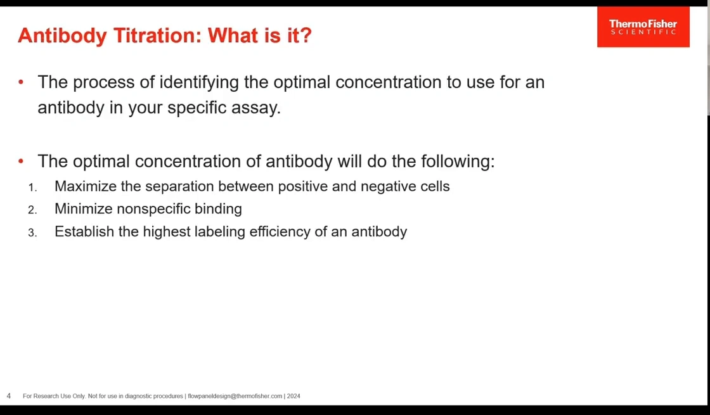
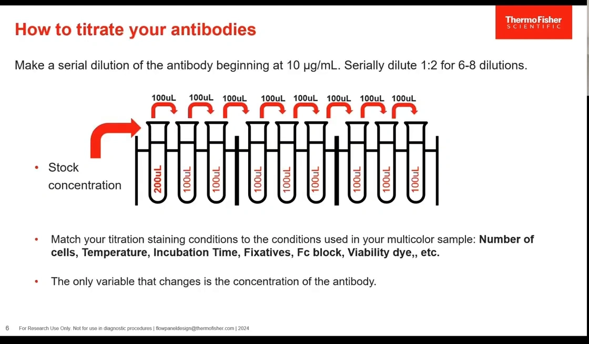
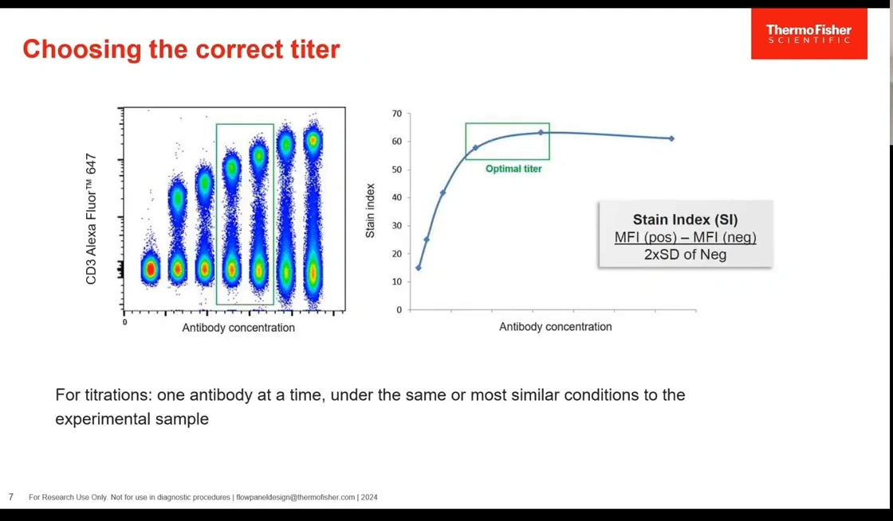
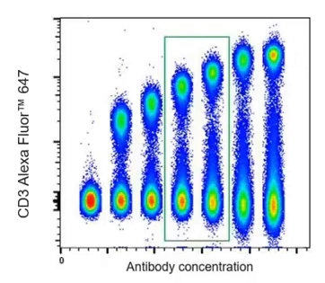
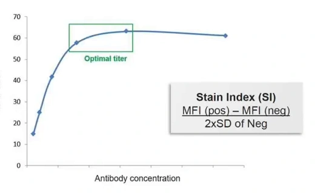
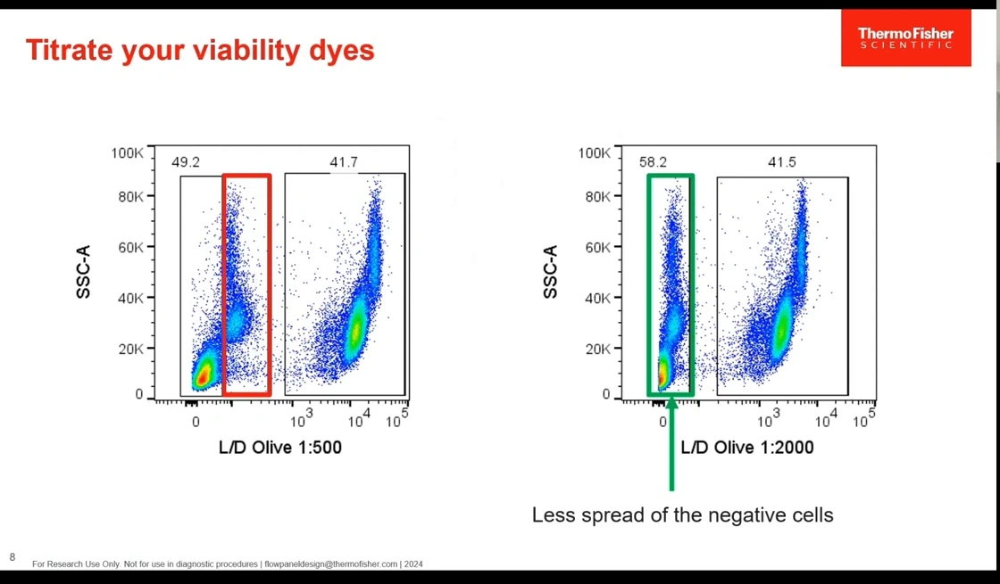
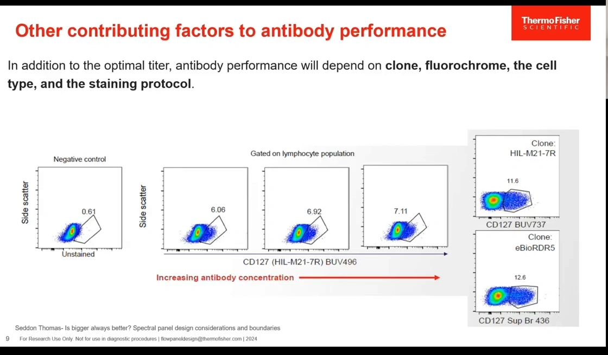
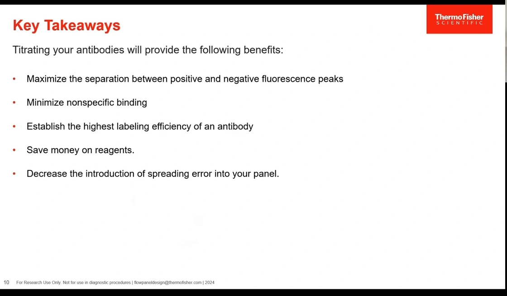

# 流式抗体滴定的判读：染色指数、饱和平台与负峰扩散

> 视频来源：[How to Optimize Antibody Use with Titrations in Flow Cytometry](https://www.youtube.com/watch?v=4YZz9DFKF0k)（YouTube · Thermo Fisher「Let's Talk Flow」系列；讲者 Berencia Fore，面板设计团队技术应用科学家）｜时长约 17 分钟
>
> 导读：这是一支短小但很聚焦的实操课，只讲一件事——**流式抗体到底该加多少**。讲者用一张染色指数曲线把「饱和」与「分辨率」拆成两个独立的问题，并解释了为什么「加到饱和」并不等于「加到最好」。字幕为 YouTube 自动生成，术语已按幻灯片订正（如 stain index、robust SD、optimal titer）。特异性对照的设计见同小节另一篇《流式特异性对照的四层设计》。

## 本讲要解决的核心问题（SCQA）

**背景**：流式的终点读数是一个荧光强度值，通常取阳性群的中位荧光强度（MFI）。直觉上，抗体加得越多，MFI 越高，信号越「强」，看起来越好。

**冲突**：但 MFI 升高有两个来源：一是抗体真的把表位占满了（特异性信号），二是过量抗体以低亲和力粘在细胞上、或者聚集体被细胞裹住（非特异背景）。这两种情况在阳性群里都会让 MFI 上升，区别在于**阴性群会同时变宽**。于是「加更多抗体」在某个点之后不再提升分辨率，反而开始破坏它。

**疑问**：那么，怎么判断「够了」？用什么指标来定这个点？为什么饱和点不等于最优点？

**回答（中心思想）**：滴定的目的不是把信号推到最高，而是**把阳性群与阴性群之间的距离推到最大**。这个距离由两个量共同决定：阳性群的亮度（随浓度上升到饱和平台）与阴性群的宽度（随浓度持续变宽）。因此最优滴度落在**「刚进入平台、但阴性峰还没开始扩散」**的那一段，而判断它需要一个把两者合并成一个数的指标——**染色指数**。

---

## 一、滴定的三个目标：分离、干净、饱和

[【跳转到 01:51】](https://www.youtube.com/watch?v=4YZz9DFKF0k&t=111)

讲者把滴定定义为「为某支抗体在你这个特定实验里找到最佳浓度」，并给出三个目标：

1. **最大化阳性与阴性细胞之间的分离**；
2. **最小化非特异结合**——她特别指出，浓度高的时候「多余的抗体会以低亲和力结合到细胞上的一些目标抗原」，这类结合不影响特异性判读的正确性，但会把阴性群弄脏；
3. **建立最高的标记效率，即把目标表位饱和**。

第三点值得展开。为什么一定要饱和？讲者的解释是：**只有表位被饱和，实验才对微小扰动不敏感**。如果工作浓度落在曲线的陡峭段，那么移液误差、温度波动、孵育时间差几十秒，都会直接改变阳性群的亮度；而一旦到了平台，这些扰动几乎不影响分离。这一点在后面的要点里再次出现。

### 1.1 什么时候必须重新滴定

讲者列出的触发条件很实用，值得当成检查清单：

- 开始一个新实验；
- 换了**新的克隆**；
- 换了**串联染料的不同批次**（串联染料会降解，批次差异明显）；
- 把某个标记换成了**另一种荧光素偶联物**；
- 改了**固定/破膜缓冲液**等会影响结合能力的步骤；
- 数据「看起来有点怪」的时候——先回头问自己：这支抗体滴过吗？

这份清单的潜台词是：滴度不是一个抗体的固有属性，而是**抗体 + 荧光素 + 细胞 + 方案**这个组合的属性。组合里任何一项变了，滴度都可能变。

---

## 二、怎么滴：一条系列稀释，一个变量

[【跳转到 03:31】](https://www.youtube.com/watch?v=4YZz9DFKF0k&t=211)

操作上有几个讲者反复强调的细节：

- **从 10 µg/mL 起，做 1:2 系列稀释，6 到 8 个点**。点越多，曲线建得越完整，越容易看出平台在哪里。
- **染色条件必须与多色样本一致**：细胞数、温度、孵育时间、固定剂、**Fc 阻断**、活死染料，全部照搬。唯一变化的变量是抗体浓度。
- **滴定前先离心**，去掉聚集体。聚集体是「阴性群变宽」的一个独立来源，如果不去掉，你会把它误判成抗体过量。
- **活死染料必须包含在滴定体系里**。讲者的理由很直接：死细胞会非特异地「亮」，如果不排除，你测到的「特异性结合」里混着死细胞的贡献。

这几条合起来是一句方法学原则：**滴定是一个单变量实验，其他所有条件都必须被钉死**。如果滴定时的细胞数与正式实验不同，得到的滴度就不能直接搬过去用。

---

## 三、读数：MFI 只讲了一半的故事

[【跳转到 05:11】](https://www.youtube.com/watch?v=4YZz9DFKF0k&t=311)

这张图是全场核心。左边是一系列浓度下的等高线图（CD3 Alexa Fluor 647 对细胞），右边是把每个浓度的「分离程度」压缩成一个数后画出的曲线。

### 3.1 等高线图里能看到什么

[【跳转到 06:51】](https://www.youtube.com/watch?v=4YZz9DFKF0k&t=411)

从左往右读这张图，可以数出三件事：

1. **最左边**：阳性群与阴性群几乎连在一起，抗体不够，表位没饱和。
2. **中间几个浓度**：阳性群明显上移，阴性群仍然紧凑——这一段是「加抗体有用」的区间。
3. **最右边**：阳性群不再明显上移（已经饱和），但**阴性群被拉成一条长尾巴**。这就是讲者说的「扩散效应」。

她在这里回答了一个很常见的疑问：为什么第三个浓度「看起来已经分开了」却不是好选择？因为「分开」只是当下的观感，而分辨率是**分离度与阴性宽度之比**。当阴性峰开始扩散，即使阳性峰还在变亮，实际可分辨的程度也可能在下降。

### 3.2 染色指数：把两个量合成一个数

[【跳转到 06:01】](https://www.youtube.com/watch?v=4YZz9DFKF0k&t=361)

讲者给出的指标是**染色指数（stain index, SI）**：

$$
\mathrm{SI} = \frac{\mathrm{MFI}_{\text{pos}} - \mathrm{MFI}_{\text{neg}}}{2 \times \mathrm{rSD}_{\text{neg}}}
$$

其中 $\mathrm{MFI}_{\text{pos}}$ 与 $\mathrm{MFI}_{\text{neg}}$ 分别是阳性群与阴性群的中位荧光强度，$\mathrm{rSD}_{\text{neg}}$ 是阴性群的**稳健标准差**（robust SD，用中位数绝对偏差一类的方式估计，不易被少量离群事件拉偏）。

这个式子的结构值得读一遍：

- **分子**是阳性与阴性的距离，代表「信号」；
- **分母**是阴性群宽度的两倍，代表「噪声」；
- 所以 SI 本质上是**信噪比**，只不过这里的「噪声」不是仪器底噪，而是阴性细胞群的分散程度。

用稳健标准差而不是普通标准差，是因为阴性群里常混有少量死细胞、双体或碎片，普通 SD 会被这些离群点放大，让 SI 无端变小。讲者提到，主流分析软件（FlowJo、FCS Express、FCSalyzer 等）都能在你圈定阴阳群后直接给出这些统计量，也有现成模板计算 SI。

### 3.3 平台不等于最优

把 SI 对浓度作图，会得到一条先陡升、后走平、末端略微下降的曲线。讲者给出的判读规则是：

- **曲线进入平台，说明表位已饱和**，再加抗体不会提升阳性信号；
- **平台之后 SI 开始下降，说明阴性峰扩散的代价超过了收益**；
- **最优滴度取「刚进入平台」的位置**，也就是图上绿框标出的那一段。

她的原话可以概括为：最优滴度是「阳性信号饱和得最好」**同时**「阴性扩散最小」的那个浓度。这两个条件在曲线上对应同一段区间，但它们的物理含义完全不同——一个是结合位点被占满，一个是非特异吸附还没起来。

这也解释了为什么「按厂商推荐浓度加」经常不是最优：厂商给的是一个保守的起点（往往偏高），而真正的滴度取决于你的细胞表达多少抗原、你的仪器电压设在哪里。

---

## 四、凡是带荧光的东西都要滴定

[【跳转到 09:21】](https://www.youtube.com/watch?v=4YZz9DFKF0k&t=561)

讲者把原则推广了一步：**面板里任何带荧光分子的试剂都应该滴定**，不只是抗体。她以可固定活死染料（live/dead fixable dye）为例。

这类染料的工作机制是跟细胞上的**胺基**共价结合。活细胞表面也有胺基，所以活细胞**也会**摄取少量染料——这就是为什么低浓度时活细胞群看起来更紧、高浓度时活细胞群开始扩散。图上 1:500 与 1:2000 的对比很清楚：低浓度那一组，被红框标出的活细胞群拖出了一条尾巴；高浓度那一组，绿框里的活细胞群更紧凑。

判读标准是双重的：

- 死细胞必须仍然**亮**（否则失去区分能力）；
- 活细胞群的「指纹」应该尽量接近**未染色样本**（讲者提到在光谱仪器上看全谱特征时尤其明显），不要侵占其他颜色的通道。

她还给了一个实操建议：如果样本里本来就没多少死细胞，**人为制造一个混合样本**（热处理杀死一部分细胞，再与活细胞混合），这样才能确认染料在死细胞上确实有效。这与对照设计里「制造你需要的对照」是同一个思路。

---

## 五、浓度只是四个变量之一

[【跳转到 11:19】](https://www.youtube.com/watch?v=4YZz9DFKF0k&t=679)

讲者在这一页把镜头拉远：抗体在流式里的表现由四个因素共同决定。

1. **克隆**：决定特异性。
2. **荧光素**：决定亮度与稳定性。她举例，基于花菁的串联染料（cyanine-based tandem dye）容易降解，降解后原本的「亮」会变成「串到别的通道」。
3. **细胞类型**：不同细胞的抗原密度、大小、自身荧光都不同。
4. **染色方案**：固定/破膜缓冲液会改变可及性。她举例，FoxP3 缓冲液与常规破膜液对同一抗体的需求浓度就不同。

右侧那张图是她引用同事（Sandra Thomas，光谱面板设计）的数据，讲的是一个很反直觉的现象：染 CD127 时，用 BV496 偶联物**无论怎么提高浓度都改善不了阳性群的分辨率**；直到换成更亮的荧光素、甚至换一个克隆，分离才明显改善。

这条经验对判读的意义是：**当滴定曲线在低 SI 处就压平，说明问题不在浓度**。这时候继续加抗体只会抬高背景。要动的是荧光素或克隆，而不是体积。

---

## 六、要点与边界

[【跳转到 13:24】](https://www.youtube.com/watch?v=4YZz9DFKF0k&t=804)

讲者的五条总结可以原样记下：

1. 最大化阳性与阴性荧光峰的分离；
2. 最小化非特异结合；
3. 建立最高的标记效率（饱和表位）；
4. 节省试剂——厂商推荐浓度往往高于实际所需，滴过之后用量可以降下来，一瓶能用更久；
5. 减少面板中的扩散误差——多余的抗体与聚集体会在多色面板里制造额外的扩散，参数越多越致命。

最后一条在她看来是「随着面板变大而越来越重要」的事：单色实验里阴性群宽一点无所谓，十几色的面板里，一个通道的扩散会通过补偿矩阵渗到其他通道，最后污染的是整个面板的分辨率。

### 6.1 滴定曲线不是亲和力曲线

需要明确一条边界：**染色指数曲线不是结合曲线**。它的纵轴是「分离程度」，不是「结合量」；横轴是抗体浓度，但细胞被离心、洗涤、重悬过，体系并不处于可逆平衡的严格条件下。因此：

- 曲线进入平台的浓度**不能**直接读成 $K_D$；
- 平台的 MFI 也**不能**直接读成「表位数」——它还受荧光素亮度、仪器增益、细胞大小影响。

（以下为补充说明，非讲者原话。）滴定曲线的形状与剂量-反应曲线同构，其半高点在形式上就是一个 EC50；但这里的「效应」是 MFI 而不是功能读出，且细胞体系里的抗体浓度与真实自由浓度并不相等。剂量-反应曲线的拟合与 EC50/IC50 的判读见本系列 5.2.6；真实结合速率与平衡常数需要 SPR/BLI 这类实时方法，见 5.2.2。

---

## 小结

- **滴定的目标是最大分离，不是最高信号**。分离由阳性亮度与阴性宽度共同决定。
- **饱和的意义是抗扰动**：工作浓度落在平台上，移液误差与温度波动才不会改变结论。
- **染色指数把分离量化**：分子是阳阴中位荧光强度之差，分母是阴性群稳健标准差的两倍，本质是信噪比。
- **平台之后 SI 会下降**，因为过量抗体让阴性峰扩散；最优滴度取「刚进平台」的位置。
- **凡是带荧光的试剂都要滴定**，包括活死染料；活细胞也会摄取少量胺基反应染料。
- **浓度只是四个变量之一**：克隆、荧光素、细胞类型、染色方案同样决定分辨率；曲线在低 SI 处压平说明该换荧光素或克隆。
- **滴定曲线不是亲和力曲线**：它给的是工作浓度，不是 $K_D$，也不是 $k_{on}$/$k_{off}$。

## 关键术语速查

| 术语 | 一句话解释 |
| --- | --- |
| 滴定（titration） | 用系列稀释找出使阳阴分离最大的抗体浓度 |
| MFI | 中位荧光强度，流式终点读数的常用统计量 |
| 染色指数（SI） | 阳阴 MFI 之差除以阴性群稳健标准差的两倍，衡量分离程度 |
| 稳健标准差（rSD） | 不易被离群事件拉偏的离散度估计，用于描述阴性群宽度 |
| 饱和平台 | 继续增加浓度而阳性信号不再上升的区间，表示表位已被占满 |
| 负峰扩散 | 过量抗体或聚集体导致阴性群变宽，压缩可分辨空间 |
| 活死染料 | 与胺基共价结合的染料，用于区分死细胞，活细胞也会少量摄取 |
| 串联染料 | 两个荧光素串联、靠能量转移发光的偶联物，易降解 |
| 最优滴度 | 刚进入饱和平台、且阴性群尚未明显扩散的浓度 |