# 流式特异性对照的四层设计：单染、FMO、同型与敲除

> 视频来源：[Flow Basics 2.4: Experimental Design and Controls](https://www.youtube.com/watch?v=b0MVzjeTzbk)（YouTube · 芝加哥大学 Flow Core「Flow Basics 2.0」系列第四讲；讲者 Laura Johnston，Flow Core 科学副总监）｜时长约 36 分钟
>
> 导读：这是一堂把「对照」当成实验设计核心来讲的课，讲者把流式实验里的对照分成四类，逐类说明**它到底修正什么、什么时候必须有、什么时候可以省**。字幕为 YouTube 自动生成，术语已按幻灯片订正（如 FMO、spillover spreading error、isoclonIC control）。本文只讲对照与读数判读，抗体浓度的滴定优化见同小节另一篇《流式抗体滴定的判读》。

## 本讲要解决的核心问题（SCQA）

**背景**：流式细胞术的终点读数是一群细胞的荧光强度分布。你把抗体加上去，仪器把每个细胞扫一遍，得到一个直方图，然后你在图上画一条线，线右边算阳性。

**冲突**：这条线不是仪器给的，是你画的。而「阴性细胞应该有多亮」并没有一个客观答案——它取决于细胞的自身荧光、其他荧光素的溢漏、抗体的非特异吸附、以及死细胞和碎片混进来的程度。同一管样本，换一种画法可以得到完全相反的结论；而当你看到「阳性」时，也无法立刻判断那是抗体真的认出了目标抗原，还是 Fc 段被细胞上的受体抓住了、或者二抗认错了东西。

**疑问**：那么，一条阳性判读要成立，需要哪些对照来支撑？这些对照各自排除了哪一种假象？在管数和细胞都有限的现实里，哪些对照绝不能省？

**回答（中心思想）**：流式的对照不是「多买几个管子」的保险，而是**四层各自负责一类误差的排除机制**：单染对照负责把仪器的电压与溢漏校正掉（技术层），FMO 对照负责把「阳性边界」画在正确的位置（判读层），同型与同克隆对照负责识别非特异结合（特异性层），未染色与实验对照（刺激/未刺激、野生型/敲除）负责确认信号确实来自目标分子（生物学层）。四层缺一层，就会有一类假象无法被排除。

---

## 一、先分类：四类对照各管一件事

[【跳转到 00:44】](https://www.youtube.com/watch?v=b0MVzjeTzbk&t=44)

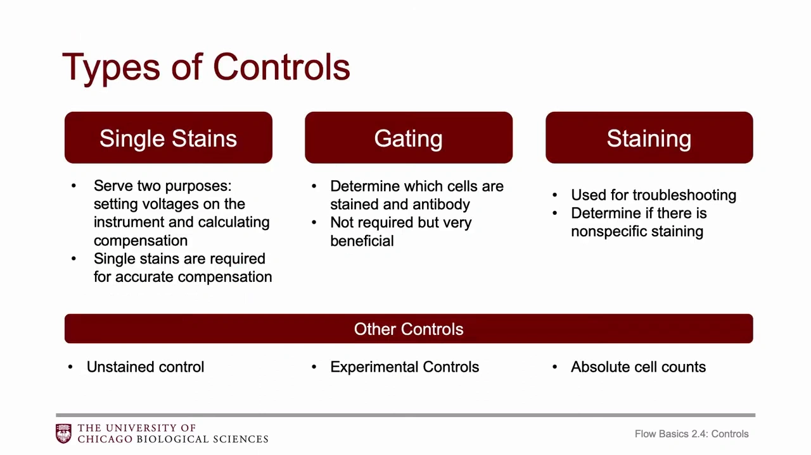

讲者一上来就把对照分成四组，并给每组一句定位：

| 类别 | 作用 | 是否每次必做 |
| --- | --- | --- |
| 单染对照（single stains） | 设电压/增益、计算补偿或光谱解混 | 必做，且是最重要的一组 |
| 门控对照（gating controls，即 FMO） | 判定「哪里算阳性」 | 强烈建议，可按标记取舍 |
| 染色对照（staining controls，同型/同克隆） | 排查非特异染色、背景过高 | 建立方案时做，问题解决后可停 |
| 其他（未染色、实验对照、绝对计数） | 自身荧光、生物学特异性、细胞数 | 视实验而定 |

这个分类的价值在于它把「对照」从一堆管子变成了**四个不同的问题**。后面所有细节都挂在这四条上。

---

## 二、单染对照：它同时决定了仪器的「量程」和「颜色串扰」

### 2.1 两个用途，都不是判读，而是校准

[【跳转到 04:25】](https://www.youtube.com/watch?v=b0MVzjeTzbk&t=265)

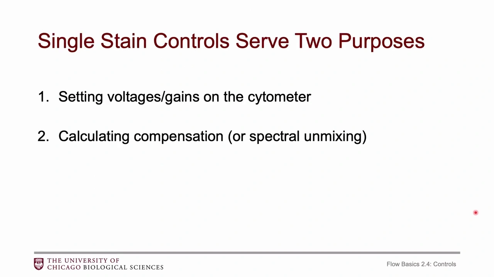

单染对照就是「一管里只放一个荧光素」。六色方案就要额外六管。它的两个用途都不涉及「这个细胞是不是阳性」，而是让仪器把每个荧光通道的信号归到正确的刻度上。

### 2.2 电压和抗体浓度是同一件事的两端

[【跳转到 04:47】](https://www.youtube.com/watch?v=b0MVzjeTzbk&t=287)

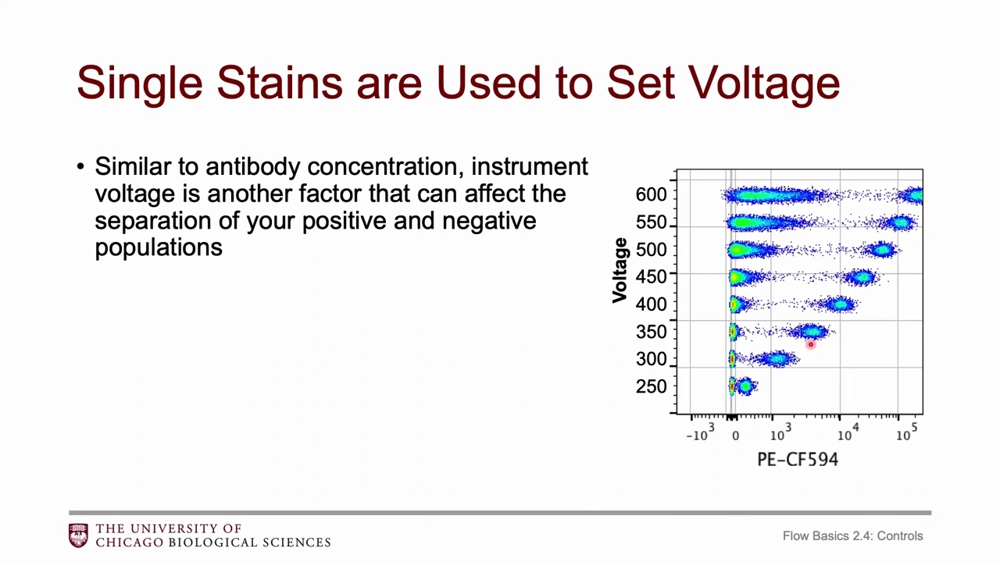

讲者做了一件很直观的事：把**同一管**单染对照在 8 个不同电压下各采集一次，叠加在同一张图上。结果是：电压升高，阳性峰越来越亮，但**阴性峰也开始扩散**。

她随即点出关键：这和你改变**抗体浓度**时看到的模式是一样的。也就是说，「阳性有多亮」和「阴性有多散」这一对矛盾，可以从两个旋钮上调——仪器电压与抗体浓度。所以最优条件不是「把抗体滴到最好」或「把电压调到最好」，而是**两个旋钮一起调到分离最大**。

这也解释了为什么单染对照是「设电压」的工具而不是「设门」的工具：它告诉你仪器的量程是否合适（阳性会不会把检测器打饱和），但不告诉你阴性细胞应该落在哪。

### 2.3 单染对照的四条硬规则

[【跳转到 08:02】](https://www.youtube.com/watch?v=b0MVzjeTzbk&t=482)

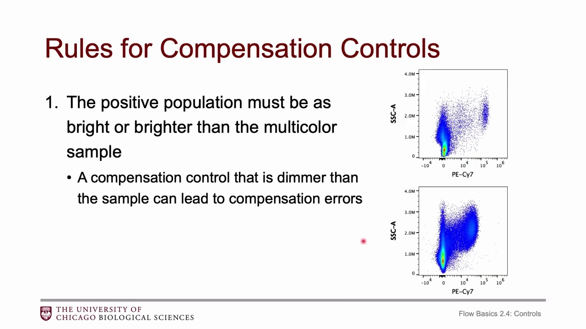

补偿的数学前提是：软件用阳性群与阴性群的**中位数**对齐来推算溢漏比例。这要求对照能代表样本的亮度范围。讲者给出四条规则：

1. **阳性群必须与多色样本一样亮，或更亮**。如果对照比样本暗，样本里那些比对照更亮的细胞就落在补偿曲线的外推区，会被补偿不足。
2. **必须用与样本完全相同的荧光素**。她举了一个最常见的偷懒：用 FITC 单染去补偿 GFP。图上看起来 FITC 通道补偿得很漂亮，但把这套补偿套到 GFP 上就是明显欠补偿。带连字符的串联染料（如 PE-Cy7、APC-Cy7）尤其必须用同一支抗体。
3. **最好同时有阳性群与阴性群**。只有阳性群时，人工补偿几乎无法判断对齐位置；用自动补偿可以借「通用阴性」（从未染色管取阴性群），但此时两者的**自身荧光必须匹配**——阳性群在微球上，阴性群也必须在微球上；阳性群在细胞上，阴性群也必须在细胞上。同一次实验里不同荧光素可以混用细胞与微球，但**同一个荧光素内部必须一致**。
4. **事件数要够**。自动补偿通常要求阳性门与阴性门各有约 100–200 个事件以上。讲者用同一管样本跑 5000 与 20000 个事件作对比：事件少的时候阳性群根本看不清。

这四条里，第二条最容易被违反，第三条最容易被误解。它们共同说明一件事：**补偿对照不是「随便找个亮的东西」，而是一个必须与样本同构的标定物**。

### 2.4 用细胞还是用补偿微球

[【跳转到 13:59】](https://www.youtube.com/watch?v=b0MVzjeTzbk&t=839)

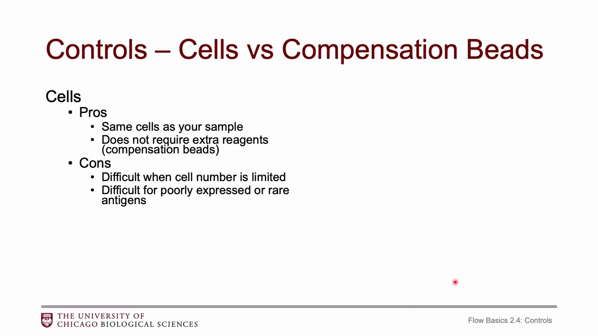

讲者把两者的利弊列得很清楚：

- **细胞**：与样本同源，补偿计算最准；不需要额外买试剂。缺点是细胞数有限、抗原表达很弱或很稀有时信号不好。
- **微球**：结合抗体的 Fc 段（或抗种属抗体），阳性群非常亮、不需要消耗珍贵样本。缺点是要额外购买，且对**聚合物荧光素**（Brilliant Violet、Brilliant UV、Brilliant Blue 系列）结合表现不稳定，可能出现「微球上补偿看起来对、细胞上偏一点」的情况。

这条经验对判读有直接影响：如果你用微球做补偿、样本是细胞，那么补偿矩阵里就埋了一个系统误差。它不会让阴性变阳性，但会让弱阳性群体的边界偏移——而这恰好是流式最常争论的地方。

---

## 三、FMO：把「阳性边界」画在该画的位置

[【跳转到 17:10】](https://www.youtube.com/watch?v=b0MVzjeTzbk&t=1030)

FMO（fluorescence minus one）是单染的镜像：一管里放**除目标荧光素之外的所有荧光素**。讲者说这是门控的「金标准」。

为什么不用未染色管画门？她给的理由是**溢漏扩散误差**（spillover spreading error）：一旦管子里有别的荧光素，它们带来的散粒噪声会扩散到目标通道，使 FMO 的阴性群比未染色管**更亮、更宽**。用未染色管画门，等于把边界画在了偏左的位置，会系统性地把一部分真阴性判成阳性。管子里荧光素越多，这个效应越明显——所以**面板越大，FMO 越重要**。

[【跳转到 18:10】](https://www.youtube.com/watch?v=b0MVzjeTzbk&t=1090)

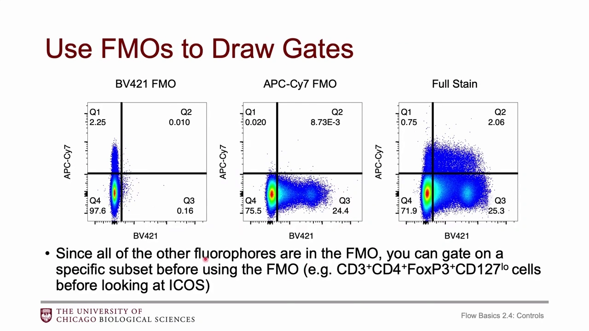

这张图是 FMO 的典型用法：左、中两管分别是 BV421 FMO 与 APC-Cy7 FMO，用它们画出十字门的边界，然后把**同一套门**原样套到右图的全染样本上。注意 FMO 里已经含有面板中几乎所有其他抗体，所以你可以**先在 FMO 上圈出目标细胞亚群**（例如 CD3⁺CD4⁺FoxP3⁺CD127^lo 的调节性 T 细胞），再在这个亚群里看目标标记的表达——这是 FMO 相对同型对照的一个实质优势。

### 3.1 什么时候可以省掉 FMO

讲者给了一条很实用的取舍标准：如果某个标记是**主表达（on/off 型）**——阴性群与阳性群之间有一段明显的空白，比如 CD3 的直方图——那么不用 FMO 也能画出可靠的门。反过来，如果信号是**连续涂抹型**（她举 CD45RA 为例），阴阳之间没有天然分界，就必须靠 FMO 定界。

面板很小的时候 FMO 的必要性也低；面板越大、溢漏扩散越严重，FMO 越不能省。

她还提了一句现实中的阻力：FMO 难配——每个管子要加「除一个之外的全部抗体」，移液次数多、容易出错。她的建议仍然是那条：**先把抗体稀释好再加**，不要直接移取小体积。

---

## 四、染色对照：同型对照管的是「非特异」，不是「阴阳」

这一节是全场最容易被误用的部分，讲者的态度也很明确。

[【跳转到 22:18】](https://www.youtube.com/watch?v=b0MVzjeTzbk&t=1338)

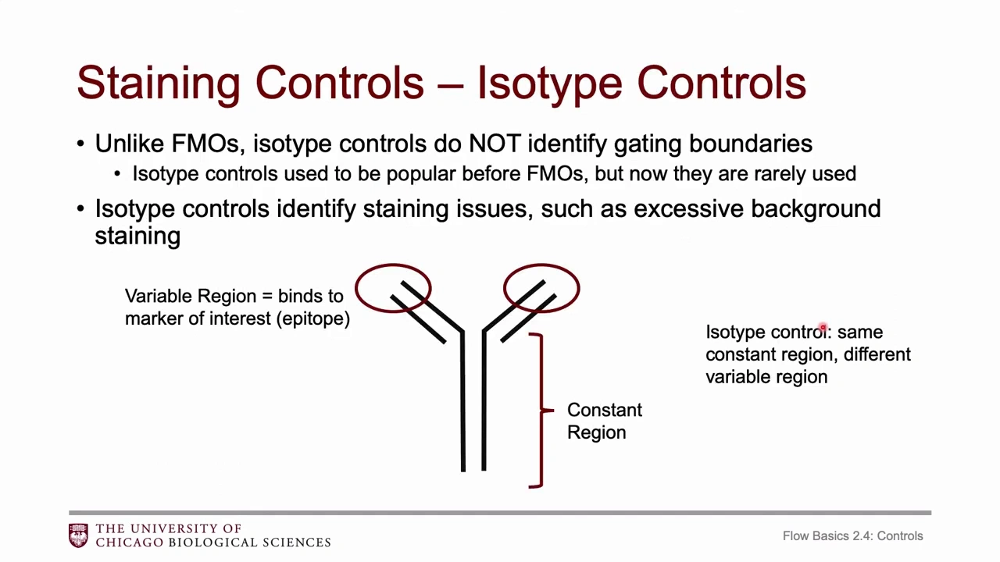

**同型对照（isotype control）** 是「恒定区相同、可变区不同」的抗体。因为它没有针对目标表位的可变区，理论上不该结合细胞。因此：

- 如果同型对照**染上了**细胞，说明结合来自抗体的其他部分（恒定区、聚集体、非特异电荷/疏水作用），而不是抗原识别。这正是你想排查的那类假阳性。
- 如果同型对照**没染上**，也不能证明你的抗体是特异的——它只说明「这一类骨架不粘」。

讲者明确说：**同型对照不该用来画门**。在 FMO 出现之前它曾被这样用，但 FMO 做这件事做得好得多；如今同型对照的正确用途只剩下「评估非特异染色」。她把「还在用同型对照画门」直接称为过时的做法。

### 4.1 同克隆对照：用未标记的同一支抗体做阻断

[【跳转到 24:20】](https://www.youtube.com/watch?v=b0MVzjeTzbk&t=1460)

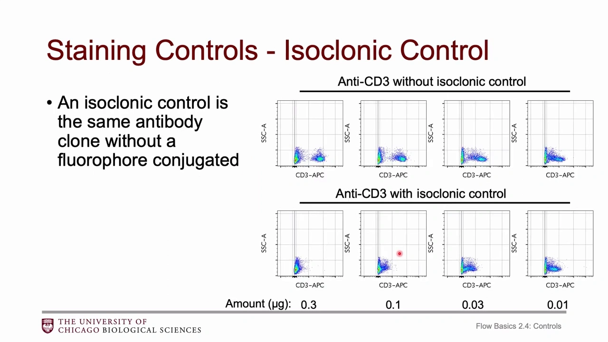

**同克隆对照（isoclonIC control）** 比同型对照严格得多：它用的是**同一支抗体克隆**，只是没有偶联荧光素。做法是把未标记抗体与荧光标记抗体混合（或先用未标记的孵育、再加标记的），看结合是否被竞争掉。

- 如果信号**消失**，说明标记抗体的结合是可被同一克隆饱和的，即特异结合。
- 如果信号**仍在**，说明这部分荧光不是通过抗原结合位点上去的——可能是游离荧光素、可能是聚集体的非特异吸附。

图上的四组剂量对比很能说明问题：不加同克隆对照时，四组都有明显阳性群；加了之后，阳性群基本消失。这是一个**功能性的特异性证明**，比「同型对照没染上」强得多。

### 4.2 背景过高时该怎么办

[【跳转到 26:00】](https://www.youtube.com/watch?v=b0MVzjeTzbk&t=1560)

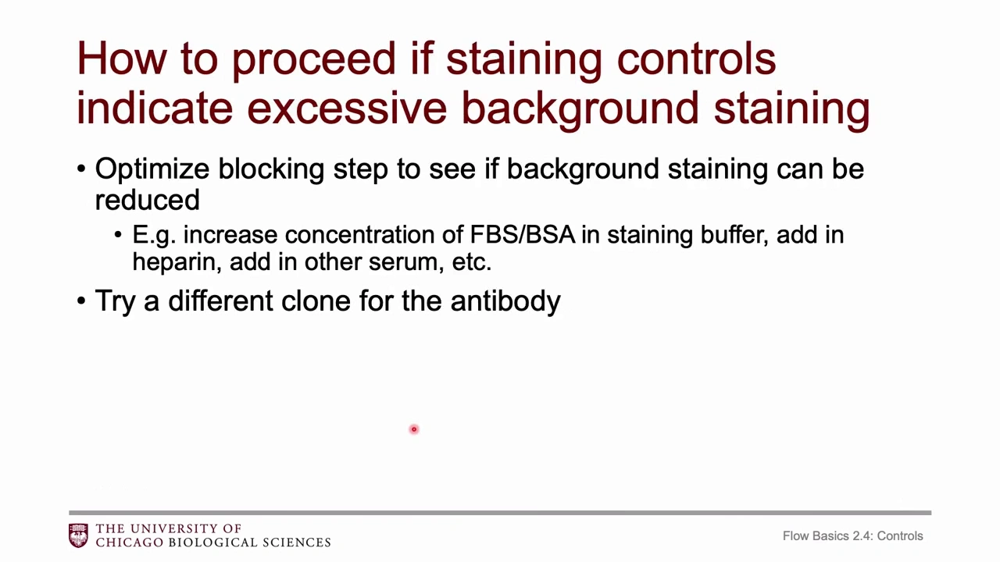

讲者给的处置路径只有两条，都很具体：

1. **优化封闭步骤**：提高染色缓冲液里 FBS/BSA 的浓度、加肝素、加其他血清。
2. **换一个抗体克隆**：如果封闭怎么调都压不下去，说明这支克隆本身就有非特异倾向。

这里补一句本系列其他小节的背景（非本视频内容）：细胞表面表达 Fcγ 受体，抗体的 Fc 段可以被这些受体抓住，产生与抗原无关的「结合」。封闭步骤里加入 Fc 受体阻断剂（Fc block）就是针对这一机制的常规做法；讲者在另一讲（抗体滴定）里把 Fc block 列为「滴定时必须与多色样本保持一致的条件」之一。换句话说，**Fc block 属于封闭步骤的一部分**，它压制的正是同型对照会显示出来的那类背景。

---

## 五、未染色与实验对照：把「信号来自目标分子」这件事坐实

[【跳转到 26:39】](https://www.youtube.com/watch?v=b0MVzjeTzbk&t=1599)

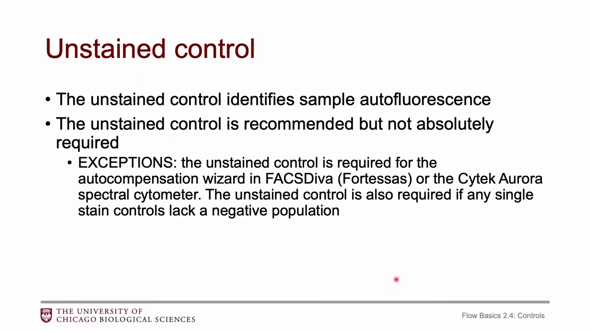

**未染色对照** 的主要用途是识别样本的**自身荧光**。讲者说它「建议但非绝对必需」，但有三种情况必须带：

- 使用自动补偿（FACSDiva 的补偿向导、Cytek Aurora 等光谱仪器）；
- 某个单染对照缺少阴性群（此时未染色管充当「通用阴性」）；
- 你想节省样本，用它来先设前向/侧向散射的门。

注意「通用阴性」的前提仍是自身荧光匹配：如果未染色管用的细胞与单染对照的细胞不同，这个阴性就不能直接借用。

[【跳转到 27:56】](https://www.youtube.com/watch?v=b0MVzjeTzbk&t=1676)

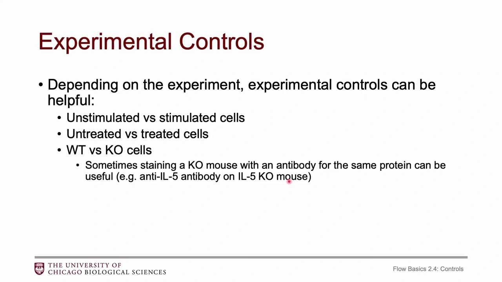

**实验对照** 是四类里最贴近生物学问题的一类，讲者列了三种：

- 未刺激 vs 刺激；
- 未处理 vs 处理；
- **野生型 vs 敲除（WT vs KO）**。

她特别点出最后一种的用法：在**敲除小鼠**身上染同一支针对该蛋白的抗体。如果抗原真的被敲掉了，信号应当消失或显著下降；如果信号照旧，那这支抗体测的就不是你以为的那个分子。这是所有对照里**唯一能直接证明抗体识别的是目标分子**的一种——同型对照只能排除骨架粘附，同克隆对照只能证明结合位点依赖，只有敲除能证明「这个信号随目标分子的有无而变」。

她也提到一个变通：如果拿不到敲除细胞，可以把未刺激与刺激的细胞**混在同一管**里，这样两类细胞共享完全相同的染色条件，差异只来自生物学状态。

---

## 六、管数预算：对照常常比样本多

[【跳转到 30:20】](https://www.youtube.com/watch?v=b0MVzjeTzbk&t=1820)

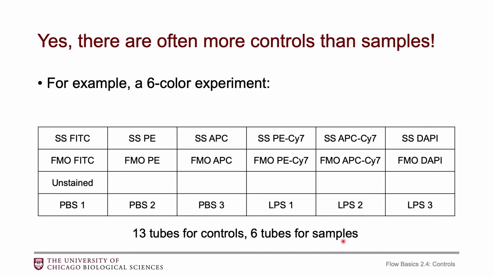

讲者算了一笔账：六色方案，六个单染 + 六个 FMO + 一个未染色 = 13 管对照，而样本只有 6 管（3 管未刺激 + 3 管刺激）。她说这在流式实验里「 unfortunately 很常见」。

于是问题变成：**有限的细胞怎么分**。

[【跳转到 31:52】](https://www.youtube.com/watch?v=b0MVzjeTzbk&t=1912)

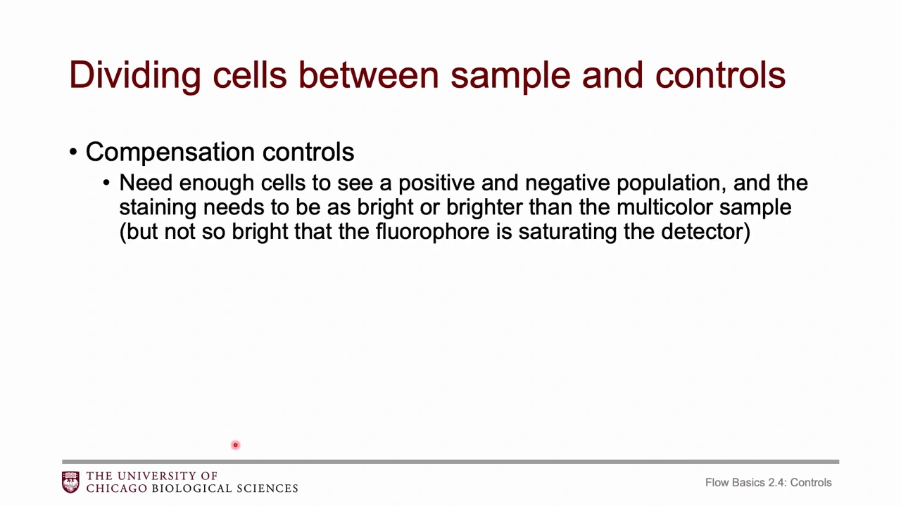

她的分配原则是：

- **单染对照可以减细胞**，只要仍满足四条规则（能看到阳性与阴性群、亮度不低于样本）。但要注意：细胞数太少可能让荧光强度变暗，或让移液误差的影响放大，反而违反「不低于样本亮度」这条。
- **FMO 尽量与样本同细胞数**，但要看标记丰度：像 CD45 这种在多数免疫细胞上高表达的标记，FMO 不需要很多细胞；如果目标是一个很稀有的亚群，FMO 的细胞数就要尽量接近样本。

这段的实际含义是：**对照的「规格」不是统一的，它由它要支撑的那条判读决定**。为画门服务的 FMO 需要足够的统计量，为补偿服务的单染只需要两个清晰的峰。

---

## 七、回到终点读数：这些对照各自排除了什么

把全场内容压成一张「假象—对照」对照表，这就是本节的学习目标：

| 可能出现的假象 | 由哪一层对照排除 | 排除的逻辑 |
| --- | --- | --- |
| 阳性群其实是检测器饱和或电压过高 | 单染对照（电压梯度） | 电压过高时阴性峰也会扩散，分离不再改善 |
| 「阳性」是别的荧光素溢漏过来的 | 单染对照 + 补偿 | 补偿把溢漏从目标通道里减掉 |
| 边界画错，把阴性算成阳性 | FMO | 用含其他荧光素的阴性群定界，抵消溢漏扩散 |
| 信号来自抗体骨架非特异粘附 | 同型对照 | 同恒定区、异可变区仍染色即为非特异 |
| 信号来自游离荧光素或聚集体 | 同克隆对照 | 未标记同克隆能竞争掉特异结合，竞争不掉的部分即非特异 |
| 信号来自 Fc 受体结合 | 封闭步骤（含 Fc block） | 饱和 Fc 受体后背景应下降 |
| 信号来自细胞自身荧光或死细胞 | 未染色对照 + 活死染料 | 自身荧光与死细胞会被单独识别 |
| 信号根本不来自目标分子 | WT vs KO 实验对照 | 抗原缺失时信号应消失 |

值得注意的是，这张表里**没有一行能给出「亲和力」或「结合速率」**。流式和 ELISA 一样是终点法：它告诉你「在这个浓度、这个时刻，细胞上有多少荧光」，不告诉你结合有多快、解离有多慢。要回答后者，必须换到 SPR/BLI 这类实时方法（见 5.2.2）。

同样，MFI 的高低也不能直接读成「表达量高低」或「结合强弱」——它同时受抗体浓度、荧光素亮度、仪器电压、细胞大小与自身荧光影响。这也是为什么同小节另一篇要专门讲**滴定**：只有把抗体浓度推到饱和平台，MFI 才接近「表位数量」的代理量；在未饱和区，MFI 主要反映的是浓度而不是结合能力。

---

## 小结

- **对照分四层，各管一类误差**：单染管仪器校准，FMO 管阳性边界，同型/同克隆管非特异结合，未染色与 WT/KO 管信号来源。
- **单染对照的两个用途都不是判读**：设电压与算补偿。电压与抗体浓度是同一矛盾的两个旋钮，要一起调。
- **四条补偿规则里最容易违反的是「同一荧光素」**：用 FITC 补偿 GFP 是典型错误；串联染料必须用同一支抗体。
- **FMO 优于未染色管，因为溢漏扩散**：管里其他荧光素会让阴性群变亮变宽，用未染色管画门会系统性偏左。
- **同型对照不能画门**，它只用于识别非特异染色；同克隆对照（未标记同抗体）是更强的功能性证明。
- **只有 WT vs KO 能证明抗体识别的是目标分子**，其余对照都只能排除某一类假象。
- **对照常常比样本多**（六色实验 13 管 vs 6 管），因此必须按「这条对照要支撑哪条判读」来决定它的细胞数规格。

## 关键术语速查

| 术语 | 一句话解释 |
| --- | --- |
| 单染对照 | 一管只含一个荧光素，用于设电压与计算补偿 |
| 补偿（compensation） | 用数学方法扣掉荧光素之间的溢漏，使阳性群与阴性群对齐 |
| 溢漏扩散误差 | 其他荧光素带来的噪声扩散到目标通道，使阴性群变宽变亮 |
| FMO | 除目标荧光素外含有全部荧光素的对照，用于画阳性边界 |
| 同型对照 | 同恒定区、异可变区的抗体，用于识别非特异结合，不用于画门 |
| 同克隆对照 | 同一克隆但不带荧光素，通过竞争阻断证明结合特异性 |
| 未染色对照 | 不含任何荧光素的样本，用于评估自身荧光 |
| 自身荧光 | 细胞自身在检测波段发出的光，是阴性群的亮度底噪 |
| WT vs KO 对照 | 野生型与敲除细胞染同一抗体，用于证明信号依赖目标分子 |