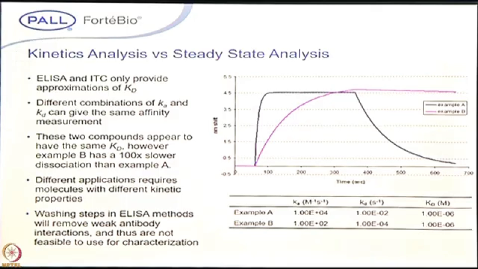
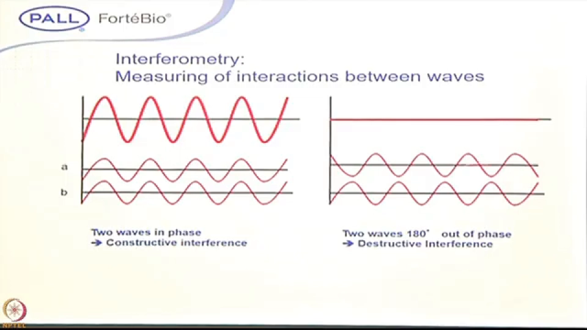
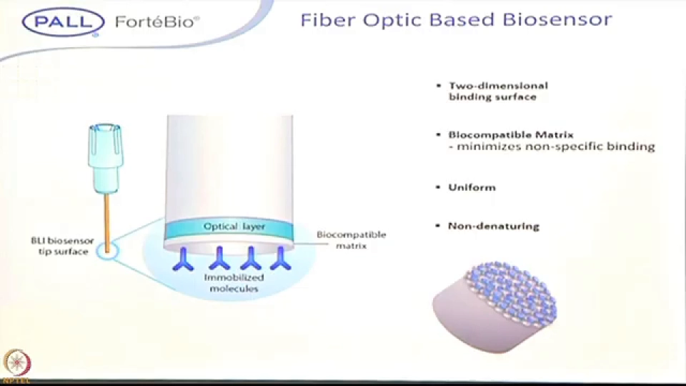
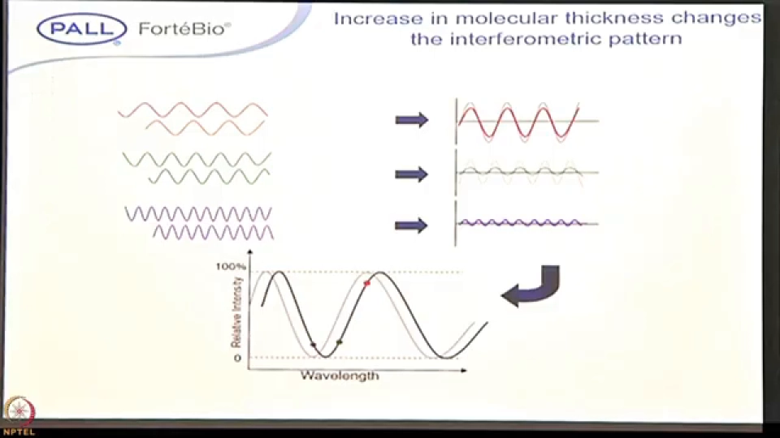
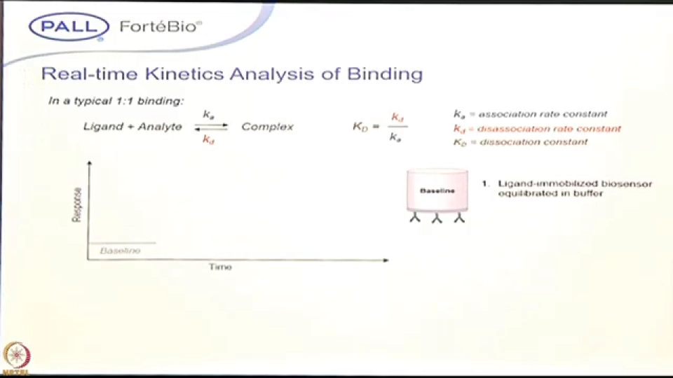
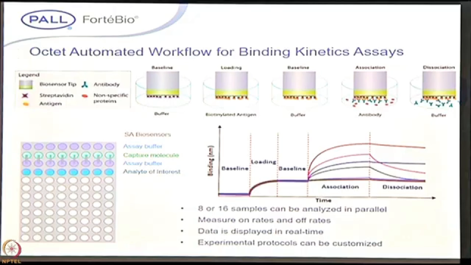
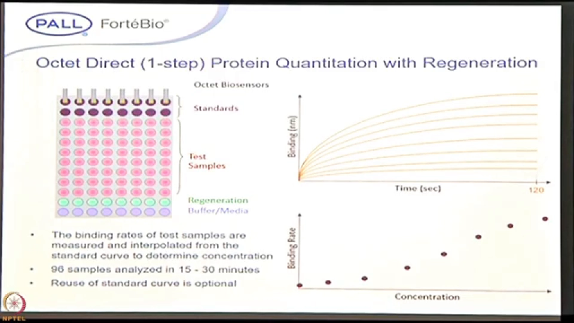
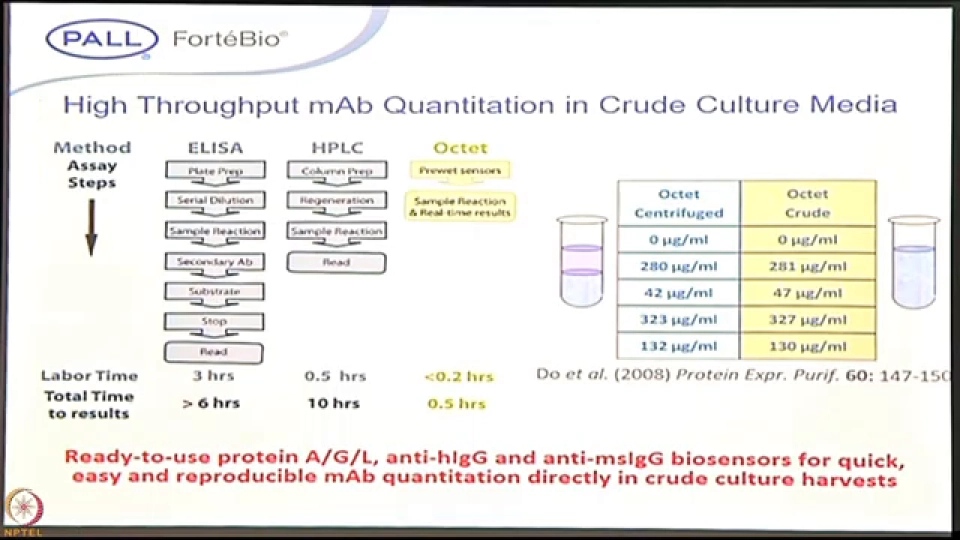

# BLI 原理与平台差异：干涉光谱、浸入式探针与高通量动力学

> 视频来源：[Lecture 40: Biomolecular interactions using Bio-Layer Interferometry (BLI) - I](https://www.youtube.com/watch?v=RAM1onEdsjM)（YouTube · NPTEL / IIT Bombay 生物物理课程，讲者 Susheelendra Vaidya，Pall ForteBio 应用科学家）｜时长约 45 分钟
>
> 导读：这是一节由仪器厂商应用科学家讲的 BLI 系统课，前半段讲「为什么需要实时动力学、BLI 的干涉原理、和 SPR 的差别」，后半段是十几个真实研究案例（流感广谱中和抗体、KSRP/let-7、分子伴侣折叠状态、小分子、抗体滴度）。讲者的口音较重、字幕为自动生成，术语已按幻灯片订正（如 biolayer interferometry、streptavidin、biotinylated）。本文按讲课顺序展开，把散落在案例里的方法学要点归到前面几节；SPR 的物理原理见同目录《SPR 如何实时看见结合》，拟合条件见《曲线能不能拟合，先看结合段有没有曲率》。

## 本讲要解决的核心问题（SCQA）

**背景**：测结合最常用的是 ELISA 和 ITC。ELISA 便宜、通用；ITC 能给出化学计量比和热力学参数。它们都能给出一个 $K_D$。

**冲突**：但这两类方法都只能做**稳态**分析——用一串浓度对响应作图，读出半高点。它们给不出 on rate 和 off rate。而两个 $K_D$ 完全相同的抗体，可能一个几秒钟就掉光、另一个能挂半小时；在需要长时间占据靶点的场合，这两者根本不是一回事。更麻烦的是 ELISA 的洗涤步骤会把弱结合洗掉，读出来的「亲和力」其实是「洗完还剩多少」。

**疑问**：如果既要不带标记、又要同时拿到 on rate 和 off rate，除了 SPR 还有什么选择？SPR 的微流控和低通量在筛选场景里够用吗？

**回答（中心思想）**：BLI 把「测折射率」换成了「测干涉光谱」——把一束白光打进光纤，收集两个界面的反射光，看它们叠加出的光谱图样随膜层厚度怎么移动。这个改动带来三个直接后果：**没有微流控**（不怕堵、能测粗样品）、**探针一次性使用**（不必再生）、**96 孔板并行**（通量高一个量级）。代价是它测的同样是「厚度」，同样分不清特异性与非特异性，仍然要靠参比与对照来兜底。

---

## 一、为什么非要动力学：同一个 $K_D$，两种完全不同的药

[【跳转到 00:18】](https://www.youtube.com/watch?v=RAM1onEdsjM&t=18)

主持人先介绍了讲者背景：Susheelendra Vaidya，Pall ForteBio 应用科学家，负责印度区的安装、支持、培训与产品推广，做过蛋白质组学、脂质组学、小分子质谱表征。

[【跳转到 01:33】](https://www.youtube.com/watch?v=RAM1onEdsjM&t=93)

讲者开场先讲「相互作用为什么重要」：转录因子结合 DNA、蛋白复合物组装、激素与生长因子的信号转导、抗原抗体结合，这些都是相互作用。药物发现里要理解药物怎么结合靶点，就要看亲和力。

他给了一个很好懂的落点——**给药频次**：

> 有的药一天三次，有的药一周一次。剂量怎么定？就取决于相互作用：亲和力强，需要的药量就少；如果药物从体内清除得很快，就需要更多剂量。

这个例子把「动力学」和「临床给药」连了起来：药物从体内清除、靶点上的复合物解离，两者谁快谁慢，决定了你多久要给一次药。

## 二、ELISA 与 ITC 的共同软肋：只能给稳态的 $K_D$

[【跳转到 03:32】](https://www.youtube.com/watch?v=RAM1onEdsjM&t=212)

讲者把常规技术过了一遍：

- **ELISA**：常用来筛相互作用。局限是**耗时**、需要更多人力开发方法，还要一步步筛才能选出候选；**试剂消耗大**，人工投入多。
- **ITC（等温滴定量热）**：能给出相互作用的**化学计量比**，也能给出熵变这类热力学参数（反应放热还是吸热）。

两者的共同局限，讲者说得很直接：

> 它们只能靠「浓度对响应」做稳态分析，给出 $K_D$，却给不出动力学参数——on rate 和 off rate。

[【跳转到 04:58】](https://www.youtube.com/watch?v=RAM1onEdsjM&t=298)

这句判断值得展开（补充解释）：稳态法测的是「平衡时占了多少」，而平衡位置只由 $K_D$ 决定；结合得多快、解离得多慢，在平衡态里被完全抹掉了。ELISA 还多一层问题——**洗涤**。洗的时候弱结合的抗体被带走，最后读到的信号偏向高亲和的那一部分，所以它给出的 $K_D$ 只是一个近似。

## 三、一张幻灯片说清「动力学分析」与「稳态分析」的差别

[【跳转到 06:38】](https://www.youtube.com/watch?v=RAM1onEdsjM&t=398)

这是全讲信息密度最高的一页。幻灯片标题是 **Kinetics Analysis vs Steady State Analysis**，右边一张表给了两个化合物：

| 例子 | $k_a$（$\mathrm{M^{-1}s^{-1}}$） | $k_d$（$\mathrm{s^{-1}}$） | $K_D$（M） |
| --- | --- | --- | --- |
| Example A | $1.00\times10^{4}$ | $1.00\times10^{-2}$ | $1.00\times10^{-6}$ |
| Example B | $1.00\times10^{2}$ | $1.00\times10^{-4}$ | $1.00\times10^{-6}$ |

两个化合物的 $K_D$ 都是 1 μM，但：

- A 的结合速率是 B 的 100 倍，解离速率也是 B 的 100 倍；
- 图上黑线（A）迅速冲上去又迅速掉下来，粉线（B）慢慢爬升、几乎不掉；
- 幻灯片上的原话是：**Example B 的解离比 Example A 慢 100 倍**。

这张表把「$K_D = k_{off}/k_{on}$」的含义讲透了：**$K_D$ 是一个比值，比值相同不代表过程相同**。两个分子在稳态法里长得一模一样，在动力学里是两种完全不同的药。

同一页还有两条要点，都很实用：

- **不同应用需要不同动力学性质的分子**。需要长时间占据靶点（比如阻断型抗体）时，慢解离更值钱；需要快速可逆、避免持续阻断时，快解离反而更好。这个取舍在 3.2.3 那篇《抗体亲和力不是越高越好》里有更细的讨论。
- **ELISA 的洗涤步骤会洗掉弱结合，因此不适合做表征**。这句话是对第二节那个判断的补充说明。

## 四、SPR 的三个现实限制

[【跳转到 04:58】](https://www.youtube.com/watch?v=RAM1onEdsjM&t=298)

讲者在引出 BLI 之前，先讲了 SPR 在实际使用中的三个痛点。这一段是厂商视角，但三条都站得住：

1. **微流控容易堵**。处理细胞培养样品或体液样品时，里面有细胞碎片和杂质，很可能堵塞流路；SPR 的流路是很精细的结构，一旦堵了往往要更换整个组件，**非常贵**，维护成本也高。
2. **通量偏低**。一次一个通道，要把一个浓度接一个浓度地注射到表面上。
3. **对折射率变化敏感**。样品里含 DMSO 或甘油时，SPR 会出现明显的体效应（bulk effect）——这一点与 SPR 的检测原理直接相关：它测的就是折射率。

第 3 条在后面的原理部分被讲者反复用来对比：BLI 对基质折射率与 pH 的变化**相对不敏感**，所以粗样品可以直接上。

## 五、BLI 的物理原理：不是测角度，是测干涉图样

[【跳转到 05:38】](https://www.youtube.com/watch?v=RAM1onEdsjM&t=338)

讲者先交代了技术来历：ForteBio 2003 年开始做这项技术，2005 年推出第一台系统 Octet QK，此后按通量不同陆续出了多种型号。

[【跳转到 06:18】](https://www.youtube.com/watch?v=RAM1onEdsjM&t=378)

原理的起点是**光的波动性**：

> 光在光纤里向前传播，遇到界面会反射回来。前向波与反射波叠加时，振幅增大，这叫**相长干涉**；两者相位差 180 度时信号被抵消，这叫**相消干涉**。相长与相消干涉共同构成了信号图谱。

[【跳转到 07:38】](https://www.youtube.com/watch?v=RAM1onEdsjM&t=458)

器件本身叫**生物传感器（biosensor）**，外形像一根针：主体是塑料，里面是一根玻璃毛细管，也就是光纤。光纤尖端镀了一层**生物相容的光学层**，你要研究的蛋白就固定在这层上。

讲者列了这个尖端的几个性质：

- 它是一个**二维结合表面**；
- 基质**生物相容、惰性**，pH 2 到 10 的缓冲体系都能用；
- 制造上**均匀**（批次间一致）；
- **非变性**，不会干扰你的相互作用体系；
- 光纤直径只有 **600 微米**，所以固定配体所需的样品量非常少。

[【跳转到 08:58】](https://www.youtube.com/watch?v=RAM1onEdsjM&t=538)

干涉是怎么变成一个读数的？讲者描述得很具体：

> 我们打一束白光下去，光被反射回来。你能看到两处反射——一处来自内部光学层，一处来自配体所在的界面。两束反射光叠加，产生不同振幅的相长与相消干涉。我们画的是**相对强度对波长**的曲线。

[【跳转到 09:58】](https://www.youtube.com/watch?v=RAM1onEdsjM&t=598)

分子结合到表面、形成**生物膜层（biolayer）**，干涉图谱就随膜层厚度移动：

> 结合的分子越多，光谱向右移动得越多。

这一段有一个非常实用的换算，讲者在后面的演示里给出了（[【跳转到 19:58】](https://www.youtube.com/watch?v=RAM1onEdsjM&t=1198)）：**传感器上每结合 1 纳米厚的蛋白，干涉图样就向蓝端移动 1 纳米**；这个光学厚度的变化被实时记录下来，单位就是 nm。

（补充：这就是为什么 BLI 的纵轴常写 "Binding (nm)"，而 SPR 写 "Response (RU)"。两者都是「表面质量/厚度」的代理量，只是标定方式不同。）

## 六、仪器结构：没有微流控，靠「浸入—提起」

[【跳转到 07:18】](https://www.youtube.com/watch?v=RAM1onEdsjM&t=438)

仪器内部：一台**分光光度计**，连着**机械臂**，还有**传感器托盘**；样品放在 **96 孔板**里，样品板带**轨道振荡**和**温控**。

讲者把与 SPR 的差别一句话讲完：

> BLI 没有微流控，靠的是「浸入—提起」（dip and read）。反应全部发生在传感器尖端。SPR 这类微流控器件里，流动帮助结合；BLI 里帮助结合的是轨道振荡。

这个改动带来一串连锁后果，值得单独列出来（部分为补充归纳）：

| 维度 | SPR | BLI |
| --- | --- | --- |
| 检测量 | 反射光共振角 → 折射率 → 质量 | 干涉光谱位移 → 光学厚度 |
| 流体 | 微流控，流动帮助结合、抑制传质 | 无流路，轨道振荡帮助混合 |
| 堵塞风险 | 有，粗样品需前处理 | 基本没有，可测含颗粒的裂解液 |
| 通量 | 常见 2 / 4 通道 | 8 / 16 / 96 通道 |
| 传感器 | 芯片可再生、反复使用 | 探针一次性，通常不需再生 |
| 体折射率效应 | 敏感，需参比扣减 | 讲者称相对不敏感 |
| 长时间解离 | 受流路与漂移限制 | 受**样品蒸发**限制 |

最后一行是 BLI 特有的坑：讲者说紧密结合的对可以监测 2 小时以上，**唯一的限制是样品蒸发**。孔里的液体蒸掉一点，浓度和光路都会变——这是长时程实验必须控温、加盖的原因。

## 七、五步工作流：BLI 的传感图长什么样

[【跳转到 17:59】](https://www.youtube.com/watch?v=RAM1onEdsjM&t=1079)

讲者先给了一张「实时动力学分析」的幻灯片作为铺垫：典型的 1:1 结合写作 $\text{Ligand} + \text{Analyte} \rightleftharpoons \text{Complex}$，$K_D = k_d / k_a$，并注明 $k_a$ 是结合速率常数、$k_d$ 是解离速率常数。

然后他把动力学实验拆成五步，并配了一张「传感器状态 + 传感图」并排的幻灯片：

1. **Baseline（基线）**：传感器浸入缓冲液。没有任何分子结合，所以是一条平线。
2. **Loading（上样）**：移到装有捕获分子的孔，把要研究的蛋白固定到传感器上，响应上升。
3. **Baseline（新基线）**：换回缓冲液，建立新的零点。
4. **Association（结合）**：浸入含分析物的孔，分析物结合上来，响应上升。
5. **Dissociation（解离）**：换回缓冲液，分析物掉下来，响应下降。

幻灯片底下写了四条要点：**8 或 16 个样品并行、同时测 on rate 与 off rate、数据实时显示、实验方案可自定义**。

这里有一个与 SPR 的实质差别：**BLI 的上样步骤就在同一次实验里完成**。SPR 通常要先单独做一次偶联、评估偶联密度，再跑动力学；BLI 把「挂配体」也变成流程里的一步，所以你能实时看到上样量——上多了还是上少了，当场就知道。上样量直接决定 $R_{max}$，也就决定了信号窗口。

## 八、不用再生，是 BLI 最实际的优势

[【跳转到 21:19】](https://www.youtube.com/watch?v=RAM1onEdsjM&t=1279)

讲者在这一段把「一次性探针」的好处讲得很透：

> 解离结束后传感器可以直接弹掉、换新的，**不需要跑再生方法或清洗流程**。所有样品溶液都可以回收，也可以换新靶点重复使用。

与之配套的是解离时长的弹性：

- 快速筛选：解离只采 **5 分钟**，一小时内能测 96 个样品，为克隆筛选提供排序依据；
- 紧密结合的对：可以监测 **2 小时以上**，为的是拿到准确的 $K_D$。

再生的代价在 SPR 那边是实实在在的：低 pH 或高盐洗脱会损伤配体，洗几次之后表面活性就掉了——这正是 SPR 实验里「重复一个浓度看曲线是否重叠」这条质控存在的原因。

## 九、粗样品直接测：BLI 最容易被低估的能力

[【跳转到 20:58】](https://www.youtube.com/watch?v=RAM1onEdsjM&t=1258)

> BLI 对基质效应相对不敏感，而且没有微流控的限制，所以可以在很「脏」的样品里测。含血清的培养液、周质提取物、带颗粒的细胞裂解液都能直接测，基质干扰很小。

讲者还补了一句机制层面的解释：**BLI 对基质折射率或 pH 的变化不敏感**——因为它的信号来自膜层厚度造成的干涉位移，而不是整体折射率。

（补充提醒：这句话是相对 SPR 而言的。「相对不敏感」不等于「完全不敏感」——高浓度甘油、DMSO、去垢剂仍会造成非特异吸附与基线漂移，所以粗样品实验照样要设空探针（不挂配体的 sensor）作参比。讲者在本讲里没有展开这一点。）

## 十、定量：从 96 孔板到 40 分钟出结果

[【跳转到 16:59】](https://www.youtube.com/watch?v=RAM1onEdsjM&t=1019)

BLI 不只做动力学，也做定量。讲者给的是**一步法（direct / 1-step）**：

- 传感器上挂好能抓目标分子的配体；
- 把标准品与待测样品一起上机，测各自的**结合速率**；
- 用标准曲线插值，得到待测样品的浓度；
- 96 个样品 **15 到 30 分钟**测完；
- 标准曲线可以重复使用。

[【跳转到 25:20】](https://www.youtube.com/watch?v=RAM1onEdsjM&t=1520)

讲者最后拿它和 ELISA、HPLC 正面比了一次（这是他引用的一篇 2008 年文献的数据）：

| 方法 | 人工时间 | 出结果总时间 |
| --- | --- | --- |
| ELISA | 3 小时 | 超过 6 小时 |
| 蛋白 HPLC | 0.5 小时 | 10 小时 |
| Octet（BLI） | 少于 0.2 小时 | 0.5 小时 |

幻灯片右侧还有一组更关键的数据：**粗培养液直接测与离心后测，滴度结果几乎一致**（0 / 281 / 47 / 327 / 130 μg/mL 对 0 / 280 / 42 / 323 / 132 μg/mL）。这正是「不用前处理」这句话的实证。

## 十一、传感器化学：挂什么，取决于你有什么

[【跳转到 18:19】](https://www.youtube.com/watch?v=RAM1onEdsjM&t=1099)

讲者列了货架上的传感器类型：

- **有标签的**：His 标签传感器、**超链霉亲和素（super streptavidin）**传感器（配生物素化配体，石英基，特别适合小分子—蛋白相互作用）；
- **预包被的抗体捕获类**：蛋白 A、蛋白 G、蛋白 L、Fc 捕获传感器；
- **无标签的**：靠**生物素化**或**胺偶联**自己固定。

选择逻辑很朴素：**你手上有什么，就用什么**。有 His 标签就用镍传感器，有生物素化位点就用链霉亲和素，什么都没有就用胺偶联（代价是随机偶联，配体朝向不受控）。

## 十二、案例：从疫苗抗体到小分子，BLI 在回答什么问题

讲者后半段用十几个案例说明 BLI 的适用范围。这里按「它回答了什么类型的问题」归类，而不是逐篇复述。

### 12.1 筛选与排序：找出广谱中和的那两株

[【跳转到 31:19】](https://www.youtube.com/watch?v=RAM1onEdsjM&t=1879)

一个团队开发流感疫苗，想找有**广谱中和能力**的抗体。他们把不同抗体与各自的**血凝素（hemagglutinin）**做结合测试，从结合图谱里挑出了两株广谱中和抗体。讲者的评价是：这类应用可以很快筛出来。

### 12.2 定位功能结构域：KSRP 与 let-7

[【跳转到 33:16】](https://www.youtube.com/watch?v=RAM1onEdsjM&t=1996)

let-7 是重要的抑癌 microRNA。KSRP 蛋白有四个结构域，用野生型可以看到它结合；把其中一个 **KH3 结构域**突变后就不结合了，由此判断 KH3 是这个结合的关键。讲者补充：这个蛋白是细胞分化的重要转录因子，在招募癌基因、调控细胞分化中很关键，基因一旦突变就有癌变风险。

### 12.3 拆解「促进型」结合：FUSE / FBP / FIR

[【跳转到 34:05】](https://www.youtube.com/watch?v=RAM1onEdsjM&t=2045)

FUSE 系统在细胞分化中很重要，c-myc 是重要的调控基因。作者想知道调控是怎么发生的：把**生物素化的 FUSE40 DNA** 固定在链霉亲和素传感器上，再测 FIR 的结合。结论是——**只有在 FBP 蛋白存在、并且有 FIR 的时候**才发生相互作用。

这个案例的方法学意义在于：BLI 能在同一个传感器上依次加多个组分，看清楚「三者同时在场才结合」这种条件依赖的关系。

### 12.4 折叠状态：分子伴侣模型

[【跳转到 35:25】](https://www.youtube.com/watch?v=RAM1onEdsjM&t=2125)

把未折叠的蛋白固定在传感器上，**未折叠的会结合、折叠的不结合**，用分子伴侣模型就能筛「折叠/未折叠」状态。

### 12.5 与 ELISA 对照：抗 HRP2 抗体的动力学

[【跳转到 35:25】](https://www.youtube.com/watch?v=RAM1onEdsjM&t=2125)

诊断免疫分析方面，他们测了 **15 株抗 HRP2 抗体**的动力学参数，并与 ELISA 做了比较。这正是本文第二节那个论点的实证：同一批抗体，ELISA 只能排序，动力学能给出机制。

### 12.6 适配体与小分子：off rate 驱动的筛选

[【跳转到 36:25】](https://www.youtube.com/watch?v=RAM1onEdsjM&t=2185)

- **适配体（aptamer）**：大小和形状与抗体不同，结合到靶点上同样能给出响应，在诊断产业里是一大应用。
- **小分子—蛋白相互作用**：只用一个浓度差，就能筛尽可能多的化合物，再**根据 off rate 挑候选**。这是 Fragment 筛选与先导化合物优化的标准打法——先看有没有结合，再看掉得快不快。
- 具体案例：密歇根大学用 **bromodomain 1** 蛋白对 3 个 hit 做了完整动力学表征；另一个例子是 **AMPK** 与 thalidezine 及其结构异构体 hernandezine 的表征比较。

### 12.7 把传感器当「抓取工具」：pull-down 后接质谱或电镜

[【跳转到 38:05】](https://www.youtube.com/watch?v=RAM1onEdsjM&t=2285)

这是 BLI 一个不太被注意的用法：把目标蛋白固定在传感器上，浸入细胞提取物或裂解液，让结合上去的蛋白挂住，然后**洗脱下来做质谱**。

案例是炭疽毒素的**前孔（prepore）**：把前孔固定在传感器尖端，在 37 度、1 摩尔尿素条件下发生前孔到孔（pore）的转变，再浸入脂质-胆酸盐混合物，就能看到孔与脂质之间形成胶束；随后取下传感器尖端、浸入缓冲液、用解偶联试剂释放复合物，制备电镜载网，就能用电镜看这些复合物。

讲者特别对比了 SPR 在这一步的劣势：**SPR 洗脱下来的复合物溶液被稀释了，还得先浓缩**才能做后续研究；BLI 可以直接在孔里完成富集。

### 12.8 排查工艺问题：EPO 定量为什么偏低

[【跳转到 39:32】](https://www.youtube.com/watch?v=RAM1onEdsjM&t=2372)

一家公司表达促红细胞生成素（EPO）时，定量结果总是偏低。他们查下去，发现是**宿主细胞的组蛋白**挡住了 EPO 的结合；把这些组分洗脱下来做质谱，确认了目标蛋白被结合、EPO 的结合被阻断。Genmab 最近也发表了这类数据。

这个案例说明：BLI 的「粗样品直接测」不只是省事，它还能把**基质干扰本身**当成研究对象。

### 12.9 细胞表面：动态重塑（dynamic remodulation）

[【跳转到 40:52】](https://www.youtube.com/watch?v=RAM1onEdsjM&t=2452)

把细胞固定在传感器表面，再测它与 EGF 的结合。讲者明确说：**这已经不是严格意义上的动力学**，而是细胞实验的正交验证。原因是：

> 细胞很大，如果只是一个小蛋白结合上去，你根本看不到生物膜层的变化。但当分子结合到细胞表面的靶点时，细胞内会发生事件——肌动蛋白重构或其他通路的变化，这些变化会导致传感器上的信号变化。

他们把这种信号叫**动态重塑（dynamic remodulation）**。这个案例的边界很清楚：信号来自细胞反应，不是结合质量，所以不能拿它算 $K_D$。

## 十三、BLI 的边界在哪

讲者没有专门讲局限，但从他讲的内容里可以整理出几条（部分为补充归纳）：

1. **它测的仍是「厚度」**，分不清特异性结合与非特异吸附。粗样品能测，不等于不用对照——空探针参比仍然必要。
2. **小分子信号弱**。1 nm 的蛋白对应 1 nm 位移，几百道尔顿的小分子只有零点几纳米甚至更小，需要高密度上样与石英基传感器（讲者提到的 super streptavidin 就是为此）。
3. **蒸发限制长时程解离**。2 小时以上的解离，孔内蒸发会引入基线漂移。
4. **振荡混合不等于流动**。SPR 的流动能持续补充表面附近的分析物，BLI 靠轨道振荡，混合效率与传质行为不同——高密度上样时同样要警惕传质限制。
5. **一次性探针的成本结构不同**。省了再生与维护，但每根探针都是耗材；通量越高，耗材账越大。

## 小结

- **ELISA 与 ITC 只能给稳态的 $K_D$**，给不出 on rate 与 off rate；ELISA 的洗涤还会洗掉弱结合，所以它给出的只是近似。
- **同一个 $K_D$ 可以由完全不同的 $k_a$、$k_d$ 组合得到**：讲者的例子是 $K_D$ 都是 1 μM，但一个解离快 100 倍。选抗体时，动力学的差别常常比 $K_D$ 的差别更要紧。
- **BLI 测的是干涉光谱位移**：白光打进光纤，两个界面的反射光叠加成光谱图样，膜层越厚图样移动越多；1 nm 蛋白 ≈ 1 nm 位移。
- **没有微流控**是 BLI 与 SPR 最根本的差别，由此带来：不怕堵、能测粗样品、探针一次性不需再生、8/16/96 通道高通量；代价是长时程受蒸发限制。
- **五步工作流**：基线 → 上样 → 新基线 → 结合 → 解离；上样量在同一次实验里可见，直接决定 $R_{max}$。
- **定量也走得通**：一步法 96 个样品 15–30 分钟，粗培养液与离心样品结果一致；相比 ELISA 的 6 小时、HPLC 的 10 小时，时间差一个量级。
- **案例覆盖**：广谱中和抗体筛选、结构域定位（KSRP/let-7）、条件依赖的三元结合（FUSE/FBP/FIR）、折叠状态、适配体、小分子 off rate 筛选、pull-down 接质谱/电镜、工艺干扰排查、细胞表面动态重塑。

## 关键术语速查

| 术语 | 一句话解释 |
| --- | --- |
| BLI（生物膜层干涉） | 用光纤尖端膜层厚度改变干涉光谱位移来实时测结合的技术 |
| 生物膜层（biolayer） | 传感器尖端由配体与结合上去的分子构成的薄层，其厚度决定信号 |
| 相长 / 相消干涉 | 两束反射光同相位叠加振幅增大 / 反相位叠加相互抵消 |
| 生物传感器（biosensor） | BLI 的一次性探针，塑料针体 + 光纤 + 尖端光学层与基质 |
| dip and read | BLI 的工作方式：机械臂夹起探针浸入孔中，无流路 |
| 上样（loading） | 把配体固定到探针尖端的步骤，其响应大小决定 $R_{max}$ |
| 动态重塑（dynamic remodulation） | 细胞固定在探针上时，细胞内反应造成的信号变化，不是结合质量 |
| 一步法定量 | 用标准品的结合速率作标准曲线，插值求未知样品浓度 |
| 超链霉亲和素传感器 | 石英基、结合生物素化配体的探针，适合小分子相互作用 |
| $k_a$ / $k_d$ | 结合速率常数与解离速率常数；$K_D = k_d / k_a$ |