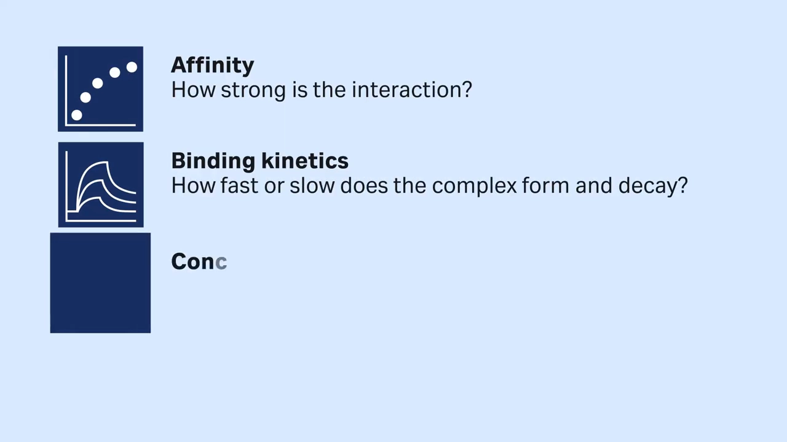
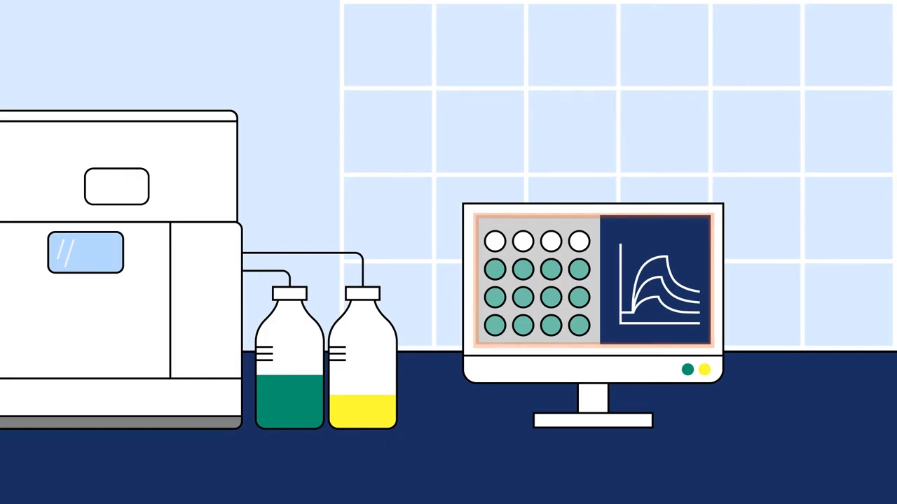
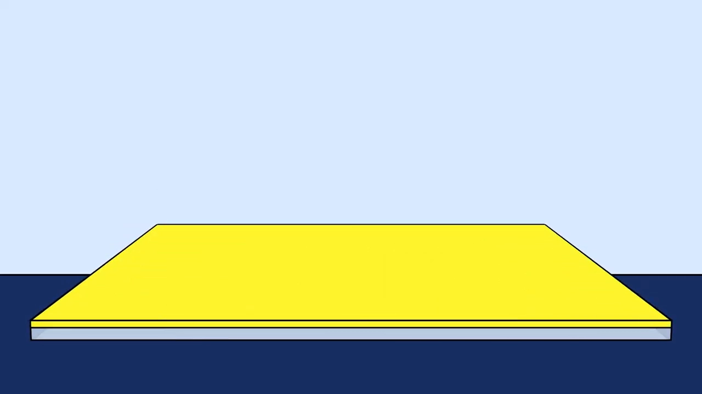
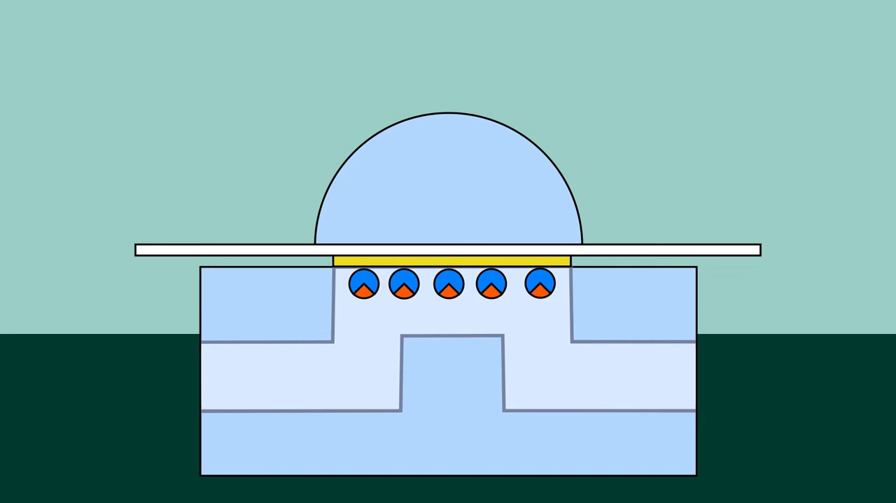
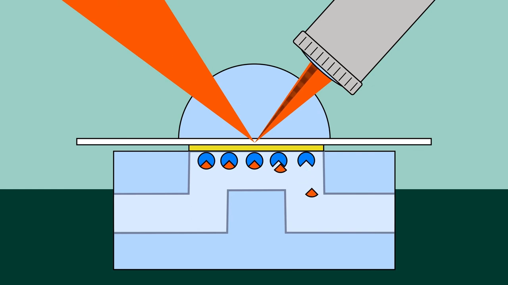
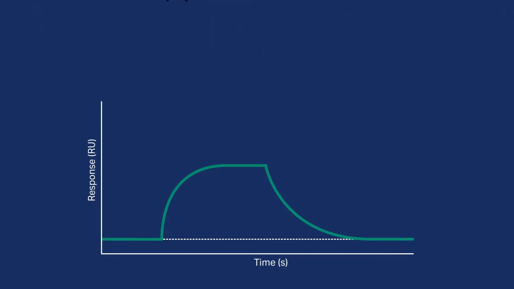
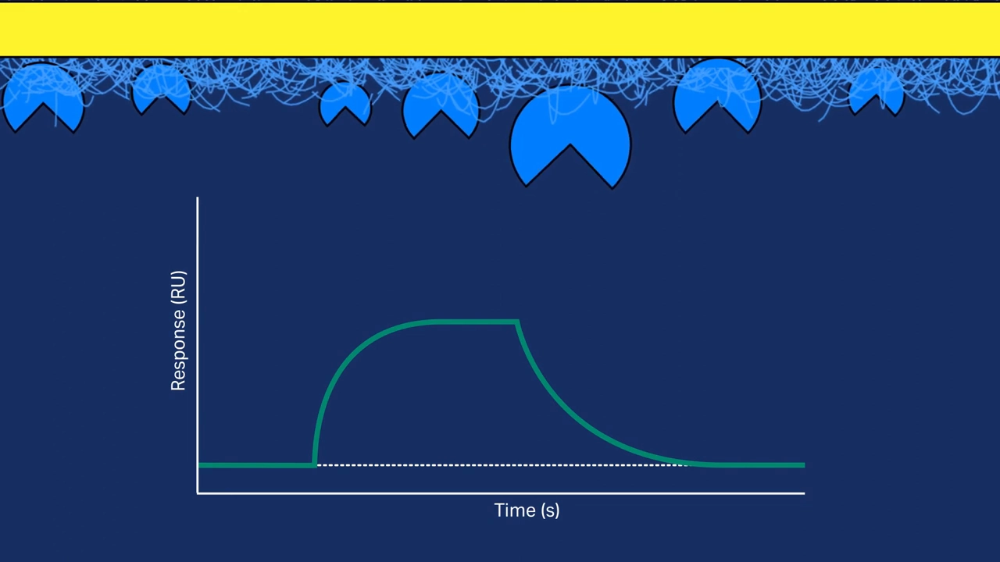

# SPR 如何实时看见结合：折射率、金膜与传感图

> 视频来源：[The principles of Surface Plasmon Resonance](https://www.youtube.com/watch?v=nkcC9BLmlrA)（YouTube · Cytiva 官方产品原理短片，Biacore 系统）｜时长约 4 分半
>
> 导读：这是一支 4 分半的官方原理动画，讲的是「一台 SPR 仪器里到底发生了什么」——金膜、葡聚糖基质、微流控、反射光角度、传感图，一个环节接一个环节。它不讲怎么挑抗体，只讲**信号是怎么被造出来的**。本文按它的动画顺序展开，末尾补了一段它没有讲、但读曲线必须知道的 $k_{on}$、$k_{off}$ 与 $K_D$ 的关系（已标注为补充）。终点法（ELISA、流式）为什么给不出这些量，见本系列 5.2.1；拟合质量怎么判、实验参数怎么设，见同目录另两篇。

## 本讲要解决的核心问题（SCQA）

**背景**：测抗体结合，最常用的办法是 ELISA 和流式——加样、孵育、洗涤、读一个强度值。它们回答的是「结合了没有、结合得多不多」。

**冲突**：但「结合得多」是一个混合结果：可能因为抗体浓度高，可能因为抗体抓得牢，也可能只是因为孵育时间够长。终点法把时间维度整个丢掉了——它只留一个时间点的快照，而结合与解离本来是一个随时间进行的过程。

**疑问**：有没有一种办法，不用标记、不用洗涤，就能在结合发生的当下把它记录下来，并且记下来的数值能直接换算成「结合上去多少质量」？

**回答（中心思想）**：SPR（surface plasmon resonance，表面等离子共振）之所以能实时看见结合，是因为它测的不是「标记」，而是**贴着金膜那一小层里的折射率**；折射率随结合上去的分子质量改变，而折射率的改变又表现为**反射光强最小的那个角度在移动**。把角度随时间画出来，就是传感图（sensorgram）。于是「结合」这件化学事件被翻译成了一条可以逐秒读数的曲线。

---

## 一、SPR 测的是质量，不是标签

[【跳转到 00:04】](https://www.youtube.com/watch?v=nkcC9BLmlrA&t=4)

讲者一开口就把定位说清楚了：Biacore 系统用 SPR 来检测并定量两个分子之间的结合，整个过程自动化、高度灵敏。关键在于后半句——

> SPR 检测原理依赖的是**质量变化**，因此可以在不使用任何标记的情况下实时分析相互作用。

这句话里有两个词值得停下来看：

- **不用标记**：ELISA 要靠酶标二抗、流式要靠荧光素，SPR 什么都不用接。少了标记这一步，就少了「标记改变了抗体性质」「标记效率批次不同」这两类麻烦。
- **实时**：不是终点取一个数，而是连续记录。结合与解离各自有多快，直接写在曲线的斜率里。

讲者还补了一句适用范围：这对**任何大小**的分子都成立，无论样品是纯的还是复杂的。这句话在实践中的分量不小——小分子（几百道尔顿）在 SPR 上的信号很弱，但原理上仍然可测；复杂样品（血清、细胞裂解液）也能直接上，代价是背景更高。

一次 SPR 实验能读出四类信息，讲者用四个图标列了出来：

1. **亲和力（affinity）**：相互作用有多强；
2. **结合动力学（binding kinetics）**：复合物形成与衰减有多快；
3. **浓度（concentration）**：样品中有多少分子是**有活性**的（注意不是「有多少蛋白」，而是「有多少还能结合」）；
4. **特异性（specificity）**：相互作用有多特异。

第 3 条最容易被忽略，却最实用：SPR 测的是「能结合的分子数」，所以它天然是一个**活性浓度**测定，而不是总蛋白测定。

[【跳转到 00:55】](https://www.youtube.com/watch?v=nkcC9BLmlrA&t=55)

## 二、一台 SPR 只有三个核心部件

讲者把仪器拆成三块，说这三块是拿到高质量、高重复性数据的关键：

- **传感芯片（sensor chip）**：结合反应真正发生的地方；
- **微流控系统（microfluidic system）**：把样品和缓冲液精确送到芯片上；
- **SPR 检测单元**：读那个角度。

样品与试剂放在可更换的架子上，由微流控系统送到芯片；每次只用**几微升**样品。微流控同时负责从缓冲液瓶取液、把废液送走。仪器操作、数据采集与评估都在软件里完成。

这里有一个容易被当成「仪器细节」而跳过的点：**微流控决定了「分析物浓度在表面上是不是真的等于你配的浓度」**。后面讲传质限制时会回到这一点——流速不够、表面密度太高时，表面附近的浓度会低于本体浓度，曲线就会失真。

## 三、芯片表面：金膜负责物理，葡聚糖负责化学

[【跳转到 01:38】](https://www.youtube.com/watch?v=nkcC9BLmlrA&t=98)

芯片的构造讲得很具体：一片**玻璃片**，上面镀一层**薄金膜**，金膜就是传感表面。

金膜之上，大多数应用还会覆盖一层**葡聚糖基质（dextran matrix）**。这层基质干两件事：

1. 它是分子可以偶联上去的**基底**——配体不是贴在裸金上，而是挂在三维的糖链网里；
2. 它提供**亲水环境**，让蛋白在一个接近水相的环境里保持构象。

也可以用其他基质来偶联特定类型的分子。**表面的特异性由偶联上去的那个分子决定**——芯片本身不认任何东西，是你挂上去的配体在认。

## 四、一次实验的操作顺序：先挂配体，再流过分析物

[【跳转到 02:09】](https://www.youtube.com/watch?v=nkcC9BLmlrA&t=129)

流程按时间顺序是：

1. 芯片装入仪器，微流控系统用缓冲液冲洗平衡（priming）；
2. 注入**配体（ligand）**，用**捕获法（capture-based）**或**共价偶联（covalent coupling）**把它固定到芯片上；
3. 分析时注入另一个结合伙伴——**分析物（analyte）**，从微孔板或样品瓶里取；
4. 微流控把分析物以**溶液形式**送过芯片表面。

术语在这里有一个固定用法，值得记牢：**配体是挂在表面上不动的那一方，分析物是流过去的那一方**。抗体药开发里通常反过来——把抗原挂在芯片上、让抗体当分析物流过，因为抗体样品更贵、更难固定。

## 五、物理原理：角度移动多少，就等于结合了多少质量

[【跳转到 02:49】](https://www.youtube.com/watch?v=nkcC9BLmlrA&t=169)

这是全片最核心的一段，讲者用一句话讲完了整条因果链：

> SPR 会使从玻璃一侧反射出来的光，在**特定角度**上强度下降。当分子结合到传感表面，靠近表面的**折射率**发生变化，反射光强最小的那个**角度**也随之移动。SPR 角的变化与结合上去的物质**质量成正比**。

拆成三步看：

1. **光在玻璃-金膜界面上发生全反射**，一部分能量以「表面等离子体」的形式耦合进金膜，于是在某个特定角度上反射光强出现一个极小值（共振角）。
2. **贴着金膜的这一薄层里，折射率变了**——分子结合上来，这层的物质组成变了，折射率随之改变。
3. **共振角随折射率移动**。而这个移动量正比于结合上去的质量。

**为什么「正比于质量」这件事如此重要？** 因为它意味着 SPR 的响应值（response，单位 RU）本质上是一个**面密度读数**。（补充：业界常用的换算是大约 1 RU 对应 1 pg/mm² 的蛋白，这个数字不是该短片的内容。）它不区分你结合上去的是抗体、是杂质、还是聚集体——只要是质量，它都算。这既是 SPR 的优点（普适、不用标记），也是它的软肋（分不清「特异性结合」和「粘上来的东西」，所以必须做参比）。

还有一个常被提到的实用推论：**光并不穿透样品**，它只在金膜另一侧发生。所以颜色深、浑浊、不透明的样品也能直接测——这一点是比色法（ELISA 的 OD 读数）做不到的。

## 六、传感图：把「结合」画成一条能读数的曲线

[【跳转到 03:13】](https://www.youtube.com/watch?v=nkcC9BLmlrA&t=193)

> 相互作用被画成传感图：纵轴是结合响应，横轴是时间。

这张图就是 SPR 的全部产出。它的形状由三件事决定：分析物什么时候被送进来、什么时候被换成纯缓冲液、以及结合本身有多快多慢。曲线上升的那一段叫**结合段（association）**，下降的那一段叫**解离段（dissociation）**。

讲者把「从传感图形状能读出什么」列成一串：**亲和力、动力学、浓度、特异性、表位分组（epitope binning）、可比性（comparability）**。也就是说，一次 SPR 实验拿到的不只是一个 KD，而是一整套关于「这个抗体怎么结合」的描述。

其中**表位分组**值得单独说一句：两种抗体若结合到同一个表位，先打一种、再打另一种时，第二种就结合不上去（响应不叠加）；若结合到不同表位，响应会叠加。这是 SPR 在抗体筛选中被大量使用的原因之一——它能在同一台仪器上同时回答「多强」和「结合在哪」。

## 七、补充：从曲线到 $k_{on}$、$k_{off}$ 与 $K_D$

（以下为补充说明，非该短片内容。）

短片停在「传感图能给出动力学」，没有写出公式。但读曲线的第一步就是把这个式子记住。抗体（Ab）与抗原（Ag）的结合是一个二级反应，解离是一级反应：

$$
\mathrm{Ab} + \mathrm{Ag} \underset{k_{off}}{\overset{k_{on}}{\rightleftharpoons}} \mathrm{Ab\cdot Ag}
$$

平衡时结合速率等于解离速率，于是：

$$
K_D = \frac{k_{off}}{k_{on}}
$$

三个量的物理含义各不相同，这正是 SPR 相对终点法的价值所在：

| 参数 | 单位 | 读法 | 由曲线哪一段决定 |
| --- | --- | --- | --- |
| $k_{on}$（结合速率常数） | $\mathrm{M^{-1}s^{-1}}$ | 每秒每个抗体分子碰到抗原并成功结合的几率 | 结合段的**上升快慢**与**弯曲程度** |
| $k_{off}$（解离速率常数） | $\mathrm{s^{-1}}$ | 复合物每秒解离的比例 | 解离段的**下降快慢**，与浓度无关 |
| $K_D$（平衡解离常数） | $\mathrm{M}$ | 占据一半位点所需的**自由**分析物浓度 | 由前两者算出，不是直接测出来的 |

这里有一个必须说清的推论：**同一个 $K_D$ 可以由完全不同的组合得到**。$k_{on}=10^{5}$、$k_{off}=10^{-3}$ 与 $k_{on}=10^{7}$、$k_{off}=10^{-1}$，两者的 $K_D$ 都是 10 nM，但前者解离要几十分钟，后者几秒钟就掉光。对做抗体药的人来说，这个差别可能比 KD 本身更要紧——需要长时间占据靶点的场合，慢解离往往比高亲和更值钱。两个抗体 KD 相同、行为却完全不同的例子，在 3.2.3 那篇《抗体亲和力不是越高越好》里有更细的讨论。

也正因为 $K_D$ 是算出来的，**它的可信度取决于 $k_{on}$ 与 $k_{off}$ 是否被曲线单独约束住**。如果结合段是一条直线（没有弯曲），$k_{on}$ 就没有被约束；如果解离段几乎没下降，$k_{off}$ 也没有被约束。这时候软件照样会吐出一组数字，但那组数字是拟合器的想象，不是实验的结论。这条判据怎么用，见同目录《SPR 动力学拟合的四个判据》。

## 小结

- SPR 测的是**贴着金膜那一层的折射率变化**，而折射率变化正比于结合上去的**质量**，所以它不需要任何标记。
- 一台仪器三个核心部件：**传感芯片、微流控系统、SPR 检测单元**；芯片是玻璃片 + 薄金膜 +（通常）葡聚糖基质，表面的特异性完全由挂上去的配体决定。
- 操作顺序固定：**先固定配体，再让分析物以溶液形式流过**；配体不动、分析物流过，是这套术语的固定用法。
- 因果链是：**分子结合 → 折射率变 → 共振角移 → 响应值变**；响应值近似正比于面密度（补充：常用换算为 1 RU ≈ 1 pg/mm²）。
- 传感图 = 响应对时间。上升段是结合，下降段是解离；从形状能读出亲和力、动力学、活性浓度、特异性、表位分组。
- 因为光不穿透样品，SPR 能直接测浑浊、有色、不透明的样品。
- （补充）$K_D = k_{off}/k_{on}$。同一个 $K_D$ 可以由快结合快解离或慢结合慢解离得到，两者的实验行为完全不同。

## 关键术语速查

| 术语 | 一句话解释 |
| --- | --- |
| SPR（表面等离子共振） | 金膜表面折射率变化引起反射光共振角移动的光学现象，SPR 仪器据此实时测结合 |
| 传感图（sensorgram） | 响应值对时间的曲线，上升段为结合、下降段为解离 |
| RU（response unit） | SPR 的响应单位，约 1 RU 对应 1 pg/mm² 的表面质量 |
| 配体（ligand） | 固定在芯片表面的那一方，通常是抗原 |
| 分析物（analyte） | 以溶液形式流过表面的那一方，通常是抗体 |
| 葡聚糖基质 | 金膜外的三维糖链层，提供偶联位点与亲水环境 |
| 捕获法 / 共价偶联 | 两种把配体固定到芯片上的方式：靠亲和捕获，或靠化学反应共价连接 |
| 表位分组（epitope binning） | 用「响应是否叠加」判断两种抗体是否竞争同一个表位 |
| $k_{on}$ / $k_{off}$ | 结合速率常数与解离速率常数，分别由结合段与解离段决定 |
| $K_D$ | 平衡解离常数，等于 $k_{off}/k_{on}$，越小亲和力越高 |