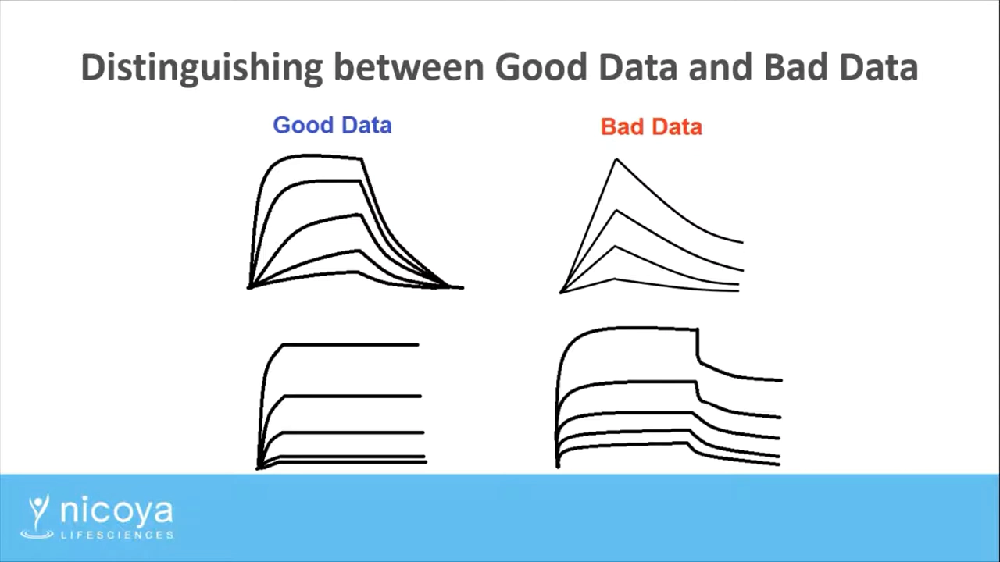
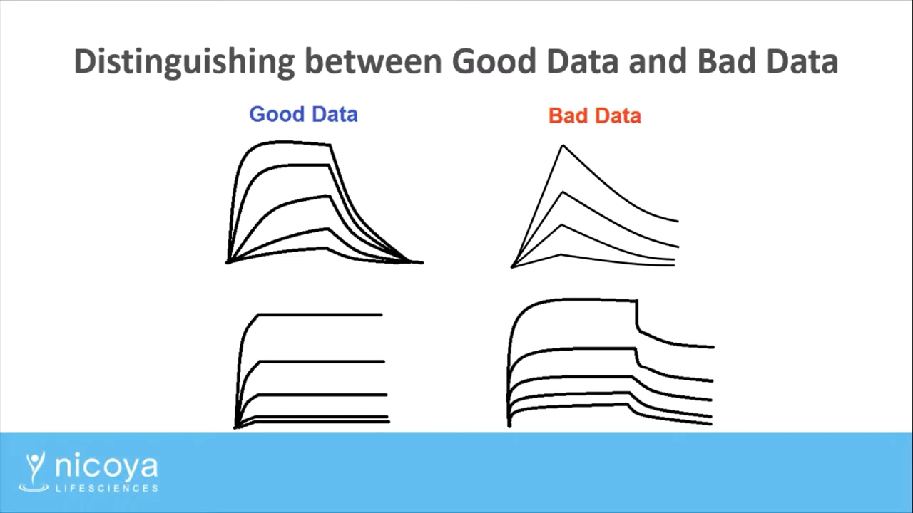
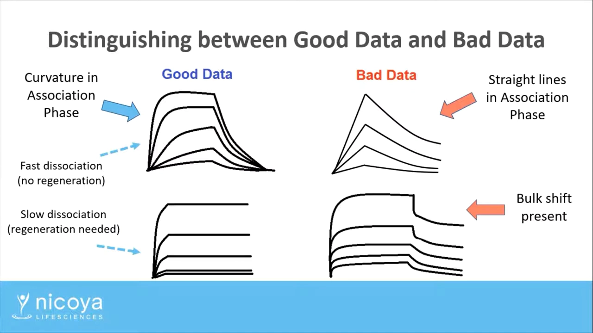
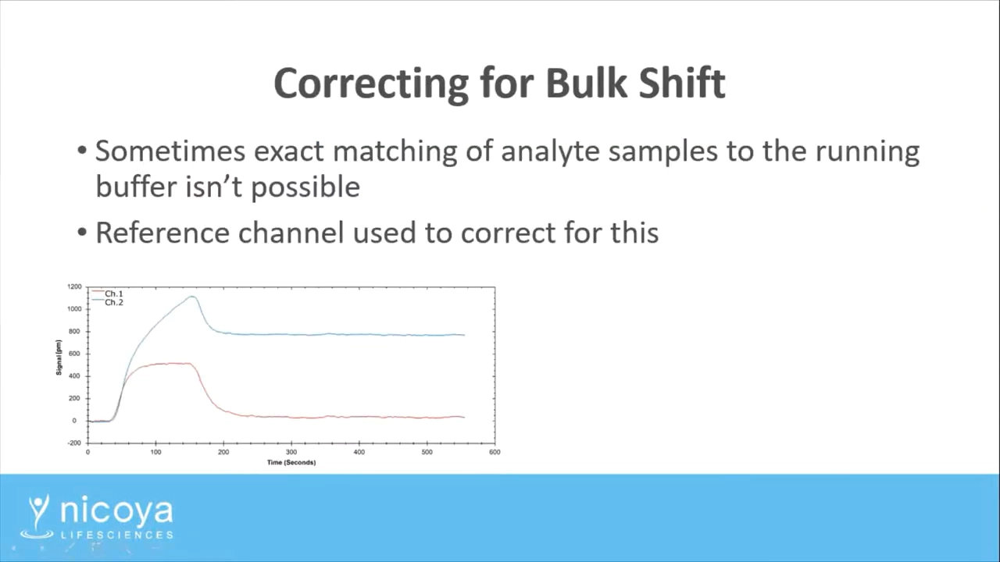
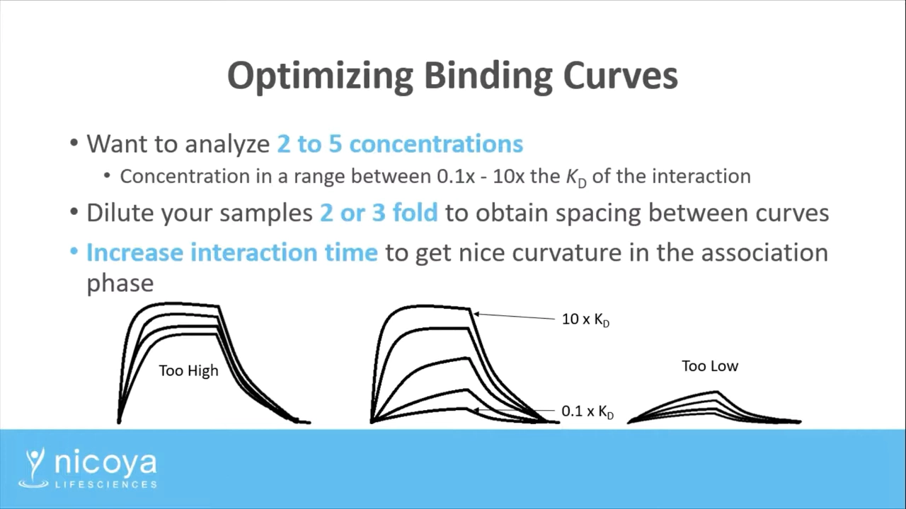
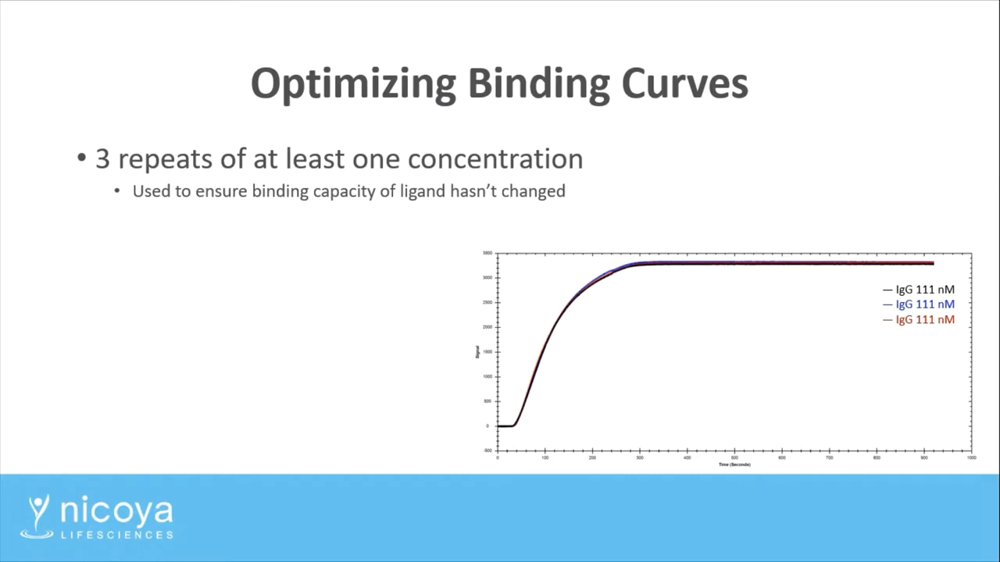
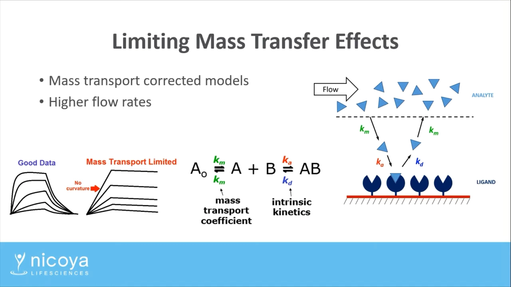

# 曲线能不能拟合，先看结合段有没有曲率

> 视频来源：[Optimizing Binding Kinetics](https://www.youtube.com/watch?v=e_tNkxbE2kY)（YouTube · Nicoya Lifesciences 官方教程，OpenSPR 系统）｜时长约 9 分钟
>
> 导读：这是一支「怎么把动力学实验跑对」的操作型教程。讲者用一组手绘风格的传感图，把「好数据 / 坏数据」的差别一条条指出来，然后给出浓度系列、稀释倍数、解离时长、传质控制的具体建议。它的价值不在原理，而在**它把「拟合失败」翻译成了「实验设计错在哪」**。本文按它的讲解顺序展开，末尾补了软件层面的三个量化判据（χ²、残差、标准误），已标注为补充。SPR 的物理原理见同目录《SPR 如何实时看见结合》，BLI 平台见《BLI 原理与平台差异》。

## 本讲要解决的核心问题（SCQA）

**背景**：做完一次 SPR 或 BLI 实验，软件会给你一组 $k_{on}$、$k_{off}$、$K_D$，还会同时给出残差和 χ²。数字总是有的——只要点了「拟合」，它就会吐出一组参数。

**冲突**：但「软件给出了数字」和「这组数字有意义」是两件事。结合段是一条直线时，$k_{on}$ 根本没有被约束；解离段几乎没下降时，$k_{off}$ 也没有被约束；样品缓冲液和运行缓冲液不匹配时，曲线末尾那个陡降是假的。这些情况下拟合器照样收敛，给出的却是一个漂亮的无意义结果。

**疑问**：在点「拟合」之前，哪些特征能告诉我「这条曲线根本不该拟合」？如果确实不该拟合，实验上又该怎么改？

**回答（中心思想）**：讲者的判据可以压成一句话——**拟合的前提是曲线里有信息**。结合段必须有曲率（否则 $k_{on}$ 无解），解离段必须有足够下降（否则 $k_{off}$ 无解），浓度系列必须跨越 $K_D$（否则浓度轴没有信息），背景必须是平的（否则跳变会被当成结合）。这四条是「能不能拟合」的门槛；过了门槛，才轮到模型选择与软件判据。

---

## 一、好数据和坏数据，肉眼就能分开

[【跳转到 00:00】](https://www.youtube.com/watch?v=e_tNkxbE2kY&t=0)

讲者开篇讲了两个理由，说明为什么值得花时间学「看数据」：一是为了拿到准确的结合动力学；二是这类实验很花时间，**如果第一组结合曲线就不理想，应该停下来，而不是继续花时间收集用不了的数据**。

这个建议在实操上非常值钱。一次完整的动力学实验（配体偶联 + 5 个浓度 + 再生 + 重复）往往要几小时；发现曲线不对时，及时停机比跑完再重来省得多。

他给出的对照很直接：

- **好数据**：结合段有明显的弯曲，不同浓度的曲线在解离段分开收敛；
- **坏数据**：结合段是一条**直线**，像被拉直的斜线。

## 二、判据一：结合段没有曲率，$k_{on}$ 就没有被约束

[【跳转到 00:31】](https://www.youtube.com/watch?v=e_tNkxbE2kY&t=31)

讲者先说了拟合的起点：**通常从一个简单的一比一（1:1）结合模型开始**。这个模型下，准确的结合常数来自结合段上**简单的指数型曲线**，所以传感图必须有弯曲，不能只是直线。

为什么直线不行？可以这样理解（补充解释）：1:1 模型的结合段是一条趋近饱和的指数曲线 $R(t) = R_{max}\frac{C}{C+K_D}\left(1-e^{-(k_{on}C+k_{off})t}\right)$，它的**弯曲程度**同时编码了 $k_{on}$ 与浓度；一条直线只告诉你「斜率是多少」，而斜率和 $k_{on}$、浓度是乘积关系，无法拆开。所以直线段的拟合结果里，$k_{on}$ 与浓度是互相顶替的，谁都可以变。

讲者给了两个可能的原因：

1. 你只采到了曲线**最开始的线性部分**——进样时间太短，还没等到它弯；
2. 你处在**扩散限制（传质限制）**的状态里——分析物从本体扩散到表面的速度成了瓶颈，表面浓度跟不上本体浓度，曲线被「拉直」。

## 三、判据二：解离段决定要不要再生

[【跳转到 01:11】](https://www.youtube.com/watch?v=e_tNkxbE2kY&t=71)

讲者用两组曲线对比了两种解离行为：

- **上面一组**：结合很快，传感信号**自己回到了加分析物之前的基线**——说明分析物已经全部解离，**不需要再生步骤**；
- **下面一组**：解离速率非常慢，分析物一直挂在配体上——这种情况下**每组浓度进样之间都需要一个再生步骤**。

这段讲的是实验流程，但它同时是一条判据：**解离段下降得越多，$k_{off}$ 被约束得越好**。如果解离段几乎是一条水平线，$k_{off}$ 只能给出一个上限，而不是一个测量值。

再生（regeneration）在这里的含义值得说清（补充）：用低 pH、高盐或高浓度盐/去垢剂把配体表面「洗回空位」，好让下一个浓度从同一条基线开始。再生的代价是配体可能被洗坏——这正是后面「重复一个浓度」这条建议要防的事。

## 四、判据三：体折射率跳变是假信号，先扣掉再谈拟合

[【跳转到 01:51】](https://www.youtube.com/watch?v=e_tNkxbE2kY&t=111)

讲者指出的第三种坏数据，是**体跳变（bulk shift）**：分析物样品缓冲液与运行缓冲液不匹配时，结合段最开始和最末尾会出现陡然的上升或下降。

> 这个跳变在结合段末尾通常更明显，看起来像是数据断了一截，但它其实是假信号。

为什么是假信号？因为 SPR/BLI 测的是折射率，而**缓冲液本身的折射率也会随成分变化**——样品里多了盐、多了 DMSO、多了甘油，光一照就产生一个与结合无关的阶跃。它在进样开始和结束各出现一次，形状像台阶。

讲者的态度很明确：**体跳变可以在动力学拟合里校正，但始终建议尽量从实验上减小它**，这样对数据的信心才最高。

[【跳转到 02:11】](https://www.youtube.com/watch?v=e_tNkxbE2kY&t=131)

## 五、参比通道：把「不结合的那一份信号」减掉

[【跳转到 03:11】](https://www.youtube.com/watch?v=e_tNkxbE2kY&t=191)

> 有时候让分析物样品和运行缓冲液完全匹配是不可能的。

这时用**参比通道（reference channel）**来校正。讲者的例子很干净：

- **通道 1 = 参比通道**，**通道 2 = 活性通道**；
- 通道 2 上的信号 = 分析物结合配体 + 体跳变；
- 通道 1 上没有配体，它测到的**只有体跳变**；
- 把通道 1 的信号从通道 2 里减掉，剩下的才是「只对应分析物结合配体」的校正后信号。

这个「减掉一个没有配体的通道」的动作，就是文献里常说的**参比扣减（reference subtraction）**。它的前提是两条通道的流路条件尽量一致——所以参比通道不能空着不用，也不能挂一个完全不同的东西。

（补充：Biacore 体系里还常做第二层扣减——用一针空白缓冲液（blank injection）扣掉系统性的漂移与进样尖峰，合称「双参比」。这一步在讲者的教程里没有展开。）

## 六、判据四：模型越复杂，越容易把坏数据拟合得好看

[【跳转到 02:31】](https://www.youtube.com/watch?v=e_tNkxbE2kY&t=151)

这一段是全片最值得记住的警告：

> 有些人会把坏数据拿去拟合更复杂的模型，因为参数更多，拟合总归会更好看。

讲者的建议是：**除非你有文献或其他生物物理技术提供的证据，说明你的相互作用确实比 1:1 更复杂，否则不要用这些复杂模型。**

这条建议背后是一个统计学常识（补充）：参数越多，模型对数据的自由度越大，残差自然更小；但残差小不等于模型对。用两状态模型去拟合一条本该是 1:1 的曲线，你会得到两组「漂亮」的速率常数，而它们都不对应真实的分子事件。

## 七、四项实验设置：浓度、稀释、时长、密度

讲者后半段给了四条可以直接抄进实验记录的建议。

### 7.1 浓度范围要跨越 $K_D$：0.1 倍到 10 倍

[【跳转到 04:15】](https://www.youtube.com/watch?v=e_tNkxbE2kY&t=255)

> 实验过程中你可以采集任意多个浓度的结合曲线，但做数据分析时，建议从中挑 **2 到 5 条**曲线来用。同时要确保所用样品的浓度范围落在相互作用 $K_D$ 的 **0.1 倍到 10 倍**之间。

幻灯片上画了三种情况，一眼就能看出问题：

- **Too High**：所有曲线都顶到饱和平台，彼此挤在一起——你只测到了 $R_{max}$，没测到 $K_D$；
- **Too Low**：所有曲线都贴着基线，几乎没有信号——信噪比不够；
- **正确范围**：从 $0.1\times K_D$ 到 $10\times K_D$，曲线从低到高铺开。

为什么必须是这个范围？因为 $K_D$ 的定义就是「占据一半位点所需的自由浓度」。浓度远高于 $K_D$ 时全是饱和，远低于 $K_D$ 时全是线性，只有跨在 $K_D$ 两侧，曲线形状才对 $K_D$ 敏感。

### 7.2 稀释倍数：2 倍或 3 倍，保证曲线间距均匀

[【跳转到 04:55】](https://www.youtube.com/watch?v=e_tNkxbE2kY&t=295)

> 你还需要保证各条曲线之间间距均匀，为此要用 **2 倍或 3 倍的梯度稀释**。

这一条与上一条是配套的：0.1–10 倍 $K_D$ 跨了两个数量级，用 3 倍稀释大约 5 个点就能铺满（0.1、0.3、1、3、10）；用 2 倍则需要更多点。间距不均匀（比如 1、2、3、4、5 倍）会让拟合被高浓度点主导。

同一条幻灯片上还有一句：为了拿到漂亮的曲率，**通常建议把分析物进样时的流速调低，以获得更长的相互作用时间**。这与后面「传质限制要靠提高流速解决」看似矛盾，其实是同一件事的两面——先保证有足够长的观察窗口，再在必要时用流速换传质。

### 7.3 从最低浓度开始往上打，并重复一个浓度

[【跳转到 05:15】](https://www.youtube.com/watch?v=e_tNkxbE2kY&t=315)

> 做结合测试时，从「能给出曲线的那个最低浓度」开始，也就是 0.1 倍 $K_D$，然后依次往上加浓度。原因是：结合上去的分析物量少时更容易解离下来，再生步骤也往往更顺。

这个顺序安排很实用：低浓度先打，表面上的残留最少，后面高浓度的曲线起点更干净。

讲者接着解释了一个常被误解的点：**所有浓度是拟合到同一个模型上、得到同一套动力学参数的**，所以模型里每个浓度都在充当其他浓度的重复，**不必每个浓度都做三平行**。但他仍建议**挑至少一个浓度重复**，用来确认配体的结合能力在整个测试过程中没有变化。

### 7.4 解离时间：至少让 5% 的分析物解离掉

[【跳转到 06:35】](https://www.youtube.com/watch?v=e_tNkxbE2kY&t=395)

> 要保证采集时间足够长，至少让 **5%** 的分析物解离掉。有时这只要两分钟，有时要 15 到 30 分钟。

这是一个很具体的下限。5% 听起来很少，但它保证了解离段不是一条水平线——有了这 5%，$k_{off}$ 才有一个可估的值。判断方法是直接看响应曲线下降了多少。

（补充：为什么是 5% 而不是更多？因为解离段越长，实验越久、漂移越大、配体失活风险越高。5% 是在「能估出 $k_{off}$」和「实验可完成」之间的折中。）

## 八、传质限制：直线段的另一个来源

[【跳转到 06:55】](https://www.youtube.com/watch?v=e_tNkxbE2kY&t=415)

> 对 OpenSPR 的大多数应用来说，除非你的结合速率非常快、快到分析物从本体扩散到表面的速度成为瓶颈，否则不用太担心传质。一旦发生传质限制，结合段通常就会呈现直线。

这张幻灯片把机制画得很清楚：反应被拆成两步——

$$
\mathrm{A_0} \underset{k_m}{\overset{k_m}{\rightleftharpoons}} \mathrm{A} + \mathrm{B} \underset{k_d}{\overset{k_a}{\rightleftharpoons}} \mathrm{AB}
$$

其中 $\mathrm{A_0}$ 是本体里的分析物，$\mathrm{A}$ 是表面附近的分析物，$\mathrm{B}$ 是配体，$k_m$ 是**传质系数**，$k_a$、$k_d$ 才是**真实的结合与解离速率**。传质受限时，你测到的是 $k_m$ 与 $k_a$ 的混合结果，而不是纯粹的 $k_a$。

讲者的处理顺序很讲究：**先尽量从实验上减小它，再去拟合数据**。

- 实验上：**提高流速**、**降低配体表面密度**；
- 拟合上：改用**扩散限制（传质校正）分析模型**。

为什么降低表面密度有用？因为表面上的配体越密，消耗分析物越快，表面附近的浓度亏空越严重。这也是为什么「高密度偶联」在 SPR 里通常是个坏主意——它不只带来传质问题，还会带来亲合力假象（见 3.2.3 那篇关于 avidity 的讨论）。

## 九、仪器维护：数据质量的隐形前提

[【跳转到 07:55】](https://www.youtube.com/watch?v=e_tNkxbE2kY&t=475)

讲者在结尾花了一分半讲维护，看似与动力学无关，其实是同一条因果链的末端：**基线漂移与管路堵塞会直接污染曲线形状**，而曲线形状正是前面所有判据的基础。

他给的是三档：**实验后处理（最重要）、每周清洗、每月清洗**。定期维护保证仪器正常运转、持续给出最高质量的数据，也能避免管路堵塞或性能下降。真遇到堵管，排查可以在自己实验室完成，但讲者要求先联系厂商以便指导。

## 十、补充：软件层面的三个量化判据

（以下为补充说明，非讲者原话。讲者的教程停在「曲线形状」这一层，没有给数值门槛；但实际用 Biacore/Octet 软件时，报告页上会同时出现三个数字，值得知道怎么看。）

1. **$\chi^2$ 应小于 $R_{max}$ 的 10%**。$\chi^2$ 是残差平方和除以自由度，量纲与响应值相同，所以要拿它和 $R_{max}$ 比。一个 4000 RU 的 $R_{max}$ 配一个 40 RU 以下的 $\chi^2$，才算拟合得住。
2. **残差图应落在 ±2 个标准差的带内，且不呈系统性形状**。残差随机散布是正常的；残差在结合段开头呈「先正后负」的弧形，往往说明模型少了什么（异质性、传质、基线漂移）。
3. **每个参数的标准误应小于参数值的 1/10**。$k_{on}=10^{5}$ 而标准误是 $5\times10^{4}$，这个 $k_{on}$ 就是没被约束住的——通常正是结合段缺曲率导致的。

三个判据的用法有先后：先看曲线形状（讲者的四条），再看残差与 χ²，最后看标准误。**形状不对时，后两个数字再漂亮也没有意义**——这正是讲者反复强调「先改实验，再改模型」的原因。

## 小结

- 拟合的前提是**曲线里有信息**：结合段要有曲率（否则 $k_{on}$ 无解）、解离段要有足够下降（否则 $k_{off}$ 无解）。
- 结合段呈直线只有两个原因：**进样太短只采到线性段**，或**传质限制**。
- **体跳变**（样品与运行缓冲液不匹配）是假信号，可用**参比通道**扣减，但应优先从实验上消除。
- **不要用复杂模型去救坏数据**：参数越多拟合越好看，但没有物理依据的模型只是把噪声也拟合进去。
- 四条实验设置：浓度范围 **0.1–10 倍 $K_D$**、**2–3 倍**梯度稀释、从最低浓度往上打并**重复一个浓度**、解离段至少让 **5%** 解离。
- 传质限制先靠**提高流速、降低配体密度**解决，再考虑用传质校正模型。
- 仪器维护（实验后、每周、每月）不是可选项：基线漂移与堵塞会直接改变曲线形状，从而毁掉前面所有判据。
- （补充）软件判据：$\chi^2 < 10\%\,R_{max}$、残差落在 ±2 标准差带内且无系统形状、参数标准误小于参数值的 1/10。

## 关键术语速查

| 术语 | 一句话解释 |
| --- | --- |
| 1:1 结合模型 | 假设一个配体结合一个分析物、无协同无多位点的最简模型，拟合的默认起点 |
| 曲率（curvature） | 结合段偏离直线的程度，是 $k_{on}$ 能否被估出的前提 |
| 体跳变（bulk shift） | 样品与运行缓冲液折射率不匹配造成的阶跃式假信号，出现在进样首尾 |
| 参比通道（reference channel） | 不挂配体的通道，用来测出并扣掉体跳变与非特异吸附 |
| 再生（regeneration） | 用低 pH 或高盐把配体表面洗回空位，供下一个浓度使用 |
| 传质系数 $k_m$ | 分析物从本体扩散到表面的速率常数；太小则曲线被拉直 |
| 扩散限制模型 | 在拟合中显式加入传质步骤的模型，用于校正传质受限的数据 |
| $R_{max}$ | 表面上所有配体位点被占满时的理论最大响应，与配体密度成正比 |
| $\chi^2$ | 残差平方和除以自由度，量纲同响应值，应与 $R_{max}$ 相比 |
| 标准误（standard error） | 拟合参数的不确定度，应小于参数值的 1/10 |