# 疏水相互作用色谱：HIC 的保留时间到底在度量什么

> 视频来源：[Hydrophobic Interaction Chromatography — a versatile method for ADC and protein analysis](https://www.youtube.com/watch?v=jg7dKZTk2VE)（YouTube · Avant 网络研讨会，讲者 Andrea（Tosoh Bioscience），主持 Martina Viten、DJ Sere）｜时长约 46 分钟
> 导读：这是一场以「方法开发」为主线的 HIC 教学报告：先讲盐如何让蛋白结合到疏水固定相上，再用六个应用（DAR、脱酰胺、氧化、双抗臂交换、候选分子疏水性排序）说明它能读出什么，最后把柱选择、盐种类、盐浓度、pH、样品基质、梯度逐个拆开。本文按「读数含义 → 条件依赖 → 早期决策价值」重组，重点回答一个问题：**HIC 的保留时间能不能当作「疏水性」这个物理量的测量值？** 字幕为 YouTube 自动生成，术语已订正（如「hick」→ HIC、「cosmotropic」→ 盐析型、「illusion」→ elution）。

## 本讲要解决的核心问题（SCQA）

**背景**：抗体的疏水性是一个绕不开的可开发性指标——它关联聚集倾向、溶解度和体内清除。业界常用疏水相互作用色谱（HIC）来排这个序：疏水性弱的先洗脱，强的后洗脱。

**冲突**：HIC 的保留时间并不是一个只由分子决定的量。同一支单抗，用硫酸铵几乎分不开聚体、换成氯化钠就分开了；盐浓度从 1.5 M 降到 0.7 M，同一个峰的位置就挪了；pH 一变，五个分子的洗脱顺序可能整个重排。也就是说，**「这个抗体的 HIC 保留时间是 8.3 分钟」这句话，离开方法条件就没有意义**。

**疑问**：HIC 到底在测什么？哪些因素在改读数、往哪个方向改？既然读数这么依赖条件，它凭什么还能用来做早期决策？

**回答（中心思想）**：**HIC 测的不是一个绝对的「疏水性数值」，而是「在指定盐环境与指定固定相下，分子表面疏水斑块与配基之间的相互作用强度」——它是一个严格意义上的相对量，只在同一套方法内可比。** 正因为如此，HIC 的正确用法不是「测一个数去和阈值比」，而是「在同一套条件下把一批候选分子排序」，或者「在同一套条件下追踪同一个分子的修饰变化」。而它之所以值得在早期做，是因为这个相对排序与聚集倾向、溶解度、清除率这些真正要命的性质高度相关。

---

## 一、HIC 的三步机制：盐负责「关水」，水负责「放人」

[【跳转到 05:43】](https://www.youtube.com/watch?v=jg7dKZTk2VE&t=343)

讲者用一张三步图把机制讲完了，这张图值得记住，因为后面所有的「条件」都能在这三步里找到位置。

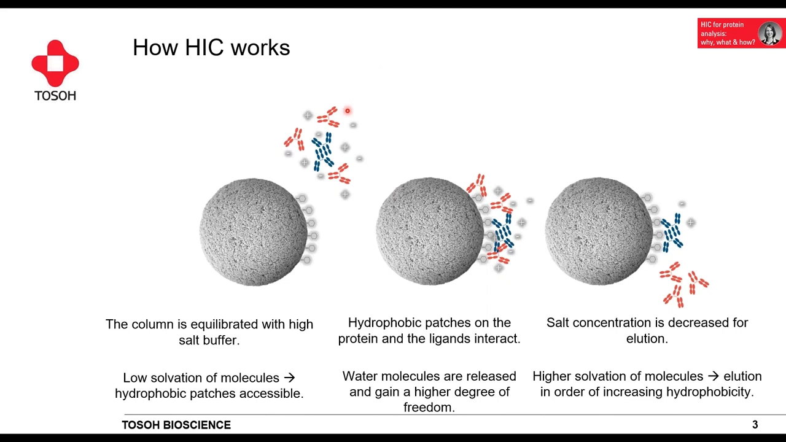

1. **高盐平衡**：柱子先用高盐缓冲液平衡。高盐让分子「几乎不被水溶剂化」，于是蛋白表面的疏水斑块**暴露出来**。
2. **结合**：蛋白的疏水斑块与固定相上的疏水配基相互作用。讲者的措辞是「水分子被释放出来，获得了更高的自由度」——这是一个熵驱动的过程。
3. **降盐洗脱**：盐浓度降低，分子重新被水溶剂化，疏水斑块不再可及，相互作用消失，分子按**疏水性递增的顺序**依次洗脱。

[【跳转到 07:54】](https://www.youtube.com/watch?v=jg7dKZTk2VE&t=474)

第二张图把「盐在干什么」画得很具体：硫酸铵解离出的铵根和硫酸根把水分子全部「占住」，蛋白表面的疏水斑块周围没有可用的水，只能去贴固定相的疏水配基。

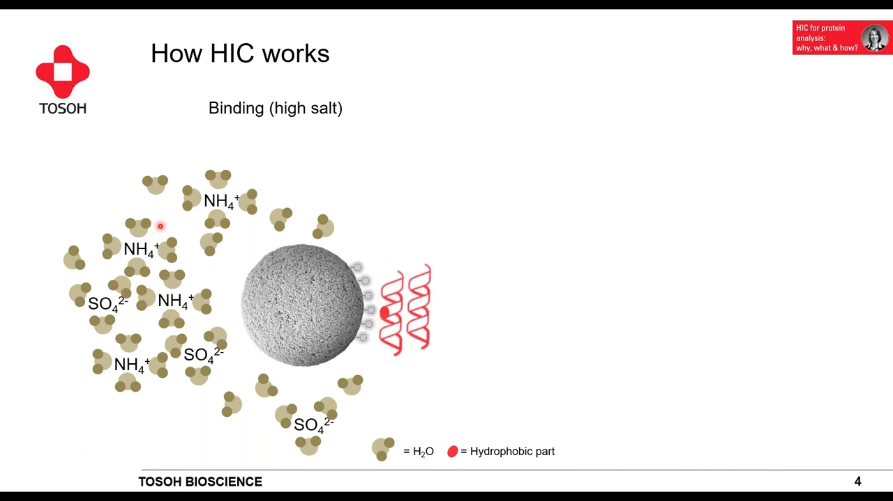

这里已经埋下了「条件依赖」的种子：**结合强度取决于「有多少水被盐抢走」，而这由盐的种类和浓度决定，不由分子单独决定。**

### 1.1 为什么不直接用反相色谱：因为反相会把蛋白弄变性

[【跳转到 09:06】](https://www.youtube.com/watch?v=jg7dKZTk2VE&t=546)

讲者说这是最常被问到的问题之一：反相色谱（RP）也按疏水性分离，而且经验更多、文献更多、方法更好开发，为什么还要用 HIC？

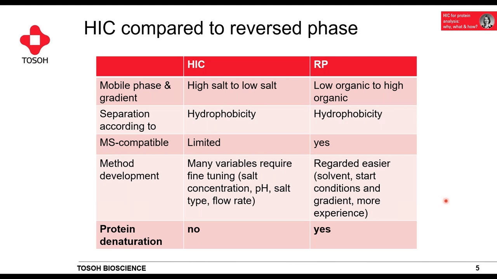

答案在表格最后一行：**反相用有机溶剂，会把 α 螺旋和 β 折叠不可逆地变性；HIC 只用盐缓冲液，是非变性条件。** 代价也很清楚：

- **与质谱兼容性差**：反相几乎无盐，接质谱很顺；HIC 的高盐对电离不利，讲者在问答里直接说「不行」，虽然有一两篇论文用低盐加 pH 位移做成了，但不是主流做法。
- **方法开发变量多**：盐浓度、pH、盐种类、流速都要细调，而反相的经验积累多得多。

这两条代价决定了 HIC 的定位：**它是「非变性条件下的疏水性排序工具」，不是「通用分离平台」。**

## 二、分子这一侧：什么在改变保留时间

### 2.1 疏水斑块：HIC 保留的物理基础

[【跳转到 10:55】](https://www.youtube.com/watch?v=jg7dKZTk2VE&t=655)

蛋白表面不是均匀的：有些区域亲水（图里蓝色），有些区域疏水（红色），取决于表面氨基酸侧链。这些**斑块**才是与固定相作用的东西。

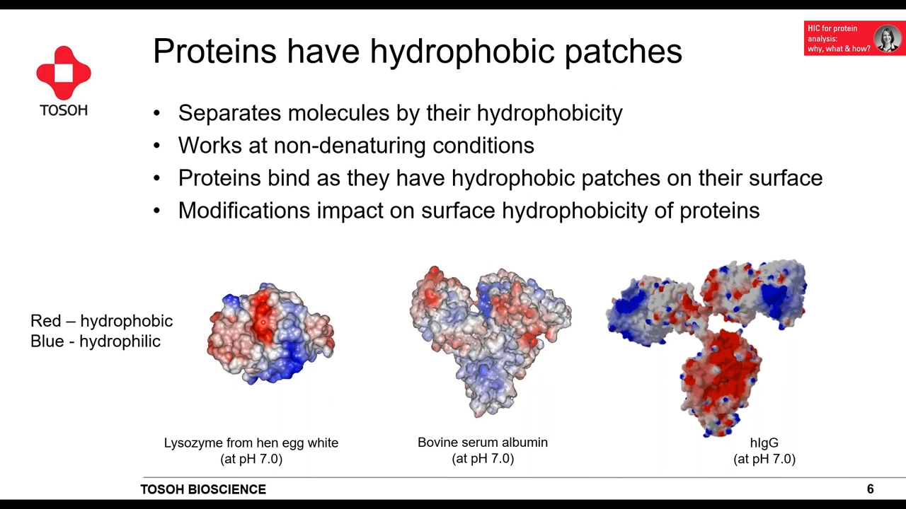

这张幻灯片上还有三条要点，正好构成本节的骨架：

- HIC 按疏水性分离分子；
- 它工作在**非变性条件**下；
- 蛋白之所以被结合，是因为表面有疏水斑块；
- **修饰会改变蛋白的表面疏水性**。

### 2.2 修饰如何移动保留时间：方向甚至可以预测

[【跳转到 11:45】](https://www.youtube.com/watch?v=jg7dKZTk2VE&t=705)

这是本讲最有信息量的一页，因为它把「修饰 → 疏水性变化方向」列成了可查的表。

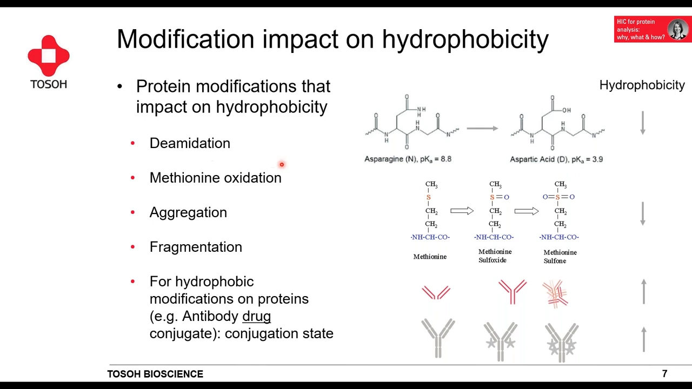

| 修饰 | 化学变化 | 疏水性方向 |
| --- | --- | --- |
| 脱酰胺（Asn → Asp） | 酰胺基变成羧基，pKa 从 8.8 降到 3.9 | 下降 |
| 甲硫氨酸氧化（Met → 亚砜 → 砜） | 硫原子加上一个或两个氧 | 下降 |
| 聚集 | 多个分子堆在一起，暴露更多疏水面 | 上升 |
| 片段化 | 分子变小 | 下降 |
| 偶联疏水药物（ADC） | 接上疏水小分子 | 上升 |

这里有一个特别值得注意的细节：**脱酰胺同时改变了 pI 和疏水性**——Asn 的 pKa 是 8.8，Asp 是 3.9，所以它既让分子更酸（pI 下降），又让分子更亲水（HIC 保留时间提前）。**同一个化学事件在两张图谱上同时留下痕迹**，这也是为什么电荷类指标与疏水类指标总被放在一起看。

至于分子大小与疏水性的关系，讲者的说法是：片段或较小的分子比大分子更不疏水，很小的蛋白甚至多肽疏水性都很低，而大分子更疏水。所以**片段化会让保留时间提前，聚集会让它推后**——这是用 HIC 判断「峰是聚体还是片段」的依据。

### 2.3 五个应用：把「修饰」读成「峰」

讲者展示了五个应用，每一个都是「同一套方法下，峰位/峰数变化 → 分子状态」的翻译练习。

**（1）ADC 的药物抗体比（DAR）**

[【跳转到 14:40】](https://www.youtube.com/watch?v=jg7dKZTk2VE&t=880)

抗体上接的药物越多，分子越疏水，洗脱越晚。于是 ADC 的 HIC 图谱变成一串「阶梯」，每个峰对应「接了 n 个药」。

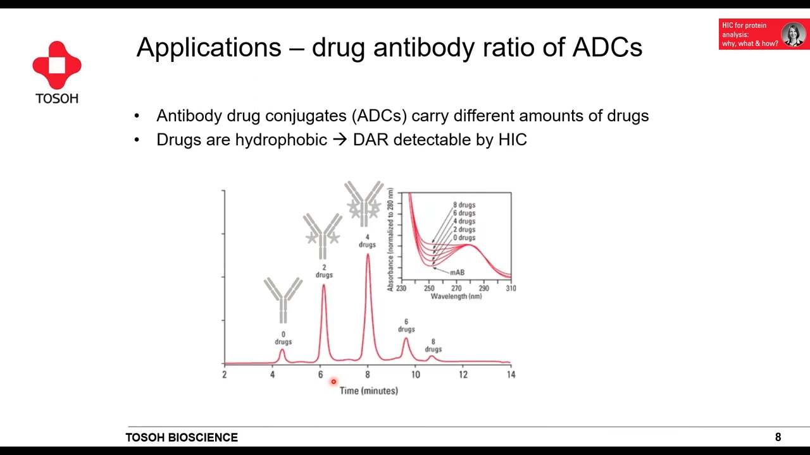

对每个峰的面积做定量，就能算出平均 DAR。讲者提到典型 ADC 上接 0–8 个美登素，平均 DAR 约 3–4。

**（2）脱酰胺：把阳离子交换的馏分拿去跑 HIC**

[【跳转到 15:55】](https://www.youtube.com/watch?v=jg7dKZTk2VE&t=955)

这个实验设计很值得学：先用**阳离子交换**把完整抗体分成若干电荷馏分，再把每个馏分酶切成 Fc 段与两个 Fab 臂，最后用 HIC 看这些馏分里到底富集了哪种脱酰胺形式。

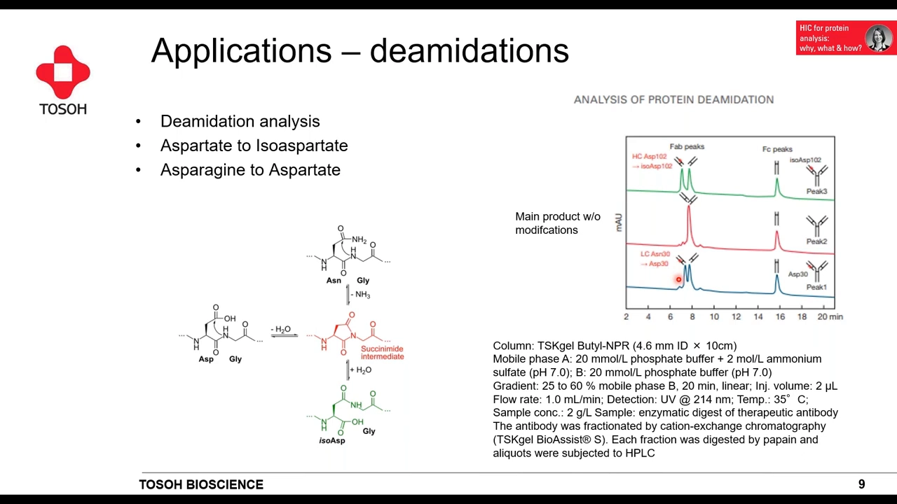

结果是：主产品（红色）只有一个峰；富集了「Asn → isoAsp」的馏分（绿色）在 Fab 区出现两个峰；富集了「Asn → Asp」的馏分在 Fab 区也出现两个峰。**也就是说，HIC 能把带脱酰胺的 Fab 臂与原始 Asn 形式分开。**

这张图的图注还把方法条件写全了（柱：TSKgel Butyl-NPR 4.6 mm × 10 cm；A 液：20 mM 磷酸缓冲液 + 2 M 硫酸铵 pH 7.0；B 液：20 mM 磷酸缓冲液 pH 7.0；梯度 25→60% B，20 分钟线性；1.0 mL/min；214 nm；35 ℃）。**没有这些条件，那两个峰的位置无从复现**——这正是「读数必须带条件」的具体体现。

**（3）甲硫氨酸氧化：0% 到 0.1% 氧化剂的滴定**

[【跳转到 17:35】](https://www.youtube.com/watch?v=jg7dKZTk2VE&t=1055)

同样的思路，把抗体酶切成 Fc 与 Fab 后用 0%、0.01%、0.1% 的氧化剂处理。Fc 段正是含甲硫氨酸的部分，于是 Fc 峰里依次出现「未氧化 → 氧化一次 → 氧化两次」。

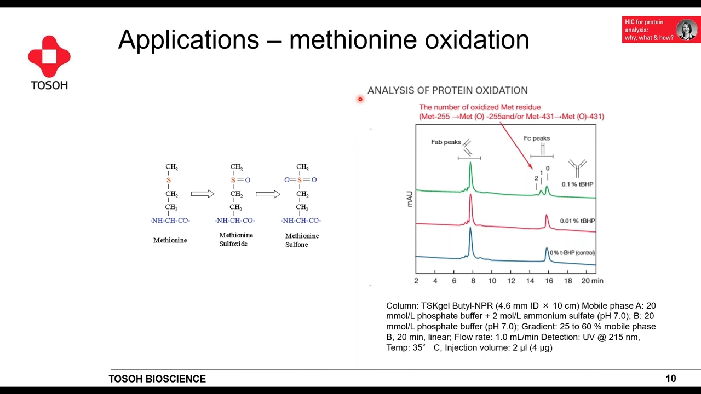

**（4）双特异性抗体的 Fab 臂交换**

[【跳转到 19:15】](https://www.youtube.com/watch?v=jg7dKZTk2VE&t=1155)

两个亲本单抗针对不同靶点、疏水性不同；通过 Fab 臂交换（还原再加氧化）把两条臂互换，得到双特异抗体。因为三者的疏水性不同，HIC 可以一眼看出交换效率。

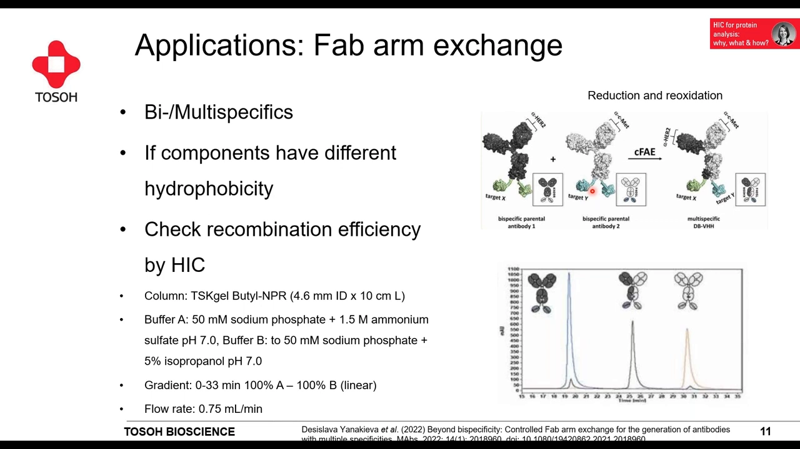

黑色是双特异抗体，可以看到交换相当成功，只剩少量单特异性亲本残留。

**（5）候选分子的疏水性排序**

[【跳转到 20:30】](https://www.youtube.com/watch?v=jg7dKZTk2VE&t=1230)

这是最贴近「可开发性评估」的用法：把一批候选分子在同一套条件下跑一遍，按保留时间排序。

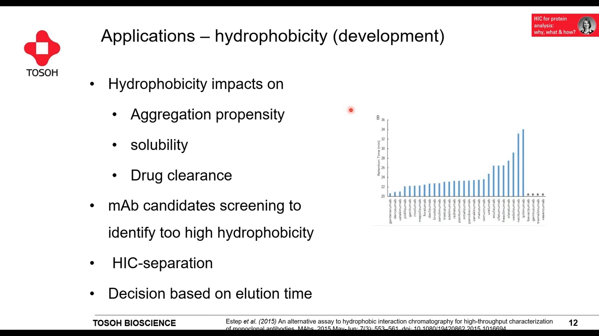

讲者给的理由很直接：**疏水性影响聚集倾向、溶解度和药物清除；分子太疏水，很可能在临床研究中走不下去。** 而这件事仅凭整体疏水性，在很早期就能判断。图里还有几个分子根本没从柱子上洗脱下来——这本身就是「太疏水」的强信号。

> 补充（非讲者原话）：这类排序之所以有意义，前提是**所有分子用完全相同的方法跑**。一旦某个分子换了盐或换了柱子，它的保留时间就不能再放进同一张排序表里。

## 三、方法这一侧：五个把读数改掉的旋钮

这一节是本文的重点。讲者把 HIC 方法开发拆成柱、盐种类、盐浓度、pH、样品基质与梯度五项，每一项都会改变保留时间。

### 3.1 柱子：功能基团只决定一部分疏水性

[【跳转到 25:05】](https://www.youtube.com/watch?v=jg7dKZTk2VE&t=1505)

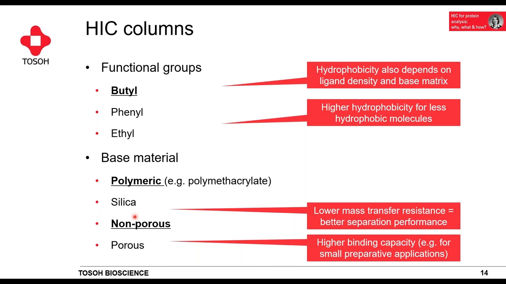

- **功能基团**：丁基最常见，也有苯基、乙基。原则是「分子越疏水，用越不疏水的柱子；分子越不疏水，用越疏水的柱子」。
- **但疏水性不只由功能基团决定**：还取决于**配基密度**和**基体材料**。讲者举的例子是乙基柱比丁基柱更疏水，因为表面配基更多、密度更高。所以**仅凭功能基团比较不同品牌的柱子是不可靠的**。
- **基体材料**：聚合物（如聚甲基丙烯酸甲酯）比硅胶稳定、可耐更高 pH；**无孔**颗粒传质阻力低、峰更尖、分离更好，有孔颗粒则用于半制备（结合容量更高）。

这条对读数的含义是：**「HIC 保留时间 8.3 分钟」这句话里还隐含了「用哪根柱子」**。换柱如换尺。

### 3.2 盐种类：Hofmeister 序列决定「要多高的盐才能留住」

[【跳转到 28:46】](https://www.youtube.com/watch?v=jg7dKZTk2VE&t=1726)

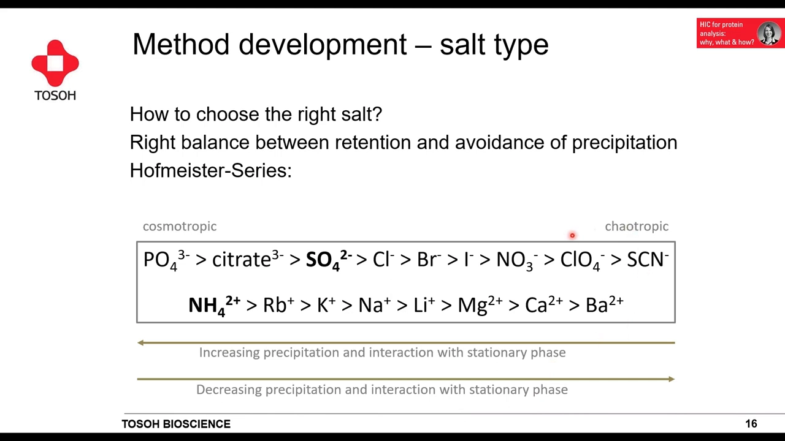

讲者给的选择逻辑很实用：

- **分子不结合、不被保留** → 往**盐析型（cosmotropic）**一端走（磷酸盐、柠檬酸盐、硫酸盐），它们增强沉淀、增强与固定相的作用；
- **分子死死粘在柱上不下来** → 往**离液型（chaotropic）**一端走（氯、溴、碘、硝酸、高氯酸、硫氰酸），它们减弱沉淀与相互作用。

[【跳转到 30:01】](https://www.youtube.com/watch?v=jg7dKZTk2VE&t=1801) 这里讲者用一组对比说明「换盐等于换选择性」：同一个单抗加一份强制降解样品，用硫酸铵时聚体几乎看不见；换成氯化钠，片段和聚体都分开了。

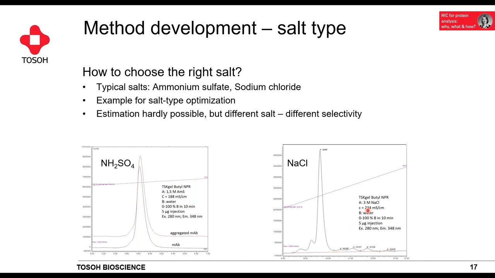

注意图注里的条件差异：硫酸铵用 1.5 M、电导 188 mS/cm；氯化钠用 3 M、电导 234 mS/cm。**同样「高盐」，两种盐的摩尔浓度差了整整一倍**——这也是为什么跨文献比较 HIC 保留时间几乎不可能。

### 3.3 盐浓度：越高越晚洗脱，但存在「不结合」的临界点

[【跳转到 31:41】](https://www.youtube.com/watch?v=jg7dKZTk2VE&t=1901)

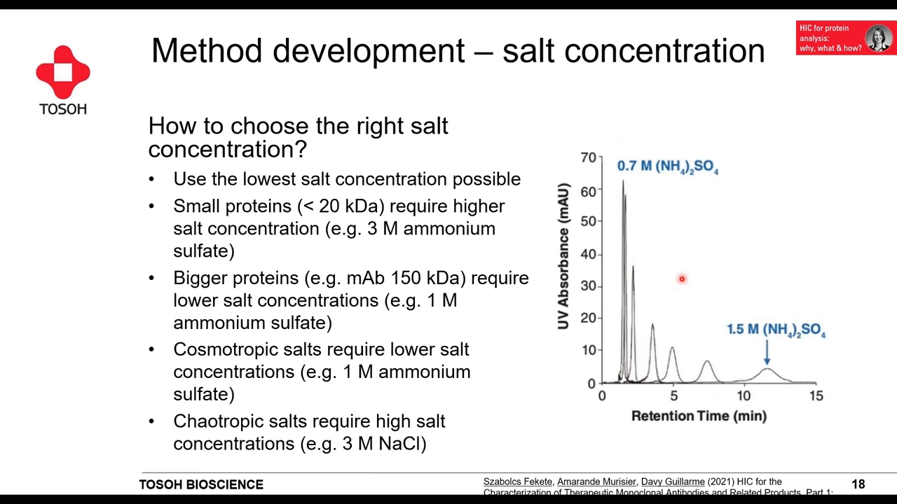

讲者给了四条经验法则：

1. **用尽可能低的盐浓度**；
2. 小蛋白（< 20 kDa）通常更不疏水，需要更高盐浓度（如 3 M 硫酸铵）；
3. 大蛋白（如 150 kDa 的单抗）需要更低盐浓度（如 1 M 硫酸铵）；
4. 盐析型盐需要的浓度低（如 1 M 硫酸铵），离液型盐需要高浓度（如 3 M 氯化钠）。

同一张幻灯片右侧的色谱图还展示了两件事：**盐浓度越高，洗脱越晚**；但存在一个临界浓度，超过它分子**完全不结合**（图里 0.7 M 的例子）。这解释了为什么「把盐加满」不是万能解。

### 3.4 pH：设在 pI 附近，因为净电荷会「稀释」疏水性

[【跳转到 32:56】](https://www.youtube.com/watch?v=jg7dKZTk2VE&t=1976)

这是全场与「pI」关系最直接的一页，也是把电荷指标与疏水指标连起来的关键。

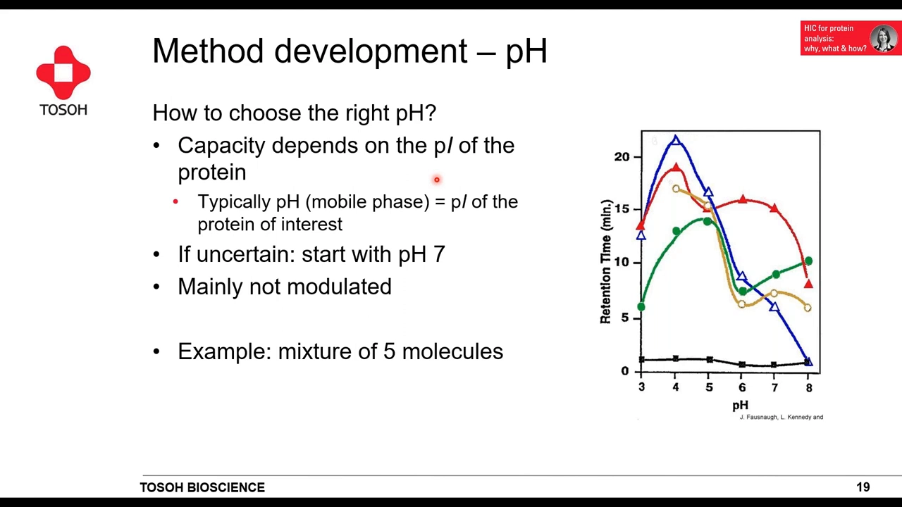

讲者的逻辑链是：

- **电荷会降低分子的疏水性**，所以只要分子带净电荷，你测到的就是「被电荷削弱过的表观疏水性」；
- 因此常规做法是把流动相 pH 设在**接近目标蛋白等电点**的位置，此时净电荷接近零，分离才真正由疏水相互作用主导；
- 不确定时从 pH 7 起步；这个参数「通常不做太多调节」。

右边那张图是「pH 会重排洗脱顺序」的实证：五个分子在 pH 3–8 之间的保留时间曲线彼此交叉。在某个 pH 下它们可能同时洗脱（完全分不开），把 pH 降下来，它们就分散到不同时间。

**这一页同时回答了两个问题**：为什么 HIC 要报 pH（因为 pH 通过净电荷改变表观疏水性），以及为什么 pI 与疏水性不能分开谈（pI 决定「在某个 pH 下还剩多少净电荷」，净电荷决定「疏水性被削弱多少」）。

### 3.5 样品基质与梯度：进样前的盐浓度就已经在改读数

[【跳转到 35:51】](https://www.youtube.com/watch?v=jg7dKZTk2VE&t=2151)

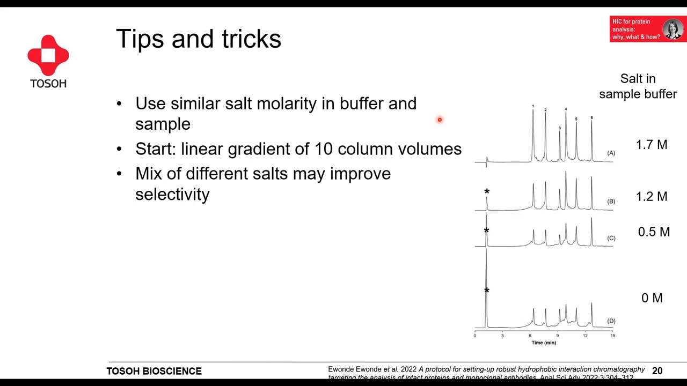

这一页把「条件」推到了进样之前：

- **样品缓冲液的盐浓度要接近运行缓冲液**。图里从 1.7 M 一路降到 0 M，可以看到 0 M 时很大一部分样品在开头就流出来（星号处），根本没被保留。**样品在纯水里，它根本不会结合。**
- **梯度起步方案**：从 100% 盐缓冲液降到 0%（水），在 **10 个柱体积**内线性下降。
- **可以混用不同的盐**来获得不同选择性，但很难预测，只能试。
- **缓冲液要过滤**（去盐结晶）；**第一次运行前先把样品与 A 液混合一次**，让可能的高盐沉淀发生在仪器外面。
- 用小颗粒、无孔材料可以提高分离性能（传质阻力低）。

## 四、为什么这个「相对量」仍然值得在早期测

把前面的内容收拢，可以给出三条判断：

1. **它是一个排序工具，不是一个绝对值工具**。同一套方法下比较一批候选分子，保留时间的相对顺序是有意义的信息；跨方法、跨柱、跨盐比较绝对数值则没有意义。
2. **它与真正要命的性质相关**。讲者明确说：疏水性高 → 聚集倾向高、溶解度低、清除快。所以早期用 HIC 排一次序，可以低成本地剔除「太疏水」的分子。
3. **它对微小修饰也敏感**。脱酰胺、甲硫氨酸氧化这种「只改一个基团」的修饰，都能在 HIC 上产生可分辨的峰位移。这让它成为稳定性研究的补充手段——**电荷图谱看不住的（比如某些不带电的变化），HIC 可能看得住**。

它的边界也要说清楚：**高盐让它难以直接接质谱**，所以结构确证还得靠质谱、肽图这些正交方法；**方法变量多**，意味着方法开发成本高于反相。讲者也坦言，确实有些 ADC 因为未知原因开发不出可用的 icIEF 方法，只能换方法——HIC 同样有这种「某些分子就是不好做」的情况。

## 小结

- **HIC 测的是「指定盐环境下的疏水相互作用强度」**，不是绝对的疏水性数值；它只在同一套方法内可比。
- **机制是熵驱动的水的争夺**：高盐把水抢走 → 疏水斑块暴露 → 结合固定相；降盐把水还给分子 → 洗脱。
- **非变性是它相对反相的核心优势**，代价是与质谱不兼容、方法变量多。
- **分子侧的可预测规律**：脱酰胺与 Met 氧化让疏水性下降，聚集让它上升，片段化让它下降，偶联疏水药物让它上升。
- **方法侧的五个旋钮**：柱子（功能基团 + 配基密度 + 基体）、盐种类（Hofmeister）、盐浓度、pH、样品基质与梯度——每一个都能把保留时间改掉。
- **pH 是电荷与疏水的接口**：pH 设在 pI 附近，净电荷接近零，测到的才是「纯粹的」疏水相互作用；带净电荷时测到的是被电荷削弱的表观疏水性。
- **实用价值**：DAR 测定、脱酰胺/氧化监测、双抗臂交换效率、候选分子早期疏水性排序。
- **报告 HIC 数据必须带条件**：柱型、盐种类与浓度、pH、梯度、流速，缺一项就不可复现。

## 关键术语速查

| 术语 | 一句话解释 |
| --- | --- |
| HIC | 疏水相互作用色谱，用高盐上样、降盐洗脱，按表面疏水性分离 |
| 疏水斑块 | 蛋白表面由疏水侧链聚集形成的区域，是与固定相配基作用的位置 |
| 盐析型盐（cosmotropic） | Hofmeister 序列靠前的一端（硫酸盐、磷酸盐、柠檬酸盐），增强疏水作用与沉淀 |
| 离液型盐（chaotropic） | 序列靠后的一端（氯、溴、碘、硫氰酸），减弱疏水作用与沉淀 |
| 配基密度 | 单位体积固定相上疏水配基的数量，与功能基团一起决定柱子疏水性 |
| 无孔颗粒 | 无内部孔道的填料，传质阻力低、峰形尖，适合分析而非制备 |
| 药物抗体比 DAR | 平均每个抗体上连接的药物分子数，可由 HIC 阶梯峰的面积算出 |
| 脱酰胺 | Asn 转为 Asp 或 isoAsp，pKa 从 8.8 降到 3.9，pI 下降且疏水性下降 |
| 甲硫氨酸氧化 | Met 的硫被氧化成亚砜或砜，疏水性下降 |
| Fab 臂交换 | 两个单抗互换 Fab 臂生成双特异抗体，靠疏水性差异可用 HIC 判断效率 |
| 表观疏水性 | 分子带净电荷时被削弱的疏水作用强度，随 pH 相对 pI 的位置而变 |