# 等电点与电荷异构体的测量：iCIEF 的读数为什么必须带着条件说

> 视频来源：[10 Minute Charge Heterogeneity Analysis for Development and Quality Control of Biopharmaceuticals](https://www.youtube.com/watch?v=UKcCqtx1sZs)（YouTube · Genetic Engineering & Biotechnology News 网络研讨会，讲者 Scott Mack（ProteinSimple）、Carrie Anderson（Merck）、Karan Shaw（ImmunoGen），主持 John Sterling）｜时长约 63 分钟
> 导读：这是一场三段式研讨会，前半讲成像毛细管等电聚焦（icIEF）的分离与检测原理，中段讲它在产品鉴别、稳定性、克隆与菌株筛选、浓度测定上的实际用法，末段讲抗体偶联药物（ADC）的电荷图谱。本文只保留「怎么测、读数是什么意思、条件怎么改变读数」这一条线；脱酰胺、C 端赖氨酸等化学修饰的机制细节已在系列 4.2.3 讲透，这里只当作「让 pI 移动的原因」引用。字幕为 YouTube 自动生成，术语已订正（如「CIF」→ cIEF、「anilite」→ anolyte、「phaly」→ Pharmalyte）。

## 本讲要解决的核心问题（SCQA）

**背景**：抗体是一群带不同修饰的变体混合物，所以它没有「一个」等电点，只有一张电荷图谱：主峰、酸性变异体、碱性变异体。行业早就用这张图谱做产品鉴别、稳定性监测和批间一致性判断。

**冲突**：同一个分子，换一套两性电解质、加不加尿素、样品里盐多一点、处方缓冲液里有个组氨酸，图谱就会变形——峰位移动、峰数变化、甚至凭空出现一段空洞。也就是说，**仪器读出来的「pI」和「酸性峰百分比」并不是分子的固有常数，而是「分子 + 这套测量条件」的共同产物**。

**疑问**：icIEF 到底测的是什么？哪些条件会改变读数、改变多少？拿到一张电荷图谱，怎么判断它是分子的性质还是方法的产物？

**回答（中心思想）**：**pI 是一个定义明确的量——净电荷为零时的 pH；但你在图谱上读到的峰位与峰比例，是一组可调条件（两性电解质范围、尿素、离子强度、辅料、聚焦时间）与分子性质共同决定的结果。所以电荷类指标必须连同方法条件一起报告，否则不可比、也不可解释。** 一旦把条件固定住，icIEF 就变成一台非常好用的相对比较仪：它能把「修饰 → pI 位移」的因果关系一格一格地读出来。

---

## 一、icIEF 测的是「净电荷为零的那个 pH」，而且它把这个 pH 变成了横轴

[【跳转到 04:14】](https://www.youtube.com/watch?v=UKcCqtx1sZs&t=254)

Scott Mack 把 cIEF 的分离过程拆成三步，第一步是进样：**整根毛细管都被样品溶液充满**，而这管溶液里除了待测蛋白，还必须有几样「配角」：

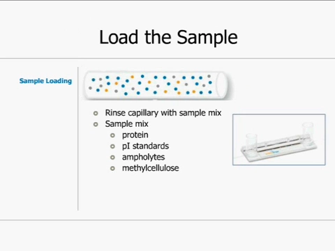

- **pI 标准品（pI markers）**：几个已知 pI 的参照物，用来把「毛细管上的位置」标定成「pI 数值」。没有它们，你只有一张位置图，没有横轴。
- **两性电解质（carrier ampholytes）**：一群 pI 各不相同的多氨基多羧基小分子，通电后自己会排成一个**连续的 pH 梯度**。这是整件事的核心——梯度不是仪器给的，是这些分子在电场里自己搭出来的。
- **甲基纤维素**：增加黏度、抑制对流和电渗，让聚焦好的条带不至于被搅散。
- **蛋白质**：待测物本身。

[【跳转到 04:39】](https://www.youtube.com/watch?v=UKcCqtx1sZs&t=279)

第二步是聚焦：毛细管一端浸在酸性溶液（阳极液，anolyte）里，另一端浸在碱性溶液（阴极液，catholyte）里。加电压后，水合氢离子从阳极、氢氧根从阴极反向迁入毛细管，**把所有两性化合物「滴定」到净电荷为零的位置**——那个位置的 pH 就是它的等电点。

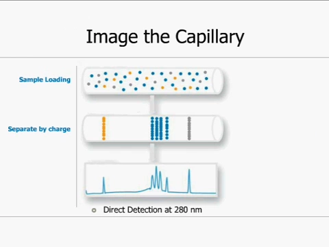

第三步是检测，也是 icIEF 与传统 cIEF 的分水岭：**不把样品推出毛细管，而是给整根毛细管拍一张 280 nm 的吸收图像**。横轴是位置（等价于 pI），纵轴是吸光度，一张电泳图就出来了。

> 补充（非讲者原话）：pI 只定义了「净电荷为零」这一个点，而净电荷的**符号与幅度**由溶液 pH 相对 pI 的位置决定：
>
> $$
> \mathrm{pH} < \mathrm{pI} \;\Rightarrow\; Z > 0, \qquad \mathrm{pH} > \mathrm{pI} \;\Rightarrow\; Z < 0
> $$
>
> 这条关系是后面两个指标能接上的原因：**配方缓冲液的 pH 离 pI 越远，净电荷越多，分子间静电排斥越强，越不容易聚集；pH 越靠近 pI，净电荷趋于零，静电排斥消失，疏水作用就占上风**——这正是下一篇 HIC 把流动相 pH 设在 pI 附近的理由。

### 1.1 「不迁移」为什么是优势：迁移会动到你要测的那个东西

传统 cIEF 的聚焦条带几乎是静止的，检测器却只有一个固定窗口，所以必须想办法把条带「推过去」。讲者把两种推法都摆了出来，并说明各自的代价。

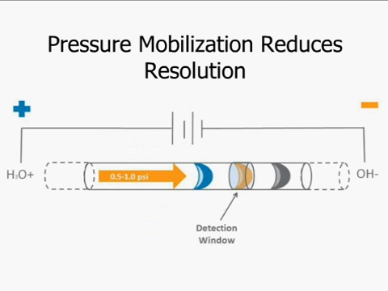

- **压力迁移**：在梯度上加 0.5–1.0 psi 的压力。好处是梯度间距不变、算出的 pI 不受影响；坏处是流体动力在毛细管内引入**层流**，分辨率明显下降。
- **化学迁移**：把阴极液换成弱酸或盐，降低梯度 pH，把整条梯度「推过」检测窗口。分辨率能保住，但它**破坏了梯度的相对间距**，于是实测 pI 与计算 pI 之间出现很大偏差——讲者特别点名 **pH 8 到 9 区间**最严重，并引用了辉瑞发表的数据。

这就是「条件决定读数」的第一个具体例子：**同一个分子，用化学迁移读出来的 pI 可能比成像法读出来的偏低**，而且偏差大小随 pI 区间变化。跨方法比较 pI 数值之前，先确认两边用的是哪种检测方式。

### 1.2 与阳离子交换色谱比：分辨率高，而且快五到六倍

[【跳转到 07:53】](https://www.youtube.com/watch?v=UKcCqtx1sZs&t=473)

讲者给了一张并排对比图，并特意提醒：**图上的标签其实标反了，分辨率更高的是 icIEF 那一侧**。

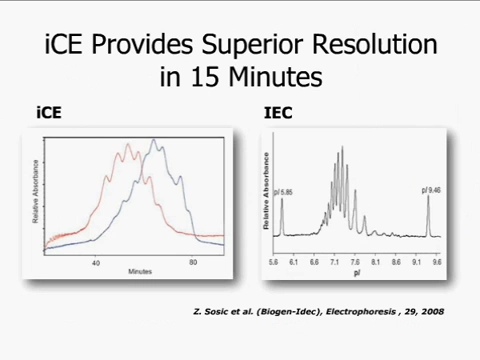

他的解释是机制层面的：离子交换靠表面相互作用，柱填料的高表面积体积比会引入**混合模式分离**，对大分子尤其限制分离能力，很多时候不得不为每个分子单独开发方法；而毛细管电泳的电场**能深入蛋白质的三维结构内部**，探测溶剂化口袋内部的差异。再加上省掉迁移步骤，10 分钟就能出一张高分辨率图谱，比传统阳离子交换快五到六倍。

代价也要说清楚：**icIEF 分出的峰没法收集**。所以实践中常常是「离子交换负责制备、icIEF 负责分辨」——Carrie Anderson 后面也明确说，正因为各有优劣，他们通常用多种方法组合来完整表征电荷异质性。

[【跳转到 08:42】](https://www.youtube.com/watch?v=UKcCqtx1sZs&t=522)

稳健性方面，讲者展示了新卡盒验证时的一组连续进样：**无论 pI 还是峰形，至少 100 次进样内保持稳定**。这是把 icIEF 当常规质控方法的前提。

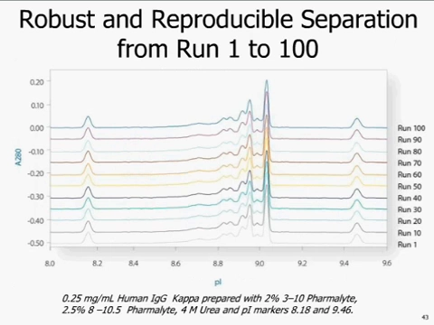

> 补充（非讲者原话）：这张图的图注里写着样品配制条件——2% pH 3–10 Pharmalyte、2.5% pH 8–10.5 Pharmalyte、4 M 尿素、pI 标记 8.18 与 9.46。也就是说，所谓「100 次稳定」是在**一套固定条件**下成立的，换条件就要重新验证。

### 1.3 同一 pI、不同图谱：鉴别靠的是整张图，不是一个数字

[【跳转到 13:10】](https://www.youtube.com/watch?v=UKcCqtx1sZs&t=790)

Carrie Anderson 把 icIEF 的第一大用途定为**产品鉴别**：法规要求，同一场地生产多个产品时必须做鉴别，而且方法要高度专一、基于该产品蛋白结构的独特之处。传统做法是 ELISA（费时费力、依赖几种关键试剂）或胰酶酶切后反相 HPLC 肽图（更稳健但仍耗时）。

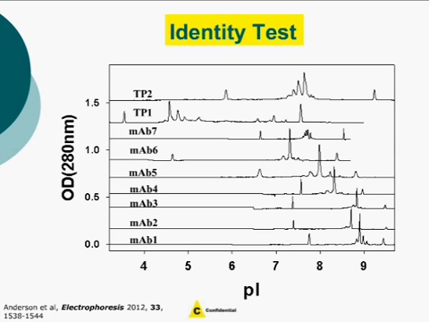

这张图给出了 icIEF 做鉴别的逻辑：**七个单抗、两个治疗性蛋白，每个产品都有一张独特的 pI/电荷分布图**。而最关键的一句话是——单抗这一类分子很可能出现**几个单抗主峰 pI 非常接近**的情况。看图中单抗 1 到单抗 3，主峰 pI 相近，但电荷图谱明显不同。

所以鉴别的判据是「**pI 数值 + 图谱形状**」的组合，而不是单个数字。这也提前回答了本文的核心问题：**pI 是一个标量，电荷异质性是分布；用标量做鉴别会撞车，用分布不会。**

## 二、读数之前先看条件：三个会改变图谱的旋钮

这一节是整场研讨会里最贴近「测量条件决定指标含义」的部分。讲者并没有把条件当成操作细节，而是当成**读数的一部分**。

### 2.1 两性电解质范围：决定你能看见什么、看不见什么

[【跳转到 39:44】](https://www.youtube.com/watch?v=UKcCqtx1sZs&t=2384)

Karan Shaw 的 ADC 例子最直观：同一个偶联物，用 Servalyt 时物种挤在一起、基线还有噪声；换成 Pharmalyte，基线干净、多个物种分得很清楚。

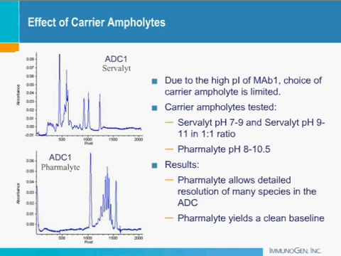

原因是这个抗体 pI 偏高，**两性电解质的选择本来就被压缩了**——能覆盖高 pI 区间的商品种类有限，选错就分不开。

在问答环节，Scott Mack 给了两条很具体的配方建议，可以直接当成「条件清单」用：

- **pI 约 9.6 的单抗**：4% 的 pH 3–10 梯度 + 5 mM 精氨酸作阴极间隔剂先筛；同时加 2–4 M 尿素防止聚集或沉淀；分辨率不够时再加入 pH 8–10.5 的两性电解质（从 2% 起步，并把 3–10 的从 4% 降到 2%，让两者大致等量）。[【跳转到 49:48】](https://www.youtube.com/watch?v=UKcCqtx1sZs&t=2988)
- **能测到多高的 pI**：限制来自阴极阻断剂，精氨酸的 pI 约 10.7，所以用 pH 8–10.5 可以做到约 10.5；再高要用 pH 9–11 的 Servalyt 配 TEMED，但 Servalyt 背景噪声大，用量要压到 2% 以下。[【跳转到 51:03】](https://www.youtube.com/watch?v=UKcCqtx1sZs&t=3063)

换句话说，**「这个抗体的 pI 是 9.4」这句话隐含了「用哪套两性电解质」这个前提**。换一套，峰位可能移动，峰数可能变化。

### 2.2 尿素：为了让它溶着，不是为了让它变性

[【跳转到 40:34】](https://www.youtube.com/watch?v=UKcCqtx1sZs&t=2434)

ADC 比裸抗体更疏水（接了药），在聚焦过程中容易析出。不加尿素时，电泳图里全是沉淀和噪声，几乎没有电荷分离；加了尿素之后峰形干净、分辨率大幅提升。

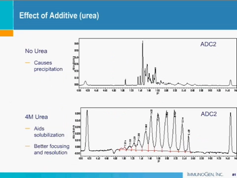

讲者对机制的解释是：尿素作为**温和变性剂**，让偶联物分子稍微展开，把电荷暴露得更充分，从而更利于按电荷分离。他给的用量是 1–4 M（演示里用了 4 M，2 M 通常已够），并强调**必须现配现用**——放久的尿素会降解，反过来伤害样品。

问答里还有一个反面证据值得记住：对**不需要**尿素就能溶解的产品，加与不加尿素的电泳图分辨率几乎没差别。所以尿素不是「加了总没坏处」的万能添加剂，而是**针对疏水/易沉淀样品的补救手段**。

> 注意这里的因果方向：尿素改变的是分子在溶液里的构象状态，因此它改变的是**你测到的那个 pI**，而不只是「信噪比」。这又是一条「读数依赖条件」的证据。

### 2.3 离子强度与辅料：会压缩梯度、会挖出一个洞

[【跳转到 51:28】](https://www.youtube.com/watch?v=UKcCqtx1sZs&t=3088)

Scott Mack 在问答里给了一条硬指标：**体系离子含量要控制在 15 mM 以下**，PBS 这种就不行。机制是：这些离子离开毛细管时被水合氢离子和氢氧根取代，会在毛细管末端造成极端 pH，同时**压缩梯度**——梯度一压缩，pI 的标定就跟着失真。

辅料也有讲究：像 Triton X-100 这类在 280 nm 有吸收的东西，会直接吃掉灵敏度。

[【跳转到 41:24】](https://www.youtube.com/watch?v=UKcCqtx1sZs&t=2484)

更隐蔽的是**处方缓冲液本身的组分**。Karan Shaw 展示了同一个 ADC 在两种处方中的图谱：醋酸盐处方下电荷物种分得很好；组氨酸处方下，中间凭空出现一段空洞。

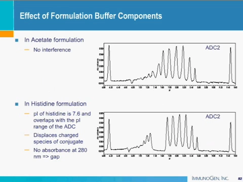

原因讲得很干脆：组氨酸是氨基酸，**pI 7.6**，恰好落在 ADC 的 pI 范围内，于是它自己也在那个位置聚焦，把偶联物的电荷物种挤开；而组氨酸在 280 nm 不吸收，所以图谱上就是一段空白。解决办法是**把样品换液到兼容缓冲液**。

这一条对读图的人特别重要：**图上的一段空白可能不是「没有那种变异体」，而是一个不吸收的干扰物站在那里**。

## 三、这台仪器还能当浓度计，但要看用哪个峰

[【跳转到 21:55】](https://www.youtube.com/watch?v=UKcCqtx1sZs&t=1315)

Carrie Anderson 的团队原本想用反相 HPLC 测工艺中间样品的滴度，结果蛋白与柱子结合太强、残留严重，只好回头评估现成的 icIEF 方法能不能兼做浓度测定。结论是可以，但要接受几个前提：

- 标准曲线在 **63–500 µg/mL** 范围内线性，R² ≥ 0.99；每个标准品的 RSD < 5%；
- 后来把曲线下延到 15 µg/mL 时发现，**低浓度端看不到酸性变异体**，所以定量的其实是主峰；
- 她最终选择**只用主峰面积**做标准曲线，理由是要测一些很脏的样品，那些样品里无法把酸性峰与其他蛋白分开，用主峰面积才前后一致。

这就带出「读数含义」的第二个层次：**同一张电泳图，用总峰面积定量和用主峰面积定量，得到的是两个不同的量**——前者是「总蛋白」，后者是「主成分」。两者在纯样品里接近，在脏样品里会分家。

[【跳转到 23:05】](https://www.youtube.com/watch?v=UKcCqtx1sZs&t=1385)

工艺样品的图谱也印证了「基质会改读数」：上游细胞裂解液样品明显不纯、含大量其他蛋白，主峰 pI 与下游样品和最终产品相比**略有偏移**，讲者判断这是**基质效应**，并通过加标确认了 pI 约 5.8 处的峰确实是目标蛋白。回收率方面，最脏的样品约 80%，其他样品 90–110%。

## 四、电荷异构体：pI 的每一次位移，都能对应到一种化学修饰

这是本讲最实用的部分：把「峰位/峰比例的变化」翻译成「分子上发生了什么」。

### 4.1 碱性峰 = C 端赖氨酸，而且可以用酶学验证

[【跳转到 14:25】](https://www.youtube.com/watch?v=UKcCqtx1sZs&t=865)

同一单抗在 −70、4、25、37 ℃ 存放六个月，碱性峰（Basics）与酸性峰（Acidics）相对主峰的变化一目了然：**温度越高，酸性峰越明显**。

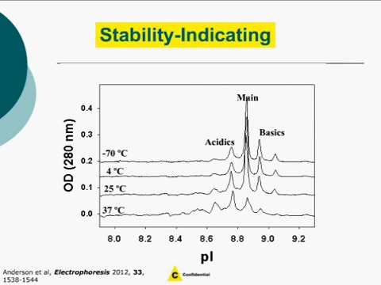

关键在于她没有停在「看起来像脱酰胺」，而是做了归属验证：**用羧肽酶 B 处理，确认这几个碱性峰是 C 端带一个和两个赖氨酸的变异体**。这是一个可复制的思路——**先给峰找到化学身份，再谈它的意义**。

### 4.2 酸性峰 = 脱酰胺，而 pH 是它的开关

[【跳转到 15:40】](https://www.youtube.com/watch?v=UKcCqtx1sZs&t=940)

同一单抗在两种处方缓冲液里的长期稳定性，是全场最有说服力的一组对照：

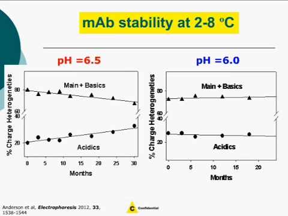

- **pH 6.5**：酸性峰随储存时间缓慢上升，主峰与碱性峰相应下降；
- **pH 6.0**：酸性峰比例基本不变。

因为脱酰胺速率在更高 pH 下更快，这个「pH 一降、酸性峰就不涨」的结果反过来支持了「酸性峰来自脱酰胺」的判断。她还补了旁证：高温下没有看到断片或聚集，用 ELISA 也没测到结合能力变化——**其他稳定性指示方法都正常，只有电荷图谱在动**，那动的就是化学修饰而不是结构崩坏。

同一套逻辑用在另一个重组蛋白上：2–8 ℃ 存放三个月酸性峰上升，冻存三个月图谱不变；序列里确实有两个脱酰胺热点。**结果是产品的储存条件被改成冻存**。这是「一个电荷读数直接改变工艺决策」的实例。

> 化学层面的细节（琥珀酰亚胺中间体、isoAsp、C 端赖氨酸在血清中的快速转化等）已在系列 4.2.3 详述，本文不重复。

### 4.3 唾液酸：糖蛋白的电荷异质性，靠酶对照定性

[【跳转到 25:07】](https://www.youtube.com/watch?v=UKcCqtx1sZs&t=1507)

糖蛋白的电荷图谱往往比单抗复杂得多，因为唾液酸（带负电）的数量可以有一大串组合。Carrie Anderson 用 EPO 的菌株筛选做了示范：三个工程菌株表达的重组人促红细胞生成素，**菌株 3 的唾液酸异质性最小**，主要只有两个主峰。

三个菌株的图谱差别主要落在 pI 4.5–5 那一片峰群上——那正是唾液酸数量不同的组分所在的位置。

[【跳转到 26:35】](https://www.youtube.com/watch?v=UKcCqtx1sZs&t=1595)

随后是关键的对照实验：用**唾液酸酶**（专门切掉唾液酸）处理。去唾液酸化的 EPO 理论 pI 是 8.4；处理后 pI 4.5–5 之间的峰全部消失，pI 约 8.5 处出现一个新峰。

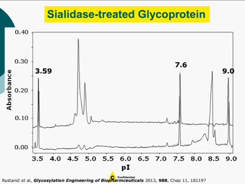

这个「酶切前后图谱整体搬家」的设计，把「这些峰是唾液酸造成的」从推测变成了证据。同一个手法还用在生物类似药比对：两个自建菌株与原研产品的图谱不同，但**去唾液酸之后电荷图谱几乎完全一致**，说明差异主要在糖的唾液酸化上，而不是蛋白骨架。

> 补充（非讲者原话）：这也是「读数必须带条件」的一个极端例子——糖蛋白的 pI 强烈依赖糖链末端唾液酸的数量，而唾液酸含量又随宿主、培养基、培养时间变化。所以糖蛋白的 pI 更适合当作「批内一致性指标」，而不是「分子常数」。

## 五、把 pI 当「结合状态」的读数：抗原一滴定，整组峰一起左移

[【跳转到 17:45】](https://www.youtube.com/watch?v=UKcCqtx1sZs&t=1065)

这是全场最巧的一个用法：**用 icIEF 看抗体与抗原的结合**。原理很朴素——结合上一个带负电（或整体更酸）的抗原，复合物的 pI 就会下降。

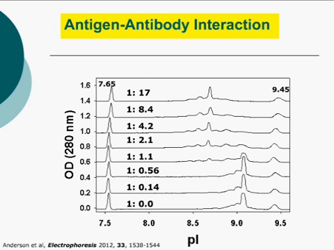

实验设计上有两个细节值得学：

1. **抗原本身不显影**。这个例子里靶抗原不含色氨酸、只有少量酪氨酸，在 280 nm 几乎不吸收，所以图谱上看到的始终是抗体那一套峰——抗原只以「把峰推走」的方式存在。
2. **看的是「整组峰是否一起移动」**。主峰从 pI 9.2 移到约 8.7，同时**所有酸性峰都跟着一起移动**。这说明这些酸性变异体在结合抗原这件事上**都是有活性的**——如果某个酸性峰原地不动，那它就是失去结合能力的组分。

[【跳转到 18:35】](https://www.youtube.com/watch?v=UKcCqtx1sZs&t=1115)

对照组也很干净：同一个蛋白与**非特异性单抗**孵育，双方的图谱都不变。而在重组蛋白那一侧，随着特异性单抗滴入，图谱开始变化，**大约在 1:1 结合比时停止变化**——这本身就是化学计量比的读数。

这条思路的意义在于：它把「电荷」这个看似只跟配方有关的理化指标，变成了**功能状态的间接探针**。而且它比传统的「先分离酸性峰再分别测活性」快得多——后者要多种方法组合，过程非常繁琐。

## 六、ADC：每修饰一个赖氨酸，pI 就下降一格

[【跳转到 34:44】](https://www.youtube.com/watch?v=UKcCqtx1sZs&t=2084)

Karan Shaw 的部分把「电荷」和「偶联化学」直接连了起来。先看传统方法为什么不够用：

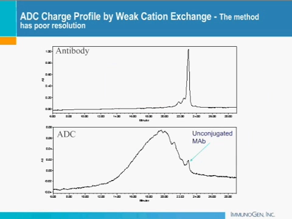

同一个抗体，阳离子交换分得很好；做成 ADC 之后，电荷物种几乎分不开，只出来一个巨大的峰，里面能辨认出少量未偶联抗体。平板凝胶等电聚焦和传统 cIEF 也各有短板（定量困难、重现性差、迁移过程损失分辨率）。

[【跳转到 37:14】](https://www.youtube.com/watch?v=UKcCqtx1sZs&t=2234)

icIEF 的图谱则是一串漂亮的「阶梯」：

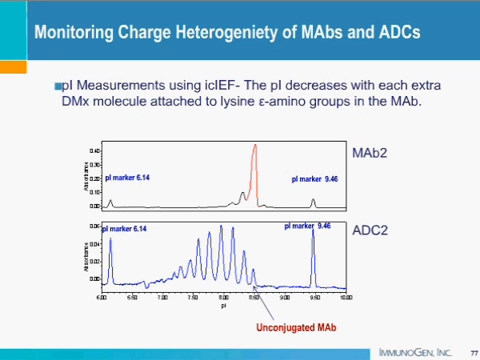

机制一句话就能说清：**赖氨酸是碱性氨基酸，每有一个赖氨酸的 ε-氨基被连接子修饰，抗体的 pI 就下降一点**。于是 ADC 的图谱变成一串向低 pI 展开的峰，每一个峰对应「接了 n 个药物」。而**最右侧那个峰与裸抗体主峰的 pI 完全吻合**——通过多次加标实验，他们确认那就是未偶联抗体。

[【跳转到 38:29】](https://www.youtube.com/watch?v=UKcCqtx1sZs&t=2309)

与质谱对照，两种方法给出的分布高度一致，只是方向相反：icIEF 里未偶联抗体在右（高 pI），质谱里未偶联抗体在左（低质量），随药物数增加分别向左、向右展开。

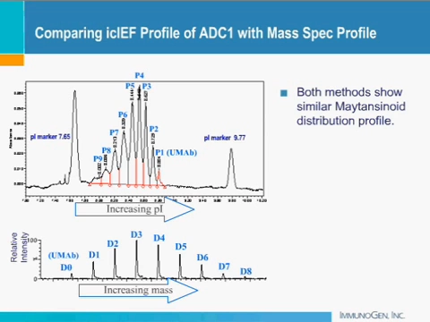

### 6.1 一个必须交代的偏差：280 nm 不只看到蛋白

[【跳转到 42:52】](https://www.youtube.com/watch?v=UKcCqtx1sZs&t=2572)

ADC 里的小分子药物（DM1/DM4）在 280 nm 也有吸收。后果是：**高偶联物种被系统性高估**，高估程度取决于该分子偶联了多少个药。所以按「总峰面积百分比」直接算未偶联抗体是不准的（算出来偏低），必须用抗体标准曲线换算浓度、再与样品总浓度相比。她用正交方法（非变性液相色谱、质谱）验证过修正后的数字更准。

这又是一个「读数含义」的例子：**同一张 ADC 电泳图，横轴（pI）是可靠的，纵轴（峰面积占比）需要修正**。她也坦言，用 icIEF 算药物抗体比会「略有偏差」，但仍能给出大致判断。

## 七、把条件写成清单：icIEF 的实操参数表

把散落在各处的条件集中起来，就是一张可以直接照抄的清单：

| 条件 | 讲者给的取值/建议 | 对读数的影响 |
| --- | --- | --- |
| 两性电解质 | pH 3–10 打底；高 pI 分子加 pH 8–10.5；更高用 pH 9–11 Servalyt + TEMED | 决定可分辨的 pI 区间与峰数 |
| 阴极间隔剂 | 5 mM 精氨酸 | 稳定高 pI 端的梯度 |
| 尿素 | 1–4 M，现配现用；仅对易沉淀/疏水样品必要 | 改变分子构象，从而改变测得的 pI |
| 离子含量 | < 15 mM，避免 PBS | 离子压缩梯度，导致 pI 标定失真 |
| 辅料 | 避免 280 nm 有吸收者（如 Triton X-100） | 降低灵敏度 |
| 处方缓冲液 | 组氨酸（pI 7.6）会与 ADC 峰重叠并挖出空洞 | 换液到兼容缓冲液 |
| 上样浓度 | 单抗常规 200 µg/mL，最低可到 50 µg/mL | 电荷异质性越复杂，「每峰浓度」越低（稀释效应） |
| 聚焦时间 | 典型 6–10 分钟，每 30 秒成像一次 | 不足则峰未聚焦完全 |
| 检测方式 | 全柱成像（不做迁移） | 迁移会降低分辨率或引入 pI 偏差 |

其中「稀释效应」这一条值得单独说：等电聚焦不像 CE-SDS 那样只有一个峰，**同样上样量下，峰越多、每个峰的浓度越低**。所以「最低能测多稀」这个问题，答案取决于这个分子的电荷异质性有多复杂。

## 小结

- **pI 的定义很干净，读数不干净**：pI 是净电荷为零的 pH，但你在图谱上读到的峰位与峰比例，是两性电解质范围、尿素、离子强度、辅料、检测方式共同决定的。
- **成像优于迁移**：压力迁移损失分辨率，化学迁移会破坏梯度间距，在 pH 8–9 造成实测与计算 pI 的明显偏差。
- **两性电解质决定「能看见什么」**：高 pI 分子可选的载体有限，换一套载体，峰位与峰数都可能变。
- **辅料会伪造或抹掉峰**：组氨酸在 pI 7.6 聚焦、又不吸收 280 nm，于是图谱上出现一段「假空白」。
- **每个峰都该有化学身份**：碱性峰用羧肽酶 B 确认是 C 端赖氨酸，酸性峰用「pH 6.0 不涨、pH 6.5 涨」确认是脱酰胺，糖蛋白的峰用唾液酸酶整体搬家来确认。
- **电荷可以当功能探针**：抗原滴定时整组峰一起左移，说明酸性变异体仍有结合活性；非特异性抗体则不引起位移。
- **ADC 的 pI 是一把尺子**：每修饰一个赖氨酸 pI 降一格，最右侧峰就是未偶联抗体；但 280 nm 下药物也吸收，峰面积占比需要标准曲线修正。
- **报告电荷指标必须带方法**：没有条件的 pI 与酸性峰百分比，既不可比、也不可解释。

## 关键术语速查

| 术语 | 一句话解释 |
| --- | --- |
| 等电点 pI | 分子净电荷为零时所在溶液的 pH；此时它不再朝任一电极迁移 |
| cIEF | 毛细管等电聚焦，在毛细管内建立 pH 梯度，让两性分子聚焦到各自 pI |
| icIEF | 成像毛细管等电聚焦，整根毛细管 280 nm 成像检测，省去迁移步骤 |
| 两性电解质 | 一群 pI 各异的小分子，通电后自己排成连续 pH 梯度 |
| pI 标准品 | 已知 pI 的参照物，用来把毛细管上的位置标定成 pI 数值 |
| 阳极液 / 阴极液 | 毛细管两端浸的酸液与碱液，提供滴定用的水合氢离子与氢氧根 |
| 压力迁移 / 化学迁移 | 传统 cIEF 把条带推过检测窗的两种方式，分别损失分辨率或破坏梯度间距 |
| 酸性 / 碱性变异体 | 比主成分 pI 更低 / 更高的组分，多因酸性基团引入或碱性基团缺失 |
| 脱酰胺 | 天冬酰胺转为天冬氨酸或异天冬氨酸，多出一个羧基，pI 下降 |
| 羧肽酶 B | 切掉 C 端碱性氨基酸的酶，用来确认碱性峰是否为 C 端赖氨酸变异体 |
| 唾液酸酶 | 切掉糖链末端唾液酸的酶，用来确认低 pI 峰是否来自唾液酸 |
| 药物抗体比 DAR | 平均每个抗体上连接的药物分子数，HIC 与 icIEF 都能估 |