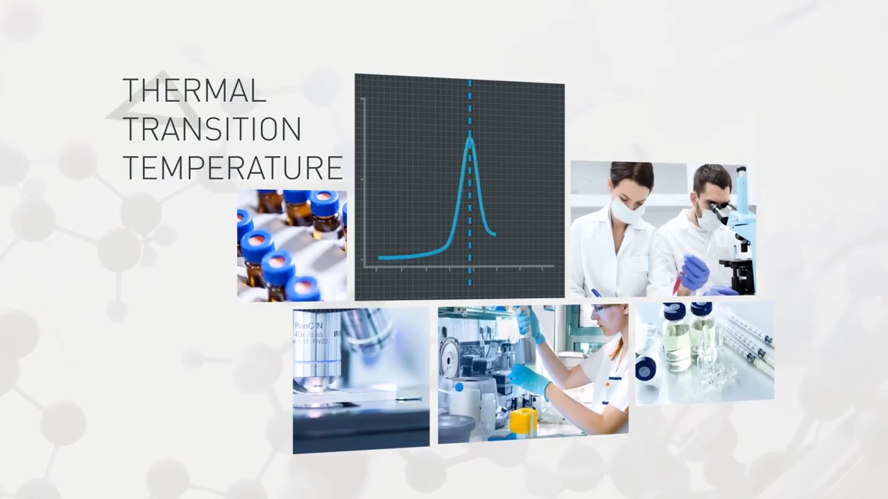
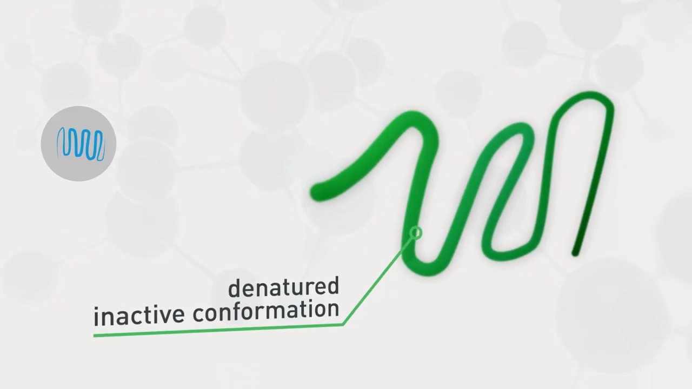
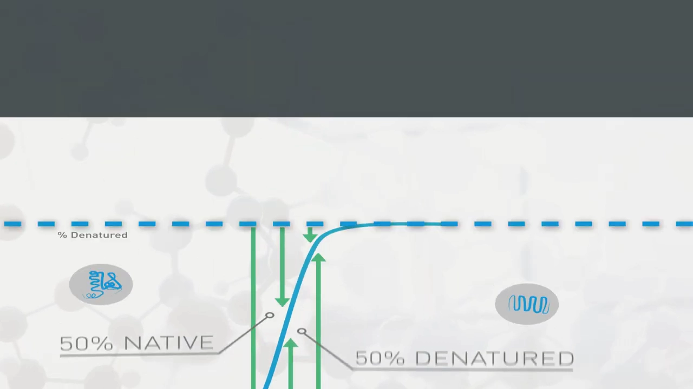
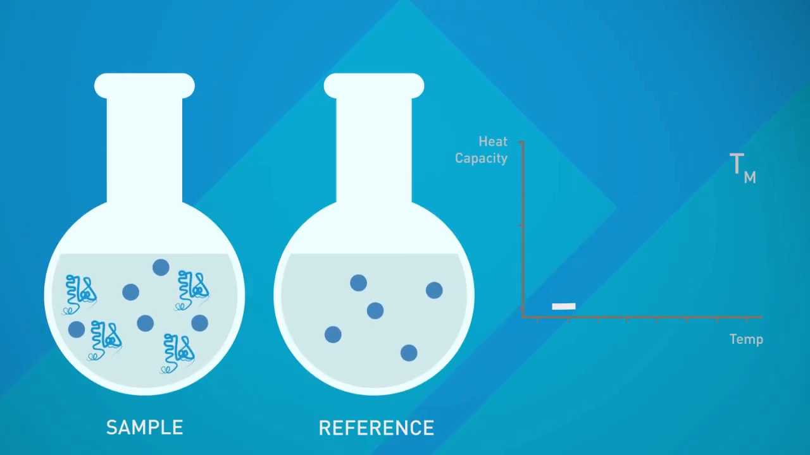
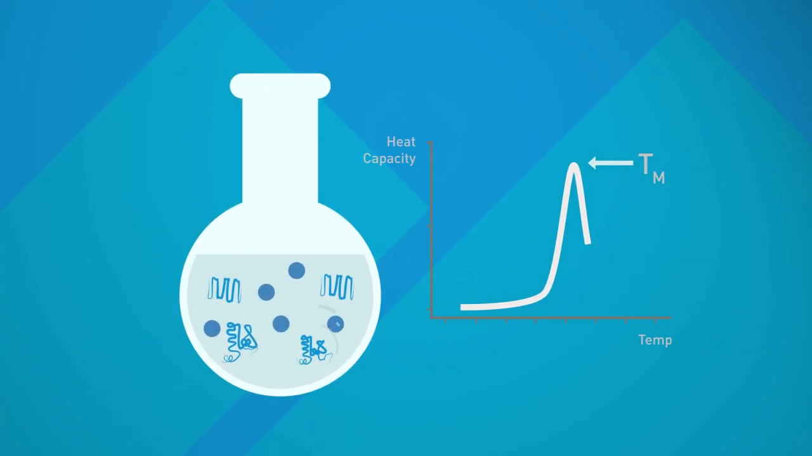
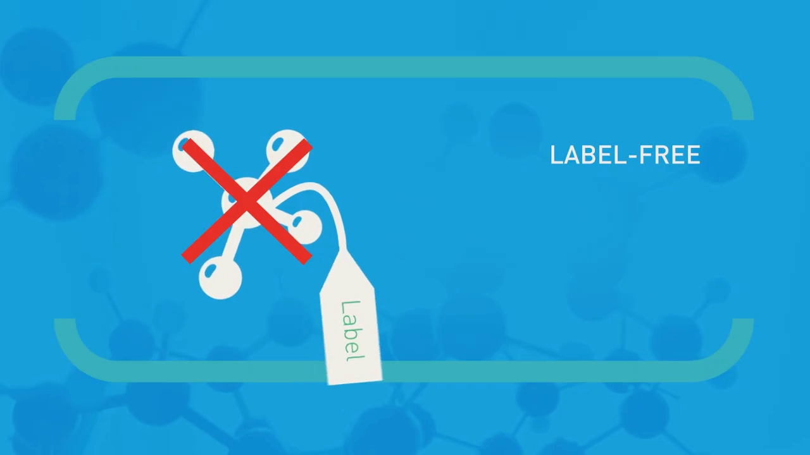
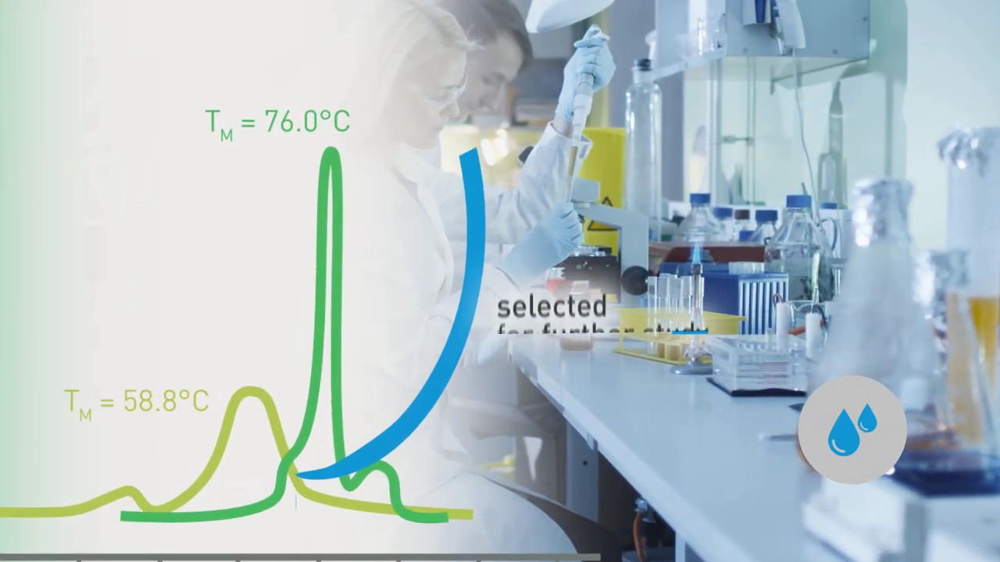
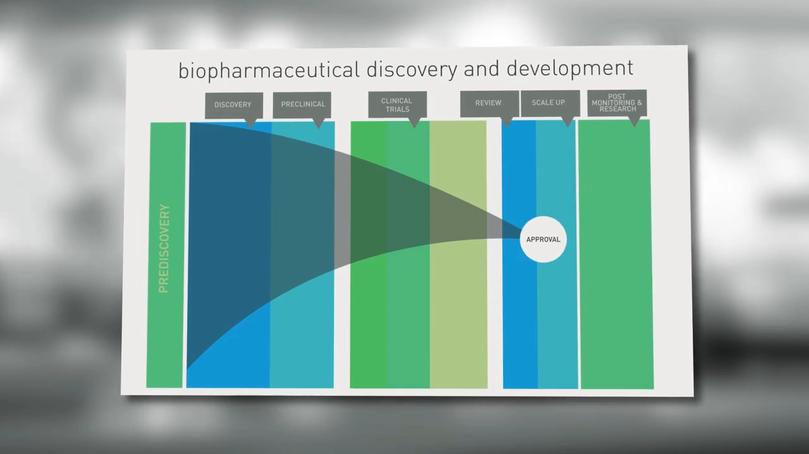

# DSC 是唯一直接测吸热峰的方法：Tm 落在热容曲线的峰顶

> 视频来源：[What Is Differential Scanning Calorimetry (DSC)?](https://www.youtube.com/watch?v=2CU3uvjKXlk)（YouTube · Malvern Panalytical 官方科普短片）｜时长约 5 分钟
> 导读：这是一支厂商制作的原理短片，信息密度很高：用四分钟把 DSC 的物理量（热容、吸热峰、熔解焓）、Tm 的定义、以及「为什么它被当作金标准」讲清楚。本文按「测什么 → 怎么测 → 怎么读 → 凭什么可信 → 边界在哪」重组；染料法 DSF 与升温/等温的差别见同节另两篇。字幕为 YouTube 自动生成，术语已订正（如「thermalstability as says」→ thermal stability assays、「bio comparability」→ biocomparability）。

## 本讲要解决的核心问题（SCQA）

**背景**：比较蛋白的热稳定性，最通用的读数是熔解温度 Tm；而 Tm 可以由很多种方法给出——染料荧光、内源荧光、圆二色、光散射。

**冲突**：这些方法都是**间接**的：它们盯着某个随去折叠而变化的「副产物信号」（染料结合、荧光红移、二级结构的手性吸收），再由信号拐点反推 Tm。信号本身受探针、缓冲液、聚集干扰，所以同一个分子在不同方法下会给出不同的 Tm。有没有一种方法**直接测「去折叠这件事吸收了多少热」**？

**疑问**：DSC 到底测的是什么物理量？曲线上的峰顶、峰面积分别代表什么？为什么它能被称为「金标准」，而它的代价又是什么？

**回答（中心思想）**：**DSC 直接测样品与参比之间的热流差，也就是蛋白去折叠时热容 $C_p$ 的变化：峰顶给出 Tm，峰面积给出熔解焓 $\Delta H$。因为不需要染料、不需要标记、不依赖光谱变化，它是唯一能直接给出去折叠热力学的常规方法，因此被当作 Tm 测定的金标准；代价是样品消耗大、通量低，且它同样只描述「加热」这一种压力。**

---

## 一、DSC 测的是热，不是光

### 1.1 一句话定义

[【跳转到 00:05】](https://www.youtube.com/watch?v=2CU3uvjKXlk&t=5)

短片的定义很干脆：**差示扫描量热法（DSC）测量生物分子在热变性过程中的热量变化**，主要对象是工程化蛋白与生物药产品。它测的量是「热流（heat flow）随温度的变化」，而不是任何光学信号。

### 1.2 Tm 就是曲线上的峰顶

[【跳转到 00:28】](https://www.youtube.com/watch?v=2CU3uvjKXlk&t=28)

DSC 把 Tm **直接呈现为数据图的峰顶**。这一点和 DSF 很不一样：DSF 的 Tm 是从「荧光半高点」反推的，而 DSC 的峰顶本身就是「热容增加最快」的温度——两者在数学上对应同一个物理事件（半数分子去折叠），所以 DSC 的读数更接近定义。

### 1.3 从「天然活性构象」到「变性失活构象」

[【跳转到 00:33】](https://www.youtube.com/watch?v=2CU3uvjKXlk&t=33)

短片强调 DSC 是**唯一已知的、能直接测去折叠热力学的方法**：它跟踪的是从天然、有活性的构象到变性、失活的构象这一整段转变，而不只是「某个信号变了」。

这句话里的「活性」值得留意：它把**构象状态**与**功能状态**明确绑在一起。这是 DSC 判读的隐含前提——**去折叠即失活**。对多数抗体成立，但对某些在去折叠后仍能复性的分子，这个前提需要单独验证。

---

## 二、Tm 的定义与它的用途

### 2.1 一半天然、一半变性

[【跳转到 01:13】](https://www.youtube.com/watch?v=2CU3uvjKXlk&t=73)

短片给的定义与教科书一致：**Tm 是 50% 的蛋白处于天然态、50% 处于变性态时的温度**，它是最可靠的热稳定性指标；Tm 越高，蛋白越稳定。

### 2.2 三个直接用途

[【跳转到 01:24】](https://www.youtube.com/watch?v=2CU3uvjKXlk&t=84)

短片列出的用途都很务实：

1. **挑构建体**：在工程化变体里选最稳定的那一个；
2. **挑缓冲液与添加剂**：哪种配方能把 Tm 推得更高；
3. **定纯化与储存条件**：把热稳定性数据作为工艺参数的依据。

> 注意第 3 条的措辞是「优化储存条件」，而不是「预测储存期」。**Tm 高只说明这个分子更耐热，不等于在 4 ℃ 放两年就没问题**——这一点与同节另一篇（升温 vs 等温）的结论一致。

---

## 三、怎么测：样品池、参比池、热容

### 3.1 双池结构：把「缓冲液的热」减掉

[【跳转到 01:44】](https://www.youtube.com/watch?v=2CU3uvjKXlk&t=104)

实验设置是 DSC 的核心：**样品池**放溶于目标缓冲液的蛋白，**参比池**放**完全匹配的缓冲液**（不含蛋白）。两池同步升温，仪器记录维持两者温度一致所需的**热流差**。这样缓冲液自身的热行为被抵消，剩下的就是蛋白的贡献。

「匹配（matched）」这个词很关键：**参比缓冲液必须与样品透析/配制成同一组成**，否则盐、辅料、pH 的差异会被当成蛋白的热事件。

### 3.2 升温过程中热容上升

[【跳转到 01:54】](https://www.youtube.com/watch?v=2CU3uvjKXlk&t=114)

起始温度下蛋白保持天然构象；随着两池升温，蛋白开始热变性，**热容 $C_p$ 随去折叠而升高**——因为去折叠暴露的疏水表面需要重新组织周围的水，体系吸热能力上升。曲线在 Tm 处达到峰顶，实验结束时全部蛋白已去折叠。

用公式表达，测到的表观热容可以写成「基线 + 转变贡献」：

$$
C_p^{\text{obs}}(T) = C_p^{\text{baseline}}(T) + \Delta H\, \frac{d f_u}{dT}
$$

其中 $f_u$ 是去折叠分数。**峰顶对应 $d f_u/dT$ 的最大值（即 $f_u=0.5$），峰面积对应 $\Delta H$**。（该式是 DSC 的标准表述，属补充说明；短片只做了定性描述。）

---

## 四、怎么读：峰顶是 Tm，峰面积是焓

### 4.1 峰面积 = 熔解焓

[【跳转到 02:24】](https://www.youtube.com/watch?v=2CU3uvjKXlk&t=144)

短片明确指出：**峰下的面积是总能量变化，也就是去折叠的焓（enthalpy）**；这是一个**吸热**反应——因为打断维持高级结构的非共价键需要能量。

这是 DSC 相对其他方法最大的增量信息：DSF 只能给你一个温度，DSC 还能给你「这次去折叠一共吸收了多少热」。焓越大，说明维持结构的相互作用总量越多（但不等于「越稳定」，稳定性由 $\Delta G$ 决定，而 $\Delta G$ 还需要熵与热容变化）。

### 4.2 多结构域会给出多个峰

短片用的是单结构域式的示意曲线（一个尖峰）。实际做抗体时，**Fab、CH2、CH3 各自熔解，会出现多个峰或肩峰**——这正是同节另一篇里「Tm1、Tm2」在 DSC 上的对应形态。DSC 因为直接测热，分峰能力通常优于染料法，这也是它在抗体表征里被偏爱的原因之一。

> **补充背景（非讲者原话）**：典型的 IgG 上 CH2 的 Tm 最低（常在 60–70 ℃ 区间），Fab 与 CH3 更高；具体数值随亚型、序列、配方变化很大。做归属时应当用结构域缺失变体或 DSC 分峰，而不是按「第一个峰就是 CH2」硬套。

---

## 五、凭什么叫「金标准」：无标记

### 5.1 不加强染料、不做化学修饰

[【跳转到 03:14】](https://www.youtube.com/watch?v=2CU3uvjKXlk&t=194)

短片给出的核心理由是 **label-free**：DSC 只用天然分子，不需要加荧光染料，也不需要化学修饰，因此比传统荧光方法更可靠——后者「经常引入不想要的假象（artifacts）」。

这句话可以对照 DSF 那篇来读：染料法的问题在于**染料与蛋白、与辅料都可能相互作用**，而且峰后信号会被聚集干扰。DSC 没有探针，就没有这类干扰——它测的是热本身。

### 5.2 排序配方与比较批次

[【跳转到 03:37】](https://www.youtube.com/watch?v=2CU3uvjKXlk&t=217)

短片把「增值」落在两件事上：

1. **给同一蛋白在不同配方中的 Tm 排序**，选 Tm 最高的配方继续研究；
2. **用热力学图谱比较不同批次、不同生产场地的产品**，保证全链条质量一致。

这张图把「排序」讲得很直观：两个样品的峰位差 17 ℃，选高的那个。注意它比较的是**同一种测量下的两个峰位**——仍然是相对比较，不是拿 76 ℃ 去对照某个通用阈值。

### 5.3 在研发生命周期里的位置

[【跳转到 03:14】](https://www.youtube.com/watch?v=2CU3uvjKXlk&t=194) [【跳转到 02:49】](https://www.youtube.com/watch?v=2CU3uvjKXlk&t=169)

短片把 DSC 放在「生物物理表征」的位置上，服务于蛋白工程、配方开发与**生物相似性/可比性（biocomparability）**研究。

---

## 六、代价与边界：金标准也不是万能的

### 6.1 三个实际限制

短片只在最后一段提到仪器层面的改进（小体积、易操作、可自动化、支持 21 CFR part 11），反过来说明传统 DSC 的短板：

| 限制 | 具体表现 | 影响 |
| --- | --- | --- |
| 样品消耗大 | 需要较高浓度与体积 | 早期只有微量表达产物时做不了 |
| 通量低 | 单次测量时间长、池数有限 | 不适合筛上百个配方条件 |
| 需要匹配参比 | 缓冲液必须严格一致 | 配方筛选时准备成本高 |

这解释了为什么实际工作中常见「**DSF/nanoDSF 高通量筛，DSC 复核关键候选**」的组合：前者便宜快，后者准且信息多。

### 6.2 它仍然只回答「加热」这一问

DSC 给的是构象稳定性（Tm、$\Delta H$），**不含胶体稳定性（聚集）与时间维度**。一个 Tm 很高但天然态就容易聚的分子，DSC 曲线可以很漂亮，长期储存却可能失败。所以：

- 判断「会不会聚」→ 需要 SLS/DLS/SEC；
- 判断「放着多久会坏」→ 需要等温/加速稳定性；
- 判断「功能还在不在」→ 需要结合活性或效价随时间的读数。

> **补充背景（非讲者原话）**：Tm 与低温储存稳定性相关性有限，因为储存温度远低于 Tm，主导降解的往往是局部去折叠、界面吸附、氧化与脱酰胺等非热路径；此外熔解可能可逆，而聚集通常不可逆。经验上的「Tm1 阈值」只能当粗筛。

---

## 小结

- **DSC 直接测热**：样品池与匹配参比池同步升温，记录热流差，得到热容–温度曲线。
- **峰顶是 Tm，峰面积是熔解焓**：前者是「一半去折叠」的温度，后者是这次转变吸收的总能量。
- **无标记是它被称为金标准的核心理由**：不加强染料、不做修饰，避免了荧光法的探针假象。
- **它的典型用法是相对比较**：给同一蛋白的不同配方排序、比较批次与场地的一致性，而不是拿绝对值对阈值。
- **代价是样品与通量**：因此常见「DSF 高通量初筛 + DSC 关键复核」的分工。
- **它只覆盖构象稳定性**：聚集、时间维度、功能保持都需要另外的读数。

## 关键术语速查

| 术语 | 一句话解释 |
| --- | --- |
| DSC | 差示扫描量热法，测样品与参比之间的热流差随温度的变化 |
| 热容 $C_p$ | 使体系升温 1 K 所需的热量；去折叠时表观热容上升 |
| Tm | 50% 天然、50% 变性时的温度，DSC 曲线上对应峰顶 |
| 熔解焓 $\Delta H$ | 峰面积对应的总吸热量，反映维持结构的相互作用总量 |
| 吸热反应 | 需要从外界吸收能量的转变；蛋白去折叠属于此类 |
| 参比池 | 只放匹配缓冲液的对照池，用于扣除缓冲液自身的热行为 |
| label-free | 无需染料或化学标记，直接测天然分子 |
| 生物可比性 | 比较不同批次、不同场地产品的一致性 |
| 构象稳定性 | 天然折叠与去折叠态之间的平衡；与胶体稳定性（聚集）不同 |