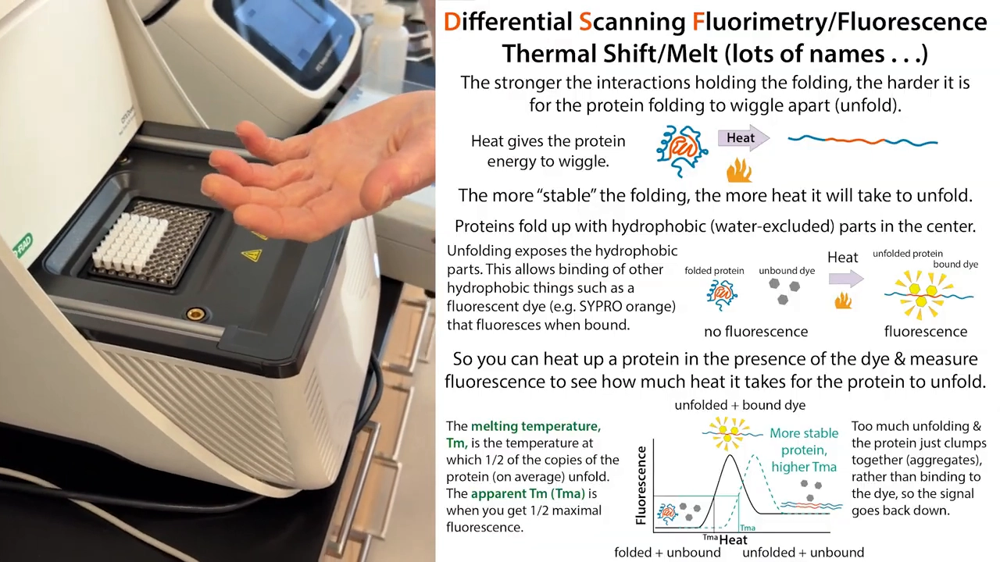
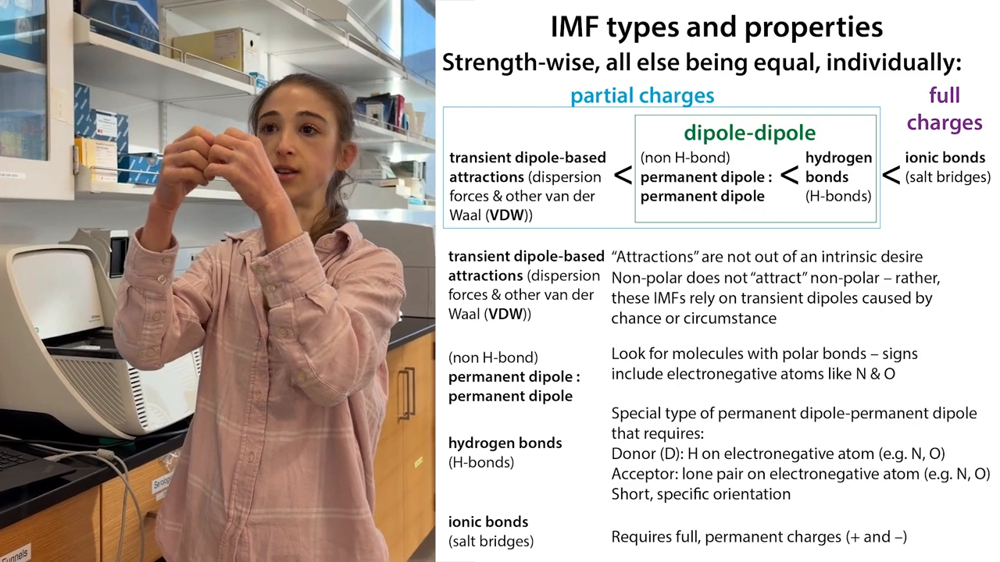
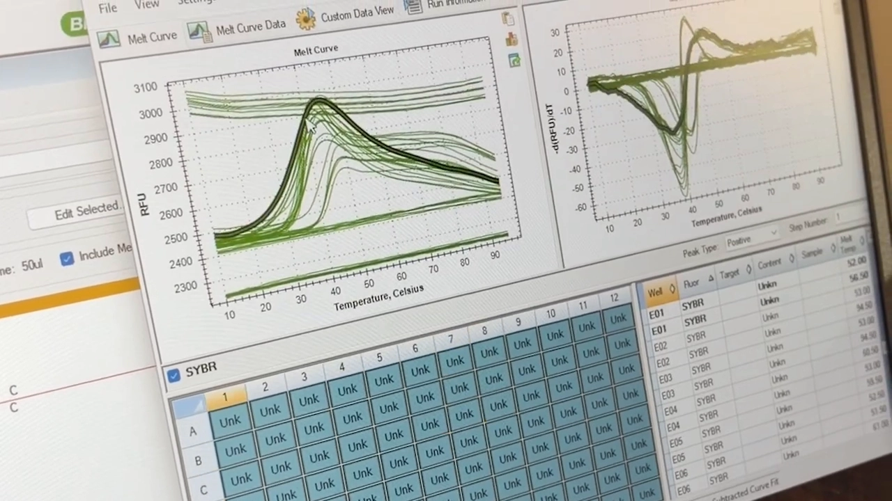
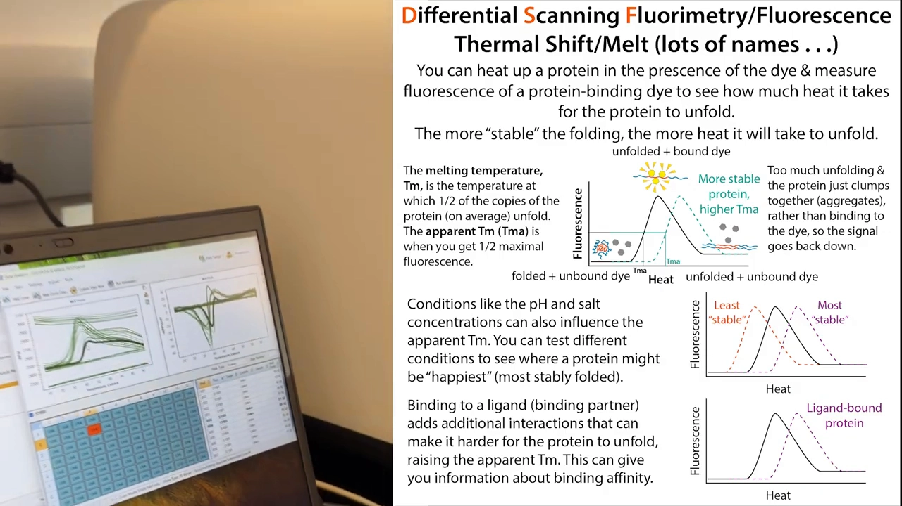
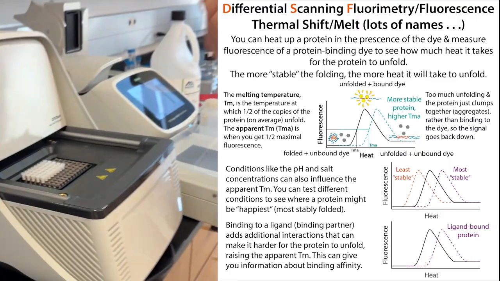
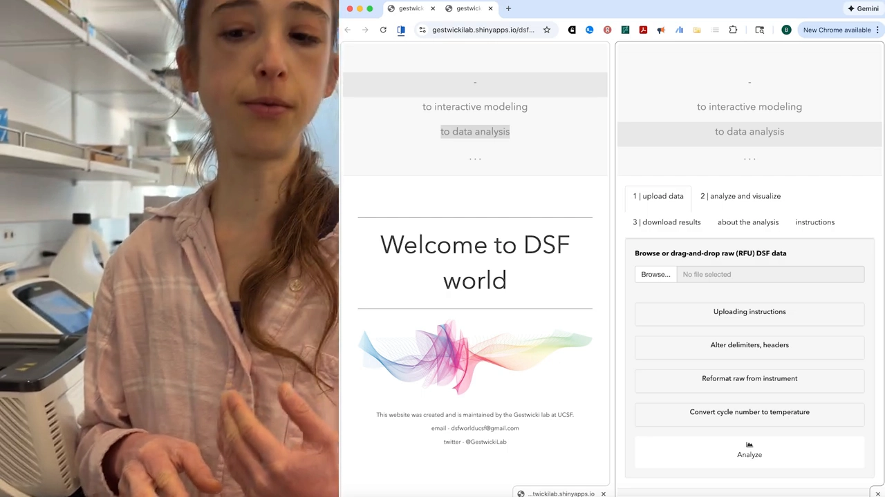
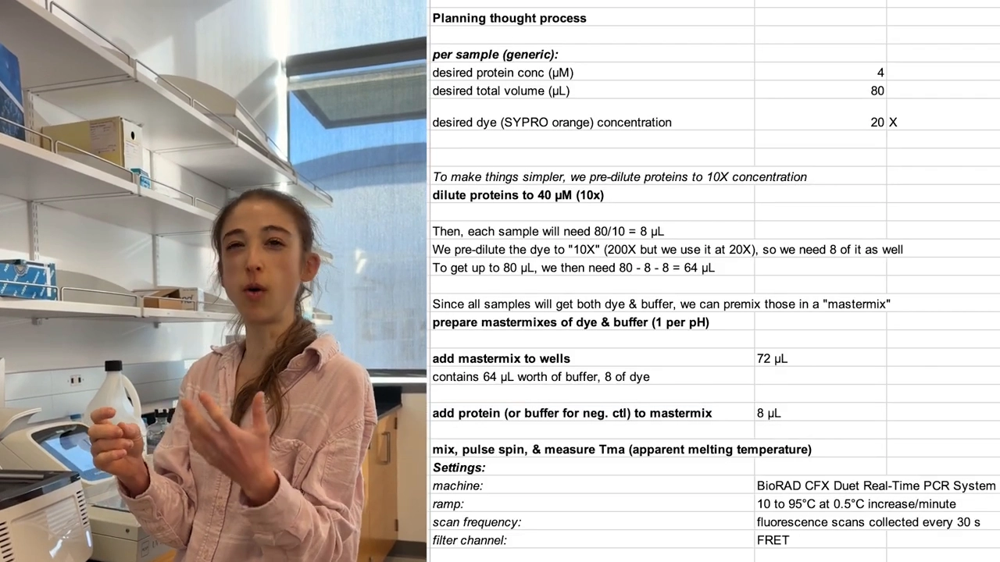

# DSF 读出的 Tm 是表观值：SYPRO Orange 报告的是疏水斑块暴露

> 视频来源：[Differential Scanning Fluorimetry / Fluorescence Thermal Shift / Melt](https://www.youtube.com/watch?v=VYCNEOb8kiI)（YouTube · the bumbling biochemist，讲者以实验室演示方式讲解）｜时长约 9 分钟
> 导读：这是一支「把 DSF 讲透到能上手」的教学短片：从热为什么能让蛋白松开讲起，到染料怎么报告去折叠、曲线为什么过峰后会掉下来、Tm 与 Tma 的区别、板子与盖子怎么选、数据怎么拟合。本文按「机制 → 曲线 → 判读 → 操作」重组；DSC、nanoDSF 等其他测法见同节另两篇。字幕为 YouTube 自动生成，术语已订正（如「cypro orange」→ SYPRO Orange、「TMA」→ Tma、「circulardicroism」→ circular dichroism）。

## 本讲要解决的核心问题（SCQA）

**背景**：想比较一批蛋白变体或一批缓冲液条件哪个更稳，最省事的方法是跑一条熔解曲线，读出一个 Tm。很多实验室用 qPCR 仪加一支荧光染料就能做，这就是 DSF（差示扫描荧光法），也叫热位移法（thermal shift）。

**冲突**：DSF 读到的信号不是蛋白本身，而是**染料结合**。蛋白去折叠、暴露疏水斑块，染料才发光；蛋白聚成一团，疏水斑块又被埋起来，信号反而掉下去。也就是说，**你看到的「熔解温度」是一次染料结合事件的温度，而不是严格意义上「一半分子解开」的温度**——所以讲者把它叫**表观 Tm（Tma, apparent Tm）**。

**疑问**：染料到底在报告什么？曲线为什么先升后降？Tma 与真正的 Tm 差在哪里？这个「表观」的读数还能用来做什么判断？

**回答（中心思想）**：**DSF 测的是「疏水斑块在什么温度被暴露出来」这一事件的表观温度，它的价值不在绝对数值，而在同一套方法内的位移（ΔTm）：条件变了、配体加了、突变做了，Tma 往哪边移、移多少，才是可判读的信息。** 一旦把 Tma 当成热力学常数、或跨方法去比绝对值，就会得出错误结论。

---

## 一、DSF 的机制：热让蛋白「松开」，染料把「松开」变成光

### 1.1 稳定性就是「要多少热量才松开」

[【跳转到 00:13】](https://www.youtube.com/watch?v=VYCNEOb8kiI&t=13)

讲者用一个很朴素的图像开场：加热给分子能量，让氨基酸残基「晃动（wiggle）」。把折叠维持住的那些**非共价相互作用**（疏水作用、氢键、范德华力、盐桥）越多、越强，就需要越多能量才能让它们断开——这就是「更稳」。

讲者还补了一句常被忽略的话：**「非极性并不主动吸引非极性」**，疏水作用的本质是水把非极性表面排除在外，靠的是瞬时偶极与熵的效应，不是某种「疏水键」。这解释了为什么疏水核心一旦暴露，就会立刻成为染料和其他疏水分子的落脚点。

### 1.2 染料报告的是「疏水斑块暴露」

[【跳转到 00:24】](https://www.youtube.com/watch?v=VYCNEOb8kiI&t=24)

天然折叠的蛋白把疏水（water-excluded）部分藏在中心，环境里没有可结合的疏水面，染料游离、不发光；升温让蛋白去折叠，疏水斑块翻到表面，**SYPRO Orange 结合上去，荧光大幅增强**。仪器一边升温一边「拍照」记录荧光，就得到一条熔解曲线。

这张「作用力强弱谱」是理解 ΔTm 的钥匙：配体结合、突变、盐浓度、pH 改变的，归根结底是这些相互作用的增减；相互作用增减，就表现为 Tma 的位移。

### 1.3 只需要一台 qPCR 仪

[【跳转到 02:12】](https://www.youtube.com/watch?v=VYCNEOb8kiI&t=132)

检测「蛋白解开了」有很多办法，但很多需要昂贵设备（讲者点名了圆二色光谱 CD）。DSF 的门槛低得多的原因很实际：**qPCR 仪本来就会精确控温、逐循环拍照**，只是平时用来测 cDNA 的扩增量，这里改成从低温缓慢升到高温、每拍一张荧光图即可。

---

## 二、一条曲线怎么读：S 形、峰顶、和峰后的下坠

### 2.1 从基线到 S 形

[【跳转到 03:06】](https://www.youtube.com/watch?v=VYCNEOb8kiI&t=186)

仪器以**梯度升温**的方式加热，每分钟记录一次荧光。曲线形状分三段：

1. **基线**：温度在升，但蛋白还没开始解开，荧光很低且平；
2. **S 形上升**：到达某个温度区间后，蛋白开始去折叠、染料结合，荧光快速上升；
3. **峰后下坠**：荧光在峰值之后**下降**。

### 2.2 峰后为什么掉下来：因为蛋白聚了

[【跳转到 03:56】](https://www.youtube.com/watch?v=VYCNEOb8kiI&t=236)

讲者给的解释是：**去折叠过头之后，蛋白互相黏成一团（clumps），把染料原本能结合的位点又埋起来了**，于是信号回落。这个细节非常重要，它意味着：

- 曲线的**下降段本身就是一个聚集信号**；
- 峰形（高度、宽度、下降斜率）里含有「解开之后会不会聚」的信息；
- 若样品在升温中大量聚集，**峰顶位置也可能被拉偏**——这也是 Tma 只能叫「表观」的原因之一。

### 2.3 Tm 与 Tma：一个是定义，一个是读数

[【跳转到 04:16】](https://www.youtube.com/watch?v=VYCNEOb8kiI&t=256)

讲者把两个概念并排放在同一张图上：

- **Tm（熔解温度）**：平均而言**一半的蛋白分子去折叠**时的温度——这是一个关于分子状态的量；
- **Tma（表观熔解温度）**：荧光达到**最大值一半**时的温度——这是一个关于染料信号的量。

两者在理想情况下接近，但不相等：Tma 依赖染料结合强弱、染料浓度、蛋白浓度、升温速率。所以**严格地说，DSF 报出来的是 Tma**；文献里普遍写成 Tm，是一种约定俗成的简写。

---

## 三、Tma 的四种用法：都是「比位移」，不是「读绝对值」

### 3.1 筛条件：哪个缓冲液让蛋白更「舒服」

[【跳转到 01:24】](https://www.youtube.com/watch?v=VYCNEOb8kiI&t=84)

同一支蛋白放在不同盐、不同 pH、不同辅料里，Tma 会整体左移或右移。讲者的说法是「筛蛋白在哪种条件下更 happy」，操作上就是排一排曲线看峰位。

### 3.2 看结合：配体让曲线右移

[【跳转到 05:03】](https://www.youtube.com/watch?v=VYCNEOb8kiI&t=303)

配体（结合伴侣）结合上去，等于给体系多加了一组相互作用，去折叠更困难，**Tma 右移**。用不同浓度的配体做一组，位移随浓度增大而饱和，就能粗略判断结合强弱——这就是「热位移法（thermal shift assay）」这个名字的由来。

讲者也提醒了例外：**有时会看到相反方向的位移**。所以判读的重点不是「一定右移」，而是「加了配体之后曲线确实变了」。

### 3.3 比变体：突变让 Tma 下降就是坏消息

[【跳转到 05:35】](https://www.youtube.com/watch?v=VYCNEOb8kiI&t=335)

做突变体筛的时候，若某个突变的 Tma 明显下降，说明这个位置对折叠很重要，蛋白「不喜欢这个突变」。这是工程改造里最常用的一类判读。

### 3.4 给结构生物学找条件

[【跳转到 08:36】](https://www.youtube.com/watch?v=VYCNEOb8kiI&t=516)

同样的数据还能反过来用：为结晶或冷冻电镜筛「最稳定的缓冲液条件」，因为稳定的构象均一性通常更好。这是把 DSF 当**条件搜索工具**，而不是当热力学测量。

---

## 四、操作细节：板子、盖子、染料、拟合

### 4.1 通量：从 PCR 管条到 384 孔板

[【跳转到 05:45】](https://www.youtube.com/watch?v=VYCNEOb8kiI&t=345)

只测几个条件时用 PCR 管条即可；条件一多就上 96 孔板、甚至 384 孔板，再往上就要用机械臂。这里的选择直接决定了「你能筛多宽的条件空间」。

### 4.2 白色不透光管 + 光学透明盖

[【跳转到 06:05】](https://www.youtube.com/watch?v=VYCNEOb8kiI&t=365)

两个容易踩的坑：

- **管/板要白色不透光**，否则相邻孔的荧光会串扰（bleed）；
- **盖子必须光学透明**（或用光学透明的封膜），因为相机在**上方**逐次拍照。

### 4.3 染料：SYPRO Orange 本来是凝胶染料

[【跳转到 06:50】](https://www.youtube.com/watch?v=VYCNEOb8kiI&t=410)

讲者特意说明：SYPRO Orange **并不是为 DSF 设计的**，它原本是蛋白凝胶染色剂，后来大家发现它在 DSF 里非常好用。这句话的潜台词是：它的结合偏好、光谱、对某些辅料的敏感性都是「顺带」的，**用之前要确认缓冲液成分不干扰**（例如含去垢剂或强疏水性辅料时尤其要小心）。

### 4.4 拟合：把 RFU 交给 DSF World

[【跳转到 07:12】](https://www.youtube.com/watch?v=VYCNEOb8kiI&t=432)

仪器导出的是**相对荧光单位（RFU）随温度**的原始数据。讲者推荐用 **DSF World**（Gestwick 实验室维护的网页工具）做曲线拟合，得到比「目测半高点」更可靠的 Tma。

### 4.5 一份可复现的参数记录

[【跳转到 07:37】](https://www.youtube.com/watch?v=VYCNEOb8kiI&t=457)

讲者在演示里给出的设置值得抄下来当模板：每样品目标蛋白浓度 4 μM、总体积 80 μL、SYPRO Orange 20×；机器为 Bio-Rad CFX Duet 实时 PCR 系统；**升温 10→95 ℃、0.5 ℃/min**；每 30 秒采集一次荧光；检测通道为 FRET。样品先配成含染料与缓冲液的 mastermix，再分配入孔，最后加蛋白（或加缓冲液作阴性对照）。

**升温速率必须写进方法**：速率越快，样品来不及在每一温度达到平衡，Tma 会偏高。跨实验室比较时，这一条比 Tm 本身更容易造成差异。

---

## 五、DSF 的边界：它测不到什么

把全片的信息收拢，DSF 的局限可以列成一张清单：

| 局限 | 原因 | 后果 |
| --- | --- | --- |
| 读数依赖染料 | 报告的是疏水斑块暴露，不是构象本身 | 得到的 Tma 不是热力学 Tm |
| 峰后下坠混入聚集 | 聚体会埋掉染料结合位点 | 聚集与去折叠在一条曲线上纠缠 |
| 对辅料敏感 | 去垢剂、疏水辅料会与染料竞争 | 某些配方根本无法测 |
| 单结构域分辨率有限 | 多个熔解事件叠成一个宽峰 | 抗体这类多结构域分子常只看到「一个宽峰」 |
| 不含时间维度 | 升温过程只有几十分钟 | 无法回答「放着多久会坏」 |

最后一条正是本节的另一篇（升温 vs 等温）要处理的问题：**DSF 给的是阈值，不是速率**。

> **补充背景（非讲者原话）**：要拿到「真正的」Tm 与熔解焓，需要 DSC（直接测热容变化）；要避免染料假象又保留高通量，可以用 nanoDSF（测内源酪氨酸/色氨酸荧光）。三者的读数不可直接互换，跨方法比较只能看趋势。

---

## 小结

- **DSF = qPCR 仪 + 荧光染料 + 升温**：门槛低、通量高，是筛条件与筛变体的主力方法。
- **信号来源是疏水斑块暴露**：折叠时染料无处可结合，去折叠后结合并发光。
- **曲线形状本身有信息**：S 形上升给 Tma，峰后下坠提示聚集。
- **报出来的是 Tma，不是 Tm**：它依赖染料、浓度与升温速率，只能在同一套方法内比较。
- **四种用法都是比位移**：筛缓冲液、看配体结合、比突变体、为结构生物学找条件。
- **方法细节决定可比性**：白色不透光板、光学透明盖、固定升温速率、记录染料倍数与通道。
- **DSF 没有时间维度**：它回答「多热才垮」，不回答「放多久会垮」。

## 关键术语速查

| 术语 | 一句话解释 |
| --- | --- |
| DSF | 差示扫描荧光法，用荧光染料随温度的变化测蛋白去折叠 |
| 热位移法（thermal shift assay） | DSF 的别名，强调配体结合会让熔解曲线「位移」 |
| Tma（表观 Tm） | 荧光达到最大值一半时的温度，是染料信号的读数 |
| Tm | 一半蛋白分子去折叠时的温度，是分子状态的量 |
| SYPRO Orange | 结合疏水斑块后荧光增强的染料，原本用于凝胶染色 |
| RFU | 相对荧光单位，仪器导出的原始信号 |
| ΔTm | 两个条件下 Tma 的差，DSF 真正可判读的量 |
| 圆二色光谱（CD） | 由二级结构的手性吸收测去折叠，需要专门仪器 |
| DSF World | 用于拟合 DSF 熔解曲线的网页工具 |