# 热变性曲线读不出「一个 Tm」：Tm1、Tm2、Tagg 与等温稳定性

> 视频来源：[See which proteins like it hot — new isothermal apps on Uncle](https://www.youtube.com/watch?v=A3k8_vkRdCE)（YouTube · Cambridge Innovation Institute 全球网络研讨会，赞助方 Unchained Labs，讲者 Andre Mueller，主持 Elizabeth Lamb）｜时长约 33 分钟
> 导读：这是一场以「稳定性读数怎么用」为主线的应用报告。前半段把一次升温实验拆成两条曲线（荧光给出的构象稳定性、静态光散射给出的聚集），中段用两个案例说明「Tm 几乎相同、长期表现却差很多」，后半段是问答。本文只保留「曲线怎么读、数字怎么比、什么不能从 Tm 推出来」这一条线；聚集的化学机制与可开发性全貌已在系列 4.2.2 讲透，此处只当作背景引用。字幕为 YouTube 自动生成，术语已订正（如「cipro orange」→ SYPRO Orange、「bcm」→ BCM、「staticeyescattering」→ static light scattering）。

## 本讲要解决的核心问题（SCQA）

**背景**：比较抗体（或任何蛋白）候选分子的热稳定性，业界最常用的做法是跑一条升温曲线，读出一个熔解温度 Tm；Tm 高一点，就认为这个分子、这个配方更稳。

**冲突**：讲者的两个案例恰好把这个直觉打穿了。第一个案例里，同一支单抗放在三种盐浓度的配方中，Tm 只在 69.5 ℃ 到 70.4 ℃ 之间变化——不到 1 ℃；可它们的聚集起始温度相差约 7 ℃，而在 60 ℃ 下孵育 6 小时后，聚集量差出一个数量级。第二个案例（RNase A）更极端：三条升温曲线几乎完全重合，Tm 没有差别，聚集也看不出来，**升温实验完全无法排序**；只有把样品在恒温下放十几小时，差别才浮出来。

**疑问**：一条热变性曲线到底测了什么？为什么同一支抗体会读出两个 Tm？Tm 和「聚集」是不是同一件事？如果 Tm 排不出序，还能用什么读数来判断「这个分子放着会不会坏」？

**回答（中心思想）**：**热稳定性不是一个数，而是一组分工明确的读数：荧光信号给出构象稳定性（Tm1、Tm2 等多个熔解事件），静态/动态光散射给出胶体稳定性（起聚温度 Tagg 与聚集速率），而「功能与质量能不能保持」只能由时间维度的等温实验来回答。** Tm 描述的是「加热到多高时结构解开」，它既不等于「放着不动多久会坏」，也不等于「结合活性还在」。因此正确的用法不是拿 Tm 去比阈值，而是：在同一套方法内比 ΔTm、把 Tagg 与 Tm 分开报告、并用等温实验给候选分子排最终次序。

---

## 一、一次升温实验，其实同时跑了两条曲线

### 1.1 升温快、信息多，但只覆盖「加热」这一种压力

[【跳转到 00:53】](https://www.youtube.com/watch?v=A3k8_vkRdCE&t=53)

讲者开场就把两种测法摆在一起：**thermal ramp（升温）**大约两小时就能给出熔解与聚集行为的大量信息，用来把候选名单收窄；**isothermal（等温）**则是把样品放在一个固定温度上长时间观察。传统流程是「先升温筛，最后才做等温」，因为等温实验很笨重——要大量蛋白溶液、要储存、还要拿去跑 HPLC 看聚集。

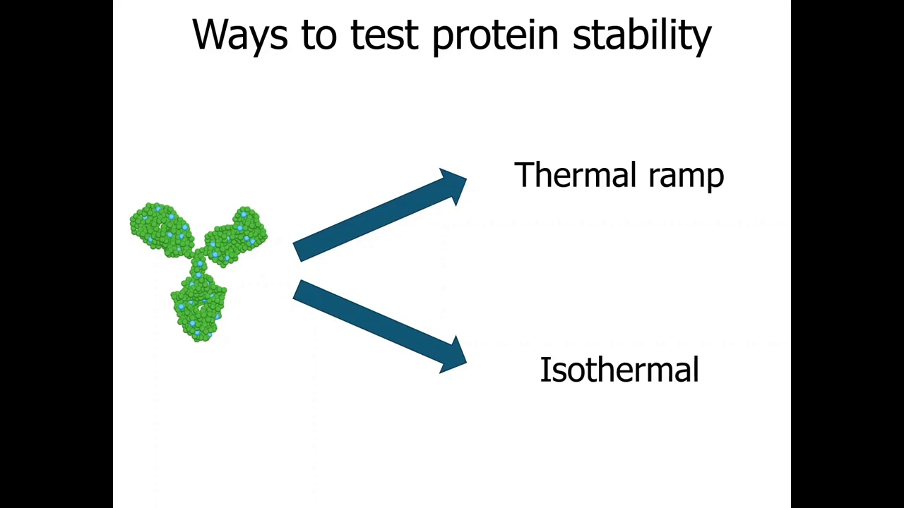

讲者用防晒霜打比方：早上出门觉得没太阳就不涂，晚上回来整个人晒红——**长期暴露是另一类风险，短时间的极端测试替代不了它**。这句话是整场报告的题眼：升温曲线回答「多热才会垮」，等温曲线回答「在这个温度下放多久会垮」。

### 1.2 蛋白会做两件事：解开，和聚在一起

[【跳转到 03:18】](https://www.youtube.com/watch?v=A3k8_vkRdCE&t=198)

要读懂后面的曲线，先要接受一个二分：蛋白的天然折叠与去折叠态处于平衡，升温把这个平衡推向去折叠态，这叫**构象稳定性（conformational stability）**；与此同时，蛋白还会聚集，这叫**胶体稳定性（colloidal stability）**。

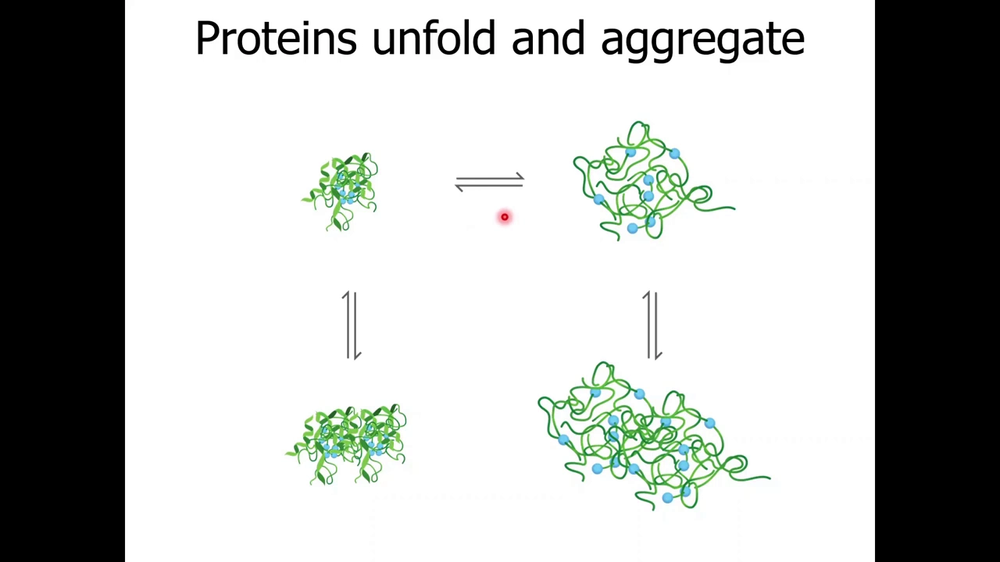

关键在于：**天然态能聚，去折叠态也能聚**，两条路都存在。所以「结构有没有解开」和「有没有聚起来」是两个独立的问题，需要两个独立的信号同时盯。这也解释了为什么单看 Tm 会误判：一个分子可能很耐热（Tm 高），却在低温下慢慢聚；也可能 Tm 不高，但只要不聚就没事。

### 1.3 三个信号、两种激发波长：一台仪器同时给

[【跳转到 04:13】](https://www.youtube.com/watch?v=A3k8_vkRdCE&t=253)

讲者介绍的仪器把三种测量放在同一个温控环境里：

- **荧光**：用 266 nm 紫外激光激发蛋白的**内源荧光**（苯丙氨酸、酪氨酸、色氨酸），或用 473 nm 蓝激光激发外加染料（如 SYPRO Orange）；记录 250–720 nm 的**全谱**发射。
- **静态光散射（SLS）**：散射光强度是**分子量的读数**，蛋白聚集、分子量变大，SLS 信号就上升；两个波长都记录，兼顾灵敏度与动态范围。
- **动态光散射（DLS）**：看样品的**扩散行为**，给出流体力学直径，是与 SLS 正交的另一个聚集读数。

温度范围 15–95 ℃，既可以做升温，也可以做等温。样品装在 16 支石英毛细管（UNi）里，每支 9 μL，两端用硅胶垫封住，避免蒸发——这一点对长达数天甚至一周的等温实验很重要。

---

## 二、抗体不是一个 Tm：两个拐点、一条起聚曲线

### 2.1 内源荧光为什么能报告「解开了」

[【跳转到 06:48】](https://www.youtube.com/watch?v=A3k8_vkRdCE&t=408)

升温过程中，仪器每 1 ℃ 记录一张荧光全谱（15→95 ℃ 共 80 张）。随着温度升高，谱图有两个变化：**峰值变低**，并且**峰位向长波方向移动**。

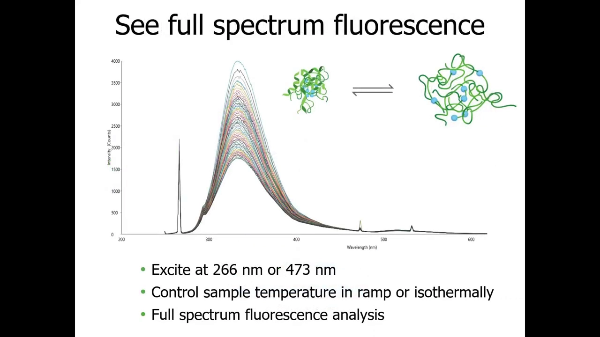

原因讲者说得很清楚：负责自发荧光的芳香族残基（Phe、Tyr、Trp）通常埋在蛋白内部的疏水环境里；蛋白熔解后它们被翻到外面的亲水环境，荧光行为随之改变。**所以荧光的红移是「埋藏环境被破坏」的间接报告，不是直接看到结构。**

### 2.2 BCM：把一整张谱压成一个数

[【跳转到 08:03】](https://www.youtube.com/watch?v=A3k8_vkRdCE&t=483)

要把 80 张谱画成一条曲线，需要一个横轴是温度、纵轴是「谱形变化」的量。讲者用的量叫 **BCM（barycentric mean，重心波长）**：把发射谱的面积从中间平分的那个波长。用数学写出来就是谱的加权平均波长：

$$
\mathrm{BCM}=\frac{\sum_i \lambda_i\, I(\lambda_i)}{\sum_i I(\lambda_i)}
$$

（上式是「重心」这一说法的一般写法，属补充说明；讲者的口头定义是「把曲线下面积分成相等两半的波长」。）

好处是**把约 130 个波长点一起积分**，信噪比高、曲线平滑；代价是**多结构域的熔解会被叠在一起**，只能靠拐点去分辨。

### 2.3 Tm1 与 Tm2：一次升温里有两个熔解事件

[【跳转到 08:53】](https://www.youtube.com/watch?v=A3k8_vkRdCE&t=533)

把 BCM 对温度作图，软件对曲线求导，找出**两个拐点**，分别记为 **Tm1** 与 **Tm2**。同一张图上还叠了一条绿色虚线——SLS 信号：它一直很平，直到 80 ℃ 左右突然上翘，那才是样品开始聚集的温度。

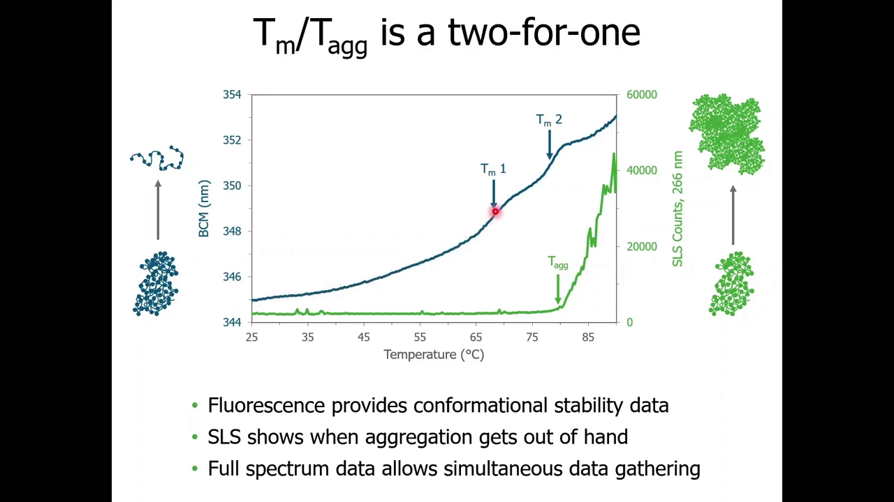

这张图是本讲的核心，值得逐项读：

| 曲线 | 纵轴 | 读出的量 | 回答的问题 |
| --- | --- | --- | --- |
| 蓝色实线（荧光 BCM） | 重心波长 nm | Tm1、Tm2 | 结构在哪些温度解开 |
| 绿色虚线（SLS） | 散射计数 | Tagg | 从哪个温度开始聚 |

**为什么会有两个 Tm**：抗体是由多个免疫球蛋白折叠域拼起来的分子，各结构域之间没有共价「同步开关」，谁先松开取决于自己那一小团相互作用。所以它天然会给出多个熔解事件，而不是一个。

> **补充背景（非讲者原话）**：在典型的 IgG 上，CH2 结构域（两条重链的 CH2 组成的一对）通常最先解开，因此 Tm1 常被归给 CH2/Fc 区，Tm2 常被归给 Fab（CH1+CL、VH+VL）与 CH3。不同亚型、不同序列会改变这个次序，所以**具体归属要靠结构域缺失变体或 DSC 分峰来确认，不能只看数字猜**。本讲只演示了「有两个拐点」，没有做归属。

### 2.4 Tagg 与 Tm 的关系：可以同起，也可以不同起

在这张示例图上，聚集（SLS 上翘）几乎与 Tm2 同时发生——讲者的措辞是「in concert with Tm2」。这是一个常见情形：**去折叠态暴露疏水斑块，随即聚起来**。但请注意这只是「这一个样品、这一种条件」的观察，不是普遍规律：

- 若天然态就能聚（胶体稳定性差），Tagg 会**低于** Tm；
- 若去折叠态也不容易聚，Tagg 会**高于** Tm，甚至在整个升温区间都看不到聚集。

所以**不能把 Tagg 当成 Tm 的附属品**，它必须单独测、单独报。

---

## 三、案例一：Tm 只差 1 ℃，聚集差 7 ℃

### 3.1 配方只改盐浓度

[【跳转到 09:43】](https://www.youtube.com/watch?v=A3k8_vkRdCE&t=583)

第一组样品是一支商业化单抗，缓冲体系固定为 25 mM 组氨酸、pH 7.4，只改 NaCl 浓度：0 mM（绿）、50 mM（蓝）、250 mM（黄）。

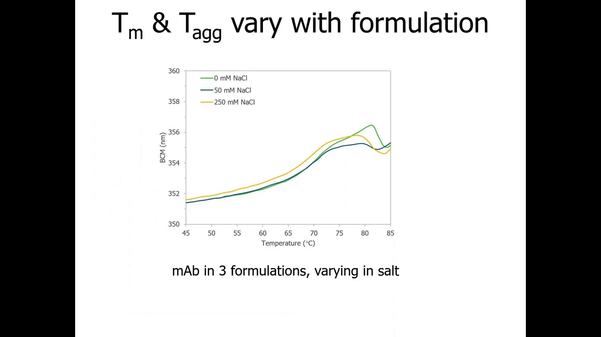

三条 BCM 曲线几乎叠在一起：Tm 在 69.5–70.4 ℃ 之间，**最大差别不到 1 ℃**。讲者的判读是「高盐略微降低 Tm」。如果只看这一个数字，结论会是「三种配方差不多，高盐稍差」。

### 3.2 把 SLS 叠上去，排序就变了

[【跳转到 10:33】](https://www.youtube.com/watch?v=A3k8_vkRdCE&t=633)

同一张图上加进 SLS 曲线后，差别出现了：**低盐（50 mM）最先开始聚集，Tagg 约 66 ℃**，比另外两个条件低约 7 ℃；而 0 mM 与 250 mM 之间的 Tagg 只差约 1 ℃，**升温实验分不开它们**。

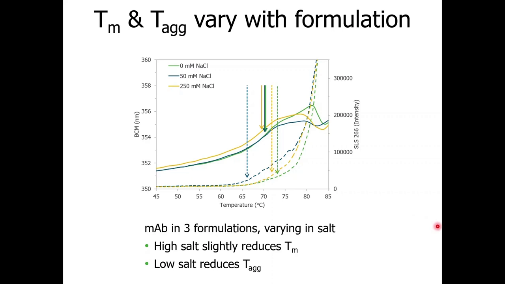

这一步的教益是方法论层面的：**同一个实验里，Tm 与 Tagg 是两个独立的排序依据，而且它们可以给出不一致的排序**。报告「这个分子的 Tm 是 70 ℃」几乎不携带可开发性信息；报告「Tm 69.5–70.4 ℃，Tagg 66–73 ℃，低盐条件 Tagg 下降 7 ℃」才有决策价值。

### 3.3 DLS 作为正交验证

[【跳转到 11:23】](https://www.youtube.com/watch?v=A3k8_vkRdCE&t=683)

讲者还看了 DLS：15 ℃ 时单抗的典型直径约 10–11 nm，升温到 95 ℃ 后直径涨到 1 μm 以上。这确认了「样品确实聚了」，与 SLS 的判断一致。**两种散射给出同一个结论时，聚集这个判断就比较硬了。**

---

## 四、案例一（续）：Tm 相同，放 6 小时就分开了

### 4.1 等温实验的温度怎么选

[【跳转到 13:03】](https://www.youtube.com/watch?v=A3k8_vkRdCE&t=783)

等温实验的第一个问题是「放在几度」。讲者坦言业界**没有共识**：有人用 Tm 减 5 ℃，有人用 42 ℃、47 ℃、60 ℃（因为手边孵箱就是这个温度）。他们的做法是回到升温曲线上挑：选 **60 ℃**，比 Tm 低约 10 ℃，比 Tagg 低 6–8 ℃。

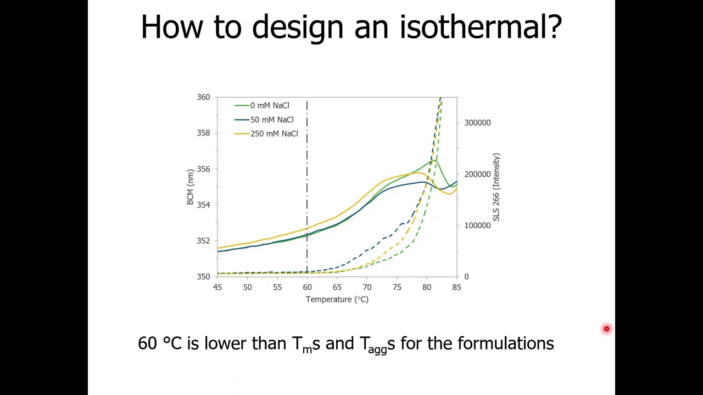

这个选择逻辑值得记住：**等温温度要低于该配方自己的 Tm 与 Tagg**，否则你测的是「已经垮掉之后的事」。而且因为仪器一次能跑 1–48 个样品，可以今天 60 ℃、明天 65 ℃、后天 55 ℃ 做一轮「侦察」，找出最适合长期观察的温度。

### 4.2 6 小时等温 SLS：把升温分不开的两个条件分开

[【跳转到 14:18】](https://www.youtube.com/watch?v=A3k8_vkRdCE&t=858)

60 ℃ 下连续记录 6 小时的 SLS（266 nm）：

- 前 3 小时三条曲线差不多；
- 3 小时之后，**低盐（50 mM）明显最快**；
- 0 mM 与 250 mM 的 Tagg 只差 1 ℃、升温时分不开，但等温 6 小时后**0 mM 的聚集量最低**。

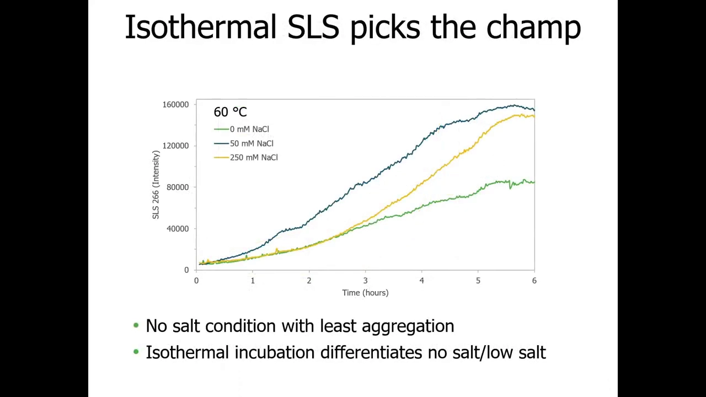

473 nm 通道给出相同结论；讲者还给出速率常数 k1 作为「数学版」的排序指标。最终结论是：**25 mM 组氨酸 pH 7.4、不加盐**这个配方最稳。

### 4.3 为什么必须做时间维度

把 3.1–4.2 连起来看，同一个分子、同一批配方，三种读法给出三种分辨率：

| 读数 | 分辨率 | 结论 |
| --- | --- | --- |
| Tm（BCM 拐点） | 差 < 1 ℃ | 三种配方几乎一样，高盐稍差 |
| Tagg（SLS 升温） | 差约 7 ℃ | 低盐最差；0 mM 与 250 mM 分不开 |
| 等温 SLS（60 ℃，6 h） | 差数倍 | 0 mM 最好、低盐最差 |

**升温给的是「阈值」，等温给的是「速率」。** 阈值相近时，速率才是决定储存期的量；而速率只能在时间维度上测出来。这就是讲者反复强调「long-term exposure 是另一类风险」的实证。

---

## 五、案例二：RNase A——升温曲线什么也看不出来

### 5.1 没有芳香族残基，就没有内源荧光

[【跳转到 19:05】](https://www.youtube.com/watch?v=A3k8_vkRdCE&t=1145)

第二个样品是 RNase A，约 17 kDa 的小蛋白，**芳香族残基很少**。讲者把它的内源荧光谱与单抗并排：RNase A 的荧光产率低得多，BCM 曲线几乎是平的——**没有可用的信号，就谈不上 Tm**。

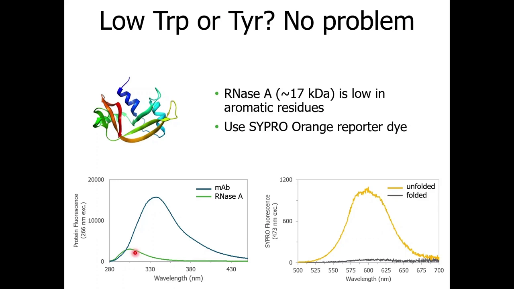

解决办法是外加报告染料 **SYPRO Orange**：它结合蛋白表面的疏水斑块，未折叠时几乎没有荧光，蛋白解开、疏水斑块暴露后荧光大幅上升（右图黄线）。这正是染料法 DSF 的机制，下一篇会专门讲。

> **讲者在问答里补充的适用条件**（[24:22](https://www.youtube.com/watch?v=A3k8_vkRdCE&t=1462)、[25:12](https://www.youtube.com/watch?v=A3k8_vkRdCE&t=1512)）：蛋白自身荧光足够时优先用内源荧光；只有在**芳香族残基太少**、或**缓冲液把荧光淬灭**（例如含 ATP、抗坏血酸）、或要沿用旧的 DSF 协议时才用染料。染料会引入自己的假象，能不用就不用。

### 5.2 三条升温曲线完全重合

[【跳转到 19:55】](https://www.youtube.com/watch?v=A3k8_vkRdCE&t=1195)

用 SYPRO Orange 跑升温，三种盐浓度的曲线**没有差别**：Tm 一样，SLS 也没有聚集信号。

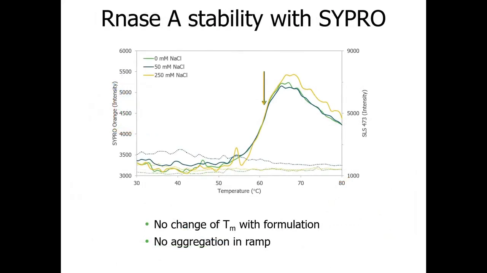

按升温实验的判读，结论会是「三个配方等价，随便选」。这正是本节要防的错误：**「测不出差别」不等于「没有差别」，可能只是这个实验没有分辨力。**

### 5.3 等温 10–11 小时后，差别出现了

[【跳转到 20:20】](https://www.youtube.com/watch?v=A3k8_vkRdCE&t=1220)

把同样的样品放到等温条件下，SLS 显示：**无盐与低盐在 10–11 小时后开始明显聚集，高盐（250 mM）始终保持平坦**。也就是说，只有高盐这个条件真正稳；而这一点在升温实验里完全看不见。

[【跳转到 21:10】](https://www.youtube.com/watch?v=A3k8_vkRdCE&t=1270)

讲者又用「每天读一次」的方式跟了三天 DLS：高盐的平均直径始终不动，无盐与低盐第一天之后就明显上升。

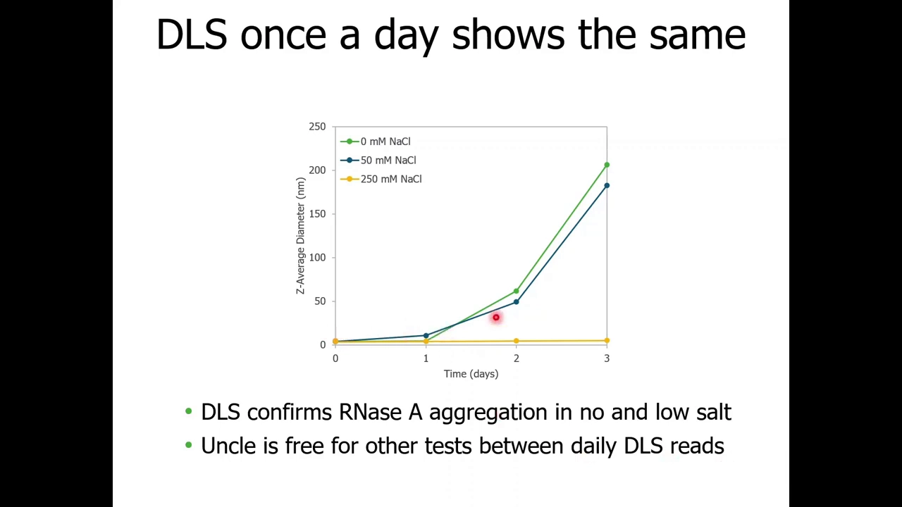

讲者的总结是：**RNase A 这个案例里，只有等温实验能对配方排序**；升温曲线「看起来都好」，是因为它压根没走到会出问题的那条路。

---

## 六、把读数放回方法：三条报告纪律

### 6.1 每个数字都要带条件和探针

[【跳转到 12:13】](https://www.youtube.com/watch?v=A3k8_vkRdCE&t=733)

同一条曲线上的 Tm，取决于：缓冲液与盐（案例一里 1 ℃ 的差别就来自盐）、升温速率、以及**探针是什么**（内源荧光 vs SYPRO Orange 报告的是不同事件）。所以「Tm = 70 ℃」这句话本身不完整，至少要写成「25 mM 组氨酸 pH 7.4、0 mM NaCl、内源荧光 BCM 拐点、升温 15–95 ℃」。

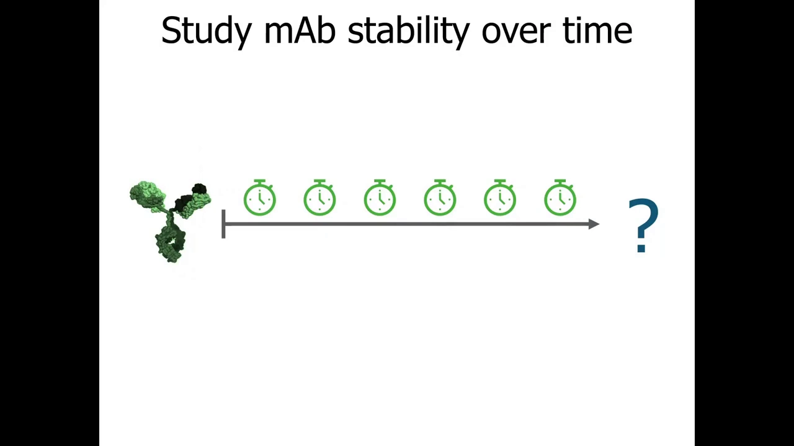

### 6.2 比变体用 ΔTm，不要跨方法比绝对值

讲者没有把 Tm 当绝对量用，而是看**同一套方法内的位移**：不同配方之间、不同盐浓度之间的差。这个用法是安全的：方法一致时，系统误差抵消，剩下的位移才反映分子或配方的差别。反过来，DSC 的 Tm 与染料 DSF 的 Tm 之间差几度是常态，**跨方法比绝对值没有意义**。

### 6.3 Tm 高 ≠ 功能保持

讲者全程没有直接测「结合活性随时间的变化」（这是本讲的边界），但两个案例已经足以说明 Tm 与「功能保持」之间的距离：

- 案例一里 Tm 几乎相同的三个配方，6 小时后的聚集量差数倍；
- 案例二里 Tm 完全相同的三个配方，十几小时后的聚集行为完全不同。

聚集一旦发生，分子的**有效浓度下降、构象被锁死**，结合活性与效价随之丧失——这是「熔解读数不等于功能保持」的物理基础。要真正回答「功能还在不在」，必须另做**加速稳定性 + 结合活性/效价随时间**的实验（ELISA、SPR/BLI、细胞效价），并把 SEC 聚体、冻融与搅拌应力一起看。

> **补充背景（非讲者原话）**：Tm 与低温储存稳定性之间的相关性有限，原因至少有三条——(1) 储存温度远低于 Tm，此时决定降解的是**局部去折叠与界面吸附**，不是整体熔解；(2) 熔解可能**可逆**（很多分子降温后能复性），而聚集一旦发生往往**不可逆**；(3) Tm 只描述热压力，不描述氧化、脱酰胺、光照、剪切这些非热路径。可开发性判读里常用的经验规则是「Tm1 低于某阈值（例如 60 ℃ 上下）要警惕」，但它是**筛选用的粗筛**，不能替代等温与功能数据。

---

## 小结

- **一次升温实验同时给出两类信息**：荧光 BCM 曲线的拐点（构象稳定性，Tm1/Tm2）与 SLS/DLS 的起聚点（胶体稳定性，Tagg）。两个信号必须同时看。
- **抗体天然有多个熔解事件**：多结构域各自解开，所以曲线上会出现 Tm1、Tm2。只报「一个 Tm」会丢掉一半信息。
- **Tm 与 Tagg 可以给出不一致的排序**：案例一里 Tm 只差 1 ℃，Tagg 差 7 ℃；把 Tagg 当作 Tm 的附属品会误判。
- **Tm 相同不代表稳定性相同**：60 ℃ 等温 6 小时把升温分不开的两个条件分开了；RNase A 更是只有等温实验能排序。
- **阈值不等于速率**：升温测「多热才垮」，等温测「多久会垮」，储存期由后者决定。
- **探针决定读数含义**：内源荧光报告芳香族残基的埋藏环境，SYPRO Orange 报告疏水斑块暴露；没有信号时换探针，但要接受它带来的假象。
- **Tm 不能替代功能数据**：功能保持要靠加速稳定性 + 结合活性/效价随时间，加上 SEC 聚体与应力实验。

## 关键术语速查

| 术语 | 一句话解释 |
| --- | --- |
| 构象稳定性 | 天然折叠与去折叠态之间的平衡有多偏向天然态；升温会把它推向去折叠 |
| 胶体稳定性 | 分子之间会不会互相黏在一起；与构象是否解开是两件事 |
| Tm | 熔解温度，半数分子去折叠时的温度；多结构域蛋白会有 Tm1、Tm2 等多个 |
| BCM | 重心波长，把荧光全谱压成一个数（谱的加权平均波长），用于画「BCM–温度」曲线 |
| Tagg | 聚集起始温度，SLS 信号开始上翘的温度 |
| SLS | 静态光散射，散射强度随分子量上升，是聚集的读数 |
| DLS | 动态光散射，由扩散行为给出流体力学直径，与 SLS 正交 |
| 升温实验（thermal ramp） | 以固定速率升温，测阈值（Tm、Tagg） |
| 等温实验（isothermal） | 固定温度长时间孵育，测速率与时间依赖的变化 |
| 内源荧光 | 蛋白自身芳香族残基（Phe/Tyr/Trp）的荧光，无需外加染料 |
| SYPRO Orange | 结合疏水斑块后荧光增强的报告染料，用于染料法 DSF |
| ΔTm | 同一方法下两个样品 Tm 的差，用于比较变体或配方的稳定性 |
| 加速稳定性 | 在高于储存温度的条件下短期放置，用来外推长期行为 |