# 竞争分组：用成对竞争给抗体分箱

> 视频来源：[Epitope Binning Using the ProteOn XPR36 Protein Interaction Array System](https://www.youtube.com/watch?v=70Pf0rcr1s0)（YouTube · Bio-Rad 网络研讨会，讲者 Yasmina Abdiche，Rinat/Pfizer 蛋白质相互作用组负责人，主持 Laura）｜时长约 40 分钟
>
> 导读：这是一节纯方法学的报告——不是「我们发现了什么抗体」，而是「怎么把一整个抗体panel按结合位置分箱，以及三种朝向各有什么坑」。讲者把自己发表在 *Analytical Biochemistry* 上的工作拆开讲：同一批抗体在 ProteOn、Octet、Biacore 三个平台上做竞争分组，结果一致。本文按「为什么用竞争 → 三种朝向怎么做 → bin 到底是什么 → 怎么选朝向」的顺序重组。SPR 的物理原理与曲线拟合见同目录《SPR 如何实时看见结合》《曲线能不能拟合，先看结合段有没有曲率》；需要残基级分辨率时该换什么方法，见同目录《表位定位的分辨率阶梯》。

## 本讲要解决的核心问题（SCQA）

**背景**：抗体筛选的常规做法是测亲和力——$K_D$ 越小越好。SPR、BLI 这类生物传感器已经把这件事做得很成熟：固定抗原、流过抗体、读传感图、拟合出 $k_\mathrm{on}$ 和 $k_\mathrm{off}$。

**冲突**：但 $K_D$ 只描述「一对分子结合得多紧」，完全不提「结合在哪儿」。讲者用一页幻灯片把这件事说得很直白——写下 $A \rightleftharpoons B$ 和 $K_D$，然后一句「知道两个生物分子结合得多紧，只能把你带到某一步为止」 [【跳转到 07:01】](https://www.youtube.com/watch?v=70Pf0rcr1s0&t=421)。真正决定一个抗体能不能当药、能不能和另一个抗体配对做鸡尾酒的，是**这个结合如何影响别的结合**。

**疑问**：不用标记、不用结晶、不改造抗体，能不能快速判断一整个抗体 panel 里哪些抢同一个位置、哪些可以同时结合？

**回答（中心思想）**：能——**竞争分组（epitope binning）**。做法是把抗原固定在传感器上，先用一株抗体把它「占满」，再让第二株抗体过来；**第二株结合不上，说明两者抢同一块地方（同一 bin）；结合得上，说明位置不同（不同 bin）**。一次实验的读数只有「有信号 / 没信号」两种，但它换来的是**功能层面的表位分组**：不需要知道任何一个残基，就能把几十上百株抗体按「是否互相阻挡」分堆。代价是 bin 只是一个**功能定义**——同一 bin 不等于同一表位，而且 bin 的划分只在被测的那批抗体内部成立。

---

## 一、为什么 $K_D$ 不够：结合强度不告诉你结合在哪

### 1.1 竞争实验要回答的是「相互作用之间的相互作用」

讲者的论证是递进的：知道一对分子的 $K_D$ 能刻画它们，但「只能到某一步」；对生物学和药物发现更重要的是**这个相互作用如何影响其他相互作用**，因为那才揭示它的功能意义 [【跳转到 07:01】](https://www.youtube.com/watch?v=70Pf0rcr1s0&t=421)。

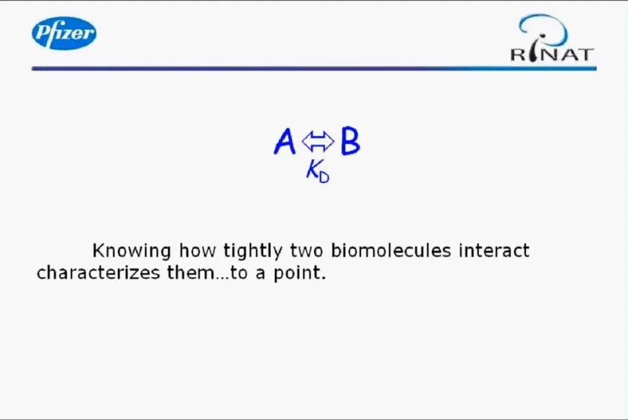

换句话说，**阻断（blocking）才是药物发现的核心问题**：抗体是不是挡住了配体与受体的结合？两株抗体能不能同时抓住同一个抗原？这些小分子和那个小分子是不是抢同一个口袋？——全都不是 $K_D$ 能回答的。

### 1.2 为什么用生物传感器做竞争：三个理由

讲者列了三条 [【跳转到 07:48】](https://www.youtube.com/watch?v=70Pf0rcr1s0&t=468)：

1. **免标记（label-free）**。ELISA 这类方法必须给某一方挂上标记才能读数。做单抗体检测时这还好，但做**抗体 panel 的分组**时，标记立刻变成大麻烦：你有一堆抗体，要区分它们，就得给其中一个生物素化、挂标签、或者重构成 Fab 片段，每一种改造都可能改变结合行为。
2. **实时（real-time）**。ELISA 和 TR-FRET 只给**终点**读数，你看不到结合过程，也就无法判断自己到底是高估还是低估了命中。
3. **配体可复用（reuse）**。ELISA 每次都要重新包被抗原，一个板一个板地消耗试剂；生物传感器的芯片上的配体可以反复用。

### 1.3 ELISA 的两个方向的错：既会假阳，也会假阴

这一段是全场最实用的方法学批评 [【跳转到 09:03】](https://www.youtube.com/watch?v=70Pf0rcr1s0&t=543)：

**假阳（over-reporting）**的来源：

- 竞争型 ELISA 要求**预混的抗原-抗体复合物与板上抗原之间达到竞争平衡**，达不到就会误判；
- TR-FRET 这类荧光方法里，某些小分子会干扰荧光信号，直接表现为「假抑制剂」；
- 终点法看不到过程，你没法判断信号是不是真的来自竞争。

**假阴（under-reporting）**的来源：

- ELISA 依赖多步洗涤，**快解离（fast off-rate）的复合物在洗涤时就已经散掉了**，于是被读成「不结合」。

实时读数正好补上这一块：你能看见结合曲线是爬上去了还是没爬，能看见解离有多快，从而判断这个「没信号」是真的被挡住，还是本来就挂不住。

---

## 二、三种朝向，一个读数：夹心=没挡住，不夹心=挡住了

### 2.1 三元关系：A 结合 B，B 结合 C，A 和 C 不互相结合

讲者把竞争实验抽象成一个三元关系 [【跳转到 10:43】](https://www.youtube.com/watch?v=70Pf0rcr1s0&t=643)：

$$
A \rightleftharpoons B \rightleftharpoons C, \qquad A \not\leftrightarrow C
$$

其中 $B$ 是抗原，$A$ 和 $C$ 是两株待比较的抗体。由此推出四条自由度：

1. **任何一方都可以固定在芯片上**（A、B、C 都行）；
2. **可以预先形成 A+B 或 B+C 复合物**；
3. **预形成的复合物可以在芯片上，也可以在溶液里**；
4. **A 和 C 的角色可以互换**。

这四条组合出三种有名字的标准朝向 [【跳转到 11:33】](https://www.youtube.com/watch?v=70Pf0rcr1s0&t=693)：

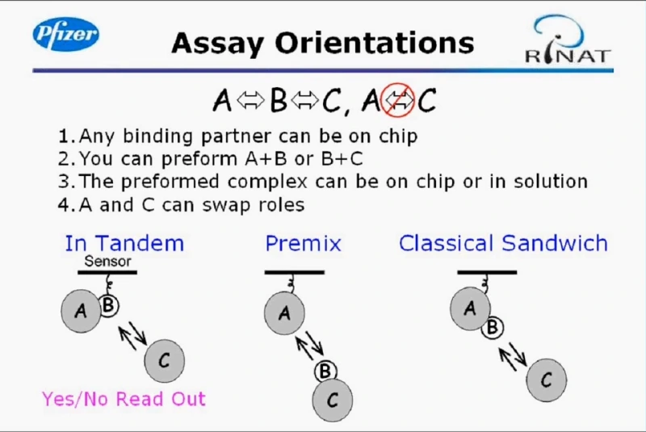

### 2.2 读数是二值的：有信号 = 夹心 = 没挡住

三种朝向的读数逻辑完全一样 [【跳转到 12:23】](https://www.youtube.com/watch?v=70Pf0rcr1s0&t=743)：

- **看到信号** → 形成了「抗体-抗原-抗体」的**夹心复合物** → 第二株抗体**没有**被第一株挡住 → 两株结合不同位置；
- **看不到信号** → 第二株**被挡住** → 两株抢同一块地方。

把这个二值读数铺满整个矩阵，就得到分组。讲者把它称为 **yes/no readout**——信息量小，但极稳健，而且不依赖任何标记。

### 2.3 分组为什么重要：六条理由

讲者专门用一页说明「为什么要做 binning」 [【跳转到 12:48】](https://www.youtube.com/watch?v=70Pf0rcr1s0&t=768)：

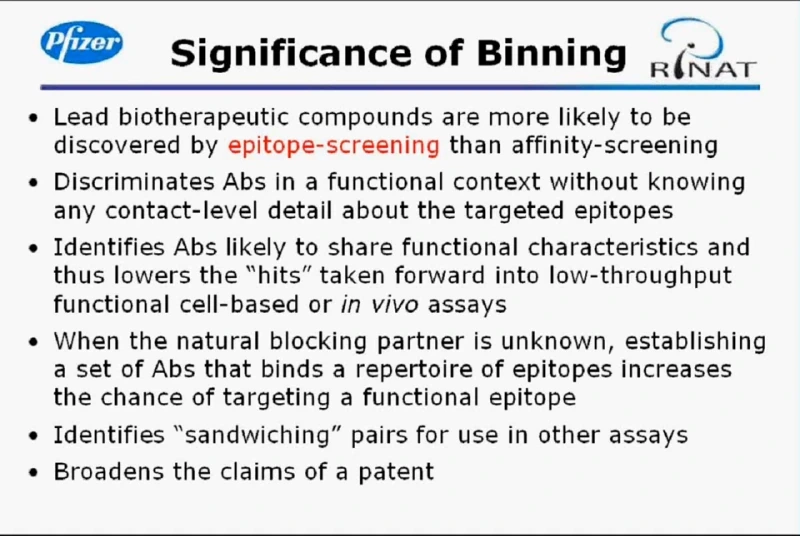

1. **按表位筛比按亲和力筛更容易收敛到先导分子**。理由很实在：**亲和力成熟有标准流程，设计表位没有**。所以从一开始就选对表位，比后面硬把亲和力拉上来更划算。
2. **不需要任何残基级信息就能在功能语境里区分抗体**。
3. **同 bin 的抗体很可能共享功能特征**，所以可以**每个 bin 挑一个代表**去做低通量的细胞实验或体内实验，大幅减少要往下推的命中数。
4. **当天然结合配体未知时**，binning 是唯一能建立「表位库」的办法：你没法做阻断实验（不知道该阻断什么），但你可以先给一堆抗体分箱，从而提高「其中某个表位是功能表位」的概率。
5. **能找出可夹心的配对**，直接用于 ELISA 等其他夹心法。
6. **能拓宽专利主张范围**（讲者原话是「律师们很喜欢这个」）：能证明抗原上有多个不同表位，IP 的权利要求就能写得更宽。

---

## 三、In tandem：一次进样跑完 36 对

### 3.1 平台：6×6 的交叉流路

ProteOn XPR36 是一台 SPR 仪器，但它的样品输送方式很特别 [【跳转到 05:02】](https://www.youtube.com/watch?v=70Pf0rcr1s0&t=302)：

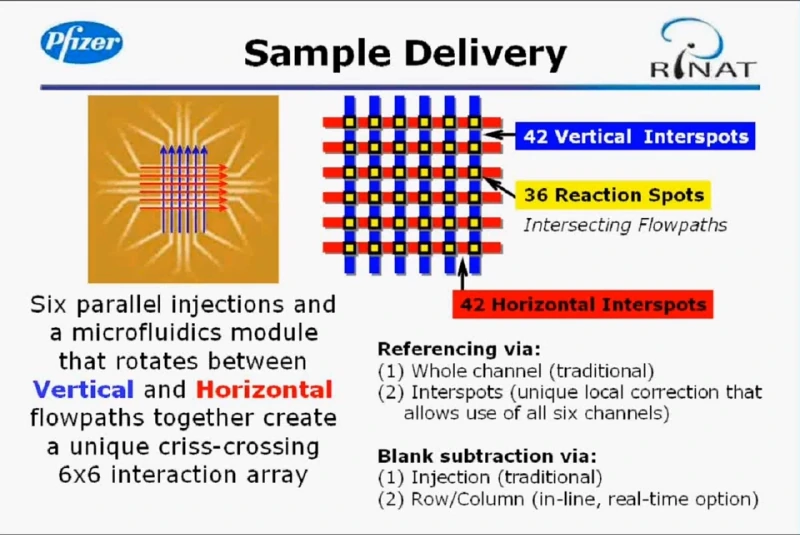

- 六条平行通道，可以在**垂直**和**水平**两个方向流动；
- 两个方向的流路交叉，形成 **6×6 = 36 个反应点（reaction spots）**；
- 不交叉的流路叫**交点（interspots）**，垂直 42 个、水平 42 个，可以用来做参考通道，从而把 36 个点全部用于固定配体；
- 空白扣除既可以用传统的空白缓冲液进样，也可以用整行/整列（在线、实时的选项）。

这个几何结构是 binning 能高通量的物理基础：**一次进样，同时打 36 个点**。

### 3.2 流程：先把抗原铺满，再用六株抗体饱和，然后转 90 度竞争

In tandem 的操作顺序 [【跳转到 15:52】](https://www.youtube.com/watch?v=70Pf0rcr1s0&t=952)：

1. 把**抗原**偶联到芯片上（所有点都铺满）；
2. 垂直方向进样，用**六株不同抗体**分别饱和六条通道上的抗原；
3. **旋转流路 90 度**，水平方向再进样，用同一组六株抗体去竞争；
4. 于是每个反应点上发生的都是「饱和抗体 $i$ 之后，竞争抗体 $j$ 能不能结合」——一个完整的 6×6 成对矩阵。

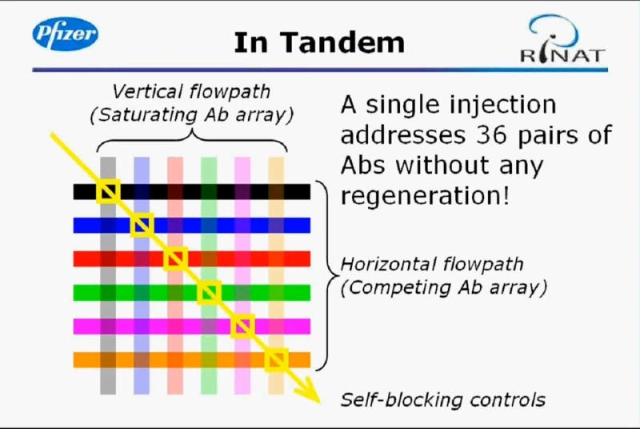

三个关键设计点：

- **一次进样覆盖 36 对相互作用，全程不需要再生（regeneration）**；
- **对角线是六个自阻断对照**：用同一株抗体去竞争自己，理应完全被挡住。这是内建的阳性对照；
- 因为是同一张芯片同一次进样，36 个点的实验条件天然一致。

### 3.3 三条「干净实验」的前提

讲者反复强调，binning 的结论质量完全取决于饱和是否干净 [【跳转到 16:17】](https://www.youtube.com/watch?v=70Pf0rcr1s0&t=977)：

1. **饱和抗体必须真的把抗原占满，而且在竞争阶段不能掉下来**。否则竞争抗体面对的是「部分空着的抗原」，会给出假信号。
2. **抗原偶联可能让抗原失活或让表位失活**。直接偶联便宜，但氨基偶联可能正好落在表位上；讲者建议备选**定向捕获（oriented capture）**——如果抗原带标签或融合伙伴，就通过标签把它抓上去。
3. **顺序很重要**：先饱和、再竞争，不能颠倒。

### 3.4 读图：一株没饱和好的抗体会污染整行整列

这是全场最好的「怎么读数据」教学 [【跳转到 18:02】](https://www.youtube.com/watch?v=70Pf0rcr1s0&t=1082)：

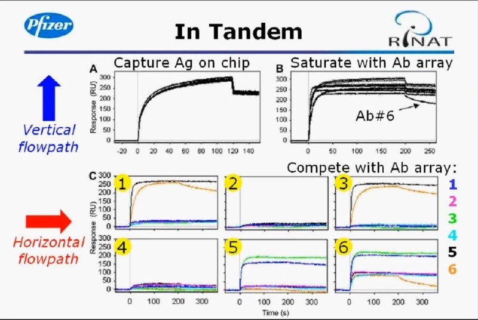

- 面板 A：抗原捕获，响应爬到约 300 RU 后稳定；
- 面板 B：六株抗体饱和，响应到 250–300 RU 并形成平台——**但箭头指出的第 6 号抗体在进样末段开始往下掉**；
- 面板 C：旋转后的六组竞争曲线，每组里六条彩色线是六株竞争抗体。

肉眼看出的分组是：

- **1 号和 3 号**很像：它们只被黑色和橙色（5、6 号）夹心，被其余所有颜色挡住；
- **2 号和 4 号**几乎全是基线——被所有人挡住；
- **5 号和 6 号**很像：只与绿色和蓝色夹心。

**但 6 号有一个陷阱**：它作为饱和抗体时没饱和住（面板 B 里在掉），所以当它去竞争自己时，本该是干净的基线，却出现了响应。讲者的结论是：**6 号作为饱和抗体不合格，但作为竞争抗体工作得很好**——这正是「饱和必须彻底」这条 caveat 的实证。

### 3.5 交通灯矩阵：把 36 条曲线压成一张表

讲者把这个 6×6 的结果整理成一张**交通灯矩阵**：行是饱和抗体、列是竞争抗体，格子的颜色编码三态——

- **红**：无信号，被挡住；
- **绿**：有信号，形成夹心，没被挡住；
- **黄/琥珀**：中间信号，不确定挡没挡住。

这张矩阵在视频里没有单独出幻灯片（讲者是口头描述它的），但它是 binning 的标准呈现方式：**一眼就能看出哪些行/列长得一样，长得一样的就是同一个 bin**。同一张表还可以横着读或竖着读——讲者特别提到这一点，因为饱和方向与竞争方向不一定完全对称。

---

## 四、Premix 与 Classical sandwich：换朝向做交叉验证

### 4.1 Premix：把抗体先和抗原混在一起

Premix 的朝向是把**抗体**固定在芯片上，然后进样「抗原 + 抗体」的预混物 [【跳转到 22:01】](https://www.youtube.com/watch?v=70Pf0rcr1s0&t=1321)：

1. 六株抗体偶联到芯片（垂直方向）；
2. 旋转流路；
3. 水平方向进样——每个通道里是**抗原与某一株抗体预混**的溶液。

读数逻辑反过来：如果预混的抗体**没有**占住表位，抗原则自由地结合到芯片抗体上，信号与「纯抗原」相当；如果预混抗体**占住了**表位，抗原被「包住」，信号下降；如果预混抗体和芯片抗体能**同时**结合抗原，就形成夹心，信号**高于**纯抗原（因为多挂了一坨质量）。

四条前提 [【跳转到 22:26】](https://www.youtube.com/watch?v=70Pf0rcr1s0&t=1346)：

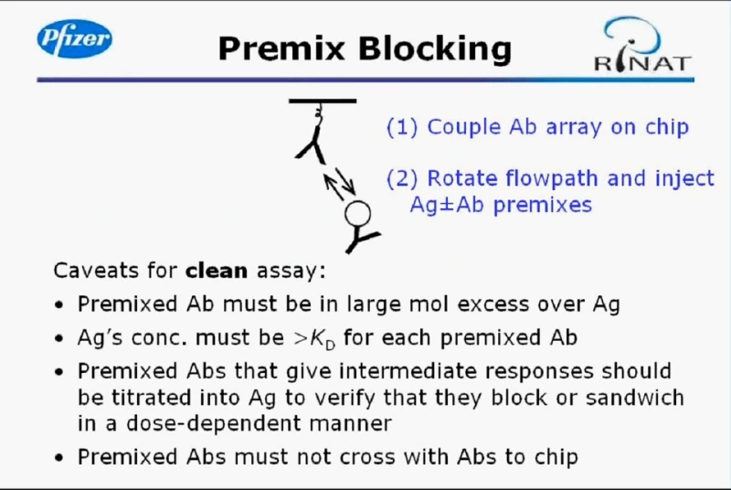

1. **预混抗体必须大幅摩尔过量于抗原**；
2. **抗原浓度必须高于每一株预混抗体的 $K_D$**——讲者给的典型值是 **200 nM**，确保在 $K_D$ 之上；
3. **给出中间响应的预混抗体必须做剂量滴定**，验证它是随剂量单调地「阻断」还是「夹心」，这样才能提高结论的置信度；
4. **预混抗体不能与芯片上的抗体交叉反应**——任何分层体系里，你假设「不会交叉」的那一对，都必须实测确认。

结果与 in tandem 完全吻合 [【跳转到 23:16】](https://www.youtube.com/watch?v=70Pf0rcr1s0&t=1396)：

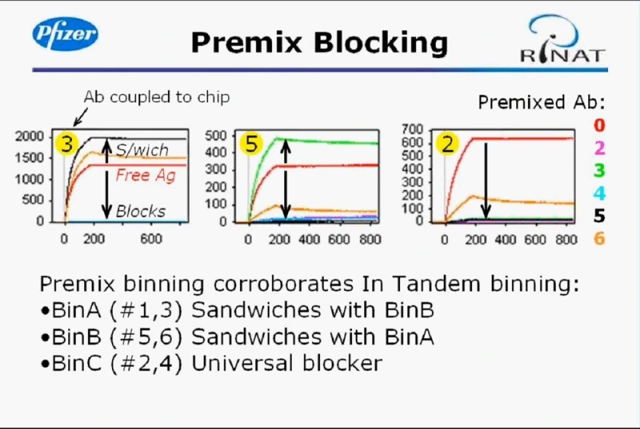

三张图分别把 3 号、5 号、2 号抗体固定在芯片上：

- **3 号在芯片上**：只有预混的 5、6 号给出高于纯抗原的信号（夹心），2、3、4 号把信号压到基线以下（阻断）；
- **5 号在芯片上**：只有 3 号能夹心，其余全部阻断；
- **2 号在芯片上**：**所有**预混抗体给出的信号都低于纯抗原——说明 2 号是「万能阻断者」。

汇总出的三个 bin 是 [【跳转到 24:56】](https://www.youtube.com/watch?v=70Pf0rcr1s0&t=1496)：

| bin | 成员 | 特征 |
| --- | --- | --- |
| A | 1、3 | 与 bin B 夹心 |
| B | 5、6 | 与 bin A 夹心 |
| C | 2、4 | 万能阻断者（与谁都不同时结合） |

### 4.2 Classical sandwich：先抓抗原，再打抗体阵列

第三种朝向最接近传统夹心 ELISA [【跳转到 25:21】](https://www.youtube.com/watch?v=70Pf0rcr1s0&t=1521)：

1. 六株抗体偶联到芯片；
2. 旋转流路，**捕获抗原**；
3. 再旋转，进样抗体阵列，看谁能结合已经被抓住的抗原。

四条前提，其中两条是这种朝向独有的：

1. **抗原必须是单体**。如果是二体或多聚体，你测到的「表位」可能只是另一个亚基——「你看到的就不是表位，而是别的亚基了」；
2. **抗原不能从芯片抗体上快速解离**，否则最后一步打抗体时已经没有抗原可结合；
3. **如果夹心步骤里某株抗体永远给不出响应，你必须怀疑这株抗体本身没活性**。由此推出一条判读原则：**只有当一株抗体在别处能夹心时，它的「阻断」才可信**；如果它从不夹心，就该换朝向、把它放到芯片上去再试一次；
4. **溶液里的抗体不能与芯片抗体非特异交叉**，必须实测。

结果与前面一致，而且更清晰 [【跳转到 26:32】](https://www.youtube.com/watch?v=70Pf0rcr1s0&t=1592)：

- **11 号和 17 号**：只阻断自己（对角线上的自夹心为阴性），与其他所有抗体都能夹心——各自是独立的 bin；
- **8 号和 10 号**：互相阻断，与其他所有抗体夹心；
- **12 号和 18 号**：互相阻断，与其他所有抗体夹心。

于是**六株抗体至少分出四个 bin**。讲者把整个矩阵画成一张表，格子里的字母是判读结果（SS = 自夹心/自阻断对照，N = 无信号即阻断，Y = 有信号即夹心）[【跳转到 28:37】](https://www.youtube.com/watch?v=70Pf0rcr1s0&t=1717)：

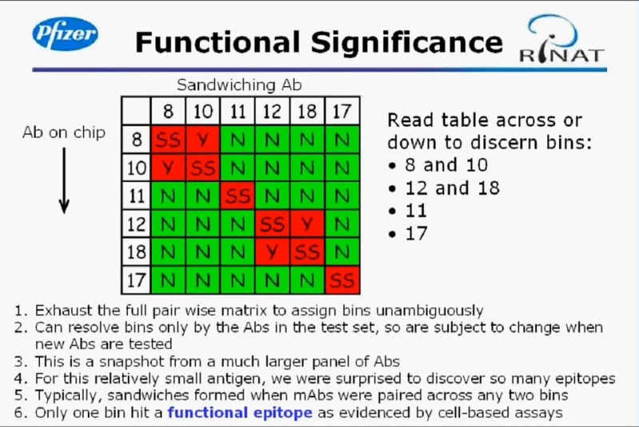

这张表的六条注释几乎就是 binning 的方法学总结：必须跑满成对矩阵才能无歧义分箱；只能依据测试集里的抗体分辨 bin，加入新抗体后可能变化；这只是更大 panel 的一个快照；对一个相对很小的抗原能出这么多表位出乎意料；**跨任意两个 bin 配对通常都能夹心**；**只有一个 bin 命中了功能表位**（由细胞实验证明）。

### 4.3 三种朝向给出同一组 bin，而且很快

讲者强调，这套 6×6 矩阵在 ProteOn 上是**一次 4 分钟的进样**就完成的 [【跳转到 28:12】](https://www.youtube.com/watch?v=70Pf0rcr1s0&t=1692)。三种朝向的结果互相印证，且与她用 Biacore、Octet 得到的分组完全一致——只是 ProteOn 快得多 [【跳转到 33:42】](https://www.youtube.com/watch?v=70Pf0rcr1s0&t=2022)。

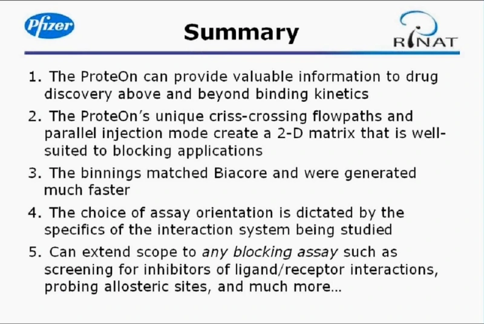

---

## 五、bin 到底是什么：一个功能定义，不是结构定义

### 5.1 bin 的定义与它隐含的传递性假设

把上面的操作抽象一下：定义两株抗体 $i$、$j$ **互相阻断**（记作 $i \sim j$）当且仅当「$i$ 饱和后 $j$ 结合不上」且「$j$ 饱和后 $i$ 结合不上」。bin 就是在这个关系下的**等价类**。

这里有一个必须警惕的地方：**「互相阻断」这个关系并不严格传递**。$i$ 与 $j$ 互阻、$j$ 与 $k$ 互阻，并不能保证 $i$ 与 $k$ 互阻——如果 $j$ 的表位恰好压在 $i$ 和 $k$ 的表位之间，但 $i$ 和 $k$ 分处两端、彼此不重叠，就会出现这种情况。所以严格的分箱必须**跑满成对矩阵**，而不是靠链式推理。

讲者的原话正是这个意思 [【跳转到 29:02】](https://www.youtube.com/watch?v=70Pf0rcr1s0&t=1742)：**你必须穷尽完整的成对矩阵才能无歧义地分箱**，而且**只能依据测试集里的抗体来分辨 bin**——往里面加入新的抗体，原本看起来一样的两组可能被拆开。

### 5.2 同一 bin 不等于同一表位

这是 binning 最容易被误读的地方。讲者自己在第 1.2 节就说了：binning 让你「**在不知道任何残基级细节的情况下**在功能语境里区分抗体」。反过来说——**它也确实不知道任何残基级细节**。

所以：

- 同一 bin 的抗体，只保证**互相阻挡**，不保证结合同一片残基；
- 不同 bin 的抗体，只保证**能同时结合**，不保证结合位置相距很远（可能只是空间上够挤得下两个 Fab）。

讲者的数据里就有现成的例子：**11 号和 17 号各自独占一个 bin**（只阻断自己），但它们的表位很可能彼此重叠——只是重叠得不够彻底，所以能互相夹心。这正是「bin 是功能分类，不是结构分类」的体现。

### 5.3 会把不同表位错分成同一 bin 的几种机制

讲者没有系统列举这些机制，但她在别处提到的几条线索可以拼起来（以下为补充整理，不是讲者原话）：

- **空间位阻而非直接重叠**：一株抗体体积大（或构象松散），盖住的面积超过自己的表位，就会「顺带」挡住旁边不重叠的表位；
- **别构效应**：结合在远端也能改变表位构象，让第二株抗体结合不上。讲者在结尾提到这套阻断实验可以推广到「探测别构位点（allosteric sites）」，说明她清楚这条通路的存在；
- **抗原多聚化**：classical sandwich 里她明确说二体会让「表位」变成「别的亚基」；反过来说，多价抗原上的「阻断」也可能只是价态竞争，而不是表位重叠；
- **抗体的价态与朝向**：完整 IgG 是二价的，两个 Fab 可以同时抓住多价抗原上的两个位点，这种亲合力效应会让「阻断」的判读偏离单价相互作用。讲者在选朝向的清单里把「抗原是单体还是多价/聚集」列在第一位，就是这个原因。

### 5.4 一个「功能表位」的故事

讲者最后讲了一个很有说服力的案例 [【跳转到 29:52】](https://www.youtube.com/watch?v=70Pf0rcr1s0&t=1792)。他们针对一个**很小的抗原**做了一大批抗体，意外地发现表位数量远超预期。但在细胞实验和体内实验里，**没有任何一个表位显示出功能意义**——直到 binning 帮他们锁定了一个特征独特的 bin，而这个 bin 对应的表位**确实有功能**。

关键在于：**他们从头到尾不知道任何一个残基**。分组本身就把功能表位挑了出来。讲者的评价是——「这就是表位分组的威力」。

---

## 六、怎么选朝向：一张清单

讲者给了一份决策清单 [【跳转到 30:42】](https://www.youtube.com/watch?v=70Pf0rcr1s0&t=1842)：

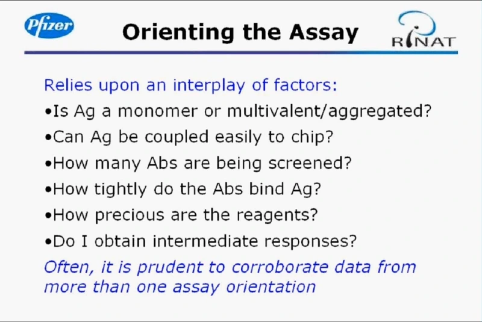

| 问题 | 影响 |
| --- | --- |
| 抗原是单体还是多价/聚集？ | 多价的**不能**用 classical sandwich |
| 抗原能不能方便地偶联到芯片？ | 不能就考虑定向捕获；或改用抗体上芯片的 premix |
| 要筛多少株抗体？ | 数量大优先 in tandem（一次 36 对） |
| 抗体结合得多紧？ | 饱和要干净需要较高的亲和力；弱亲和力抗体要选合适朝向 |
| 试剂有多宝贵？ | 宝贵的试剂应该**偶联在芯片上**（可复用），而不是每次流过去 |
| 是否出现中间响应？ | 出现就做**剂量滴定**，看它是随剂量单调阻断还是单调夹心 |

最后一条是讲者的核心建议：**「通常明智的做法是用一种以上的朝向互相印证」**。她自己在这批抗体上就是三种朝向全做了一遍，才敢下分箱结论。

---

## 七、binning 在分辨率阶梯上的位置

把 binning 和同小节另外两类方法放在一起看，各自的定位很清楚：

| 方法 | 分辨率 | 能回答 | 回答不了 |
| --- | --- | --- | --- |
| 竞争分组（binning） | 功能性分组 | 两株抗体是否互阻、能否配对夹心、整个 panel 分几堆 | 哪些残基、同一 bin 是否真同一表位、bin 之外还有没有细分 |
| 氢氘交换质谱（HDX-MS） | 肽段级 | 哪条肽段被盖住、构象是否变化 | 肽段内具体哪几个残基、直接接触 vs 别构 |
| 丙氨酸扫描 | 残基级 + 能量学 | 哪些残基是能量热点 | 接触面积、折叠破坏的假阳性 |
| 冷冻电镜 / 晶体学 | 原子级 | 原子级接触、跨亚基的复杂表位 | 能量学权重、溶液态差异 |

三者的关系不是替代，而是**从粗到细的三级筛选**：

1. 先用 **binning** 把几十上百株抗体分成几堆，每堆挑代表——这一步最便宜、最快、通量最高；
2. 对关键 bin 的代表做 **HDX-MS**，确认它盖住的是哪一段肽段、构象有没有变；
3. 真正要改亲和力、要写专利时，才上**丙氨酸扫描**和**结构解析**。

反过来也成立：binning 的模糊性只有靠更高分辨率的方法才能消除，而高分辨率方法的低通量只有靠 binning 才能绕开。

---

## 八、一个附带的收获：杂交瘤与噬菌体展示给出互补的表位

问答环节有一个很实用的观察 [【跳转到 34:57】](https://www.youtube.com/watch?v=70Pf0rcr1s0&t=2097)。主持人问：在找表位这件事上，杂交瘤和噬菌体展示哪个更容易出东西？

讲者的回答是**两个都做**，理由是两者的偏倚方向不同：

- **杂交瘤**要求表位具有**免疫原性**——一个表位必须在动物体内能引发免疫反应才能拿到抗体。所以**功能表位可能因为不具免疫原性而拿不到**；
- **噬菌体展示 / 天然文库**没有免疫系统的筛选，**纯粹按亲和力探针**，所以能拿到杂交瘤拿不到的表位。

结果是：**两种方法常常给出互补的表位**。

关于命中数量，她的经验是**高度依赖抗原**：同一套杂交瘤流程，有时只出 5 个命中，有时出 5000 个；取决于抗原的免疫原性、有没有用半抗原/偶联、以及抗原有多大。天然文库理论上多样性更高，但实际常常被**一个优势克隆**淹没，所以两者的有效产出其实差不多。

---

## 小结

- **$K_D$ 只描述「结合得多紧」，不描述「结合在哪儿」**。竞争分组回答的是后者，而且不需要标记、不需要结晶、不需要改造抗体。
- **读数是二值的**：能夹心 = 没被挡住 = 不同位置；不能夹心 = 被挡住 = 同一位置。信息量小，但极稳健。
- **三种朝向**（in tandem / premix / classical sandwich）本质是同一个三元关系的不同摆法，各有前提：in tandem 要求饱和彻底且抗原偶联不失活；premix 要求预混抗体大幅过量、抗原浓度高于 $K_D$；classical sandwich 要求抗原是单体且不快速解离。
- **饱和不干净会污染整行整列**。讲者的 6 号抗体在饱和阶段脱落，导致它「自己阻断自己」失败，出现假的中间信号——这是最典型的判读陷阱。
- **bin 是功能定义，不是结构定义**。同一 bin 只保证互阻，不保证同一表位；「互阻」这个关系也不严格传递，所以必须跑满成对矩阵。
- **bin 的划分只在测试集内成立**。加入新抗体，原本合并的 bin 可能被拆开——讲者用「六株抗体至少分出四个 bin，但这是更大 panel 的一个快照」来说明这一点。
- **选朝向看六个问题**：抗原是否多价、能否偶联、要筛多少、抗体多紧、试剂多贵、有没有中间响应。出现中间响应就做剂量滴定；条件允许就用两种以上朝向互相印证。
- **binning 在分辨率阶梯的最底层但通量最高**，它的模糊性要靠 HDX-MS、丙氨酸扫描、结构解析来消除。

---

## 关键术语速查

| 术语 | 一句话解释 |
| --- | --- |
| 表位分组（epitope binning） | 用成对竞争实验把抗体按「是否互相阻挡」分堆的方法 |
| bin | 一组互相阻断的抗体；是一个功能分类，不是结构分类 |
| 夹心（sandwich） | 两株抗体同时结合同一个抗原形成的「抗体-抗原-抗体」复合物 |
| 自阻断 / 自夹心（self-block / self-sandwich） | 用同一株抗体竞争自己，理应完全阻断，是内建对照 |
| in tandem | 抗原固定在芯片上，先用抗体阵列饱和，转 90 度再竞争 |
| premix | 抗体固定在芯片上，进样「抗原 + 抗体」预混物 |
| classical sandwich | 抗体固定在芯片上，先捕抗原，再打抗体阵列；要求抗原是单体 |
| 定向捕获（oriented capture） | 通过标签把抗原「有方向地」抓到芯片上，避免随机偶联压住表位 |
| 再生（regeneration） | 把芯片上的配体复合物洗掉以便重复使用；in tandem 的矩阵设计可以全程不再生 |
| 交通灯矩阵 | 用红/绿/黄三色编码「阻断/夹心/不确定」的成对分组矩阵 |
| 中间响应（intermediate response） | 介于完全阻断与完全夹心之间的信号，通常意味着饱和不足或部分重叠 |
| 免标记（label-free） | 不需要给分子挂荧光或酶标，直接测质量变化引起的折射率变化 |
| 快解离（fast off-rate） | 复合物解离很快；在依赖洗涤的终点法里会被误读成「不结合」 |