# 表位定位的分辨率阶梯：丙氨酸扫描、氢氘交换与冷冻电镜

> 视频来源：[Epitope Mapping in Antibody Therapeutics and Vaccine Development: The Evolving Landscape](https://www.youtube.com/watch?v=NM5oEJ6bqwM)（YouTube · GEN 网络研讨会，讲者 Joseph Rucker / James Crowe / Lisa Haile，主持 Jeff Biscus）｜时长约 76 分钟
>
> 导读：这是一场三位讲者接力的研讨会——Integral Molecular 讲高通量丙氨酸扫描（鸟枪突变），范德堡大学讲用 SAXS、氢氘交换、冷冻电镜追病毒抗体的作用机制，最后一位讲表位数据在专利与监管里的价值。本文按「分辨率」这条主线重新组织：每种方法能给出什么粒度的表位信息、代价是什么、彼此怎么互补。表位概念本身见同系列《表位构象、可及性与抗原糖基化》，SPR/BLI 的曲线拟合见《结合动力学测量：SPR、BLI 与曲线拟合》；竞争分组（binning）见同目录《竞争分组：用成对竞争给抗体分箱》。

## 本讲要解决的核心问题（SCQA）

**背景**：抗体药和疫苗研发里，「这个抗体结合在靶点表面的哪一块」是一个绕不开的问题。它决定两株抗体能不能同时结合（做鸡尾酒、做双特异），决定中和机制是挡受体还是别构，也决定专利能不能写清楚。

**冲突**：能回答这个问题的实验手段有一大把，但它们给出的答案**粒度完全不同**。晶体学能告诉你哪几个残基和哪几个残基之间有几埃的距离；氢氘交换只能告诉你「这一段肽段参与了」；竞争分组连残基都不提，只说「这两株抗体抢同一个位置」。更麻烦的是，单克隆抗体的数量这几年涨得比表位定位的速度快得多——主持人开场就把这当成行业矛盾点提了出来 [【跳转到 00:25】](https://www.youtube.com/watch?v=NM5oEJ6bqwM&t=25)。

**疑问**：这些方法各自的分辨率到底是多少？什么情况下必须上晶体学或冷冻电镜，什么情况下一次丙氨酸扫描就够了？把不同方法的结果放在一起对不上，该信谁？

**回答（中心思想）**：表位定位方法可以排成一条**分辨率阶梯**——肽阵列（序列级）< 竞争分组（功能分组级）< SAXS / 单颗粒电镜（区域级）< 氢氘交换（肽段级）< 丙氨酸扫描（残基级 + 能量学）< 晶体学 / 冷冻电镜（原子级）。**阶梯越高越贵越慢，但高分辨率不一定回答低分辨率能回答的问题**：丙氨酸扫描能告诉你哪个残基「值钱」，晶体学只能告诉你哪个残基「挨着」。所以讲者给出的最终建议不是选一种最好的方法，而是**用一组不同分辨率的方法互相约束**——他自己的 H5 抗体工作就是把电镜、氢氘交换、晶体结构和突变数据一起塞进计算对接里。

---

## 一、先把「表位」拆成三个可测的量

### 1.1 表位是结合表面，但真正决定亲和力的只是少数热点残基

讲者给的定义很朴素：抗体和抗原结合时形成一个**结合面**，抗原这一侧的表面就叫**表位（epitope）**，抗体这一侧叫**互补位（paratope）** [【跳转到 04:20】](https://www.youtube.com/watch?v=NM5oEJ6bqwM&t=260)。

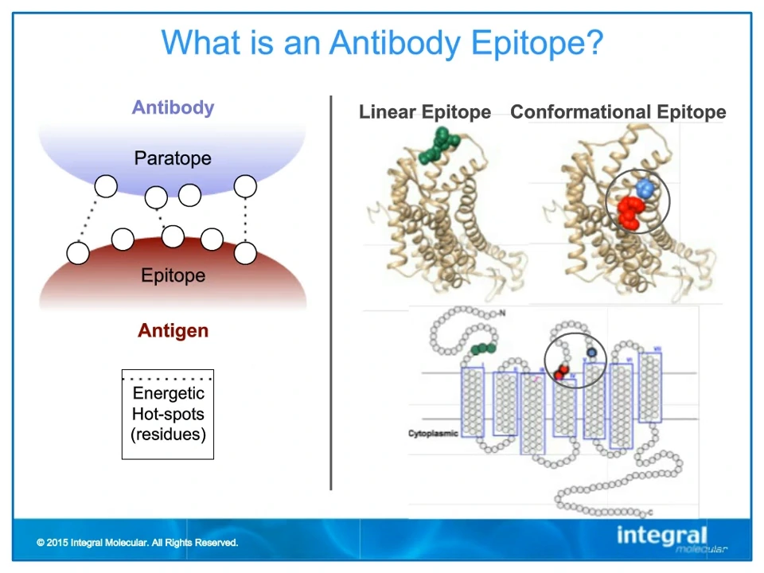

关键在于他紧接着补的一句：**表位上的残基并不都同等重要**。有些残基只是「在场」，去掉它对结合几乎没影响；有些残基一换，结合就掉了——后者叫**能量热点残基（energetic hot-spot residues）**，讲者有时直接叫「关键残基」。

这个区分是后面所有方法学的分水岭。**「哪些残基在接触面上」和「哪些残基在能量上重要」是两个不同的问题**，而不同实验手段天然偏向其中一个。

### 1.2 线性表位与构象表位：序列上连续，还是空间上聚拢

- **线性表位（linear epitope）**：参与结合的残基在一级序列上是连续的一段。
- **构象表位（conformational epitope）**，也叫**不连续表位（discontinuous epitope）**：残基在序列上东一个西一个，折叠之后在三维空间里凑到一起。

讲者明确说，治疗性抗体面对的**大多数是构象表位** [【跳转到 05:10】](https://www.youtube.com/watch?v=NM5oEJ6bqwM&t=310)。这个事实直接淘汰了一整类方法：任何「按序列切肽段、看抗体结合哪一段」的做法，天生只能看见线性表位。

判断一个表位是不是构象表位，有一个非常实用的旁证：如果丙氨酸扫描捞出来的关键残基**在序列上不连续**，那它几乎必然是构象表位——讲者在问答里就是这么回答「没有晶体结构能不能做构象表位定位」的 [【跳转到 69:09】](https://www.youtube.com/watch?v=NM5oEJ6bqwM&t=4149)。

### 1.3 评价一种表位定位方法的五个维度

讲者把「怎么挑方法」拆成五个正交的问题 [【跳转到 06:04】](https://www.youtube.com/watch?v=NM5oEJ6bqwM&t=364)：

1. **能不能做构象表位**（还是只对线性表位有效）；
2. **分辨率**（原子级 / 残基级 / 区域级）；
3. **能不能对付复杂蛋白**（膜蛋白、病毒糖蛋白这类难表达难折叠的靶点）；
4. **给不给能量学信息**（是「在接触面上」还是「结合靠它」）；
5. **速度**。

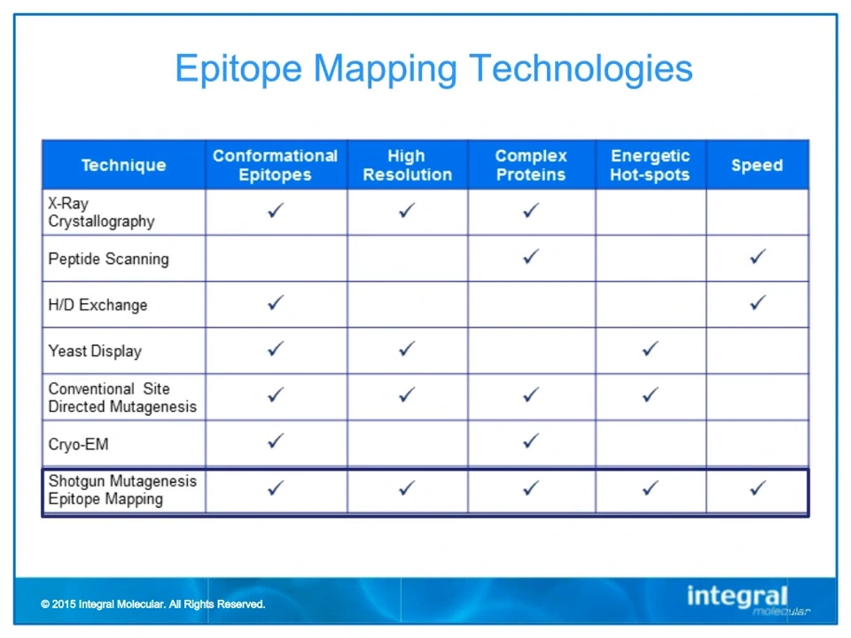

这张表是整场研讨会的骨架，值得逐行读：

| 方法 | 构象表位 | 高分辨率 | 复杂蛋白 | 能量热点 | 速度 |
| --- | --- | --- | --- | --- | --- |
| X 射线晶体学 | 是 | 是 | 是 | 否 | 慢 |
| 肽段扫描（peptide scanning） | 否 | 否 | 是 | 否 | 快 |
| 氢氘交换（H/D exchange） | 是 | 否 | 否 | 否 | 快 |
| 酵母展示 | 是 | 是 | 否 | 是 | 慢 |
| 传统定点突变 | 是 | 是 | 是 | 是 | 慢 |
| 冷冻电镜（Cryo-EM） | 是 | 否 | 是 | 否 | 慢 |
| 鸟枪突变表位定位 | 是 | 是 | 是 | 是 | 快 |

注意两件事。第一，**「高分辨率」和「能量热点」是两列不同的勾**：晶体学勾了高分辨率没勾能量热点，突变类方法两列都勾。第二，冷冻电镜在这一版表里「高分辨率」是空着的——这是 2015 年前后的认知，讲者在后面的实际案例里已经用冷冻电镜做到了接近原子级，见第四节。

---

## 二、丙氨酸扫描：唯一能直接给出「能量学」的残基级方法

### 2.1 鸟枪突变：把每个位置都换成丙氨酸，然后看谁掉了结合

丙氨酸扫描（alanine scanning）的思路极简：**把候选残基逐个突变成丙氨酸**（侧链只有一个甲基，等于把侧链「砍掉」但基本不破坏主链），然后测每个变体还能不能被抗体结合。结合掉了的位置，就是表位里「值钱」的位置。

讲者的公司把这件事做成了流水线，叫**鸟枪突变表位定位（shotgun mutagenesis epitope mapping）** [【跳转到 07:30】](https://www.youtube.com/watch?v=NM5oEJ6bqwM&t=450)：

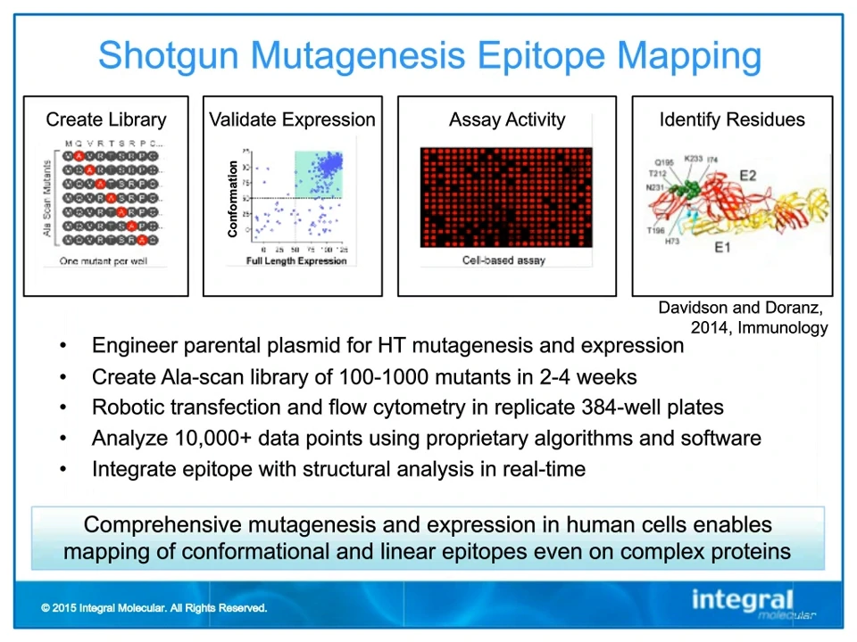

1. **建库**：先把母本质粒改造成适合高通量突变和高表达的形式，然后做出**覆盖全长的丙氨酸扫描库**，几百到上千个突变体，**2–4 周**完成；
2. **验证表达**：每个突变体都要单独确认它还能不能折叠、能不能上到细胞表面——这一步是后面所有结论的前提；
3. **测活性**：机器人转染 + 流式细胞术，384 孔板做重复，一次拿到上万个数据点；
4. **定位残基**：把掉结合的突变体映射回结构，得到表位。

讲者强调这套流程的关键优势是**在完整的人细胞里表达全长蛋白**，所以膜蛋白、病毒糖蛋白这类「提纯就变性」的靶点也能做 [【跳转到 08:45】](https://www.youtube.com/watch?v=NM5oEJ6bqwM&t=525)。

### 2.2 与共结晶的差别：足迹不等于热点

这是全场最有信息量的一张对比图。同一个抗埃博拉 GP 蛋白的抗体，三种方法给出的残基集合层层收窄 [【跳转到 09:29】](https://www.youtube.com/watch?v=NM5oEJ6bqwM&t=569)：

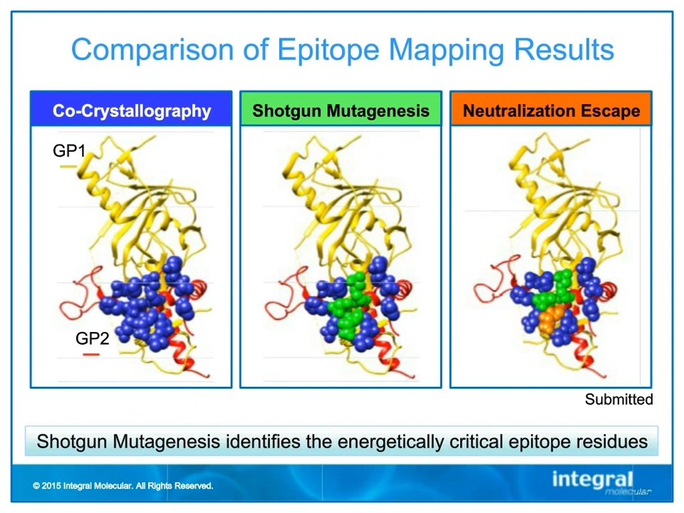

- **共结晶（co-crystallography）**给出的是**足迹（footprint）**：抗体盖住的那一大片残基，蓝色。讲者的原话是，这些残基「可能对相互作用有能量贡献，但只是出现在足迹里」。
- **鸟枪突变**给出的是**能量关键残基**，绿色。它们**落在足迹内部**，但只占一小块。
- **中和逃逸突变（neutralization escape）**给出的是第三套集合，橙色——病毒靠突变这些位置来逃避免疫，所以它们和「结合所必需」又不完全等价。

一句话总结这张图：**足迹是「挨着」，热点是「靠它」**。做抗体工程要改的是热点，做表位遮盖/竞争判断看的是足迹，两者不能互换。

### 2.3 三个必须做的对照：突变体到底还折不折叠

丙氨酸扫描最容易被质疑的一点是：**你测到的结合下降，是表位被破坏，还是蛋白整体折坏了？** 讲者在问答里给了三层防护 [【跳转到 63:19】](https://www.youtube.com/watch?v=NM5oEJ6bqwM&t=3799)：

1. **表面表达**：如果突变体还能上到细胞表面，至少说明它保留了大致结构；
2. **构象对照抗体**：用一组已知结合蛋白**不同部位**的构象依赖抗体做内部对照——如果这些对照抗体全都还结合，说明蛋白没散架；
3. **功能保持**：如果某个突变敲掉了抗体结合、但蛋白的天然功能（比如病毒侵染、GPCR 信号）还在，那这个突变大概率只动了表位。

这三条对照是丙氨酸扫描能被称为「残基级」的前提。少了它们，一堆「掉结合」的突变体可能只是折叠失败的垃圾。

### 2.4 通量：为什么它能做到 120 株抗体一次铺开

讲者给出的数字是**每月 20 个表位**、累计做过 500 多个抗体 [【跳转到 16:42】](https://www.youtube.com/watch?v=NM5oEJ6bqwM&t=1002)。这个通量带来的不只是效率，而是**换一种提问方式**：与其精雕一株抗体的表位，不如把一个病人身上分离出的所有抗体一起铺开，看免疫反应整体压在哪些区域。

登革病毒的例子最直观：从**一个**感染者身上分离 120 株单抗，全部做丙氨酸扫描，然后按表位归类 [【跳转到 38:14】](https://www.youtube.com/watch?v=NM5oEJ6bqwM&t=2294)：

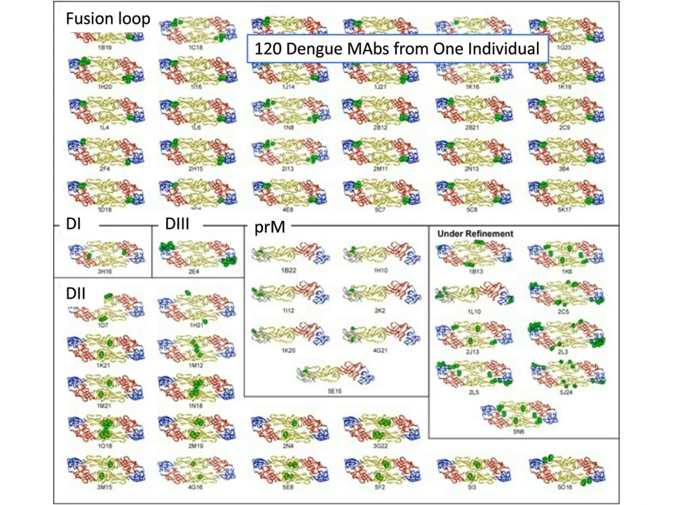

每张小图是一株抗体的足迹，绿色小球是被突变掉后结合消失的残基。120 张图按抗原区（融合环 fusion loop、结构域 DI/DII/DIII、prM）自动聚成几大簇。讲者的评论是：**这个规模用前面那些结构方法根本做不了**。

### 2.5 丙氨酸扫描的局限

- **必须能表达大量变体**：几百到上千个质粒，没有高通量平台做不动；
- **只对「容忍突变」的表位有效**：如果某个残基一突变就破坏折叠，你会把它误判成表位（这也是 2.3 那三条对照存在的原因）；
- **不报告接触面积**：它告诉你「这个残基重要」，不告诉你「这个残基埋了多少平方埃」；
- **会混进别构效应**：突变一个不在表位上的残基也可能远程改变表位构象，这类信号单看突变数据分不清——讲者在问答里专门点了这一点 [【跳转到 72:54】](https://www.youtube.com/watch?v=NM5oEJ6bqwM&t=4374)。

---

## 三、氢氘交换质谱：在溶液里给表位画一张肽段级地图

### 3.1 原理：把蛋白泡进重水，看哪些氢换得快

讲者把氢氘交换（hydrogen-deuterium exchange，HDX；配合质谱简称 HDX-MS，讲者习惯叫它 **DXMS**）称为「另一个低分辨率技术」 [【跳转到 30:45】](https://www.youtube.com/watch?v=NM5oEJ6bqwM&t=1845)。它的化学基础是一步交换反应：

$$
\mathrm{Protein{-}H} + \mathrm{D_2O} \;\rightleftharpoons\; \mathrm{Protein{-}D} + \mathrm{HDO}
$$

把蛋白放进重水（$\mathrm{D_2O}$）里，蛋白上共价结合的氢会被氘替换。真正参与交换的主要是**主链酰胺氢（backbone amide protons）**。而一个主链酰胺氢换不换得掉，取决于两件事：

1. **溶剂可及性**：这个位置是不是暴露在溶剂里；
2. **氢键保护**：如果它已经参与二级结构（α 螺旋、β 折叠）的氢键，就被「锁住」了，换得很慢。

所以交换速率本质上是**局部结构紧致程度的读数**：暴露、松散、无氢键的地方换得快；埋藏、有氢键、处在界面上的地方换得慢。讲者的总结是「这个方法给出分子各部分的溶剂可及性，也就是三级结构信息」。

### 3.2 差谱：加了抗体之后「消失的标记」就是足迹

单看一个蛋白的交换速率只能得到它的柔性分布，要定位表位必须做**差谱**。流程是：

1. 蛋白单独孵育，在 10 s / 100 s / 1000 s 三个时间点淬灭、酶解、上质谱；
2. 蛋白 + Fab 复合物重复一遍；
3. 两组数据相减，**结合后交换变慢（标记减少）的肽段，就是被抗体盖住的区域**。

轮状病毒 VP6 的例子把整条链路展示得很完整 [【跳转到 30:46】](https://www.youtube.com/watch?v=NM5oEJ6bqwM&t=1846)：

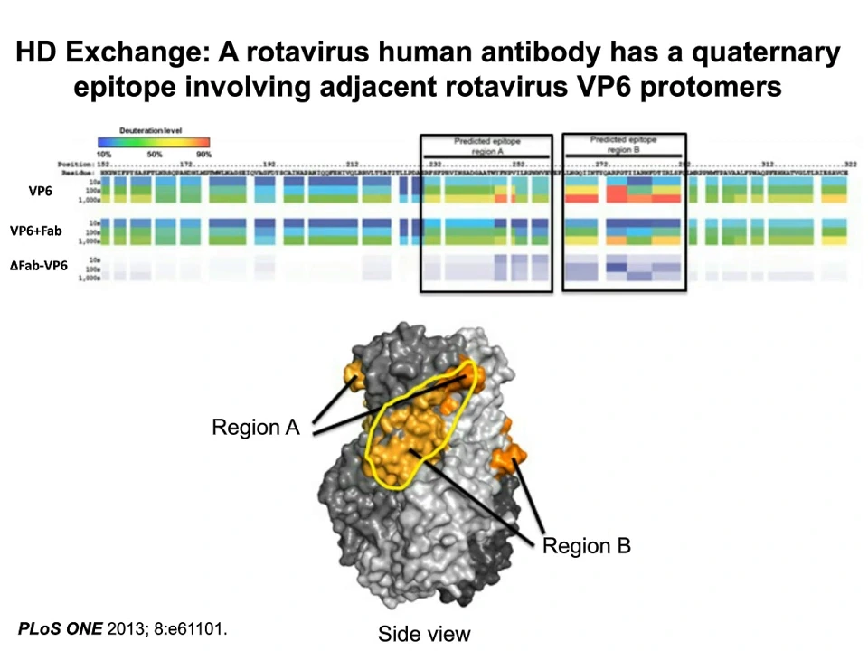

- 最上面一行是 VP6 单独交换，颜色越红表示氘掺入越多（越暴露）；
- 第二行是加了 Fab 之后；
- 第三行是**差值**，蓝色表示「加了抗体后交换明显变慢」；
- 差值里被框出的两段肽段，就是预测的表位区域 A 和区域 B；
- 把这两段映射回空间填充模型，发现**区域 A 和区域 B 分别落在两个不同的 protomer 上**。

这个结果很有意思：抗体「眼里」只有一个连续的表面，它并不在乎这些残基来自哪个亚基。所以这是一个**四级表位（quaternary epitope）**——只有把三聚体拼起来才存在。

### 3.3 分辨率：肽段级，不是残基级

讲者在问答里把 HDX 的分辨率讲得最清楚：氢氘交换「只识别出参与表位、或者影响表位的一条肽段」，**它不是氨基酸分辨率的方法**，要判断肽段里具体哪几个残基参与，还得结合结构去解释 [【跳转到 71:14】](https://www.youtube.com/watch?v=NM5oEJ6bqwM&t=4274)。

这个限制来自流程本身：质谱读的是**酶解后的肽段**的质量偏移，肽段有多长，分辨率就有多粗。想更细只能靠更密的酶切（重叠肽段），但代价是覆盖度和工作量。

### 3.4 氢氘交换的优缺点

| 维度 | 表现 |
| --- | --- |
| 需不需要晶体结构 | 不需要，溶液态直接测 |
| 分辨率 | 肽段级（几个到十几个残基一段） |
| 对构象变化 | 很敏感——这正是它的长处，能看见别构与构象重排 |
| 能否区分直接接触与别构 | 不能，两者都表现为「交换变慢」 |
| 复杂体系 | 病毒颗粒、大复合物都能做，但数据解释更难 |
| 速度 | 相对快，但数据分析重 |

最后一行「分不清直接接触与别构」是 HDX 最本质的模糊性：抗体结合引起远端构象收紧，和抗体直接盖住这段肽段，在差谱上长得一模一样。

---

## 四、结构方法：从 SAXS 的包膜到冷冻电镜的原子级

### 4.1 晶体学是「金标准」，但它只能给你足迹

讲者把 X 射线晶体学称为表位定位的 **gold standard** [【跳转到 21:20】](https://www.youtube.com/watch?v=NM5oEJ6bqwM&t=1280)。1918 流感 HA 与人间单抗的共晶结构是标准范例：

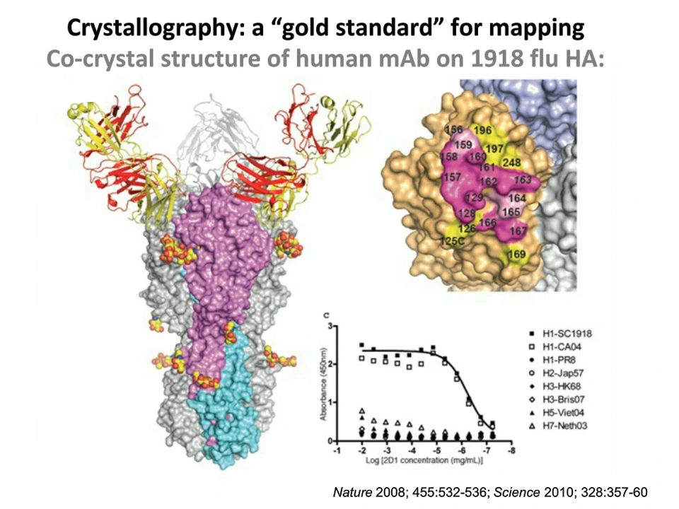

右侧放大图把足迹上的残基逐个标了号（156、157、158、159、160、161、162、163、164、165、166、167、169、196、197、248……），这是原子级分辨率才给得出的东西。下方那张结合曲线则说明这个抗体只认 1918/H1 亚型，对 H2、H3、H5、H7 都不结合——**结构解释了特异性**。

但注意前面 2.2 的对比：晶体学给的是**足迹**，不是能量热点。这是「高分辨率」和「能量学」两列勾选不同的根源。

### 4.2 SAXS 与单颗粒电镜：低分辨率但能看见「整体姿态」

马尔堡病毒的例子展示了低分辨率方法不可替代的一面。当时马尔堡糖蛋白连晶体结构都没有，团队只能用**单颗粒分析（single particle analysis）**：拍几千张噪声很大的透射电镜照片，把相似颗粒的数字图像叠加平均，再重建三维 [【跳转到 25:55】](https://www.youtube.com/watch?v=NM5oEJ6bqwM&t=1555)。结果是能看清「三份 Fab 结合在糖蛋白三聚体顶部」，但看不清侧链。

更粗一档的是**小角 X 射线散射（SAXS）**，它给的是溶液的**包膜（envelope）**，分辨率只有几十埃 [【跳转到 28:50】](https://www.youtube.com/watch?v=NM5oEJ6bqwM&t=1730)：

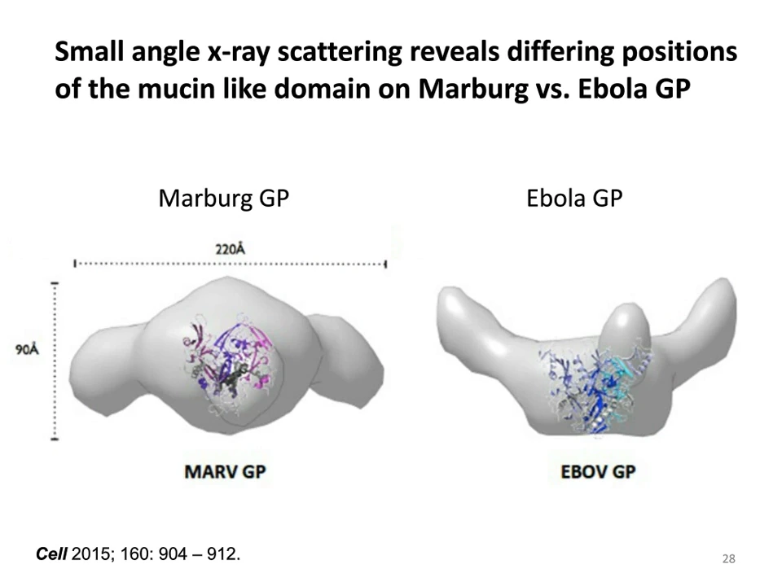

这张图解决了一个具体的困惑：有些马尔堡抗体能结合**切掉 mucin 样结构域的**埃博拉 GP，却不中和完整病毒。SAXS 显示，马尔堡 GP 的 mucin 样结构域（图中两侧的「翅膀」）是垂在侧面、让开了顶部的受体结合域；而埃博拉 GP 的同一结构域像天线一样竖在顶部，**正好压在受体结合域上**。所以抗体在切短的蛋白上够得着，在完整病毒上够不着。

**包膜级别（几十埃）的分辨率，在这里恰好够用来回答「挡没挡住」这个功能问题。**

### 4.3 冷冻电镜：原子级，而且能看见「颗粒里的构象」

冷冻电镜（cryo-EM）把颗粒快速冻在薄冰里，从不同角度成像再三维重建 [【跳转到 33:40】](https://www.youtube.com/watch?v=NM5oEJ6bqwM&t=2020)。它比单颗粒电镜强的地方在于分辨率能推到接近原子级，同时**保留了颗粒的整体上下文**。

登革病毒 5J7 抗体的例子把「上下文」的价值推到极致 [【跳转到 35:09】](https://www.youtube.com/watch?v=NM5oEJ6bqwM&t=2109)：

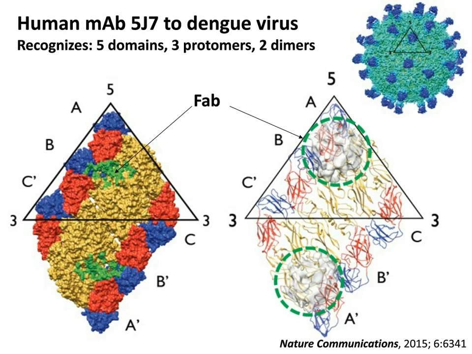

一株抗体同时接触 **5 个结构域、跨 3 个 protomer、跨 2 个二体**。讲者的说法是，这可能是他们遇到过最「五级（quinary）」的表位——**这种表位在分离的可溶蛋白上根本不存在**，只有病毒颗粒这个层级才有。

冷冻电镜还能直接看见**构象变化**。登革 1F4 抗体的例子 [【跳转到 37:05】](https://www.youtube.com/watch?v=NM5oEJ6bqwM&t=2225)：

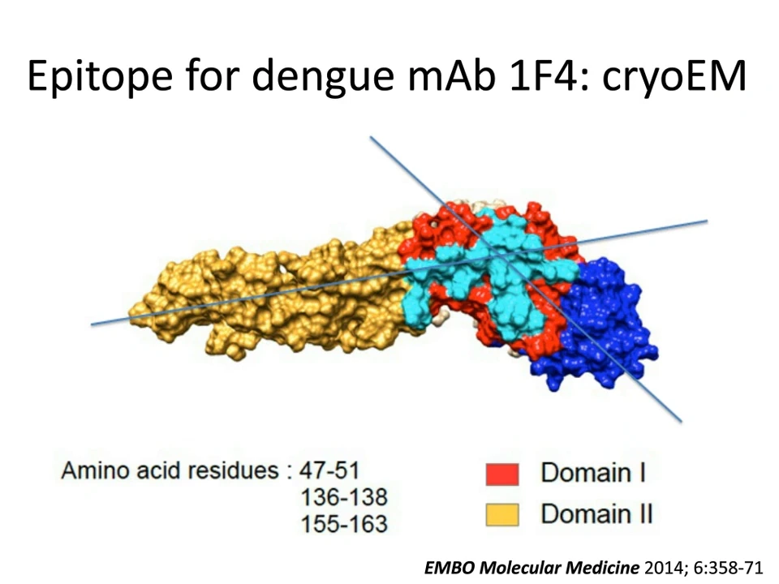

同一个 protomer，在可溶蛋白的晶体结构里是**直的**，在颗粒里却是**折成锐角**的。1F4 只认折起来的那一版——把蛋白做成可溶形式，抗体就完全不结合了。讲者的结论很重：**如果不用颗粒，这株抗体根本不会被发现**。

---

## 五、病毒抗原为什么逼着你用多种方法

讲者专门用一页总结「为什么表位这么难测」 [【跳转到 20:00】](https://www.youtube.com/watch?v=NM5oEJ6bqwM&t=1200)：

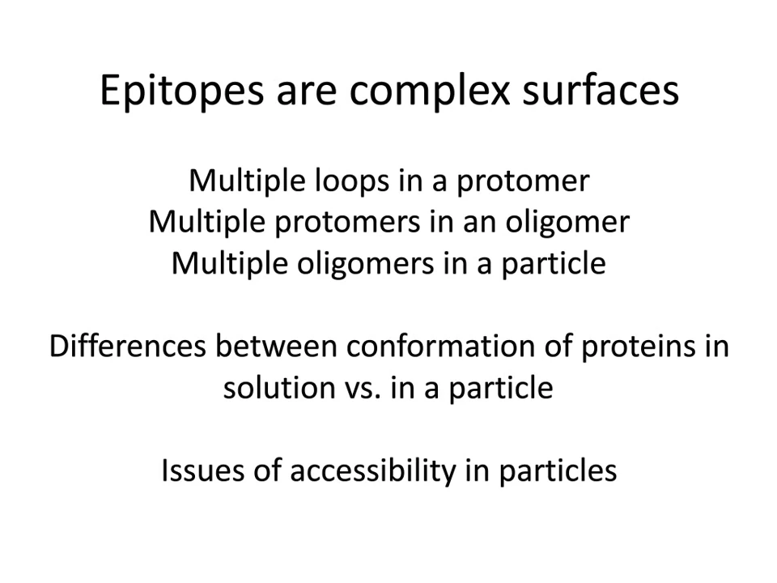

三层嵌套：

1. **一个 protomer 内的多个环**：构象表位的基本形态；
2. **一个寡聚体里的多个 protomer**：表位可以跨亚基（VP6 的例子里区域 A、B 分属两个 protomer）；
3. **一个颗粒里的多个寡聚体**：表位可以跨二体、跨筏（登革 5J7）。

再加上两件事：**溶液态和颗粒态的构象可能不同**（1F4 的例子），以及**颗粒里的可及性受限**（抗体能不能挤进去）。

这解释了为什么讲者反复强调「没有任何一种技术能拿到全部相关信息」——他在自己的报告末尾把这个结论写成了两句话 [【跳转到 41:22】](https://www.youtube.com/watch?v=NM5oEJ6bqwM&t=2482)：

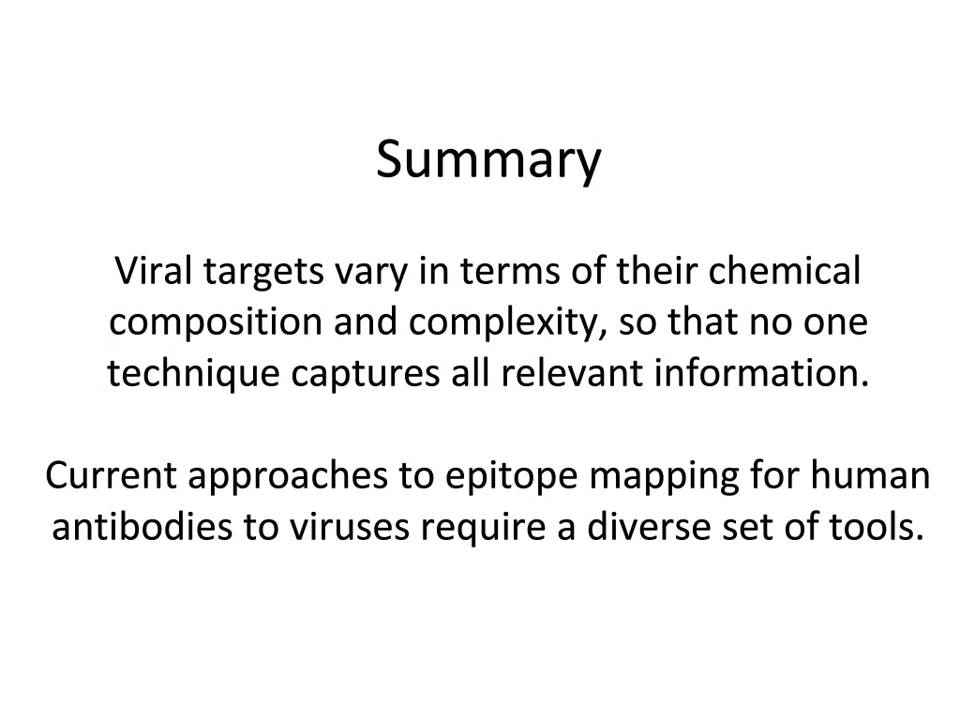

---

## 六、混合方法：把几种低分辨率证据叠成一张高分辨率图

最后一个案例是正面的示范：H5 越南株 HA 与人间单抗 [【跳转到 39:04】](https://www.youtube.com/watch?v=NM5oEJ6bqwM&t=2344)。

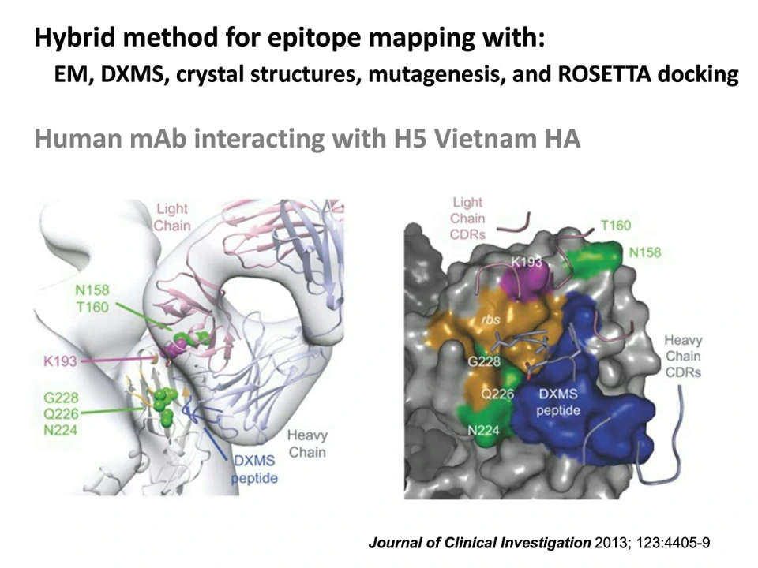

四路证据各管一段：

- **单颗粒电镜**给出包膜和 Fab 的大致姿态（左上灰白包膜）；
- **氢氘交换（DXMS）**给出一条明确的肽段（图中蓝色）；
- **功能实验**知道这个抗体阻断受体结合，所以受体结合位点（橙色 rbs）必须在界面里；
- **晶体结构**给出 Fab 本身的骨架，**丙氨酸扫描**给出几个关键残基（绿色/紫色标注的 N158、T160、K193、G228、Q226、N224）。

把这四组约束一起喂给 Rosetta 做计算对接，得到的模型里 Fab 的足迹**正好压在 DXMS 肽段和受体结合域上**。这个模型后来还预测了：接种常规 H5 疫苗的人产生的抗体，也能识别实验室改造过的、可人际传播的 H5 变异株——因为变异株改动的残基不在这个表位上。

**这就是「正交验证」的具体样子**：没有哪一路数据单独够用，但四路一起就把分辨率补到了能下结论的程度。

---

## 七、分辨率对照表

把全场内容压成一张表。这张表是本小节的核心结论：

| 方法 | 分辨率 | 能回答什么 | 回答不了什么 | 典型速度 |
| --- | --- | --- | --- | --- |
| 肽段扫描 / 肽阵列 | 序列片段级 | 有没有线性表位，大致在序列哪一段 | 构象表位（直接漏掉） | 快 |
| 竞争分组（binning） | 功能性分组 | 两株抗体是否抢同一块地方、能否配对夹心 | 具体是哪些残基、同一组是否真同一表位 | 快，可高通量 |
| SAXS | 包膜级（几十埃） | 整体形状、结构域摆在哪、挡没挡住 | 任何残基信息 | 快 |
| 单颗粒电镜（低分辨） | 10–20 埃 | 抗体结合在哪个区域、几份拷贝 | 侧链、具体残基接触 | 中 |
| 氢氘交换质谱 | 肽段级 | 哪条肽段被盖住、构象是否变化、别构 | 肽段内具体哪几个残基、直接接触 vs 别构 | 中 |
| 丙氨酸扫描 | 残基级 + 能量学 | 哪些残基是能量热点、构象表位也能做 | 接触面积、折叠破坏的假阳性 | 快（高通量） |
| 冷冻电镜 | 近原子级 | 原子级接触、颗粒上下文、构象差异 | 能量学权重 | 慢 |
| X 射线晶体学 | 原子级 | 原子级接触、氢键网络 | 能量学权重、溶液/颗粒态差异 | 慢 |

读这张表的正确姿势不是「挑最高的那一行」，而是**先想清楚你要回答哪个问题**：

- 要判断两株抗体能不能做双特异 / 鸡尾酒 → 竞争分组或丙氨酸扫描就够；
- 要解释中和机制（挡受体还是别构）→ 需要结构，SAXS / 电镜 / 晶体学；
- 要改亲和力、要做理性设计 → 必须知道能量热点，只能靠突变类方法；
- 要写专利、要证明「我的抗体结合的表位和别人不一样」→ 越具体越好，原子级结构最有力。

---

## 八、为什么值得花钱做表位定位：从挑候选到专利

研讨会的第一位和第三位讲者其实在回答同一个问题：**表位数据到底买到了什么**。

**在候选筛选上**，表位信息能直接改变决策。埃博拉抗体鸡尾酒的对比是全场最有说服力的例子 [【跳转到 10:52】](https://www.youtube.com/watch?v=NM5oEJ6bqwM&t=652)：

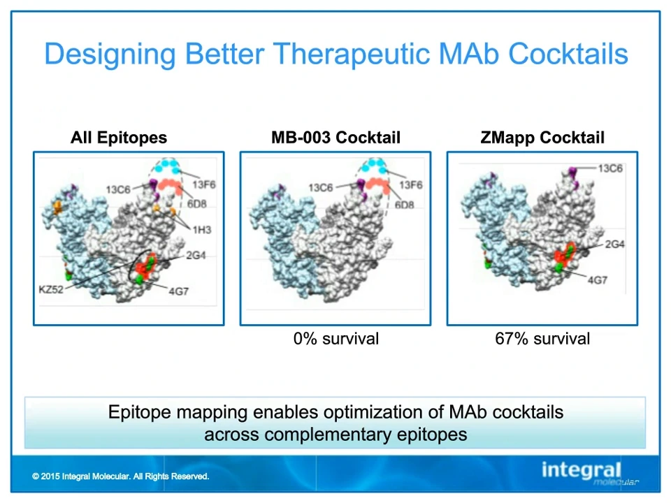

MB-003 鸡尾酒里的三株抗体**都结合在埃博拉 GP 的同一块区域**，动物实验生存率 0%；ZMapp 的抗体**分布在多个不同区域**，生存率 67%。讲者的结论是：要做有效的鸡尾酒，必须打到蛋白的多个区域——而这件事只有先做表位定位才知道。

**在专利与监管上**，第三位讲者（专利律师）的要点可以压缩成三句 [【跳转到 42:10】](https://www.youtube.com/watch?v=NM5oEJ6bqwM&t=2530)：

1. 美国专利法对生物医药有「**书面描述与可实施性**」（35 U.S.C. §112）要求，你必须证明自己「拥有」所主张的发明。**能清楚定义表位，就更容易满足这一条**；反之，Rochester 的 COX-2 专利就是因为申请里没给出具体化合物结构而被判无效。
2. 表位知识是**自由实施（freedom to operate）**的支撑：如果你的抗体结合的表位和已有专利抗体不同，你可以主张自己是新的。她特别提到要尽量写清**构象表位**，因为线性表位在 *Myriad* / *Alice* 之后越来越难主张——「自然产物」不是可专利客体，除非你把它接到固相支持物上、加上可检测标记、或做成嵌合/人源化/偶联形式。
3. 在 **FDA 的抗体与生物类似药**审评里，表位数据不是强制项，但它能帮助定义结合特异性、解释交叉反应、支撑免疫原性评估；对生物类似药，表位是「指纹式相似性」分析的一部分，能帮你把相似度评级推到最高一档 [【跳转到 57:18】](https://www.youtube.com/watch?v=NM5oEJ6bqwM&t=3438)。

---

## 小结

- **表位有两个层次的问题**：「哪些残基在接触面上」（足迹）和「哪些残基决定结合强度」（能量热点）。前者靠结构方法，后者只能靠突变类方法。
- **丙氨酸扫描**是目前唯一同时给出「残基级」和「能量学」的常规手段，通量能做到每月 20 个表位、一次铺开 120 株抗体；代价是必须能表达大量变体，且必须用表面表达、构象对照抗体、功能保持三条对照排除「折叠坏了」的假阳性。
- **氢氘交换质谱**在溶液里工作，不需要晶体，靠「加了抗体之后交换变慢的肽段」定位足迹；分辨率是**肽段级**，而且**分不清直接接触与别构**。它对构象变化极敏感，这是长处也是模糊源。
- **结构方法排成一条阶梯**：SAXS 给包膜（几十埃），单颗粒电镜给区域（10–20 埃），冷冻电镜和晶体学给原子级。冷冻电镜的独特价值是**保留颗粒上下文**——登革 5J7 那种跨 5 个结构域、跨 2 个二体的表位，以及 1F4 那种只在颗粒里才存在的构象，离开颗粒就不存在。
- **方法之间的结果对不上是常态，不是事故**。讲者的处理方式是：先理解靶点的生物学，再用不同分辨率的数据互相约束，最后在「重叠区」下结论。
- **正交验证的范式**：电镜定姿态 + 氢氘交换定肽段 + 功能实验定界面 + 突变定热点 + 计算对接整合。单看任何一路都不够。

---

## 关键术语速查

| 术语 | 一句话解释 |
| --- | --- |
| 表位（epitope） | 抗原上被抗体识别的那一片表面 |
| 互补位（paratope） | 抗体上与被识别的表位互补的那一片表面 |
| 能量热点残基（energetic hot-spot） | 表位上真正决定结合强度的少数残基，去掉它结合就大幅下降 |
| 线性表位（linear epitope） | 参与结合的残基在一级序列上连续 |
| 构象表位 / 不连续表位（conformational / discontinuous epitope） | 残基在序列上分散、折叠后在空间上聚拢形成的表位 |
| 四级表位（quaternary epitope） | 需要多个亚基组装后才存在的表位 |
| 丙氨酸扫描（alanine scanning） | 把候选残基逐个突变成丙氨酸，测结合是否丢失，从而定位表位与热点 |
| 鸟枪突变（shotgun mutagenesis） | 高通量版本的丙氨酸扫描：一次建几百到上千个突变体，机器人转染 + 流式读数 |
| 中和逃逸突变（neutralization escape） | 病毒通过突变某些残基逃避免疫，用来反向验证表位 |
| 氢氘交换（HDX / HDX-MS / DXMS） | 把蛋白放进重水，测主链酰胺氢的交换速率，反映溶剂可及性与氢键保护 |
| 差谱（difference spectrum） | 有抗体与无抗体两组 HDX 数据相减，交换变慢的肽段即足迹 |
| 小角 X 射线散射（SAXS） | 溶液态低分辨率结构方法，给出分子包膜 |
| 单颗粒分析（single particle analysis） | 把大量电镜颗粒图像叠加平均、重建三维的方法 |
| 冷冻电镜（cryo-EM） | 把颗粒冻在薄冰里成像再重建，可接近原子级并保留颗粒上下文 |
| 足迹（footprint） | 抗体盖住的那一片残基，不等于能量热点 |