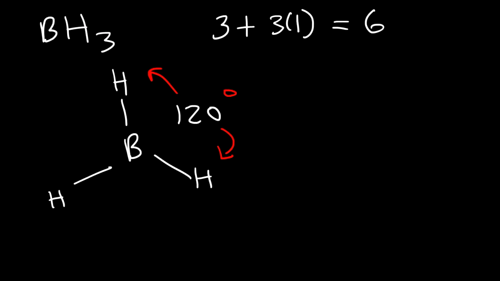
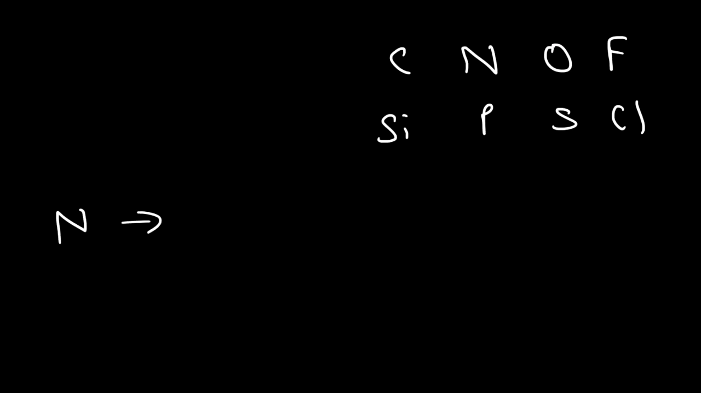
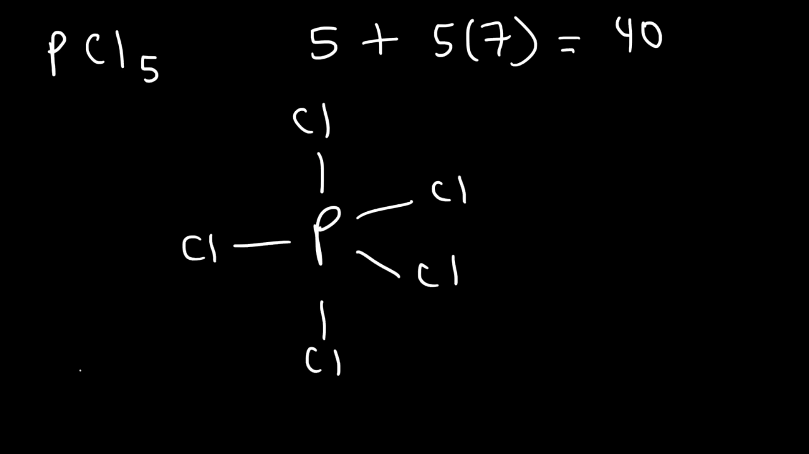
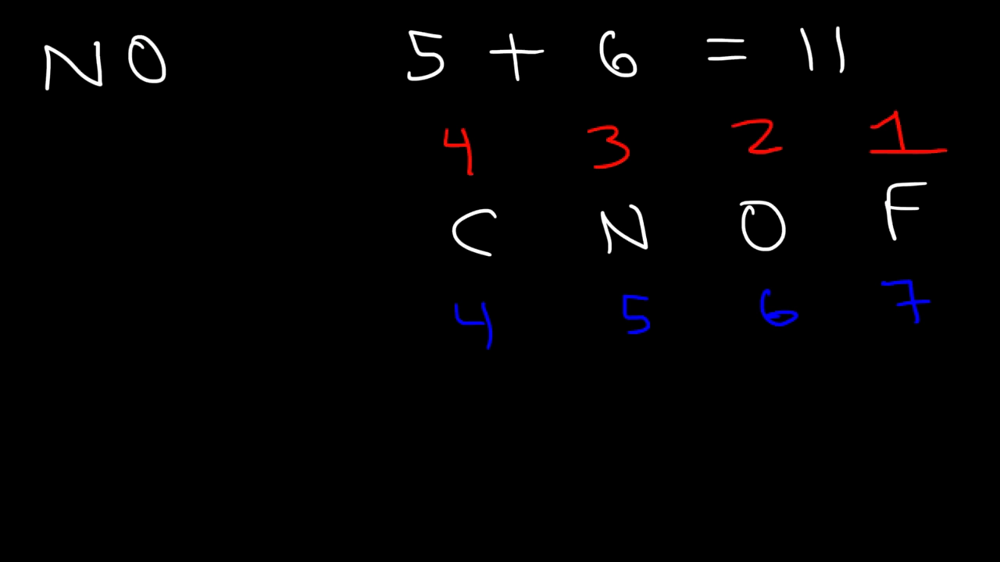
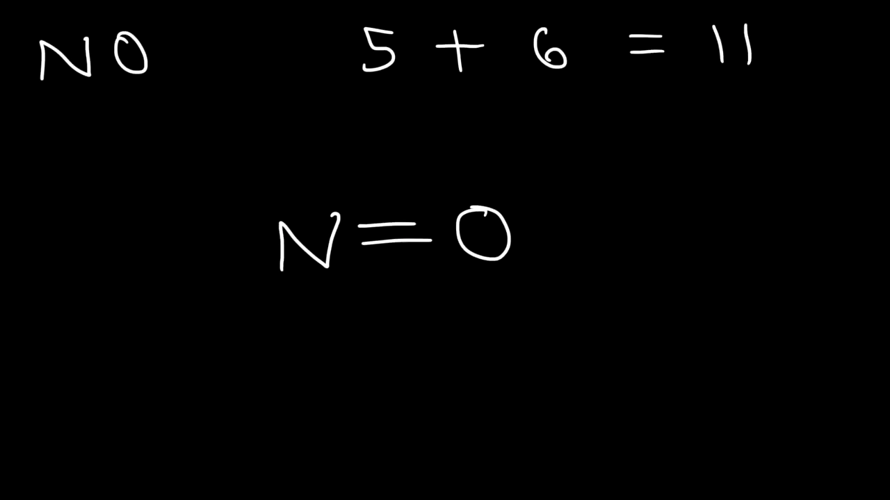
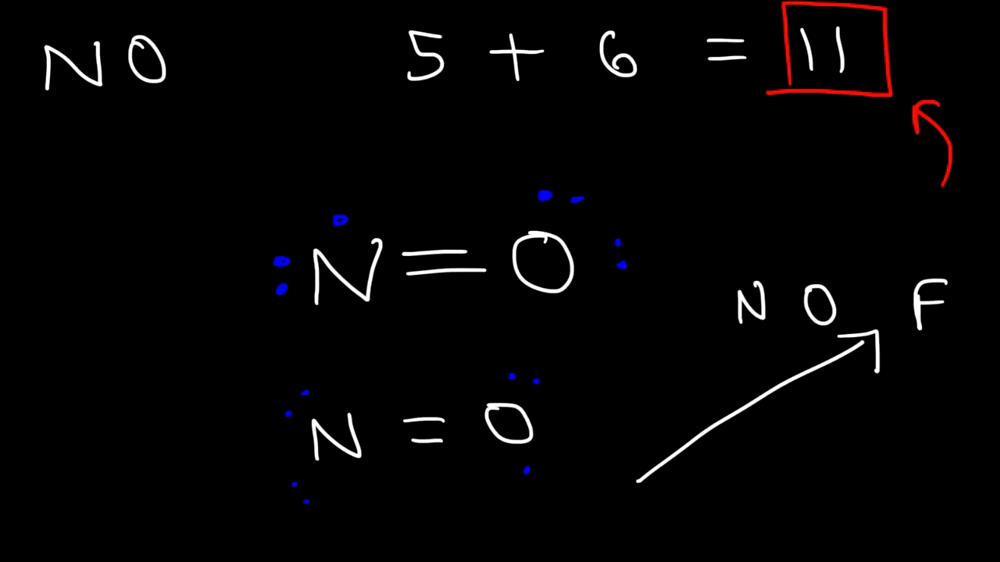
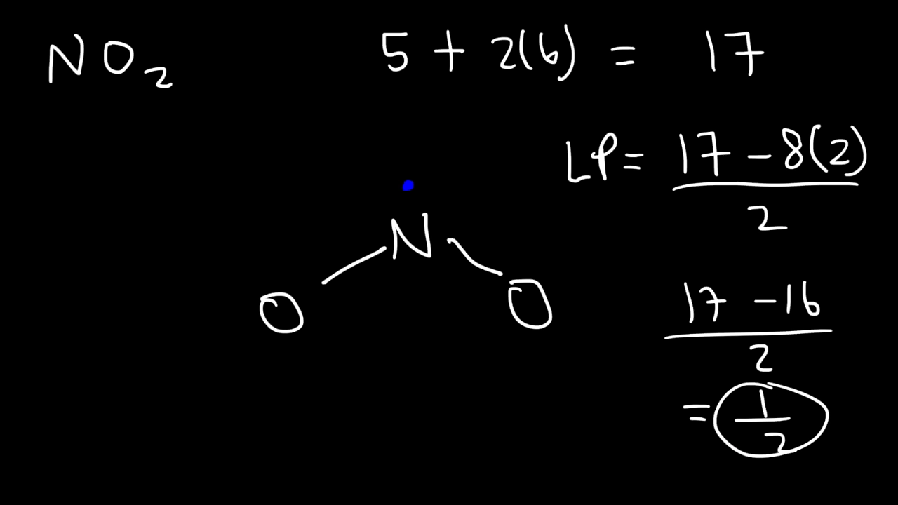
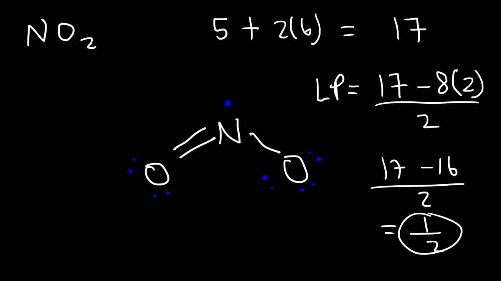

# 八隅体规则的例外：价态上限与「合法连接」

> 视频来源：[Exceptions To The Octet Rule - Lewis Dot Diagrams](https://www.youtube.com/watch?v=96L6_IwyHRM)（YouTube · The Organic Chemistry Tutor）｜时长约 12 分钟
> 导读：这支视频用 BH₃、PCl₅、ICl₅、NO、NO₂ 五个例子，把「八隅体规则」的三类例外一次讲完。本文按「价电子数 → 成键数 → 例外 → 合法性判据」重排，并在最后补一段化学信息学里怎么用这套规则检查结构是否合法。

## 本讲要解决的核心问题（SCQA）

**背景**：分子在化学信息学里被画成一张图：原子是节点，化学键是边。只要给出节点和边，程序就能存、能搜、能算。

**冲突**：但并非任意一张图都对应真实分子。碳连五根键、氧连三根键、氮周围挤九个电子——这些图在纸面上画得出来，在化学上却不成立。程序必须先判断「这张图是否合法」，否则后面的性质计算全是在算一个不存在的分子。

**疑问**：一个原子到底能连几根键？这条边界从哪里来？

**回答（中心思想）**：边界来自**价电子数**和**八隅体规则**。第二周期元素（C、N、O、F）最外层最多容纳 8 个电子，所以「成键数 = 8 − 价电子数」是一条硬上限；而八隅体本身只是一条**经验规则**，它有三类合法例外——**不足八隅体、超价、奇电子数**。把「规则 + 三类例外」合起来，就得到化学信息学里最基础的那道合法性校验。

## 一、价电子数决定「一个原子能连几根键」

### 1.1 价电子是最外层、参与成键的那部分电子

[【跳转到 00:00】](https://www.youtube.com/watch?v=96L6_IwyHRM&t=0)

路易斯结构（Lewis structure，又叫电子点图）只画**最外层电子**，因为只有它们参与成键。视频的起点就是八隅体规则本身：一个原子在分子中周围有 8 个电子时最稳定——octet 就是「八」的意思。

但规则一开口就有反例。第一个反例是 BH₃（硼烷）。

### 1.2 数一遍价电子，就知道能连几根键

[【跳转到 00:25】](https://www.youtube.com/watch?v=96L6_IwyHRM&t=25)

画 BH₃ 的路易斯结构，第一步是数总价电子数：硼有 3 个，每个氢有 1 个，一共 $3+3\times 1 = 6$ 个。第二步，每个氢至少要和硼连一根键，每根键占 2 个电子，于是 6 个电子刚好排成 3 根 B–H 键。

排完之后硼周围只有 6 个电子，凑不满 8 个。这不是画错了，而是**分子里根本没有第 7、第 8 个价电子可用**。

[【跳转到 00:50】](https://www.youtube.com/watch?v=96L6_IwyHRM&t=50)

所以 BH₃ 的正确结构就是「硼周围 6 个电子」，分子呈平面三角形，键角 120°。视频在这里给出一句关键判断：**八隅体只是一条一般规则，不是每个分子都会遵守**。

## 二、八隅体规则：为什么偏偏是 8

[【跳转到 01:15】](https://www.youtube.com/watch?v=96L6_IwyHRM&t=75)

为什么第二周期元素「不能超过 8」，而第三周期可以？视频给的解释很朴素，但足够用：

- 第二周期元素（C、N、O、F）的价电子在**第 2 层**，这一层只有 2s 和 2p 两个亚层，最多容纳 $2+6=8$ 个电子；
- 第三周期元素（Si、P、S、Cl）的价电子在**第 3 层**，这一层有 3s、3p、3d，最多可容纳 18 个电子。

这条「价层容量」的差别，直接决定了后面两类例外的分界：**第二周期只能「不足」，不能「超额」；第三周期及以下既可以不足，也可以超额。**

## 三、例外一：不足八隅体——缺电子的中心是合法的

[【跳转到 01:40】](https://www.youtube.com/watch?v=96L6_IwyHRM&t=100)

第一类例外叫**不足八隅体**（incomplete octet）：中心原子周围少于 8 个电子。典型代表是 BH₃。视频在后面的成键数速查里还提到，铍只有 2 个价电子、倾向连 2 根键——按同样逻辑，BeCl₂ 的铍周围只有 4 个电子（这是补充例子，视频未展开）。

这类结构在化学信息学里最容易误判：如果校验程序硬性要求「每个原子周围必须 8 个电子」，BH₃ 就会被判为非法。**正确做法是把「不足」当作允许状态**，只在需要时给出警告。

## 四、例外二：超价——第三周期起可以「超额」

### 4.1 PCl₅：中心原子周围 10 个电子

[【跳转到 03:20】](https://www.youtube.com/watch?v=96L6_IwyHRM&t=200)

PCl₅ 是标准的超价（expanded octet）例子。数电子：磷 5 个，5 个氯各 7 个，总共 $5+5\times 7=40$ 个。

视频给了一个好用的孤对电子公式：

$$
\text{LP}=\frac{V-8n}{2}
$$

其中 $V$ 是总价电子数，$n$ 是**不居中的原子个数**（这里 $n=5$）。代入得：

$$
\text{LP}=\frac{40-8\times 5}{2}=0
$$

中心磷上没有孤对电子，5 个氯全部以单键连在磷上，磷周围就是 $5\times 2=10$ 个电子——超过 8，但合法，因为磷在第三周期。

### 4.2 ICl₅：中心原子周围 12 个电子

[【跳转到 04:35】](https://www.youtube.com/watch?v=96L6_IwyHRM&t=275)

同样的流程用在 ICl₅ 上：碘 7 个，5 个氯共 35 个，总数 42。孤对数：

$$
\text{LP}=\frac{42-8\times 5}{2}=1
$$

于是碘上有 1 对孤对电子，外加 5 根 I–Cl 键，碘周围共 $2+10=12$ 个电子。分子呈四方锥形。视频特意把电子数一个个点出来：2、4、6、8、10、12。

[【跳转到 05:25】](https://www.youtube.com/watch?v=96L6_IwyHRM&t=325)

**分界线要记牢**：能超价的是第三周期及以下（Si、P、S、Cl、I……）；第二周期的 C、N、O、F **绝对不能超过 8**。后文 NO₂ 的例子会用到这条硬约束。

## 五、例外三：奇电子数——自由基必然破坏八隅体

### 5.1 先记住「每种元素喜欢连几根键」

[【跳转到 06:15】](https://www.youtube.com/watch?v=96L6_IwyHRM&t=375)

处理奇电子分子之前，视频先复习了一张「成键数速查表」：右侧元素倾向**获得**电子凑满 8，左侧元素倾向**给出**电子。

- 碳 4 个价电子，还差 4 个 → 连 **4** 根键；
- 氮 5 个价电子，还差 3 个 → 连 **3** 根键；
- 氧 6 个价电子，还差 2 个 → 连 **2** 根键；
- 氟 7 个价电子，还差 1 个 → 连 **1** 根键；
- 硼 3 个价电子，倾向给出 3 个 → 连 **3** 根键；
- 铍 2 个价电子，倾向给出 2 个 → 连 **2** 根键。

这张表其实就是「典型价态」的来源：**价态不是背出来的，而是「8 减去价电子数」算出来的**（对第二周期而言）。

### 5.2 NO：11 个电子，怎么排都有一个原子不满

[【跳转到 07:30】](https://www.youtube.com/watch?v=96L6_IwyHRM&t=450)

NO 的价电子数是 $5+6=11$，是奇数。氮喜欢连 3 根键、氧喜欢连 2 根，所以 NO 要么是双键、要么是三键。

先试双键：两根键用掉 4 个电子，还剩 7 个要分配。无论最后那个电子给氧还是给氮，总有一个原子只有 7 个电子。视频的结论很直接：**只要价电子总数是奇数，八隅体必然被破坏，这是算术决定的，不是画法问题**。

那到底让谁满八隅体？视频用电负性来判断：氧比氮更靠右上方，电负性更强，会把那个电子拉过去，所以「氧满 8、氮 7」的结构更稳定。

[【跳转到 09:35】](https://www.youtube.com/watch?v=96L6_IwyHRM&t=575)

### 5.3 NO₂：17 个电子，孤对电子算出「半对」

[【跳转到 10:00】](https://www.youtube.com/watch?v=96L6_IwyHRM&t=600)

NO₂ 的价电子数是 $5+2\times 6=17$。氮能连更多键，所以氮居中被两个氧夹住。代入孤对公式，$n=2$：

$$
\text{LP}=\frac{17-8\times 2}{2}=\frac{1}{2}
$$

「半对孤对电子」就是**一个单电子**。氮先连两根单键（用掉 4 个电子，加上这个单电子共 5 个），再补一根双键让氮到 7 个电子；此时不能再加键了，因为氮一旦到 9 个电子就越过了第二周期的硬上限。

[【跳转到 11:40】](https://www.youtube.com/watch?v=96L6_IwyHRM&t=700)

剩下的电子补给氧：双键氧补 2 对孤对、单键氧补 3 对孤对，总数正好 17。这就是 NO₂ 的路易斯结构——一个带单电子的自由基。

## 六、把三条规则合起来，就是「合法连接」的判据

[【跳转到 12:05】](https://www.youtube.com/watch?v=96L6_IwyHRM&t=725)

视频最后总结：**只要价电子数是奇数，八隅体通常就会被破坏**。把整支视频的结论压缩成一张判据表：

| 检查项 | 判据 | 违反时的典型例子 |
| --- | --- | --- |
| 价电子总数 | 等于各原子价电子数之和，离子再按电荷加减 | 少数电子导致无解 |
| 第二周期上限 | C、N、O、F 周围电子数 $\le 8$ | 氮连 5 根键（10 电子）不合法 |
| 第三周期及以下 | 允许超过 8（常见 10 或 12） | PCl₅、ICl₅ 合法 |
| 下限 | 允许不足 8 | BH₃（6 电子）、BeCl₂（4 电子） |
| 奇电子 | 允许存在单电子（自由基） | NO（11 电子）、NO₂（17 电子） |

### 6.1 补充：化学信息学里这道校验叫什么

> 以下内容是补充背景，不在视频中。

在 RDKit 这类工具里，把 SMILES 或分子图变成可用分子要经过一步 **sanitization（净化）**。它做的第一件事就是**价态检查**：查一张「元素 → 允许价态」的表（碳 4、氮 3、氧 2、硫 2/4/6、磷 3/5、卤素 1……），再结合形式电荷判断每个原子的成键数是否越界。越界时典型报错是「Explicit valence for atom # N is greater than permitted」。

这也解释了为什么八隅体规则在化学信息学里地位特殊：它不是一条需要精确计算的量子化学结论，而是一张**廉价、可查表、能挡住大部分错误输入**的筛子。苯环写成大写 `C1CCCCC1` 与写成芳香小写 `c1ccccc1`，前者价态合法但结构错误，后者才通过芳香性感知——这类问题都要先过价态这一关。

同时要记住这道关的**边界**：价态合法只是「连接关系可能成立」，它不保证分子式对应的就是你要的那个分子。同一分子式可以有许多合法连接（异构体），同一分子还可以在互变异构体之间切换（这部分留到后续小节展开）。

## 小结

- 价电子数决定成键数：对第二周期元素，**成键数 = 8 − 价电子数**，于是 C、N、O、F 分别是 4、3、2、1；
- 八隅体规则来自价层容量：第二周期价层最多 8 个电子，第三周期及以下价层可容纳更多；
- 三类合法例外：**不足八隅体**（BH₃、BeCl₂）、**超价**（PCl₅ 10 电子、ICl₅ 12 电子）、**奇电子自由基**（NO、NO₂）；
- 孤对电子公式 $\text{LP}=(V-8n)/2$ 可以快速算出中心原子上的孤对；算出 $1/2$ 就说明存在单电子；
- 超价只属于第三周期及以下，第二周期元素**绝不能超过 8 个电子**；
- 把「规则 + 例外」写成表，就是化学信息学里最基础的合法性校验；它能挡住价态错误，但挡不住异构体与互变异构。

## 关键术语速查

| 术语 | 一句话解释 |
| --- | --- |
| 价电子 | 原子最外层、参与成键的电子 |
| 八隅体规则 | 原子周围有 8 个电子时较稳定的一条经验规则 |
| 不足八隅体 | 中心原子周围少于 8 个电子，如 BH₃ 的 6 电子 |
| 超价 | 中心原子周围超过 8 个电子，只出现在第三周期及以下，如 PCl₅ |
| 自由基 | 含未成对电子的物种，价电子总数为奇数，如 NO、NO₂ |
| 孤对电子 | 不参与成键、只属于某一个原子的电子对 |
| 净化 sanitization | 化学信息学工具把分子图转成可用对象时的校验流程，价态检查是第一步 |