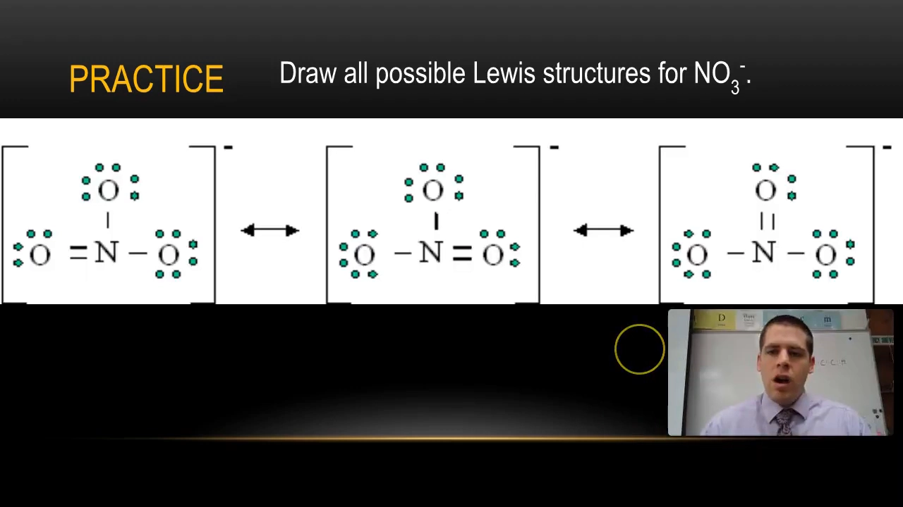
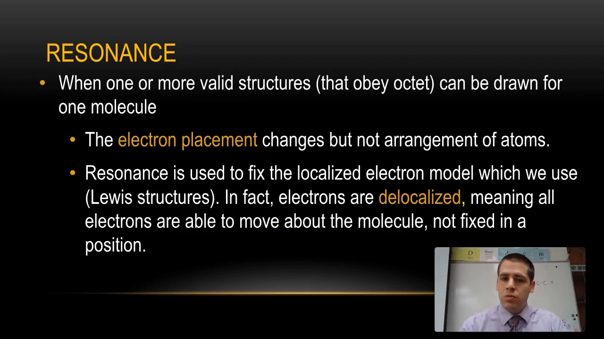
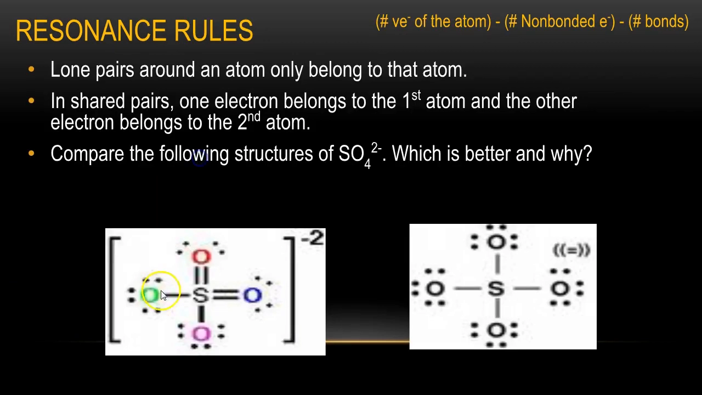
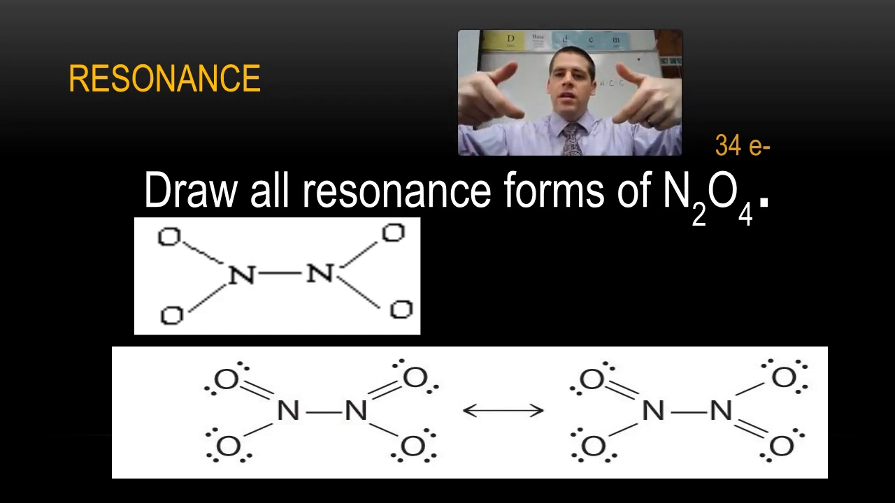
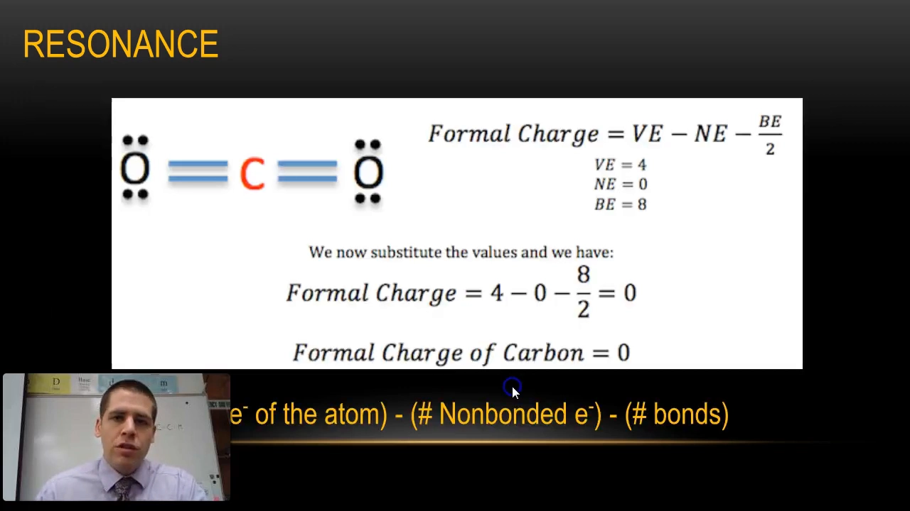
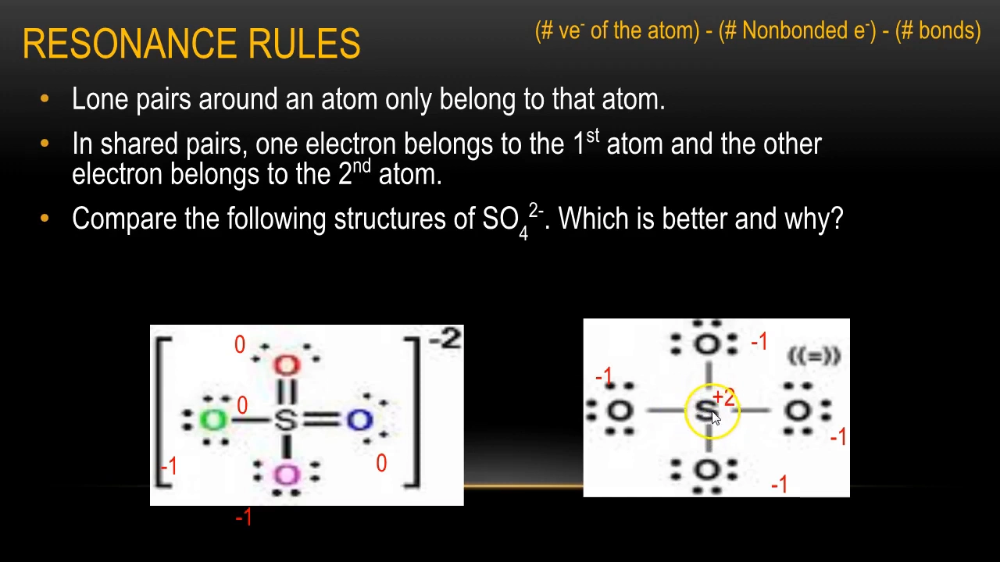
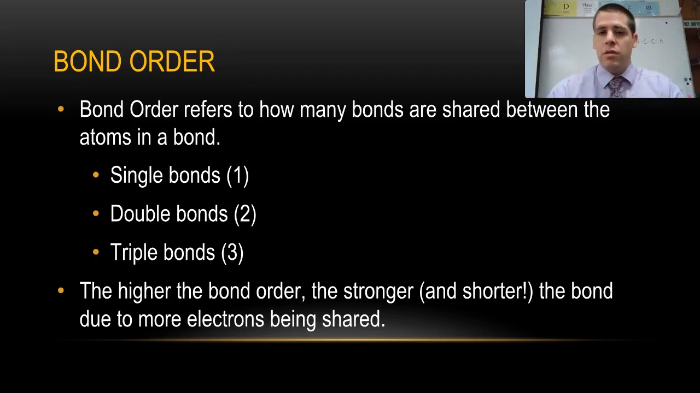
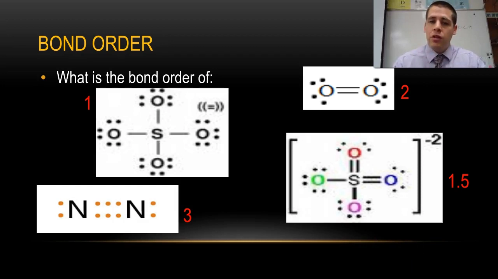

# 形式电荷、共振与键级：判断路易斯结构的好坏

> 视频来源：[3.4 - Resonance, Formal Charge, & Bond Order](https://www.youtube.com/watch?v=8dZYkdurvAk)（YouTube · WN APChem）｜时长约 7.5 分钟
> 导读：这支短课把「同一分子能画出好几个路易斯结构」这件事讲透：先用实验事实说明它们为什么都「部分正确」，再给出形式电荷这把尺子，最后用键级把多个结构折算成一个数。

## 本讲要解决的核心问题（SCQA）

**背景**：画路易斯结构时，只要把双键挪个位置，就能得到好几个都满足八隅体的结构。比如硝酸根 NO₃⁻，双键可以落在三个氧中的任意一个上。

**冲突**：实验测量却显示，NO₃⁻ 的三根 N–O 键**长度和强度完全相同**。如果真有一根双键、两根单键，应该能测出长短之分——但没有。

**疑问**：这几个结构到底哪个对？如果都不完全对，该用什么标准挑出「更好」的那个？

**回答（中心思想）**：分三步。**第一**，先用八隅体筛掉不合格的结构；**第二**，对都合格的结构算**形式电荷**，选形式电荷最接近零、负电荷落在电负性更大原子上的那个；**第三**，若剩下多个同样好的结构，就用**共振**表示它们共同描述的真实电子结构，并用**键级**把这组结构折算成一个平均键级。

## 一、NO₃⁻：三个都合法的结构

[【跳转到 00:00】](https://www.youtube.com/watch?v=8dZYkdurvAk&t=0)

视频从一道练习开始：画出 NO₃⁻ 所有可能的路易斯结构。注意电荷——带一个负电，所以要在总价电子数上**多加一个电子**。

画完会发现，双键只有三个可放的位置（三个氧各一个），于是得到三个结构。它们都满足八隅体，都带 −1 电荷。

[【跳转到 00:23】](https://www.youtube.com/watch?v=8dZYkdurvAk&t=23)

问题在于，这三个结构预言「有一根键更短更强」，而实验数据显示三根键**完全一样**。这个矛盾正是共振概念的起点。

## 二、共振：不是「来回跳」，而是电子离域

[【跳转到 00:48】](https://www.youtube.com/watch?v=8dZYkdurvAk&t=48)

视频对共振（resonance）的解释很克制：当同一个分子能画出**多个都满足八隅体的合法结构**时，真实分子并不是在其中某一个之间来回切换，而是「所有这些结构共同描述的状态」。讲者自己也提醒，说「双键在氧之间跳来跳去」只是一种方便的说法，更准确的说法是：**每根 N–O 键都相当于 1⅓ 根键**。

### 2.1 共振的三条规则

[【跳转到 01:36】](https://www.youtube.com/watch?v=8dZYkdurvAk&t=96)

共振结构之间只允许**电子位置**变化，不允许**原子位置**变化：

- 所有共振结构的**电子总数必须相同**；
- 必须满足八隅体（除非属于上一讲的例外）；
- **原子核不能移动**，只有价电子的分布不同。

视频还给了一条重要的观念纠正：路易斯结构把电子画成「定域」的——好像电子被绑在某个原子上；真实分子里电子是**离域**（delocalized）的，可以在整个分子范围内活动。共振结构只是用「定域的图」去逼近「离域的真相」。

### 2.2 N₂O₄：四个画法，其实只有两个

[【跳转到 02:16】](https://www.youtube.com/watch?v=8dZYkdurvAk&t=136)

第二个练习是 N₂O₄，共 34 个价电子。画的时候很容易数出「四个」共振结构：两根双键可以在上方，也可以在下方。

但视频提醒：这是**三维物体**，把整个分子翻过来，上方的双键就变到了下方——两个图其实是同一个结构旋转后的样子。所以真正不同的只有两个。

这条提醒对化学信息学同样重要：判断两个结构是否相同，不能只看图面朝向，要看**连接关系与键的分布**是否真的不同。

## 三、形式电荷：给每个原子记一笔账

### 3.1 公式：价电子 − 非键电子 − 键数

[【跳转到 03:02】](https://www.youtube.com/watch?v=8dZYkdurvAk&t=182)

当多个结构都满足八隅体时，用**形式电荷**（formal charge）判断哪个更合理。它的思路是：假装所有共用电子对都**平均分给两端原子**，然后看每个原子「名义上」多了还是少了电子。

视频给的记法是：

$$
\text{FC} = V - N_{\text{nonbond}} - B
$$

其中 $V$ 是该原子的价电子数，$N_{\text{nonbond}}$ 是它身上的非键电子数（孤对电子），$B$ 是它连的键数。等价地，也可以写成「减去一半成键电子」：

$$
\text{FC} = V - N_{\text{nonbond}} - \frac{1}{2}B_{\text{e}}
$$

因为每根键有 2 个电子，一半就是 1，所以「减键数」和「减一半成键电子数」是一回事。

### 3.2 CO₂：三个原子形式电荷全为零

[【跳转到 03:51】](https://www.youtube.com/watch?v=8dZYkdurvAk&t=231)

以 CO₂ 为例。碳有 4 个价电子，没有非键电子，连 4 根键（两个双键）：

$$
\text{FC}(\mathrm{C}) = 4 - 0 - 4 = 0
$$

每个氧有 6 个价电子，带 4 个非键电子（2 对孤对），连 2 根键（一个双键）：

$$
\text{FC}(\mathrm{O}) = 6 - 4 - 2 = 0
$$

三个原子的形式电荷都是 0，这是最理想的情况。

### 3.3 硫酸根：两种结构怎么取舍

[【跳转到 04:32】](https://www.youtube.com/watch?v=8dZYkdurvAk&t=272)

真正需要判断的是 SO₄²⁻。视频并排给出两种画法：

- **左边的结构**：硫与两个氧成双键、与两个氧成单键。两个双键氧形式电荷为 0，两个单键氧为 −1，硫为 0。
- **右边的结构**：硫与四个氧全部单键。四个氧形式电荷都是 −1，硫则是 +2。

[【跳转到 05:47】](https://www.youtube.com/watch?v=8dZYkdurvAk&t=347)

视频给出的判据是：**选形式电荷最接近零、且负电荷落在电负性更大原子上的那个**。左边结构里硫是 0、负电荷都在氧上；右边结构里硫带 +2，明显更差。所以左边更好。

注意左边结构里硫一共连了 6 根键、周围 12 个电子，已经超出八隅体；之所以仍选它，是因为它的形式电荷更接近零。

## 四、判断顺序：先八隅体，再形式电荷，最后共振

[【跳转到 05:59】](https://www.youtube.com/watch?v=8dZYkdurvAk&t=359)

视频把整套判断流程总结成一条优先级链：

1. **八隅体优先**：能满足八隅体的结构，整体优于不能满足的；
2. **形式电荷次之**：都满足八隅体时，选形式电荷最接近零的；
3. **共振兜底**：如果仍有多个同样好的结构，就说明存在共振，把它们都画出来。

形式电荷只用来**在合格结构之间排序**，不能用来推翻八隅体——这个顺序不能颠倒。

## 五、键级：把共振折算成一个数

[【跳转到 06:15】](https://www.youtube.com/watch?v=8dZYkdurvAk&t=375)

**键级**（bond order）指的是两个原子之间共享了几根键：

- 单键键级为 1；
- 双键键级为 2；
- 三键键级为 3。

键级越高，共享的电子越多，原子被拉得越近，键就越**短**、越**强**。视频的说法是：键级越高，键越强，因为键更短，原子之间更难被拉开。

### 5.1 共振结构要取平均

[【跳转到 06:45】](https://www.youtube.com/watch?v=8dZYkdurvAk&t=405)

对没有共振的键，直接数键即可；对参与共振的键，要把多个结构**平均**。视频给了四个例子：全部单键的结构键级为 1，O₂ 为 2，N₂ 为 3，而 SO₄²⁻ 这类「两根双键 + 两根单键」的结构，平均下来每个 S–O 键的键级是 1.5。

一般地，平均键级可以写成：

$$
\text{BO} = \frac{\text{所有共振结构中该键的键数之和}}{\text{共振结构个数}}
$$

这也解释了本节开头 NO₃⁻ 的「1⅓ 根键」：三个结构各有一根双键、两根单键，平均键级是 $(2+1+1)/3=1.33$。实验测到的键长正好介于单键与双键之间，与这个平均值吻合。

## 小结

- 同一分子式常能画出多个满足八隅体的路易斯结构，它们不是「谁抄错了」，而是共振的不同写法；
- 共振只改**电子位置**，不改**原子位置**；真实电子是离域的，路易斯结构只是定域近似；
- 形式电荷公式 $\text{FC}=V-N_{\text{nonbond}}-B$，判据是「最接近零、负电荷给电负性大的原子」；
- 判断顺序：**八隅体 → 形式电荷 → 共振**；
- 键级 = 共享键数，单/双/三键分别为 1/2/3，共振结构的键级取平均；键级越高，键越短越强；
- 化学信息学里，形式电荷和键级都是分子的基本属性，共振则常被折叠成「芳香性」或「部分键级」来处理（这部分留到下一小节）。

## 关键术语速查

| 术语 | 一句话解释 |
| --- | --- |
| 共振 | 多个只差电子排布的路易斯结构共同描述同一个分子 |
| 共振杂化体 | 把多个共振结构「叠加」后得到的真实电子分布 |
| 形式电荷 | 假设共用电子对平均分配时，原子名义上的电荷 |
| 离域 | 电子不固定在某个原子或某根键上，而是在分子范围内分布 |
| 键级 | 两个原子之间共享的键数，单/双/三键为 1/2/3 |
| 平均键级 | 共振结构中某根键的键数取平均，如 NO₃⁻ 的 1.33 |