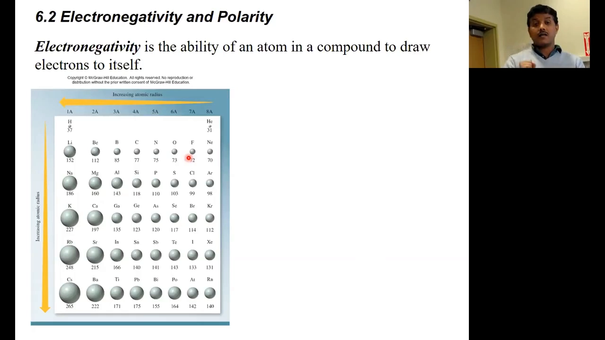
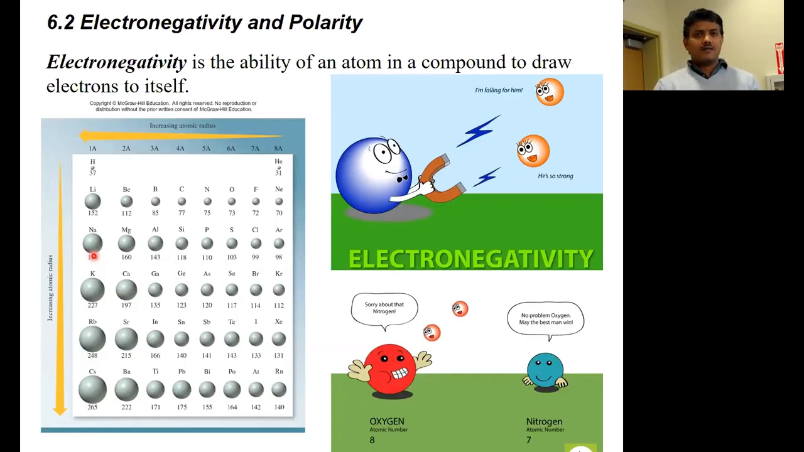
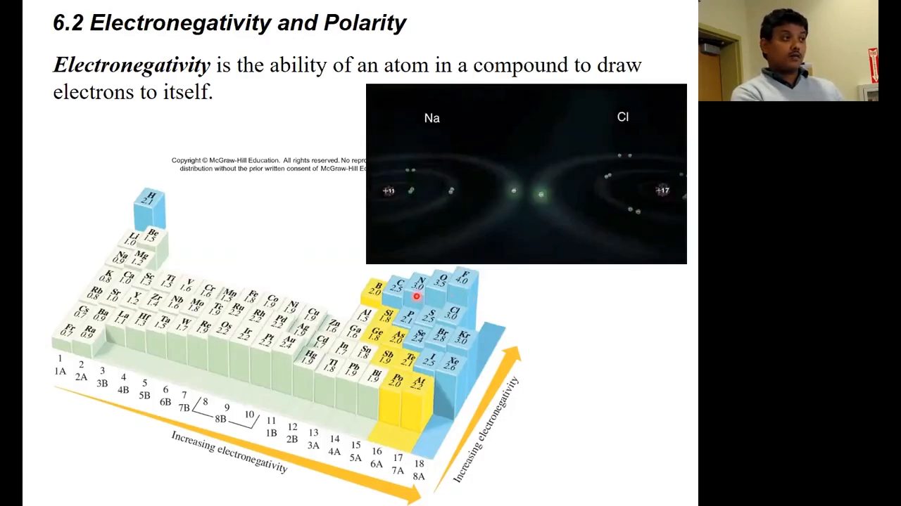
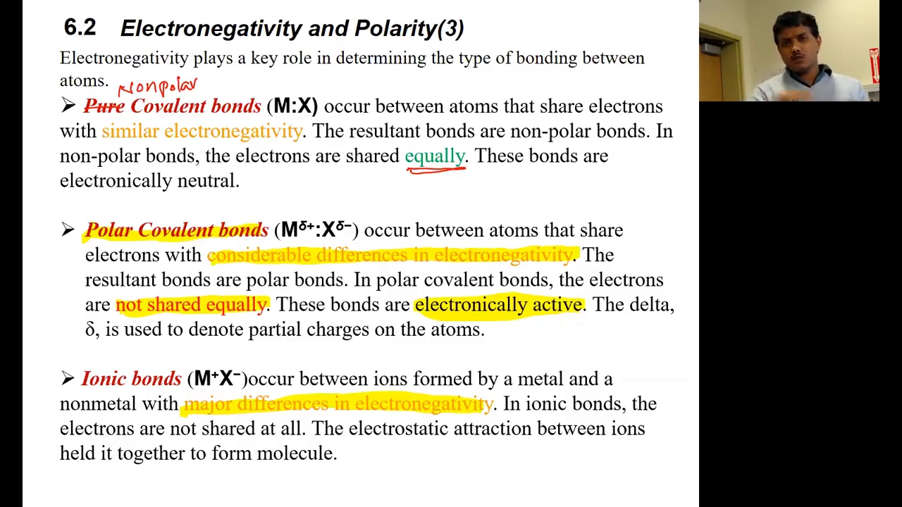
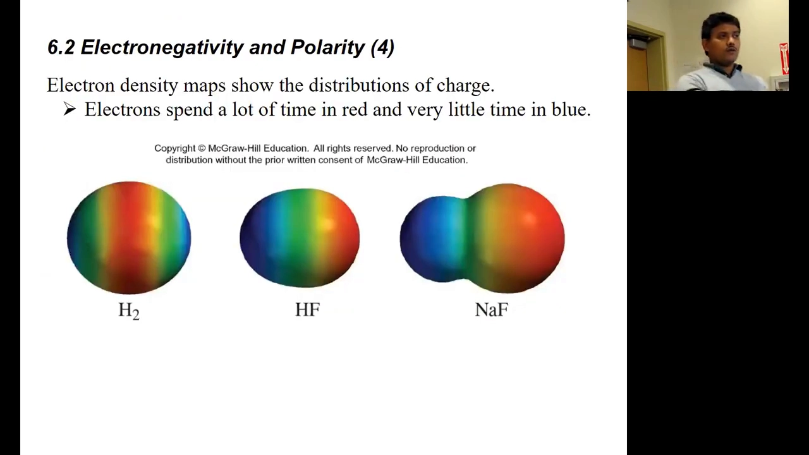
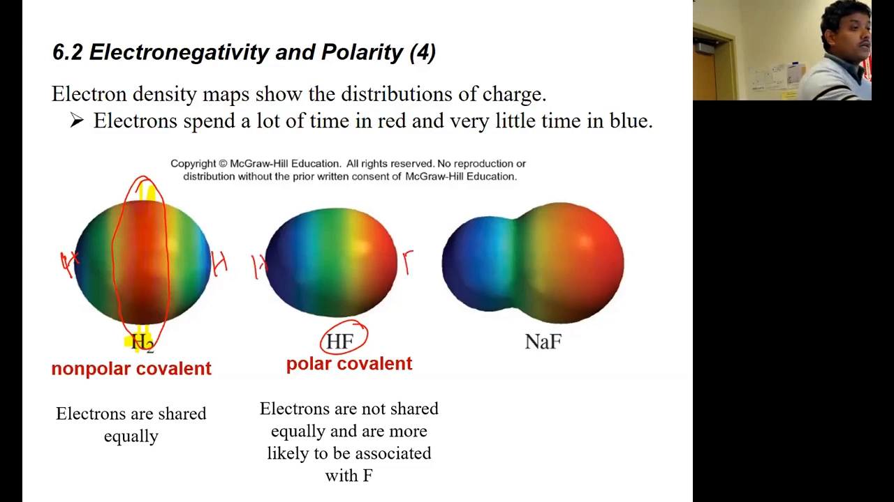
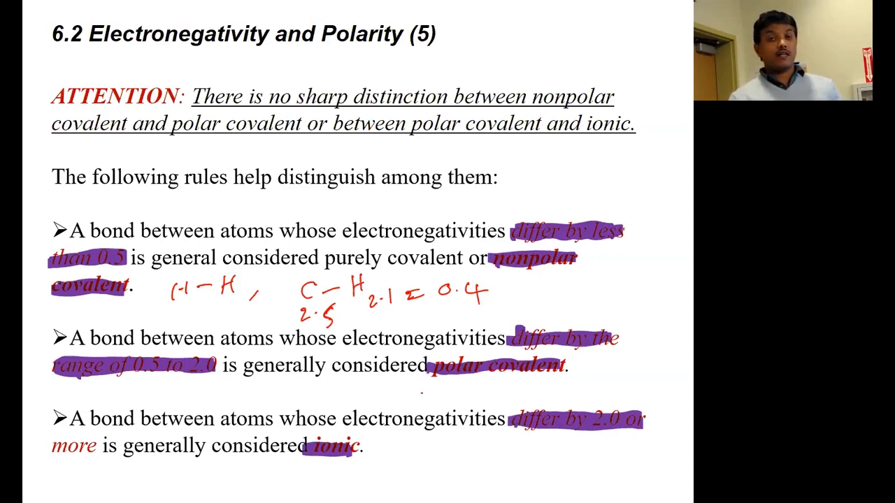
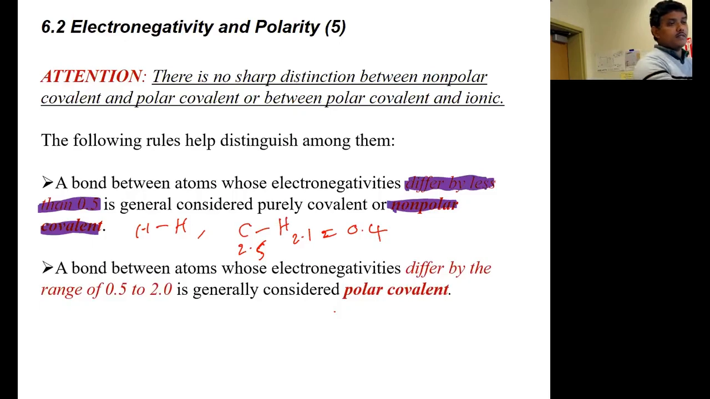

# 电负性、键型与键的极性：从原子半径到离子键

> 视频来源：[6.2 Electronegativity, Bond Types & Polarity: Nonpolar, Polar Covalent & Ionic (Part 1)](https://www.youtube.com/watch?v=0txc-RQic7I)（YouTube · TheSTEMProfessor）｜时长约 15 分钟
> 导读：这支课把「电负性」讲成一条因果链：原子半径决定原子核拉住外层电子的力度，这个力度就是电负性；两个原子电负性之差，又决定了它们之间形成的是非极性共价键、极性共价键还是离子键。本文按这条链重排，并在末尾补充视频未展开的配位键与「键的极性 vs 分子的极性」。

## 本讲要解决的核心问题（SCQA）

**背景**：分子由原子通过化学键连成。同样是「键」，H₂ 里的两个氢共享电子，NaCl 里的钠和氯却是一个给、一个拿，HF 里的电子又明显偏向氟一侧。

**冲突**：这三种情况在纸面上都可以画成「两个原子之间有一条线」，但它们的物理本质完全不同——一条线掩盖了电子到底被谁掌握。

**疑问**：有没有一个**可以查表、可以算差值**的量，让我们一眼判断两个原子之间会形成哪种键？

**回答（中心思想）**：有，就是**电负性**（electronegativity）。它衡量原子在化合物中把电子拉向自己的能力，根源是原子半径：半径越小，原子核离外层电子越近，拉得越紧。两个原子的电负性之差 $\Delta\text{EN}$ 就是判据：**小于 0.5 是非极性共价键，0.5 到 2.0 是极性共价键，2.0 及以上是离子键**。

## 一、电负性：原子在化合物中「抢电子」的能力

### 1.1 定义：为什么原子要抢电子

[【跳转到 00:30】](https://www.youtube.com/watch?v=0txc-RQic7I&t=30)

视频给的定义是：**电负性是化合物中一个原子把电子拉向自己的能力**。

为什么原子有这种倾向？因为它想达到稀有气体的电子构型，也就是上一节讲的八隅体。原子通过共享电子来凑满 8 个，但**并不是所有原子在这笔交易里地位平等**——有的原子核更「贪」，会把共用电子拉得更靠近自己。

### 1.2 根源是原子半径：越小拉得越紧

[【跳转到 01:20】](https://www.youtube.com/watch?v=0txc-RQic7I&t=80)

视频先复习原子半径的周期趋势：**从右到左增大，从上到下增大**。反过来看，从锂到氟，原子半径一路变小。

半径变小意味着什么？原子核带正电，外层电子带负电，两者互相吸引；**距离越短，吸引力越强**。所以半径小的原子，外层电子被原子核抓得更牢，它去抢别人电子的能力也更强。

[【跳转到 03:25】](https://www.youtube.com/watch?v=0txc-RQic7I&t=205)

由此得到电负性的两条趋势，正好与原子半径**相反**：

- **从左到右增大**（同周期）；
- **从上到下减小**（同主族）。

所以氟是电负性最大的元素——它半径最小，抢电子最凶。

### 1.3 具体比较：F > O > N，Cl 抢得过 Na

[【跳转到 04:15】](https://www.youtube.com/watch?v=0txc-RQic7I&t=255)

视频用几组对比把趋势落地：

- 氧比氟大，所以氟的电负性高于氧；
- 氧比氮小，所以氧的电负性高于氮；
- 钠的半径是 186 pm，氯只有 99 pm，所以氯能把钠的电子抢过来——这正是 NaCl 形成的原因。

一般规律：**金属电负性最低**（它们倾向失去电子达到稀有气体构型），**非金属电负性高**（它们倾向再拿一个电子）。

### 1.4 数值表：氟是 4.0

[【跳转到 05:43】](https://www.youtube.com/watch?v=0txc-RQic7I&t=343)

视频展示了一张电负性数值表，并强调这是后面要反复查的表。几个关键值：

| 元素 | 电负性 |
| --- | --- |
| F | 4.0 |
| O | 3.5 |
| N | 3.0 |
| C | 2.5 |
| H | 2.1 |
| Na | 0.9 |

同主族从上到下（F → Cl → Br → I → At）电负性缓慢下降，原因还是半径变大。视频用**有效核电荷**解释同周期趋势：从左到右质子数增加，原子核拉住外层电子的能力增强，半径缩小，电负性升高。

## 二、电负性差 ΔEN 决定键型

### 2.1 三种键

[【跳转到 07:28】](https://www.youtube.com/watch?v=0txc-RQic7I&t=448)

两个原子成键时，键的性质由它们电负性之差决定：

1. **非极性共价键**（nonpolar covalent，也叫纯共价键）：两个原子电负性相近，电子**平均共享**；
2. **极性共价键**（polar covalent）：电负性差得比较明显，电子仍然共享，但**偏向电负性大的一方**；
3. **离子键**（ionic）：电负性差得很大，电子不再共享，而是**从一个原子转移给另一个原子**，靠正负离子间的静电吸引结合。

视频特别指出：**极性共价键是化学里最常见的一种键**，也是后面课程的重点。

### 2.2 电子密度图：同一件事的三种样子

[【跳转到 09:58】](https://www.youtube.com/watch?v=0txc-RQic7I&t=598)

视频用 X 射线测得的电子密度图（electron density map）做直观对照。图上红色表示电子出现得多，蓝色表示出现得少：

- **H₂**：电子云对称地待在两个氢中间，谁也不占便宜——非极性共价键；
- **HF**：电子云明显偏向氟一侧（氟 4.0、氢 2.1）——极性共价键，电子仍共享但极不均匀；
- **NaF**：电子已经整个跑到氟那边，钠变成正离子、氟变成负离子，两者靠静电吸引——离子键。

[【跳转到 10:53】](https://www.youtube.com/watch?v=0txc-RQic7I&t=653)

同一个画面被讲者逐一圈注：H₂ 标为 nonpolar covalent、HF 标为 polar covalent，NaF 则说明电子已不再共享。

### 2.3 阈值：0.5 与 2.0

[【跳转到 13:12】](https://www.youtube.com/watch?v=0txc-RQic7I&t=792)

视频先给了一句重要提醒：**非极性共价、极性共价、离子键之间没有绝对的分界线**，这些阈值只是帮助判断的经验规则。

具体规则：

- $\Delta\text{EN} < 0.5$：非极性共价键；
- $0.5 \le \Delta\text{EN} < 2.0$：极性共价键；
- $\Delta\text{EN} \ge 2.0$：离子键。

[【跳转到 14:02】](https://www.youtube.com/watch?v=0txc-RQic7I&t=842)

视频用两个例子检验这套规则：

- **C–H 键**：碳 2.5、氢 2.1，差 0.4，小于 0.5，所以是**非极性共价键**。视频由此解释：C–H 键在化学上很「稳定」，很难被打开，因为它不参与化学反应。
- **HCl、HBr、C–Cl、C–F、N–O**：差值落在 0.5 到 2.0 之间，都是**极性共价键**。

### 2.4 这套判据在化学信息学里怎么用

> 以下内容是补充背景，不在视频中。

在分子描述符里，电负性差最直接的用途是给每个键打上「极性」标签，进而估计**部分电荷**（partial charge）。形式电荷只区分整数电荷，而极性共价键上的电荷是分数（常用 $\delta^+$、$\delta^-$ 表示），这正是分子间静电作用、氢键与对接打分的输入。

需要注意：$\Delta\text{EN}$ 判据是**定性的经验规则**。真实分子的电荷分布还受杂化、共轭、邻近基团影响，所以软件里通常用 Gasteiger、MMFF 等模型算部分电荷，而不是直接查电负性表相减。

## 三、补充：配位键与「键的极性 ≠ 分子的极性」

> 以下内容是补充背景，不在视频中。

**配位键**（coordinate/dative bond）是共价键的一种特例：共用电子对**由一方单独提供**，另一方只提供空轨道。比如 NH₃ 的氮把一对孤对电子给 H⁺，形成 NH₄⁺；水与 H⁺ 形成 H₃O⁺ 也是同样道理。在分子图里，配位键和普通共价键一样就是一条边；区别在**电子账**上——用形式电荷算一下，就能看出哪个原子「出」了电子对。

另外要区分两个层次：

- **键的极性**：看一根键两端原子的 $\Delta\text{EN}$，是局部的；
- **分子的极性**：看整个分子的偶极矩是否抵消。CO₂ 有两根极性 C=O 键，但分子是直线形，两个偶极方向相反、互相抵消，整体**非极性**；H₂O 的两根 O–H 键呈折角，偶极不能抵消，整体**极性**。

所以「有极性键」不等于「是极性分子」，这一点在判断溶解性、跨膜能力时非常关键。

## 小结

- 电负性是原子在化合物中拉电子的能力，根源是原子半径：半径越小，拉得越紧；
- 趋势：同周期从左到右增大，同主族从上到下减小，与原子半径相反；氟最大（4.0）；
- 键型由电负性差决定：$\Delta\text{EN}<0.5$ 非极性共价，$0.5\sim2.0$ 极性共价，$\ge 2.0$ 离子键；
- 三种键之间**没有绝对分界**，阈值只是经验规则；
- 电子密度图把三种键画成「对称共享 → 偏向一方 → 完全转移」的连续变化；
- C–H 键的 $\Delta\text{EN}$ 只有 0.4，属于非极性共价键，这解释了有机骨架为什么化学上相对惰性；
- 补充两点：配位键是电子对由一方提供的共价键；有极性键不等于分子有极性，还要看偶极是否抵消。

## 关键术语速查

| 术语 | 一句话解释 |
| --- | --- |
| 电负性 | 化合物中原子把电子拉向自己的能力，氟最高为 4.0 |
| 有效核电荷 | 原子核实际作用在外层电子上的净正电荷，同周期从左到右增大 |
| 非极性共价键 | 电负性差小于 0.5，电子平均共享 |
| 极性共价键 | 电负性差 0.5 到 2.0，电子共享但偏向电负性大的一方 |
| 离子键 | 电负性差不小于 2.0，电子完全转移，靠静电吸引结合 |
| 电子密度图 | 用颜色表示电子出现概率的图，红多蓝少 |
| 部分电荷 | 极性键上分数形式的电荷，用 $\delta^+$、$\delta^-$ 表示 |
| 配位键 | 共用电子对由一方单独提供的共价键，如 NH₄⁺ |