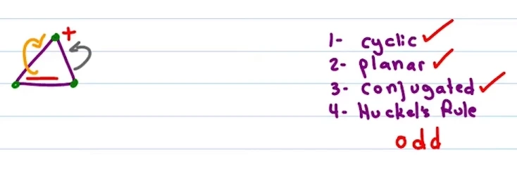
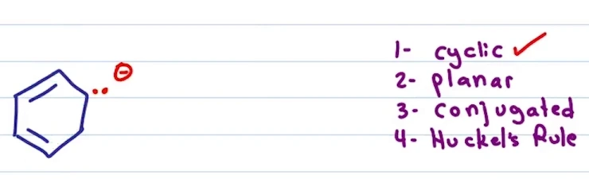
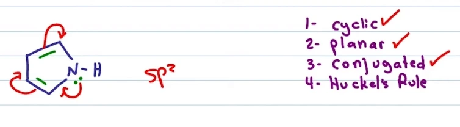
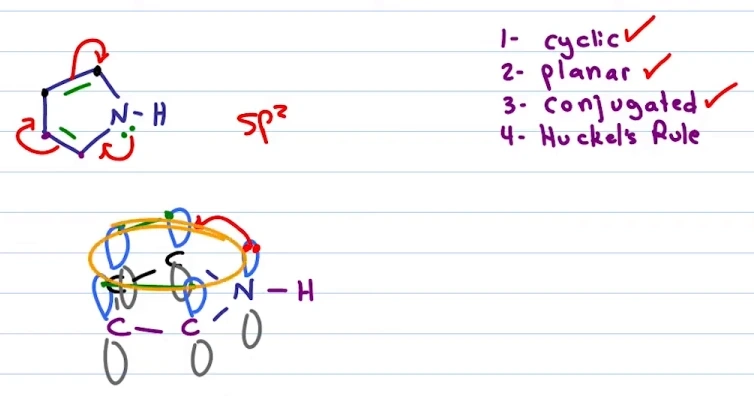
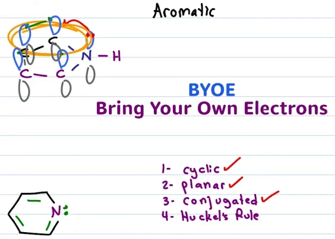
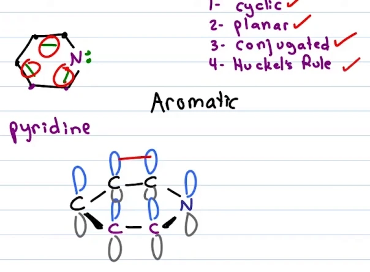

# 带电环与杂环的芳香性：吡咯的氮"自带电子"，吡啶的氮"不出力"

> 视频来源：[Aromaticity of Charged and Heterocyclic Compounds](https://www.youtube.com/watch?v=dsQttwQXYD8)（YouTube · Leah4sci）｜时长约 14 分钟
> 导读：这支视频专门处理芳香性判定里最容易翻车的两类分子——**带电荷的环**和**含杂原子的环**。它给出一套"四步检查表 + 电子对奇偶速算"的流程，并用侧视图解释：为什么吡咯的氮必须交出自己的孤对电子，而吡啶的氮明明有孤对电子却不能算。

## 本讲要解决的核心问题（SCQA）

**背景**：判断芳香性的四步检查表已经很清楚——**环状、共面、共轭、满足休克尔规则**。用这套表判断苯这类"纯碳、无电荷"的环，几乎没有歧义。

**冲突**：真实分子往往不是这样。环上可能带正电荷或负电荷，也可能有氮、氧、硫这样的杂原子。此时"数 π 电子"立刻变得含糊：正电荷算几个电子？负电荷算几个？杂原子上的孤对电子到底算不算进共轭体系？

**疑问**：面对带电环和杂环，怎样才能不靠死记硬背、而是每次都数对？

**回答（中心思想）**：四步检查表**照用不改**，只是"数电子"这一步要守两条规矩：**电荷提供的是空 p 轨道（阳离子）或一对孤对电子（阴离子）**；**杂原子一次只能参与一次共轭**——它已经有 π 键，就不要再把孤对电子算进去；它没有 π 键，才用一对孤对电子。判定的快捷方式是数**能参与共振的电子对**：**奇数对**满足休克尔规则，**偶数对**不满足。

## 一、四步检查表：换了分子，流程不换

[【跳转到 00:00】](https://www.youtube.com/watch?v=dsQttwQXYD8&t=0)

视频开宗明义：一个分子要芳香，必须**环状、共面、共轭、满足休克尔规则**。但这并不意味着环上只能有碳——苯只是最简单的情形（6 个碳、3 根 π 键、别无他物）。

当分子里出现负电荷、正电荷，或者环上换成了别的原子时，**不要另立标准**，仍然按这张检查表逐条过。讲者强调：要预先知道"什么样的电荷、什么样的杂环会给出什么结果"，这样判定时才不会慌。

## 二、阳离子：空的 p 轨道也是共轭的一环

[【跳转到 00:55】](https://www.youtube.com/watch?v=dsQttwQXYD8&t=55)

先看**碳正离子**。一个碳正离子连着三个原子，还剩一个**空的 p 轨道**，位于碳原子的上下方。它是 sp² 杂化的，p 轨道里**没有电子**，正张着口等待一对电子——比如用来形成一根 π 键。

这解释了共振的方向性：π 键或孤对电子很"乐意"往正电荷那边移动，于是正电荷被挪到另一个碳上，形成一个可以持续传递的共轭体系。**空 p 轨道不提供电子，但它让共轭得以延续**，这一点在数电子时容易漏掉。

### 2.1 环丙烯基阳离子：1 根 π 键，奇数，芳香

[【跳转到 01:45】](https://www.youtube.com/watch?v=dsQttwQXYD8&t=105)

拿一个带正电荷的三元环来走流程：

1. **环状**？能绕一圈画回来，是。
2. **共面**？每根 π 键两端的碳都是 sp²，正电荷所在的碳也是 sp²，是。
3. **共轭**？那根 π 键可以向空 p 轨道方向共振——向左或向右都行，整环完全共轭，是。
4. **休克尔规则**？这里用一个速算：**总共 1 根 π 键，是奇数**，奇数就符合休克尔规则。

结论：这个环虽然小、张力很大，但它是**芳香性**的。

[【跳转到 02:35】](https://www.youtube.com/watch?v=dsQttwQXYD8&t=155)

### 2.2 环戊二烯基阳离子：2 根 π 键，偶数，反芳香

[【跳转到 03:00】](https://www.youtube.com/watch?v=dsQttwQXYD8&t=180)

把同样的思路搬到五元环上：环戊二烯本来因为有一个 sp³ 碳而**非芳香**；如果把这个 sp³ 碳换成**碳正离子**，它就变成 sp²、分子也就平面了。此时环状、共面、共轭三条全过。

但数电子时：**总共 4 个 π 电子，也就是 2 根 π 键**——偶数。偶数不符合休克尔规则，属于"反休克尔"，因此它是**反芳香性**的。

[【跳转到 03:25】](https://www.youtube.com/watch?v=dsQttwQXYD8&t=205)

## 三、阴离子：孤对电子必须先"坐进" p 轨道

[【跳转到 03:50】](https://www.youtube.com/watch?v=dsQttwQXYD8&t=230)

阴离子的评估方式与阳离子相同，只是"An"（阴离子）意味着**多**了一对电子而不是少了一对。如果体系里是"一根 π 键旁边一个碳负离子"，负电荷那对电子可以向 π 键方向共振，得到的新共振式里 π 键移到了中间、左边剩下一个孤对电子——显然还能继续共振。

讲者在这里补了一个关键前提：**要让这对电子参与共振，那个碳必须是 sp² 杂化，把孤对电子放进 p 轨道**。否则电子待在 sp³ 的杂化轨道里，方向不对，够不着 π 体系。这一点在判断阴离子时尤其要盯住。

### 3.1 环戊二烯基阴离子：6 个电子、3 对，芳香

[【跳转到 04:40】](https://www.youtube.com/watch?v=dsQttwQXYD8&t=280)

还是那个五元环，这次把碳正离子换成**带孤对电子的碳负离子**：

- **环状**：孤对电子能共振进环里，是。
- **共面**：孤对电子必须坐在 sp² 碳上，于是全环都是 sp²，是。
- **共轭**：阴离子能共振进环，是。
- **休克尔规则**：这里要小心——**不能只看 π 键的根数**。两根 π 键是偶数，但真正决定芳香性的是**能参与共振的电子对总数**：2 根 π 键 + 1 对孤对电子 = **3 对，奇数**，符合休克尔规则。

结论：环戊二烯基阴离子是**芳香性**的。

[【跳转到 05:30】](https://www.youtube.com/watch?v=dsQttwQXYD8&t=330)

### 3.2 六元环阴离子：数出 6 个电子，却仍然非芳香

[【跳转到 05:55】](https://www.youtube.com/watch?v=dsQttwQXYD8&t=355)

紧接着是一个"陷阱题"：一个六元环上带负电荷。如果只盯着电子数，6 个电子、3 对、奇数，看起来该是芳香的。

但检查表还有前三条。这个环上**有一个碳既没有电荷、也没有 π 键**，它是 sp³ 杂化的、呈四面体构型。于是：

- 分子**不共面**（那个 sp³ 碳把取代基顶出了平面）；
- 整环**不共轭**（共振传不到 sp³ 碳上）。

讲者的说法很形象：这个 sp³ 碳"对芳香性毫无兴趣"，它让整个分子变成**非芳香性**。

[【跳转到 06:20】](https://www.youtube.com/watch?v=dsQttwQXYD8&t=380)

这个例子说明：**电子数只是四条中的一条**。数对了电子数，仍可能因为几何或共轭被否掉。

## 四、速算法：数"能参与共振的电子对"，看奇偶

视频反复用到同一个捷径，值得单独拎出来：

- 不去数 π 电子总数，而是数**能参与共振的电子对**（每根 π 键算一对，参与共轭的一对孤对电子也算一对）；
- **奇数对** → 满足休克尔规则（因为 $4n+2$ 除以 2 是 $2n+1$，永远是奇数）；
- **偶数对** → 不满足（$4n$ 除以 2 是 $2n$，永远是偶数）。

用这个捷径回看前面的例子：环丙烯基阳离子 1 对（奇，芳香）、环戊二烯基阳离子 2 对（偶，反芳香）、环戊二烯基阴离子 3 对（奇，芳香）、苯 3 对（奇，芳香）。四种情形一次对齐。

## 五、杂环：一个原子只能参与一次共轭

[【跳转到 06:45】](https://www.youtube.com/watch?v=dsQttwQXYD8&t=405)

**杂环**（heterocyclic）就是环上有"别的"原子——不是碳的原子。视频用一个很实用的动机来解释为什么要专门讨论它：**芳香性是高度稳定的状态，只要能芳香，分子就会努力去芳香**；稳定的东西不活泼，不稳定的东西才活泼。所以杂原子"如果有能力，就会想办法为芳香性做贡献"。

但"做贡献"有明确的规则，讲者把它压缩成三个判断：

1. **一个原子不能同时用两对电子参与共振**。要么用一根 π 键，要么用一对孤对电子，**只此一次**。
2. **如果这个原子已经有 π 键参与共振，就不要再把它的孤对电子算进来**。
3. **如果它没有 π 键，就用它的一对孤对电子**；即使它有两对孤对电子，也**只需要一对**。

[【跳转到 08:34】](https://www.youtube.com/watch?v=dsQttwQXYD8&t=514)

一句话版本：**"已经有 π 键 → 不用孤对电子；没有 π 键 → 用一对孤对电子。"**

## 六、吡咯：氮必须"自带电子"

[【跳转到 08:54】](https://www.youtube.com/watch?v=dsQttwQXYD8&t=534)

用这套规则看**吡咯**（pyrrole，五元环，环上有一个 N–H）：

- **环状**：绕一圈能回到起点，包括氮原子，是。
- **共面**：碳都有 π 键、是 sp²；氮看上去是 sp³（三根键 + 一对孤对电子），但这里要用到共振的一条规则——**如果原子有能力参与共振，它会重新杂化成 sp² 以便参与**。所以氮实际上是 sp²，分子是平面的。
- **共轭**：氮没有 π 键，于是**必须交出自己的那对孤对电子**进入 p 轨道，与环上两根 π 键连成一体。
- **休克尔规则**：2 根 π 键 + 1 对孤对电子 = **3 对，奇数**，符合。

[【跳转到 10:09】](https://www.youtube.com/watch?v=dsQttwQXYD8&t=609)

视频还给了一个可以动手搭模型的**侧视图**：把两个碳放在后方、两个碳放在前方，p 轨道画在环平面的上下两侧；氮是 sp²，键角约 120°，**N–H 键垂直于环平面、指向外侧**——正是这个朝向让氢不挡住 p 轨道，而氮的那对孤对电子则进入 p 轨道，与两侧的 π 键连起来。

[【跳转到 10:59】](https://www.youtube.com/watch?v=dsQttwQXYD8&t=659)

## 七、吡啶：氮的孤对电子在环平面内，够不着 π 体系

[【跳转到 11:24】](https://www.youtube.com/watch?v=dsQttwQXYD8&t=684)

**吡啶**（pyridine）看起来和吡咯一样"应该芳香"，但走流程会发现关键差别：

- **环状**、**共面**（全是 sp²）、**共轭**（把氮遮住看，它就是苯），三条都过。
- **休克尔规则**：如果按"3 根 π 键 + 1 对孤对电子 = 4 对"来数，是偶数，结论会变成反芳香——**这就错了**。

错在哪里？回到第五节那条规则：**氮已经有 π 键、已经在共振体系里了，它的孤对电子就不算数**。于是只数 3 对，奇数，**吡啶是芳香性**的。

[【跳转到 12:14】](https://www.youtube.com/watch?v=dsQttwQXYD8&t=734)

视频用侧视图解释了"为什么那对电子想参与也参与不了"：氮是 sp² 杂化时，那对孤对电子占据的是**位于环平面内**的 sp² 轨道，方向与 p 轨道**垂直**（讲者说"像一根指向自己、与分子成 120° 的键"）。而 π 体系用的是垂直于环平面的 p 轨道。两者方向差 90°，**根本无法重叠**，所以这对电子既不算进 π 电子数，也不参与共轭。

[【跳转到 13:04】](https://www.youtube.com/watch?v=dsQttwQXYD8&t=784)

**吡咯和吡啶的差别可以一句话记住**：吡咯的氮**没有** π 键，只能"自带电子"（视频写作 BYOE，bring your own electrons）参与；吡啶的氮**已经有** π 键，那对孤对电子就留在环平面里，不参与计数。两者都是芳香环，但一个 6 个 π 电子里有 2 个来自氮，另一个 6 个全部来自环上的三根 π 键。

## 八、补充：这套判据在药物分子里的用处

> 以下内容不在视频里，是为把判据接到"药物发现"语境而补的背景。

- **五元杂环与六元杂环是两类不同的骨架**：吡咯型（吡咯、呋喃、噻吩、吲哚）靠"两根 π 键 + 一对孤对电子"凑 6 个电子，杂原子**参与了共轭**；吡啶型（吡啶、嘧啶、吡嗪）靠"三根 π 键"，杂原子的孤对电子**留在环平面内**。吲哚、嘌呤这类稠环体系里同时存在两种氮：一个像吡咯的氮（交出孤对电子），一个像吡啶的氮（孤对电子可用）。
- **孤对电子"能不能用"直接决定酸碱性**：吡啶的氮孤对电子在平面内、可用，所以吡啶是碱，能被质子化；吡咯的氮孤对电子已经交给芳香体系，质子化会破坏芳香性，所以吡咯几乎不显碱性，反而 N–H 有一定的酸性。这是"电子结构决定化学性质"最直观的例子之一。
- **对建模与表示的影响**：正因为杂原子的孤对电子有时参与、有时不参与，程序在判断芳香性时必须同时看环的几何、电子数和杂原子的成键状态。同一个含氮环，写成不同的互变异构体或不同的质子化状态，芳香性判定可能随之改变——这也是后续讨论互变异构与分子形态时要格外小心的原因。

## 小结

- 带电环和杂环**沿用同一张四步检查表**：环状、共面、共轭、休克尔规则。
- **阳离子**提供的是空 p 轨道：环丙烯基阳离子 1 对电子（芳香），环戊二烯基阳离子 2 对（反芳香）。
- **阴离子**提供一对孤对电子，但前提是那个原子**先变成 sp²**，让电子进入 p 轨道：环戊二烯基阴离子 3 对（芳香）。
- **速算法**：数"能参与共振的电子对"，**奇数对符合 $4n+2$，偶数对不符合**。
- **电子数不是全部**：六元环阴离子数出 6 个电子，却因为环上有一个 sp³ 碳而不共面、不共轭，最终是**非芳香**。
- **杂原子一次只能参与一次**：已有 π 键就不算孤对电子，没有 π 键就用一对孤对电子。
- **吡咯 vs 吡啶**：前者"自带电子"（孤对电子进 p 轨道），后者孤对电子留在环平面内、与 π 体系垂直，不参与计数。

## 关键术语速查

| 术语 | 一句话解释 |
| --- | --- |
| 碳正离子（carbocation） | 带正电的碳，sp² 杂化、有一个空 p 轨道，可接受电子对 |
| 碳负离子（carbanion） | 带负电的碳，多出一对孤对电子；需 sp² 杂化才能参与共轭 |
| 反芳香性（antiaromatic） | 环状、共面、完全共轭但电子对数为偶数（$4n$），比非芳香更不稳定 |
| 非芳香性（nonaromatic） | 因不共面或不完全共轭（如环上有 sp³ 碳）而不满足芳香条件 |
| 电子对奇偶速算 | 数能参与共振的电子对：奇数对符合 $4n+2$，偶数对不符合 |
| 杂环（heterocycle） | 环上含 N、O、S 等非碳原子的环系 |
| BYOE | 视频里的说法 bring your own electrons：杂原子没有 π 键时，只能自带孤对电子参与共轭 |
| 吡咯型氮 / 吡啶型氮 | 前者交出孤对电子进 p 轨道，后者孤对电子留在环平面内不参与 |