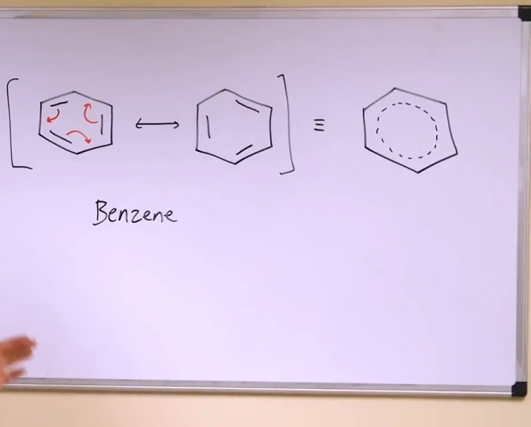
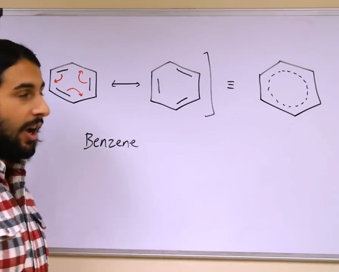
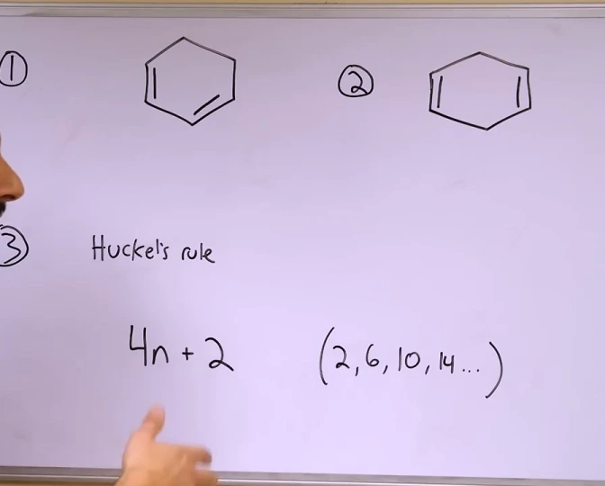
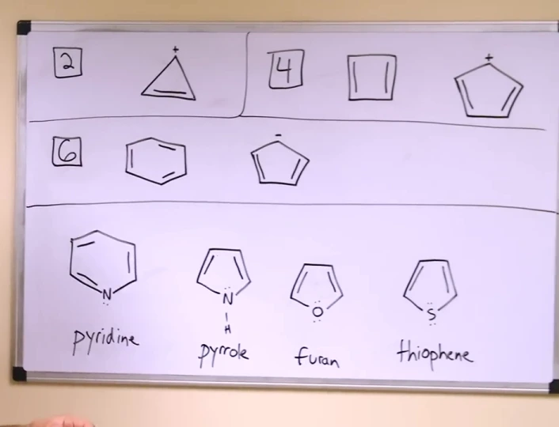
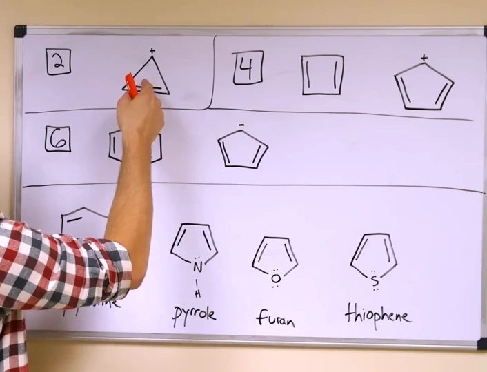
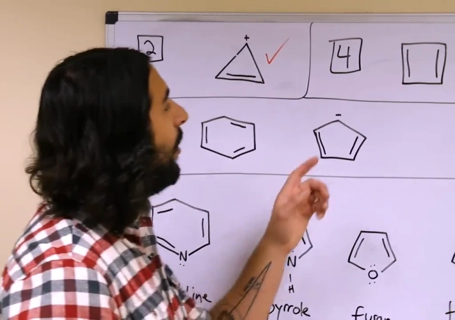
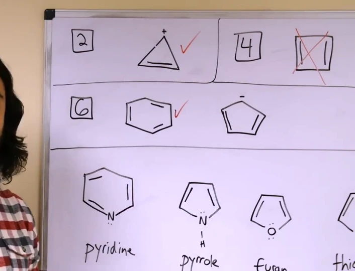
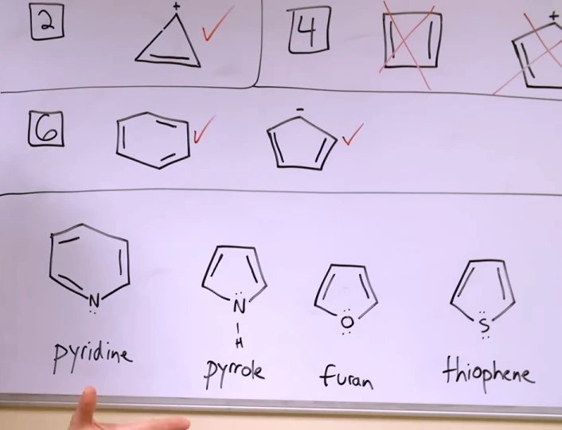

# 芳香性不是气味：休克尔规则与"键标记不等于真实电子结构"

> 视频来源：[Aromaticity and Huckel's Rule](https://www.youtube.com/watch?v=7-BguH4_WBQ)（YouTube · Professor Dave Explains）｜时长约 10 分钟
> 导读：这支视频用一块白板从苯出发，讲清"为什么芳香性是一种电子结构性质"，再给出三条判据与一组由易到难的例子，最后落到杂环上"孤对电子要不要参与共轭"这个最容易错的地方。本文按视频顺序整理，并在最后一节补充"画出来的键"与"存进计算机的键"之间的差别。

## 本讲要解决的核心问题（SCQA）

**背景**：有机化学里常把某些化合物叫作"芳香族"。这个称呼来自早期化学家从植物精油里闻到的好闻气味。

**冲突**：气味和分子结构其实没有必然关系。后来人们才发现，被叫作芳香族的那些分子，共同点在于它们都含有**完全共轭的不饱和环系**——于是"芳香性"从一个气味词变成了一个结构词。

**疑问**：既然芳香性描述的是环上的电子排布，那么给定一个环，凭什么判断它是不是芳香性的？图上画成单双键交替的苯，真实分子里那三根双键到底在不在？

**回答（中心思想）**：芳香性是一类**电子离域**带来的额外稳定性。判断它只需三条：环状且**完全共面**、**完全共轭**、离域的 π 电子数满足**休克尔规则** $4n+2$。而图上画的单双键交替只是**共振式**，真实分子是这些共振式的"复合体"——键标记不等于真实电子结构。

## 一、芳香性的本义：全共轭的不饱和环系

[【跳转到 00:00】](https://www.youtube.com/watch?v=7-BguH4_WBQ&t=0)

视频开头先纠正了这个词的来历：早期人们注意到某些从植物精油里分离出来的化合物有宜人的气味，于是把它们叫作"芳香"的；很久以后才明白，真正让它们归为一类的不是气味，而是**完全共轭的不饱和环系**。今天用这个词，指的就是分子结构本身。

最常见的例子是**苯**（benzene）。苯环上有三根 π 键，它们按"双键—单键—双键"的方式交替排列，这就是**共轭**（conjugation）。关键在于，这三个 π 键不是各自局限在某个局部，而是**在整个分子上离域**（delocalized）——不是离域在一部分，而是绕整个环离域。

[【跳转到 00:43】](https://www.youtube.com/watch?v=7-BguH4_WBQ&t=43)

## 二、苯的真实结构：两个凯库勒式都不是分子本身

[【跳转到 01:08】](https://www.youtube.com/watch?v=7-BguH4_WBQ&t=68)

苯可以画出**两个不同的共振结构**：把三根双键挪到另一组位置上。视频的讲法是：在两个共振式里，每一对相邻碳之间都**有机会**成为双键，所以这两个式子**实际上都不存在**，真正存在的是它们的**复合共振结构**（composite resonance structure）——也就是常画的"环内一个圆圈"。

[【跳转到 01:23】](https://www.youtube.com/watch?v=7-BguH4_WBQ&t=83)

讲者进一步说：苯"真正看起来像这样"——**整个环上分布着部分的 π 电子密度**（partial pi electron density）。这句话正是本小节要抓的核心：**图上画的那几根短线是记账方式，不是电子云的实际形状**。所谓"完全共轭的不饱和环系"，指的就是这种把 π 电子摊在整个环上的状态，而它是芳香性的**前提条件**。

[【跳转到 01:38】](https://www.youtube.com/watch?v=7-BguH4_WBQ&t=98)

## 三、判定芳香性的三条规则

[【跳转到 01:58】](https://www.youtube.com/watch?v=7-BguH4_WBQ&t=118)

视频把判据压成三条，逐条配了反例：

1. **整个环系必须共面**（fully planar）。只有 sp² 杂化的碳才是三角平面构型；如果环上出现 sp³ 杂化的碳，它呈四面体构型，取代基会"戳出纸面"，整个分子就不再是平面的。
2. **体系必须完全共轭**。π 键要按"双键—单键"交替的方式排好，相邻的 p 轨道才能重叠；如果两段 π 体系隔得太远，电子就没法从一个位置传到另一个位置。
3. **参与离域的 π 电子数必须满足休克尔规则**。

[【跳转到 03:03】](https://www.youtube.com/watch?v=7-BguH4_WBQ&t=183)

## 四、休克尔规则怎么用：把 n 代进去

休克尔规则写作：

$$
4n + 2
$$

其中 $n$ 可以取任意非负整数，算出来的就是"能让体系成为芳香性的离域 π 电子数"。视频里现场代入：

- $n=0$：$4\times 0+2=2$，即 2 个 π 电子也可能芳香；
- $n=1$：$4+2=6$，即 6 个 π 电子；
- 继续下去得到 $2, 6, 10, 14, \dots$

[【跳转到 03:48】](https://www.youtube.com/watch?v=7-BguH4_WBQ&t=228)

反过来，**8、12 这类数字不行**：即使分子完全共面、完全共轭，只要离域 π 电子数是 8 或 12，它也不是芳香性的。这条"反面清单"是后面判断反芳香性的依据。

## 五、逐例判定：从三元环到苯环

[【跳转到 04:23】](https://www.youtube.com/watch?v=7-BguH4_WBQ&t=263)

视频把例子按"离域 π 电子数"排成三行写在白板上：第一行是 2 电子与 4 电子，第二行是 6 电子，第三行是杂环。这样排列的好处是——**同一行里电子数相同，判据却可能相反**，差异全在几何与共轭上。

### 5.1 三元环阳离子：只有 2 个 π 电子，却芳香

[【跳转到 04:28】](https://www.youtube.com/watch?v=7-BguH4_WBQ&t=268)

第一个例子是一个带正电荷的三元环（环丙烯基阳离子）。它完全共面；正电荷所在的那个碳是**碳正离子**，sp² 杂化、带一个空的 p 轨道，所以整环仍然完全共轭——那根单独的 π 键可以把电子"推"到正电荷处，正电荷随之换到另一个碳上。讲者说，这样一共能画出**三个共振式**，正电荷轮流落在三个碳上，因此这一根 π 键是**绕整环离域**的。

前两条满足，再数电子：参与离域的只有 **2 个 π 电子**，正好是 $4n+2$ 在 $n=0$ 时的值，所以它是**芳香性**的。

[【跳转到 04:38】](https://www.youtube.com/watch?v=7-BguH4_WBQ&t=278)

[【跳转到 04:46】](https://www.youtube.com/watch?v=7-BguH4_WBQ&t=286)

### 5.2 四元环与五元环阳离子：4 个 π 电子，反芳香

[【跳转到 05:26】](https://www.youtube.com/watch?v=7-BguH4_WBQ&t=326)

接下来两个例子都是 4 个 π 电子：

- **环丁二烯**：所有碳都是 sp²，分子完全平面、完全共轭，还能画出另一个共振式；但参与离域的是 **4 个 π 电子**，不满足 $4n+2$，于是它是**反芳香性**（antiaromatic）的。
- **环戊二烯基阳离子**：五元环上带一个正电荷，同样能画出五个共振式、正电荷轮流落在五个碳上；但电子数仍是 **4 个**，所以也是**反芳香性**的。

[【跳转到 05:48】](https://www.youtube.com/watch?v=7-BguH4_WBQ&t=348)

这里的要点是：**"能共振"不等于"芳香"**。共轭只是必要条件之一，电子数必须同时对上 $4n+2$。

### 5.3 苯：6 个 π 电子

[【跳转到 06:21】](https://www.youtube.com/watch?v=7-BguH4_WBQ&t=381)

回到苯：所有碳都是 sp²、隐式氢都在纸面内，完全平面、完全共轭，还有另一个共振式。数电子时讲者给了一个通用算法——**每根 π 键贡献 2 个 π 电子**，苯有三根 π 键，就是 6 个，满足 $4n+2$，所以芳香。

### 5.4 环戊二烯基阴离子：多一对孤对电子，就够 6 个

[【跳转到 07:09】](https://www.youtube.com/watch?v=7-BguH4_WBQ&t=429)

最后一个例子把阳离子换成**阴离子**。讲者提醒：能参与共振的不只是成键电子，**孤对电子也可以**。负电荷意味着一对额外的电子，它同样可以离域。

于是同一个五元环，从"少一对电子"（阳离子，4 个 π 电子）变成"多一对电子"（阴离子，6 个 π 电子），电子数一下就对上了 $4n+2$，分子变成**芳香性**。

[【跳转到 07:09】](https://www.youtube.com/watch?v=7-BguH4_WBQ&t=429)

## 六、杂环：孤对电子"需要时才参与"

[【跳转到 08:01】](https://www.youtube.com/watch?v=7-BguH4_WBQ&t=481)

**杂环**（heterocyclic）指环里除了碳还有别的元素：吡啶（pyridine）含氮，呋喃（furan）含氧，噻吩（thiophene）含硫，吡咯（pyrrole）也含氮。这些杂原子都带孤对电子，而孤对电子**可能参与、也可能不参与**共振。

讲者给的原则有两句，都是判断的关键：

- 芳香性是**很强的稳定化因素**，所以"只要能芳香，分子就会芳香"；
- 但**可用的孤对电子只在"需要"时才参与共振**。

具体到分子：

- **吡啶**：环上已有三根 π 键，**不需要**孤对电子也能凑够芳香性，所以那对孤对电子**不计入**，只看三根 π 键的 6 个电子。
- **吡咯**：环上只有两根 π 键，氮的**那一对**孤对电子**必须**参与，才凑成 6 个电子。
- **呋喃、噻吩**：氧和硫各有两对孤对电子，但**只需要一对**参与共振，另一对不参与。

[【跳转到 09:20】](https://www.youtube.com/watch?v=7-BguH4_WBQ&t=560)

所以这四个杂环都是芳香性的，但"数出来是 6 个电子"的**凑法完全不同**：吡啶是"三根 π 键"，其余三个是"两根 π 键 + 一对孤对电子"。这也是初学者最容易数错的地方——**同样数出 6，来源可以不一样**。

## 七、补充：从"画出来的键"到"存进计算机的键"

> 以下内容不在视频里，是为把本节与后续"计算表示"衔接起来而补的背景。

视频反复强调"图上画的键不是真实结构"。这句话在化学信息学里有一个非常具体的落地版本：

- **键长与键级**：苯的六根 C–C 键实测等长，约 1.39 Å，介于典型 C–C 单键（约 1.54 Å）与 C=C 双键（约 1.34 Å）之间，常被说成"键级约 1.5"。凯库勒式里"三根单键三根双键"的写法，在几何上是不成立的。
- **两种等价的文本写法**：SMILES 里既可以用**小写芳香原子**写苯（`c1ccccc1`），也可以用**凯库勒式**写交替单双键（`C1=CC=CC=C1`）。前者声明"这是芳香体系"，后者只是把双键位置写死；两者描述的是同一个分子，但携带的信息不同。
- **程序怎么判断**：RDKit 这类工具读入分子后，会按内置的**芳香性模型**（默认是 RDKit 自己的模型，另有 MDL 等可选模型）重新感知哪些环是芳香的，输出时可以选择保留芳香标记或**凯库勒化**（kekulize）成单双键。也就是说，"这个环是不是芳香的"通常不是从文件里读来的，而是**程序按规则重新算出来的**。

这带来一个实践上的提醒：**同一个分子可以有多种合法写法，但芳香性判定应当一致**；如果两个工具对同一个环给出不同结论，问题往往出在芳香性模型或输入的价态/电荷上，而不是"分子变了"。

在药物化学里，这套判据的用处很直接：芳香环是绝大多数小分子药物的骨架（苯、吡啶、嘧啶、吲哚等），它们平面、疏水、可堆叠；同时芳香环上的电子密度分布也决定了哪里容易被代谢酶氧化、哪里能形成 π–π 堆积。把"环是不是芳香的"判断错，后面关于性质与代谢位点的推理就会整体跑偏。

## 小结

- **芳香性是一种电子结构性质**，不是气味；它的结构前提是"完全共轭的不饱和环系"。
- 苯的两个凯库勒式**都不等于真实分子**，真实结构是它们的复合体：π 电子密度摊在整个环上。
- 三条判据：**共面 + 完全共轭 + π 电子数满足 $4n+2$**；三条缺一，就不是芳香性。
- 休克尔数：$2, 6, 10, 14, \dots$ 可以；**8、12 不行**，对应的是反芳香性。
- 数电子时别忘了**孤对电子也能参与**：环戊二烯基阳离子 4 个（反芳香），阴离子 6 个（芳香）。
- 杂环的口诀是"**需要才参与**"：吡啶不用氮的孤对电子，吡咯/呋喃/噻吩各用一对。
- 在计算表示里，"芳香"是程序按规则**重新感知**出来的属性，与文件里写成小写芳香原子还是凯库勒式无关。

## 关键术语速查

| 术语 | 一句话解释 |
| --- | --- |
| 共轭（conjugation） | π 键按双键—单键交替排列，相邻 p 轨道可以重叠、电子可以传递 |
| 离域（delocalization） | π 电子不再局限在某两根原子之间，而是分布在整个共轭体系上 |
| 复合共振结构 | 多个共振式叠加后的真实电子分布，如苯的"环内圆圈" |
| 休克尔规则 | 芳香性要求离域 π 电子数为 $4n+2$，即 2、6、10、14…… |
| 反芳香性（antiaromatic） | 共面、完全共轭但 π 电子数为 $4n$（4、8、12……），比非芳香更不稳定 |
| 非芳香性（nonaromatic） | 共面或共轭条件不满足（如环上有 sp³ 碳），谈不上芳香或反芳香 |
| 杂环（heterocycle） | 环上除碳以外还含 N、O、S 等杂原子的环系 |
| 孤对电子参与共轭 | 杂原子的孤对电子进入 p 轨道、成为 π 体系的一部分；只在"需要凑数"时参与 |