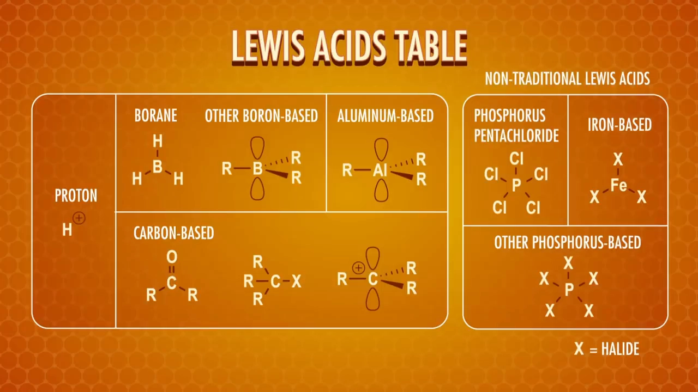
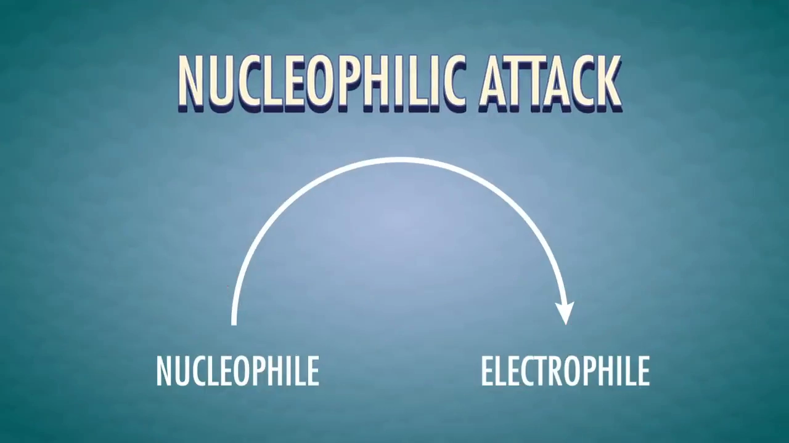
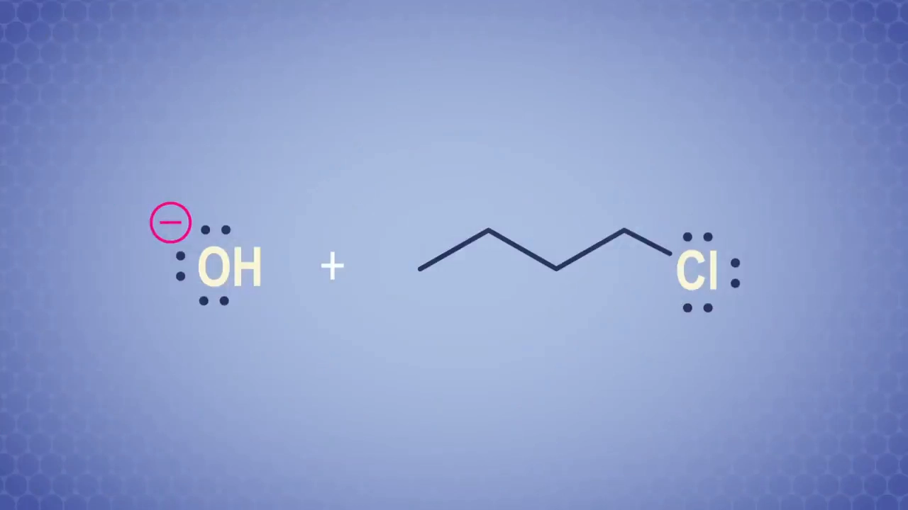
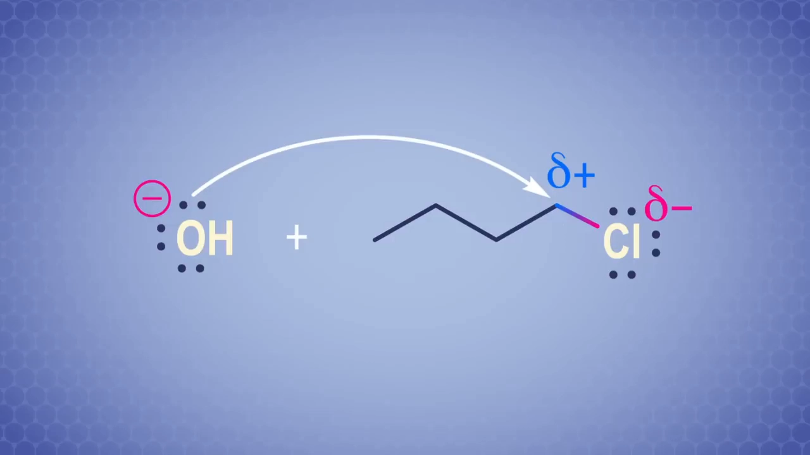
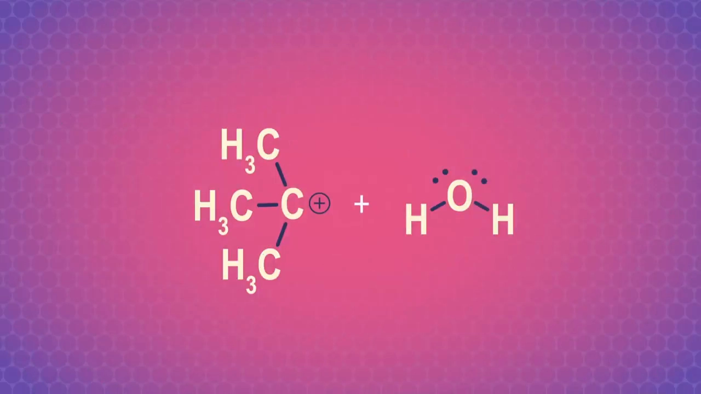
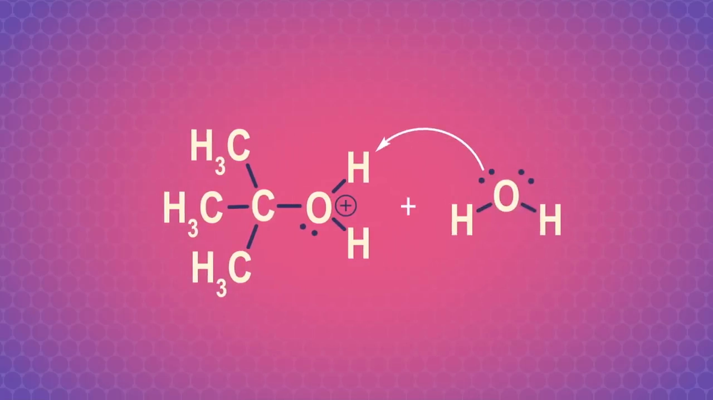
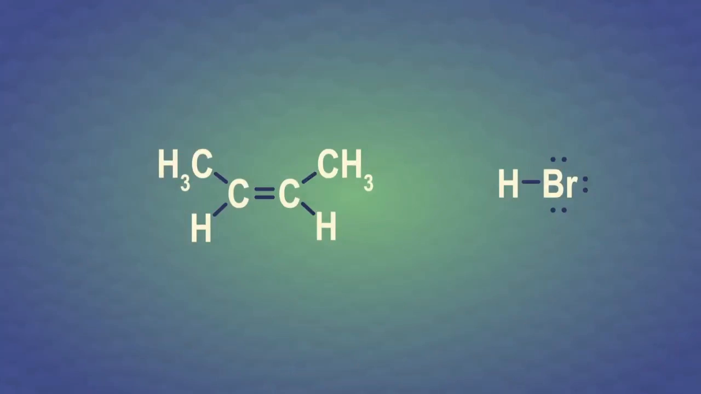
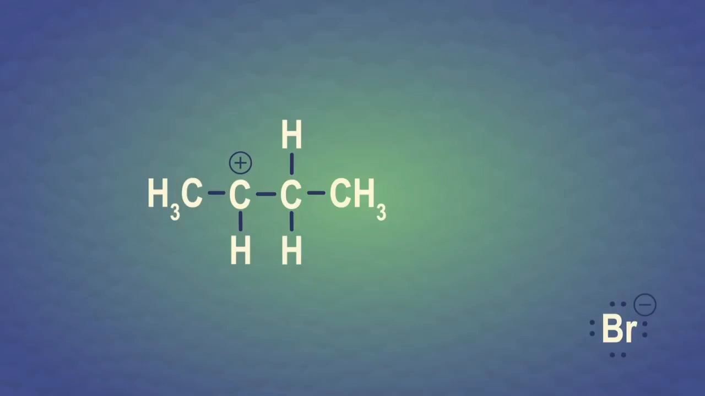
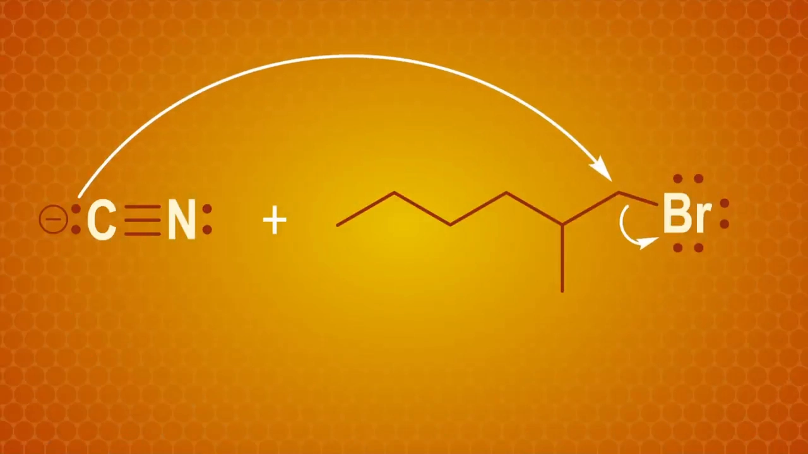
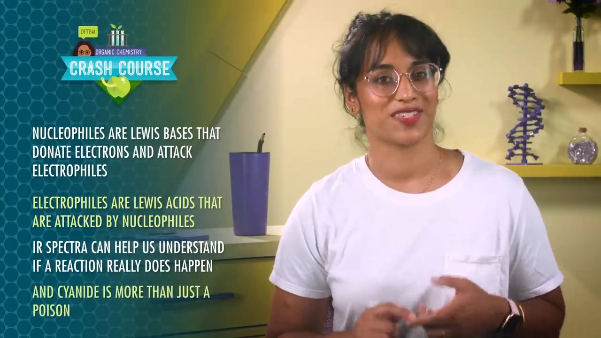

# 亲核体与亲电体：反应从电子最缺的那个原子开始

> 视频来源：[Nucleophiles and Electrophiles: Crash Course Organic Chemistry #12](https://www.youtube.com/watch?v=R3PLq3dOqv4)（YouTube · CrashCourse，讲者 Deboki Chakravarti）｜时长约 12 分钟
> 导读：前两节讲的是「分子有什么性质」，这一节讲「性质怎么变成反应」。视频用路易斯酸碱把分子分成两类角色——给电子对的亲核体、收电子对的亲电体——然后用四个具体反应演示：箭头永远从亲核体的电子对出发，落在电子最缺的那个原子上。本文按「定义 → 判据 → 四个例子 → 检查表」整理，末尾补一张常见亲核体/亲电体/离去基团速查表（标明为补充）。

## 本讲要解决的核心问题（SCQA）

**背景**：上一节用 $pK_a$ 解决了「质子会跑到谁身上」。但有机反应里更多的事不是质子转移，而是**成键与断键**：一个基团被换掉、一根 π 键被打开、一条碳链被接长。前几节也已经建立了「分子热点」的概念——分子上会出现明显的正电荷与负电荷区域。

**冲突**：知道哪里有正电、哪里有负电，还不足以写出反应。到底是哪一方主动？箭头从哪个原子画到哪个原子？反应之后哪个基团会掉下来、以什么形式掉下来？如果每一步都要靠背，有机反应就是几千条互不相干的记忆。

**疑问**：能不能用一套统一的角色划分，把「谁攻谁、攻在哪个原子、谁离开」这三件事一次定下来？

**回答（中心思想）**：能。用**路易斯酸碱**给分子分角色：**亲核体**（nucleophile）是富电子、愿意给出一对电子的物种，也就是路易斯碱；**亲电体**（electrophile）是缺电子、愿意接受一对电子的物种，也就是路易斯酸。于是反应位置有了判据：**电子最富的地方去攻电子最缺的地方**；画法有了规则：**箭头永远从亲核体的电子对出发，指向亲电体**；产物有了判据：**碳最多连四根键**，多出来的那根必须由一个基团带着一对电子离开——这就是**离去基团**。

## 一、路易斯酸碱：从「给质子」升级到「给电子对」

### 1.1 两套定义的分工

[【跳转到 01:10】](https://www.youtube.com/watch?v=R3PLq3dOqv4&t=70)

上一节用的是布朗斯特–洛里：酸给质子、碱收质子。视频指出还有一套更宽的定义——**路易斯酸碱**：**路易斯酸接受一对电子，路易斯碱给出一对电子**。它不是替代前者，而是把「质子转移」推广成「电子对转移」，因此能描述成键反应。

常见的路易斯碱包括：带孤对电子的原子（氨、水）、带负电的原子（氯离子）、带负电的基团（氢氧根）。判据很简单：**电子多**，就叫**富电子**（electron rich）。

### 1.2 亲核体 = 路易斯碱：抓钩的比喻

[【跳转到 01:53】](https://www.youtube.com/watch?v=R3PLq3dOqv4&t=113)

「亲核」（nucleophile）字面意思是「亲核的」——喜欢原子核。但在有机反应里，它的实际含义是：**喜欢另一个分子上的正电荷或正电区域**。

讲者给的比喻是超级英雄的**抓钩**：亲核体拿着抓钩，寻找一个正电荷，把电子甩过去抓住它。所以亲核体在反应里永远是**主动进攻的一方**。

### 1.3 亲电体 = 路易斯酸：靶子的比喻

[【跳转到 02:14】](https://www.youtube.com/watch?v=R3PLq3dOqv4&t=134)

反过来，路易斯酸是带正电的原子（例如质子），或者是**比八隅体少一对电子、带空 p 轨道**的分子，例如甲硼烷 $\mathrm{BH_3}$——中性时只有 6 个电子，空 p 轨道正好可以接收电子对。它们**缺电子**（electron poor），所以愿意接受孤对电子；它们就是**亲电体**（electrophile，「亲电子的」）。

讲者给亲电体的比喻是：身上挂着一个大大的红色靶心，写着「抓钩请往这里扔」。

这张表把常见的路易斯酸按中心原子分类：质子、硼系、铝系、碳系（羰基碳、碳卤、碳正离子），右栏是 PCl₅ 与铁系等「非传统路易斯酸」。对药物化学来说最常用的两格是**羰基碳**和**碳正离子**——它们几乎出现在所有亲核加成、亲核取代的起点。

### 1.4 碳正离子：最重要的亲电体

[【跳转到 03:07】](https://www.youtube.com/watch?v=R3PLq3dOqv4&t=187)

视频特别点出**碳正离子**（carbocation）：sp² 杂化的碳、带一个空 p 轨道、只有三根键。用形式电荷核对：中性碳有 4 个价电子，三根键贡献 3 个，$4-3=+1$，所以带一个正电荷。

这个「三根键 + 空 p 轨道」的画像，就是后面判断亲电位置的核心：**看到碳只连三根键，就知道那里缺电子**。

## 二、亲核进攻：箭头永远从电子对出发

### 2.1 一条画箭头的规则

[【跳转到 03:42】](https://www.youtube.com/watch?v=R3PLq3dOqv4&t=222)

亲核体与任何东西反应，都叫**亲核进攻**（nucleophilic attack）。视频把有机反应比作编排好的打斗场面，亲核进攻只是其中一招，可以单独发生，也可以是多步反应中的一步。

规则只有一条：**弯箭头永远从亲核体的电子对开始，指向亲电体**。

讲者还补了一句容易被忽略的话：亲电体不是被动挨打的旁观者。它「太想要电子」，有时会主动挑起亲核体的进攻——就像你不停催促别人做某件事，直到对方动手。

### 2.2 例一：氢氧根 + 1-氯丁烷 → 1-丁醇

[【跳转到 04:46】](https://www.youtube.com/watch?v=R3PLq3dOqv4&t=286)

第一个例子是一步反应。反应物是氢氧根与 1-氯丁烷：

- 氢氧根带负电、电子很多，很容易判断它是**亲核体**；
- 1-氯丁烷是**亲电体**，但这一点不那么直观，需要回到键的极性：C–Cl 键被极化，电负性大的氯把电子拉向自己，于是**碳带部分正电（$\delta^+$）、氯带部分负电（$\delta^-$）**。

这张图把两件事同时画出来了：箭头从 $\mathrm{OH^-}$ 的孤对电子出发，落在 $\delta^+$ 的碳上；而这根键的极性来源，正是氯的吸电子。

反应怎么收尾？讲者的说法是「碳最多只能连四根键，所以收尾前必须检查有没有违反规则」：氯带着一对电子离开，成为氯离子，剩下 1-丁醇。这类反应叫**亲核取代**（nucleophilic substitution），因为氢氧根**取代**了氯的位置。

### 2.3 用红外光谱验证「真的反应了」

[【跳转到 06:19】](https://www.youtube.com/watch?v=R3PLq3dOqv4&t=379)

视频没有停在纸面：产物是否生成，可以用**红外光谱**（IR）核对。IR 通过键的振动给出官能团信息，而醇的 O–H 是最容易认出的信号之一。

讲者对比了 1-氯丁烷与产物的谱图：产物在约 **3300 cm⁻¹** 出现一个又强又宽的峰，正是醇的 O–H。于是「纸上画的反应」有了实验证据。这一步的意义不只是验证：它说明**官能团既是反应的起点，也是检测反应的读数**。

## 三、两步反应：碳正离子遇水

### 3.1 第一步：水用孤对电子进攻

[【跳转到 07:23】](https://www.youtube.com/watch?v=R3PLq3dOqv4&t=443)

第二个例子的亲电体是**碳正离子**，它「太显眼」，连水这种弱亲核体都会去攻。这类反应通常是**两步**。

第一步仍由亲核体发起：水分子中氧上的一对孤对电子进攻带正电的碳，形成一根新键。

### 3.2 第二步：另一个水分子把质子拿走

[【跳转到 08:11】](https://www.youtube.com/watch?v=R3PLq3dOqv4&t=491)

第一步之后，氧上带正电、还多连了一个氢。第二步由**第二个水分子**来完成：它去攻这个质子，这叫**去质子化**（deprotonation）。

视频在这里特意提醒两个容易画错的地方：

- **不要**把电子直接画到带正电的氧上——氧要遵守八隅体，那样会给它 10 个电子；
- 氢不能连两根键，所以是 O–H 键上的那对电子转移到氧上，中和正电荷，同时放出一个水合氢离子。

最终得到一个醇和一个水合氢离子。整个过程可以概括为：**碳正离子被一个水分子亲核进攻，再被另一个水分子去质子化**。

## 四、π 键也能当亲核体：烯烃 + HBr

### 4.1 π 电子是现成的抓钩

[【跳转到 09:03】](https://www.youtube.com/watch?v=R3PLq3dOqv4&t=543)

视频接着换一类亲核体：**带双键、三键的分子**，例如烯烃、炔烃和羰基。理由很简单——亲核体就是「电子多的基团」，π 键正好电子多。

以顺-2-丁烯与 HBr 为例：

HBr 是强酸，完全电离成 $\mathrm{H^+}$ 与 $\mathrm{Br^-}$。烯烃的双键充当亲核体，把 π 电子甩向质子。

### 4.2 碳正离子生成后，溴离子接手

[【跳转到 09:43】](https://www.youtube.com/watch?v=R3PLq3dOqv4&t=583)

质子被抓住后，原来双键的一个碳少了一个电子、变成正电——于是**生成了一个碳正离子**；同时 $\mathrm{Br^-}$ 是现成的亲核体。

溴离子进攻这个碳正离子，得到 2-溴丁烷。整个反应是两步：**π 键攻质子 → 碳正离子被溴离子攻**。这也说明「亲核体/亲电体」不是分子的固定身份，而是**每一步反应里的临时角色**：烯烃第一步是亲核体，生成的碳正离子第二步就变成亲电体。

## 五、强亲核体：氰化物与碳–碳成键

### 5.1 为什么氰化物重要

[【跳转到 10:05】](https://www.youtube.com/watch?v=R3PLq3dOqv4&t=605)

最后一个例子是**氰化物**（$\mathrm{CN^-}$）：碳与氮三键相连，碳上带负电。它在维多利亚时代的侦探小说里是著名毒物，但在有机合成里，它是一个能**形成碳–碳键**的亲核体。

这一点在药物化学里很关键：能把两个碳接起来，才谈得上把分子「接长」、构建复杂骨架。

### 5.2 反应：氰基取代溴

[【跳转到 10:45】](https://www.youtube.com/watch?v=R3PLq3dOqv4&t=645)

氰离子进攻 1-溴-2-甲基己烷的 1 号碳（连溴的那个碳），溴带着一对电子离开：

这同样是一次**亲核取代**。视频最后提到，带氰基的碳链是通往其他官能团的「入口」，也可以用来把短链加长——这部分留到后续章节。

## 六、把判据固化成一张检查表

[【跳转到 11:16】](https://www.youtube.com/watch?v=R3PLq3dOqv4&t=676)

视频结尾把整集内容压成三句话：

1. **亲核体是路易斯碱**，给出电子、进攻亲电体；
2. **亲电体是路易斯酸**，被亲核体进攻；
3. **IR 光谱**可以帮我们判断反应是否真的发生。

> 补充（非视频内容）：把上面这套判据做成一张表，遇到新反应时按「找亲核体 → 找亲电体 → 找离去基团」三步走，就能定位大多数常见转化。

| 角色 | 常见成员 | 判据 |
| --- | --- | --- |
| 亲核体 | 胺的氮、硫醇/硫醚的硫、醇的氧、羧酸根、氢氧根、氰离子、烯烃的 π 键、烯醇 | 有孤对电子或 π 电子，常带负电或部分负电 |
| 亲电体 | 羰基碳、烷基卤的碳、碳正离子、质子、Michael 受体（$\alpha,\beta$-不饱和羰基的 β 碳） | 带正电、有空的 p 轨道，或与吸电子基相连 |
| 离去基团 | $\mathrm{I^-} > \mathrm{Br^-} > \mathrm{Cl^-} \gg \mathrm{F^-}$；磺酸酯（如甲磺酸酯、对甲苯磺酸酯）；质子化后的水或醇 | 弱碱就是好离去基团；$\mathrm{OH^-}$ 要先质子化才能离去 |

几个「一句话定位」的常见转化（同样为补充）：

- **水解**：水或氢氧根当亲核体，进攻酯或酰胺的羰基碳，离去基团是醇或胺。酯容易水解，酰胺难得多——因为酰胺的氮孤对电子与羰基共轭，羰基碳没那么「缺电子」。
- **酰化**：胺的氮进攻酰氯或酸酐的羰基碳，氯离子或羧酸根离去，生成酰胺。
- **烷基化**：胺的氮进攻烷基卤的碳，卤离子离去；这是把烷基挂到氮上的常用办法。
- **Michael 加成**：亲核体进攻 $\alpha,\beta$-不饱和羰基的 β 碳，负电荷经羰基共振稳定，是共价抑制剂设计里常见的成键方式。
- **成盐**：碱性胺与酸（如盐酸）之间的质子转移，不生成新键，只改变电荷状态，用于改善溶解度与结晶性。
- **酯化做前药**：把羧酸做成酯，掩掉极性以便过膜，进体内再由酯酶水解回羧酸——正好利用了「酯能被水解」这个性质。

## 小结

- **路易斯酸碱把反应角色化**：亲核体 = 给电子对的路易斯碱；亲电体 = 收电子对的路易斯酸。
- **反应位置有判据**：电子最富的地方攻电子最缺的地方；键的极性（$\delta^+$/$\delta^-$）常常就是线索。
- **箭头规则只有一条**：从亲核体的电子对出发，指向亲电体。
- **碳最多连四根键**：多出来的键必须由一个离去基团带走一对电子，这就是取代反应的收尾方式。
- **角色是临时的**：烯烃先当亲核体，生成的碳正离子随后当亲电体；同一步里没有固定身份。
- **产物可验证**：IR 上约 3300 cm⁻¹ 的宽峰就是醇的 O–H，纸上的箭头可以用谱图核对。

## 关键术语速查

| 术语 | 一句话解释 |
| --- | --- |
| 路易斯酸 / 路易斯碱 | 接受 / 给出一对电子的物种，比布朗斯特定义更宽 |
| 亲核体（nucleophile） | 富电子、能给出电子对去进攻正电区域的物种，即路易斯碱 |
| 亲电体（electrophile） | 缺电子、能接受电子对的物种，即路易斯酸 |
| 亲核进攻（nucleophilic attack） | 亲核体把电子对给向亲电体、形成新键的过程 |
| 亲核取代 | 亲核体取代底物上的一个基团（离去基团）的反应 |
| 离去基团（leaving group） | 带着一对电子离开的基团；碱性越弱越容易离去 |
| 碳正离子（carbocation） | 只连三根键、带空 p 轨道的碳，典型亲电体 |
| 去质子化（deprotonation） | 碱把质子从带正电的氧或氮上拿走，使其中和 |
| 分子热点（molecular hot spot） | 分子上电荷最集中的位置，也就是反应最可能发生的位置 |