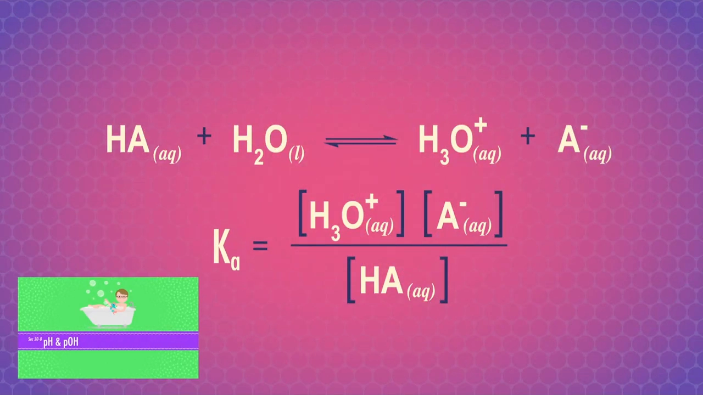
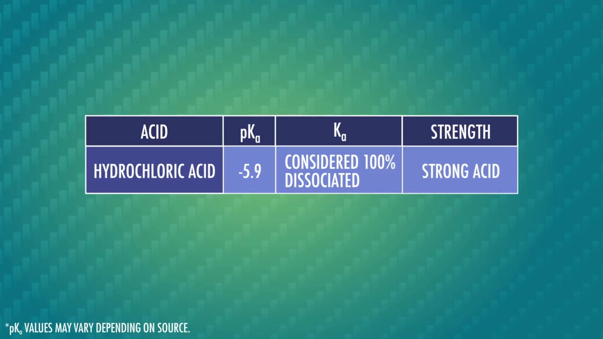
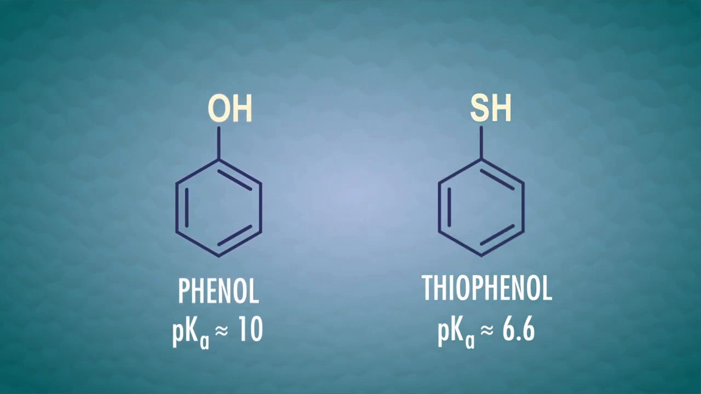
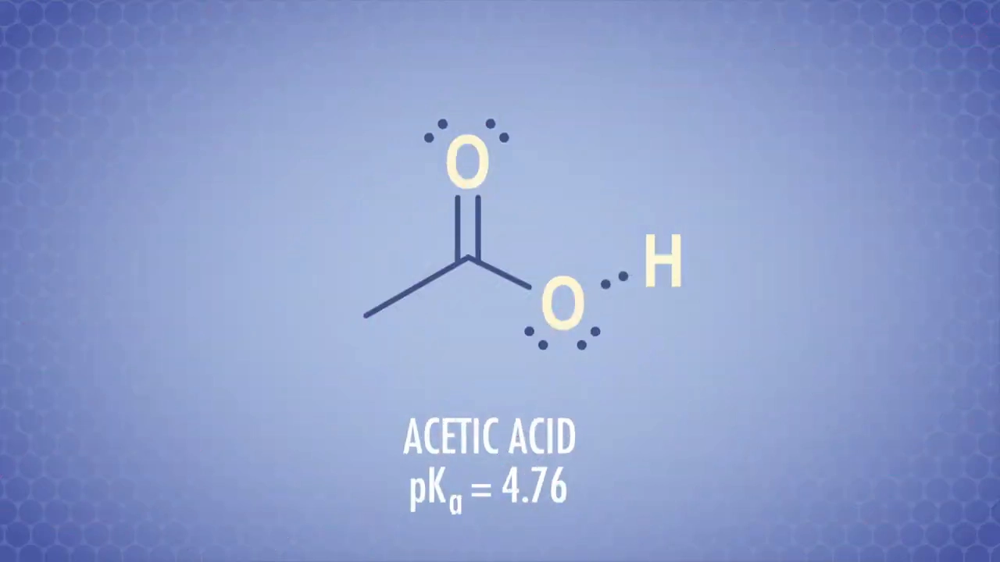
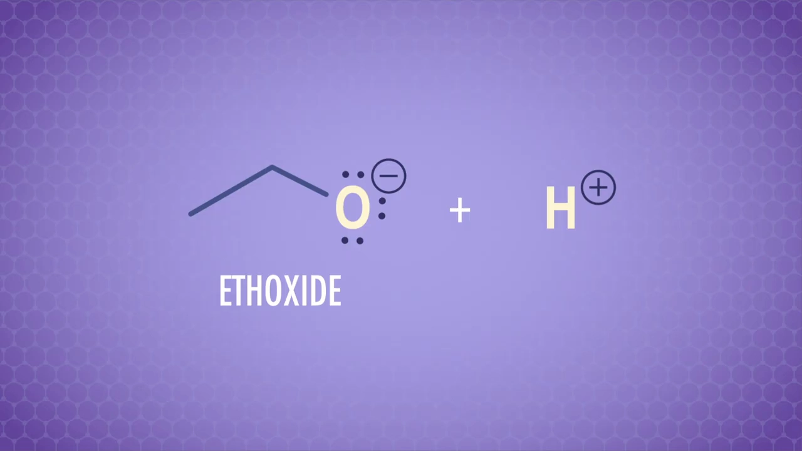
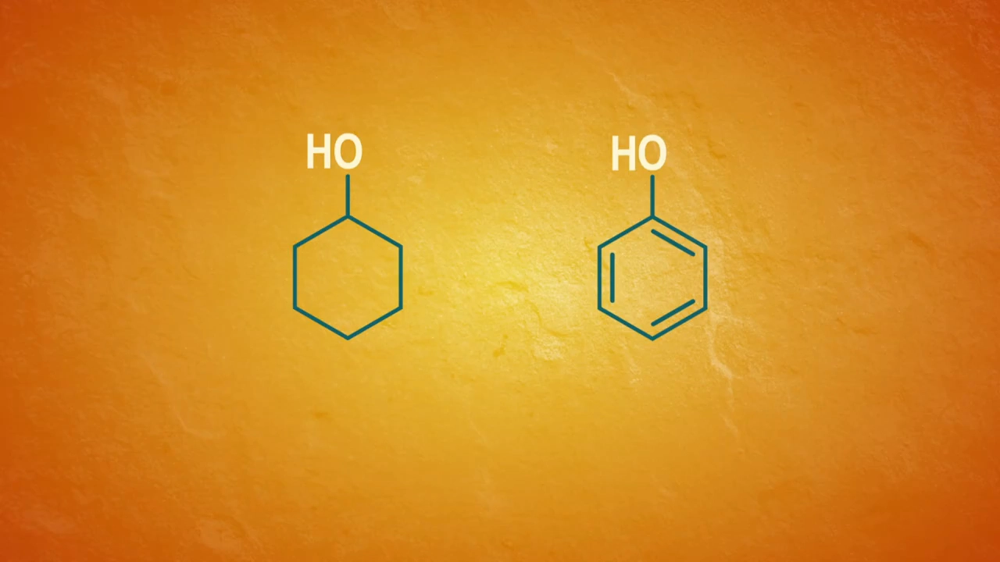
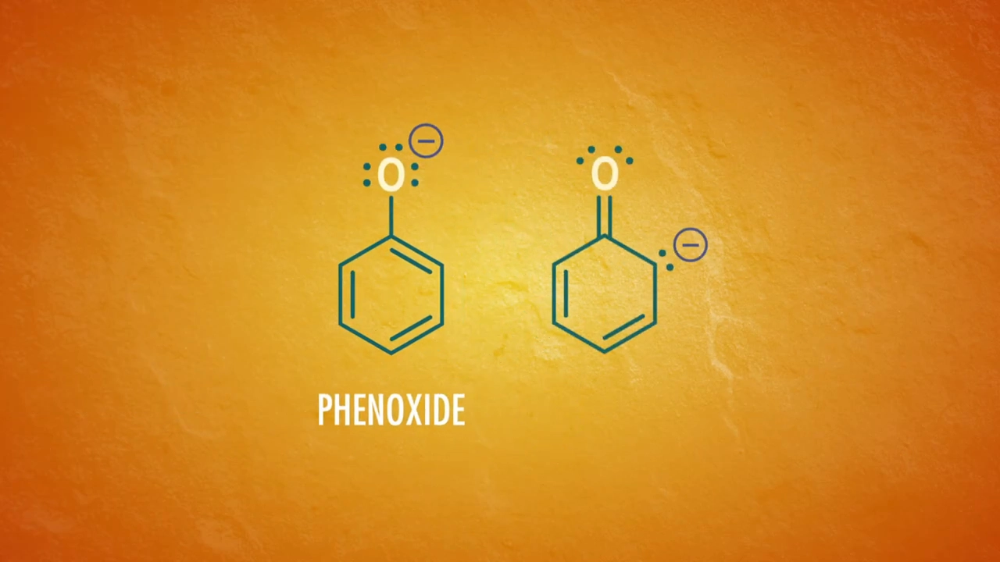
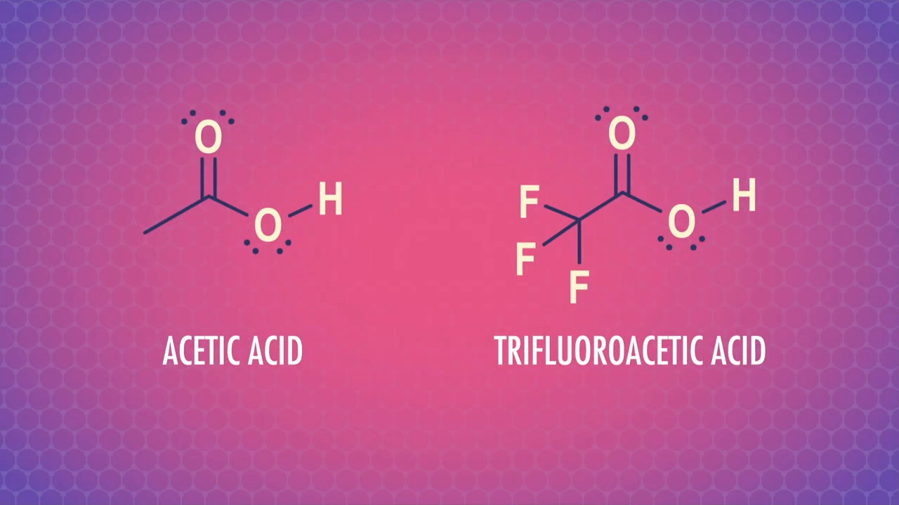
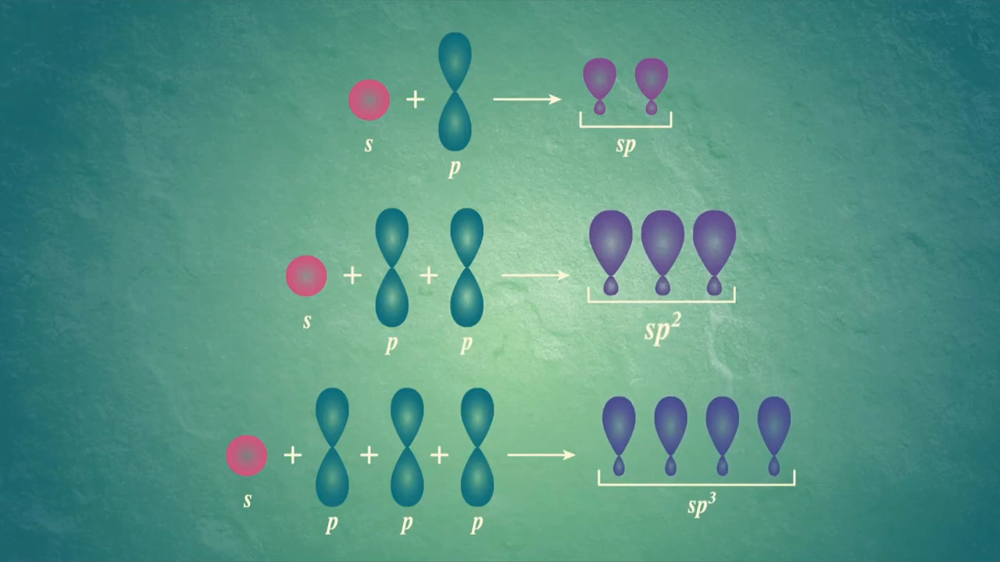
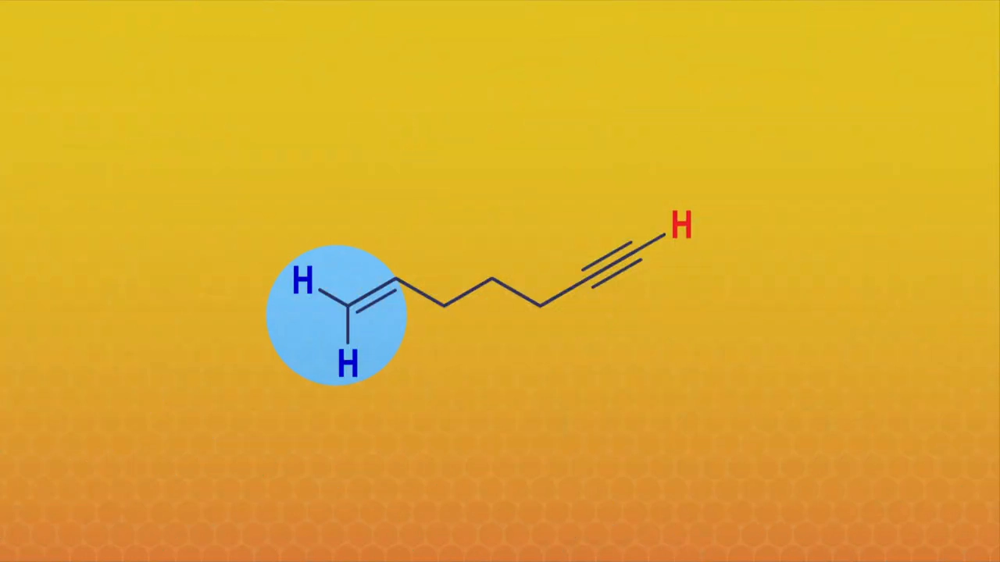

# 同一个O–H，pKa差13个数量级：判断酸碱中心的四条判据

> 视频来源：[Acidity: Crash Course Organic Chemistry #11](https://www.youtube.com/watch?v=BLKqbC_QIZA)（YouTube · CrashCourse，讲者 Deboki Chakravarti）｜时长约 11 分钟
> 导读：上一节说明官能团决定性质，这一节专门把「酸性」这一项拆开：为什么同样一根 O–H，羧酸和醇的 $pK_a$ 差 13 个数量级？视频给出四条可排序的判据——原子身份、共振稳定、诱导效应、杂化轨道 s 成分，并反复强调它们其实是同一件事的四种说法：让共轭碱更稳定。本文按判据逐条整理，末尾补一段「在药物分子上怎么用」。

## 本讲要解决的核心问题（SCQA）

**背景**：上一节已经确立：官能团决定分子的性质，其中一项就是酸性。酸性的强弱可以用 $pK_a$ 排序，$pK_a$ 越小酸性越强。有机分子里到处是 O–H、N–H、C–H，每一种都可能给出质子。

**冲突**：但「有 O–H」完全不足以判断酸性。乙酸与乙醇都有 O–H，$pK_a$ 分别是 4.76 与 18 左右，相差约 13 个数量级；苯酚与环己醇只差一个环、一个双键体系，$pK_a$ 却是 10 与 16；乙烷、乙烯、乙炔的 C–H 酸性也各不相同。凭「像不像酸」去猜，几乎必错。

**疑问**：面对任意两个质子，有没有一套**可以逐条检查、能给出排序**的判据？

**回答（中心思想）**：有，而且只有四条。酸性强弱取决于**共轭碱稳不稳定**——共轭碱越稳定，原来的酸越容易交出质子。四条判据分别是：**① 原子身份**（同一周期电负性越大越稳，同一族原子越大、越容易被极化越稳）；**② 共振稳定**（负电荷能摊到多个原子上就更稳）；**③ 诱导效应**（电负性原子通过 σ 键把负电荷拉走）；**④ 杂化轨道的 s 成分**（s 成分越高，电子离核越近，越能稳住负电荷）。四条判据都指向同一句话：**谁能让负电荷更舒服，谁对应的酸就更强**。

## 一、先把「酸」和「$pK_a$」定义清楚

### 1.1 布朗斯特–洛里定义：酸是给出质子的那一方

[【跳转到 01:19】](https://www.youtube.com/watch?v=BLKqbC_QIZA&t=79)

视频从电影《异形》里「酸血能烧穿飞船地板」讲起，然后立刻收回到化学：我们需要预测的是**弱酸弱碱的强弱**，因为酸碱中心正是分子上发生反应的「热点」（molecular hot spots）。

酸碱有阿伦尼乌斯、布朗斯特–洛里、路易斯三套定义，本节用**布朗斯特–洛里**（Brønsted–Lowry）：**酸是失去质子的物质，碱是接受质子的物质**。把乙酸溶在水里，水充当碱，夺走羧基上的质子，生成水合氢离子与羧酸根；此时水合氢离子是水的**共轭酸**，羧酸根是乙酸的**共轭碱**。

### 1.2 从 $K_a$ 到 $pK_a$：把指数变成一个可比的数

[【跳转到 01:50】](https://www.youtube.com/watch?v=BLKqbC_QIZA&t=110)

酸有多愿意交出质子，是一个像沸点一样的物理性质，用**酸解离常数** $K_a$ 描述。它来自平衡：

$$
\mathrm{HA} + \mathrm{H_2O} \rightleftharpoons \mathrm{H_3O^+} + \mathrm{A^-}
\qquad
K_a = \frac{[\mathrm{H_3O^+}][\mathrm{A^-}]}{[\mathrm{HA}]}
$$

- $K_a$ 大 → 平衡偏向产物 → 强酸；
- $K_a$ 小 → 平衡偏向反应物 → 弱酸。

但 $1.8 \times 10^{-5}$ 这样的数字不好比较，于是取负对数得到 $pK_a$，就像把质子浓度变成 pH：

$$
pK_a = -\log_{10} K_a
$$

**$pK_a$ 越小，酸性越强**。视频给的第一张表就是极端例子：盐酸的 $pK_a$ 约为 $-5.9$，视为完全解离，属于强酸。

## 二、判据一：原子身份——电负性与极化率

### 2.1 同一周期看电负性，同一族看大小

[【跳转到 06:01】](https://www.youtube.com/watch?v=BLKqbC_QIZA&t=361)

第一条判据是**失去质子的那个原子是谁**：

- **同一周期**内，电负性越大的元素越能稳住负电荷，共轭碱越稳定；
- **同一族**内，原子越大，电子所处的轨道越弥散，电子云越容易被扭曲、摊开——这个性质叫**极化率**（polarizability），负电荷被摊开也就更稳。

讲者用两个类比解释极化率：把小原子上的电子密度想成**一杯水**，把大原子想成**一个飞盘**；同样多的水倒进飞盘，就有更多空间铺开。

### 2.2 苯酚与苯硫酚：只换了一个原子，$pK_a$ 差 3.4

[【跳转到 06:46】](https://www.youtube.com/watch?v=BLKqbC_QIZA&t=406)

把苯酚的氧换成硫，得到**苯硫酚**（thiophenol）。两者结构上唯一的区别就是 O 与 S 的大小；硫比氧多 8 个电子，共轭碱上的负电荷在易极化的硫上摊得更开，共轭碱更稳定，所以：

- 苯酚 $pK_a \approx 10$；
- 苯硫酚 $pK_a \approx 6.6$。

也就是说，**硫醇/苯硫酚比对应的醇/酚酸性强**，这在药物化学里很实用：硫醇在生理条件下更容易以硫负离子形式存在。

## 三、判据二：共振稳定——负电荷能不能「分摊」

### 3.1 乙酸与乙醇：背包客分装备的比喻

[【跳转到 04:07】](https://www.youtube.com/watch?v=BLKqbC_QIZA&t=247)

第二条判据是**共轭碱能否画出多个共振式**。讲者的比喻是结伴背包旅行：一个人背全部装备会很累，把帐篷、炊具、食物分给几个人，每个人就轻松了；负电荷也一样，能摊到两个氧上，就比压在一个氧上舒服。

乙酸失去质子后得到乙酸根，负电荷在两个氧之间共振：

乙醇失去质子后得到乙氧负离子，没有共振式可以写，氧独自承担全部负电荷：

结果就是**乙酸是比乙醇强得多的酸**（乙醇的 $pK_a$ 视频未给数值，常见表值在 16–18 之间）；反过来，乙氧负离子是比乙酸根强得多的碱——它更想把质子抢回来。

### 3.2 苯酚与环己醇：一个环上的双键，换来 6 个 $pK_a$ 单位

[【跳转到 05:18】](https://www.youtube.com/watch?v=BLKqbC_QIZA&t=318)

同样的逻辑用在环上。环己醇的共轭碱把负电荷锁在氧上，没有别的原子可以分担；苯酚的共轭碱（苯氧负离子）可以把负电荷推进苯环，画出**四个共振式**：

- 苯酚 $pK_a \approx 10$；
- 环己醇 $pK_a \approx 16$。

这也解释了一个常见的直觉：**酚不是醇**。在生理 pH 下，相当一部分酚会以酚氧负离子存在，而普通醇羟基几乎不电离。

## 四、判据三：诱导效应——隔着 σ 键拉电荷

### 4.1 乙酸与三氟乙酸：三个氟，四个半 $pK_a$ 单位

[【跳转到 07:11】](https://www.youtube.com/watch?v=BLKqbC_QIZA&t=431)

第三条判据是**诱导效应**（inductive effect）：电负性原子通过共价键把负电荷往自己这边拉，从而稳定共轭碱。

比较乙酸与**三氟乙酸**：两者的共轭碱都有两个氧的共振稳定，但三氟乙酸根上还多了三个氟。三个氟通过 σ 键把负电荷继续往外拉，共轭碱更稳，平衡更偏产物侧：

- 乙酸 $pK_a = 4.76$；
- 三氟乙酸 $pK_a = 0.23$。

差 4.5 个单位，约合三万多倍的酸性差别——仅仅因为把三个氢换成了氟。讲者的说法是：这相当于又多了几个帮忙背装备的同伴。

## 五、判据四：杂化轨道的 s 成分

### 5.1 s 成分越高，电子离核越近

[【跳转到 08:05】](https://www.youtube.com/watch?v=BLKqbC_QIZA&t=485)

第四条判据最弱，但也常考：**杂化轨道的 s 成分**。sp 轨道可以看成一半 s、一半 p，s 成分最高；sp² 次之；sp³ 最低。

s 轨道更靠近原子核，所以 s 成分越高，电子越贴近核，负电荷被稳定得越好。反过来，sp² 与 sp³ 的电子离核更远，稳定负电荷的能力更差。

### 5.2 乙烷、乙烯、乙炔：$pK_a$ 从 50 到 25

[【跳转到 09:04】](https://www.youtube.com/watch?v=BLKqbC_QIZA&t=544)

把这条判据用在三个最简单的烃上：乙烷的碳是 sp³，乙烯是 sp²，乙炔是 sp。所以三者 C–H 的酸性顺序是**乙炔 > 乙烯 > 乙烷**。

讲者特意补了一句现实感：乙炔的 $pK_a$ 约 25，在整个尺度上根本不算酸，更不可能烧穿飞船——但**相对顺序**是可靠的。

### 5.3 同一个分子里，哪个质子更酸

[【跳转到 09:34】](https://www.youtube.com/watch?v=BLKqbC_QIZA&t=574)

这条判据还能处理分子内部的比较。视频给了一个一端是烯、一端是炔的分子：从烯端拔质子，负电荷落在 sp² 碳上；从炔端拔质子，负电荷落在 sp 碳上。sp 碳的 s 成分更高、更能稳住负电荷，所以**炔端的质子更酸**。

这正是「用少量规则定位反应位置」的雏形：不必记住整张反应表，只要判断哪个质子被拔走后共轭碱最稳。

## 六、四条判据合起来怎么用

[【跳转到 10:16】](https://www.youtube.com/watch?v=BLKqbC_QIZA&t=616)

视频结尾把四条判据并列成一张清单：

| 判据 | 看什么 | 视频中的例子 | 怎么记 |
| --- | --- | --- | --- |
| 原子身份 | 同周期比电负性，同族比大小与极化率 | 苯酚 10 vs 苯硫酚 6.6 | 负电荷喜欢电负性大、体积大的原子 |
| 共振稳定 | 共轭碱能否画出多个共振式 | 乙酸 4.76 vs 乙醇约 18；苯酚 10 vs 环己醇 16 | 能分摊就稳 |
| 诱导效应 | 邻近电负性原子通过 σ 键拉电子 | 三氟乙酸 0.23 vs 乙酸 4.76 | 吸电子基越多、越近，酸性越强 |
| 轨道 s 成分 | 负电荷所在碳的杂化方式 | 乙炔 25 > 乙烯 44 > 乙烷 50 | s 成分越高越酸 |

使用顺序上，视频没有给硬性优先级，但可以按「先看原子，再看共振，再看诱导，最后看杂化」走一遍：**原子身份决定量级，共振与诱导决定同一量级内的排序，杂化只处理碳负离子这类边缘情形**。

> 补充（非视频内容）：在药物分子上，这套判据最常用的三个场合是——判断某个氮在生理 pH 下是否带正电（脂肪胺共轭酸 $pK_a$ 约 9–10，多半带正电；酰胺的氮几乎不碱）；判断羧酸、酚、磺酰胺在中性水溶液里是否电离（羧酸 $pK_a$ 约 4–5，几乎全电离；酚约 10，部分电离）；以及判断一个质子会不会被体内的亲核体（如谷胱甘肽的硫醇，$pK_a$ 约 9）抢走。这些判断最终服务的是 1.1.6 的质子化形态与 2.1.1 的酸碱平衡。

## 小结

- **酸性强弱 = 共轭碱稳定性**：四条判据都是这一句话的不同侧面。
- **原子身份**：同周期电负性越大越酸，同族原子越大越酸（苯酚 10 → 苯硫酚 6.6）。
- **共振稳定**：负电荷能离域就稳（乙酸 4.76 vs 乙醇约 18；苯酚 10 vs 环己醇 16）。
- **诱导效应**：吸电子基隔着 σ 键拉电荷（三氟乙酸 0.23 vs 乙酸 4.76）。
- **s 成分**：sp > sp² > sp³（乙炔 25 > 乙烯 44 > 乙烷 50），也能用来比较同一分子内不同质子的酸性。
- **$pK_a$ 是可查、可比的数**：$pK_a$ 越小酸性越强，比较两个质子就是比较两个数。

## 关键术语速查

| 术语 | 一句话解释 |
| --- | --- |
| 布朗斯特–洛里酸 | 能给出质子的物质；对应的碱是能接受质子的物质 |
| 共轭碱（conjugate base） | 酸失去一个质子后剩下的物种，其稳定性决定酸的强弱 |
| $K_a$ / $pK_a$ | 酸解离常数及其负对数；$pK_a$ 越小酸性越强 |
| 共振稳定 | 负电荷可以分布在多个原子上，使共轭碱更稳定 |
| 诱导效应（inductive effect） | 电负性原子通过 σ 键把电子密度拉向自己，稳定邻近的负电荷 |
| 极化率（polarizability） | 电子云被外场扭曲、摊开的难易程度；原子越大越易极化 |
| s 成分 | 杂化轨道中 s 轨道的比例，sp 为 50%，sp² 约 33%，sp³ 约 25% |
| 分子热点（molecular hot spot） | 分子上出现明显正、负电荷的位置，是反应最可能发生的地方 |