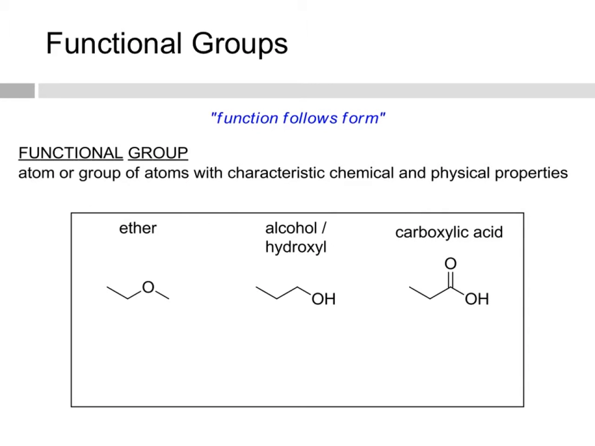
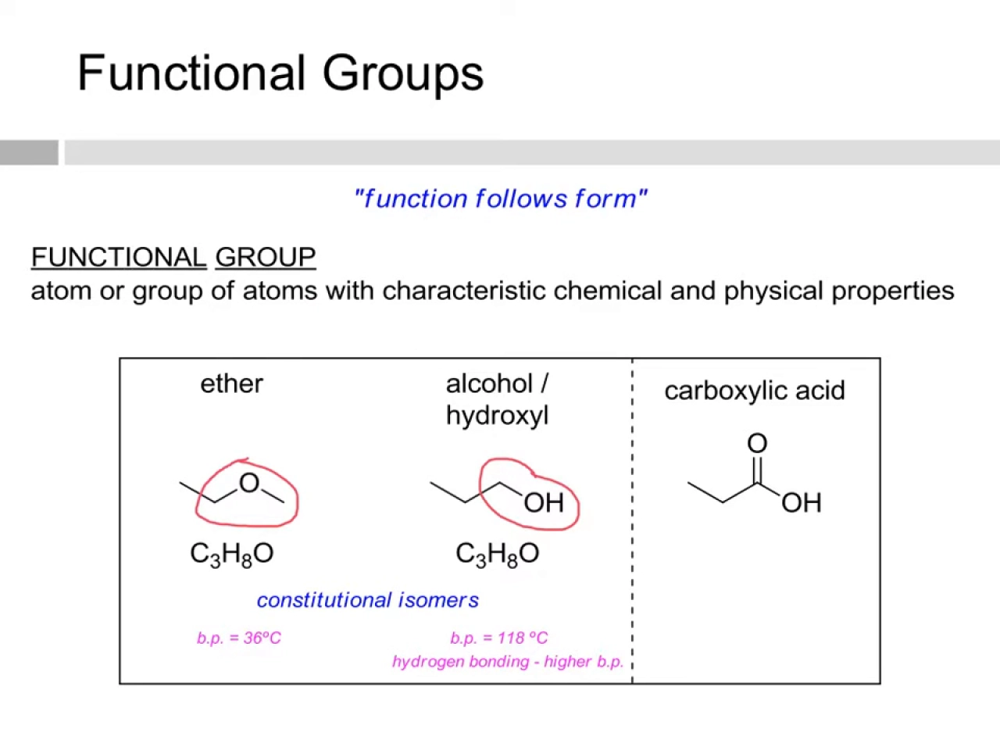
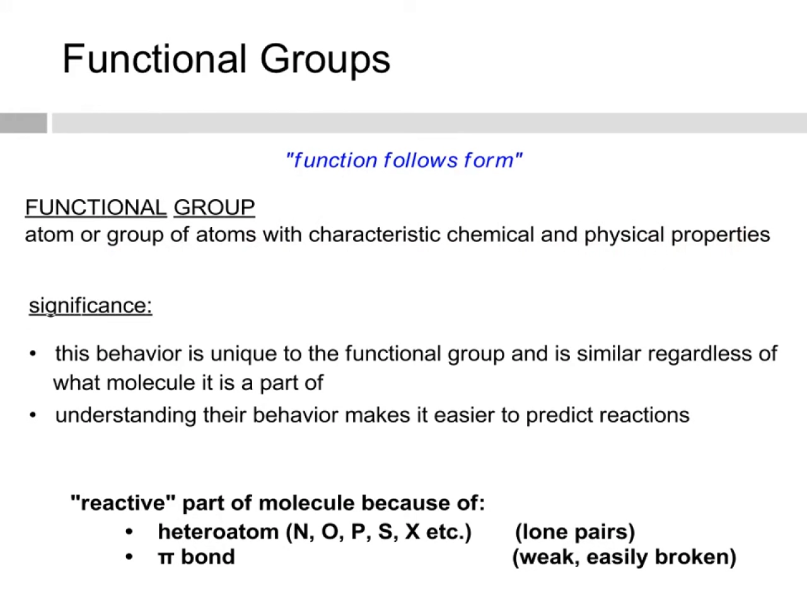
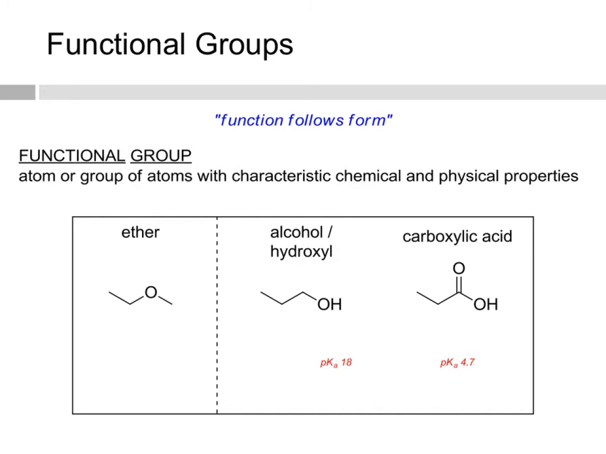
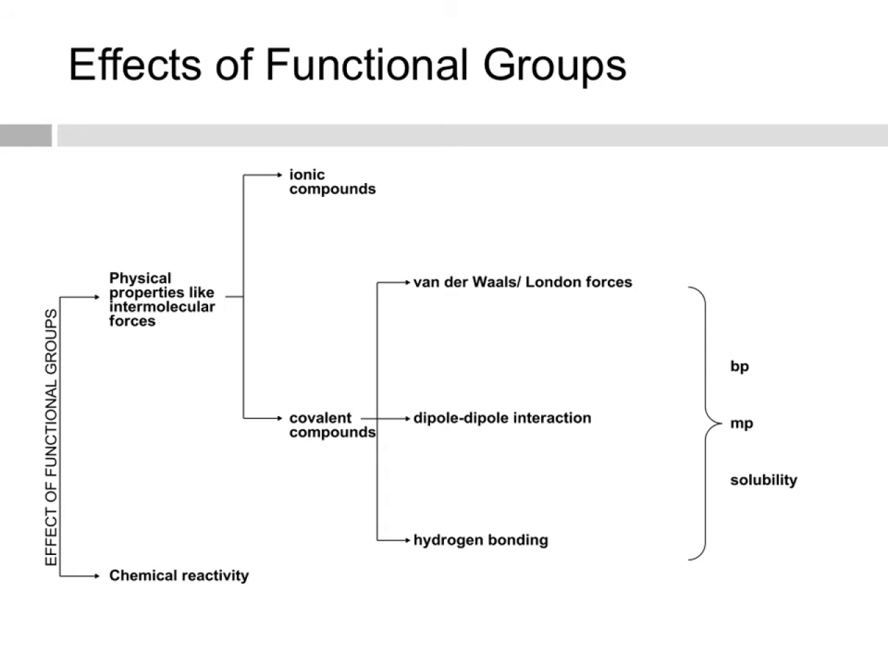
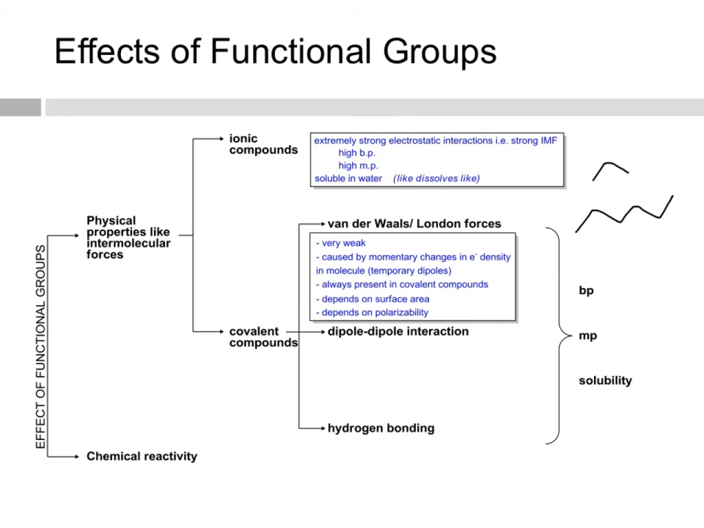
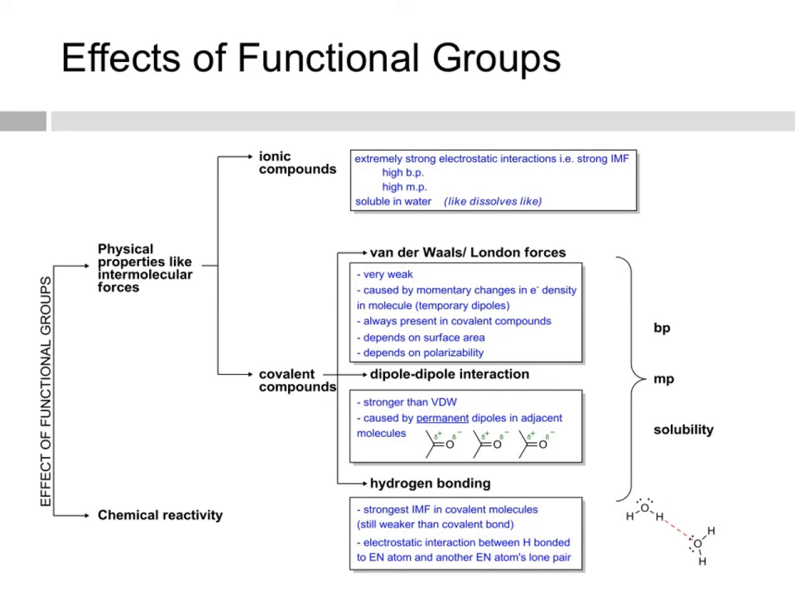
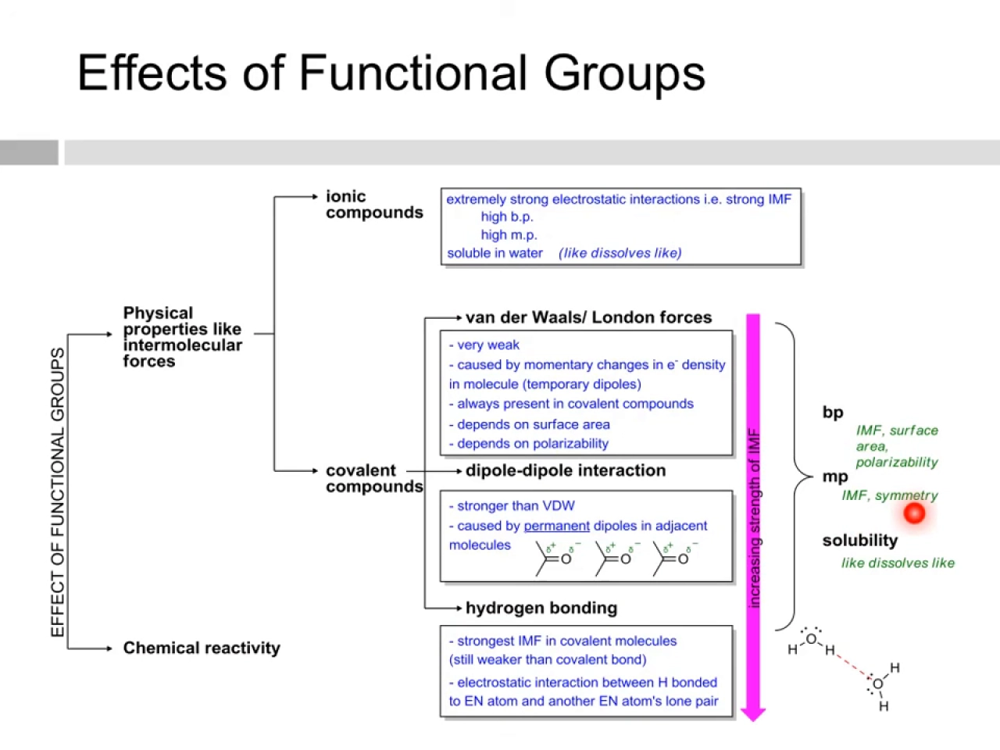

# 官能团决定性质：同一个分子式，沸点差82度

> 视频来源：[Functional group effects](https://www.youtube.com/watch?v=eR1bqEwRbSc)（YouTube · Priya Mathew）｜时长约 8 分钟
> 导读：这是一节把「官能团」讲成因果链的短课：先用一个分子式相同、沸点相差 82 度的异构体对，再用一个「都有 O–H、pKa 却差 13 个数量级」的分子对，说明官能团才是性质的来源；后半段把三种分子间作用力和沸点、熔点、溶解度逐一对上。本文按这条链重排，并在末尾补一张常见官能团速查表与药物改造的用法（标明为补充）。

## 本讲要解决的核心问题（SCQA）

**背景**：上一节（1.1.2）已经说明，分子可以画成一张图：原子是节点、化学键是边，价态决定哪些连接合法。再上一节（1.1.3）说明，环上的电子会离域，图上画的单双键不等于真实电子结构。

**冲突**：但「连接合法」并不能告诉我们这个分子会有什么性质。两个分子可以有完全相同的分子式、同样合法的连接，一个是沸点 36 摄氏度的液体，另一个是沸点 118 摄氏度的液体；两个分子都有 O–H 键，一个的 $pK_a$ 是 18，另一个是 4.7。差别不是画错了，而是分子里换了「一小块东西」。

**疑问**：这一小块东西是什么？为什么它一换，沸点、酸性、溶解度就跟着换？有没有一套少量规则，让我们看到一个分子就能预判它的性质与反应位置？

**回答（中心思想）**：这一小块东西就是**官能团**（functional group）——带有特定化学与物理性质的一个原子或一组原子。讲者用一句话概括它的地位：**功能跟随形式**（function follows form）。官能团之所以能决定性质，是因为它同时决定了三件事：**能不能形成氢键等分子间作用力**（决定沸点、熔点、溶解度）、**电子往哪边偏**（决定 $pK_a$ 与电荷分布）、**哪里有孤对电子、π 键或正电荷**（决定反应从哪里发生）。因此只要认出官能团，就不必每次从整个分子重新推理。

## 一、官能团：功能跟随形式

### 1.1 定义：一小块原子，带一整套性质

[【跳转到 00:00】](https://www.youtube.com/watch?v=eR1bqEwRbSc&t=0)

讲者开宗明义：官能团是**带有特定化学与物理性质的一个原子或一组原子**，整堂课的原则是「功能跟随形式」。

这张幻灯片把三个官能团并排放：醚是一个氧连两个碳；醇（羟基）是一个氧连一个碳和一个氢；羧酸则是在羟基之外还多一个碳氧双键。三者都由碳、氧、氢组成，但性质完全不同——差别就落在这一小块结构上。

### 1.2 一对构造异构体：分子式相同，沸点差 82 度

[【跳转到 00:55】](https://www.youtube.com/watch?v=eR1bqEwRbSc&t=55)

讲者取了一对**构造异构体**（constitutional isomers）：分子式相同、成键方式不同的两个分子。这里两个分子都是 $\mathrm{C_3H_8O}$，一个是醚，一个是醇。

直觉上，分子式相同的两个分子性质应该接近。实测结果是：

- 醚的沸点约 **36 摄氏度**；
- 与之同分异构的醇，沸点约 **118 摄氏度**。

讲者给的解释只有一句：这个分子里有 **O–H**，意味着它可以形成**氢键**（hydrogen bonding），所以沸点更高。也就是说，决定沸点高低的不是「有几个碳几个氧」，而是「这一小块能不能伸出氢键」。

## 二、官能团是分子里「有反应性」的那部分

### 2.1 为什么官能团的行为可以迁移到别的分子

[【跳转到 03:00】](https://www.youtube.com/watch?v=eR1bqEwRbSc&t=180)

讲者强调官能团的两层意义：

1. 这种性质是**官能团独有的**，无论它挂在哪个分子上，行为都相似；
2. 因此理解官能团的行为，就能**预测反应的结果**，而不必把每个分子当成新问题。

[【跳转到 03:25】](https://www.youtube.com/watch?v=eR1bqEwRbSc&t=205)

幻灯片把「有反应性」的原因列成两条：**杂原子**（N、O、P、S 以及各种卤素 X）带**孤对电子**；**π 键**较弱、容易被打开。讲者在口述中补了第三条：**正电荷**，例如碳正离子（carbocation）。

这三条其实就是后面判断「反应从哪里发生」的全部依据：孤对电子多的地方容易去攻别人（亲核体），电子少、带正电或有空轨道的地方容易被攻（亲电体），π 键则是现成的电子来源。具体怎么用，见本小节第二篇《同一个 O–H，pKa 差 13 个数量级》与第三篇《亲核体与亲电体》。

## 三、同一个 O–H，酸性差 13 个数量级

### 3.1 醇与羧酸：都有 O–H，$pK_a$ 却是 18 与 4.7

[【跳转到 01:05】](https://www.youtube.com/watch?v=eR1bqEwRbSc&t=65)

讲者接着把醇和羧酸放在一起比较。羧酸官能团可以拆成：一个碳，双键连一个氧，单键连一个 O–H，再单键连到另一个碳上。两者都有 O–H，但：

- 醇的 O–H，$pK_a \approx 18$；
- 羧酸的 O–H，$pK_a \approx 4.7$。

讲者没有在这支视频里展开原因（共振稳定共轭碱的部分留给下一篇），但他给出了一个非常实用的推论：**如果你取一当量的碱加到这两个化合物的混合物里，羧酸的质子会先反应**。这就是「用 $pK_a$ 判断谁先反应」的最朴素形式——酸性强的先交出质子。[【跳转到 02:35】](https://www.youtube.com/watch?v=eR1bqEwRbSc&t=155)

### 3.2 这条比较在药物分子里的含义

一个分子上同时有醇羟基和羧基时，在生理 pH 附近，羧基几乎全部电离成羧酸根，醇羟基基本不动。于是「哪个基团带负电、哪个基团保持中性」这件事，不用做实验就能先猜出来。这一层（电离状态如何随 pH 变化）属于 1.1.6 与 2.1.1 的任务，这里只需记住判据：**同一个元素、同样一根 O–H，只要旁边的电子结构不同，酸性可以差十几个数量级**。

## 四、官能团通过分子间作用力决定沸点、熔点、溶解度

### 4.1 先把「效应」分成两条线

[【跳转到 03:42】](https://www.youtube.com/watch?v=eR1bqEwRbSc&t=222)

讲者把官能团的效应画成一棵树：一边是**物理性质（分子间作用力）**，另一边是**化学反应性**。

物理性质这一支再分：

- **离子化合物**：极强静电作用 → 高沸点、高熔点（晶格堆积更好还会再抬高熔点）→ 溶于水（相似相溶）；
- **共价化合物**：只需考虑三种分子间作用力——范德华力（伦敦色散力）、偶极–偶极相互作用、氢键。

有机分子绝大多数属于后者，所以下面三节都在讲这三条力的强弱与来源。

### 4.2 范德华力：最弱，但人人都有，靠表面积和极化率吃饭

[【跳转到 04:57】](https://www.youtube.com/watch?v=eR1bqEwRbSc&t=297)

范德华力由分子中的**瞬时偶极**引起，在共价化合物中**总是存在**，强弱取决于两件事：**表面积**和**极化率**（polarizability，电子云被扭曲的难易程度）。

讲者用丙烷与己烷解释表面积：丙烷三个碳、己烷六个碳，己烷表面积更大，分子间接触更多、范德华力更强，所以己烷沸点更高——**丙烷在室温下是气体，己烷是液体**。

这条规律对药物分子的直接含义是：**加碳链、加大疏水基团，会同时提高亲脂性和分子间作用力**，溶解度与熔点都会跟着变。

### 4.3 偶极–偶极与氢键：从「瞬时」到「永久」再到「最强」

[【跳转到 05:22】](https://www.youtube.com/watch?v=eR1bqEwRbSc&t=322)

- **偶极–偶极相互作用**比范德华力稍强，来源是相邻分子间的**永久偶极**。讲者用丙酮举例：电子被氧拉走，分子始终有偶极矩，氧带部分负电、羰基碳带部分正电；溶液里丙酮分子会按电荷排队。
[【跳转到 06:12】](https://www.youtube.com/watch?v=eR1bqEwRbSc&t=372)

- **氢键**是共价分子中**最强的分子间作用力**（但仍弱于共价键）。它的定义是：一个**与电负性原子成键的氢**，与另一个**电负性原子的孤对电子**之间的静电作用。能参与氢键的电负性原子，讲者只列了三个：**氟、氧、氮**。

这张图是整节课的骨架：三条力按强度递增排列，右侧的括号说明它们最终影响的是沸点（bp）、熔点（mp）和溶解度。

### 4.4 三条判据：看沸点、看熔点、看溶解度分别该看什么

[【跳转到 07:02】](https://www.youtube.com/watch?v=eR1bqEwRbSc&t=422)

讲者最后把「怎么用」压成三句话：

| 要预测的性质 | 该看的量 |
| --- | --- |
| 沸点 | 分子间作用力强度、表面积、极化率（后两项回到范德华力） |
| 熔点 | 分子间作用力，外加**分子对称性**（决定晶格堆积好坏） |
| 溶解度 | 相似相溶：非极性溶非极性，极性溶极性 |

注意熔点多出来的那一项：对称性。一个分子即使分子间作用力不弱，若形状不规则、堆不紧，熔点也可能偏低。这一条在药物化学里对应「晶型」问题，但讲者没有展开，这里只作为提示。

## 五、补充：把这张性质地图接到药物改造上

> 以下内容为**补充背景**，不是视频原话。视频只讲了「官能团决定性质」这条原则，没有讲药物设计。

视频给出的判据可以整理成一张「看一眼官能团就知道性质倾向」的表。下表的结构式一栏用文字描述，$pK_a$ 为常见数量级的近似值：

| 官能团 | 结构特征 | 极性 / 氢键 | 典型 $pK_a$ 或反应倾向 |
| --- | --- | --- | --- |
| 烃基（烷、烯、炔、芳环） | 只有 C、H | 非极性，只给范德华力 | 烷烃 $pK_a$ 约 50，炔氢约 25；芳环可被氧化 |
| 卤代（R–X） | 碳连卤素 | 弱极性，无氢键供体 | 可作离去基团；芳基卤较难水解 |
| 羟基（醇 R–OH） | O 连一个 C、一个 H | 强极性，既是供体又是受体 | $pK_a$ 约 16–18；易被氧化、易成酯/成醚 |
| 醚（R–O–R） | O 连两个 C | 有偶极，无氢键供体 | 化学上较惰性；易被氧化成过氧化物 |
| 胺（R–NH₂ 等） | N 带孤对电子 | 极性，可作氢键供体/受体 | 共轭酸 $pK_a$ 约 9–10，生理 pH 下多带正电 |
| 酰胺（R–CO–NH–） | 羰基旁接 N | 强极性，氢键供体与受体兼备 | 极难水解，远稳定于酯；平面结构 |
| 羧酸（R–COOH） | 羰基 + O–H | 强极性，强氢键 | $pK_a$ 约 4–5，生理 pH 下几乎全为羧酸根 |
| 酯（R–CO–O–R） | 羰基 + 烷氧基 | 中等极性，无氢键供体 | 可被酯酶水解；常用作前药 |
| 醛 / 酮（C=O） | 羰基碳带部分正电 | 极性，受体 | 羰基碳是亲电中心，易被亲核加成 |
| 腈（R–C≡N） | 碳氮三键 | 极性，受体 | 碳端可水解为羧酸；氮端可被还原为胺 |
| 硝基（–NO₂） | N 带正电、O 带负电 | 强极性 | 强吸电子，显著降低邻近基团的 $pK_a$ |
| 硫醇 / 硫醚（–SH / –S–） | 硫代替氧 | 弱极性 | 硫醇 $pK_a$ 约 10，比醇酸得多；易被氧化成二硫键 |
| 磺酰胺（–SO₂NH–） | 硫上两个氧 + N | 强极性 | N–H 酸性明显强于普通酰胺 |

几个可以直接拿来用的改造套路（同样为补充）：

- **生物等排替换**（bioisosteric replacement）：把容易被氧化的位置换成不易被氧化的等排基团，例如芳环上的氢换成氟——体积只从约 1.2 Å 增到约 1.35 Å，几乎不改形状，却挡掉了代谢氧化；把甲基换成氯也是同一类操作。
- **酯化做前药**：羧酸极性太强、难以穿过细胞膜时，先做成酯，进体内再被酯酶水解回羧酸。酯「能被水解」这个缺点，在这里正好变成设计工具。
- **酰胺键当骨架**：酰胺比酯稳定得多，所以肽键、以及大量口服药里的连接单元都用酰胺而不是酯。
- **碱性胺的双刃剑**：胺在生理 pH 下带正电，有利于与靶点的酸性残基成盐桥，但碱性过强会增加 hERG 通道抑制风险、也会影响口服吸收。常见的做法是降低 $pK_a$（引入吸电子基）或改成酰胺。
- **找代谢软点**：分子上最容易被氧化的位置通常是富电子的芳环、苄位/烯丙位的 C–H、以及硫醚。把软点用氟或环化保护起来，往往是延长半衰期的第一步。

这张表只用来「定位」：看到羧酸先想到电离、看到酯先想到水解、看到羰基先想到亲核加成。真正的机理与条件，属于后续小节。

## 小结

- **官能团是性质的载体**：功能跟随形式，一小块原子的身份决定了整个分子的化学与物理行为。
- **分子式相同不等于性质相同**：$\mathrm{C_3H_8O}$ 的醚与醇，沸点 36 与 118，差别来自 O–H 能否形成氢键。
- **官能团的行为可迁移**：正因为它在不同分子上表现相似，认出官能团就能预测反应，而不必逐个分子重推。
- **「有反应性」的三个来源**：杂原子的孤对电子、π 键、正电荷（如碳正离子）。
- **酸性是官能团性质**：醇的 O–H 约 18，羧酸的 O–H 约 4.7；一当量碱会先打羧酸。
- **三条分子间作用力按强度递增**：范德华力 < 偶极–偶极 < 氢键；只有 F、O、N 参与的氢键才算数。
- **三条判据**：沸点看分子间作用力与表面积/极化率，熔点还要看对称性，溶解度看相似相溶。

## 关键术语速查

| 术语 | 一句话解释 |
| --- | --- |
| 官能团（functional group） | 带有特定化学与物理性质的一个原子或一组原子，是分子中决定性质与反应性的那一小块 |
| 功能跟随形式（function follows form） | 结构决定性质的说法：官能团的形式一变，性质就跟着变 |
| 构造异构体（constitutional isomer） | 分子式相同、原子连接方式不同的分子，例如 $\mathrm{C_3H_8O}$ 的醚与醇 |
| 范德华力（van der Waals force） | 由瞬时偶极引起的弱作用力，共价分子中总是存在，强弱随表面积与极化率变化 |
| 偶极–偶极相互作用 | 相邻分子永久偶极之间的作用，比范德华力稍强 |
| 氢键（hydrogen bonding） | 与 F、O、N 成键的氢，与另一电负性原子孤对电子之间的静电作用，是共价分子中最强的分子间作用力 |
| 极化率（polarizability） | 电子云在外场下被扭曲、摊开的难易程度，原子越大越容易被极化 |
| $pK_a$ | 酸解离常数 $K_a$ 的负对数；数值越小酸性越强 |
| 杂原子（heteroatom） | 碳氢骨架以外的原子，如 N、O、P、S、卤素，通常带孤对电子 |
| 碳正离子（carbocation） | 只连三根键、带一个空 p 轨道与正电荷的碳，是典型的亲电体 |