# 相同的连接，不同的空间：构造异构、对映体、非对映体与内消旋体

> 视频来源：[Stereoisomers, Enantiomers, Meso Compounds, Diastereomers, Constitutional Isomers, Cis & Trans](https://www.youtube.com/watch?v=XftIUcLWTEE)（YouTube · The Organic Chemistry Tutor）｜时长约 10.5 分钟
> 导读：这支视频是一节「分类练习课」——它不推导反应，只用一组对比结构反复问同一个问题：这两个分子到底是什么关系？本文按它的判据顺序重排，把「连接相同、空间不同」这件事讲成一个可以照着走的决策流程。字幕为自动生成，术语已按化学惯例订正（如 anomers→enantiomers、miso→meso）。

## 本讲要解决的核心问题（SCQA）

**背景**：你已经会看分子的连接关系了——哪个碳上接了羟基、哪个碳上接了溴，分子式怎么写，碳骨架怎么编号。按这套看法，两个分子只要原子和连接方式一样，就应该是同一个分子。

**冲突**：视频一开场就给出两对结构：上面一对，溴原子都接在第 2 号碳上，连接完全一样，可一个溴画成实心楔形（朝纸面外），另一个画成虚线楔形（朝纸面里）；下面一对，羟基一个接在第 2 号碳、一个接在第 3 号碳，连接不同。两类「不一样」被放在一起，看上去都是「画得不一样」，性质却完全不同。

**疑问**：既然连接相同，为什么还会是不同的分子？拿到两个结构式，怎么判断它们是同一个分子、一对镜像、还是根本不同的化合物？

**回答（中心思想）**：判断两个结构的关系只要两步——**先看连接（连通性），再看空间（立体中心是否翻转、有没有对称面）**。连接不同就是构造异构体；连接相同但空间排布不同就是立体异构体；立体中心全部翻转且没有对称面是一对对映体；只翻转了一部分是非对映体；全部翻转却存在对称面，那根本不是两个分子，而是同一个内消旋体。

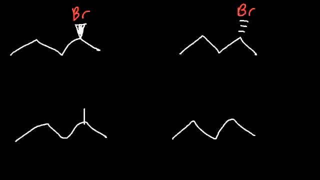

## 一、先分清两种「不同」：连接不同，还是空间不同

### 1.1 构造异构体：原子一样，接的地方不一样

视频先给「异构体」下了一个统一的前提：所有异构体的分子式相同，但结构不同。区别在于「结构不同」指哪一种不同。

构造异构体（constitutional isomer）的差别在**连通性**：哪个基团接在哪个原子上。视频的例子是一对丁醇——分子式都是 $\mathrm{C_4H_{10}O}$，但前一个分子的羟基接在 2 号碳上（2-丁醇），后一个接在 3 号碳上。碳骨架一样长，羟基的位置换了，就是两个不同的化合物。

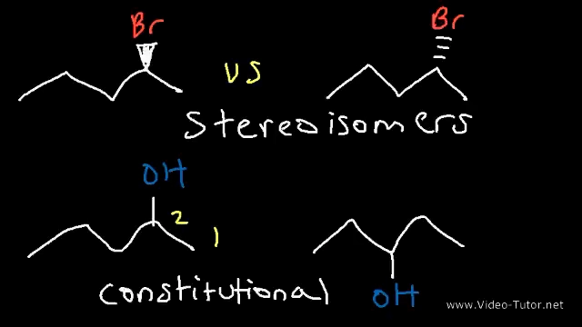

[【跳转到 01:15】](https://www.youtube.com/watch?v=XftIUcLWTEE&t=75)

### 1.2 立体异构体：接的地方一样，朝向不一样

第二对结构才是这一节的主角。两个分子都是 2-溴丁烷：溴都接在 2 号碳上，碳骨架、取代基位置完全一致。差别只在空间——第一个分子的溴用实心楔形表示，指向纸面外（朝向你）；第二个用虚线楔形表示，指向纸面里（背离你）。

讲者的措辞很关键：**「它们连接方式相同，但空间排布不同，这就使它们成为立体异构体。」** 立体异构体（stereoisomer）不是「结构不同」的另一种说法，而是「连接相同、空间不同」的专称。

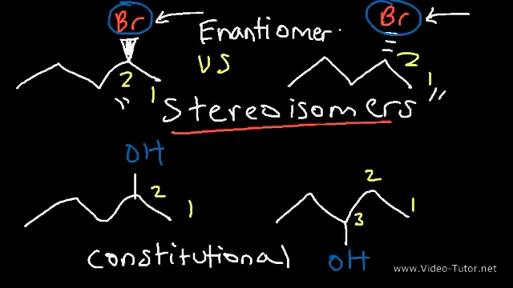

[【跳转到 01:40】](https://www.youtube.com/watch?v=XftIUcLWTEE&t=100)

这里要顺手立一个后面反复要用的概念：**手性中心**（chiral center，也叫立体中心）。视频把它当作已知前提使用——一个碳上接四个互不相同的基团，就是手性中心。2-溴丁烷的 2 号碳接的是溴、氢、甲基、乙基，四个基团都不同，所以它是手性中心；也正因为如此，它才有「朝前」和「朝后」两种画法。

## 二、对映体：互为镜像，怎么转都叠不上

### 2.1 判据是「镜像 + 不可重叠」

上面那对 2-溴丁烷，讲者给出的名字是**对映体**（enantiomer）。定义有两半，缺一不可：它们互为镜像；并且它们不能重叠（non-superimposable）。就像左右手：零件完全一样，但把右手压到左手上，拇指永远朝反方向。

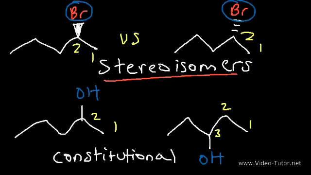

[【跳转到 02:05】](https://www.youtube.com/watch?v=XftIUcLWTEE&t=125)

### 2.2 换构型就是换分子：全部翻转才是对映体

视频给了一条非常实用的操作规则：**改变一个手性中心的构型，就得到一个不同的立体异构体；把所有手性中心的构型都翻转，才得到对映体。**

对只有一个手性中心的分子（如 2-溴丁烷），这条规则退化成一句话：翻它，就是它的对映体。对有两个手性中心的分子（视频用的是 2,3-二氯丁烷、2,3-丁二醇），就必须数清楚「翻了几个」。

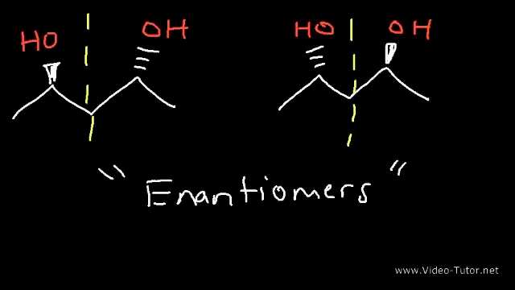

[【跳转到 02:30】](https://www.youtube.com/watch?v=XftIUcLWTEE&t=150)

## 三、非对映体：只翻了一部分手性中心

### 3.1 「部分翻转」是判定非对映体的关键

如果第一个手性中心保持原样、第二个翻转了，结果既不是原分子，也不是它的镜像，而是**非对映体**（diastereomer）。

讲者用一个记号把这件事说得更清楚：假设一个分子有三个手性中心，构型是 $R,R,R$。把它和 $R,S,R$ 相比——只有一个中心变了，这是非对映体；把它和 $S,S,S$ 相比——三个都变了，如果没有对称面，这才是一对对映体。所以判据可以写成一句口诀：**全变 = 对映体（前提是无对称面），部分变 = 非对映体。**

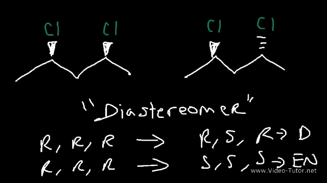

[【跳转到 03:20】](https://www.youtube.com/watch?v=XftIUcLWTEE&t=200)

### 3.2 顺反异构是非对映体的一个特例

顺反（cis/trans）异构常被当成独立的一类，但在这个框架里它是非对映体的子集。视频给的例子是一个环上的两个羟基：两个羟基同在环平面一侧是顺式，分居两侧是反式。它们连接完全相同，只是空间关系不同；而且只翻转了其中一个中心，所以是典型的非对映体。

讲者特意强调了两句话的方向性：**顺反异构体一定属于非对映体，但不是所有非对映体都是顺反异构体。** 双键两侧基团在同侧或异侧（如顺-2-丁烯与反-2-丁烯）也是同一个道理——连接没变，只是两侧基团的相对朝向变了。

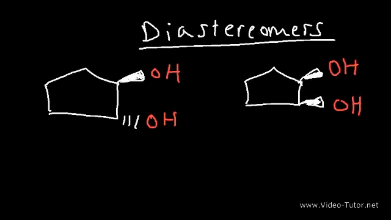

[【跳转到 07:05】](https://www.youtube.com/watch?v=XftIUcLWTEE&t=425)

## 四、内消旋体：全部翻转了，却还是同一个分子

### 4.1 对称面让「翻转」失效

最容易出错的一步在这里。视频给出一对分子：两个手性中心的构型都翻转了，按上一条口诀应该是对映体——但它们之间可以画出一个**对称面**（视频里那条竖直的虚线）。有对称面就意味着：把分子沿平面折过去，两半完全重合；也就是说，这两个「看起来不同」的画法其实是同一个分子。

这类分子叫**内消旋化合物**（meso compound）。它的特别之处在于：分子内部含手性中心，整体却不手性（achiral），因为它和自己的镜像可以重叠。

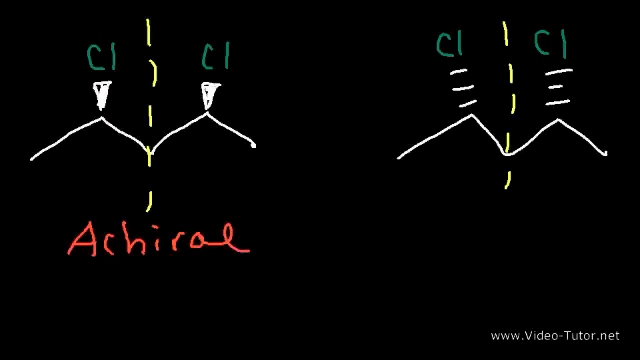

[【跳转到 04:35】](https://www.youtube.com/watch?v=XftIUcLWTEE&t=275)

### 4.2 把判据串成一个流程

视频在 06:15 处把前面所有情况压成一张判据表，这也是本文的中心思想：

1. **连接不同** → 构造异构体，到此为止。
2. **连接相同**，进入立体异构的判断。
3. **所有手性中心都翻转，且没有对称面** → 一对对映体。
4. **所有手性中心都翻转，但有对称面** → 内消旋体，两者是同一个分子。
5. **只有部分手性中心翻转** → 非对映体（顺反异构是其中一种）。

[【跳转到 06:15】](https://www.youtube.com/watch?v=XftIUcLWTEE&t=375)

## 五、三个容易看错的例子

判据本身不难，难在「有没有对称面」「这个碳到底是不是手性中心」需要真的去看结构。视频后半段用三道题专门练这个。

### 5.1 不是手性中心，就不必区分前后

第一个例子是环戊醇：一个画成羟基朝前，一个画成羟基朝后。看上去像一对对映体，但答案是**同一个分子**。原因是这个碳不是手性中心——顺着环往两边走，两条路径完全一样，等于有两个相同的基团，不满足「四个基团都不同」。既然不是手性中心，朝前朝后只是同一个分子的不同画法。

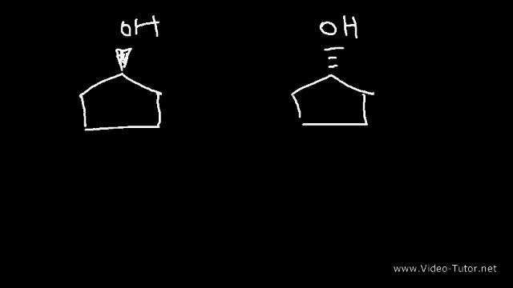

[【跳转到 08:20】](https://www.youtube.com/watch?v=XftIUcLWTEE&t=500)

### 5.2 连接不同，就不是立体异构

第二个例子：两个分子各有两个溴，一个在 1 号和 3 号碳上，另一个在 1 号和 2 号碳上。虽然也有「朝前/朝后」的画法差异，但溴的位置本身就不同——**连通性不同，属于构造异构体**，不该拿去讨论立体关系。

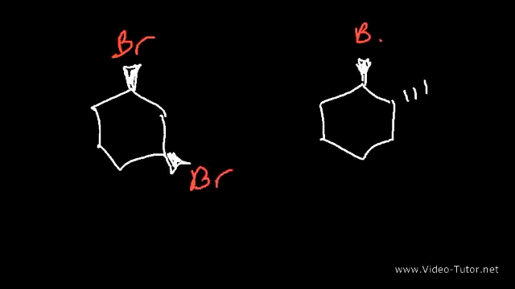

[【跳转到 09:10】](https://www.youtube.com/watch?v=XftIUcLWTEE&t=550)

### 5.3 有两个对称面的内消旋体

第三个例子中，两个分子的手性中心都翻转了，但两个分子各自都能画出对称面，因此答案同样是**内消旋体，两者是同一个分子**。这道题提醒的是：对称面不一定只有一条，判断时要找全。

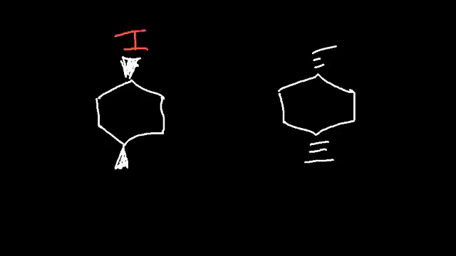

[【跳转到 10:00】](https://www.youtube.com/watch?v=XftIUcLWTEE&t=600)

## 六、这套判据在药物化学里意味着什么（补充）

视频本身只做分类，没有展开后果，这里补一句必要的衔接（属补充背景，非讲者原话）：对映体在连接上完全一致，所以它们的分子量、熔点、沸点、在普通有机溶剂里的溶解度几乎一样；但生物体内的酶和受体本身是手性环境，两个对映体与同一个结合口袋的贴合程度可以差出很多。换句话说，**「连接相同」只保证它们是同一张分子式，不保证它们在生物体系里做同一件事**。这条线索在下一篇《镜像分子的两副面孔》里用 L-葡萄糖和沙利度胺展开。

## 小结

- 判断两个结构的关系，先看连接、再看空间：连接不同是构造异构体，连接相同而空间不同才是立体异构体。
- 对映体的两个条件缺一不可：互为镜像，且无法重叠；把分子里所有手性中心都翻转，才可能得到对映体。
- 只翻转一部分手性中心，得到的是非对映体；顺反异构是非对映体的特例，不能反过来推。
- 全部翻转却存在对称面时，两个画法其实是同一个分子——这就是内消旋体，它含手性中心但整体不手性。
- 判断前先确认那个碳到底是不是手性中心：环上两条路径相同、或有两个相同基团时，朝前朝后只是画法差异。
- 对称面可能不止一条，找全才不会把同一个分子误判成一对对映体。

## 关键术语速查

| 术语 | 一句话解释 |
| --- | --- |
| 构造异构体 | 分子式相同但原子连接方式不同的化合物，如 2-丁醇与 3-丁醇 |
| 立体异构体 | 连接方式相同、原子在空间中的排布不同的化合物 |
| 手性中心 | 接有四个互不相同基团的碳原子，也叫立体中心 |
| 对映体 | 互为镜像且无法重叠的一对立体异构体 |
| 非对映体 | 连接相同，但只有部分手性中心构型不同的立体异构体 |
| 顺反异构 | 双键两侧或环上两个基团在同侧/异侧造成的非对映关系 |
| 内消旋体 | 含手性中心但存在对称面、可与自身镜像重叠的分子 |
| 对称面 | 把分子沿该平面折过去两半能重合的假想平面 |
| 实心/虚线楔形 | 表示键指向纸面外或纸面里的画法，用来表达空间朝向 |