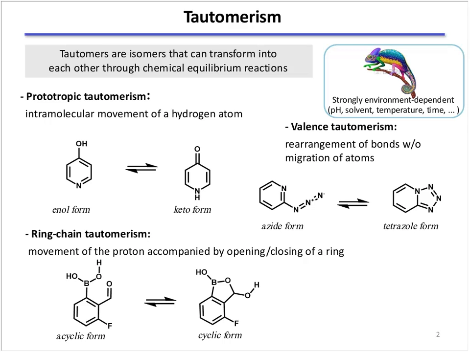
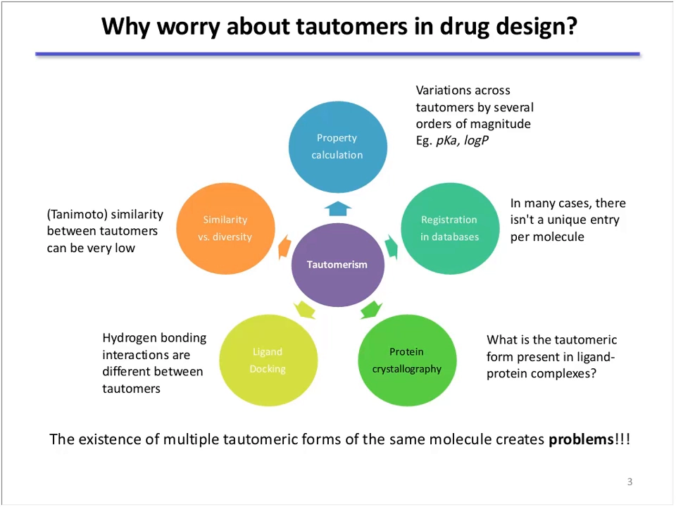
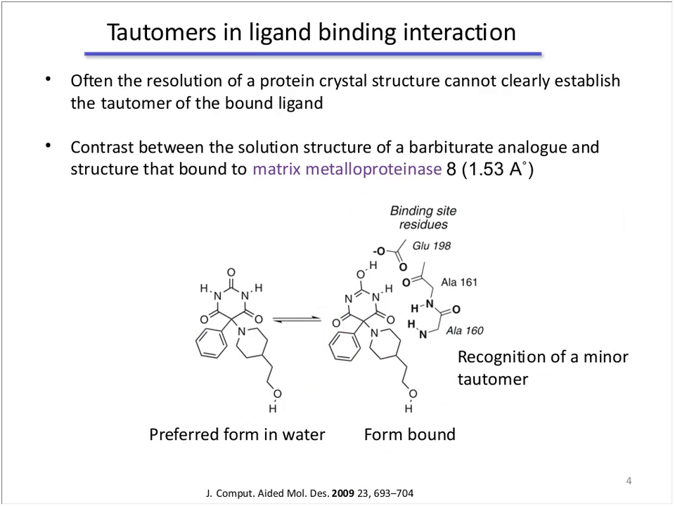
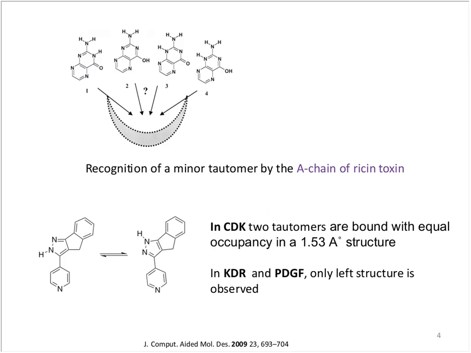
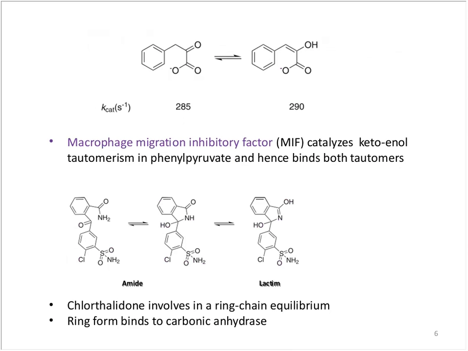
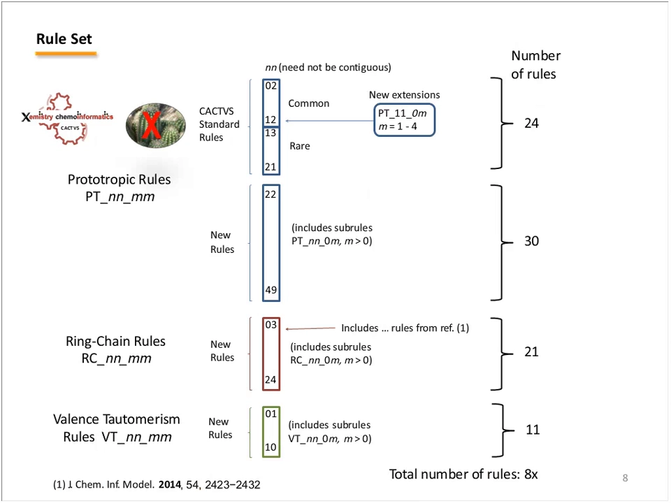
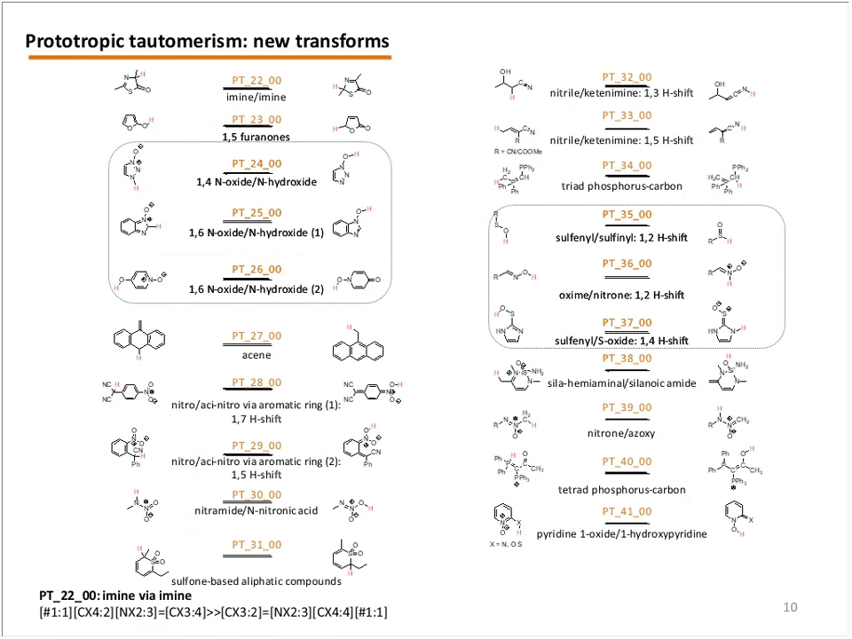
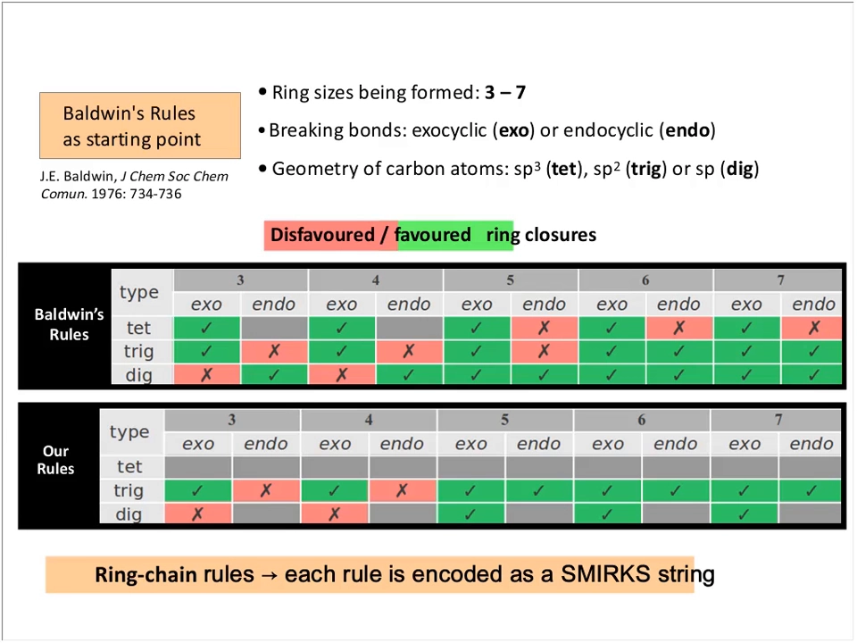
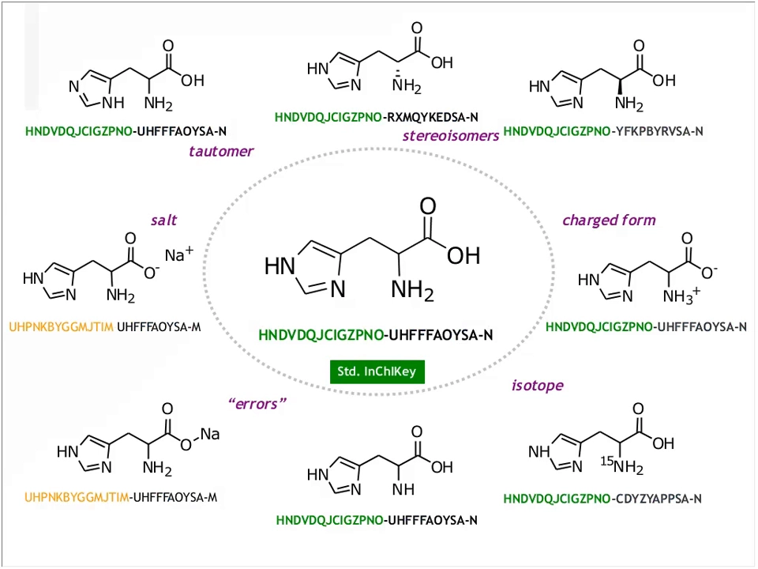

# 互变异构：质子挪一个位置，就是另一种物质

> 视频来源：[Handling of Tautomerism in small molecule chemical databases by Dr. Devendra Dhaked](https://www.youtube.com/watch?v=_vFenl1D7eY)（YouTube · 计算辅助药物设计国际虚拟会议报告，讲者 Devendra Dhaked，NIPER 加尔各答）｜时长约 44 分钟
> 导读：前两节分别讲了「质子化由 pH 决定」和「盐型是另一个化学实体」。这一节讲第三种形态问题：**同一个分子式、同一批原子，只把质子挪到另一个位置、顺带调整双键，就得到另一个合法结构**。这类结构叫互变异构体，它们能通过化学平衡互相转化。视频系统给出三种互变异构类型、五个「为什么必须管」的场景、四类枚举规则，以及同一分子在数据库里变成多条记录的原因。
> 说明：本视频是会议报告录像，自动字幕识别质量较差（大量术语被吞掉或错拼）。本文因此**以幻灯片画面为主要依据**，只在字幕可辨认处引用讲者的表述；凡属补充的背景，均单独标注。

## 本讲要解决的核心问题（SCQA）

**背景**：上一节已经确立：分子在样品里以哪种质子化形态存在，由 pH 与 $pK_a$ 共同决定；做成盐之后，它甚至成了另一个要报批的化学实体。也就是说，「一个化合物」在现实中很少只有一张面孔。

**冲突**：还有一类更麻烦的多面孔——**互变异构**。它不涉及加质子或去质子，也不涉及反离子，只是**分子内部把一个氢挪个位置、同时把单双键重排**。酮式和烯醇式、酰胺和亚胺酸、开链和成环，都是同一个分子式下的不同写法。问题是：这些写法在化学上都合法，性质却可以差出几个数量级；数据库会把它们记成不同条目，对接程序会算到不同的氢键模式，晶体结构甚至可能只抓住那个「水里并不占优」的形态。

**疑问**：互变异构到底有哪几种？它为什么会让性质计算、数据库登记、对接和晶体学同时出问题？有没有办法把「所有可能的形态」系统地列出来、并挑一个统一的代表？

**回答（中心思想）**：互变异构体是**能通过化学平衡互相转化的异构体**，分三类——**质子转移型（prototropic）**、**开链—成环型（ring-chain）**、**价键重排型（valence）**。它的存在让「一个分子一个答案」这件事失效，所以计算化学的做法是：**用规则系统枚举出所有互变异构体，再按能量与规则挑出标准形态**，并在登记、建模、写作时明确说明用的是哪一种。

## 一、定义与三种类型：质子怎么挪，环怎么开合

[【跳转到 02:05】](https://www.youtube.com/watch?v=_vFenl1D7eY&t=125)

幻灯片给的定义很干脆：**互变异构体（tautomers）是能通过化学平衡反应互相转化的异构体**。

三类分别是什么：

**① 质子转移型（prototropic tautomerism）**——分子内一个氢原子换位置。图上是最经典的例子：4-羟基吡啶（烯醇式）与 4-吡啶酮（酮式）之间的平衡。氢从氧上跑到氮上，双键随之重排。

**② 开链—成环型（ring-chain tautomerism）**——质子移动的同时伴随一个环的打开或关闭。图上的例子是一个含硼的酰基硼酸：开链式与成环式之间互变。

**③ 价键重排型（valence tautomerism）**——没有原子迁移，只是键的重新排布。图上的例子是 2-叠氮基吡啶与四唑并吡啶之间的平衡：叠氮基闭合成五元环。

幻灯片右上角还有一句很关键的注解，配了一只变色龙：互变异构**强烈依赖环境**——pH、溶剂、温度、时间都会改变平衡偏向哪一侧。这就是为什么「这个分子的互变异构体是哪个」这个问题，必须带上条件才能回答。

> 补充（非视频内容）：这正是互变异构与**共振**的分界。共振式之间只有电子的重新分布，原子核的位置完全不动，所以共振式不是不同的分子；互变异构则**真的移动了一个原子核（通常是氢）**，因此互变异构体是不同的物种，可以分离、可以有不同的性质。1.1.2 节讲过的共振，与这里的互变异构不是一回事。

## 二、为什么必须管：五个场景同时出问题

[【跳转到 03:03】](https://www.youtube.com/watch?v=_vFenl1D7eY&t=183)

幻灯片把「为什么药物设计要担心互变异构」画成五个方向，中心写着「互变异构」，最后一句是「同一分子存在多种互变异构形态会制造**问题**」。

| 场景 | 问题 |
| --- | --- |
| 性质计算 | 不同互变异构体之间，$pK_a$、$\log P$ 等性质可以差**几个数量级** |
| 数据库登记 | 很多情况下**每个分子并没有唯一一条记录** |
| 蛋白晶体学 | 结合在口袋里的到底是哪个互变异构体？ |
| 配体对接 | 不同互变异构体的**氢键相互作用不同** |
| 相似性与多样性 | 互变异构体之间的（Tanimoto）相似度可能**非常低** |

这张图值得逐条对上本节的主题：

- **性质计算**：你算 $\log P$ 用的是酮式还是烯醇式，结果可能不在一个量级上。上一节讲的 logD 也一样——形态选错，数值就错。
- **数据库登记**：同一化合物在库里出现多条记录，互变异构是原因之一（另一大原因是盐型，见上一节）。
- **晶体学与对接**：蛋白口袋会**选择**某个形态，而不是样品里最稳定的那个（下一节有实例）。
- **相似性**：如果两个互变异构体在指纹上相似度很低，去重、聚类、多样性挑选都会失真。

## 三、蛋白会挑那个「水里不占优」的形态

[【跳转到 03:49】](https://www.youtube.com/watch?v=_vFenl1D7eY&t=229)

这是本节最有说服力的一组例子。幻灯片先给出一条前提：**蛋白晶体结构的分辨率往往不足以明确判定配体是哪个互变异构体**。

第一个例子是一个巴比妥类（barbiturate）类似物与**基质金属蛋白酶 8（MMP-8）**的 1.53 Å 结构。左边是**水中优势形态**，右边是**实际结合的形态**——两者是互变异构体。也就是说，蛋白口袋通过氢键（图中标出 Glu 198、Ala 161、Ala 160 等残基）**稳定了那个在水中并不占优的形态**，于是晶体结构里看到的是「次要互变异构体」。

[【跳转到 03:49】](https://www.youtube.com/watch?v=_vFenl1D7eY&t=229)

第二组例子更能说明「同一个分子，不同蛋白给不同答案」：

- **蓖麻毒素（ricin toxin）A 链**：幻灯片上画了四个可能的互变异构体（编号 1–4），中间打了个问号——蛋白识别的是其中一个**次要**互变异构体；
- **CDK**：在 1.53 Å 结构中，**两种互变异构体以相同占据率**结合；
- **KDR 与 PDGF**：只观察到左边那一种结构。

这一组事实对建模的启示很直接：**「配体是哪个互变异构体」不是分子自己的属性，而是「分子 + 蛋白」的属性**。用单一形态去对接所有靶点，等于假设所有口袋都做同一个选择。

### 3.1 酶可以催化互变异构，并同时结合两种形态

[【跳转到 04:48】](https://www.youtube.com/watch?v=_vFenl1D7eY&t=288)

幻灯片还给了两个「互变异构被蛋白主动利用」的例子：

- **巨噬细胞移动抑制因子（MIF）**：它催化苯丙酮酸（phenylpyruvate）的**酮—烯醇互变**，$k_{cat}$ 对两种形态分别是 285 与 290 s⁻¹，并且**同时结合两种互变异构体**；
- **氯噻酮（chlorthalidone）**：在**酰胺（amide）与内酰亚胺（lactim）**之间形成开链—成环平衡，**成环形态**结合碳酸酐酶。

氯噻酮这一条尤其值得记住：它把本节三种类型里的第二种（开链—成环）与药物化学里常说的「酰胺—亚胺酸互变」连在了一起。酰胺的氮上氢挪到氧上、C=O 变 C–OH、C–N 变 C=N，就得到内酰亚胺（亚胺酸）形态——两者的氢键给体/受体完全对调。

> 补充（非视频内容）：杂环上的 NH/OH 互变（如吡啶酮/羟基吡啶、咪唑的 N–H 位置）都属于同一类质子转移型互变，也是药物数据库里最常见的「一条分子多条记录」来源之一。

## 四、把形态枚举出来：8 类规则、约 86 条变换

[【跳转到 05:08】](https://www.youtube.com/watch?v=_vFenl1D7eY&t=308)

既然形态这么多，靠人想是不可能穷尽的。讲者所在工作（用于 InChI 重新设计）的做法是**把互变异构写成规则系统**。

幻灯片把规则分成几组，命名方式很规整：

- **质子转移规则 PT_nn_mm**：其中一部分直接沿用 **CACTVS 标准规则**（编号 02、12、13、21），再加上新增扩展（PT_11_0m），共 **24 条**；
- **新增质子转移规则**：编号 22–49，含子规则 PT_nn_0m，共 **30 条**；
- **开链—成环规则 RC_nn_mm**：编号 03–24，共 **21 条**；
- **价键互变规则 VT_nn_mm**：编号 01–10，共 **11 条**。

合计 **8 类、约 86 条**变换。这个数量本身就说明：互变异构不是「酮—烯醇」一种，而是一整个家族。

### 4.1 看几条具体规则：从亚胺到 N-氧化物

[【跳转到 06:58】](https://www.youtube.com/watch?v=_vFenl1D7eY&t=418)

幻灯片逐条列出了新增的质子转移变换，每条都配了前后结构和规则编号：

举几个能看懂的：

- **PT_22_00 亚胺/亚胺（imine/imine）**：双键两侧的氮互换质子位置；
- **PT_24_00 / PT_25_00 / PT_26_00：N-氧化物 / N-羟基**，分别是 1,4、1,6、1,6 的氢迁移；
- **PT_27_00 吖烯（acene）**；
- **PT_28_00 / PT_29_00：硝基 / 酸式硝基（nitro/aci-nitro）**，经芳香环的 1,7 与 1,5 氢迁移；
- **PT_30_00 硝胺 / 硝基酸（nitramide/N-nitronic acid）**；
- **PT_31_00 吡啶 1-氧化物 / 1-羟基吡啶**；
- 右侧还有含磷、含硫的变换：**PT_34_00 三价磷—五价磷**、**PT_36_00 肟/硝酮**、**PT_37_00 亚磺酰/磺酰**。

幻灯片底部还贴了一条规则的实际写法（SMIRKS 字符串），说明这些规则是**可以被程序执行**的，不是给人看的示意。

> 补充（非视频内容）：这就是「互变异构枚举」的工程实现方式——把每条变换写成一个反应式的模式匹配，程序对分子逐条套用，直到不再产生新结构为止。枚举的规模会迅速膨胀，所以实际使用时要配合能量过滤与规则优先级。

### 4.2 开链—成环：把 Baldwin 规则改一改

[【跳转到 07:87】](https://www.youtube.com/watch?v=_vFenl1D7eY&t=487)

开链—成环型互变异构的枚举，需要一个「这个环能不能闭合」的判据。幻灯片说得很清楚：以 **Baldwin 规则**（1986 年提出，用于判断成环反应的可行性）为起点，再按自己的需要修改。

Baldwin 规则把成环反应按三个维度分类：**成环大小（3–7 元）**、**断裂的键是环外的 exo 还是环内的 endo**、**碳原子的几何（sp³ 四面体、sp² 三角、sp 直线）**。图上红绿格子就是「不利/有利」的判断。

下半部分是讲者工作里**修改后的规则表**：与 Baldwin 原表相比，有些格子被改动（例如 5 元环 trig/endo 从不利改为有利，4 元环 dig/exo 等）。幻灯片最后一句点明实现方式：**每条开链—成环规则都被编码成一个 SMIRKS 字符串**。

> 补充（非视频内容）：为什么要改？Baldwin 规则原本描述的是反应动力学上的成环倾向，而互变异构枚举关心的是「这个环状形态在能量上是否值得保留」。两者判据不同，所以表格要按枚举的需要调整。

## 五、同一分子，六种身份：形态不一致如何变成多条记录

[【跳转到 13:08】](https://www.youtube.com/watch?v=_vFenl1D7eY&t=788)

这是本节与「样品与建模输入一致性」最直接相关的一张幻灯片。中心是组氨酸（histidine）的一个形态，周围六个方向分别是它的**互变异构体、立体异构体、盐、带电形态、同位素标记物**，以及标注为「错误」的两种写法。

这张图把前三节的内容收在了一起：

- **互变异构体**（左上）：质子位置不同；
- **立体异构体**（上中）：手性中心构型不同（1.1.5 节的内容）；
- **盐**（左中）：带上了 Na⁺ 反离子（上一节的内容）；
- **带电形态**（右中）：羧酸根 + 铵正离子的两性离子形态（第一节 logD 的内容）；
- **同位素**（右下）：¹⁵N 标记；
- **错误**（下方两个）：结构本身画错了，却也被当成一条记录。

每一格下面都有一串标识符，而且**互不相同**。也就是说，同一个化学实体，只要形态不同，在数据库眼里就是不同的东西。讲者的原话（字幕可辨认部分）是：很多情况下**每个分子并没有唯一一条记录**。

> 补充（非视频内容）：标识符本身的分层编码与标准化算法属于 1.2.2 的内容，这里不展开。本节只需要记住结论：**形态不同 → 标识符不同 → 数据库里多条记录**，而其中一部分记录并不是「不同的物质」，只是同一物质的不同写法或错误写法。

## 六、这对「样品与建模输入一致」意味着什么

> 补充（非视频内容，属本节归纳）：把前三节合起来，可以整理成一张检查表。

| 问题 | 该问什么 | 出错后果 |
| --- | --- | --- |
| 质子化态 | 这个 pH 下是中性还是离子？ | logD、溶解度、跨膜判断全错 |
| 盐型 | 记录/称量的是游离型还是盐？ | 剂量差 20% 以上 |
| 互变异构 | 用的是酮式还是烯醇式？酰胺还是亚胺酸？ | $pK_a$、$\log P$、氢键模式差几个数量级 |
| 立体化学 | 手性中心是否定义？外消旋还是单一构型？ | 对接姿态与活性判断失真 |
| 同位素/标记 | 是否含标记原子？ | 分子量、代谢追踪对不上 |

对应的操作建议也只有三条：

1. **枚举而不是猜**：对每个分子枚举互变异构体与质子化态，用能量与规则筛掉不合理的；
2. **显式记录**：在数据库字段、建模输入文件、实验记录里写明「哪一种形态」，而不是只写分子名；
3. **比较前先标准化**：去盐、去重、统一互变异构形态，再算性质、再做相似性（上一节的「去盐」与这里的「统一互变异构」是同一类操作）。

## 小结

- **互变异构体是能通过化学平衡互变的异构体**，与共振不同：共振只动电子，互变异构**真的移动了一个原子核**。
- **三种类型**：质子转移型（酮—烯醇、N-氧化物/N-羟基、硝基/酸式硝基）、开链—成环型（开链式↔环式）、价键重排型（叠氮↔四唑）。
- **平衡强烈依赖环境**：pH、溶剂、温度、时间都会改变哪一侧占优，所以「哪个形态」必须带条件回答。
- **五个受害场景**：性质计算（差几个数量级）、数据库登记（没有唯一记录）、晶体学（结合的是哪个形态）、对接（氢键模式不同）、相似性（互变异构体之间相似度可能极低）。
- **蛋白会挑形态**：MMP-8 结合巴比妥类的次要互变异构体；CDK 中两种形态等占据，KDR/PDGF 只看到一种；MIF 甚至催化并同时结合两种；氯噻酮以成环的内酰亚胺形态结合碳酸酐酶。
- **工程做法是规则枚举**：8 类约 86 条变换（质子转移 24 + 新增 30 + 开链—成环 21 + 价键 11），每条编码成 SMIRKS；开链—成环以 Baldwin 规则为起点并加以修改。
- **同一分子有六种身份**：互变异构体、立体异构体、盐、带电形态、同位素、错误结构，标识符各不相同——这就是数据库里「一个分子多条记录」的来源。

## 关键术语速查

| 术语 | 一句话解释 |
| --- | --- |
| 互变异构（tautomerism） | 能通过化学平衡互相转化的异构现象，通常伴随一个氢原子的迁移 |
| 互变异构体（tautomer） | 互变异构平衡中的某一个具体形态，如酮式、烯醇式 |
| 质子转移型（prototropic） | 分子内氢原子换位置、单双键随之重排的互变 |
| 开链—成环型（ring-chain） | 质子迁移同时伴随环的打开或闭合的互变 |
| 价键重排型（valence） | 无原子迁移、仅键的重新排布导致的互变，如叠氮↔四唑 |
| 内酰亚胺（lactim） | 酰胺的亚胺酸式互变异构体，C=O 变 C–OH、C–N 变 C=N |
| SMIRKS | 用 SMILES 风格书写的反应模式字符串，可被程序执行 |
| 互变异构枚举 | 用规则系统生成一个分子的全部合理互变异构体 |
| Baldwin 规则 | 判断成环反应可行性的经验规则，按环大小、exo/endo、杂化方式分类 |
| Tanimoto 相似度 | 用分子指纹比较两个结构相似程度的指标，0 到 1 |
| 标准化（standardization） | 把结构统一到规范形态（去盐、去重、统一互变异构）的处理流程 |