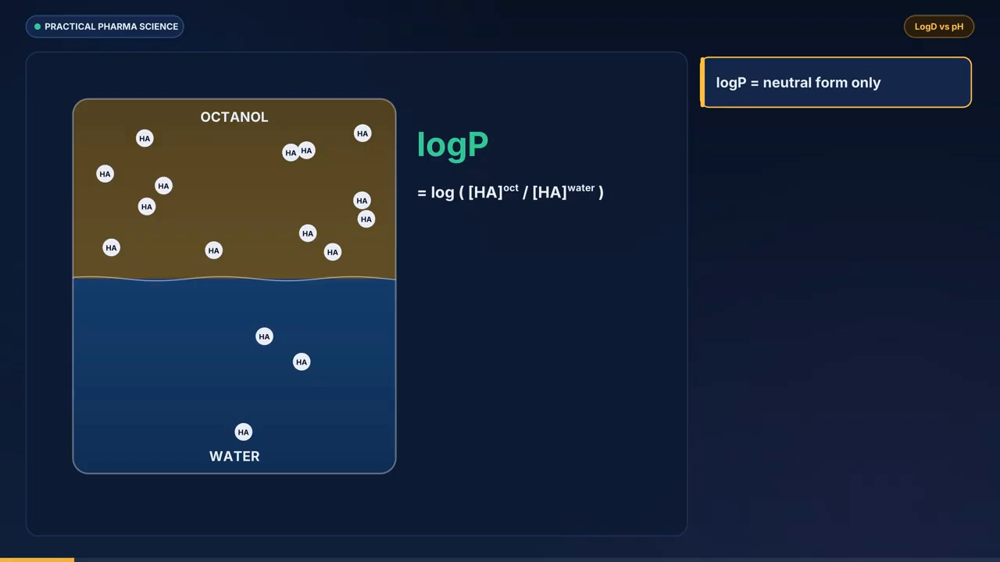
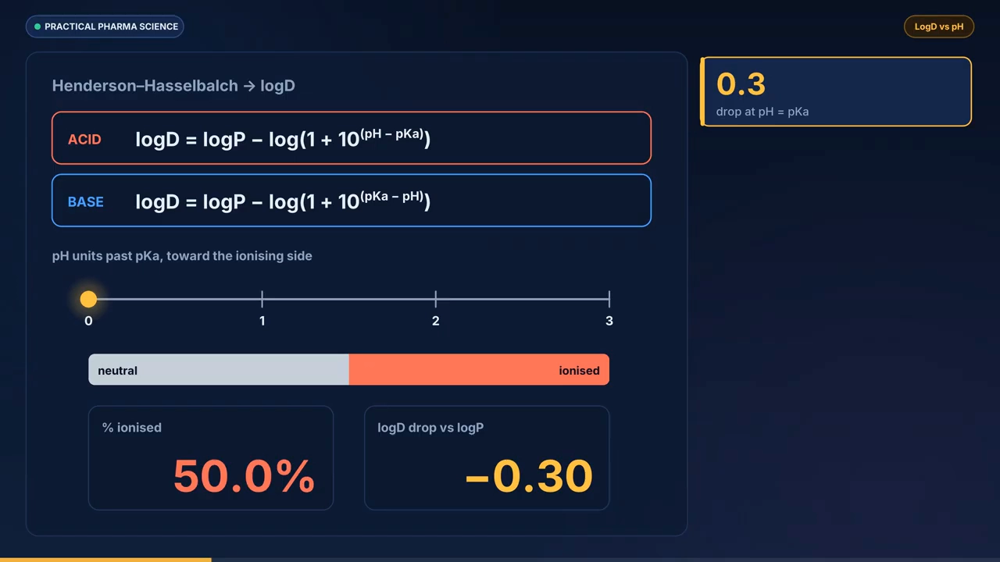
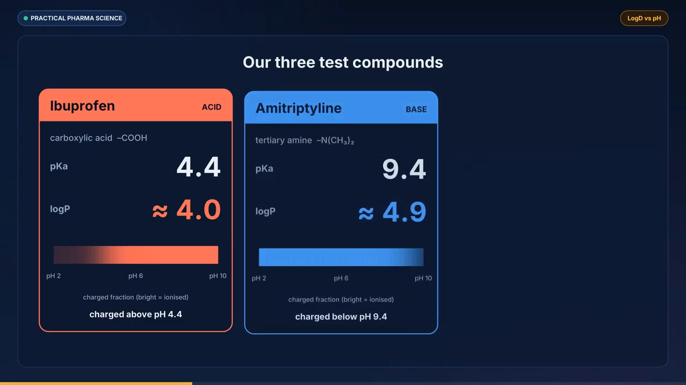
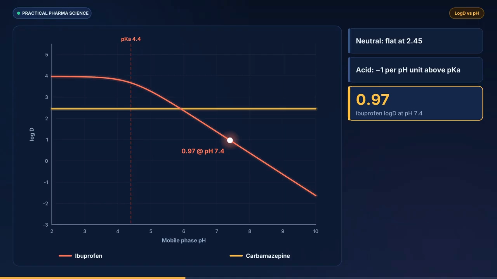
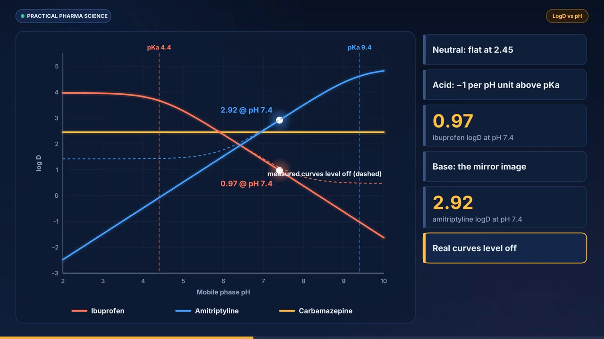
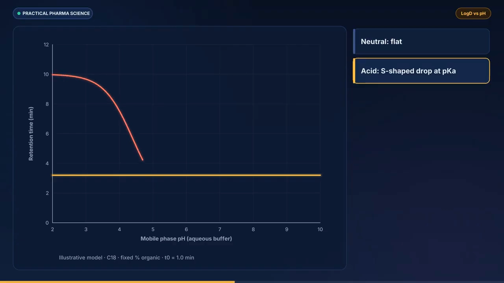
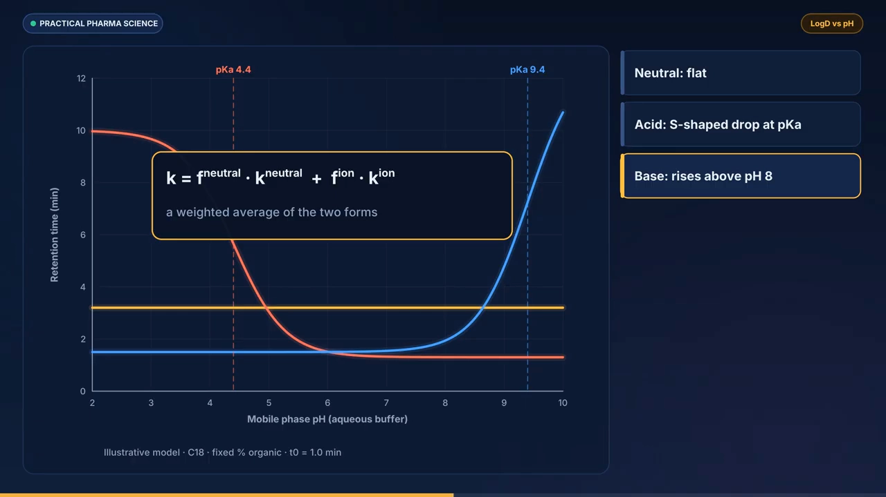
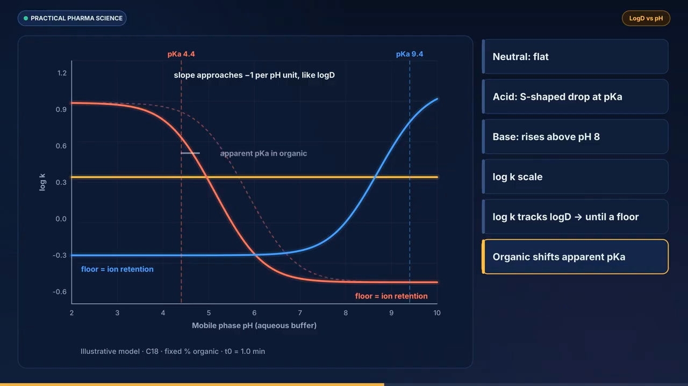
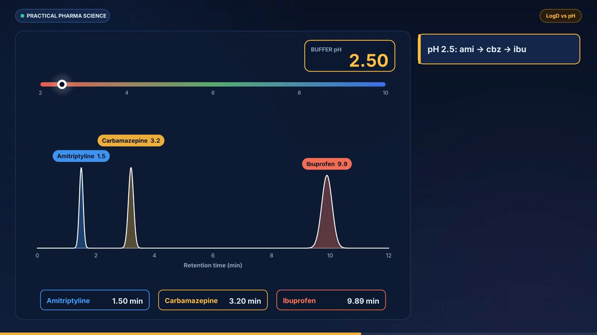
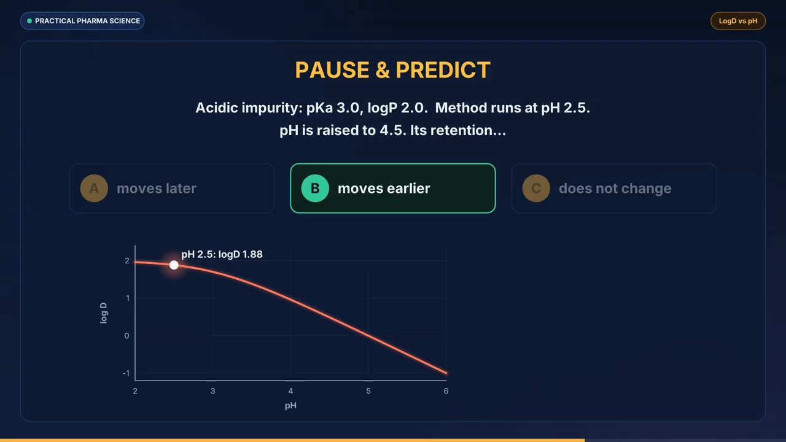

# 同一个分子，pH 一变就换了形态：logP 与 logD 的分工

> 视频来源：[LogD vs pH Explained: Why Your HPLC Retention Changes With Mobile Phase pH](https://www.youtube.com/watch?v=ZjnYpXGiocI)（YouTube · Practical Pharma Science）｜时长约 9 分钟
> 导读：上一节（1.1.4）解决了「哪个质子更容易掉」——用四条判据给 $pK_a$ 排序。这一节接着问下一句：**知道了 $pK_a$，样品里这个分子此刻到底是哪种形态？** 视频用三种药物（一个酸、一个碱、一个中性）在 pH 2 到 10 之间的 logD 曲线和色谱保留曲线，把「形态随 pH 变化」画成了一张可以查的图。本文按「形态 → 读数 → 后果」三层整理，末尾补一段与建模输入的关系。

## 本讲要解决的核心问题（SCQA）

**背景**：分子有酸碱性，$pK_a$ 是可查、可比的数，$pK_a$ 越小酸性越强。药物分子在溶液里往往同时存在中性和带电两种形态，两者的亲脂性天差地别。

**冲突**：但实验室里报出来的常常只有一个数——「这个化合物的 logP 是 4」。问题在于，**logP 只描述中性形态**，它根本不随 pH 变化；而真实样品（缓冲液、血浆、溶出介质、流动相）永远处在某个具体 pH 下，分子有相当一部分是带电的。同一个化合物，在 pH 2.5 和 pH 7.4 的样品里是两种不同的东西，用 logP 去描述后者的亲脂性，会差出好几个数量级。

**疑问**：既然形态随 pH 变，有没有一个量能描述「**这个 pH 下、这个样品里**的真实亲脂性」？它和 logP 是什么关系？形态变化又会在哪些读数上留下痕迹？

**回答（中心思想）**：有，就是 **logD（分布系数）**。logD 把该 pH 下**所有形态**（中性 + 带电）一起算进去，等于 logP 乘上「中性形态所占的分数」，因此它随 pH 变化、且在 $pH = pK_a$ 处只比 logP 低 0.3。掌握这一条，就能把「形态」这个看不见的东西，变成色谱保留、溶出、分配实验里可以读出来的位移。

## 一、logP 与 logD 的分工：一个只认中性形态，一个认全部形态

### 1.1 分配实验：把药物在油和水之间摇一摇

[【跳转到 00:35】](https://www.youtube.com/watch?v=ZjnYpXGiocI&t=35)

logP 和 logD 都来自同一个实验：把化合物放进**辛醇（油相）与水**的两相体系里振荡，等它分配平衡，再测两相中的浓度。辛醇被当作「细胞膜」的粗略替身，水被当作「水相环境」的替身。

**logP（分配系数，partition coefficient）** 定义为中性形态在两相中的浓度比取对数：

$$
\log P = \log_{10} \frac{[\mathrm{HA}]_{\text{octanol}}}{[\mathrm{HA}]_{\text{water}}}
$$

讲者特意强调：**logP 只描述一种物种——不带电的中性分子**，所以它是一个与 pH 无关的常数。它是分子「天生」的亲脂倾向。

### 1.2 logD：把带电形态也算进去

[【跳转到 01:05】](https://www.youtube.com/watch?v=ZjnYpXGiocI&t=65)

**logD（分布系数，distribution coefficient）** 才是「真实世界版本」：它把某个特定 pH 下分子的**所有形态**（中性的和带电的）一起计入总量。关键在于一句话——**带电的分子讨厌油相，它待在水里**。所以药物被离子化的比例越高，logD 就越低。

由此得到两者最实用的关系：

$$
\log D = \log P + \log_{10} f_{\text{neutral}}
$$

其中 $f_{\text{neutral}}$ 是该 pH 下中性形态所占的分数。当分子完全不电离时，$f_{\text{neutral}} = 1$，logD 与 logP 相等；一旦有电离，logD 必然低于 logP。

> 补充（非视频内容）：这个式子也解释了为什么数据库里同一个化合物会同时登记 logP 和多个 pH 下的 logD——前者是分子属性，后者是「分子 + 环境」的属性。引用任何一个数值之前，都要先问清楚它对应什么 pH、什么形态。

### 1.3 为什么这件事和色谱有关：反相色谱就是同一个分配实验

[【跳转到 01:05】](https://www.youtube.com/watch?v=ZjnYpXGiocI&t=65)

视频把辛醇换成 **C18 固定相**、把水换成**流动相**，指出反相色谱本质上就是同一个分配实验：**logD 越高，分子在固定相里待得越久，保留时间越长**。这一步很关键——它让「形态」从一个抽象概念，变成了色谱图上可以看见的峰位移动。

## 二、Henderson–Hasselbalch：把 pH 与 $pK_a$ 换算成形态比例

### 2.1 两个公式，酸和碱只差一个符号

[【跳转到 01:29】](https://www.youtube.com/watch?v=ZjnYpXGiocI&t=89)

logD 随 pH 变化的规律，直接由 Henderson–Hasselbalch 方程给出。视频写成两条：

$$
\log D_{\text{acid}} = \log P - \log_{10}\left(1 + 10^{\,pH - pK_a}\right)
$$

$$
\log D_{\text{base}} = \log P - \log_{10}\left(1 + 10^{\,pK_a - pH}\right)
$$

讲者说「代数式不必背，记住四个数就行」——这四句话其实是本节最该带走的东西：

| pH 相对 $pK_a$ 的位置 | 离子化比例 | logD 相对 logP |
| --- | --- | --- |
| $pH = pK_a$ | 50% | 低 0.3 |
| 向离子化一侧偏 1 个单位 | 约 90% | 低约 1 |
| 向离子化一侧偏 2 个单位 | 99% | 低约 2 |
| 再每偏 1 个单位 | 更彻底 | 再低 1 |

**每单位 pH 亲脂性降 10 倍**，这就是「斜率 −1」的含义。还要记住方向：**对酸，离子化的一侧是高 pH；对碱，是低 pH**。

### 2.2 三种药物，三条曲线

[【跳转到 02:19】](https://www.youtube.com/watch?v=ZjnYpXGiocI&t=139)

视频用三个化合物做对照，覆盖了三种典型情形：

| 化合物 | 类型 | $pK_a$ | logP | 在 pH 2–10 的行为 |
| --- | --- | --- | --- | --- |
| 布洛芬（ibuprofen） | 羧酸 | 约 4.4 | 约 4.0 | pH 高于 $pK_a$ 后带电 |
| 阿米替林（amitriptyline） | 叔胺碱 | 约 9.4 | 约 4.9 | pH 低于 $pK_a$ 时带电 |
| 卡马西平（carbamazepine） | 中性 | 无 | 约 2.5 | 全程不带电 |

讲者提醒：文献值在不同来源间略有出入，但这些都是典型值，够用来画趋势。

[【跳转到 02:56】](https://www.youtube.com/watch?v=ZjnYpXGiocI&t=176)

先看布洛芬这一条。低 pH 下它保持质子化（中性），logD 贴着 4.0；pH 越过 $pK_a$ 后开始离子化，logD **每单位 pH 下降 1**。到生理 pH 7.4 时已经降到约 1——差了三个数量级。

[【跳转到 03:21】](https://www.youtube.com/watch?v=ZjnYpXGiocI&t=201)

阿米替林是**镜像**：低 pH 下完全质子化，logD 深在 0 以下；随后每单位 pH 上升 1，pH 7.4 时约 2.9，要到 pH 10 以上才接近它完整的 logP。卡马西平则是一条 2.5 的水平线——**没有电荷，就没有变化**。

### 2.3 一个诚实的提醒：真实离子也会分配一点

[【跳转到 03:21】](https://www.youtube.com/watch?v=ZjnYpXGiocI&t=201)

上面两个公式是理想化的。视频补了一句：真实的离子仍会分配一点点，**常常以离子对的形式**，所以实测 logD 会在比 logP 低几个单位处**趋于平缓**，而不是一直往下掉。图中虚线就是这个「实测曲线触底」的效果。

> 补充（非视频内容）：这也是为什么 logD 的实测值依赖缓冲液种类与离子强度——离子对的形成会随反离子改变。引用文献 logD 时，条件（pH、缓冲液、方法）和数值一样重要。

## 三、形态变化在色谱上的三个痕迹

### 3.1 保留时间是两种形态的加权平均

[【跳转到 04:11】](https://www.youtube.com/watch?v=ZjnYpXGiocI&t=251)

把同样的三个化合物放到 C18 柱上、固定有机相比例、只扫 pH，得到的保留曲线是 **S 形**，而不是 logD 那样的直线斜率。为什么？讲者给的解释是：**保留是加权平均**——中性形态的分数乘以中性形态的保留，加上离子形态的分数乘以离子的保留。

$$
k = f_{\text{neutral}} \cdot k_{\text{neutral}} + f_{\text{ion}} \cdot k_{\text{ion}}
$$

[【跳转到 04:36】](https://www.youtube.com/watch?v=ZjnYpXGiocI&t=276)

换成 **log k** 坐标后，这条 S 曲线才开始像 logD：先平，然后朝「每单位 pH 下降 1」靠拢。讲者总结这条真正的联系：**当中性形态主导保留时，log k 跟着 logD 走；一旦离子自身那点小保留接管，曲线就触底**。

### 3.2 有机溶剂会让表观 $pK_a$ 偏移

[【跳转到 05:01】](https://www.youtube.com/watch?v=ZjnYpXGiocI&t=301)

一个容易被忽略的实操细节：你测的是**水相缓冲液**的 pH，但流动相里的有机溶剂会改变**表观 $pK_a$**。对酸，表观 $pK_a$ 通常升高半个单位以上；对胺碱，通常略微下降。所以真实的转折点会比水相值偏一点。

这条对建模同样成立：**在水里算出来的 $pK_a$ 不能直接搬到含有机溶剂、或蛋白口袋这种低介电环境里用**。

### 3.3 洗脱顺序会随 pH 完全反转

[【跳转到 05:26】](https://www.youtube.com/watch?v=ZjnYpXGiocI&t=326)

把 pH 从 2 扫到 10 看色谱图：pH 2.5 时阿米替林先出（1.50 min），然后卡马西平（3.20 min），布洛芬最后（9.89 min）。

到 pH 7 时，两个离子化的药物都冲向死体积，布洛芬和阿米替林彼此相差不到半分钟——**这是这个混合物最糟糕的位置**。到 pH 10，洗脱顺序完全反转。

### 3.4 最危险的位置：$pK_a$ 附近 ±1.5 个单位

[【跳转到 05:51】](https://www.youtube.com/watch?v=ZjnYpXGiocI&t=351)

再仔细看 pH 4.4，正好压在布洛芬的 $pK_a$ 上：pH 只变 0.1，保留就移动约 10%；而在 pH 2.5 时，同样 0.1 的变化只移动不到半个百分点。讲者的结论是：**一个方法最危险的位置，是落在某个分析物 $pK_a$ 上下约 1.5 个单位之内**。

道理和第 2.1 节的表是同一件事：在 $pK_a$ 附近，形态比例对 pH 最敏感（斜率最大）；离得越远，形态越「锁死」。

## 四、把规律用起来：一个预测题与四条实验台规则

### 4.1 预测题：pH 从 2.5 提到 4.5，酸性杂质会怎样

[【跳转到 06:16】](https://www.youtube.com/watch?v=ZjnYpXGiocI&t=376)

视频给了一个小练习：新发现一个酸性杂质，$pK_a = 3.0$、logP = 2.0，方法原本跑在 pH 2.5，同事把 pH 提到 4.5，它的保留会怎样？

答案是**提前流出**。pH 2.5 时它四分之三是中性，logD 约 1.9；到 pH 4.5，它比 $pK_a$ 高了一个半单位，约 97% 离子化，logD 掉到约 0.5——**亲脂性低了 25 倍**，于是可能和早流出的某个峰共洗脱。

这道题的价值在于：它只需要 $pK_a$、logP 和 pH 三个数，就能预测一个「形态变化导致读数变化」的后果，不需要做实验。

### 4.2 四条实验台规则

[【跳转到 07:06】](https://www.youtube.com/watch?v=ZjnYpXGiocI&t=426)

1. **选 pH 之前，查清每个分析物（包括已知杂质）的 $pK_a$ 和 logP**；
2. **把 pH 设在离每个 $pK_a$ 至少两个单位的位置**，此时每个化合物 99% 处于单一形态，保留稳健；
3. **把 pH 当选择性工具**：中性化合物不动，酸和碱朝相反方向移动；两个峰共洗脱时，改 pH 就能把它们拉开；
4. **尊重系统极限**：缓冲液在自己 $pK_a$ 上下一个单位内最有效；经典硅胶柱通常标称 pH 2–8，超过就要用杂化柱或耐高 pH 的柱子。

[【跳转到 07:31】](https://www.youtube.com/watch?v=ZjnYpXGiocI&t=451)

对本例的混合物，pH 2.5 的磷酸盐缓冲是稳健选择：布洛芬完全中性、保留良好；卡马西平不受影响；阿米替林完全质子化、早早流出，所以梯度起始有机相可以低一些。若想让阿米替林强保留，用杂化柱跑高 pH 也行，但 pH 10 只比它的 $pK_a$ 高 0.6，那里的保留对微小 pH 误差仍然敏感。

## 五、这条规律对「样品与建模输入一致」意味着什么

视频本身是色谱方法开发的视角，但它给出的机制可以直接搬到本节的主题上：**同一个化合物，只要 pH 或溶剂环境不同，就是不同的形态；形态不同，读数就不同。**

> 补充（非视频内容，属本节归纳）：把上面的机制整理成三条检查项，用于核对「样品里的形态」与「模型输入的形态」是否一致。

**第一，报数值时必须带上 pH。** logP 是分子属性，logD 是「分子 + pH」的属性。数据库里同一个化合物出现 logD 7.4、logD 6.5 等多个值，不是数据打架，而是条件不同。引用前先看条件，否则会把「pH 7.4 下 logD 1.0 的布洛芬」和「logP 4.0 的布洛芬」当成两个化合物。

**第二，建模输入必须显式指定质子化态。** 对接、描述符计算、pKa 预测都要吃一个具体的结构：是中性羧酸还是羧酸根？是游离碱还是质子化的铵？视频的曲线说明，这两种形态的亲脂性可以差 3–4 个 log 单位，静电性质更是完全不同。用中性形态去对接一个在生理 pH 下 99% 电离的酸，等于换了个分子在算。

**第三，环境会移动 $pK_a$。** 表观 $pK_a$ 在含有机溶剂、低介电环境（蛋白口袋）里会偏移，所以「水相 $pK_a$」只是起点。这也是为什么同一化合物在不同来源的数据库里，$pK_a$ 会有一两个十分之一的出入。

## 小结

- **logP 只认中性形态**，与 pH 无关；**logD 认全部形态**，随 pH 变化。两者关系是 $\log D = \log P + \log f_{\text{neutral}}$。
- **Henderson–Hasselbalch 给出四个关键数**：$pH = pK_a$ 时一半电离、logD 低 0.3；向离子化一侧每偏 1 个单位，logD 再低 1（亲脂性降 10 倍）。
- **方向别记反**：酸的离子化侧是高 pH，碱的离子化侧是低 pH；中性分子全程不变。
- **色谱保留是两种形态的加权平均**，所以曲线是 S 形；换成 log k 后才接近 logD 的斜率。
- **最危险的位置是 $pK_a$ 上下约 1.5 个单位**：那里形态比例对 pH 最敏感，0.1 个 pH 单位就能让保留移动 10%。
- **实测 logD 会在低处趋于平缓**（离子对分配），不会一直往下掉；引用数值要连条件一起引用。

## 关键术语速查

| 术语 | 一句话解释 |
| --- | --- |
| 分配系数 logP | 中性形态在辛醇/水两相中的浓度比取对数，与 pH 无关 |
| 分布系数 logD | 某 pH 下所有形态（中性 + 带电）的总浓度比取对数，随 pH 变化 |
| 中性分数 $f_{\text{neutral}}$ | 该 pH 下未电离形态所占比例，$\log D = \log P + \log f_{\text{neutral}}$ |
| Henderson–Hasselbalch 方程 | 把 pH、$pK_a$ 与酸/碱的离子化比例联系起来的方程 |
| 表观 $pK_a$ | 在含有机溶剂或非水环境中测到的 $pK_a$，与水中值有偏移 |
| 保留因子 k | 溶质在固定相与流动相中的量比，是中性形态与离子形态保留的加权平均 |
| 离子对 | 带电药物与反离子结合成的中性缔合物，是离子仍能少量分配进油相的原因 |
| 死体积（void） | 色谱柱中不被固定相保留的部分，完全亲水的组分在此流出 |